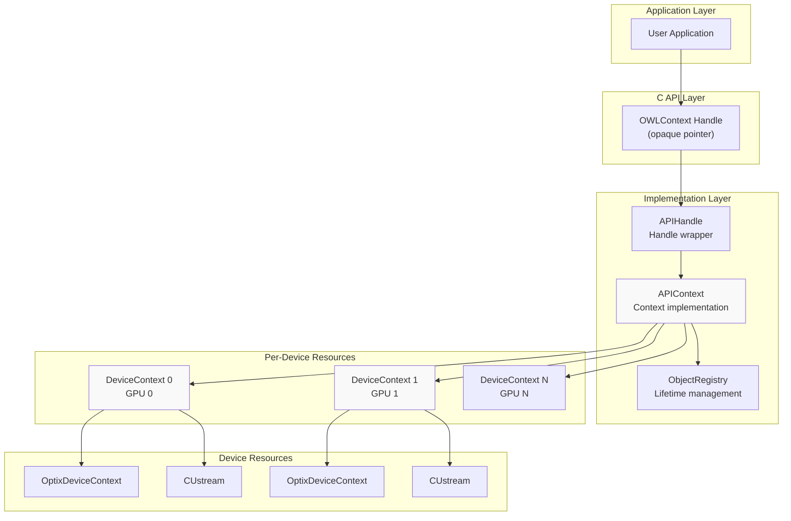
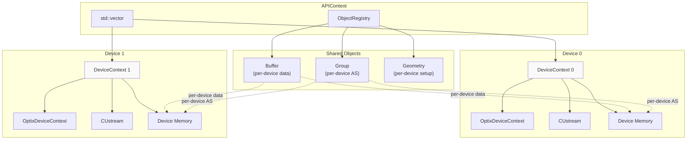
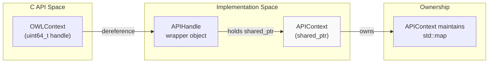
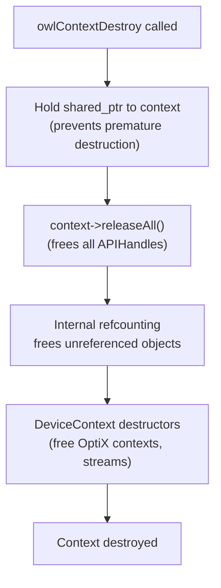

<!-- source: DeepWiki mcp.deepwiki.com · repo NVIDIA/OWL · page 3.1 Context and Device Management · fetched 2026-10-26 -->

# Context and Device Management

<details>
<summary>Relevant source files</summary>

The following files were used as context for generating this wiki page:

- [include/owl/owl_host.h](include/owl/owl_host.h)
- [owl/APIHandle.h](owl/APIHandle.h)
- [owl/impl.cpp](owl/impl.cpp)

</details>


This document describes OWL's context and device management system, which provides the foundation for all ray tracing operations. An `OWLContext` serves as the root container that coordinates multi-GPU execution, manages object lifetimes, and maintains per-device OptiX and CUDA resources.

For information about creating programs and modules within a context, see [Programs and Modules](#3.5). For details on launching ray tracing operations, see [Launch Operations](#3.7).

## Purpose and Architecture

The `OWLContext` is the first object created in any OWL application and the last to be destroyed. It encapsulates:

- **Device selection and management** for single-GPU or multi-GPU configurations
- **Per-device OptiX contexts** and CUDA streams
- **Object registry** for lifetime management of all OWL objects (buffers, geometries, groups, programs)
- **Global pipeline configuration** (ray types, instancing depth, motion blur, etc.)



**Diagram: OWL Context Architecture and Device Management**

Sources: [include/owl/owl_host.h:310-361](), [owl/APIHandle.h:10-40](), [owl/impl.cpp:44-60]()

## Context Creation

### Basic Context Creation

The `owlContextCreate()` function initializes a context with GPU device selection:

```c
OWLContext owlContextCreate(int32_t *requestedDeviceIDs,
                            int numDevices);
```

**Device Selection Rules:**

| `requestedDeviceIDs` | `numDevices` | Behavior |
|---------------------|-------------|----------|
| `nullptr` | `0` or `<0` | Use all available GPUs |
| `nullptr` | `1` | Use GPU 0 only |
| `nullptr` | `N > 1` | Use first N GPUs (0, 1, ..., N-1) |
| `int[] {2,5}` | `2` | Use specific GPUs with CUDA ordinals 2 and 5 |

**Example Usage:**

```c
// Single GPU (device 0)
OWLContext ctx = owlContextCreate(nullptr, 1);

// All available GPUs
OWLContext ctx = owlContextCreate(nullptr, 0);

// Specific GPU subset
int32_t devices[] = {0, 2};
OWLContext ctx = owlContextCreate(devices, 2);
```

**Important:** Once created, device indices are remapped to OWL's internal numbering (0 to N-1). A context created with `devices={2,5}` will refer to them as device 0 and device 1 in all subsequent API calls.

Sources: [include/owl/owl_host.h:340-361](), [owl/impl.cpp:44-52]()

### Device Count Querying

```c
int32_t owlGetDeviceCount(OWLContext context);
```

Returns the number of devices in the context (not the number of devices in the system).

Sources: [include/owl/owl_host.h:336-338](), [owl/impl.cpp:317-322]()

## Context Configuration

Configuration functions modify global pipeline settings and **must be called before** `owlBuildPrograms()`, `owlBuildPipeline()`, or creating geometries. Changing these settings after pipeline construction results in undefined behavior.

### Ray Type Configuration

```c
void owlContextSetRayTypeCount(OWLContext context, size_t numRayTypes);
```

Sets the number of ray types used by the application. Each ray type can have separate miss programs and per-geometry hit programs. Default is 1.

**Example:** A path tracer might use 2 ray types—one for camera rays, one for shadow rays.

Sources: [include/owl/owl_host.h:394-396](), [owl/impl.cpp:89-95]()

### Payload and Attribute Configuration

```c
void owlContextSetNumPayloadValues(OWLContext context, 
                                   size_t numRayPayloadValues);

void owlContextSetNumAttributeValues(OWLContext context, 
                                     size_t numAttributeValues);
```

- **Payload Values:** Number of 32-bit registers passed through ray tracing calls as payload (default: depends on OptiX version, typically 32)
- **Attribute Values:** Number of 32-bit registers passed from intersection programs to hit programs (default: 2, sufficient for triangle barycentric coordinates)

Reducing these values can improve occupancy on the GPU. Increasing beyond defaults requires OptiX 7.2+.

Sources: [include/owl/owl_host.h:398-409](), [owl/impl.cpp:97-109]()

### Instancing Depth

```c
void owlSetMaxInstancingDepth(OWLContext context, 
                              int32_t maxInstanceDepth);
```

Configures the maximum nesting level of instance groups:

| Value | Meaning | Hardware Acceleration |
|-------|---------|----------------------|
| `1` | Two-level scene (BLAS + single IAS layer) | Full |
| `2+` | Multi-level instancing (nested IAS) | Partial (software traversal) |

**Default:** 1 (recommended). Values > 1 incur performance penalties.

Sources: [include/owl/owl_host.h:422-446](), [owl/impl.cpp:156-162]()

### Feature Enablement

```c
void owlEnableMotionBlur(OWLContext context);
void owlEnableCurves(OWLContext context);
void owlEnableSpheres(OWLContext context);
```

Enables optional OptiX features. **Must be called before pipeline construction.**

- **Motion Blur:** Enables time-varying transforms and geometry (2 keyframes: t=0 and t=1)
- **Curves:** Enables curve geometry primitives (requires OptiX 7.4+)
- **Spheres:** Enables sphere geometry primitives (requires OptiX 7.5+)

**Ordering Requirement:** If using both motion blur and curves/spheres, enable motion blur first.

Sources: [include/owl/owl_host.h:362-382](), [owl/impl.cpp:165-191]()

### SBT Record Configuration

```c
void owlContextDisablePerGeometrySBTRecords(OWLContext context);
```

By default, OWL creates separate Shader Binding Table (SBT) records for each geometry in a geometry group, allowing per-geometry variables. Disabling this optimization shares a single SBT record across all geometries in a BLAS, enabling:

- **Device-side SBT offset calculations** for interactive manipulation of millions of instances
- **Instance programs** (see [Groups and Acceleration Structures](#3.4))

Calculating offsets becomes: `baseIndex + blasIndex * numRayTypes` instead of `baseIndex + (geomIndexInBLAS) * numRayTypes`.

Sources: [include/owl/owl_host.h:383-389](), [owl/impl.cpp:173-177]()

### Bound Launch Parameters

```c
void owlContextSetBoundLaunchParamValues(
    OWLContext context,
    const OWLBoundValueDecl *boundValues,
    int numBoundValues);
```

Specifies launch parameter values to be baked into module compilation (OptiX 7.2+). This is an advanced optimization that allows OptiX to specialize kernels for specific launch parameter values, ignoring them at runtime.

Sources: [include/owl/owl_host.h:411-420](), [owl/impl.cpp:112-134]()

## Device Management

### Per-Device Resource Access

OWL maintains separate OptiX contexts and CUDA streams for each device:

```c
cudaStream_t owlContextGetStream(OWLContext context, int deviceID);
OptixDeviceContext owlContextGetOptixContext(OWLContext context, int deviceID);
```

**Use Cases:**
- **Custom CUDA operations** requiring stream synchronization
- **OptiX interop** for direct API calls (advanced users)
- **Stream-ordered operations** for asynchronous launches

**Example:**

```c
// Synchronize with OWL's internal stream
cudaStream_t stream = owlContextGetStream(context, 0);
cudaStreamSynchronize(stream);

// Direct OptiX API access
OptixDeviceContext optixContext = owlContextGetOptixContext(context, 0);
// Use optixContext for low-level OptiX calls...
```

Sources: [include/owl/owl_host.h:448-454](), [owl/impl.cpp:71-84]()

### Multi-GPU Coordination



**Diagram: Multi-GPU Resource Distribution**

OWL automatically replicates data and acceleration structures across all devices in the context. Each `owlBufferCreate()` allocates memory on all devices; each `owlGroupBuildAccel()` builds acceleration structures on all devices.

**Data Distribution Strategies:**

| Buffer Type | Distribution | Use Case |
|-------------|-------------|----------|
| Device Buffer | Replicated copy per GPU | Read-only scene data, textures |
| Host-Pinned Buffer | Single shared allocation | Render targets, frame buffers |
| Managed Memory | CUDA unified memory | Small datasets, convenience |
| User Buffer | User-provided per-device pointers | Custom memory management |

Sources: [include/owl/owl_host.h:736-780]()

## Handle System and Object Lifetime

### Handle-Based API

OWL uses an opaque handle system to manage object lifetimes and enable C API compatibility:



**Diagram: Handle System Architecture**

**Key Properties:**
- Handles are opaque 64-bit pointers to `APIHandle` wrapper objects
- `APIHandle` holds a `shared_ptr` to the actual object
- `APIContext` maintains a registry of all handles it creates
- Reference counting ensures objects live until last reference is released

Sources: [owl/APIHandle.h:23-40]()

### Object Lifetime Management

```c
// All OWL objects provide release functions
void owlBufferRelease(OWLBuffer buffer);
void owlGroupRelease(OWLGroup group);
void owlRayGenRelease(OWLRayGen rayGen);
void owlVariableRelease(OWLVariable variable);
// etc.
```

**Lifetime Rules:**

1. **Creation** returns a handle with reference count 1
2. **Release** decrements reference count; if 0, frees the handle
3. **Internal references** may keep objects alive (e.g., geometries referenced by groups)
4. **Context destruction** releases all handles, then releases internal references

**Example:**

```c
OWLBuffer buffer = owlDeviceBufferCreate(context, OWL_FLOAT3, 1000, nullptr);
// buffer refcount = 1

owlGeomSetBuffer(geom, "vertices", buffer);
// buffer refcount = 2 (handle + geometry reference)

owlBufferRelease(buffer);
// buffer refcount = 1 (handle released, geometry still references it)
// Buffer memory remains valid because geometry holds a reference

owlGeomRelease(geom);
// buffer refcount = 0, buffer memory freed
```

Sources: [owl/impl.cpp:1048-1092]()

## Context Destruction

```c
void owlContextDestroy(OWLContext context);
```

Destroys the context and releases all resources:

1. **Releases all handles** in the context's registry
2. **Decrements internal references** to all objects
3. **Frees objects** with zero remaining references
4. **Destroys per-device resources** (OptiX contexts, CUDA streams)
5. **Invalidates the context handle**

**Order of Operations:**



**Diagram: Context Destruction Sequence**

**Important:** After `owlContextDestroy()`, all handles derived from that context (buffers, geometries, groups, etc.) are invalid and must not be used.

Sources: [include/owl/owl_host.h:359-360](), [owl/impl.cpp:657-664]()

## Configuration Summary

The following table summarizes all context configuration functions and their constraints:

| Function | Purpose | Must Call Before | Default Value |
|----------|---------|------------------|---------------|
| `owlContextSetRayTypeCount` | Set number of ray types | Pipeline build | 1 |
| `owlContextSetNumPayloadValues` | Set ray payload size | Pipeline build | OptiX default (~32) |
| `owlContextSetNumAttributeValues` | Set intersection attribute size | Pipeline build | 2 |
| `owlSetMaxInstancingDepth` | Set max IAS nesting | Pipeline build | 1 |
| `owlEnableMotionBlur` | Enable motion blur | Pipeline build, geometry creation | Disabled |
| `owlEnableCurves` | Enable curve primitives | Pipeline build | Disabled |
| `owlEnableSpheres` | Enable sphere primitives | Pipeline build | Disabled |
| `owlContextDisablePerGeometrySBTRecords` | Optimize SBT for many instances | Pipeline build | Enabled |
| `owlContextSetBoundLaunchParamValues` | Bind launch params for compilation | Module creation | None |

Sources: [include/owl/owl_host.h:86-446](), [owl/impl.cpp:89-191]()

## Complete Context Lifecycle Example

```c
// 1. Create context with 2 GPUs
int32_t devices[] = {0, 1};
OWLContext context = owlContextCreate(devices, 2);

// 2. Configure before building
owlContextSetRayTypeCount(context, 2);  // Primary + shadow rays
owlEnableMotionBlur(context);
owlSetMaxInstancingDepth(context, 1);   // Two-level scene

// 3. Create modules, programs, geometries...
OWLModule module = owlModuleCreate(context, ptxCode);
OWLRayGen rayGen = owlRayGenCreate(context, module, "rayGen", ...);
// ...

// 4. Build pipeline
owlBuildPrograms(context);
owlBuildPipeline(context);
owlBuildSBT(context);

// 5. Launch ray tracing
owlLaunch2D(rayGen, width, height, launchParams);

// 6. Cleanup
owlContextDestroy(context);  // Frees all resources
```

Sources: [include/owl/owl_host.h:331-450](), [owl/impl.cpp:44-212]()

---

