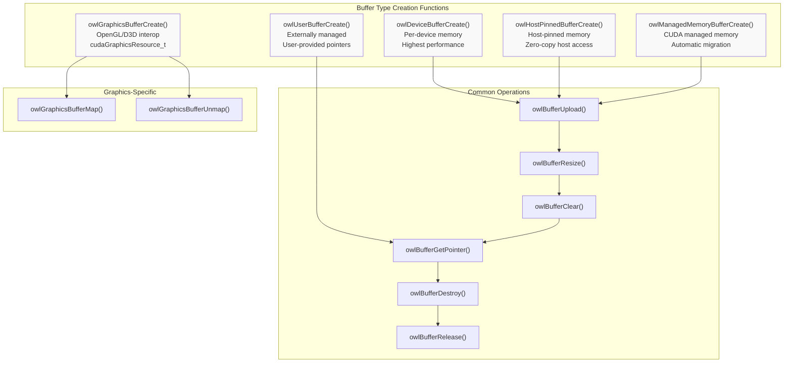
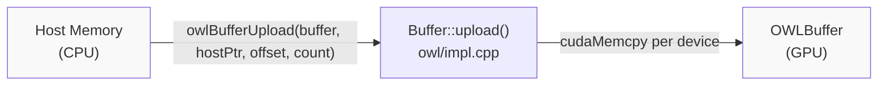
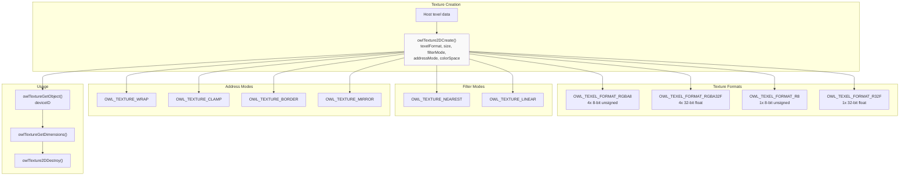
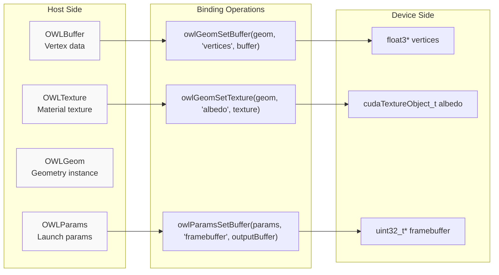
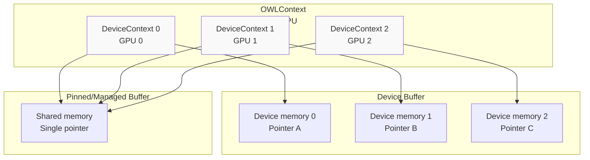
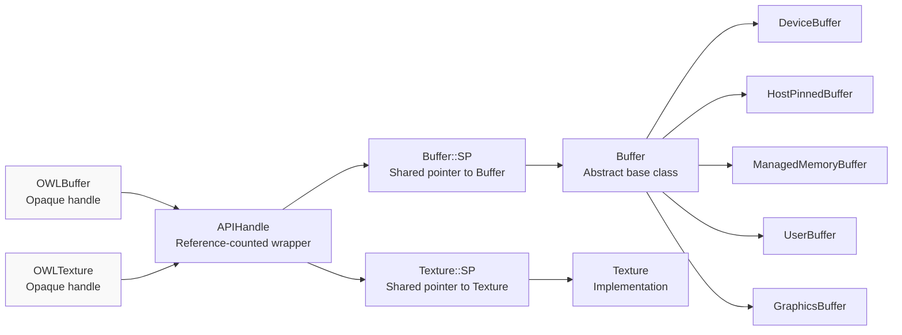

<!-- source: DeepWiki mcp.deepwiki.com · repo NVIDIA/OWL · page 3.2 Buffers and Textures · fetched 2026-10-26 -->

# Buffers and Textures

<details>
<summary>Relevant source files</summary>

The following files were used as context for generating this wiki page:

- [include/owl/owl_host.h](include/owl/owl_host.h)
- [owl/impl.cpp](owl/impl.cpp)

</details>


This page documents OWL's buffer and texture management system, covering memory allocation strategies, data types, upload operations, and integration with the ray tracing pipeline. Buffers store geometry data, indices, and other per-primitive information, while textures provide 2D sampled data for shading. For information about using buffers and textures within geometry or programs, see [Variable System](#3.6). For geometry-specific data configuration, see [Geometry Types and Instances](#3.3).

## Buffer Types

OWL provides five distinct buffer types, each optimized for different usage patterns and memory accessibility requirements:



**Sources:** [include/owl/owl_host.h:668-840]()

### Device Buffers

Device buffers allocate separate memory on each GPU in the context. This is the most common buffer type for geometry data that does not require host access during rendering.

**API Function:**
```c
OWLBuffer owlDeviceBufferCreate(OWLContext context,
                                OWLDataType type,
                                size_t count,
                                const void *init);
```

**Parameters:**
- `context`: The OWL context
- `type`: Data type from `OWLDataType` enum (e.g., `OWL_FLOAT3`, `OWL_INT`, `OWL_USER_TYPE(MyStruct)`)
- `count`: Number of elements
- `init`: Optional host data to initialize buffer (can be `nullptr`)

**Use Cases:**
- Triangle vertex positions and normals
- Index buffers
- Per-primitive data that changes infrequently

**Sources:** [include/owl/owl_host.h:668-679](), [owl/impl.cpp:668-679]()

### Host-Pinned Buffers

Host-pinned buffers use CUDA pinned memory, accessible from both host and all GPUs without explicit copies. Memory is allocated once and shared across devices.

**API Function:**
```c
OWLBuffer owlHostPinnedBufferCreate(OWLContext context,
                                    OWLDataType type,
                                    size_t count);
```

**Use Cases:**
- Frequently updated data (e.g., camera parameters, per-frame state)
- Output buffers for readback
- Staging buffers for incremental uploads

**Performance Note:** While convenient, pinned memory transfers may be slower than device-local access for data used every frame on the GPU.

**Sources:** [include/owl/owl_host.h:796-808](), [owl/impl.cpp:796-808]()

### Managed Memory Buffers

Managed memory buffers use CUDA's unified memory system, with automatic page migration between host and device.

**API Function:**
```c
OWLBuffer owlManagedMemoryBufferCreate(OWLContext context,
                                       OWLDataType type,
                                       size_t count,
                                       const void *init);
```

**Use Cases:**
- Prototyping and development
- Data with unpredictable access patterns
- Simplified memory management when performance is not critical

**Caveats:** Managed memory may introduce latency due to page faults during first access. For production code, explicit device buffers with controlled uploads typically perform better.

**Sources:** [include/owl/owl_host.h:813-825](), [owl/impl.cpp:813-825]()

### User Buffers

User buffers wrap externally-managed device pointers, allowing integration with existing CUDA code or custom allocators.

**API Function:**
```c
OWLBuffer owlUserBufferCreate(OWLContext context,
                              OWLDataType type,
                              size_t count,
                              void **addresses,
                              int numAddresses);
```

**Parameters:**
- `addresses`: Array of device pointers, one per GPU in context
- `numAddresses`: Must match number of devices in context, or 1 for single-pointer mode

**Constraints:**
- OWL does **not** allocate, free, or upload data for user buffers
- Application is responsible for lifetime management
- Only works with POD (plain old data) types

**Use Cases:**
- CUDA-interop scenarios
- Custom memory pools
- Zero-copy integration with existing GPU data structures

**Sources:** [include/owl/owl_host.h:687-702](), [owl/impl.cpp:687-702]()

### Graphics Buffers

Graphics buffers wrap CUDA graphics resources for OpenGL or Direct3D interoperability.

**API Function:**
```c
OWLBuffer owlGraphicsBufferCreate(OWLContext context,
                                  OWLDataType type,
                                  size_t count,
                                  cudaGraphicsResource_t resource);
```

**Workflow:**
1. Register OpenGL/D3D buffer with CUDA using `cudaGraphicsGLRegisterBuffer` or equivalent
2. Create OWL graphics buffer wrapper
3. Call `owlGraphicsBufferMap()` before use in ray tracing
4. Call `owlGraphicsBufferUnmap()` after use, before graphics API consumes buffer

**Use Cases:**
- Direct rendering to OpenGL VBOs
- Sharing data with rasterization pipeline
- Displaying ray traced results in OpenGL textures

**Sources:** [include/owl/owl_host.h:827-860](), [owl/impl.cpp:827-860]()

## Data Types

OWL buffers are strongly typed via the `OWLDataType` enum, which specifies element size and interpretation:

| Category | Types | Description |
|----------|-------|-------------|
| **Scalars** | `OWL_FLOAT`, `OWL_INT`, `OWL_UINT`, `OWL_LONG`, `OWL_ULONG`, `OWL_DOUBLE`, `OWL_CHAR`, `OWL_UCHAR`, `OWL_SHORT`, `OWL_USHORT`, `OWL_BOOL` | Single-component values |
| **Vectors** | `OWL_FLOAT2/3/4`, `OWL_INT2/3/4`, `OWL_UINT2/3/4`, etc. | 2, 3, or 4-component vectors |
| **Matrices** | `OWL_AFFINE3F` | 4x3 affine transformation matrix |
| **Meta-types** | `OWL_BUFFER`, `OWL_BUFFER_SIZE`, `OWL_BUFFER_ID`, `OWL_BUFFER_POINTER`, `OWL_GROUP`, `OWL_TEXTURE`, `OWL_DEVICE` | Handle/reference types |
| **User-defined** | `OWL_USER_TYPE(T)` | Custom structs (use macro `OWL_USER_TYPE(MyStruct)`) |

**User-defined types** are specified via the `OWL_USER_TYPE` macro:
```c
struct MyVertex {
  float3 position;
  float3 normal;
  float2 texCoord;
};

OWLBuffer vertices = owlDeviceBufferCreate(
  context,
  OWL_USER_TYPE(MyVertex),  // Expands to OWL_USER_TYPE_BEGIN + sizeof(MyVertex)
  vertexCount,
  hostData
);
```

**Sources:** [include/owl/owl_host.h:85-206]()

## Buffer Operations

### Uploading Data



**API Function:**
```c
void owlBufferUpload(OWLBuffer buffer,
                     const void *hostPtr,
                     size_t destItemOffset,
                     size_t numItems);
```

**Parameters:**
- `destItemOffset`: Offset in **typed elements** (not bytes). Default is 0.
- `numItems`: Number of elements to upload. Use `(size_t)-1` to upload entire buffer capacity.

**Example:**
```c
// Upload 100 float3 vertices starting at element 50
float3 hostVertices[100];
owlBufferUpload(vertexBuffer, hostVertices, 50, 100);
```

**Implementation Detail:** For device buffers, `owlBufferUpload` performs a `cudaMemcpy` to each GPU. For pinned/managed buffers, memory is already shared, so the operation is a no-op or synchronization point.

**Sources:** [include/owl/owl_host.h:843-847](), [owl/impl.cpp:913-924]()

### Resizing Buffers

```c
void owlBufferResize(OWLBuffer buffer, size_t newItemCount);
```

Resizes the buffer to hold `newItemCount` elements. Existing data may be preserved or lost depending on internal implementation. For production code, prefer creating buffers with correct size upfront.

**Sources:** [include/owl/owl_host.h:893-901](), [owl/impl.cpp:893-901]()

### Clearing Buffers

```c
void owlBufferClear(OWLBuffer buffer);
```

Sets entire buffer memory to zero using `cudaMemset`. Only supported for buffers of copyable data types (not object buffers).

**Sources:** [include/owl/owl_host.h:849-853](), [owl/impl.cpp:708-715]()

### Accessing Buffer Pointers

```c
const void *owlBufferGetPointer(OWLBuffer buffer, int deviceID);
```

Returns the device pointer for the specified GPU. For device buffers, each GPU may have a different address. For pinned/managed buffers, the pointer is consistent across devices and valid on the host.

**Use Cases:**
- CUDA interop (e.g., custom kernels operating on OWL buffers)
- Debugging (inspecting buffer addresses)
- Direct `cudaMemcpy` operations

**Sources:** [include/owl/owl_host.h:809-810](), [owl/impl.cpp:862-870]()

### Destroying vs. Releasing Buffers

OWL objects use reference counting. Two functions control buffer lifetime:

```c
void owlBufferRelease(OWLBuffer buffer);  // Decrement refcount
void owlBufferDestroy(OWLBuffer buffer);  // Force immediate destruction
```

**`owlBufferRelease`:** Decrements the reference count. When count reaches zero, the buffer is freed. This is the standard cleanup path.

**`owlBufferDestroy`:** Immediately destroys the buffer and frees device memory, even if other objects hold references to the handle. Use with caution—references from geometries or variables will become invalid.

**Sources:** [include/owl/owl_host.h:782-943](), [owl/impl.cpp:930-943]()

## Textures

OWL supports 2D textures for sampled data in shaders. Textures are created with specific formats, filtering modes, and addressing behavior.



**Sources:** [include/owl/owl_host.h:270-301](), [include/owl/owl_host.h:703-733]()

### Texture Creation

```c
OWLTexture owlTexture2DCreate(OWLContext context,
                              OWLTexelFormat texelFormat,
                              uint32_t size_x,
                              uint32_t size_y,
                              const void *texels,
                              OWLTextureFilterMode filterMode,
                              OWLTextureAddressMode addressMode_x,
                              OWLTextureAddressMode addressMode_y,
                              OWLTextureColorSpace colorSpace,
                              uint32_t linePitchInBytes);
```

**Parameters:**

| Parameter | Description | Default |
|-----------|-------------|---------|
| `texelFormat` | Pixel format (`OWL_TEXEL_FORMAT_RGBA8`, `OWL_TEXEL_FORMAT_RGBA32F`, `OWL_TEXEL_FORMAT_R8`, `OWL_TEXEL_FORMAT_R32F`) | Required |
| `size_x`, `size_y` | Texture dimensions in pixels | Required |
| `texels` | Host data in row-major order | Required |
| `filterMode` | `OWL_TEXTURE_NEAREST` or `OWL_TEXTURE_LINEAR` | `OWL_TEXTURE_LINEAR` |
| `addressMode_x`, `addressMode_y` | Wrap behavior: `WRAP`, `CLAMP`, `BORDER`, `MIRROR` | `OWL_TEXTURE_CLAMP` |
| `colorSpace` | `OWL_COLOR_SPACE_LINEAR` or `OWL_COLOR_SPACE_SRGB` | `OWL_COLOR_SPACE_LINEAR` |
| `linePitchInBytes` | Bytes between rows. 0 means `size_x * texelSize` | 0 (automatic) |

**Example:**
```c
// Create 512x512 RGBA8 texture with bilinear filtering
uint8_t texels[512 * 512 * 4];  // RGBA data
OWLTexture tex = owlTexture2DCreate(
  context,
  OWL_TEXEL_FORMAT_RGBA8,
  512, 512,
  texels,
  OWL_TEXTURE_LINEAR,     // Bilinear filtering
  OWL_TEXTURE_WRAP,       // Wrap in X
  OWL_TEXTURE_WRAP,       // Wrap in Y
  OWL_COLOR_SPACE_SRGB,   // sRGB color space
  0                       // Automatic pitch
);
```

**Sources:** [include/owl/owl_host.h:703-751](), [owl/impl.cpp:721-751]()

### Texture Operations

**Get Texture Object:**
```c
cudaTextureObject_t owlTextureGetObject(OWLTexture texture, int deviceID);
```
Returns the CUDA texture object handle for direct use in custom CUDA kernels. Useful for advanced interop scenarios.

**Get Dimensions:**
```c
owl2ui owlTextureGetDimensions(OWLTexture texture);
```
Returns the texture size as a 2D unsigned integer vector (`owl2ui` with `.x` and `.y` fields).

**Destroy Texture:**
```c
void owlTexture2DDestroy(OWLTexture texture);
```
Immediately frees texture memory and invalidates the handle.

**Sources:** [include/owl/owl_host.h:725-733](), [owl/impl.cpp:754-791]()

## Integration with Variables

Buffers and textures are passed to device programs via the variable system. Use `owlGeomSetBuffer`, `owlGeomSetTexture`, `owlParamsSetBuffer`, etc., to bind them to shader variables.



**Example Workflow:**

1. **Create buffer and texture:**
```c
OWLBuffer vertexBuffer = owlDeviceBufferCreate(context, OWL_FLOAT3, numVertices, vertices);
OWLTexture albedoTexture = owlTexture2DCreate(context, OWL_TEXEL_FORMAT_RGBA8, 1024, 1024, texels, ...);
```

2. **Bind to geometry:**
```c
owlGeomSetBuffer(geom, "vertices", vertexBuffer);
owlGeomSetTexture(geom, "albedo", albedoTexture);
```

3. **Access in device code:**
```cuda
// Device-side program data structure
struct MyGeomData {
  float3* vertices;
  cudaTextureObject_t albedo;
};

OPTIX_CLOSEST_HIT_PROGRAM(MyClosestHit)() {
  const MyGeomData& self = owl::getProgramData<MyGeomData>();
  float3 vertex = self.vertices[primitiveID];
  float4 color = tex2D<float4>(self.albedo, u, v);
  // ...
}
```

For detailed information on the variable system, see [Variable System](#3.6).

**Sources:** [include/owl/owl_host.h:1669-1690](), [owl/impl.cpp:1598-1636]()

## Memory Layout and Device Coordination

For multi-GPU contexts, OWL manages per-device copies transparently:



**Device buffers** maintain separate allocations per GPU, each with potentially different addresses. `owlBufferUpload` copies data to all devices. `owlBufferGetPointer(buffer, deviceID)` returns the device-specific pointer.

**Pinned/managed buffers** use a single shared allocation accessible from all GPUs and the host. All devices see the same address.

**Sources:** [include/owl/owl_host.h:668-840](), [owl/impl.cpp:668-840]()

## Buffer and Texture Handles

Both `OWLBuffer` and `OWLTexture` are opaque handles managed by the `APIHandle` system:



Internally, all OWL API handles are instances of `APIHandle`, which holds a reference-counted shared pointer to the actual object. This enables safe handle management and automatic cleanup when the last reference is released.

**Sources:** [owl/impl.cpp:54-68](), [owl/impl.cpp:758-791]()

## Performance Considerations

| Buffer Type | Allocation Cost | Upload Cost | Device Access | Host Access | Best Use Case |
|-------------|-----------------|-------------|---------------|-------------|---------------|
| **Device** | Medium | High (explicit copy) | Fastest | None | Static geometry, frequently accessed on GPU |
| **Host-Pinned** | Low | Low (already shared) | Slower than device | Fast | Dynamic data, CPU readback |
| **Managed** | Low | Low (page migration) | Variable (page faults) | Fast | Prototyping, unpredictable patterns |
| **User** | None (external) | Manual | Fastest | Depends | CUDA interop, custom allocators |
| **Graphics** | None (external) | None | Fast | Via graphics API | OpenGL/D3D interop |

**Recommendations:**
- Use **device buffers** for static or infrequently-updated data accessed every frame
- Use **pinned buffers** for per-frame parameters or output buffers
- Avoid **managed memory** in performance-critical paths due to page migration overhead
- Use **user buffers** when integrating with existing CUDA memory management
- Use **graphics buffers** only when sharing data with rasterization pipeline

**Sources:** [include/owl/owl_host.h:668-840](), [owl/impl.cpp:668-860]()

---

