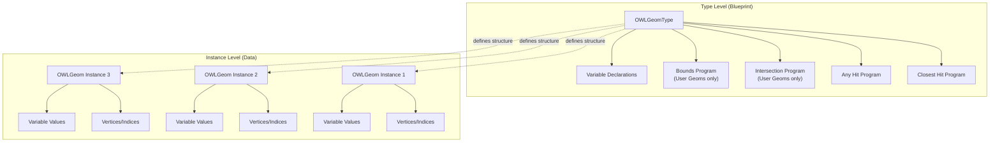
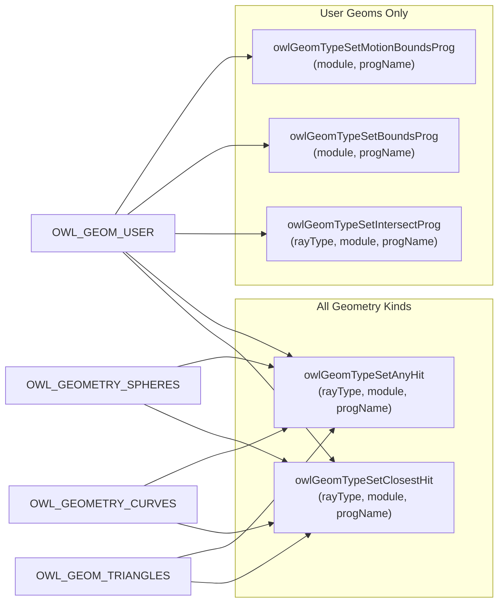
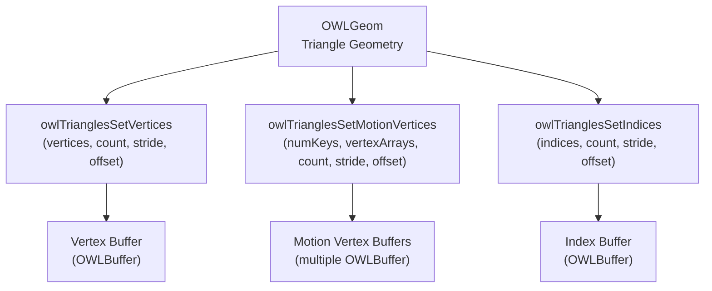
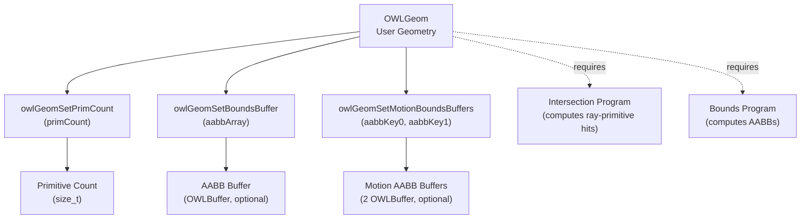
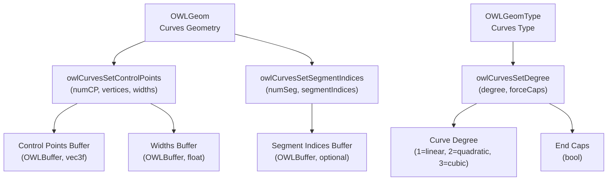
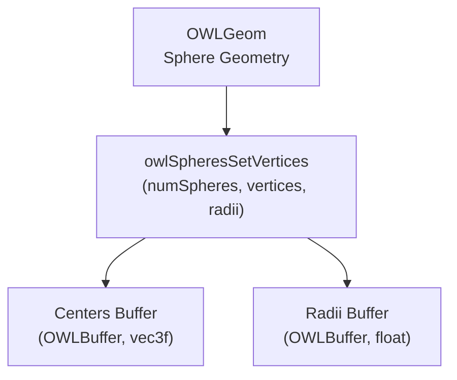
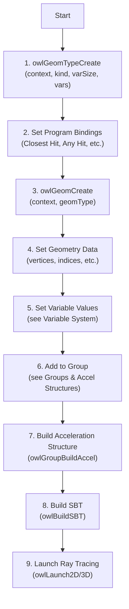

<!-- source: DeepWiki mcp.deepwiki.com · repo NVIDIA/OWL · page 3.3 Geometry Types and Instances · fetched 2026-10-26 -->

# Geometry Types and Instances

<details>
<summary>Relevant source files</summary>

The following files were used as context for generating this wiki page:

- [include/owl/owl_host.h](include/owl/owl_host.h)
- [owl/UserGeomGroup.h](owl/UserGeomGroup.h)
- [owl/impl.cpp](owl/impl.cpp)

</details>


## Purpose and Scope

This page documents the OWL Host API for creating and configuring geometry types and geometry instances. Geometry types (`OWLGeomType`) define the ray tracing program bindings (closest hit, any hit, intersection, bounds) and variable layout, while geometry instances (`OWLGeom`) contain the actual geometric data (vertices, indices, primitives). Together, these form the foundation for building acceleration structures.

For information about organizing geometries into groups and building acceleration structures, see [Groups and Acceleration Structures](#3.4). For details on the variable system used to configure geometry data, see [Variable System](#3.6). For information on creating the programs that bind to geometry types, see [Programs and Modules](#3.5).

---

## Geometry Type System

### Concept: Type vs Instance

OWL follows a two-level pattern for geometries: **geometry types** define program bindings and variable layout, while **geometry instances** hold actual data. This separation enables efficient reuse—multiple geometry instances can share the same type (and thus the same shader programs and variable layout) while having different data.



**Diagram: Geometry Type-Instance Relationship**

Sources: [include/owl/owl_host.h:310-314](), [include/owl/owl_host.h:691-696](), [include/owl/owl_host.h:468-473]()

### Geometry Kinds

OWL supports four geometry kinds, defined by the `OWLGeomKind` enum:

| Geometry Kind | Enum Value | Description | OptiX Mapping |
|---------------|------------|-------------|---------------|
| Triangles | `OWL_GEOM_TRIANGLES` | Built-in triangle primitives with hardware-accelerated intersection | `OPTIX_BUILD_INPUT_TYPE_TRIANGLES` |
| User-Defined | `OWL_GEOM_USER` | Custom primitives with user-provided intersection and bounds programs | `OPTIX_BUILD_INPUT_TYPE_CUSTOM_PRIMITIVES` |
| Curves | `OWL_GEOMETRY_CURVES` | Built-in curve primitives (linear, quadratic, cubic b-spline) | `OPTIX_BUILD_INPUT_TYPE_CURVES` |
| Spheres | `OWL_GEOMETRY_SPHERES` | Built-in sphere primitives | `OPTIX_BUILD_INPUT_TYPE_SPHERES` |

Sources: [include/owl/owl_host.h:207-223]()

**Note:** Curves require OptiX 7.4+ and must be enabled with `owlEnableCurves()` before pipeline compilation. Spheres require OptiX 7.5+ and must be enabled with `owlEnableSpheres()`.

### Creating a Geometry Type

```c++
OWLGeomType owlGeomTypeCreate(
    OWLContext       context,
    OWLGeomKind      kind,
    size_t           sizeOfVarStruct,
    const OWLVarDecl *vars,
    int              numVars
);
```

**Parameters:**
- `context`: The OWL context
- `kind`: One of the `OWLGeomKind` values
- `sizeOfVarStruct`: Size of the data structure that will be written to the SBT for each geometry instance
- `vars`: Array of variable declarations (can be `nullptr` if `numVars` is 0)
- `numVars`: Number of variables, or `-1` for null-terminated array

**Returns:** Handle to the created geometry type

Sources: [include/owl/owl_host.h:691-696](), [owl/impl.cpp:945-961]()

### Setting Program Bindings

Geometry types require program bindings that define what code executes during ray tracing. Different geometry kinds support different program types:



**Diagram: Program Binding APIs by Geometry Kind**

#### Closest Hit Program

```c++
void owlGeomTypeSetClosestHit(
    OWLGeomType type,
    int         rayType,
    OWLModule   module,
    const char  *progName
);
```

Sets the closest hit program for a specific ray type. This program executes when a ray's closest intersection belongs to a geometry of this type.

Sources: [include/owl/owl_host.h:1031-1034](), [owl/impl.cpp:1254-1275]()

#### Any Hit Program

```c++
void owlGeomTypeSetAnyHit(
    OWLGeomType type,
    int         rayType,
    OWLModule   module,
    const char  *progName
);
```

Sets the any hit program for a specific ray type. This program executes for every potential intersection during traversal, enabling effects like alpha-tested transparency.

Sources: [include/owl/owl_host.h:1036-1040](), [owl/impl.cpp:1277-1298]()

#### Intersection Program (User Geoms Only)

```c++
void owlGeomTypeSetIntersectProg(
    OWLGeomType type,
    int         rayType,
    OWLModule   module,
    const char  *progName
);
```

Sets the intersection program for user-defined geometries. This program computes ray-primitive intersections for custom primitive types.

Sources: [include/owl/owl_host.h:1042-1046](), [owl/impl.cpp:1300-1321]()

#### Bounds Program (User Geoms Only)

```c++
void owlGeomTypeSetBoundsProg(
    OWLGeomType type,
    OWLModule   module,
    const char  *progName
);
```

Sets the bounds program for user-defined geometries. This program computes the axis-aligned bounding box (AABB) for each primitive, used during acceleration structure construction.

Sources: [include/owl/owl_host.h:1048-1051](), [owl/impl.cpp:1323-1343]()

#### Motion Bounds Program (User Geoms Only)

```c++
void owlGeomTypeSetMotionBoundsProg(
    OWLGeomType type,
    OWLModule   module,
    const char  *progName
);
```

Sets the motion bounds program for user-defined geometries with motion blur. This program computes time-varying AABBs.

Sources: [include/owl/owl_host.h:1053-1056](), [owl/impl.cpp:1345-1365]()

---

## Geometry Instances

### Creating a Geometry Instance

```c++
OWLGeom owlGeomCreate(
    OWLContext  context,
    OWLGeomType type
);
```

Creates a geometry instance of the specified type. The instance inherits the program bindings and variable layout from its type.

**Parameters:**
- `context`: The OWL context
- `type`: The geometry type to instantiate

**Returns:** Handle to the created geometry instance

Sources: [include/owl/owl_host.h:468-473](), [owl/impl.cpp:963-979]()

### Releasing a Geometry Instance

```c++
void owlGeomRelease(OWLGeom geometry);
```

Releases the API handle to a geometry instance. OWL uses reference counting, so the underlying object is freed when all references are released.

Sources: [include/owl/owl_host.h:472-473](), [owl/impl.cpp:1088-1092]()

---

## Triangle Geometries

Triangle geometries (`OWL_GEOM_TRIANGLES`) use hardware-accelerated ray-triangle intersection. They are the most common geometry type and offer the best performance for triangle meshes.



**Diagram: Triangle Geometry Data Configuration**

### Setting Vertices

```c++
void owlTrianglesSetVertices(
    OWLGeom   triangles,
    OWLBuffer vertices,
    size_t    count,
    size_t    stride,
    size_t    offset
);
```

Configures the vertex buffer for a triangle geometry.

**Parameters:**
- `triangles`: The triangle geometry to configure
- `vertices`: Buffer containing vertex positions (typically `float3` or compatible type)
- `count`: Number of vertices
- `stride`: Byte offset between consecutive vertices (0 means tightly packed)
- `offset`: Byte offset to the first vertex in the buffer

Sources: [include/owl/owl_host.h:908-912](), [owl/impl.cpp:1097-1118]()

### Setting Motion Vertices

```c++
void owlTrianglesSetMotionVertices(
    OWLGeom   triangles,
    size_t    numKeys,
    OWLBuffer *vertexArrays,
    size_t    count,
    size_t    stride,
    size_t    offset
);
```

Configures time-varying vertices for motion blur. The first array represents `t=0`, the last represents `t=1`, with linear interpolation between keys.

**Parameters:**
- `triangles`: The triangle geometry to configure
- `numKeys`: Number of time steps (must be ≥ 2)
- `vertexArrays`: Array of `numKeys` vertex buffers
- `count`: Number of vertices per time step
- `stride`: Byte offset between consecutive vertices
- `offset`: Byte offset to the first vertex in each buffer

**Requirements:** Motion blur must be enabled with `owlEnableMotionBlur()` before creating geometries.

Sources: [include/owl/owl_host.h:913-925](), [owl/impl.cpp:1120-1153]()

### Setting Indices

```c++
void owlTrianglesSetIndices(
    OWLGeom   triangles,
    OWLBuffer indices,
    size_t    count,
    size_t    stride,
    size_t    offset
);
```

Configures the index buffer for a triangle geometry. Indices are triplets of vertex indices defining triangles.

**Parameters:**
- `triangles`: The triangle geometry to configure
- `indices`: Buffer containing index triplets (typically `int3` or `uint3`)
- `count`: Number of index triplets (i.e., number of triangles)
- `stride`: Byte offset between consecutive triplets (0 means tightly packed)
- `offset`: Byte offset to the first triplet in the buffer

**Note:** If no index buffer is set, vertices are interpreted as a flat list of triangles (every 3 vertices form a triangle).

Sources: [include/owl/owl_host.h:926-930](), [owl/impl.cpp:1228-1249]()

---

## User-Defined Geometries

User-defined geometries (`OWL_GEOM_USER`) enable custom primitive types with user-provided intersection and bounds programs. Examples include spheres, cylinders, implicit surfaces, or domain-specific primitives.



**Diagram: User Geometry Configuration**

### Setting Primitive Count

```c++
void owlGeomSetPrimCount(
    OWLGeom geom,
    size_t  primCount
);
```

Sets the number of primitives in a user-defined geometry. **This must be called before building the acceleration structure containing this geometry.**

**Parameters:**
- `geom`: The user geometry to configure
- `primCount`: Number of primitives

Sources: [include/owl/owl_host.h:1060-1062](), [owl/impl.cpp:984-991]()

### Setting Bounds Buffer (Optional)

```c++
void owlGeomSetBoundsBuffer(
    OWLGeom   geom,
    OWLBuffer aabbArray
);
```

Optionally provides a pre-computed AABB buffer for user geometries. This can improve performance by avoiding repeated malloc/free during real-time acceleration structure rebuilds.

**Parameters:**
- `geom`: The user geometry to configure
- `aabbArray`: Buffer containing AABBs (typically 6 floats per primitive: min.x, min.y, min.z, max.x, max.y, max.z)

**Note:** If not provided, AABBs are computed dynamically by calling the bounds program.

Sources: [include/owl/owl_host.h:1065-1068](), [owl/impl.cpp:993-1004]()

### Setting Motion Bounds Buffers (Optional)

```c++
void owlGeomSetMotionBoundsBuffers(
    OWLGeom   geom,
    OWLBuffer aabbArrayKey0,
    OWLBuffer aabbArrayKey1
);
```

Provides pre-computed time-varying AABB buffers for user geometries with motion blur.

**Parameters:**
- `geom`: The user geometry to configure
- `aabbArrayKey0`: AABB buffer at `t=0`
- `aabbArrayKey1`: AABB buffer at `t=1`

Sources: [include/owl/owl_host.h:1070-1075](), [owl/impl.cpp:1006-1020]()

---

## Curves Geometries

Curves geometries (`OWL_GEOMETRY_CURVES`) provide built-in support for rendering curves such as hair, fur, or wire frames. Curves can be linear, quadratic b-spline, or cubic b-spline.



**Diagram: Curves Geometry Configuration**

### Setting Curve Degree

```c++
void owlCurvesSetDegree(
    OWLGeomType curvesGeomType,
    int         degree,
    bool        forceCaps
);
```

Configures the curve degree and end-cap behavior for a curves geometry type.

**Parameters:**
- `curvesGeomType`: The curves geometry type to configure
- `degree`: Curve degree (1 = linear, 2 = quadratic b-spline, 3 = cubic b-spline)
- `forceCaps`: Whether to add end-caps for non-linear curves (linear curves always have end-caps)

**Requirements:** Curves support requires OptiX 7.4+. Call `owlEnableCurves()` before pipeline compilation.

Sources: [include/owl/owl_host.h:936-942](), [owl/impl.cpp:1819-1832]()

### Setting Control Points

```c++
void owlCurvesSetControlPoints(
    OWLGeom   curvesGeom,
    int       numControlPoints,
    OWLBuffer vertices,
    OWLBuffer widths
);
```

Configures the control points and widths for a curves geometry.

**Parameters:**
- `curvesGeom`: The curves geometry to configure
- `numControlPoints`: Number of control points
- `vertices`: Buffer of control point positions (vec3f per control point)
- `widths`: Buffer of curve widths (float per control point)

Sources: [include/owl/owl_host.h:944-956](), [owl/impl.cpp:1836-1867]()

### Setting Segment Indices

```c++
void owlCurvesSetSegmentIndices(
    OWLGeom   curvesGeom,
    int       numSegmentIndices,
    OWLBuffer segmentIndices
);
```

Configures segment indices for a curves geometry. If not set, control points are interpreted as consecutive curve segments.

**Parameters:**
- `curvesGeom`: The curves geometry to configure
- `numSegmentIndices`: Number of segments
- `segmentIndices`: Buffer of segment indices

Sources: [include/owl/owl_host.h:958-960](), [owl/impl.cpp:1869-1887]()

---

## Sphere Geometries

Sphere geometries (`OWL_GEOMETRY_SPHERES`) provide built-in support for rendering spheres with hardware-accelerated ray-sphere intersection.



**Diagram: Sphere Geometry Configuration**

### Setting Vertices and Radii

```c++
void owlSpheresSetVertices(
    OWLGeom   spheresGeom,
    int       numSpheres,
    OWLBuffer vertices,
    OWLBuffer radii
);
```

Configures sphere centers and radii for a sphere geometry.

**Parameters:**
- `spheresGeom`: The sphere geometry to configure
- `numSpheres`: Number of spheres
- `vertices`: Buffer of sphere centers (vec3f per sphere)
- `radii`: Buffer of sphere radii (float per sphere)

**Requirements:** Sphere support requires OptiX 7.5+. Call `owlEnableSpheres()` before pipeline compilation.

Sources: [include/owl/owl_host.h:966-975](), [owl/impl.cpp:1889-1917]()

---

## Workflow Summary

The typical workflow for creating and using geometries:



**Diagram: Geometry Setup Workflow**

Sources: [owl/impl.cpp:945-979](), [owl/impl.cpp:1254-1365](), [owl/impl.cpp:1097-1249]()

---

## Implementation Details

### Internal Class Hierarchy

Internally, OWL implements geometry types through a class hierarchy:

| Host API Type | Internal Class | File |
|---------------|----------------|------|
| `OWLGeomType` (triangles) | `TrianglesGeomType` | `owl/Triangles.h` |
| `OWLGeomType` (user) | `UserGeomType` | `owl/UserGeom.h` |
| `OWLGeomType` (curves) | `CurvesGeomType` | `owl/CurvesGeom.h` |
| `OWLGeomType` (spheres) | `SphereGeomType` | `owl/SphereGeom.h` |
| `OWLGeom` (triangles) | `TrianglesGeom` | `owl/Triangles.h` |
| `OWLGeom` (user) | `UserGeom` | `owl/UserGeom.h` |
| `OWLGeom` (curves) | `CurvesGeom` | `owl/CurvesGeom.h` |
| `OWLGeom` (spheres) | `SphereGeom` | `owl/SphereGeom.h` |

The `APIHandle` system (defined in `owl/APIHandle.h`) provides the bridge between opaque API handles and internal shared pointers.

Sources: [owl/impl.cpp:54-68](), [owl/impl.cpp:329-350]()

### Memory Management

OWL uses reference-counted shared pointers internally. The `owlGeomRelease()` function decrements the reference count; the geometry is freed when the count reaches zero. This allows geometries to be safely shared across groups and contexts.

Sources: [owl/impl.cpp:1050-1092]()

---

