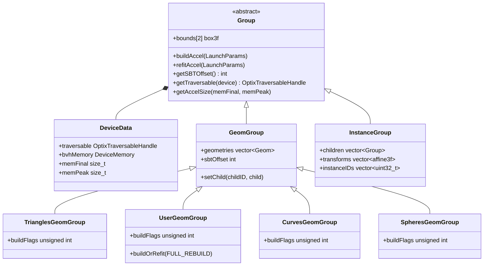
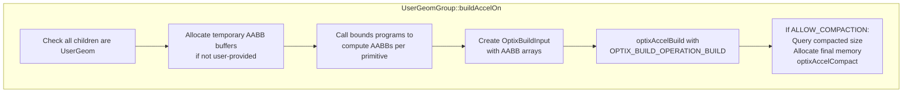
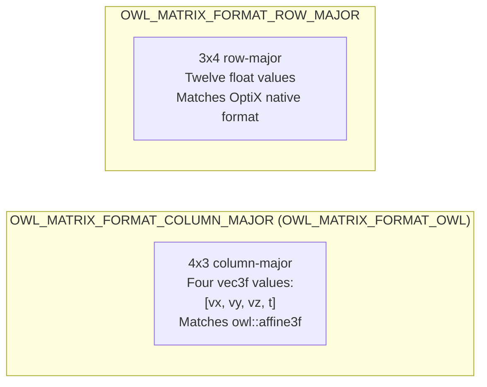
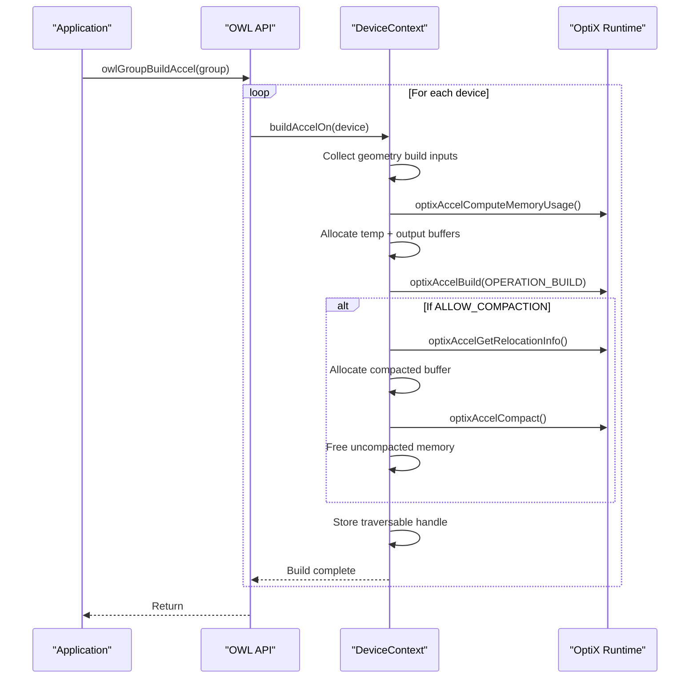

<!-- source: DeepWiki mcp.deepwiki.com · repo NVIDIA/OWL · page 3.4 Groups and Acceleration Structures · fetched 2026-10-26 -->

# Groups and Acceleration Structures

<details>
<summary>Relevant source files</summary>

The following files were used as context for generating this wiki page:

- [include/owl/owl_host.h](include/owl/owl_host.h)
- [owl/Group.h](owl/Group.h)
- [owl/UserGeomGroup.h](owl/UserGeomGroup.h)

</details>


## Purpose and Scope

This document describes OWL's group abstraction for managing OptiX acceleration structures. Groups organize geometries and instances into Bounding Volume Hierarchies (BVHs) that enable efficient ray tracing. OWL provides two primary group types: **Geometry Groups** (BLAS - Bottom-Level Acceleration Structures) that contain primitives, and **Instance Groups** (IAS - Instance/Top-Level Acceleration Structures) that enable multi-level instancing with transforms.

For information about creating geometries to place in groups, see [Geometry Types and Instances](#3.3). For information about how groups participate in the Shader Binding Table, see [Programs and Modules](#3.5).

---

## Group Type Hierarchy

OWL implements OptiX's two-level acceleration structure model through an abstract `Group` base class with specialized subclasses for different primitive types and instancing.

### Group Class Hierarchy



**Sources:** [owl/Group.h:18-87](), [owl/Group.h:91-118](), [owl/UserGeomGroup.h:15-41]()

---

## Geometry Groups (BLAS)

Geometry Groups represent bottom-level acceleration structures that contain actual geometric primitives. Each specialized group type corresponds to a specific OptiX primitive type.

### Triangles Geometry Groups

Triangle groups are the most common geometry group type, containing triangle meshes defined by vertex and index buffers.

**Creation:**
```cpp
OWLGroup owlTrianglesGeomGroupCreate(
    OWLContext context,
    size_t numGeometries,
    OWLGeom *arrayOfChildGeoms,
    unsigned int buildFlags = 0
);
```

**Parameters:**
- `numGeometries`: Number of triangle geometry objects in this group (must be non-zero)
- `arrayOfChildGeoms`: Array of `OWLGeom` handles created with `OWL_GEOM_TRIANGLES` type
- `buildFlags`: Combination of `OptixBuildFlags` (0 uses OWL defaults)

**Default Build Flags:** `OPTIX_BUILD_FLAG_PREFER_FAST_TRACE | OPTIX_BUILD_FLAG_ALLOW_COMPACTION`

**Sources:** [include/owl/owl_host.h:550-554]()

### User Geometry Groups

User geometry groups contain custom primitives with application-defined intersection programs and bounding boxes.

**Creation:**
```cpp
OWLGroup owlUserGeomGroupCreate(
    OWLContext context,
    size_t numGeometries,
    OWLGeom *arrayOfChildGeoms,
    unsigned int buildFlags = 0
);
```

**Requirements:**
- All child geometries must be of type `OWL_GEOM_USER`
- Each geometry must have `owlGeomSetPrimCount()` called before building
- Optionally set AABB buffers with `owlGeomSetBoundsBuffer()` to avoid repeated allocations

**Build Process:**



**Sources:** [include/owl/owl_host.h:528-532](), [owl/UserGeomGroup.h:15-41]()

### Curves Geometry Groups

Curves groups contain B-spline curve primitives with configurable degree and end caps.

**Creation:**
```cpp
OWLGroup owlCurvesGeomGroupCreate(
    OWLContext context,
    size_t numCurveGeometries,
    OWLGeom *curveGeometries,
    unsigned int buildFlags = 0
);
```

**Prerequisites:**
- Must call `owlEnableCurves(context)` before pipeline compilation
- Curves support requires OptiX 7.4+

**Configuration:**
```cpp
void owlCurvesSetDegree(
    OWLGeomType curvesGeomType,
    int degree,           // 1=linear, 2=quadratic, 3=cubic
    bool forceCaps        // Add end-caps for non-linear curves
);

void owlCurvesSetControlPoints(
    OWLGeom curvesGeom,
    int numControlPoints,
    OWLBuffer vertices,   // vec3f positions
    OWLBuffer widths      // float radii
);
```

**Sources:** [include/owl/owl_host.h:577-581](), [include/owl/owl_host.h:940-956]()

### Spheres Geometry Groups

Spheres groups contain sphere primitives with per-sphere centers and radii.

**Creation:**
```cpp
OWLGroup owlSphereGeomGroupCreate(
    OWLContext context,
    size_t numGeometries,
    OWLGeom *arrayOfChildGeoms,
    unsigned int buildFlags = 0
);
```

**Prerequisites:**
- Must call `owlEnableSpheres(context)` before pipeline compilation
- Spheres support requires OptiX 7.5+

**Configuration:**
```cpp
void owlSpheresSetVertices(
    OWLGeom spheresGeom,
    int numSpheres,
    OWLBuffer vertices,  // vec3f centers
    OWLBuffer radius     // float radii
);
```

**Sources:** [include/owl/owl_host.h:598-602](), [include/owl/owl_host.h:968-975]()

---

## Instance Groups (IAS)

Instance Groups create top-level acceleration structures that reference other groups (both geometry groups and other instance groups) with per-instance transforms and properties.

### Instance Group Creation

```cpp
OWLGroup owlInstanceGroupCreate(
    OWLContext context,
    size_t numInstances,
    const OWLGroup *initGroups = nullptr,
    const uint32_t *initInstanceIDs = nullptr,
    const float *initTransforms = nullptr,
    OWLMatrixFormat matrixFormat = OWL_MATRIX_FORMAT_OWL,
    unsigned int buildFlags = 0,
    bool useInstanceProgram = false
);
```

**Initialization Options:**
- **Bulk Initialization**: Pass arrays during creation for efficient setup of millions of instances
- **Individual Setup**: Pass `nullptr` and use setter functions for smaller instance counts

| Parameter | Default Behavior if nullptr/0 | Setter Function |
|-----------|-------------------------------|-----------------|
| `initGroups` | Invalid groups (must set later) | `owlInstanceGroupSetChild()` |
| `initInstanceIDs` | Instance i gets ID=i | `owlInstanceGroupSetInstanceIDs()` |
| `initTransforms` | Identity transforms | `owlInstanceGroupSetTransform()` |

**Sources:** [include/owl/owl_host.h:622-665]()

### Instance Transforms

Transforms position, orient, and scale instances in world space. OWL supports two matrix formats:

#### Transform Matrix Formats



**Per-Instance Transform:**
```cpp
void owlInstanceGroupSetTransform(
    OWLGroup group,
    int whichChild,
    const float *floats,
    OWLMatrixFormat matrixFormat = OWL_MATRIX_FORMAT_OWL
);
```

**Bulk Transform Update:**
```cpp
void owlInstanceGroupSetTransforms(
    OWLGroup group,
    uint32_t timeStep,        // 0 for t=0, 1 for t=1 (motion blur)
    const float *floatsForThisTimeStep,
    OWLMatrixFormat matrixFormat = OWL_MATRIX_FORMAT_OWL
);
```

**Sources:** [include/owl/owl_host.h:65-83](), [include/owl/owl_host.h:987-1004]()

### Instance IDs and Visibility

**Instance IDs** are user-defined identifiers accessible in hit programs via `optixGetInstanceId()`. By default, the i-th instance receives ID=i, but this can be customized:

```cpp
void owlInstanceGroupSetInstanceIDs(
    OWLGroup group,
    const uint32_t *instanceIDs  // Array of size numInstances
);
```

**Visibility Masks** control which instances are visible to which rays (using ray masks in trace calls):

```cpp
void owlInstanceGroupSetVisibilityMasks(
    OWLGroup group,
    const uint8_t *visibilityMasks  // 8-bit mask per instance
);
```

**Sources:** [include/owl/owl_host.h:1011-1017]()

### Multi-Level Instancing

OWL supports arbitrary instancing depth, where instance groups can reference other instance groups. The maximum depth is configured via:

```cpp
void owlSetMaxInstancingDepth(
    OWLContext context,
    int32_t maxInstanceDepth
);
```

**Instancing Depth Semantics:**

| Depth | Meaning | Performance |
|-------|---------|-------------|
| 1 | Two-level scene: IAS → BLAS only | Hardware-accelerated (default) |
| 2+ | Multi-level: IAS → IAS → ... → BLAS | Software traversal overhead |

**Recommendation:** Keep `maxInstanceDepth = 1` whenever possible by flattening scene graphs to two levels during preprocessing.

**Sources:** [include/owl/owl_host.h:444-446]()

### Instance Programs

For advanced use cases with millions of instances, custom instance programs can compute `OptixInstance` structures on the GPU:

```cpp
void owlInstanceGroupSetInstanceProg(
    OWLGroup group,
    OWLModule module,
    const char *progName
);
```

**Requirements:**
- Must disable per-geometry SBT records: `owlContextDisablePerGeometrySBTRecords()`
- Enables parallel SBT offset calculation: `baseIndex + blasIndex * numRayTypes`

**Sources:** [include/owl/owl_host.h:1020-1022](), [include/owl/owl_host.h:388-389]()

---

## Acceleration Structure Building

### Build vs. Refit

OWL provides two operations for acceleration structure construction:

| Operation | Function | Use Case | Performance |
|-----------|----------|----------|-------------|
| **Build** | `owlGroupBuildAccel()` | Full reconstruction | Slower, optimal quality |
| **Refit** | `owlGroupRefitAccel()` | Topology-preserving update | Faster, lower quality |

**Building:**
```cpp
void owlGroupBuildAccel(
    OWLGroup group,
    OWLParams params = nullptr  // Optional launch params for context
);
```

**Refitting:**
```cpp
void owlGroupRefitAccel(
    OWLGroup group,
    OWLParams params = nullptr
);
```

**Refit Constraints:**
- Geometry topology must not change (same primitive count)
- Vertex positions and transforms can be updated
- Requires initial build with `OPTIX_BUILD_FLAG_ALLOW_UPDATE`

**Sources:** [include/owl/owl_host.h:671-672]()

### Build Flags

Build flags control acceleration structure construction behavior:

```cpp
unsigned int buildFlags = 
    OPTIX_BUILD_FLAG_PREFER_FAST_TRACE |      // Optimize traversal speed
    OPTIX_BUILD_FLAG_ALLOW_COMPACTION |       // Enable post-build compaction
    OPTIX_BUILD_FLAG_ALLOW_UPDATE;            // Enable refitting
```

**Common Flag Combinations:**

| Use Case | Flags |
|----------|-------|
| Static scene | `PREFER_FAST_TRACE \| ALLOW_COMPACTION` (OWL default) |
| Dynamic scene (refittable) | `PREFER_FAST_TRACE \| ALLOW_UPDATE` |
| Fast build (preview quality) | `PREFER_FAST_BUILD` |

**Sources:** [owl/UserGeomGroup.h:34-36]()

### Build Process Flow



**Sources:** [owl/UserGeomGroup.h:25-32]()

### Memory Management and Compaction

**Querying Acceleration Structure Size:**
```cpp
void owlGroupGetAccelSize(
    OWLGroup group,
    size_t *p_memFinal,  // Final BVH size (after compaction)
    size_t *p_memPeak    // Peak memory during build
);
```

**Compaction Behavior:**
- Enabled by `OPTIX_BUILD_FLAG_ALLOW_COMPACTION`
- OWL automatically compacts if flag is set
- Typical savings: 40-60% memory reduction
- Peak memory is 2-3× final size during construction

**Sources:** [include/owl/owl_host.h:680-683](), [owl/Group.h:78-83]()

---

## Querying Group Information

### Traversable Handles

The `OptixTraversableHandle` is the device-side handle used in `optixTrace()` calls:

```cpp
OptixTraversableHandle owlGroupGetTraversable(
    OWLGroup group,
    int deviceID
);
```

**Usage Pattern:**
```cpp
// Host side: build and get traversable
owlGroupBuildAccel(myGroup);
OptixTraversableHandle handle = owlGroupGetTraversable(myGroup, 0);

// Set as launch parameter variable
owlParamsSetGroup(launchParams, "world", myGroup);

// Device side: automatically available in programs
extern "C" __constant__ LaunchParams optixLaunchParams;
optixTrace(optixLaunchParams.world, ...);
```

**Sources:** [include/owl/owl_host.h:812-813](), [owl/Group.h:69-70](), [owl/Group.h:132-134]()

### SBT Offsets

The Shader Binding Table offset indicates where a group's geometries are written in the SBT:

```cpp
uint32_t owlGroupGetSBTOffset(OWLGroup group);
```

**Use Cases:**
- Custom SBT indexing in instance programs
- Manual ray type calculations
- Debugging SBT layout issues

**Sources:** [include/owl/owl_host.h:688-689](), [owl/Group.h:58-61]()

---

## Complete Example: Two-Level Scene


**Sources:** [include/owl/owl_host.h:550-665](), [include/owl/owl_host.h:671-672]()

---

