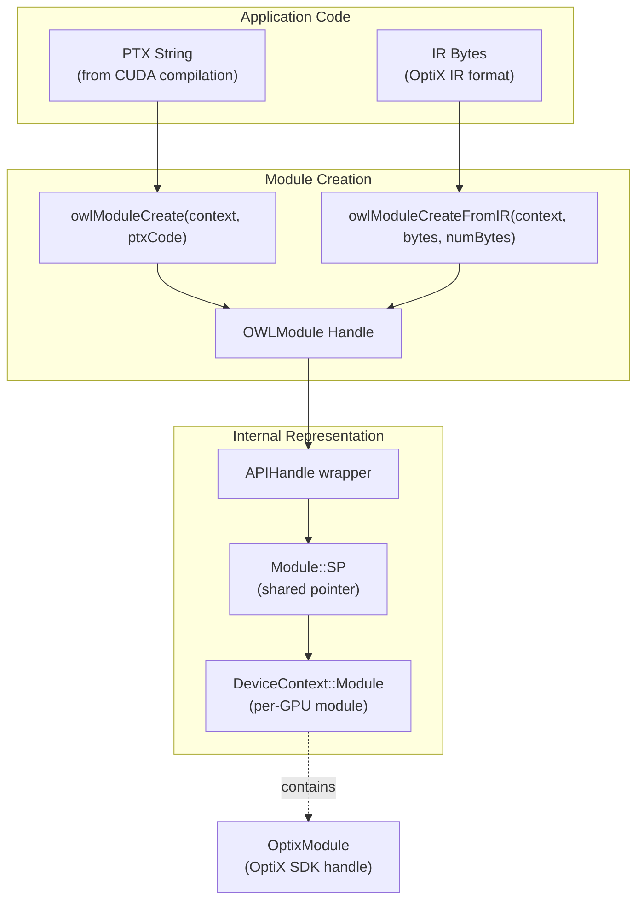
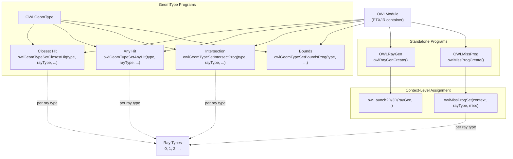
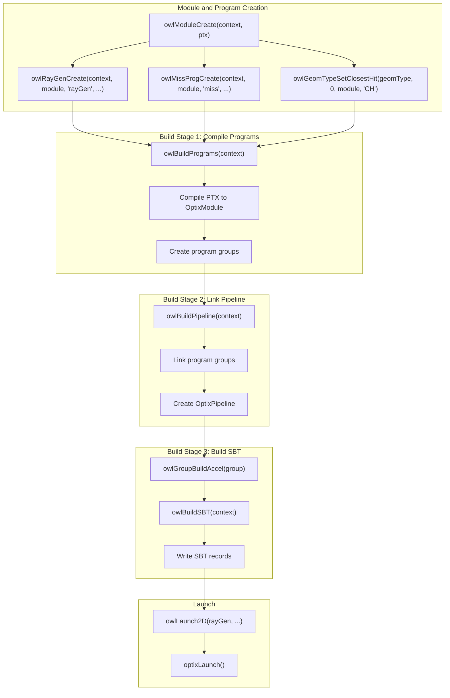
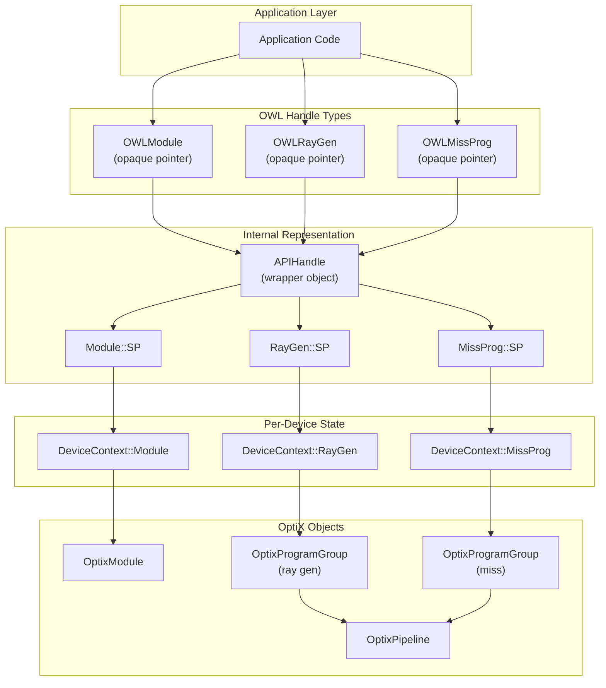

<!-- source: DeepWiki mcp.deepwiki.com · repo NVIDIA/OWL · page 3.5 Programs and Modules · fetched 2026-10-26 -->

# Programs and Modules

<details>
<summary>Relevant source files</summary>

The following files were used as context for generating this wiki page:

- [include/owl/owl_host.h](include/owl/owl_host.h)
- [owl/impl.cpp](owl/impl.cpp)

</details>


Programs and Modules form the core of OWL's GPU program management system. A **module** (`OWLModule`) represents compiled PTX or IR code containing one or more device-side programs. **Programs** are extracted from modules by name and represent the various program types that execute during ray tracing: ray generation, miss, closest hit, any hit, intersection, and bounds programs. This page covers module creation, program types, their configuration, and the build process that compiles and links them into an executable OptiX pipeline.

For information about setting variables on programs, see [3.6 Variable System](#3.6). For details on launch operations that execute ray generation programs, see [3.7 Launch Operations](#3.7). For geometry type configuration that uses hit programs, see [3.3 Geometry Types and Instances](#3.3).

## Module Creation and Lifecycle

Modules are the container for compiled GPU code. OWL supports two module creation methods:

| Function | Purpose | Input Format |
|----------|---------|--------------|
| `owlModuleCreate()` | Create module from PTX string | Null-terminated PTX code |
| `owlModuleCreateFromIR()` | Create module from IR bytes | Binary IR data and size |
| `owlModuleRelease()` | Release module reference | - |

**PTX Module Creation:**

```
OWLModule module = owlModuleCreate(context, ptxCode);
```

The `ptxCode` parameter must be a valid null-terminated string containing PTX assembly. Typically, PTX is generated by compiling CUDA device code (`.cu` files) with `nvcc`. The `embed_ptx` CMake utility (see [5.3 PTX Embedding](#5.3)) automates this compilation and embedding process.

**IR Module Creation:**

```
OWLModule module = owlModuleCreateFromIR(context, irBytes, numBytes);
```

IR (Intermediate Representation) modules provide an alternative to PTX, accepting OptiX IR format. Note that bounds programs are not currently supported with IR modules.

**Module Lifecycle:**

Modules are reference-counted. The `owlModuleRelease()` function decrements the reference count, freeing the module when it reaches zero. Programs created from a module hold references to it, so modules remain valid as long as their programs exist.

Sources: [include/owl/owl_host.h:456-466](), [owl/impl.cpp:1022-1045]()

### Module Creation Flow



Sources: [owl/impl.cpp:1022-1045](), [include/owl/owl_host.h:456-466]()

## Program Types

OWL supports five program types, each serving a distinct role in the ray tracing pipeline:

| Program Type | Trigger Condition | Set On | Created Via |
|--------------|-------------------|--------|-------------|
| Ray Generation | Launch start | Standalone | `owlRayGenCreate()` |
| Miss | Ray misses all geometry | Ray type (context) | `owlMissProgCreate()` + `owlMissProgSet()` |
| Closest Hit | Ray hits geometry | `OWLGeomType` + ray type | `owlGeomTypeSetClosestHit()` |
| Any Hit | Ray candidate intersection | `OWLGeomType` + ray type | `owlGeomTypeSetAnyHit()` |
| Intersection | Ray tests user geometry | `OWLGeomType` + ray type | `owlGeomTypeSetIntersectProg()` |
| Bounds | BVH build for user geometry | `OWLGeomType` | `owlGeomTypeSetBoundsProg()` |

### Ray Generation Programs

Ray generation programs (`OWLRayGen`) are the entry point for ray tracing. Each launch executes one ray generation program across a 2D or 3D grid of threads.

**Creating a Ray Generation Program:**

```
OWLVarDecl rayGenVars[] = {
  { "frameBuffer", OWL_BUFPTR, OWL_OFFSETOF(RayGenData, frameBuffer) },
  { "world",       OWL_GROUP,  OWL_OFFSETOF(RayGenData, world) },
  { /* sentinel */ }
};

OWLRayGen rayGen = owlRayGenCreate(
  context,
  module,
  "rayGenProgram",      // Function name in PTX/IR
  sizeof(RayGenData),   // Size of data struct
  rayGenVars,           // Variable declarations
  -1                    // -1 means null-terminated list
);
```

The `programName` parameter ("rayGenProgram" above) must match a function in the module declared with `OPTIX_RAYGEN_PROGRAM` on the device side (see [4.1 Program Declaration Macros](#4.1)).

**Variable System:**

Ray generation programs support the full variable system (see [3.6 Variable System](#3.6)). Variables are set using:
- `owlRayGenSet*()` functions (e.g., `owlRayGenSet3f()`, `owlRayGenSetBuffer()`)
- `owlRayGenGetVariable()` + `owlVariableSet*()`

**Launching:**

Ray generation programs are launched via `owlLaunch2D()`, `owlLaunch3D()`, or their async variants. See [3.7 Launch Operations](#3.7) for details.

Sources: [include/owl/owl_host.h:481-490](), [owl/impl.cpp:408-430]()

### Miss Programs

Miss programs (`OWLMissProg`) execute when a ray traverses the scene without hitting any geometry. OWL supports multiple ray types, each with its own miss program.

**Creating and Assigning Miss Programs:**

```
OWLVarDecl missVars[] = {
  { "bgColor", OWL_FLOAT3, OWL_OFFSETOF(MissProgData, bgColor) },
  { /* sentinel */ }
};

OWLMissProg missProg = owlMissProgCreate(
  context,
  module,
  "missProgram",        // Function name in PTX/IR
  sizeof(MissProgData),
  missVars,
  -1
);

// Assign to ray type 0 (primary rays)
owlMissProgSet(context, 0, missProg);
```

**Per-Ray-Type Assignment:**

The `owlMissProgSet()` function assigns a miss program to a specific ray type. Different ray types (e.g., primary rays, shadow rays) can use different miss programs:

```
owlMissProgSet(context, 0, primaryMiss);   // Primary rays
owlMissProgSet(context, 1, shadowMiss);    // Shadow rays
```

**Backward Compatibility:**

For backward compatibility, `owlMissProgCreate()` automatically assigns the first created miss program to ray type 0, the second to ray type 1, etc. Explicit assignment via `owlMissProgSet()` overrides this behavior.

Sources: [include/owl/owl_host.h:499-511](), [owl/impl.cpp:452-492]()

### Hit Programs

Hit programs execute when rays intersect geometry. OWL supports two types:

**Closest Hit Programs:**

Execute when a ray's closest intersection is determined. Set per-ray-type on geometry types:

```
owlGeomTypeSetClosestHit(
  geomType,
  0,                    // Ray type
  module,
  "closestHitProgram"   // Function name
);
```

**Any Hit Programs:**

Execute for every potential ray-geometry intersection during traversal, allowing early ray termination or transparency effects:

```
owlGeomTypeSetAnyHit(
  geomType,
  0,                    // Ray type
  module,
  "anyHitProgram"       // Function name
);
```

**Multi-Ray-Type Configuration:**

When `owlContextSetRayTypeCount(context, N)` is called, each geometry type can have different hit programs for each ray type:

```
owlContextSetRayTypeCount(context, 2);

// Ray type 0: primary rays with shading
owlGeomTypeSetClosestHit(geomType, 0, module, "shadingCH");

// Ray type 1: shadow rays with simple occlusion test
owlGeomTypeSetAnyHit(geomType, 1, module, "shadowAH");
```

Sources: [include/owl/owl_host.h:1031-1046](), [owl/impl.cpp:1254-1298]()

### Intersection and Bounds Programs

For user-defined geometry (created with `OWL_GEOM_USER`), custom intersection and bounds programs are required:

**Intersection Programs:**

Define custom ray-primitive intersection logic:

```
owlGeomTypeSetIntersectProg(
  userGeomType,
  0,                        // Ray type
  module,
  "intersectionProgram"     // Function name
);
```

Like hit programs, intersection programs are set per-ray-type. Different ray types can use different intersection algorithms.

**Bounds Programs:**

Compute axis-aligned bounding boxes for primitives during BVH construction:

```
owlGeomTypeSetBoundsProg(
  userGeomType,
  module,
  "boundsProgram"           // Function name
);
```

Bounds programs are not per-ray-type; they execute once during acceleration structure building. They are not currently supported for modules created from IR.

**Motion Blur Support:**

For motion blur, a separate bounds program computes bounding boxes for each time step:

```
owlGeomTypeSetMotionBoundsProg(
  userGeomType,
  module,
  "motionBoundsProgram"
);
```

Sources: [include/owl/owl_host.h:1043-1056](), [owl/impl.cpp:1300-1365]()

## Program Type Configuration Map



Sources: [include/owl/owl_host.h:481-511, 1031-1056](), [owl/impl.cpp:408-492, 1254-1365]()

## Build Process

The OWL build process transforms modules and program specifications into an executable OptiX pipeline through three stages:

### Build Stages

| Stage | Function | Purpose | When to Call |
|-------|----------|---------|--------------|
| 1. Compile Programs | `owlBuildPrograms()` | Compile all modules into OptiX modules | After creating all modules and programs, before pipeline creation |
| 2. Link Pipeline | `owlBuildPipeline()` | Link programs into OptiX pipeline | After program compilation, before SBT build |
| 3. Build SBT | `owlBuildSBT()` | Generate Shader Binding Table | After pipeline linking, before launch |

**Typical Build Sequence:**

```
// 1. Create modules and programs
OWLModule module = owlModuleCreate(context, ptxCode);
OWLRayGen rayGen = owlRayGenCreate(context, module, "rayGen", ...);
OWLMissProg miss = owlMissProgCreate(context, module, "miss", ...);
owlGeomTypeSetClosestHit(geomType, 0, module, "closestHit");

// 2. Build programs (compile modules)
owlBuildPrograms(context);

// 3. Build pipeline (link programs)
owlBuildPipeline(context);

// 4. Build SBT (must be done after creating geometries)
owlBuildSBT(context);
```

**Program Compilation (`owlBuildPrograms`):**

Compiles all created modules into OptiX module objects. This involves:
- Passing PTX/IR to OptiX for compilation
- Creating `OptixModule` handles for each module
- Validating program names exist in modules

This step must be called after all modules are created but before pipeline linking.

**Pipeline Linking (`owlBuildPipeline`):**

Links all programs into a single OptiX pipeline. This involves:
- Creating `OptixProgramGroup` objects for each program
- Configuring pipeline options (trace depth, payload size, etc.)
- Linking program groups into an `OptixPipeline`

Configuration options like ray payload size (`owlContextSetNumPayloadValues()`) and max instancing depth (`owlSetMaxInstancingDepth()`) must be set before this call.

**SBT Building (`owlBuildSBT`):**

Generates the Shader Binding Table, which maps geometries to their hit programs and stores program data. This must be called after geometries are created and their acceleration structures are built. See [3.4 Groups and Acceleration Structures](#3.4) for SBT details.

**Incremental Builds:**

After the initial build, `owlBuildSBT()` can be called again to update the SBT after modifying variables or transforms. `owlBuildPrograms()` and `owlBuildPipeline()` typically do not need to be called again unless new modules or programs are added.

Sources: [include/owl/owl_host.h:331-334](), [owl/impl.cpp:193-212]()

### Build Process Flow



Sources: [owl/impl.cpp:193-212](), [include/owl/owl_host.h:331-334]()

## Variable System Integration

All program types (ray generation and miss programs) support the OWL variable system. Variables are declared during program creation and set using type-specific setter functions.

**Variable Declaration:**

```
struct RayGenData {
  float3 cameraPosition;
  OptixTraversableHandle world;
  float* frameBuffer;
};

OWLVarDecl rayGenVars[] = {
  { "cameraPosition", OWL_FLOAT3,  OWL_OFFSETOF(RayGenData, cameraPosition) },
  { "world",          OWL_GROUP,   OWL_OFFSETOF(RayGenData, world) },
  { "frameBuffer",    OWL_BUFPTR,  OWL_OFFSETOF(RayGenData, frameBuffer) },
  { nullptr }
};
```

**Setting Variables:**

Variables can be set in two ways:

1. **Direct Setter Functions:**
```
owlRayGenSet3f(rayGen, "cameraPosition", 0.f, 5.f, 10.f);
owlRayGenSetGroup(rayGen, "world", topLevelGroup);
owlRayGenSetBuffer(rayGen, "frameBuffer", framebuffer);
```

2. **Variable Handle Pattern:**
```
OWLVariable camPosVar = owlRayGenGetVariable(rayGen, "cameraPosition");
owlVariableSet3f(camPosVar, 0.f, 5.f, 10.f);
owlVariableRelease(camPosVar);
```

**Supported Types:**

Programs support all variable types: primitives (float, int, etc.), vectors (float3, int4), buffers (`OWL_BUFFER`, `OWL_BUFPTR`), textures (`OWL_TEXTURE`), and groups (`OWL_GROUP`).

For complete variable system documentation, see [3.6 Variable System](#3.6).

Sources: [include/owl/owl_host.h:1080-1097, 1419-1691](), [owl/impl.cpp:329-383, 1450-1589]()

## Program Data Access on Device

On the device side (in CUDA kernels), program data is accessed using device-side API functions:

**Program Declaration Macros:**

```cuda
OPTIX_RAYGEN_PROGRAM(rayGenProgram)() {
  const RayGenData& self = owl::getProgramData<RayGenData>();
  // Use self.cameraPosition, self.world, etc.
}

OPTIX_MISS_PROGRAM(missProgram)() {
  const MissProgData& self = owl::getProgramData<MissProgData>();
  // Use self.bgColor, etc.
}

OPTIX_CLOSEST_HIT_PROGRAM(closestHitProgram)() {
  const GeomData& self = owl::getProgramData<GeomData>();
  // Use self.color, self.vertices, etc.
}
```

The `getProgramData<T>()` function retrieves the data structure configured through the variable system. For details on device-side programming, see [4.1 Program Declaration Macros](#4.1) and [4.3 Data Access Utilities](#4.3).

Sources: Device-side API in `include/owl/owl_device.h`

## Context Configuration for Programs

Several context-wide settings affect program behavior and must be configured before building the pipeline:

**Ray Type Count:**

```
owlContextSetRayTypeCount(context, numRayTypes);
```

Sets the number of ray types supported by the pipeline. Each ray type can have its own miss program and per-geometry-type hit programs. Must be set before creating programs or pipeline.

**Payload Size:**

```
owlContextSetNumPayloadValues(context, numPayloadRegisters);
```

Configures the number of 32-bit registers available for ray payload data. Defaults to 2. Must be set before building the pipeline.

**Attribute Values:**

```
owlContextSetNumAttributeValues(context, numAttributeRegisters);
```

Sets the number of attribute registers for passing data from intersection programs to hit programs. Defaults to 2. Only relevant for user-defined geometry.

**Bound Launch Parameters:**

```
OWLBoundValueDecl boundValues[] = {
  { { "frameIndex", OWL_INT, 0 }, &frameIndex },
  { { nullptr } }
};
owlContextSetBoundLaunchParamValues(context, boundValues, -1);
```

Specifies launch parameter values to specialize during module compilation (OptiX 7.2+). This optimization bakes constant values into the compiled code.

Sources: [include/owl/owl_host.h:394-420](), [owl/impl.cpp:89-134]()

## Module and Program Handles Summary



Sources: [owl/impl.cpp:54-60, 408-492, 1022-1045]()

---

