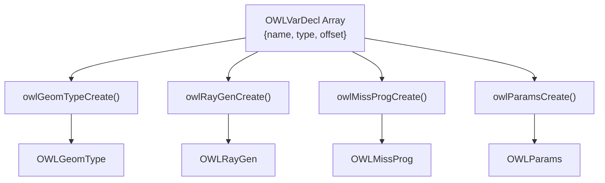
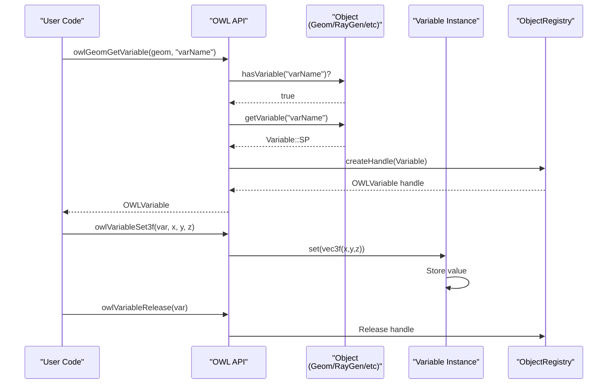
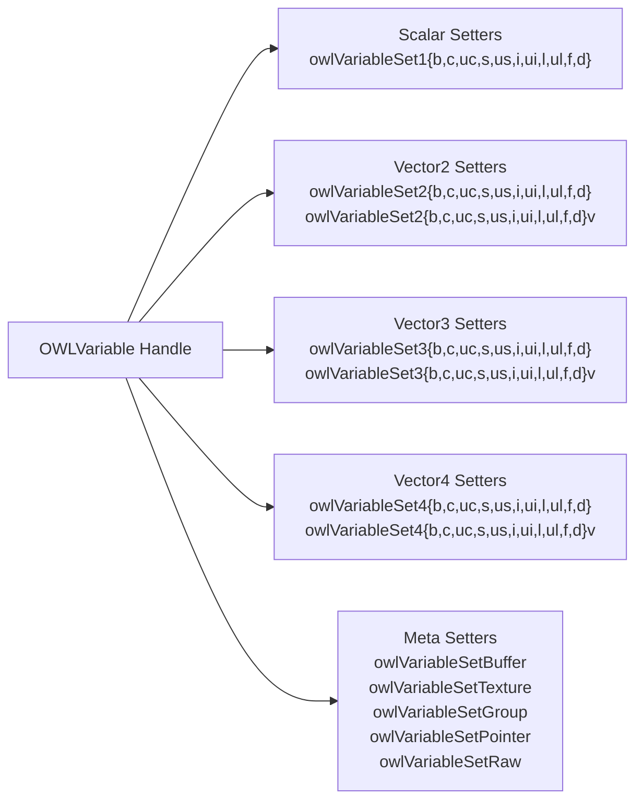
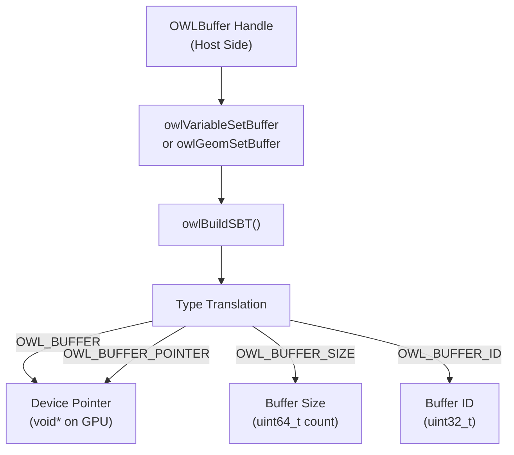
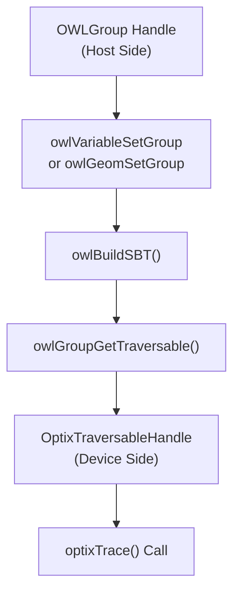
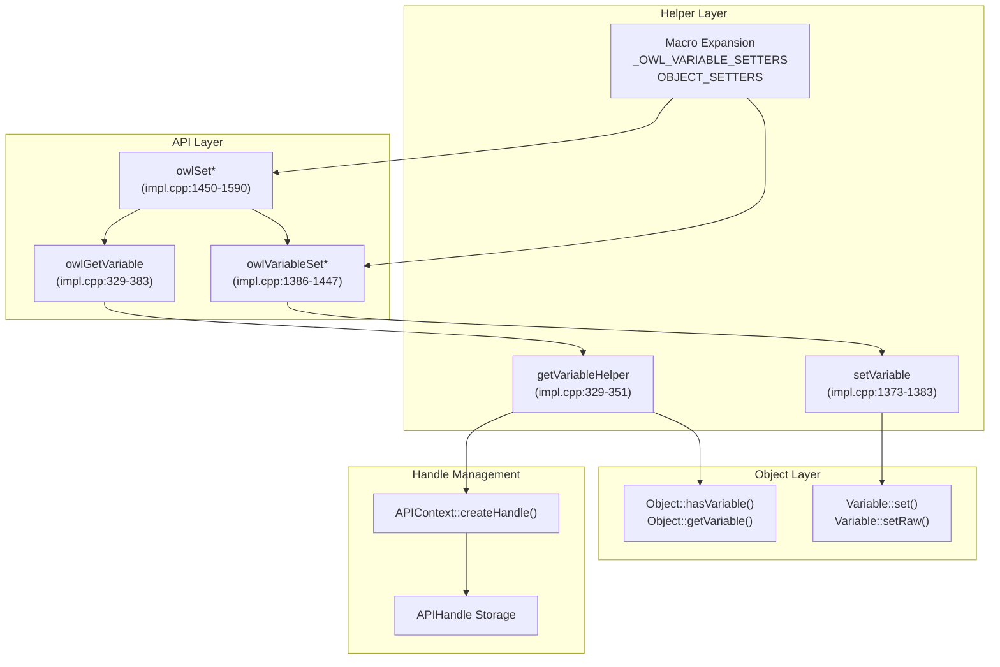

<!-- source: DeepWiki mcp.deepwiki.com · repo NVIDIA/OWL · page 3.6 Variable System · fetched 2026-10-26 -->

# Variable System

<details>
<summary>Relevant source files</summary>

The following files were used as context for generating this wiki page:

- [include/owl/owl_host.h](include/owl/owl_host.h)
- [owl/impl.cpp](owl/impl.cpp)

</details>


The Variable System provides the mechanism for declaring and setting parameters on OWL objects (geometries, ray generation programs, miss programs, and launch parameters) from the host side, making those values accessible to device-side GPU code. This system bridges the gap between host-side C++ configuration and device-side CUDA program execution.

For information about the device-side access to these variables, see [Data Access Utilities](#4.3).

## Overview

The Variable System enables users to:

1. **Declare variables** when creating objects using `OWLVarDecl` structures that specify variable names, types, and memory offsets
2. **Set variable values** from the host using either handle-based or direct setter functions
3. **Access variable values** from device programs through the program data structures

Variables are typed using the `OWLDataType` enum and support both simple types (scalars, vectors) and complex types (buffers, textures, groups). The system automatically handles translation of certain types (e.g., `OWLBuffer` handles to device pointers) during Shader Binding Table (SBT) construction.

Sources: [include/owl/owl_host.h:258-263](), [include/owl/owl_host.h:85-203]()

## Variable Declaration

Variables are declared when creating objects through arrays of `OWLVarDecl` structures:



**OWLVarDecl Structure**

The `OWLVarDecl` structure defines a variable declaration:

| Field | Type | Purpose |
|-------|------|---------|
| `name` | `const char*` | Variable name (must match device-side struct member) |
| `type` | `OWLDataType` | Variable type from the `OWLDataType` enum |
| `offset` | `uint32_t` | Byte offset within the struct (use `OWL_OFFSETOF` macro) |

Variable declarations must match the device-side struct layout. The `sizeOfVarStruct` parameter in creation functions specifies the total struct size.

Sources: [include/owl/owl_host.h:258-262](), [include/owl/owl_host.h:57-60](), [owl/impl.cpp:386-406]()

## Variable Data Types

```mermaid
graph TB
    OWL_DATA_TYPE["OWLDataType Enum"]
    
    SPECIAL["Special Types<br/>OWL_BUFFER<br/>OWL_GROUP<br/>OWL_TEXTURE<br/>OWL_DEVICE"]
    
    COPYABLE["Copyable Types<br/>(_OWL_BEGIN_COPYABLE_TYPES)"]
    
    SCALAR["Scalar Types"]
    VECTOR["Vector Types"]
    MATRIX["Matrix Types"]
    USER["User Types"]
    
    FLOAT["Float Family<br/>OWL_FLOAT/2/3/4"]
    INT["Int Family<br/>OWL_INT/2/3/4"]
    UINT["Uint Family<br/>OWL_UINT/2/3/4"]
    LONG["Long Family<br/>OWL_LONG/2/3/4"]
    ULONG["Ulong Family<br/>OWL_ULONG/2/3/4"]
    DOUBLE["Double Family<br/>OWL_DOUBLE/2/3/4"]
    CHAR["Char Family<br/>OWL_CHAR/2/3/4"]
    UCHAR["Uchar Family<br/>OWL_UCHAR/2/3/4"]
    SHORT["Short Family<br/>OWL_SHORT/2/3/4"]
    USHORT["Ushort Family<br/>OWL_USHORT/2/3/4"]
    BOOL["Bool Family<br/>OWL_BOOL/2/3/4"]
    
    AFFINE["OWL_AFFINE3F"]
    
    USER_BEGIN["OWL_USER_TYPE_BEGIN<br/>+ sizeof(Type)"]
    
    OWL_DATA_TYPE --> SPECIAL
    OWL_DATA_TYPE --> COPYABLE
    
    COPYABLE --> SCALAR
    COPYABLE --> VECTOR
    COPYABLE --> MATRIX
    COPYABLE --> USER
    
    SCALAR --> FLOAT
    SCALAR --> INT
    SCALAR --> UINT
    SCALAR --> LONG
    SCALAR --> ULONG
    SCALAR --> DOUBLE
    SCALAR --> CHAR
    SCALAR --> UCHAR
    SCALAR --> SHORT
    SCALAR --> USHORT
    SCALAR --> BOOL
    
    VECTOR --> FLOAT
    VECTOR --> INT
    VECTOR --> UINT
    VECTOR --> LONG
    VECTOR --> ULONG
    VECTOR --> DOUBLE
    VECTOR --> CHAR
    VECTOR --> UCHAR
    VECTOR --> SHORT
    VECTOR --> USHORT
    VECTOR --> BOOL
    
    MATRIX --> AFFINE
    USER --> USER_BEGIN
```



**Type Categories**

The `OWLDataType` enum divides types into two categories based on the `_OWL_BEGIN_COPYABLE_TYPES` threshold:

**Special Types (< 1000)**: These require translation during SBT build
- `OWL_BUFFER` - Translated to device pointer
- `OWL_BUFFER_SIZE` - Translated to element count
- `OWL_BUFFER_ID` - Buffer identifier
- `OWL_BUFFER_POINTER` - Direct device pointer
- `OWL_GROUP` - Translated to `OptixTraversableHandle`
- `OWL_TEXTURE` - Translated to `cudaTextureObject_t`
- `OWL_DEVICE` - Device index (implicit variable)

**Copyable Types (≥ 1000)**: Copied directly as binary data
- Scalar and vector types for all primitive types (8/16/32/64-bit signed/unsigned integers, floats, doubles, bools)
- `OWL_AFFINE3F` - 4x3 affine transformation matrix
- `OWL_RAW_POINTER` - 64-bit raw pointer (alias for `OWL_ULONG`)
- User-defined types via `OWL_USER_TYPE(T)` macro

Sources: [include/owl/owl_host.h:85-203](), [include/owl/owl_host.h:205]()

## Variable Access Pattern

The Variable System uses a handle-based pattern for type-safe variable access:



**Variable Retrieval Functions**

| Function | Purpose | Object Type |
|----------|---------|-------------|
| `owlGeomGetVariable` | Get variable from geometry | `OWLGeom` |
| `owlRayGenGetVariable` | Get variable from ray generation program | `OWLRayGen` |
| `owlMissProgGetVariable` | Get variable from miss program | `OWLMissProg` |
| `owlParamsGetVariable` | Get variable from launch parameters | `OWLParams` |

All functions take an object handle and variable name, returning an `OWLVariable` handle. The handle must be released with `owlVariableRelease` when no longer needed.

Sources: [include/owl/owl_host.h:1080-1098](), [owl/impl.cpp:329-383]()

## Setting Variables

The Variable System provides two approaches for setting variable values:

### Handle-Based Approach

1. Get variable handle with `owl<Object>GetVariable`
2. Set value with `owlVariableSet*` functions
3. Release handle with `owlVariableRelease`

**Generic Variable Setters**



Suffix legend: `b`=bool (C++ only), `c`=char, `uc`=uchar, `s`=short, `us`=ushort, `i`=int, `ui`=uint, `l`=long (int64), `ul`=ulong (uint64), `f`=float, `d`=double. The `v` suffix indicates vector input (array pointer).

Sources: [include/owl/owl_host.h:1100-1211](), [owl/impl.cpp:1373-1447]()

### Direct Approach

Convenience functions combine variable retrieval and setting in a single call:

**Object-Specific Setters**

Each object type (`RayGen`, `Geom`, `MissProg`, `Params`) provides direct setter functions:

```
owl<Object>Set1{b,c,uc,s,us,i,ui,l,ul,f,d}(object, "varName", value)
owl<Object>Set2{b,c,uc,s,us,i,ui,l,ul,f,d}(object, "varName", x, y)
owl<Object>Set3{b,c,uc,s,us,i,ui,l,ul,f,d}(object, "varName", x, y, z)
owl<Object>Set4{b,c,uc,s,us,i,ui,l,ul,f,d}(object, "varName", x, y, z, w)
owl<Object>Set{2,3,4}{b,c,uc,s,us,i,ui,l,ul,f,d}v(object, "varName", values)

owl<Object>SetBuffer(object, "varName", buffer)
owl<Object>SetTexture(object, "varName", texture)
owl<Object>SetGroup(object, "varName", group)
owl<Object>SetPointer(object, "varName", pointer)
owl<Object>SetRaw(object, "varName", pointer, devID)
```

These functions internally call `owl<Object>GetVariable`, set the value, and release the handle.

Sources: [include/owl/owl_host.h:1213-1691](), [owl/impl.cpp:1450-1590]()

## Special Variable Types

### Buffer Variables



Buffer variables declared with `OWL_BUFFER` type are automatically translated to device pointers during SBT construction. Related types:
- `OWL_BUFFER_SIZE` - Translated to the element count (not byte size)
- `OWL_BUFFER_ID` - Translated to buffer identifier
- `OWL_BUFFER_POINTER` (alias `OWL_BUFPTR`) - Direct device pointer access

Sources: [include/owl/owl_host.h:98-103](), [owl/impl.cpp:1625-1636]()

### Texture Variables

Textures are set via `owlVariableSetTexture` or object-specific setters. During SBT build, `OWL_TEXTURE`/`OWL_TEXTURE_2D` types are translated to `cudaTextureObject_t` handles that can be used with CUDA texture sampling functions on the device.

Sources: [include/owl/owl_host.h:114-115](), [owl/impl.cpp:1612-1623]()

### Group Variables

Group variables provide access to acceleration structures from device code:



Group variables declared with `OWL_GROUP` type are translated to `OptixTraversableHandle` values, allowing device programs to recursively trace into acceleration structures.

Sources: [include/owl/owl_host.h:105](), [owl/impl.cpp:1598-1609]()

### Raw and Pointer Variables

**Raw Variables** (`owlVariableSetRaw`): Allows setting arbitrary binary data, optionally per-device. When `devID` is -1, the value is set for all devices; otherwise, only for the specified device. Useful for CUDA interop.

**Pointer Variables** (`owlVariableSetPointer`): Sets a 64-bit raw pointer value (cast to `uint64_t`). The pointer is not translated—it's copied directly. Use `OWL_RAW_POINTER` type for declaration.

Sources: [include/owl/owl_host.h:1208-1210](), [owl/impl.cpp:1638-1664]()

## Variable System Implementation



**Key Implementation Details**

1. **Template-Based Retrieval**: The `getVariableHelper<T>` template function provides type-safe variable retrieval for different object types (Geom, RayGen, MissProg, LaunchParams).

2. **Macro-Generated Setters**: The implementation uses macros (`_OWL_VARIABLE_SETTERS`, `OBJECT_SETTERS_T`, `OBJECT_META_SETTERS`) to generate the extensive set of setter functions for all type/dimension combinations. This reduces code duplication for the 100+ setter function variants.

3. **Handle-Based API**: `OWLVariable` is an opaque handle (`APIHandle*`) that wraps a `Variable::SP` shared pointer. This provides safe memory management while maintaining a C-compatible API.

4. **Variable Storage**: Variables store their values internally and apply them to the appropriate device memory during SBT construction or updates. The `Variable::set()` method handles type checking and value storage.

5. **Type Translation**: Special types (`OWL_BUFFER`, `OWL_GROUP`, `OWL_TEXTURE`) are translated during `owlBuildSBT()` by querying the actual object handles and retrieving their device-side representations.

Sources: [owl/impl.cpp:329-383](), [owl/impl.cpp:1373-1665](), [owl/impl.cpp:1386-1447]()

## Variable Declaration Example Pattern

Typical usage pattern for declaring and using variables:

```c++
// Host-side struct (must match device-side)
struct MyGeomData {
    vec3f color;           // offset 0
    float opacity;         // offset 12
    OptixTraversableHandle world;  // offset 16
    float* vertexBuffer;   // offset 24
};

// Variable declarations using OWL_OFFSETOF
OWLVarDecl myVars[] = {
    { "color",   OWL_FLOAT3, OWL_OFFSETOF(MyGeomData, color) },
    { "opacity", OWL_FLOAT,  OWL_OFFSETOF(MyGeomData, opacity) },
    { "world",   OWL_GROUP,  OWL_OFFSETOF(MyGeomData, world) },
    { "vertexBuffer", OWL_BUFFER_POINTER, OWL_OFFSETOF(MyGeomData, vertexBuffer) },
    { nullptr } // null-terminated
};

// Create geometry type with variables
OWLGeomType geomType = owlGeomTypeCreate(
    context, OWL_GEOM_TRIANGLES, 
    sizeof(MyGeomData), myVars, -1  // -1 = null-terminated array
);

// Create geometry instance and set variables
OWLGeom geom = owlGeomCreate(context, geomType);

// Approach 1: Direct setters
owlGeomSet3f(geom, "color", 1.0f, 0.0f, 0.0f);
owlGeomSet1f(geom, "opacity", 0.8f);
owlGeomSetGroup(geom, "world", rootGroup);
owlGeomSetBuffer(geom, "vertexBuffer", vertexBuffer);

// Approach 2: Handle-based
OWLVariable colorVar = owlGeomGetVariable(geom, "color");
owlVariableSet3f(colorVar, 1.0f, 0.0f, 0.0f);
owlVariableRelease(colorVar);
```

Sources: [include/owl/owl_host.h:57-60](), [include/owl/owl_host.h:258-262]()

---

