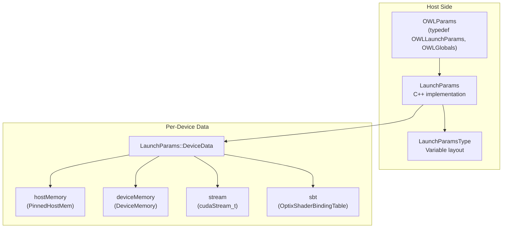
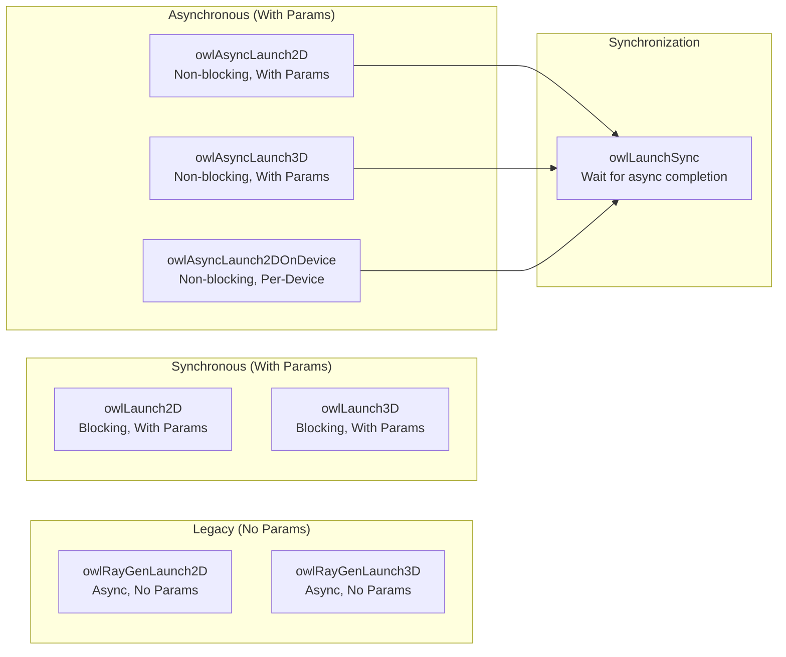
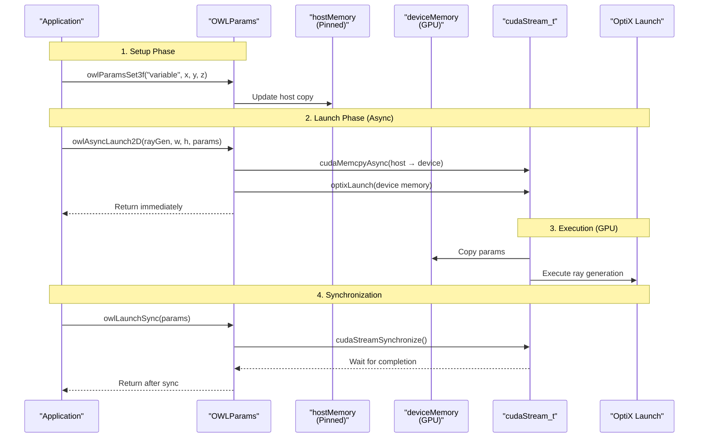

<!-- source: DeepWiki mcp.deepwiki.com · repo NVIDIA/OWL · page 3.7 Launch Operations · fetched 2026-10-26 -->

# Launch Operations

<details>
<summary>Relevant source files</summary>

The following files were used as context for generating this wiki page:

- [include/owl/owl_host.h](include/owl/owl_host.h)
- [owl/LaunchParams.cpp](owl/LaunchParams.cpp)
- [owl/LaunchParams.h](owl/LaunchParams.h)

</details>


This page documents the host-side API for executing ray tracing launches in OWL. Launch operations trigger the execution of ray generation programs on the GPU, with support for both synchronous and asynchronous execution modes. For information about ray generation program creation, see [Programs and Modules](#3.5). For information about setting variables on programs, see [Variable System](#3.6).

## Overview

OWL provides several launch functions that execute ray generation programs with specified dimensions (2D or 3D). Launch operations can be performed with or without launch parameters (also called "globals"), and can execute synchronously (blocking) or asynchronously (non-blocking). Each launch parameters object maintains its own CUDA stream to enable independent asynchronous launches.

**Sources:** [include/owl/owl_host.h:855-903]()

## Launch Parameters (OWLParams)

Launch parameters, also referred to as "globals" or `OWLParams`, are objects that encapsulate variables accessible to all programs during a launch. These correspond to the `__constant__` CUDA variable on the device side.

### Structure



Each `OWLParams` object contains:
- **Host memory**: Pinned host-side copy of parameter values for fast async upload
- **Device memory**: GPU-side memory holding parameters during launch
- **CUDA stream**: Dedicated stream for independent asynchronous operations
- **SBT reference**: Shader binding table used for the launch

**Sources:** [owl/LaunchParams.h:36-94](), [owl/LaunchParams.cpp:36-47]()

### Creation

Launch parameters are created by specifying a size and variable declarations:

```c++
OWLParams owlParamsCreate(OWLContext context,
                          size_t sizeOfVarStruct,
                          const OWLVarDecl *vars,
                          int numVars);
```

**Key parameters:**
- `sizeOfVarStruct`: Size of the device-side struct (usually `sizeof(YourLaunchParams)`)
- `vars`: Array of variable declarations describing the struct layout
- `numVars`: Number of variables in the array

**Sources:** [include/owl/owl_host.h:475-479]()

### Setting Variables

Variables on launch parameters are set using the same variable system as other OWL objects. The `owlParamsSet*` family of functions sets parameter values:

| Function Pattern | Description |
|-----------------|-------------|
| `owlParamsSet1f`, `owlParamsSet3f`, etc. | Set scalar/vector floats |
| `owlParamsSet1i`, `owlParamsSet3i`, etc. | Set scalar/vector integers |
| `owlParamsSetBuffer` | Set buffer references |
| `owlParamsSetGroup` | Set group (traversable) references |
| `owlParamsSetTexture` | Set texture references |

For complete variable setting API, see [Variable System](#3.6).

**Sources:** [include/owl/owl_host.h:1244-1332]()

### CUDA Streams

Each `OWLParams` object has a dedicated CUDA stream per device, accessible via:

```c++
cudaTextureObject_t owlParamsGetCudaStream(OWLParams params, int deviceID);
```

This enables:
- Multiple independent asynchronous launches
- Overlapping computation with data transfers
- Per-launch resource management

**Sources:** [include/owl/owl_host.h:898-899](), [owl/LaunchParams.h:82](), [owl/LaunchParams.cpp:87-90]()

## Launch Functions

### Legacy Launches (Without Parameters)

These functions execute launches without launch parameters, using default streams. They are asynchronous and do not wait for completion:

```c++
void owlRayGenLaunch2D(OWLRayGen rayGen, int dims_x, int dims_y);
void owlRayGenLaunch3D(OWLRayGen rayGen, int dims_x, int dims_y, int dims_z);
```

**Use case:** Simple renders where no global parameters are needed.

**Note:** These launches are asynchronous and may not be complete when the function returns.

**Sources:** [include/owl/owl_host.h:855-863]()

### Synchronous Launches

Synchronous launches execute and wait for completion before returning:

```c++
void owlLaunch2D(OWLRayGen rayGen, int dims_x, int dims_y, OWLParams params);
void owlLaunch3D(OWLRayGen rayGen, int dims_x, int dims_y, int dims_z, OWLParams params);
```

**Characteristics:**
- **Blocking**: Function returns only after launch completes
- **Requires params**: Both `rayGen` and `params` must be valid handles
- **Thread-safe**: Each params object has its own stream

**Use case:** Simple rendering loops where you want to ensure completion before the next frame.

**Sources:** [include/owl/owl_host.h:865-876]()

### Asynchronous Launches

Asynchronous launches submit work and return immediately:

```c++
void owlAsyncLaunch2D(OWLRayGen rayGen, int dims_x, int dims_y, OWLParams params);
void owlAsyncLaunch3D(OWLRayGen rayGen, int dims_x, int dims_y, int dims_z, 
                      OWLParams params);
```

**Characteristics:**
- **Non-blocking**: Function returns immediately after submitting work
- **Stream-based**: Uses the dedicated stream from the params object
- **Parallel execution**: Multiple async launches can overlap if using different params objects

**Use case:** Advanced rendering pipelines with overlapping computation and data transfer.

**Sources:** [include/owl/owl_host.h:878-889]()

### Per-Device Launches

For explicit multi-GPU control or dynamic load balancing:

```c++
void owlAsyncLaunch2DOnDevice(OWLRayGen rayGen, int dims_x, int dims_y, 
                              int deviceID, OWLParams params);
```

**Characteristics:**
- **Device-specific**: Launches only on the specified device
- **Asynchronous**: Returns immediately
- **Load balancing**: Enables custom work distribution across GPUs

**Use case:** Dynamic load balancing or heterogeneous GPU configurations.

**Sources:** [include/owl/owl_host.h:891-895]()

## Launch Coordination

### Launch Function Comparison



### Synchronization

To wait for asynchronous launches to complete:

```c++
void owlLaunchSync(OWLParams params);
```

This function:
- Synchronizes on the CUDA stream associated with the params object
- Waits across all devices in the context
- Ensures all work submitted with this params object is complete

**Implementation:** Internally calls `cudaStreamSynchronize` on each device's stream.

**Sources:** [include/owl/owl_host.h:901-903](), [owl/LaunchParams.cpp:95-101]()

## Launch Data Flow



**Sources:** [owl/LaunchParams.h:43-65](), [owl/LaunchParams.cpp:36-47]()

## Common Usage Patterns

### Pattern 1: Simple Synchronous Rendering

```c++
// Setup
OWLParams params = owlParamsCreate(context, sizeof(LaunchParams), vars, numVars);
OWLRayGen rayGen = owlRayGenCreate(context, module, "renderFrame", ...);

// Per-frame loop
while (rendering) {
    // Update parameters
    owlParamsSetBuffer(params, "frameBuffer", frameBuffer);
    owlParamsSet3f(params, "cameraPos", camPos.x, camPos.y, camPos.z);
    
    // Synchronous launch (blocks until complete)
    owlLaunch2D(rayGen, width, height, params);
    
    // Read results immediately
    readFrameBuffer();
}
```

### Pattern 2: Asynchronous Pipeline

```c++
// Use two params objects for double buffering
OWLParams params[2];
for (int i = 0; i < 2; i++) {
    params[i] = owlParamsCreate(context, sizeof(LaunchParams), vars, numVars);
}

int current = 0;
while (rendering) {
    // Update current params
    owlParamsSetBuffer(params[current], "frameBuffer", frameBuffers[current]);
    
    // Launch asynchronously
    owlAsyncLaunch2D(rayGen, width, height, params[current]);
    
    // Sync previous frame (if any) and display
    if (frameCount > 0) {
        int previous = 1 - current;
        owlLaunchSync(params[previous]);
        displayFrameBuffer(frameBuffers[previous]);
    }
    
    // Swap
    current = 1 - current;
    frameCount++;
}
```

### Pattern 3: Multi-GPU Load Balancing

```c++
// Create params per device
int numDevices = owlGetDeviceCount(context);
std::vector<OWLParams> deviceParams(numDevices);
for (int i = 0; i < numDevices; i++) {
    deviceParams[i] = owlParamsCreate(context, sizeof(LaunchParams), vars, numVars);
}

// Distribute work across devices
for (int dev = 0; dev < numDevices; dev++) {
    int startY = (height * dev) / numDevices;
    int endY = (height * (dev + 1)) / numDevices;
    int devHeight = endY - startY;
    
    // Set device-specific parameters
    owlParamsSet1i(deviceParams[dev], "startY", startY);
    
    // Launch on specific device
    owlAsyncLaunch2DOnDevice(rayGen, width, devHeight, dev, deviceParams[dev]);
}

// Wait for all devices
for (int dev = 0; dev < numDevices; dev++) {
    owlLaunchSync(deviceParams[dev]);
}
```

**Sources:** [include/owl/owl_host.h:855-903]()

## Launch Dimensions

| Function Type | Dimensions | Thread Organization |
|--------------|------------|---------------------|
| `*Launch2D` | `(dims_x, dims_y)` | 2D grid, `optixGetLaunchIndex()` returns `(x, y, 0)` |
| `*Launch3D` | `(dims_x, dims_y, dims_z)` | 3D grid, `optixGetLaunchIndex()` returns `(x, y, z)` |

**Device-side access:**
- Use `optixGetLaunchIndex()` to get the current thread's position
- Use `optixGetLaunchDimensions()` to get the total grid size

For device-side launch utilities, see [Data Access Utilities](#4.3).

**Sources:** [include/owl/owl_host.h:855-889]()

## Implementation Details

### Memory Management

The `LaunchParams::DeviceData` structure manages per-device resources:

| Field | Type | Purpose |
|-------|------|---------|
| `hostMemory` | `PinnedHostMem` | Pinned host memory for fast async transfers |
| `deviceMemory` | `DeviceMemory` | GPU memory holding parameter values |
| `stream` | `cudaStream_t` | Dedicated CUDA stream for this params object |
| `sbt` | `OptixShaderBindingTable` | SBT reference for launches |

**Lifecycle:**
1. **Creation:** Allocates host and device memory, creates CUDA stream
2. **Launch:** Copies host memory to device asynchronously via stream
3. **Destruction:** Destroys CUDA stream, frees memory

**Sources:** [owl/LaunchParams.h:43-65](), [owl/LaunchParams.cpp:36-52]()

### Stream Isolation

Each `OWLParams` object has its own CUDA stream per device, enabling:
- **Concurrent launches:** Different params can launch simultaneously
- **Independent progress:** One launch doesn't block another
- **Resource isolation:** Each launch manages its own async operations

The dedicated stream is created in `LaunchParams::DeviceData` constructor and destroyed in the destructor.

**Sources:** [owl/LaunchParams.cpp:44](), [owl/LaunchParams.cpp:51]()

## Best Practices

1. **Use synchronous launches for simple cases:** When you need results immediately and don't require overlapping work.

2. **Use asynchronous launches for pipelines:** When you can overlap computation with other work (e.g., displaying previous frame while rendering next).

3. **Create multiple params objects for double/triple buffering:** This allows launching the next frame while previous frames are still in flight.

4. **Match launch dimensions to your problem:** Use 2D launches for image rendering, 3D launches for volumetric operations.

5. **Use per-device launches for load balancing:** When GPUs have different performance characteristics or for adaptive load distribution.

6. **Always sync before accessing results:** For async launches, call `owlLaunchSync` before reading output buffers.

7. **Reuse params objects:** Creating params objects has overhead; reuse them across frames by updating variables.

**Sources:** [include/owl/owl_host.h:855-903](), [owl/LaunchParams.h:36-94]()

---

