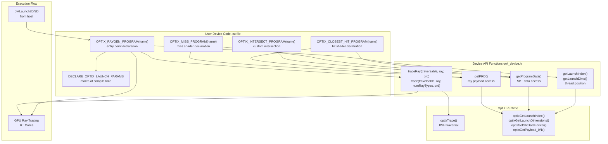
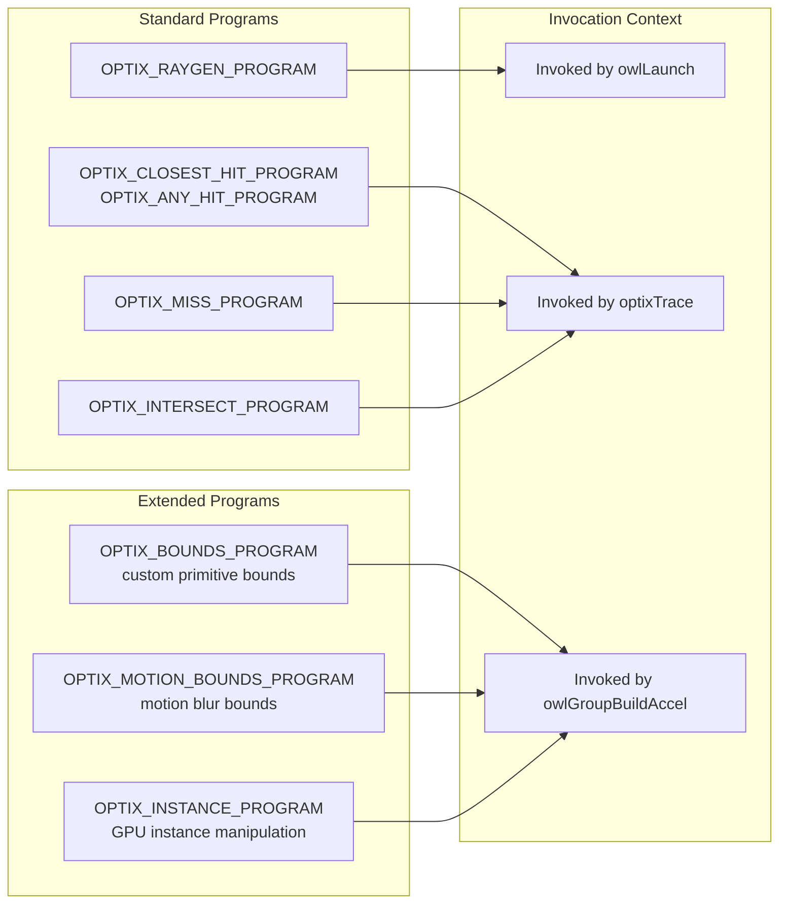
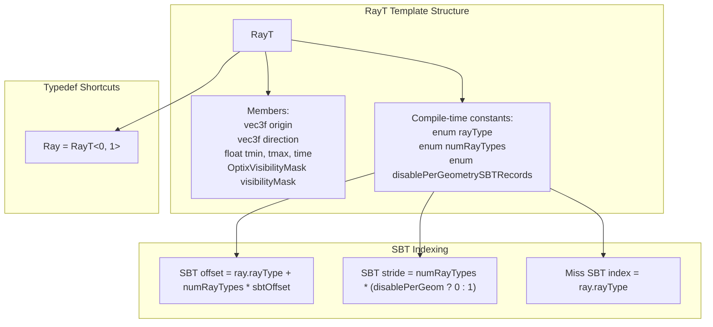
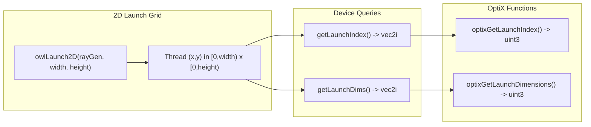
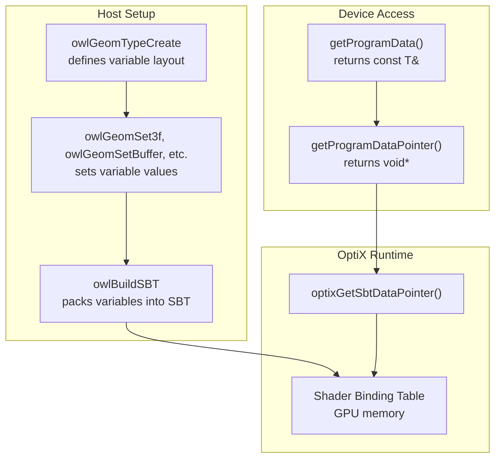
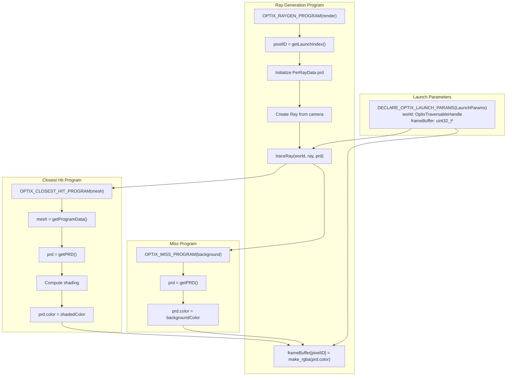

<!-- source: DeepWiki mcp.deepwiki.com · repo NVIDIA/OWL · page 4 Device API Reference · fetched 2026-10-26 -->

# Device API Reference

<details>
<summary>Relevant source files</summary>

The following files were used as context for generating this wiki page:

- [include/owl/owl_device.h](include/owl/owl_device.h)

</details>


This page documents the GPU-side API exposed in `owl_device.h` for writing CUDA device code that executes as OptiX ray tracing programs. The Device API provides macros for declaring OptiX program types, functions for tracing rays and accessing program data, and utility functions for common device-side operations.

**Scope**: This page covers only GPU-side (device) code constructs. For CPU-side API functions that create and manage OptiX objects from the host, see [Host API Reference](#3). For build system utilities that compile CUDA code to PTX, see [PTX Embedding](#5.3).

**Requirements**: All code using the Device API must be compiled with `nvcc` (CUDA compiler). The header enforces this requirement at [include/owl/owl_device.h:20-22](), issuing a compilation error if included in non-CUDA contexts.

## Overview

The Device API operates within OptiX programs that execute on the GPU during ray tracing. Programs are written as CUDA device functions, compiled to PTX, and bound to OptiX pipeline stages through the Host API. At runtime, OptiX invokes these programs at specific pipeline stages (ray generation, intersection testing, hit processing, miss handling).

### Device API Architecture



**Diagram: Device API Program Structure**

The diagram illustrates how user device code uses OWL macros to declare programs, OWL functions to access data and trace rays, which delegate to underlying OptiX runtime functions. Programs are invoked by host-side `owlLaunch` calls.

**Sources**: [include/owl/owl_device.h:1-374]()

### Namespace and Dependencies

All Device API functions reside in the `owl` namespace [include/owl/owl_device.h:24]() and use types from `owl::common` [include/owl/owl_device.h:26](). The API depends on:

| Dependency | Purpose | Header |
|------------|---------|--------|
| OptiX | Ray tracing runtime API | `<optix.h>` |
| CUDA | GPU programming model | `<cuda.h>` |
| CUDA vector types | Built-in vector types | `<vector_types.h>` |
| OWL math types | `vec2i`, `vec3f`, `vec4f`, `affine3f`, `box3f` | `"owl/common/math/*.h"` |

**Sources**: [include/owl/owl_device.h:8-14]()

## Program Declaration Macros

Program declaration macros define the entry points for OptiX pipeline stages. Each macro expands to an `extern "C" __global__` function with OptiX's required naming convention (double-underscore prefix indicating program type).

### Core Program Types

| Macro | Purpose | OptiX Function Name Pattern | Lines |
|-------|---------|----------------------------|-------|
| `OPTIX_RAYGEN_PROGRAM(name)` | Ray generation entry point, invoked once per launch thread | `__raygen__##name` | [244-246]() |
| `OPTIX_CLOSEST_HIT_PROGRAM(name)` | Closest hit shader, invoked when ray finds nearest intersection | `__closesthit__##name` | [248-250]() |
| `OPTIX_ANY_HIT_PROGRAM(name)` | Any-hit shader, invoked for all intersections (for transparency, etc.) | `__anyhit__##name` | [252-254]() |
| `OPTIX_MISS_PROGRAM(name)` | Miss shader, invoked when ray hits no geometry | `__miss__##name` | [260-262]() |
| `OPTIX_INTERSECT_PROGRAM(name)` | Custom intersection, for procedural geometry | `__intersection__##name` | [256-258]() |

**Usage Pattern**:
```cpp
// Declare ray generation program
OPTIX_RAYGEN_PROGRAM(renderFrame)()
{
  const vec2i pixelID = owl::getLaunchIndex();
  // ... trace rays ...
}

// Declare closest hit program
OPTIX_CLOSEST_HIT_PROGRAM(triangleMesh)()
{
  const TriangleMeshData &self = owl::getProgramData<TriangleMeshData>();
  // ... compute shading ...
}

// Declare miss program
OPTIX_MISS_PROGRAM(radiance)()
{
  PerRayData &prd = owl::getPRD<PerRayData>();
  prd.color = vec3f(0.f); // background color
}
```

**Sources**: [include/owl/owl_device.h:244-262]()

### Extended Program Types



**Diagram: Program Type Invocation Contexts**

#### OPTIX_BOUNDS_PROGRAM

Computes bounding boxes for custom geometry primitives during acceleration structure building. The macro generates both a CUDA kernel wrapper and the user-implemented bounds function.

**Macro Expansion** [include/owl/owl_device.h:266-295]():
- Declares forward reference for `__boundsFunc__##progName`
- Generates `__boundsFuncKernel__##progName` kernel that launches in parallel over primitives
- User implements inline device function with signature:
  ```cpp
  void __boundsFunc__##progName(const void *geomData,
                                 owl::common::box3f &bounds,
                                 const int32_t primID)
  ```

**Usage Example**:
```cpp
OPTIX_BOUNDS_PROGRAM(sphereBounds)
(const void *geomData, box3f &bounds, const int32_t primID)
{
  const SphereGeomData &self = *(const SphereGeomData*)geomData;
  const vec3f center = self.centers[primID];
  const float radius = self.radii[primID];
  bounds.lower = center - vec3f(radius);
  bounds.upper = center + vec3f(radius);
}
```

#### OPTIX_MOTION_BOUNDS_PROGRAM

Computes bounding boxes for two motion blur keyframes [include/owl/owl_device.h:299-333](). Similar structure to `OPTIX_BOUNDS_PROGRAM` but outputs two bounding boxes:

```cpp
void __motionBoundsFunc__##progName(const void *geomData,
                                     owl::common::box3f &boundskey1,
                                     owl::common::box3f &boundskey2,
                                     const int32_t primID)
```

#### OPTIX_INSTANCE_PROGRAM

Enables GPU-side manipulation of instance properties (transforms, visibility masks, instance IDs) during acceleration structure builds [include/owl/owl_device.h:338-373](). Assumes per-geometry SBT contribution is disabled.

**User Signature**:
```cpp
void __instanceFunc__##progName(const int32_t instanceIndex, 
                                 OptixInstance &instance)
```

The `OptixInstance` struct is initialized with defaults (identity transform, full visibility mask, instance ID = index) and user code modifies fields as needed.

**Sources**: [include/owl/owl_device.h:266-373]()

### Launch Parameters Declaration

The `DECLARE_OPTIX_LAUNCH_PARAMS(type)` macro declares a constant memory variable for global launch parameters [include/owl/owl_device.h:242]():

```cpp
extern __constant__ type optixLaunchParams;
```

**Requirements**:
- Must use the fixed name `optixLaunchParams`
- Must have `__constant__` storage qualifier (OptiX requirement)
- Type must match the type set via `owlParamsSet*` on the host

**Usage**:
```cpp
struct LaunchParams {
  OptixTraversableHandle world;
  uint32_t *frameBuffer;
  vec2i frameSize;
};

DECLARE_OPTIX_LAUNCH_PARAMS(LaunchParams)

OPTIX_RAYGEN_PROGRAM(render)()
{
  const vec2i pixelID = getLaunchIndex();
  // Access global parameters
  const uint32_t fbIndex = pixelID.x + pixelID.y * optixLaunchParams.frameSize.x;
  optixLaunchParams.frameBuffer[fbIndex] = /* ... */;
}
```

**Sources**: [include/owl/owl_device.h:239-242]()

## Ray Tracing Functions

The Device API provides type-safe wrappers around OptiX's `optixTrace` function, managing ray parameters, payload packing, and SBT indexing.

### Ray Type Representation



**Diagram: Ray Type and SBT Indexing**

The `RayT` template [include/owl/owl_device.h:131-152]() encapsulates ray parameters with compile-time configuration for SBT indexing:

| Template Parameter | Type | Purpose |
|-------------------|------|---------|
| `_rayType` | `int` | Ray type index for multi-ray-type rendering (0 for single type) |
| `_numRayTypes` | `int` | Total number of ray types in the system |
| `_disablePerGeometrySBTRecords` | `bool` | If true, use single SBT record for all geometry instances (stride=0) |

**Constructor** [include/owl/owl_device.h:137-147]():
```cpp
RayT(const vec3f &origin,
     const vec3f &direction,
     float tmin,
     float tmax,
     OptixVisibilityMask visibilityMask=(OptixVisibilityMask)(-1))
```

**Default Type**: `Ray` is a typedef for `RayT<0,1>` [include/owl/owl_device.h:153]() representing a single ray type system with per-geometry SBT records enabled.

**Sources**: [include/owl/owl_device.h:131-153]()

### traceRay Function

Template function that traces rays with compile-time SBT configuration [include/owl/owl_device.h:156-180]():

```cpp
template<typename RayType, typename PRD>
inline __device__ void traceRay(OptixTraversableHandle traversable,
                                 const RayType &ray,
                                 PRD &prd,
                                 uint32_t rayFlags = 0u)
```

**Parameters**:

| Parameter | Type | Description |
|-----------|------|-------------|
| `traversable` | `OptixTraversableHandle` | Root acceleration structure handle (typically from `optixLaunchParams`) |
| `ray` | `const RayType &` | Ray parameters with embedded SBT configuration |
| `prd` | `PRD &` | Per-ray data payload (passed by reference, packed into payload registers) |
| `rayFlags` | `uint32_t` | Optional OptiX ray flags (e.g., `OPTIX_RAY_FLAG_DISABLE_ANYHIT`) |

**Implementation Details**:
1. Packs `prd` pointer into two 32-bit payload registers using `packPointer` [include/owl/owl_device.h:165]()
2. Extracts SBT offset, stride, and miss index from `RayType` template parameters [include/owl/owl_device.h:175-177]()
3. Calls `optixTrace` with packed payload [include/owl/owl_device.h:167-179]()

**Usage**:
```cpp
struct PerRayData {
  vec3f color;
  int depth;
};

OPTIX_RAYGEN_PROGRAM(render)()
{
  PerRayData prd;
  prd.depth = 0;
  
  Ray ray(/* origin */ camera.pos,
          /* direction */ normalize(rayDir),
          /* tmin */ 0.001f,
          /* tmax */ 1e20f);
  
  owl::traceRay(optixLaunchParams.world, ray, prd);
  
  // prd.color now contains result from hit/miss programs
}
```

**Sources**: [include/owl/owl_device.h:156-180]()

### trace Function Overloads

Two runtime-configured overloads for backward compatibility and runtime flexibility:

#### Overload 1: Runtime Ray Type Count

```cpp
template<typename PRD>
inline __device__ void trace(OptixTraversableHandle traversable,
                              const Ray &ray,
                              int numRayTypes,
                              PRD &prd,
                              int sbtOffset = 0)
```

**Parameters** [include/owl/owl_device.h:182-207]():
- `numRayTypes`: Passed at runtime instead of compile-time template parameter
- `sbtOffset`: Additional offset for per-geometry SBT indexing
- SBT stride computed as `numRayTypes` (assumes per-geometry records enabled)

#### Overload 2: Runtime Geometry SBT Control

```cpp
template<typename PRD>
inline __device__ void trace(OptixTraversableHandle traversable,
                              const Ray &ray,
                              int numRayTypes,
                              bool disablePerGeometrySBTRecords,
                              PRD &prd,
                              int sbtOffset = 0)
```

**Parameters** [include/owl/owl_device.h:209-235]():
- `disablePerGeometrySBTRecords`: Runtime boolean controlling SBT stride calculation
- SBT stride computed as `numRayTypes * (disablePerGeometrySBTRecords ? 0 : 1)` [include/owl/owl_device.h:231]()

**Comparison**:

| Function | SBT Config | Performance | Use Case |
|----------|-----------|-------------|----------|
| `traceRay` | Compile-time | Optimal (constants) | Known ray type configuration |
| `trace` (overload 1) | Runtime | Moderate | Variable ray types, per-geometry SBT |
| `trace` (overload 2) | Runtime | Moderate | Variable ray types and SBT layout |

**Sources**: [include/owl/owl_device.h:182-235]()

## Data Access Utilities

Functions for accessing OptiX-provided data within device programs.

### Launch Coordinate Queries



**Diagram: Launch Coordinate Query Flow**

#### getLaunchIndex

Returns the current thread's index within the launch grid [include/owl/owl_device.h:28-31]():

```cpp
inline __device__ vec2i getLaunchIndex()
{
  return (vec2i)optixGetLaunchIndex();
}
```

**Returns**: `vec2i` with x,y coordinates for 2D launches (z-coordinate discarded from OptiX's `uint3`)

**Typical Usage**: Computing pixel coordinates in ray generation programs
```cpp
const vec2i pixelID = owl::getLaunchIndex();
const int fbIndex = pixelID.x + pixelID.y * fbWidth;
```

#### getLaunchDims

Returns the dimensions of the launch grid [include/owl/owl_device.h:35-38]():

```cpp
inline __device__ vec2i getLaunchDims()
{
  return (vec2i)optixGetLaunchDimensions();
}
```

**Returns**: `vec2i` with width, height of the launch grid

**Note**: For 1D or 3D launches, use OptiX functions directly. OWL's wrappers are optimized for 2D launches (the most common case for rendering).

**Sources**: [include/owl/owl_device.h:28-38]()

### Program Data Access

Program data (also called "SBT data") contains per-program or per-geometry parameters stored in the Shader Binding Table.



**Diagram: Program Data Flow from Host to Device**

#### getProgramDataPointer

Returns untyped pointer to current program's SBT data [include/owl/owl_device.h:44-47]():

```cpp
inline __device__ const void *getProgramDataPointer()
{
  return (const void*)optixGetSbtDataPointer();
}
```

**Returns**: `const void*` to SBT data for the currently executing program

**Use Case**: When type is determined at runtime or for manual casting

#### getProgramData<T>

Type-safe template wrapper [include/owl/owl_device.h:53-57]():

```cpp
template<typename T>
inline __device__ const T &getProgramData()
{
  return *(const T*)getProgramDataPointer();
}
```

**Template Parameter**: `T` must match the struct type declared with `owlGeomTypeCreate` on the host

**Returns**: `const T&` reference to program data

**Warning**: No runtime type checking is performed. Type mismatch causes undefined behavior.

**Usage Pattern**:
```cpp
// Host side: define variable layout
struct TriangleMeshData {
  vec3f *vertices;
  vec3i *indices;
  vec3f *normals;
  vec2f *texcoords;
};
OWLGeomType geomType = owlGeomTypeCreate(context, OWL_GEOM_TRIANGLES,
                                          sizeof(TriangleMeshData), ...);
owlGeomTypeSetVariables(geomType, ...);

// Device side: access data
OPTIX_CLOSEST_HIT_PROGRAM(mesh)()
{
  const TriangleMeshData &self = owl::getProgramData<TriangleMeshData>();
  const vec3i idx = self.indices[primID];
  const vec3f v0 = self.vertices[idx.x];
  // ...
}
```

**Sources**: [include/owl/owl_device.h:44-57]()

### Payload Data Access

Per-ray data (PRD) is user-defined data passed through ray tracing calls, modified by hit/miss programs.

#### Payload Packing/Unpacking

OptiX passes payload through up to 32 32-bit registers. OWL uses the first two registers to pack a 64-bit pointer [include/owl/owl_device.h:104-117]():

```cpp
static __forceinline__ __device__ void* unpackPointer(uint32_t i0, uint32_t i1)
{
  const uint64_t uptr = static_cast<uint64_t>(i0) << 32 | i1;
  return reinterpret_cast<void*>(uptr); 
}

static __forceinline__ __device__ void packPointer(void* ptr, uint32_t& i0, uint32_t& i1)
{
  const uint64_t uptr = reinterpret_cast<uint64_t>(ptr);
  i0 = uptr >> 32;
  i1 = uptr & 0x00000000ffffffff;
}
```

**Implementation**: Upper 32 bits in `i0`, lower 32 bits in `i1`

#### getPRDPointer

Retrieves untyped pointer from payload registers [include/owl/owl_device.h:120-125]():

```cpp
static __forceinline__ __device__ void *getPRDPointer()
{ 
  const uint32_t u0 = optixGetPayload_0();
  const uint32_t u1 = optixGetPayload_1();
  return unpackPointer(u0, u1);
}
```

**Operation**: Extracts payload registers 0 and 1, unpacks to 64-bit pointer

#### getPRD<T>

Type-safe PRD access [include/owl/owl_device.h:127-129]():

```cpp
template<typename T>
static __forceinline__ __device__ T &getPRD()
{ 
  return *(T*)getPRDPointer(); 
}
```

**Returns**: Non-const reference `T&` (hit/miss programs modify PRD)

**Usage in Hit Program**:
```cpp
struct PerRayData {
  vec3f color;
  vec3f normal;
  float t;
};

OPTIX_CLOSEST_HIT_PROGRAM(shading)()
{
  PerRayData &prd = owl::getPRD<PerRayData>();
  const TriangleMeshData &mesh = owl::getProgramData<TriangleMeshData>();
  
  // Compute and store results in PRD
  prd.normal = computeNormal(mesh, primID);
  prd.color = shade(prd.normal);
  prd.t = optixGetRayTmax();
}
```

**Sources**: [include/owl/owl_device.h:104-129]()

### Data Access Summary Table

| Function | Returns | Const | Use Case | Lines |
|----------|---------|-------|----------|-------|
| `getLaunchIndex()` | `vec2i` | N/A | Thread position in launch grid | [28-31]() |
| `getLaunchDims()` | `vec2i` | N/A | Launch grid dimensions | [35-38]() |
| `getProgramDataPointer()` | `const void*` | Yes | Untyped SBT data access | [44-47]() |
| `getProgramData<T>()` | `const T&` | Yes | Typed SBT data access | [53-57]() |
| `getPRDPointer()` | `void*` | No | Untyped payload pointer | [120-125]() |
| `getPRD<T>()` | `T&` | No | Typed payload reference | [127-129]() |
| `packPointer()` | `void` | N/A | Pack pointer into two uint32_t | [112-117]() |
| `unpackPointer()` | `void*` | N/A | Unpack pointer from two uint32_t | [104-109]() |

**Sources**: [include/owl/owl_device.h:28-129]()

## Device Utilities

Helper functions for common device-side operations.

### Color Conversion

#### linear_to_srgb

Converts linear RGB values to sRGB color space [include/owl/owl_device.h:63-68]():

```cpp
inline __device__ float linear_to_srgb(float x) {
  if (x <= 0.0031308f) {
    return 12.92f * x;
  }
  return 1.055f * pow(x, 1.f/2.4f) - 0.055f;
}
```

**Parameters**: 
- `x`: Linear color component in [0, 1]

**Returns**: sRGB component applying standard gamma correction

**Note**: Apply per-channel before packing to RGBA

#### make_8bit

Quantizes float [0, 1] to 8-bit integer [0, 255] [include/owl/owl_device.h:70-73]():

```cpp
inline __device__ uint32_t make_8bit(const float f)
{
  return min(255, max(0, int(f*256.f)));
}
```

**Clamping**: Ensures result is in valid range even for out-of-bounds inputs

#### make_rgba

Packs color vectors into 32-bit RGBA format [include/owl/owl_device.h:75-90]():

```cpp
// RGB with full opacity
inline __device__ uint32_t make_rgba(const vec3f color)
{
  return
    (make_8bit(color.x) << 0) +
    (make_8bit(color.y) << 8) +
    (make_8bit(color.z) << 16) +
    (0xffU << 24);
}

// RGBA with custom alpha
inline __device__ uint32_t make_rgba(const vec4f color)
{
  return
    (make_8bit(color.x) << 0) +
    (make_8bit(color.y) << 8) +
    (make_8bit(color.z) << 16) +
    (make_8bit(color.w) << 24);
}
```

**Format**: Little-endian RGBA (R in bits 0-7, G in 8-15, B in 16-23, A in 24-31)

**Usage**:
```cpp
OPTIX_RAYGEN_PROGRAM(render)()
{
  vec3f color = computeColor();
  optixLaunchParams.frameBuffer[pixelID] = owl::make_rgba(color);
}
```

**Sources**: [include/owl/owl_device.h:63-90]()

### Transform Utilities

#### initializeTransformToIdentity

Initializes 3x4 row-major transform matrix to identity [include/owl/owl_device.h:92-96]():

```cpp
inline __device__ void initializeTransformToIdentity(float (&t)[12]) {
  t[0] = 1.f; t[1] = 0.f; t[2] = 0.f; t[3] = 0.f;
  t[4] = 0.f; t[5] = 1.f; t[6] = 0.f; t[7] = 0.f;
  t[8] = 0.f; t[9] = 0.f; t[10] = 1.f; t[11] = 0.f;
}
```

**Matrix Layout**: Row-major 3x4 affine transform (3 rows of [basis_x basis_y basis_z translation])

**Use Case**: Initializing transforms in `OPTIX_INSTANCE_PROGRAM`

#### toRowMajor

Converts OWL's `affine3f` to OptiX's 3x4 row-major array [include/owl/owl_device.h:98-102]():

```cpp
inline __device__ void toRowMajor(affine3f tfm, float (&t)[12]) {
  t[0] = tfm.l.vx.x; t[1] = tfm.l.vx.y; t[2] = tfm.l.vx.z; t[3] = tfm.p.x;
  t[4] = tfm.l.vy.x; t[5] = tfm.l.vy.y; t[6] = tfm.l.vy.z; t[7] = tfm.p.y;
  t[8] = tfm.l.vz.x; t[9] = tfm.l.vz.y; t[10] = tfm.l.vz.z; t[11] = tfm.p.z;
}
```

**Parameters**:
- `tfm`: OWL `affine3f` with linear part `l` (basis vectors `vx`, `vy`, `vz`) and translation `p`
- `t`: Output 12-element float array

**Matrix Representation**:
```
[vx.x vx.y vx.z p.x]
[vy.x vy.y vy.z p.y]
[vz.x vz.y vz.z p.z]
```

**Usage Example**:
```cpp
OPTIX_INSTANCE_PROGRAM(transformInstances)
(const int32_t instanceIndex, OptixInstance &instance)
{
  affine3f transform = computeTransform(instanceIndex);
  owl::toRowMajor(transform, instance.transform);
  instance.instanceId = instanceIndex;
}
```

**Sources**: [include/owl/owl_device.h:92-102]()

### Device Utilities Summary

| Function | Purpose | Input Types | Output Type | Lines |
|----------|---------|-------------|-------------|-------|
| `linear_to_srgb(x)` | Linear to sRGB conversion | `float` | `float` | [63-68]() |
| `make_8bit(f)` | Float [0,1] to int [0,255] | `float` | `uint32_t` | [70-73]() |
| `make_rgba(color)` | Pack RGB/RGBA to 32-bit | `vec3f`/`vec4f` | `uint32_t` | [75-90]() |
| `initializeTransformToIdentity(t)` | Set transform to identity | `float[12]&` | `void` | [92-96]() |
| `toRowMajor(tfm, t)` | Convert affine3f to array | `affine3f`, `float[12]&` | `void` | [98-102]() |

**Sources**: [include/owl/owl_device.h:63-102]()

## Complete Device Program Example

The following diagram illustrates data flow through a complete ray tracing program using all major Device API components:



**Diagram: Complete Ray Tracing Program Flow**

**Corresponding Code Structure**:

```cpp
// Launch parameters
struct LaunchParams {
  OptixTraversableHandle world;
  uint32_t *frameBuffer;
  vec2i frameSize;
};
DECLARE_OPTIX_LAUNCH_PARAMS(LaunchParams)

// Per-ray data
struct PerRayData {
  vec3f color;
  int depth;
};

// Program data
struct MeshData {
  vec3f *vertices;
  vec3i *indices;
  vec3f *normals;
};

// Ray generation
OPTIX_RAYGEN_PROGRAM(render)()
{
  const vec2i pixelID = owl::getLaunchIndex();
  
  PerRayData prd;
  prd.depth = 0;
  
  Ray ray = generateCameraRay(pixelID);
  owl::traceRay(optixLaunchParams.world, ray, prd);
  
  const int fbIndex = pixelID.x + pixelID.y * optixLaunchParams.frameSize.x;
  optixLaunchParams.frameBuffer[fbIndex] = owl::make_rgba(prd.color);
}

// Closest hit
OPTIX_CLOSEST_HIT_PROGRAM(mesh)()
{
  const MeshData &mesh = owl::getProgramData<MeshData>();
  PerRayData &prd = owl::getPRD<PerRayData>();
  
  const int primID = optixGetPrimitiveIndex();
  const vec3i idx = mesh.indices[primID];
  const vec3f normal = mesh.normals[primID];
  
  prd.color = computeShading(normal);
}

// Miss
OPTIX_MISS_PROGRAM(background)()
{
  PerRayData &prd = owl::getPRD<PerRayData>();
  prd.color = vec3f(0.2f, 0.3f, 0.4f); // sky color
}
```

**Sources**: [include/owl/owl_device.h:1-374]()

---

