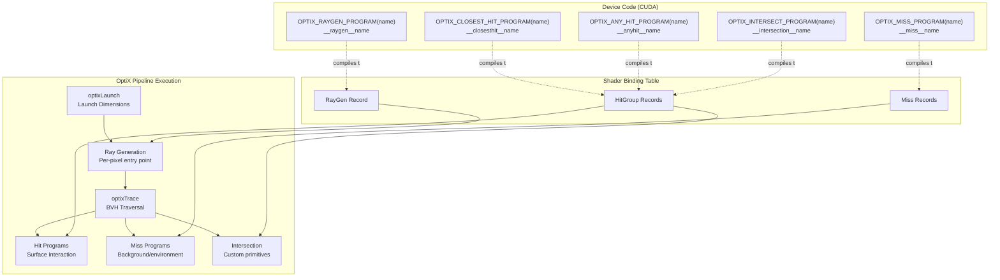
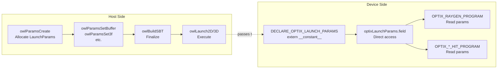
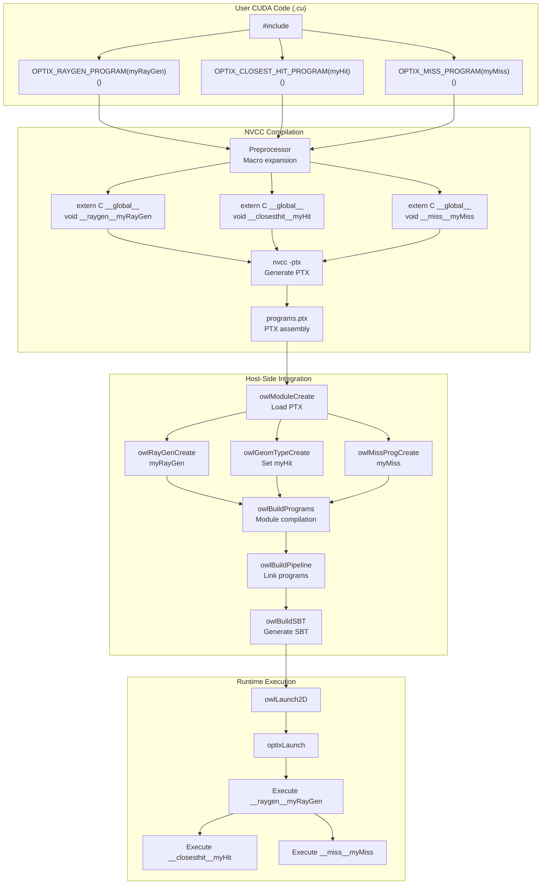
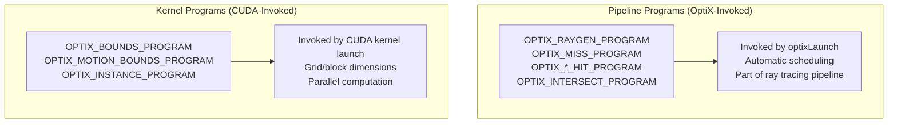

<!-- source: DeepWiki mcp.deepwiki.com · repo NVIDIA/OWL · page 4.1 Program Declaration Macros · fetched 2026-10-26 -->

# Program Declaration Macros

<details>
<summary>Relevant source files</summary>

The following files were used as context for generating this wiki page:

- [include/owl/owl_device.h](include/owl/owl_device.h)

</details>


This page documents the device-side program declaration macros that define entry points for GPU kernels in OWL. These macros are used in CUDA code (`.cu` files) to declare OptiX programs that execute on the GPU during ray tracing. For information about creating and managing programs from the host side, see [Programs and Modules](#3.5). For ray tracing functions that invoke these programs, see [Ray Tracing Functions](#4.2).

**Sources:** [include/owl/owl_device.h:1-374]()

## Overview

OWL provides preprocessor macros that wrap OptiX's naming conventions for different program types. Each macro generates an `extern "C" __global__` function with the appropriate OptiX naming prefix, ensuring proper linkage and execution within the OptiX pipeline. These macros simplify program declaration while maintaining full access to OptiX functionality.

### Program Types and Entry Points

The following diagram shows how device-side program declaration macros correspond to OptiX program types and their roles in the ray tracing pipeline:



**Sources:** [include/owl/owl_device.h:244-262]()

## Core Program Type Macros

### OPTIX_RAYGEN_PROGRAM

Declares a ray generation program, which serves as the entry point for ray tracing operations. Ray generation programs execute once per launch dimension element (e.g., per pixel for 2D launches).

**Syntax:**
```c++
OPTIX_RAYGEN_PROGRAM(programName)()
{
    // Ray generation code
}
```

**Macro Expansion:**
The macro expands to [include/owl/owl_device.h:244-246]():
```c++
extern "C" __global__ void __raygen__##programName
```

The `extern "C"` linkage ensures the symbol name is not mangled, allowing OptiX to locate it. The `__raygen__` prefix is OptiX's naming convention for ray generation programs.

**Sources:** [include/owl/owl_device.h:244-246]()

### OPTIX_MISS_PROGRAM

Declares a miss program, invoked when a ray does not intersect any geometry. Miss programs typically implement background colors, environment maps, or sky models.

**Syntax:**
```c++
OPTIX_MISS_PROGRAM(programName)()
{
    // Miss handling code
}
```

**Macro Expansion:**
Expands to [include/owl/owl_device.h:260-262]():
```c++
extern "C" __global__ void __miss__##programName
```

Multiple miss programs can be created for different ray types using the SBT miss index.

**Sources:** [include/owl/owl_device.h:260-262]()

### OPTIX_CLOSEST_HIT_PROGRAM

Declares a closest hit program, executed when a ray intersects geometry and no intervening geometry is found. This is the primary location for shading calculations.

**Syntax:**
```c++
OPTIX_CLOSEST_HIT_PROGRAM(programName)()
{
    // Closest hit shading code
}
```

**Macro Expansion:**
Expands to [include/owl/owl_device.h:248-250]():
```c++
extern "C" __global__ void __closesthit__##programName
```

**Sources:** [include/owl/owl_device.h:248-250]()

### OPTIX_ANY_HIT_PROGRAM

Declares an any hit program, invoked for every potential intersection during traversal. Used for alpha testing, shadow transparency, or early ray termination.

**Syntax:**
```c++
OPTIX_ANY_HIT_PROGRAM(programName)()
{
    // Any hit filtering code
    // Can call optixIgnoreIntersection() or optixTerminateRay()
}
```

**Macro Expansion:**
Expands to [include/owl/owl_device.h:252-254]():
```c++
extern "C" __global__ void __anyhit__##programName
```

**Sources:** [include/owl/owl_device.h:252-254]()

### OPTIX_INTERSECT_PROGRAM

Declares an intersection program for custom primitive types (user-defined geometry). The program computes ray-primitive intersections and reports hits using `optixReportIntersection()`.

**Syntax:**
```c++
OPTIX_INTERSECT_PROGRAM(programName)()
{
    // Custom intersection test
    // Call optixReportIntersection() if hit found
}
```

**Macro Expansion:**
Expands to [include/owl/owl_device.h:256-258]():
```c++
extern "C" __global__ void __intersection__##programName
```

**Sources:** [include/owl/owl_device.h:256-258]()

## Launch Parameters Declaration

### DECLARE_OPTIX_LAUNCH_PARAMS

Declares a global constant structure containing launch parameters accessible from all device programs. This structure holds read-only data that remains constant across a single launch.

**Syntax:**
```c++
DECLARE_OPTIX_LAUNCH_PARAMS(LaunchParamsType)
```

**Macro Expansion:**
Expands to [include/owl/owl_device.h:242]():
```c++
extern __constant__ LaunchParamsType optixLaunchParams;
```

The variable name must always be `optixLaunchParams` (OptiX requirement), but the type is user-defined. Launch parameters are set on the host using `owlParamsSet*` functions and accessed directly on the device.

### Host-Device Launch Parameter Flow



**Sources:** [include/owl/owl_device.h:239-242]()

## Advanced Program Types

### OPTIX_BOUNDS_PROGRAM

Declares a bounds program for computing axis-aligned bounding boxes of custom primitives. Unlike the other program types that execute via OptiX's pipeline, bounds programs are invoked from CUDA kernels during acceleration structure building.

**Macro Structure:**
The macro [include/owl/owl_device.h:266-294]() generates:
1. A forward declaration of the user's bounds function
2. A `__global__` kernel wrapper (`__boundsFuncKernel__`) that launches on a grid
3. The actual device function signature for user implementation

**Generated Kernel:**
```c++
extern "C" __global__
void __boundsFuncKernel__##progName(
    const void *geomData,
    owl::common::box3f *const boundsArray,
    const uint32_t numPrims)
```

The kernel computes `primID` from thread/block indices and invokes the user's bounds function for valid primitives. The user implements:
```c++
void __boundsFunc__##progName(
    const void *geomData,
    owl::common::box3f &bounds,
    const int32_t primID)
```

**Sources:** [include/owl/owl_device.h:266-295]()

### OPTIX_MOTION_BOUNDS_PROGRAM

Declares a motion bounds program for computing bounding boxes at two time keyframes, enabling motion blur with custom primitives.

**Macro Structure:**
Similar to `OPTIX_BOUNDS_PROGRAM`, the macro [include/owl/owl_device.h:299-332]() generates:
1. Forward declaration for the motion bounds function
2. A `__global__` kernel wrapper (`__motionBoundsFuncKernel__`)
3. User function signature with two bounds outputs

**Generated Kernel:**
```c++
extern "C" __global__
void __motionBoundsFuncKernel__##progName(
    const void *geomData,
    owl::common::box3f *const boundsArrayKey1,
    owl::common::box3f *const boundsArrayKey2,
    const uint32_t numPrims)
```

The user implements:
```c++
void __motionBoundsFunc__##progName(
    const void *geomData,
    owl::common::box3f &boundskey1,
    owl::common::box3f &boundskey2,
    const int32_t primID)
```

**Sources:** [include/owl/owl_device.h:299-333]()

### OPTIX_INSTANCE_PROGRAM

Declares an instance manipulation program for GPU-side control of instance transforms, visibility masks, and flags. This program type requires `disablePerGeometrySBTRecords` to be enabled.

**Macro Structure:**
The macro [include/owl/owl_device.h:338-372]() generates:
1. Forward declaration of the instance function
2. A `__global__` kernel wrapper (`__instanceFuncKernel__`)
3. User function signature receiving an `OptixInstance` structure

**Generated Kernel:**
```c++
extern "C" __global__
void __instanceFuncKernel__##progName(
    OptixInstance *insts,
    uint32_t numInsts,
    uint32_t numRayTypes)
```

The kernel initializes each `OptixInstance` with defaults:
- `flags = OPTIX_INSTANCE_FLAG_NONE`
- `instanceId = instanceIndex`
- `visibilityMask = 255`
- `transform = identity` (via `initializeTransformToIdentity`)

The user implements:
```c++
void __instanceFunc__##progName(
    const int32_t instanceIndex,
    OptixInstance &instance)
```

**Sources:** [include/owl/owl_device.h:338-373]()

## Compilation and Linking Flow

The following diagram illustrates how program declaration macros are compiled and linked into the OptiX pipeline:



**Sources:** [include/owl/owl_device.h:244-262]()

## Usage Patterns

### Basic Program Declaration

The typical pattern for declaring device programs follows this structure:

| Macro | Purpose | When Invoked |
|-------|---------|--------------|
| `OPTIX_RAYGEN_PROGRAM` | Entry point for ray tracing | Once per launch dimension element |
| `OPTIX_CLOSEST_HIT_PROGRAM` | Surface shading | On closest ray-geometry intersection |
| `OPTIX_ANY_HIT_PROGRAM` | Transparency/filtering | On any potential intersection |
| `OPTIX_MISS_PROGRAM` | Background handling | When ray misses all geometry |
| `OPTIX_INTERSECT_PROGRAM` | Custom intersection test | During BVH traversal for user geometry |
| `OPTIX_BOUNDS_PROGRAM` | Bounding box computation | During acceleration structure build |
| `OPTIX_MOTION_BOUNDS_PROGRAM` | Motion blur bounds | During motion-enabled AS build |
| `OPTIX_INSTANCE_PROGRAM` | Instance manipulation | During instance group build |

**Sources:** [include/owl/owl_device.h:244-373]()

### Program Name Binding

The program name specified in the macro must match the name used in host-side program creation:

**Device Code:**
```c++
OPTIX_RAYGEN_PROGRAM(primaryRays)()
{
    // Implementation
}
```

**Host Code:**
```c++
OWLRayGen rayGen = owlRayGenCreate(
    context, module, "primaryRays", 
    sizeof(RayGenData), rayGenVars, -1);
```

The string `"primaryRays"` corresponds to the expanded symbol `__raygen__primaryRays` in the compiled PTX.

**Sources:** [include/owl/owl_device.h:244-262]()

### Kernel vs Pipeline Programs

The program types have different execution models:



Pipeline programs integrate into OptiX's ray tracing execution model, while kernel programs execute as standard CUDA kernels during build operations.

**Sources:** [include/owl/owl_device.h:266-373]()

### Error Prevention

The file header [include/owl/owl_device.h:20-22]() enforces device-side inclusion:

```c++
#ifndef __CUDACC__
#  error "this file should only ever get included on the device side"
#endif
```

This preprocessor check ensures `owl_device.h` is only included when compiling with `nvcc` (CUDA compiler), preventing accidental use in host code where these macros and device functions are invalid.

**Sources:** [include/owl/owl_device.h:20-22]()

---

