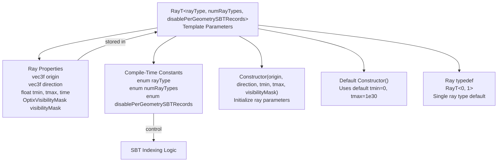
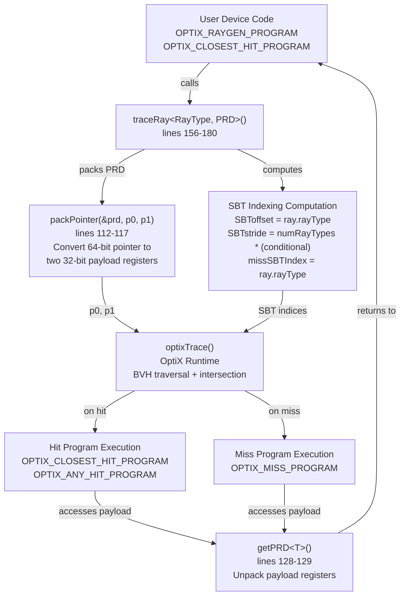
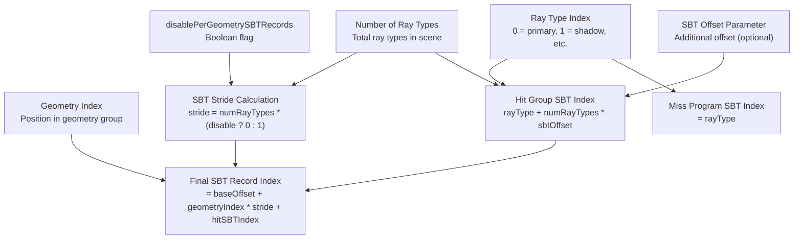
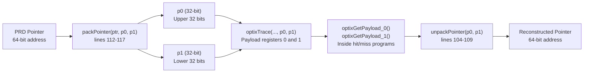

<!-- source: DeepWiki mcp.deepwiki.com · repo NVIDIA/OWL · page 4.2 Ray Tracing Functions · fetched 2026-10-26 -->

# Ray Tracing Functions

<details>
<summary>Relevant source files</summary>

The following files were used as context for generating this wiki page:

- [include/owl/owl_device.h](include/owl/owl_device.h)

</details>


This page documents the device-side ray tracing functions provided by OWL for GPU kernels. These functions wrap OptiX's `optixTrace` API to provide type-safe, convenient ray shooting from ray generation programs, closest hit programs, and other device-side code. The functions handle SBT (Shader Binding Table) indexing, payload management through pointer packing/unpacking, and ray type configuration.

For program declaration macros (OPTIX_RAYGEN_PROGRAM, OPTIX_CLOSEST_HIT_PROGRAM, etc.), see [4.1](#4.1). For accessing program data and payload utilities (getProgramData, getPRD), see [4.3](#4.3).

## Ray Definition

OWL provides the `RayT` template struct to encapsulate ray parameters and configuration. The template defines ray type metadata at compile time, enabling automatic SBT indexing.

### RayT Template Structure



The `RayT` template [include/owl/owl_device.h:131-153]() defines:

| Template Parameter | Purpose | Default |
|-------------------|---------|---------|
| `_rayType` | Ray type index for multi-type scenarios | 0 |
| `_numRayTypes` | Total number of ray types in scene | 1 |
| `_disablePerGeometrySBTRecords` | Skip per-geometry SBT records | false |

**Member Variables:**

- `vec3f origin, direction` - Ray spatial definition
- `float tmin, tmax` - Ray parameter range (default: 0.0f to 1e30f)
- `float time` - Time value for motion blur (default: 0.0f)
- `OptixVisibilityMask visibilityMask` - 8-bit mask for selective intersection (default: 0xFF, all visible)

**Typedef:**
```cpp
typedef RayT<0,1> Ray;
```
The `Ray` typedef [include/owl/owl_device.h:153]() provides a convenient single-ray-type alias.

**Sources:** [include/owl/owl_device.h:131-153]()

## traceRay Function

The `traceRay` function is the primary ray tracing interface. It is templated on both the ray type and payload type, providing type-safe payload handling.

### Function Signature

```cpp
template<typename RayType, typename PRD>
inline __device__
void traceRay(OptixTraversableHandle traversable,
              const RayType &ray,
              PRD           &prd,
              uint32_t rayFlags = 0u)
```

[include/owl/owl_device.h:156-180]()

### Call Flow Diagram



### Implementation Details

The `traceRay` function [include/owl/owl_device.h:156-180]():

1. **Packs the payload pointer** using `packPointer` [include/owl/owl_device.h:112-117]() into two 32-bit registers `p0` and `p1` (OptiX payload registers)
2. **Extracts ray configuration** from the `RayType` template's compile-time constants:
   - `ray.rayType` - which ray type this is
   - `ray.numRayTypes` - total ray types in the system
   - `ray.disablePerGeometrySBTRecords` - whether to skip per-geometry records
3. **Computes SBT stride**: `numRayTypes * (disablePerGeometrySBTRecords ? 0 : 1)`
4. **Calls optixTrace** with properly computed SBT offsets

### Parameters

| Parameter | Type | Description |
|-----------|------|-------------|
| `traversable` | `OptixTraversableHandle` | Acceleration structure handle (from launch params or group) |
| `ray` | `const RayType &` | Ray object (typically `RayT<>` or `Ray`) |
| `prd` | `PRD &` | Per-ray data payload (passed by reference) |
| `rayFlags` | `uint32_t` | OptiX ray flags (default: 0) |

**Sources:** [include/owl/owl_device.h:156-180](), [include/owl/owl_device.h:112-117]()

## trace Function Overloads

OWL provides simpler `trace` function overloads for scenarios where ray type configuration is determined at runtime rather than compile-time.

### Overload 1: Basic trace

```cpp
template<typename PRD>
inline __device__
void trace(OptixTraversableHandle traversable,
           const Ray &ray,
           int numRayTypes,
           PRD &prd,
           int sbtOffset = 0)
```

[include/owl/owl_device.h:182-207]()

This overload uses the basic `Ray` typedef and requires explicit `numRayTypes` parameter. The SBT offset is computed as:
```
SBToffset = ray.rayType + numRayTypes * sbtOffset
SBTstride = numRayTypes
```

### Overload 2: With disablePerGeometrySBTRecords flag

```cpp
template<typename PRD>
inline __device__
void trace(OptixTraversableHandle traversable,
           const Ray &ray,
           int numRayTypes,
           bool disablePerGeometrySBTRecords,
           PRD &prd,
           int sbtOffset = 0)
```

[include/owl/owl_device.h:209-235]()

This overload adds runtime control over per-geometry SBT record behavior. The SBT stride becomes:
```
SBTstride = numRayTypes * (disablePerGeometrySBTRecords ? 0 : 1)
```

### Comparison Table

| Aspect | traceRay | trace (Overload 1) | trace (Overload 2) |
|--------|----------|-------------------|-------------------|
| Ray type metadata | Compile-time (template) | Runtime parameter | Runtime parameter |
| SBT record control | Compile-time | Always enabled | Runtime parameter |
| Type safety | Strong (templated Ray) | Basic (Ray typedef) | Basic (Ray typedef) |
| Performance | Optimal (constants known) | Slightly slower | Slightly slower |
| Flexibility | Limited to template params | Runtime configuration | Full runtime control |

**Sources:** [include/owl/owl_device.h:182-235]()

## SBT Indexing and Ray Types

Understanding SBT indexing is critical for multi-ray-type scenarios (e.g., separate primary rays, shadow rays, reflection rays).

### SBT Index Calculation



### SBT Indexing Logic

**For Hit Groups** [include/owl/owl_device.h:167-179]():

1. **SBT Offset**: `ray.rayType` (or `ray.rayType + numRayTypes * sbtOffset` in `trace` functions)
2. **SBT Stride**: `ray.numRayTypes * (disablePerGeometrySBTRecords ? 0 : 1)`
   - If `disablePerGeometrySBTRecords` is true: stride = 0 (all geometries share same hit records)
   - If false: stride = numRayTypes (each geometry has its own records for each ray type)

**For Miss Programs** [include/owl/owl_device.h:177]():
- Miss SBT index is always `ray.rayType`
- Each ray type has its own dedicated miss program

### Multi-Ray-Type Example Scenario

Consider a scene with 2 ray types (primary and shadow) and 3 geometries:

| Ray Type | Geometry | disablePerGeometry=false | disablePerGeometry=true |
|----------|----------|-------------------------|------------------------|
| Primary (0) | Geom 0 | Record 0 | Record 0 |
| Shadow (1) | Geom 0 | Record 1 | Record 0 |
| Primary (0) | Geom 1 | Record 2 | Record 0 |
| Shadow (1) | Geom 1 | Record 3 | Record 0 |
| Primary (0) | Geom 2 | Record 4 | Record 0 |
| Shadow (1) | Geom 2 | Record 5 | Record 0 |

When `disablePerGeometrySBTRecords=true`, all geometries use record 0 for primary rays and record 0 for shadow rays (same record, determined only by ray type).

**Sources:** [include/owl/owl_device.h:167-179](), [include/owl/owl_device.h:202-206](), [include/owl/owl_device.h:230-234]()

## Payload Management

Ray payloads (Per-Ray Data or PRD) carry information between ray generation, hit, and miss programs.

### Pointer Packing Mechanism

OptiX provides 32 payload registers (`optixGetPayload_0()` through `optixGetPayload_31()`). OWL uses the first two registers to pass 64-bit pointers:



### Pack and Unpack Functions

**packPointer** [include/owl/owl_device.h:112-117]():
```cpp
static __forceinline__ __device__ void packPointer(void* ptr, uint32_t& i0, uint32_t& i1)
{
  const uint64_t uptr = reinterpret_cast<uint64_t>(ptr);
  i0 = uptr >> 32;        // Upper 32 bits
  i1 = uptr & 0x00000000ffffffff;  // Lower 32 bits
}
```

**unpackPointer** [include/owl/owl_device.h:104-109]():
```cpp
static __forceinline__ __device__ void* unpackPointer(uint32_t i0, uint32_t i1)
{
  const uint64_t uptr = static_cast<uint64_t>(i0) << 32 | i1;
  void* ptr = reinterpret_cast<void*>(uptr);
  return ptr;
}
```

### Accessing Payload in Device Code

Inside hit or miss programs, retrieve the payload using `getPRD<T>()` [include/owl/owl_device.h:127-129]():

```cpp
template<typename T>
static __forceinline__ __device__ T &getPRD()
{ 
  return *(T*)getPRDPointer();
}
```

This function calls `getPRDPointer()` [include/owl/owl_device.h:120-125](), which unpacks payload registers 0 and 1.

**Important:** The PRD must be passed by reference to `traceRay` or `trace`. The pointer packing ensures the same memory location is accessible in all programs invoked by the ray.

**Sources:** [include/owl/owl_device.h:104-109](), [include/owl/owl_device.h:112-117](), [include/owl/owl_device.h:120-129]()

## Usage Patterns

### Pattern 1: Single Ray Type (Simplest)

```cpp
// Define PRD structure
struct RadiancePRD {
  vec3f color;
  int depth;
};

OPTIX_RAYGEN_PROGRAM(simpleRayGen)()
{
  // Use default Ray (single ray type)
  owl::Ray ray(origin, direction, 0.0f, 1e20f);
  
  RadiancePRD prd;
  prd.color = vec3f(0.0f);
  prd.depth = 0;
  
  // Simple trace - no ray type configuration needed
  owl::traceRay(traversable, ray, prd);
  
  // Use prd.color...
}
```

### Pattern 2: Multiple Ray Types (Compile-Time)

```cpp
struct ShadowPRD {
  float visibility;
};

// Define ray types at compile time
using PrimaryRay = owl::RayT<0, 2>;  // Ray type 0, 2 total types
using ShadowRay = owl::RayT<1, 2>;   // Ray type 1, 2 total types

OPTIX_CLOSEST_HIT_PROGRAM(primaryHit)()
{
  // Cast shadow ray
  ShadowRay shadowRay(hitPoint, lightDir, 0.001f, lightDistance);
  
  ShadowPRD shadowPrd;
  shadowPrd.visibility = 1.0f;
  
  owl::traceRay(traversable, shadowRay, shadowPrd);
  
  // Use shadowPrd.visibility...
}
```

### Pattern 3: Runtime Ray Type Configuration

```cpp
OPTIX_RAYGEN_PROGRAM(flexibleRayGen)()
{
  owl::Ray ray(origin, direction, 0.0f, 1e20f);
  ray.rayType = 0;  // Set at runtime
  
  RadiancePRD prd;
  
  // Use trace with runtime parameters
  int numRayTypes = 2;
  owl::trace(traversable, ray, numRayTypes, prd);
}
```

### Pattern 4: Visibility Masking

```cpp
OPTIX_RAYGEN_PROGRAM(maskedRayGen)()
{
  // Create ray with visibility mask (only intersect objects with matching bits)
  OptixVisibilityMask mask = 0x01;  // Only intersect layer 0
  owl::Ray ray(origin, direction, 0.0f, 1e20f, mask);
  
  RadiancePRD prd;
  owl::traceRay(traversable, ray, prd);
}
```

**Sources:** [include/owl/owl_device.h:131-180](), [include/owl/owl_device.h:182-235]()

## Ray Flags

The `rayFlags` parameter in `traceRay` [include/owl/owl_device.h:161]() accepts OptiX ray flags:

| Flag | Purpose |
|------|---------|
| `OPTIX_RAY_FLAG_NONE` | Default behavior (0u) |
| `OPTIX_RAY_FLAG_DISABLE_ANYHIT` | Skip any-hit programs |
| `OPTIX_RAY_FLAG_ENFORCE_ANYHIT` | Always invoke any-hit even for opaque |
| `OPTIX_RAY_FLAG_TERMINATE_ON_FIRST_HIT` | Stop at first hit (optimization) |
| `OPTIX_RAY_FLAG_DISABLE_CLOSESTHIT` | Skip closest-hit program |
| `OPTIX_RAY_FLAG_CULL_BACK_FACING_TRIANGLES` | Back-face culling |
| `OPTIX_RAY_FLAG_CULL_FRONT_FACING_TRIANGLES` | Front-face culling |
| `OPTIX_RAY_FLAG_CULL_DISABLED_ANYHIT` | Treat geometries without any-hit as opaque |
| `OPTIX_RAY_FLAG_CULL_ENFORCED_ANYHIT` | Treat geometries with any-hit as non-opaque |

The `trace` function overloads always use `rayFlags = 0u` [include/owl/owl_device.h:201](), [include/owl/owl_device.h:229]().

**Sources:** [include/owl/owl_device.h:156-180](), [include/owl/owl_device.h:182-235]()

## Performance Considerations

### Compile-Time vs Runtime Configuration

- **traceRay with RayT template**: Ray type configuration is compile-time constant, enabling compiler optimizations. Preferred for known ray type configurations.
- **trace with runtime parameters**: More flexible but SBT indexing math performed at runtime. Use when ray types determined dynamically.

### disablePerGeometrySBTRecords Optimization

When all geometries in a group share the same hit programs, setting `disablePerGeometrySBTRecords=true` [include/owl/owl_device.h:135]():
- Reduces SBT size (fewer records)
- Reduces memory bandwidth
- Slightly faster SBT lookups

Trade-off: Loss of per-geometry program binding flexibility.

### Payload Size

Payload data (PRD) is passed by pointer (packed into 2 registers). The PRD structure itself should be kept reasonably sized to minimize cache pressure when accessed in hit/miss programs. Consider using device pointers within PRD for large data rather than embedding large arrays directly.

**Sources:** [include/owl/owl_device.h:131-235]()

---

