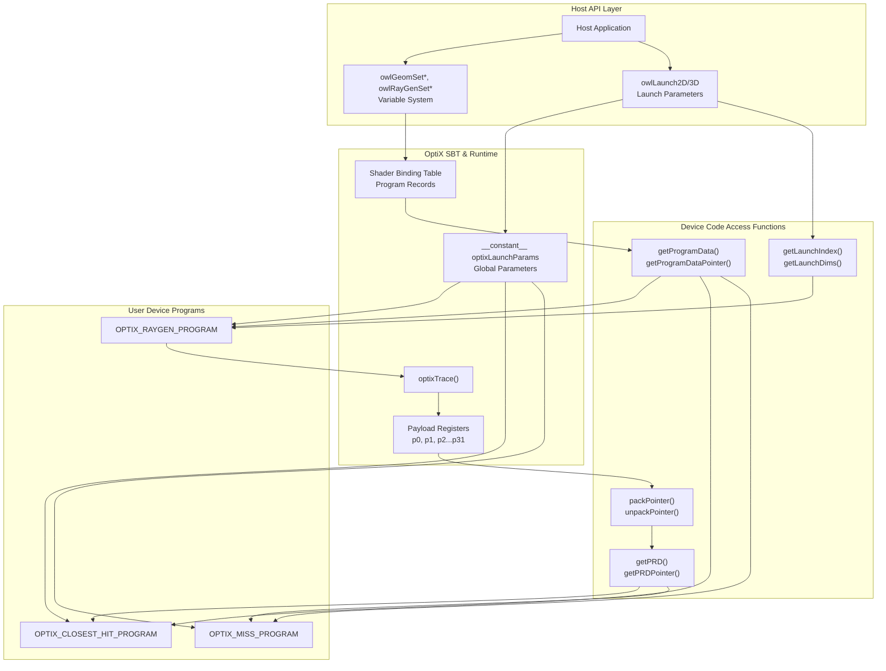
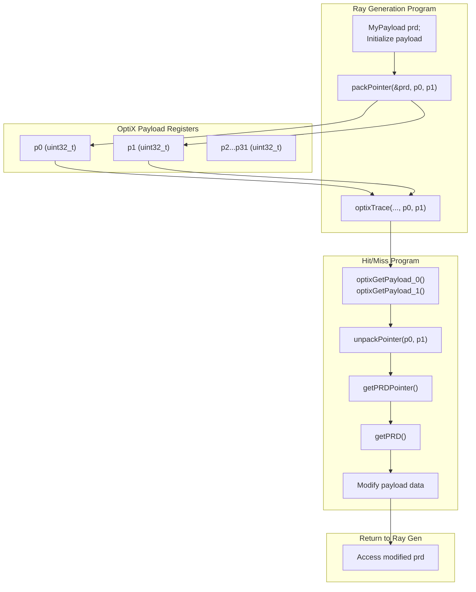

<!-- source: DeepWiki mcp.deepwiki.com · repo NVIDIA/OWL · page 4.3 Data Access Utilities · fetched 2026-10-26 -->

# Data Access Utilities

<details>
<summary>Relevant source files</summary>

The following files were used as context for generating this wiki page:

- [include/owl/owl_device.h](include/owl/owl_device.h)

</details>


This page documents the device-side utility functions for accessing data within GPU kernels. These functions provide convenient wrappers around OptiX built-in functions and handle the complexities of accessing program data (SBT records), per-ray data (payload), and launch parameters from within ray generation, hit, miss, and intersection programs.

For information about declaring these programs, see [Program Declaration Macros](#4.1). For information about tracing rays, see [Ray Tracing Functions](#4.2). For general device-side helper functions, see [Device Utilities](#4.4).

## Overview of Device Data Access



**Data Access Flow in OWL Device Code**

Sources: [include/owl/owl_device.h:1-263]()

## Launch Information Access

Device programs can query their execution context using launch information functions. These functions wrap OptiX built-in functions to provide type-safe access.

### getLaunchIndex

```cpp
inline __device__ vec2i getLaunchIndex()
```

Returns the current thread's position within the 2D launch grid as a `vec2i`. This corresponds to the pixel or work item being processed in the current invocation.

**Implementation:** Wraps `optixGetLaunchIndex()` and casts the result to OWL's `vec2i` type.

**Usage Example:**
```cpp
OPTIX_RAYGEN_PROGRAM(renderFrame)()
{
  const vec2i pixelID = getLaunchIndex();
  const vec2i fbSize = getLaunchDims();
  // Generate ray for pixel (pixelID.x, pixelID.y)
}
```

Sources: [include/owl/owl_device.h:28-31]()

### getLaunchDims

```cpp
inline __device__ vec2i getLaunchDims()
```

Returns the dimensions of the 2D launch grid as a `vec2i`. This typically corresponds to the framebuffer or output buffer dimensions.

**Note:** OWL currently provides 2D launch dimension access. For 1D or 3D launches, direct use of OptiX built-ins would be required.

**Implementation:** Wraps `optixGetLaunchDimensions()` and casts the result to OWL's `vec2i` type.

Sources: [include/owl/owl_device.h:35-38]()

## Program Data Access

Program data (also called SBT data) is the per-program or per-geometry data structure stored in the Shader Binding Table. In OWL, this is set on the host using the variable system (see [Variable System](#3.6)).


**Program Data Flow: Host Variables to Device Access**

Sources: [include/owl/owl_device.h:40-57]()

### getProgramDataPointer

```cpp
inline __device__ const void* getProgramDataPointer()
```

Returns an untyped pointer to the currently executing program's SBT data record. This is a low-level function; prefer the templated `getProgramData<T>()` for type safety.

**Implementation:** Direct wrapper around `optixGetSbtDataPointer()`.

Sources: [include/owl/owl_device.h:44-47]()

### getProgramData&lt;T&gt;

```cpp
template<typename T>
inline __device__ const T& getProgramData()
```

Returns a typed reference to the currently executing program's SBT data record. The type `T` must match the structure defined on the host when setting variables.

**Type Safety:** This function performs a hard cast without runtime type checking. The caller must ensure the type `T` matches the structure layout used during SBT construction.

**Usage Example:**
```cpp
struct TriangleMeshData {
  vec3f* vertices;
  vec3i* indices;
  vec3f color;
};

OPTIX_CLOSEST_HIT_PROGRAM(triangleHit)()
{
  const TriangleMeshData& data = getProgramData<TriangleMeshData>();
  const vec3i index = data.indices[optixGetPrimitiveIndex()];
  // Use vertex data...
}
```

Sources: [include/owl/owl_device.h:49-57]()

## Per-Ray Data Access

Per-Ray Data (PRD) is custom payload data passed through the ray tracing pipeline. OptiX provides 32 payload registers (32-bit unsigned integers) that can carry data between ray generation, hit, and miss programs.

### Payload Register Mechanism



**Payload Data Flow Through Ray Tracing**

Sources: [include/owl/owl_device.h:104-129]()

### packPointer

```cpp
static __forceinline__ __device__ void packPointer(void* ptr, uint32_t& i0, uint32_t& i1)
```

Packs a 64-bit pointer into two 32-bit unsigned integers for storage in OptiX payload registers. This is necessary because OptiX payload registers are 32-bit, but device pointers are 64-bit.

**Parameters:**
- `ptr`: The pointer to pack
- `i0`: Output - high 32 bits of the pointer
- `i1`: Output - low 32 bits of the pointer

**Implementation:** Reinterprets the pointer as a 64-bit unsigned integer, then splits it into high and low 32-bit components.

Sources: [include/owl/owl_device.h:112-117]()

### unpackPointer

```cpp
static __forceinline__ __device__ void* unpackPointer(uint32_t i0, uint32_t i1)
```

Unpacks two 32-bit unsigned integers into a 64-bit pointer. This reverses the operation performed by `packPointer`.

**Parameters:**
- `i0`: High 32 bits of the pointer
- `i1`: Low 32 bits of the pointer

**Returns:** The reconstructed 64-bit pointer

**Implementation:** Combines the two 32-bit values into a 64-bit unsigned integer, then reinterprets as a pointer.

Sources: [include/owl/owl_device.h:104-109]()

### getPRDPointer

```cpp
static __forceinline__ __device__ void* getPRDPointer()
```

Retrieves the per-ray data pointer from OptiX payload registers 0 and 1. This is a convenience function that calls `optixGetPayload_0()` and `optixGetPayload_1()` and unpacks the result.

**Assumptions:** This function assumes the pointer was packed into payload registers 0 and 1 using the `packPointer` function or equivalent logic in `traceRay` (see [Ray Tracing Functions](#4.2)).

Sources: [include/owl/owl_device.h:120-125]()

### getPRD&lt;T&gt;

```cpp
template<typename T>
static __forceinline__ __device__ T& getPRD()
```

Returns a typed reference to the per-ray data. This is the preferred method for accessing PRD in hit and miss programs.

**Type Safety:** The type `T` must match the payload structure passed to `traceRay`. No runtime type checking is performed.

**Usage Example:**
```cpp
struct Payload {
  vec3f color;
  float distance;
  bool hit;
};

OPTIX_CLOSEST_HIT_PROGRAM(closestHit)()
{
  Payload& prd = getPRD<Payload>();
  prd.color = vec3f(1.0f, 0.0f, 0.0f);
  prd.distance = optixGetRayTmax();
  prd.hit = true;
}

OPTIX_MISS_PROGRAM(miss)()
{
  Payload& prd = getPRD<Payload>();
  prd.color = vec3f(0.0f, 0.0f, 0.0f);
  prd.hit = false;
}
```

Sources: [include/owl/owl_device.h:127-129]()

## Data Access Pattern Summary

| Function | Purpose | Returns | Typical Usage |
|----------|---------|---------|---------------|
| `getLaunchIndex()` | Current thread position | `vec2i` | Ray generation, determining pixel coordinates |
| `getLaunchDims()` | Launch grid dimensions | `vec2i` | Ray generation, computing normalized coordinates |
| `getProgramDataPointer()` | SBT data (untyped) | `const void*` | Low-level access (rarely needed) |
| `getProgramData<T>()` | SBT data (typed) | `const T&` | All programs, accessing geometry/program parameters |
| `getPRDPointer()` | Payload pointer | `void*` | Low-level PRD access (rarely needed) |
| `getPRD<T>()` | Payload data (typed) | `T&` | Hit/Miss programs, modifying ray payload |
| `packPointer()` | Pointer → registers | `void` (outputs to refs) | Internal use by `traceRay` |
| `unpackPointer()` | Registers → pointer | `void*` | Internal use by `getPRDPointer` |

## Usage Patterns

### Complete Ray Tracing Example

```cpp
// Host-side structure definition
struct TriangleMeshData {
  vec3f* vertices;
  vec3i* indices;
};

struct Payload {
  vec3f color;
  bool hit;
};

// Device-side ray generation
OPTIX_RAYGEN_PROGRAM(renderFrame)()
{
  const vec2i pixelID = getLaunchIndex();
  const vec2i fbSize = getLaunchDims();
  
  // Create payload
  Payload prd;
  prd.color = vec3f(0.0f);
  prd.hit = false;
  
  // Setup ray
  Ray ray;
  ray.origin = /* camera origin */;
  ray.direction = /* ray direction */;
  
  // Trace (automatically packs &prd into payload registers)
  traceRay(optixLaunchParams.world, ray, prd);
  
  // Use result
  if (prd.hit) {
    // Write color to framebuffer
  }
}

// Device-side closest hit program
OPTIX_CLOSEST_HIT_PROGRAM(triangleHit)()
{
  // Access program data (geometry-specific)
  const TriangleMeshData& data = getProgramData<TriangleMeshData>();
  
  // Access per-ray data (this ray's payload)
  Payload& prd = getPRD<Payload>();
  
  // Compute hit color
  const int primID = optixGetPrimitiveIndex();
  const vec3i index = data.indices[primID];
  prd.color = /* compute color from vertices */;
  prd.hit = true;
}
```

This example demonstrates the three primary data access patterns:
1. Launch information (`getLaunchIndex`, `getLaunchDims`)
2. Program data from SBT (`getProgramData<T>`)
3. Per-ray payload data (`getPRD<T>`)

Sources: [include/owl/owl_device.h:28-129]()

---

