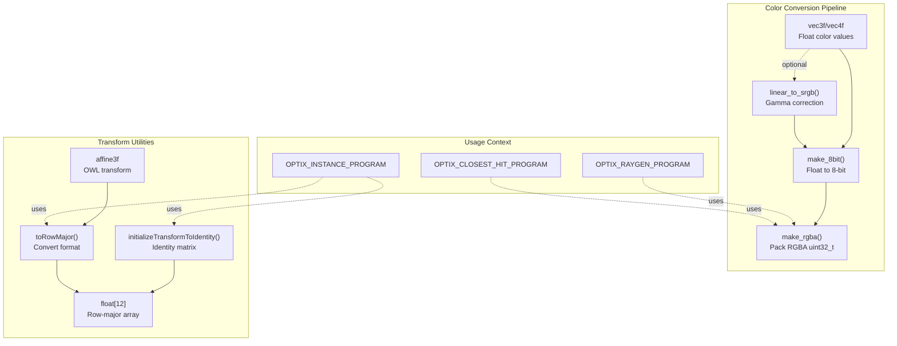
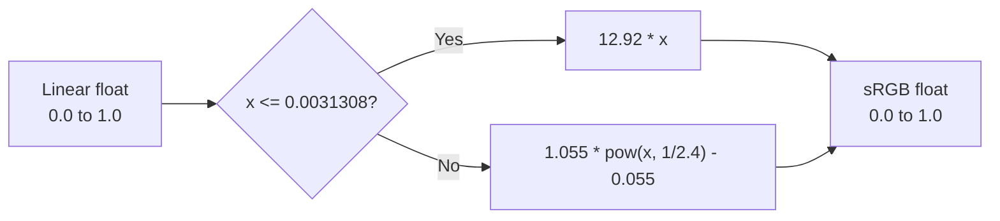
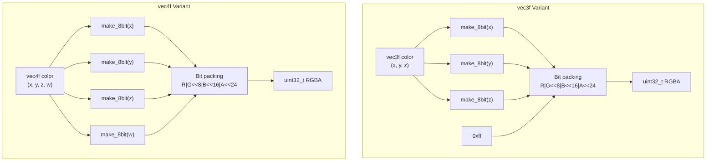
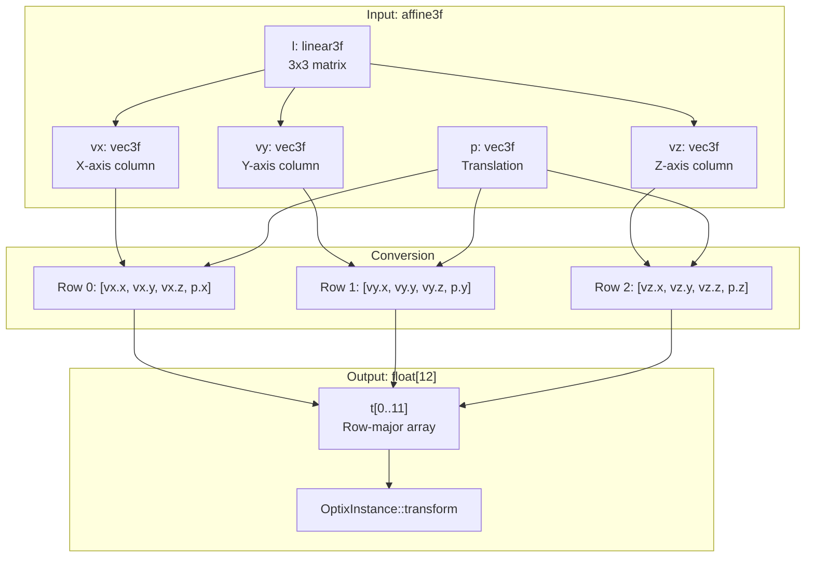

<!-- source: DeepWiki mcp.deepwiki.com · repo NVIDIA/OWL · page 4.4 Device Utilities · fetched 2026-10-26 -->

# Device Utilities

<details>
<summary>Relevant source files</summary>

The following files were used as context for generating this wiki page:

- [include/owl/owl_device.h](include/owl/owl_device.h)

</details>


This page documents convenience helper functions available in the OWL Device API for common GPU-side operations, including color conversion and transform matrix manipulation. These utilities are defined in `owl_device.h` and are designed for use within CUDA device code.

For core data access functions like `getProgramData`, `getPRD`, and pointer packing/unpacking, see [Data Access Utilities](#4.3). For ray tracing operations, see [Ray Tracing Functions](#4.2).

**Sources:** [include/owl/owl_device.h:60-102]()

---

## Overview

Device utilities provide inline device functions that simplify common operations in ray tracing kernels:



**Diagram: Device Utilities Architecture**

**Sources:** [include/owl/owl_device.h:63-102]()

---

## Color Conversion Functions

### linear_to_srgb

Converts linear color space values to sRGB gamma-corrected values.

| Function Signature | Return Type | Description |
|-------------------|-------------|-------------|
| `linear_to_srgb(float x)` | `float` | Applies sRGB gamma correction curve |

The function implements the standard sRGB transfer function:
- For `x ≤ 0.0031308`: returns `12.92 * x`
- For `x > 0.0031308`: returns `1.055 * pow(x, 1/2.4) - 0.055`

**Implementation:** [include/owl/owl_device.h:63-68]()



**Diagram: sRGB Conversion Flow**

**Sources:** [include/owl/owl_device.h:63-68]()

---

### make_8bit

Converts a floating-point color component to an 8-bit integer value.

| Function Signature | Return Type | Description |
|-------------------|-------------|-------------|
| `make_8bit(float f)` | `uint32_t` | Clamps to [0, 255] range |

The function multiplies the input by 256, then clamps to the range [0, 255]. Values are truncated (not rounded) to integer.

**Implementation:** [include/owl/owl_device.h:70-73]()

---

### make_rgba

Packs color components into a single 32-bit RGBA value with 8 bits per channel.

| Function Signature | Return Type | Description |
|-------------------|-------------|-------------|
| `make_rgba(vec3f color)` | `uint32_t` | RGB with alpha=255 |
| `make_rgba(vec4f color)` | `uint32_t` | RGBA with all channels |

Both overloads pack channels in little-endian byte order:
- Bits 0-7: Red channel
- Bits 8-15: Green channel  
- Bits 16-23: Blue channel
- Bits 24-31: Alpha channel (0xff for vec3f version)

**Implementation:** [include/owl/owl_device.h:75-90]()



**Diagram: RGBA Packing Variants**

**Sources:** [include/owl/owl_device.h:75-90]()

---

## Transform Matrix Utilities

### initializeTransformToIdentity

Initializes a 12-element float array to the 3x4 identity transform matrix.

| Function Signature | Return Type | Description |
|-------------------|-------------|-------------|
| `initializeTransformToIdentity(float (&t)[12])` | `void` | Sets `t` to identity matrix |

The resulting matrix represents a 3x4 row-major affine transformation:

```
[1.0  0.0  0.0  0.0]
[0.0  1.0  0.0  0.0]
[0.0  0.0  1.0  0.0]
```

This format is used by OptiX for instance transforms in `OptixInstance::transform`.

**Implementation:** [include/owl/owl_device.h:92-96]()

**Sources:** [include/owl/owl_device.h:92-96]()

---

### toRowMajor

Converts an `affine3f` transform to a 12-element row-major float array.

| Function Signature | Return Type | Description |
|-------------------|-------------|-------------|
| `toRowMajor(affine3f tfm, float (&t)[12])` | `void` | Converts to OptiX format |

The `affine3f` structure from `owl/common/math/AffineSpace.h` contains:
- `affine3f::l`: The 3x3 linear transformation matrix (`vx`, `vy`, `vz` column vectors)
- `affine3f::p`: The translation vector

The conversion maps these to a row-major 3x4 matrix for OptiX:

| Array Index | Matrix Position | Source |
|-------------|-----------------|--------|
| `t[0]`, `t[1]`, `t[2]` | Row 0 (X-axis) | `tfm.l.vx.x`, `tfm.l.vx.y`, `tfm.l.vx.z` |
| `t[3]` | Row 0 (translation) | `tfm.p.x` |
| `t[4]`, `t[5]`, `t[6]` | Row 1 (Y-axis) | `tfm.l.vy.x`, `tfm.l.vy.y`, `tfm.l.vy.z` |
| `t[7]` | Row 1 (translation) | `tfm.p.y` |
| `t[8]`, `t[9]`, `t[10]` | Row 2 (Z-axis) | `tfm.l.vz.x`, `tfm.l.vz.y`, `tfm.l.vz.z` |
| `t[11]` | Row 2 (translation) | `tfm.p.z` |

**Implementation:** [include/owl/owl_device.h:98-102]()



**Diagram: Transform Conversion from affine3f to OptiX Format**

**Sources:** [include/owl/owl_device.h:98-102]()

---

## Usage Patterns

### Color Conversion in Ray Generation Programs

Typical usage in a ray generation program that outputs to a framebuffer:

```cuda
OPTIX_RAYGEN_PROGRAM(renderFrame)()
{
  const vec2i pixelID = getLaunchIndex();
  
  // Trace ray and accumulate color...
  vec3f color = computeRadiance();
  
  // Convert to sRGB and pack to RGBA
  vec3f srgb = vec3f(linear_to_srgb(color.x),
                     linear_to_srgb(color.y),
                     linear_to_srgb(color.z));
  
  uint32_t rgba = make_rgba(srgb);
  
  // Write to framebuffer
  frameBuffer[pixelID] = rgba;
}
```

**Sources:** [include/owl/owl_device.h:63-90]()

---

### Transform Initialization in Instance Programs

The `OPTIX_INSTANCE_PROGRAM` macro uses these utilities internally to set up default transforms. User code can override the transform:

```cuda
OPTIX_INSTANCE_PROGRAM(setupInstances)
(const int32_t instanceIndex, OptixInstance &instance)
{
  // Default identity transform is already set by macro
  // Override with custom transform
  affine3f transform = computeInstanceTransform(instanceIndex);
  toRowMajor(transform, instance.transform);
  
  instance.instanceId = instanceIndex;
  instance.visibilityMask = 0xff;
}
```

The macro wrapper at [include/owl/owl_device.h:339-372]() automatically calls `initializeTransformToIdentity` before invoking user code.

**Sources:** [include/owl/owl_device.h:92-102](), [include/owl/owl_device.h:339-372]()

---

## Implementation Details

All device utilities are defined as `inline __device__` functions, ensuring:
- **Zero overhead**: Inlined at call sites by the CUDA compiler
- **Device-only**: The `__device__` qualifier prevents accidental host-side usage
- **Header-only**: No separate compilation required

The functions use OWL's math types from `owl/common/math/vec.h` and `owl/common/math/AffineSpace.h`, providing seamless integration with the rest of the OWL API.

**Sources:** [include/owl/owl_device.h:1-14](), [include/owl/owl_device.h:63-102]()

---

## Summary Table

| Function | Input | Output | Primary Use Case |
|----------|-------|--------|------------------|
| `linear_to_srgb` | `float` linear | `float` sRGB | Gamma correction for display |
| `make_8bit` | `float` [0,1] | `uint32_t` [0,255] | Color quantization |
| `make_rgba` (vec3f) | `vec3f` RGB | `uint32_t` RGBA | Framebuffer output (opaque) |
| `make_rgba` (vec4f) | `vec4f` RGBA | `uint32_t` RGBA | Framebuffer output (transparent) |
| `initializeTransformToIdentity` | `float[12]&` | - | Default transform setup |
| `toRowMajor` | `affine3f`, `float[12]&` | - | OptiX instance transform conversion |

**Sources:** [include/owl/owl_device.h:63-102]()

---

