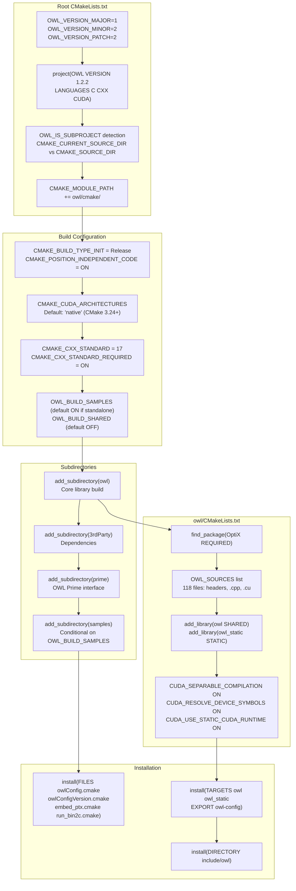
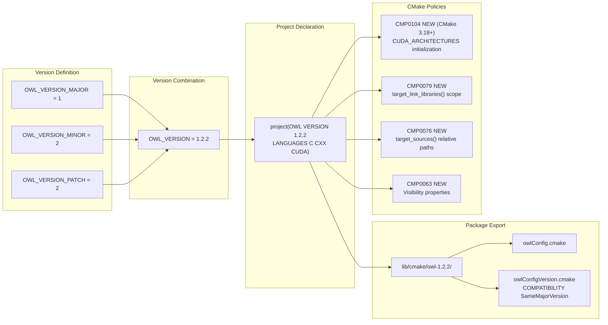
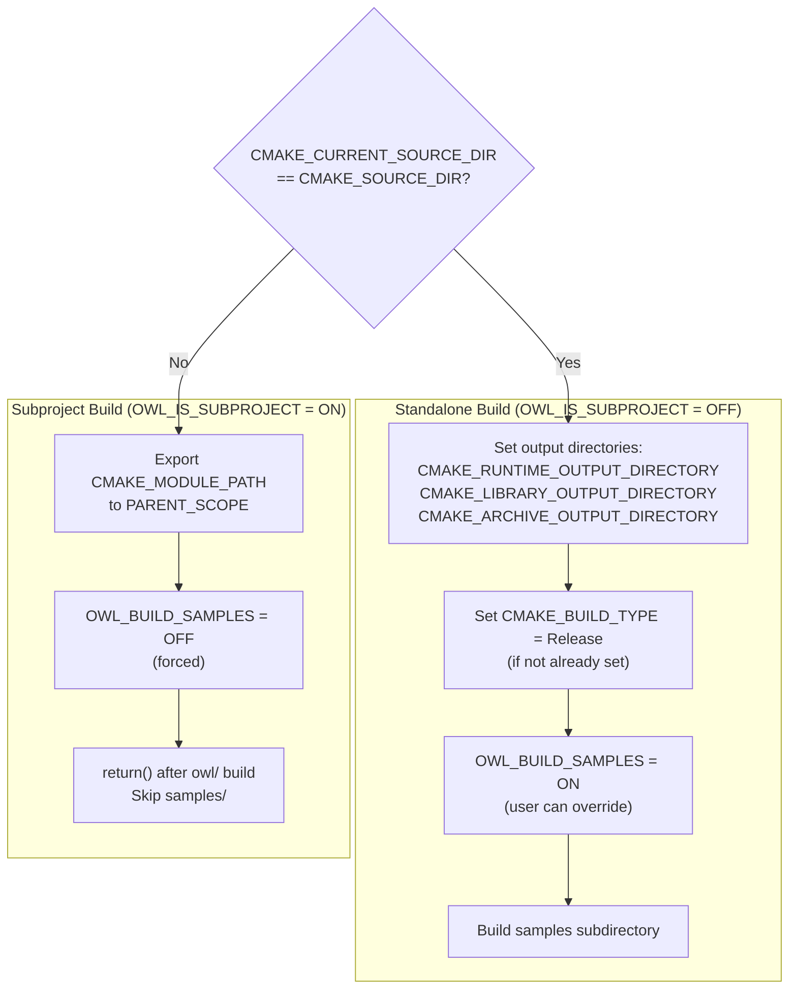
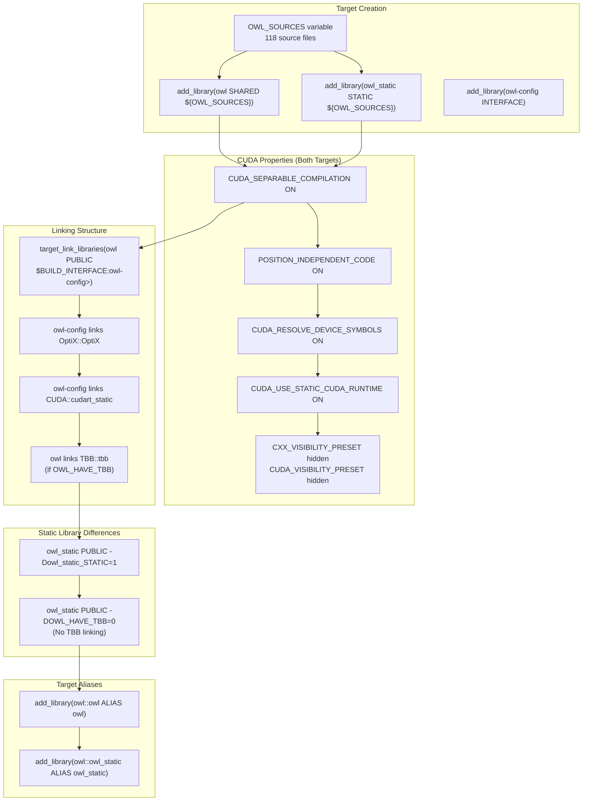
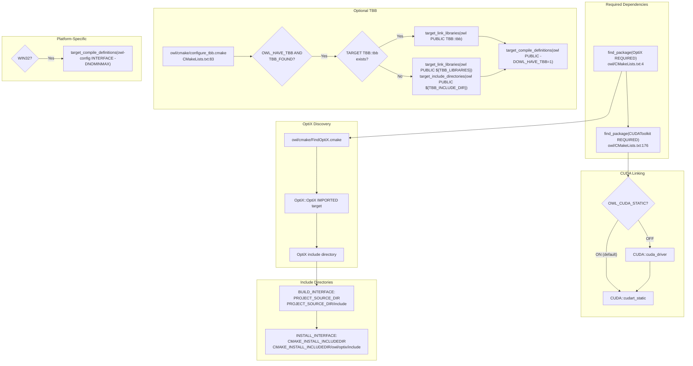

<!-- source: DeepWiki mcp.deepwiki.com · repo NVIDIA/OWL · page 5 Build System · fetched 2026-10-26 -->

# Build System

<details>
<summary>Relevant source files</summary>

The following files were used as context for generating this wiki page:

- [CMakeLists.txt](CMakeLists.txt)
- [owl/CMakeLists.txt](owl/CMakeLists.txt)

</details>


This document describes OWL's CMake-based build system architecture, including its two-tier structure, version management, target generation, and dependency configuration. For detailed information about CMake configuration options and variables, see [CMake Configuration](#5.1). For the package system and downstream integration, see [Package System](#5.2). For PTX compilation and embedding utilities, see [PTX Embedding](#5.3).

## Overview

OWL uses CMake 3.24+ as its build system, producing both shared (`owl`) and static (`owl_static`) library targets. The build system follows a two-tier architecture: the root [CMakeLists.txt:1-187]() orchestrates the overall project, while [owl/CMakeLists.txt:1-211]() defines the core library build. The system supports both standalone builds and integration as a Git submodule, automatically adjusting behavior based on context.

The build system generates:
- `libow.so` / `owl.dll` (shared library)
- `libow_static.a` / `owl_static.lib` (static library)
- CMake package files for downstream integration
- Optional samples and OWL Prime interface

**Sources:** [CMakeLists.txt:1-187](), [owl/CMakeLists.txt:1-211]()

## Two-Tier CMake Architecture



**Sources:** [CMakeLists.txt:5-37](), [CMakeLists.txt:22-26](), [CMakeLists.txt:50-59](), [CMakeLists.txt:62-70](), [CMakeLists.txt:90-110](), [owl/CMakeLists.txt:4-5](), [owl/CMakeLists.txt:120-122]()

### Root Layer

The root [CMakeLists.txt:1-187]() serves as the project coordinator:

| Responsibility | Implementation |
|----------------|---------------|
| Version Management | `OWL_VERSION_MAJOR/MINOR/PATCH` variables at lines 5-7, combined into `OWL_VERSION` at line 35 |
| Subproject Detection | Lines 22-26 compare `CMAKE_CURRENT_SOURCE_DIR` vs `CMAKE_SOURCE_DIR` to set `OWL_IS_SUBPROJECT` |
| Build Options | Lines 50-80 configure output directories, build types, and option flags |
| Module Path Setup | Line 62 appends `owl/cmake/` to `CMAKE_MODULE_PATH` for utility scripts |
| Subdirectory Coordination | Lines 90-110 add `owl/`, `3rdParty/`, `prime/`, and conditionally `samples/` |
| Package Export | Lines 123-149 configure and install CMake package files |
| Target Installation | Lines 159-185 install libraries, headers, and CMake exports |

**Sources:** [CMakeLists.txt:5-7](), [CMakeLists.txt:22-26](), [CMakeLists.txt:50-80](), [CMakeLists.txt:90-110](), [CMakeLists.txt:123-149]()

### Library Layer

The [owl/CMakeLists.txt:1-211]() defines the actual library build:

| Component | Lines | Description |
|-----------|-------|-------------|
| OptiX Discovery | 4 | `find_package(OptiX REQUIRED)` locates OptiX SDK |
| Source Collection | 6-118 | `OWL_SOURCES` lists 118 files (headers, .cpp, .cu) |
| Target Creation | 120-122 | Creates `owl` (shared) and `owl_static` (static) targets |
| CUDA Properties | 126-143 | Sets separable compilation, device symbol resolution, static CUDA runtime |
| Interface Target | 120, 145-157 | `owl-config` INTERFACE target for build-time configuration |
| Dependency Linking | 145-189 | Links OptiX, CUDA, and optionally TBB |
| Include Directories | 190-204 | Configures build and install interface include paths |
| Target Aliases | 209-210 | Creates `owl::owl` and `owl::owl_static` aliases |

**Sources:** [owl/CMakeLists.txt:4](), [owl/CMakeLists.txt:6-118](), [owl/CMakeLists.txt:120-143](), [owl/CMakeLists.txt:145-211]()

## Version Management and Project Configuration



Version information is defined at the top of [CMakeLists.txt:5-7]() using three separate variables, then combined at line 35 into `OWL_VERSION` (format `MAJOR.MINOR.PATCH`). The `project()` command at line 36 uses this combined version, enabling CMake's version-aware features.

The version directly determines the package installation directory: `${CMAKE_INSTALL_LIBDIR}/cmake/owl-${OWL_VERSION}` (line 123-125). The [write_basic_package_version_file()](#https://cmake.org/cmake/help/latest/module/CMakePackageConfigHelpers.html) call at lines 136-140 generates version checking logic with `SameMajorVersion` compatibility—downstream projects can use any 1.x.x version of OWL but not 2.x.x without updating their requirements.

**Sources:** [CMakeLists.txt:5-7](), [CMakeLists.txt:35-36](), [CMakeLists.txt:123-125](), [CMakeLists.txt:136-140]()

## Subproject Detection and Conditional Behavior



The build system detects whether OWL is being built standalone or as a subproject by comparing `CMAKE_CURRENT_SOURCE_DIR` with `CMAKE_SOURCE_DIR` at [CMakeLists.txt:22-26](). This boolean `OWL_IS_SUBPROJECT` controls multiple behaviors:

| Aspect | Standalone (`OFF`) | Subproject (`ON`) |
|--------|-------------------|-------------------|
| Output Directories | Lines 51-53: Set to `${PROJECT_BINARY_DIR}` | Left to parent project's configuration |
| Build Type | Lines 54-58: Defaults to `Release` if unset | Inherits from parent project |
| Module Path | Line 62: Used locally | Line 64: Exported to `PARENT_SCOPE` |
| Samples Build | Lines 66-69: `OWL_BUILD_SAMPLES` defaults to `ON` | Line 65: Forced to `OFF` |
| Subdirectories | Lines 108-110: Builds samples if enabled | Lines 102-106: `return()` before samples |

This design allows parent projects to include OWL via `add_subdirectory(owl EXCLUDE_FROM_ALL)` without building unnecessary samples, while standalone builds default to building everything.

**Sources:** [CMakeLists.txt:22-26](), [CMakeLists.txt:50-59](), [CMakeLists.txt:62-70](), [CMakeLists.txt:102-110]()

## Build Targets and Library Configuration



OWL produces three CMake targets defined in [owl/CMakeLists.txt:120-211]():

### Primary Targets

1. **`owl` (shared library)**
   - Created at [owl/CMakeLists.txt:121]() from `${OWL_SOURCES}`
   - Compiled with CUDA separable compilation and device symbol resolution (lines 126-134)
   - Links OptiX, CUDA runtime (static), and optionally TBB (lines 151-171)
   - Visibility preset `hidden` for both C++ and CUDA symbols (lines 132-133)
   - RPATH set to `$ORIGIN` on Linux, `$loader_path` on macOS (lines 157-161)

2. **`owl_static` (static library)**
   - Created at [owl/CMakeLists.txt:122]() from same `${OWL_SOURCES}`
   - Same CUDA properties as shared library (lines 135-143)
   - Defines `owl_static_STATIC=1` preprocessor macro (line 124)
   - **Does NOT link TBB** (line 173 comment: "there is no static tbb lib")
   - Forces `OWL_HAVE_TBB=0` to disable TBB code paths (line 173)

3. **`owl-config` (interface library)**
   - Created at [owl/CMakeLists.txt:120]() as INTERFACE-only target
   - Used only during build (`$<BUILD_INTERFACE:...>` generator expressions at lines 152, 155)
   - Encapsulates common dependencies: OptiX (line 146), CUDA (lines 178-188)
   - Defines `OWL_CUDA_STATIC=1` when static CUDA runtime is used (line 123)
   - Sets include directories for build and install contexts (lines 190-196)

Both `owl` and `owl_static` are aliased to `owl::owl` and `owl::owl_static` respectively (lines 209-210) for consistent namespacing.

**Sources:** [owl/CMakeLists.txt:120-143](), [owl/CMakeLists.txt:145-189](), [owl/CMakeLists.txt:209-210]()

## Dependency Configuration



### OptiX Discovery

The build system locates OptiX using [owl/cmake/FindOptiX.cmake]() invoked at [owl/CMakeLists.txt:4](). This creates an `OptiX::OptiX` IMPORTED target that is linked to `owl-config` at [owl/CMakeLists.txt:146]().

**Sources:** [owl/CMakeLists.txt:4](), [owl/CMakeLists.txt:145-147]()

### CUDA Configuration

CUDA discovery happens via [find_package(CUDAToolkit REQUIRED)](#https://cmake.org/cmake/help/latest/module/FindCUDAToolkit.html) at [owl/CMakeLists.txt:176](). The build system uses static CUDA runtime by default:

- Line 11: `CMAKE_CUDA_USE_STATIC_CUDA_RUNTIME ON` (root)
- Lines 131, 140: `CUDA_USE_STATIC_CUDA_RUNTIME ON` (per-target)
- Lines 177-188: Links `CUDA::cudart_static` when `OWL_CUDA_STATIC` is true

If `OWL_CUDA_STATIC` is disabled, the build also links `CUDA::cuda_driver` (line 185-186).

**Sources:** [CMakeLists.txt:11](), [owl/CMakeLists.txt:131](), [owl/CMakeLists.txt:176-188]()

### Intel TBB (Optional)

Threading Building Blocks support is configured at [CMakeLists.txt:83]() via `configure_tbb.cmake`. If enabled:

- Lines 163-171: Links TBB to `owl` (shared library only)
- Line 164: Modern CMake uses `TBB::tbb` target
- Lines 167-168: Legacy CMake uses `${TBB_LIBRARIES}` and `${TBB_INCLUDE_DIR}`
- Line 170: Defines `OWL_HAVE_TBB=1` preprocessor macro
- Line 173: `owl_static` explicitly sets `OWL_HAVE_TBB=0` (no TBB linking)

**Sources:** [CMakeLists.txt:83](), [owl/CMakeLists.txt:163-173]()

### Include Directory Configuration

Include paths are configured using [generator expressions](https://cmake.org/cmake/help/latest/manual/cmake-generator-expressions.7.html) at [owl/CMakeLists.txt:190-204]():

| Context | Directories |
|---------|-------------|
| `BUILD_INTERFACE` | `${PROJECT_SOURCE_DIR}`, `${PROJECT_SOURCE_DIR}/include` |
| `INSTALL_INTERFACE` | `${CMAKE_INSTALL_INCLUDEDIR}`, `${CMAKE_INSTALL_INCLUDEDIR}/owl/optix/include` |

The `INSTALL_INTERFACE` includes a bundled copy of OptiX headers under `owl/optix/include` installed at [CMakeLists.txt:182-184]().

**Sources:** [owl/CMakeLists.txt:190-204](), [CMakeLists.txt:182-184]()

## Installation Layout

The build system installs artifacts to standard GNU directories via [CMakeLists.txt:159-184]():

```
${CMAKE_INSTALL_PREFIX}/
├── lib/
│   ├── libow.so (or owl.dll on Windows)
│   ├── libow_static.a (or owl_static.lib on Windows)
│   └── cmake/
│       └── owl-1.2.2/
│           ├── owlConfig.cmake
│           ├── owlConfigVersion.cmake
│           ├── owl-config.cmake (exported targets)
│           ├── embed_ptx.cmake
│           └── run_bin2c.cmake
├── bin/
│   └── owl.dll (Windows shared libraries)
└── include/
    └── owl/
        ├── owl.h
        ├── owl_host.h
        ├── owl_device.h
        ├── common/
        └── optix/
            └── include/ (bundled OptiX headers)
```

Key installation steps:

| Lines | Component | Destination |
|-------|-----------|-------------|
| 142-149 | CMake package files | `lib/cmake/owl-${OWL_VERSION}/` |
| 159-171 | Library targets (`owl`, `owl_static`) | `lib/` (archives), `bin/` (Windows DLLs) |
| 172-175 | Target export file `owl-config.cmake` | `lib/cmake/owl-${OWL_VERSION}/` |
| 177-180 | Public headers from `include/owl/` | `include/owl/` |
| 181-184 | Bundled OptiX headers | `include/owl/optix/include/` |

The `NAMELINK_SKIP` option at line 166 prevents installation of symlink `libow.so` on Linux (only `libow.so.1.2.2` is installed).

**Sources:** [CMakeLists.txt:142-149](), [CMakeLists.txt:159-184]()

---

