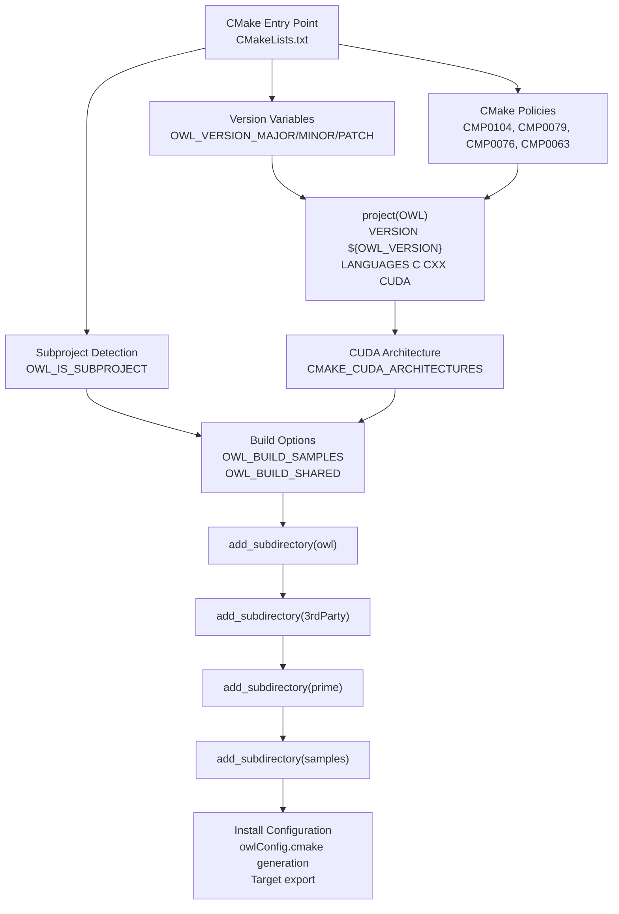
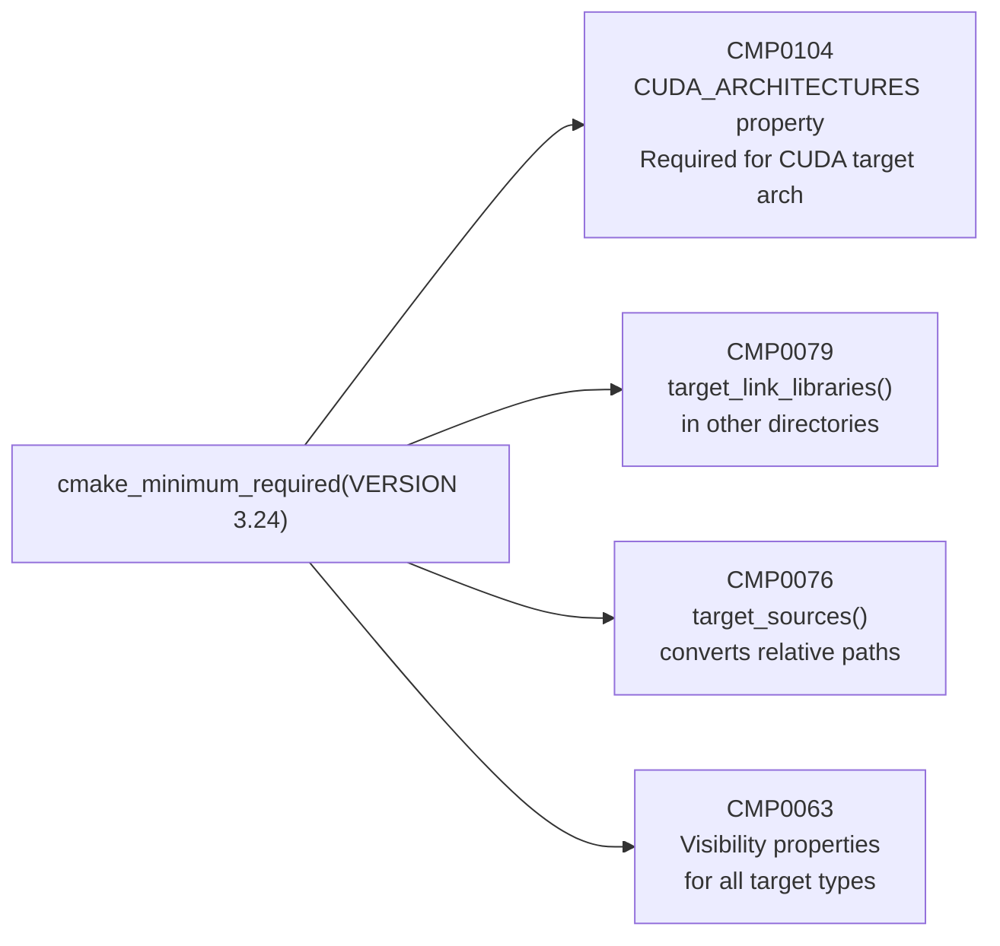
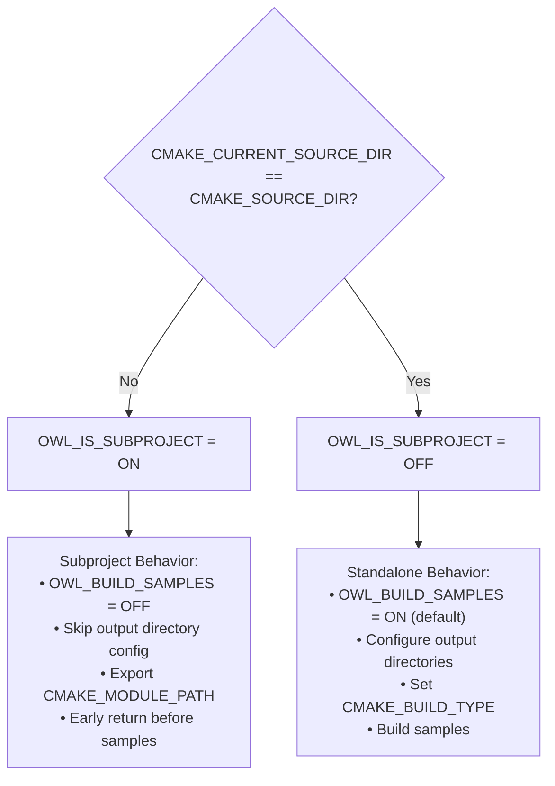
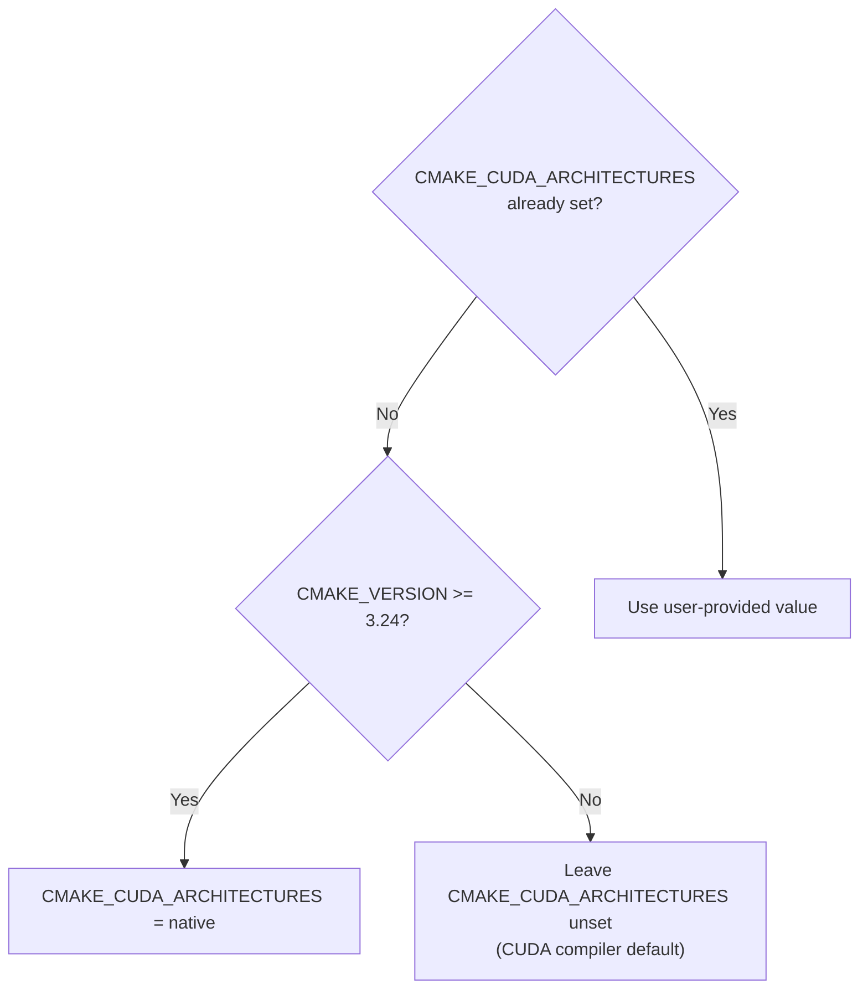
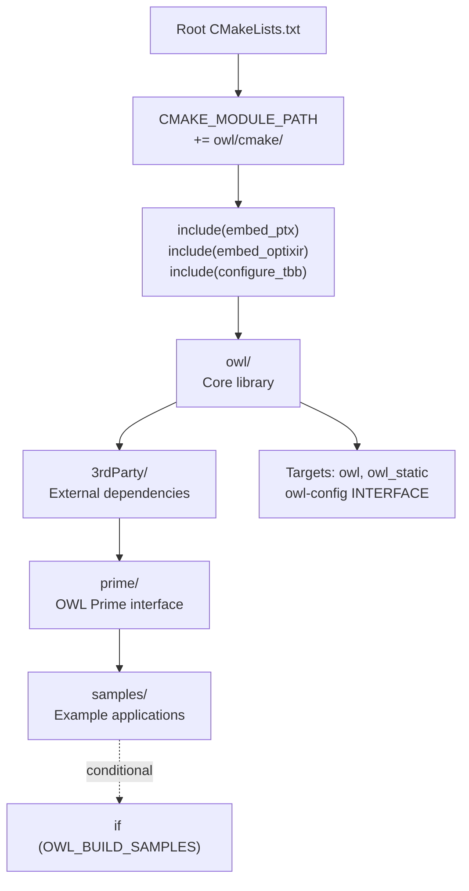
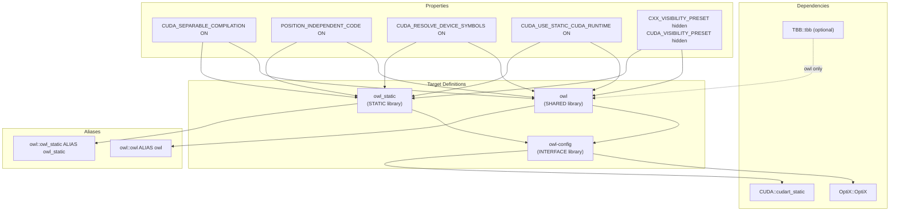
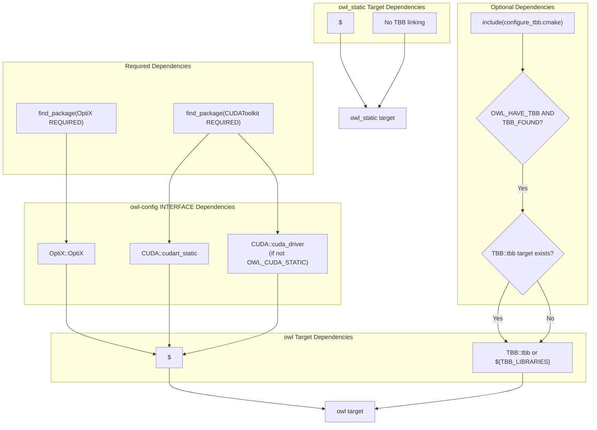

<!-- source: DeepWiki mcp.deepwiki.com · repo NVIDIA/OWL · page 5.1 CMake Configuration · fetched 2026-10-26 -->

# CMake Configuration

<details>
<summary>Relevant source files</summary>

The following files were used as context for generating this wiki page:

- [CMakeLists.txt](CMakeLists.txt)
- [owl/CMakeLists.txt](owl/CMakeLists.txt)

</details>


This page documents the root CMake configuration system in OWL, specifically the [CMakeLists.txt:1-187]() file that orchestrates the entire build. It covers version management, build options, subproject detection, CUDA architecture configuration, and how the library targets are defined. For information about CMake package generation and downstream integration, see [Package System](#5.2). For PTX embedding utilities, see [PTX Embedding](#5.3).

## Configuration Overview

The root `CMakeLists.txt` serves as the entry point for building OWL. It manages project-wide settings, detects whether OWL is being built standalone or as a subproject, configures build options, and coordinates subdirectory builds.



**Sources:** [CMakeLists.txt:1-187]()

## Version Management

OWL uses semantic versioning defined at the top of the root `CMakeLists.txt`. The version components are set as cache variables before the `project()` command:

| Variable | Value | Line Reference |
|----------|-------|----------------|
| `OWL_VERSION_MAJOR` | `1` | [CMakeLists.txt:5]() |
| `OWL_VERSION_MINOR` | `2` | [CMakeLists.txt:6]() |
| `OWL_VERSION_PATCH` | `2` | [CMakeLists.txt:7]() |

These are combined into `OWL_VERSION` at [CMakeLists.txt:35]() as `${OWL_VERSION_MAJOR}.${OWL_VERSION_MINOR}.${OWL_VERSION_PATCH}`, producing version `1.2.2`. This version is used in:
- The `project()` command [CMakeLists.txt:36]()
- CMake package installation directory `lib/cmake/owl-${OWL_VERSION}` [CMakeLists.txt:124]()
- Package version file generation [CMakeLists.txt:136-140]()

**Sources:** [CMakeLists.txt:5-7](), [CMakeLists.txt:35-36]()

## CMake Policies

OWL sets several CMake policies to enable modern CMake behavior and ensure consistent builds across versions:



- **CMP0104** (line 14): Set to `NEW` for CMake 3.18+, enables the `CUDA_ARCHITECTURES` target property, which controls which GPU architectures are targeted
- **CMP0079** (line 16): Allows `target_link_libraries()` to be called for targets defined in other directories
- **CMP0076** (line 17): Converts relative paths in `target_sources()` to absolute
- **CMP0063** (line 18): Honors visibility properties (`CXX_VISIBILITY_PRESET`, `CUDA_VISIBILITY_PRESET`) for all target types

**Sources:** [CMakeLists.txt:9-18]()

## Subproject Detection

OWL detects whether it's being built as a standalone project or included as a subproject (e.g., via `add_subdirectory()` from a parent project):



The check occurs at [CMakeLists.txt:22-26](). When `OWL_IS_SUBPROJECT` is `ON`:
- Sample building is disabled [CMakeLists.txt:65]()
- Output directories are not configured [CMakeLists.txt:51-53]()
- `CMAKE_MODULE_PATH` is exported to parent scope [CMakeLists.txt:64]()
- Build returns early before samples [CMakeLists.txt:102-106]()

When `OWL_IS_SUBPROJECT` is `OFF` (standalone):
- Sample building defaults to `ON` but can be disabled with `OWL_BUILD_SAMPLES` option [CMakeLists.txt:69]()
- Output directories consolidate to `${PROJECT_BINARY_DIR}` [CMakeLists.txt:51-53]()
- `CMAKE_BUILD_TYPE` defaults to `Release` [CMakeLists.txt:54-58]()

**Sources:** [CMakeLists.txt:22-26](), [CMakeLists.txt:50-70](), [CMakeLists.txt:102-106]()

## Build Options

OWL provides two primary build options:

| Option | Type | Default | Condition | Line Reference |
|--------|------|---------|-----------|----------------|
| `OWL_BUILD_SAMPLES` | `option()` | `ON` if standalone, `OFF` if subproject | Set at [CMakeLists.txt:65]() or [CMakeLists.txt:69]() | Controls sample builds |
| `OWL_BUILD_SHARED` | `option()` | `OFF` | Always available | [CMakeLists.txt:79]() |
| `CMAKE_BUILD_TYPE` | cache variable | `Release` | Only set if standalone | [CMakeLists.txt:54-58]() |

### OWL_BUILD_SAMPLES

Controls whether the `samples/` directory is built. The logic is:
```cmake
if (OWL_IS_SUBPROJECT)
  set(OWL_BUILD_SAMPLES OFF)
else()
  option(OWL_BUILD_SAMPLES "Build the Samples?" ON)
endif()
```

Samples are only added if this is `ON` [CMakeLists.txt:108-110]().

### OWL_BUILD_SHARED

Controls library type. When `OFF`, builds static library only. When `ON`, builds shared library. This option is aliased to the standard CMake variable `BUILD_SHARED_LIBS` [CMakeLists.txt:80](). Both `owl` (shared) and `owl_static` targets are always created in [owl/CMakeLists.txt:121-122](), regardless of this option.

**Sources:** [CMakeLists.txt:50-70](), [CMakeLists.txt:79-80](), [CMakeLists.txt:108-110]()

## CUDA Architecture Configuration

OWL configures `CMAKE_CUDA_ARCHITECTURES` with version-dependent defaults:



The configuration logic at [CMakeLists.txt:39-48]():
- If `CMAKE_CUDA_ARCHITECTURES` is not set:
  - For CMake 3.24+: Set to `"native"` which auto-detects GPU architectures present on the build machine
  - For CMake < 3.24: Leave unset, allowing CUDA compiler to use its default (typically the host GPU)
- If `CMAKE_CUDA_ARCHITECTURES` is already set (e.g., by user or parent project), respect that value

This enables building for the local GPU by default while allowing explicit architecture specification via `-DCMAKE_CUDA_ARCHITECTURES="70;75;80"`.

**Sources:** [CMakeLists.txt:39-48]()

## Project Structure and Subdirectories

The root `CMakeLists.txt` coordinates multiple subdirectories:



Directory inclusion order:
1. **owl/** [CMakeLists.txt:90]() - Core library defining `owl` and `owl_static` targets
2. **3rdParty/** [CMakeLists.txt:92]() - External dependencies
3. **prime/** [CMakeLists.txt:97]() - OWL Prime interface layer
4. **samples/** [CMakeLists.txt:109]() - Only if `OWL_BUILD_SAMPLES` is `ON`

The module path is extended at [CMakeLists.txt:62]() to include `owl/cmake/`, making utilities like `embed_ptx.cmake` and `configure_tbb.cmake` available.

**Sources:** [CMakeLists.txt:62](), [CMakeLists.txt:76-77](), [CMakeLists.txt:83](), [CMakeLists.txt:90-110]()

## Library Target Configuration

The `owl/` subdirectory defines three related targets:



### Target Definitions

Three targets are created in [owl/CMakeLists.txt:120-122]():
- **owl-config** (INTERFACE): Holds common compile definitions and link dependencies
- **owl** (SHARED): Shared library built from sources
- **owl_static** (STATIC): Static library built from same sources

### Common Properties

Both `owl` and `owl_static` share identical properties [owl/CMakeLists.txt:126-143]():
- `CUDA_SEPARABLE_COMPILATION ON` - Enables separate compilation of CUDA device code
- `POSITION_INDEPENDENT_CODE ON` - Required for shared libraries
- `CUDA_RESOLVE_DEVICE_SYMBOLS ON` - Links device symbols at target link time
- `CUDA_USE_STATIC_CUDA_RUNTIME ON` - Links static CUDA runtime
- `CXX_VISIBILITY_PRESET hidden` / `CUDA_VISIBILITY_PRESET hidden` - Default symbol visibility

### Compile Definitions

- `owl-config`: Defines `-DOWL_CUDA_STATIC=1` [owl/CMakeLists.txt:123]()
- `owl_static`: Defines `-Dowl_static_STATIC=1` (PUBLIC) [owl/CMakeLists.txt:124]() and `-DOWL_HAVE_TBB=0` [owl/CMakeLists.txt:173]()
- `owl`: Defines `-DOWL_HAVE_TBB=1` if TBB is available [owl/CMakeLists.txt:170]()

### Aliases

Target aliases enable consistent `owl::` namespace [owl/CMakeLists.txt:209-210]():
- `owl::owl` → `owl`
- `owl::owl_static` → `owl_static`

**Sources:** [owl/CMakeLists.txt:120-143](), [owl/CMakeLists.txt:209-210]()

## Dependency Management

OWL links against OptiX, CUDA, and optionally TBB:



### OptiX

Found via custom `FindOptiX.cmake` module at [owl/CMakeLists.txt:4](). Provides `OptiX::OptiX` INTERFACE target linked through `owl-config` [owl/CMakeLists.txt:145-147]().

### CUDA Toolkit

Required by `find_package(CUDAToolkit REQUIRED)` [owl/CMakeLists.txt:176](). Link dependencies depend on `OWL_CUDA_STATIC` variable:
- If `OWL_CUDA_STATIC` is set: Links `CUDA::cudart_static` only [owl/CMakeLists.txt:177-181]()
- Otherwise: Links both `CUDA::cuda_driver` and `CUDA::cudart_static` [owl/CMakeLists.txt:184-187]()

### Intel TBB (Optional)

TBB configuration is handled by `owl/cmake/configure_tbb.cmake` [CMakeLists.txt:83]() and [owl/CMakeLists.txt:36](). If `OWL_HAVE_TBB` and `TBB_FOUND` are both true:
- Check if modern CMake target `TBB::tbb` exists [owl/CMakeLists.txt:164]()
- If yes: Link to `TBB::tbb` [owl/CMakeLists.txt:165]()
- If no: Use legacy variables `${TBB_LIBRARIES}` and `${TBB_INCLUDE_DIR}` [owl/CMakeLists.txt:167-168]()
- Define `-DOWL_HAVE_TBB=1` [owl/CMakeLists.txt:170]()

**Note:** TBB is only linked to the `owl` shared library target, not `owl_static`. The static target explicitly sets `-DOWL_HAVE_TBB=0` [owl/CMakeLists.txt:173]() with the comment "there is not static tbb lib".

### Build Interface Dependencies

Both `owl` and `owl_static` link to `owl-config` using generator expressions [owl/CMakeLists.txt:151-156]():
```cmake
target_link_libraries(owl PUBLIC
  $<BUILD_INTERFACE:owl-config>
)
target_link_libraries(owl_static PUBLIC
  $<BUILD_INTERFACE:owl-config>
)
```

This ensures that `owl-config` dependencies (OptiX, CUDA) are only propagated during the build, not when consuming the installed library (where they're handled by `owlConfig.cmake`).

**Sources:** [owl/CMakeLists.txt:4](), [owl/CMakeLists.txt:145-188](), [owl/CMakeLists.txt:163-173](), [CMakeLists.txt:83]()

## Include Directories

Include paths are configured differently for build-time and install-time:

| Target | Build Interface | Install Interface | Line Reference |
|--------|----------------|-------------------|----------------|
| `owl-config` | `${PROJECT_SOURCE_DIR}`<br/>`${PROJECT_SOURCE_DIR}/include` | `${CMAKE_INSTALL_INCLUDEDIR}` | [owl/CMakeLists.txt:190-196]() |
| `owl` | (inherited from owl-config) | `${CMAKE_INSTALL_INCLUDEDIR}`<br/>`${CMAKE_INSTALL_INCLUDEDIR}/owl/optix/include` | [owl/CMakeLists.txt:197-200]() |
| `owl_static` | (inherited from owl-config) | `${CMAKE_INSTALL_INCLUDEDIR}`<br/>`${CMAKE_INSTALL_INCLUDEDIR}/owl/optix/include` | [owl/CMakeLists.txt:201-204]() |

The build interface uses `$<BUILD_INTERFACE:...>` generator expressions to provide access to the source tree. The install interface uses `$<INSTALL_INTERFACE:...>` to reference the installation prefix structure.

Platform-specific definitions are added at [owl/CMakeLists.txt:205-207]():
```cmake
if (WIN32)
  target_compile_definitions(owl-config INTERFACE -DNOMINMAX)
endif()
```

**Sources:** [owl/CMakeLists.txt:190-207]()

## C++ and CUDA Standards

OWL requires C++17 and configures CUDA compilation standards:

| Variable | Value | Scope | Line Reference |
|----------|-------|-------|----------------|
| `CMAKE_CXX_STANDARD` | `17` | Project-wide | [CMakeLists.txt:73]() |
| `CMAKE_CXX_STANDARD_REQUIRED` | `ON` | Project-wide | [CMakeLists.txt:74]() |
| `CMAKE_CUDA_USE_STATIC_CUDA_RUNTIME` | `ON` | Project-wide | [CMakeLists.txt:11]() |
| `CMAKE_POSITION_INDEPENDENT_CODE` | `ON` | Project-wide | [CMakeLists.txt:29]() |

The minimum CMake version is `3.24` [CMakeLists.txt:9](), enabling features like `CMAKE_CUDA_ARCHITECTURES` with `"native"` support and modern CUDA integration.

**Sources:** [CMakeLists.txt:9](), [CMakeLists.txt:11](), [CMakeLists.txt:29](), [CMakeLists.txt:73-74]()

## Output Directory Configuration

For standalone builds, OWL consolidates build outputs to the project binary directory:

```cmake
set(CMAKE_RUNTIME_OUTPUT_DIRECTORY ${PROJECT_BINARY_DIR})
set(CMAKE_LIBRARY_OUTPUT_DIRECTORY ${PROJECT_BINARY_DIR})
set(CMAKE_ARCHIVE_OUTPUT_DIRECTORY ${PROJECT_BINARY_DIR})
```

This configuration at [CMakeLists.txt:51-53]() places all executables, shared libraries, and static libraries in the same directory, simplifying development and testing. This is skipped when `OWL_IS_SUBPROJECT` is true to avoid interfering with the parent project's output structure.

**Sources:** [CMakeLists.txt:50-59]()

## Installation Configuration

The root `CMakeLists.txt` configures installation of libraries, headers, and CMake package files. The installation destination for CMake config files is:

```cmake
set(OWL_CMAKE_INSTALL_DESTINATION
  ${CMAKE_INSTALL_LIBDIR}/cmake/owl-${OWL_VERSION}
)
```

This evaluates to `lib/cmake/owl-1.2.2/` [CMakeLists.txt:123-125](). The install commands at [CMakeLists.txt:142-185]() install:

1. **CMake package files** to `lib/cmake/owl-1.2.2/`:
   - `owlConfig.cmake` (generated)
   - `owlConfigVersion.cmake` (generated)
   - `embed_ptx.cmake` (utility)
   - `run_bin2c.cmake` (utility)

2. **Library targets** (`owl`, `owl_static`):
   - Shared libraries → `${CMAKE_INSTALL_LIBDIR}`
   - Static libraries → `${CMAKE_INSTALL_LIBDIR}`
   - DLLs on Windows → `${CMAKE_INSTALL_BINDIR}`
   - Export as `owl-config` with `owl::` namespace

3. **Headers**:
   - `include/owl/` → `${CMAKE_INSTALL_INCLUDEDIR}/owl/`
   - `3rdParty/optix/include/` → `${CMAKE_INSTALL_INCLUDEDIR}/owl/optix/include/`

The targets are exported with the `owl::` namespace [CMakeLists.txt:172-175](), enabling downstream projects to link against `owl::owl` or `owl::owl_static`.

**Sources:** [CMakeLists.txt:123-185]()

---

