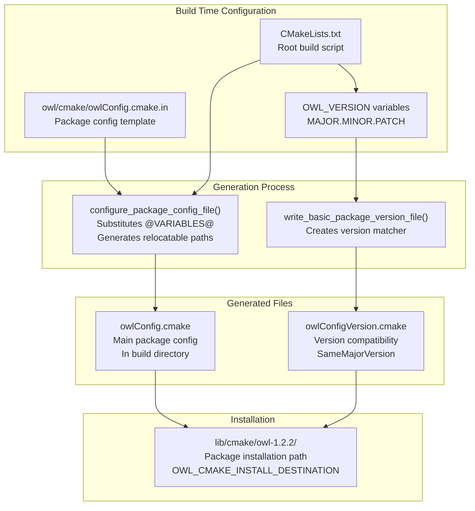
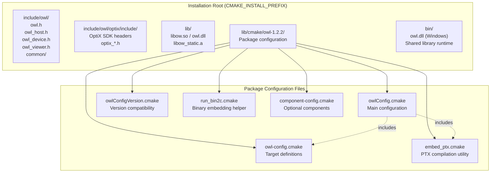
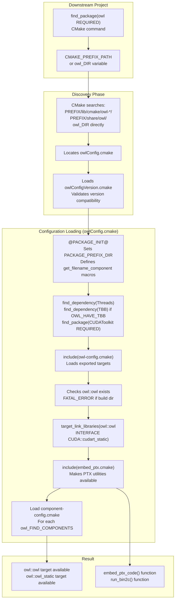
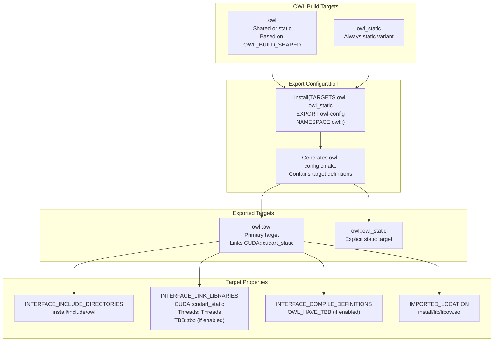
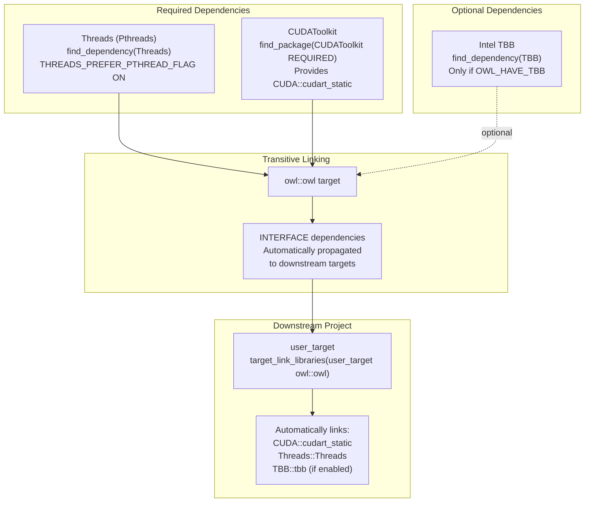
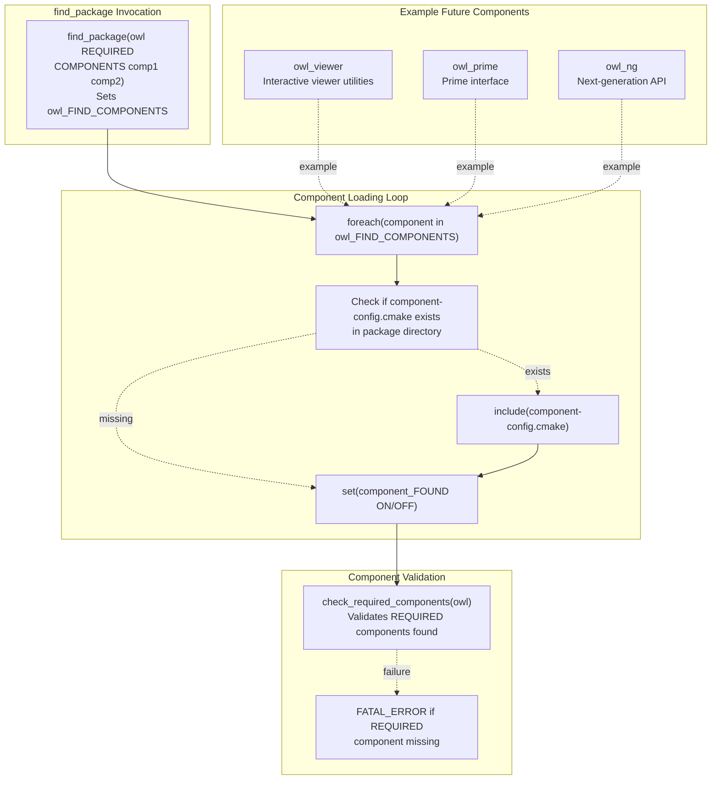
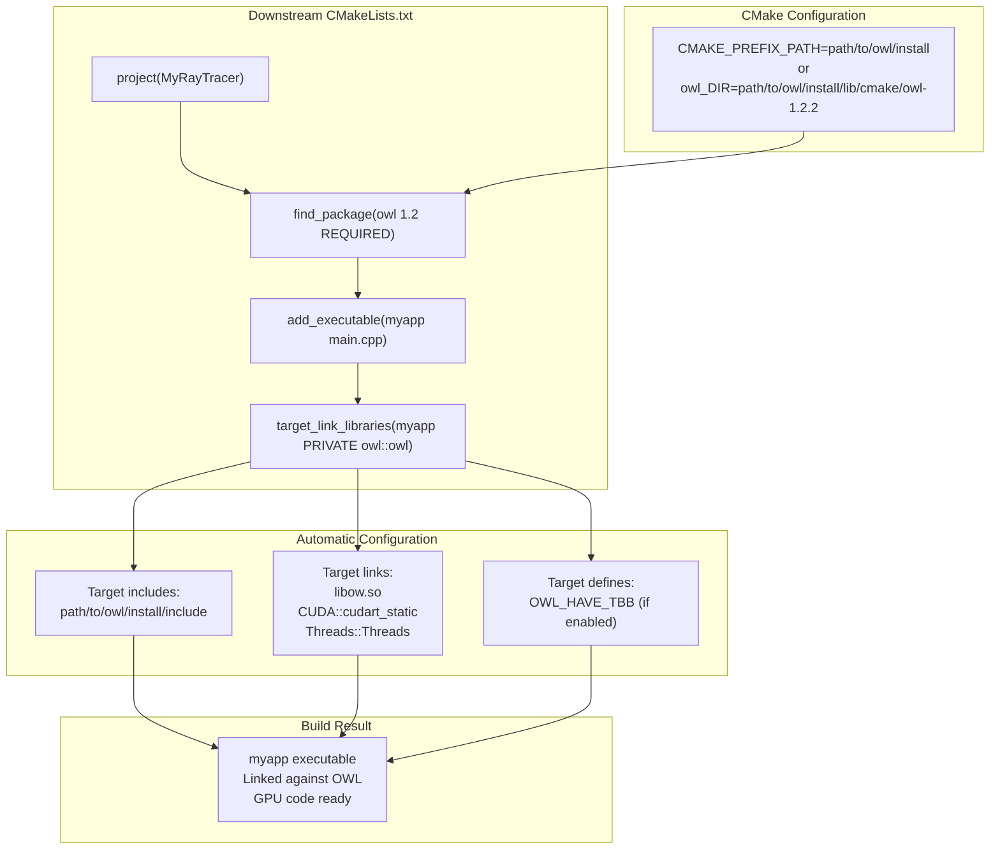

<!-- source: DeepWiki mcp.deepwiki.com · repo NVIDIA/OWL · page 5.2 Package System · fetched 2026-10-26 -->

# Package System

<details>
<summary>Relevant source files</summary>

The following files were used as context for generating this wiki page:

- [CMakeLists.txt](CMakeLists.txt)
- [owl/cmake/owlConfig.cmake.in](owl/cmake/owlConfig.cmake.in)

</details>


## Purpose and Scope

This document explains OWL's CMake package configuration system, which enables downstream projects to discover, link, and use OWL as a dependency. The package system generates relocatable CMake configuration files, exports targets with proper namespacing, manages transitive dependencies, and provides utility scripts for GPU code compilation.

For information about initial CMake project configuration and build options, see [CMake Configuration](#5.1). For details on the PTX embedding utilities available to downstream projects, see [PTX Embedding](#5.3).

## Package Configuration File Generation

OWL's root `CMakeLists.txt` generates two primary package configuration files during the build process. These files enable CMake's `find_package()` mechanism to locate and configure OWL installations.



**Sources:** [CMakeLists.txt:123-140]()

The generation process uses CMake's `configure_package_config_file()` function [CMakeLists.txt:129-134](), which processes the template file [owl/cmake/owlConfig.cmake.in]() and performs several critical operations:

| Operation | Purpose | Implementation |
|-----------|---------|----------------|
| `@PACKAGE_INIT@` substitution | Generates relocatable path macros | [owlConfig.cmake.in:4]() |
| `@OWL_HAVE_TBB@` substitution | Conditionally enables TBB dependency | [owlConfig.cmake.in:26]() |
| `@PROJECT_NAME@` substitution | Validates required components | [owlConfig.cmake.in:47]() |
| `@CMAKE_INSTALL_DATAROOTDIR@` substitution | Provides data resource path | [owlConfig.cmake.in:23]() |

The version file is generated with `SameMajorVersion` compatibility [CMakeLists.txt:139](), meaning OWL version 1.2.2 is compatible with requests for version 1.x.x but not 2.x.x.

## Installed Directory Structure

Upon installation, OWL creates a standardized directory layout that follows CMake conventions. The package configuration files are installed to a version-specific subdirectory to allow multiple OWL versions to coexist.



**Sources:** [CMakeLists.txt:123-184]()

The installation process is executed through multiple `install()` commands:

**Configuration Files Installation** [CMakeLists.txt:142-149]():
- `owlConfig.cmake` - Main package configuration
- `owlConfigVersion.cmake` - Version compatibility checker
- `embed_ptx.cmake` - PTX compilation utility for downstream projects
- `run_bin2c.cmake` - Binary-to-C-array conversion helper

**Additional CMake Utilities Installation** [CMakeLists.txt:151-157]():
- All `.cmake` files from `cmake/` directory
- Excludes `Findowl.cmake` (deprecated finder module)

**Target Libraries Installation** [CMakeLists.txt:161-171]():
- `owl` - Shared or static library (based on `OWL_BUILD_SHARED`)
- `owl_static` - Always static variant
- Shared libraries (`.so`/`.dll`) → `lib/` on Unix, `bin/` on Windows
- Static libraries (`.a`/`.lib`) → `lib/`
- Import libraries (`.lib` on Windows) → `lib/`

**Headers Installation** [CMakeLists.txt:177-184]():
- Public API headers from `include/owl/`
- Bundled OptiX headers from `3rdParty/optix/include/`

## Package Discovery and Loading

When a downstream project executes `find_package(owl)`, CMake searches for `owlConfig.cmake` in standard locations and user-specified paths. The configuration file orchestrates a multi-step loading process.



**Sources:** [owlConfig.cmake.in:1-50]()

### Configuration Sequence

**1. Package Initialization** [owlConfig.cmake.in:4]()  
The `@PACKAGE_INIT@` macro expands to code that:
- Defines `PACKAGE_PREFIX_DIR` pointing to the installation root
- Provides relocatable path computation macros
- Enables `set_and_check()` and `check_required_components()` functions

**2. Dependency Resolution** [owlConfig.cmake.in:8-32]()  
Uses `find_dependency()` to locate required dependencies:
```cmake
find_dependency(Threads)                    # Always required
find_dependency(TBB)                        # If @OWL_HAVE_TBB@ is ON
find_package(CUDAToolkit REQUIRED)          # Always required
```

**3. Target Import** [owlConfig.cmake.in:11]()  
Includes `owl-config.cmake`, which contains the actual target definitions exported via `install(EXPORT owl-config ...)` [CMakeLists.txt:172-175]().

**4. Build Directory Detection** [owlConfig.cmake.in:13-19]()  
Prevents accidental use of OWL from its build directory:
```cmake
if (NOT TARGET owl::owl)
  message(FATAL_ERROR "CMAKE_PREFIX_PATH or owl_DIR are pointing to a
  owl build directory. Please do a full install of owl...")
endif()
```

**5. CUDA Runtime Linkage** [owlConfig.cmake.in:32]()  
Adds static CUDA runtime as an `INTERFACE` dependency, automatically propagating to all consumers:
```cmake
target_link_libraries(owl::owl INTERFACE CUDA::cudart_static)
```

**6. Utility Script Inclusion** [owlConfig.cmake.in:34]()  
Makes `embed_ptx.cmake` functions available to downstream projects for compiling their own GPU kernels.

## Target Export System

OWL exports two library targets with the `owl::` namespace, ensuring no naming conflicts with other projects. The export system uses CMake's target export mechanism to generate portable target definitions.



**Sources:** [CMakeLists.txt:159-175]()

### Target Installation Details

The `install(TARGETS ...)` command [CMakeLists.txt:161-171]() specifies different destinations for different artifact types:

| Artifact Type | Destination (Unix) | Destination (Windows) | Variable |
|---------------|-------------------|----------------------|----------|
| Shared library | `${CMAKE_INSTALL_LIBDIR}` | `${CMAKE_INSTALL_BINDIR}` (runtime) | Typically `lib/` or `bin/` |
| Import library | `${CMAKE_INSTALL_LIBDIR}` | `${CMAKE_INSTALL_LIBDIR}` | Typically `lib/` |
| Static library | `${CMAKE_INSTALL_LIBDIR}` | `${CMAKE_INSTALL_LIBDIR}` | Typically `lib/` |

The `NAMELINK_SKIP` directive [CMakeLists.txt:166]() excludes symbolic links (e.g., `libow.so` → `libow.so.1.2.2`) from the development installation, as they're handled separately.

### Target Export Mechanics

The `EXPORT owl-config` directive [CMakeLists.txt:164]() groups the targets for export, and the subsequent `install(EXPORT ...)` command [CMakeLists.txt:172-175]() generates the actual CMake target file:

```cmake
install(EXPORT owl-config
  DESTINATION ${OWL_CMAKE_INSTALL_DESTINATION}  # lib/cmake/owl-1.2.2/
  NAMESPACE owl::                                # Prefixes targets
)
```

This produces `owl-config.cmake` containing:
- `add_library(owl::owl SHARED IMPORTED)` or `STATIC IMPORTED`
- `set_target_properties()` calls defining include directories, link libraries, and compile definitions
- `add_library(owl::owl_static STATIC IMPORTED)`
- Corresponding properties for the static variant

## Dependency Resolution

The package system manages three categories of dependencies: required system libraries, optional performance libraries, and the CUDA ecosystem. Dependencies are resolved at the time `find_package(owl)` is invoked.



**Sources:** [owlConfig.cmake.in:8-32]()

### Dependency Finding Logic

**Threads Library** [owlConfig.cmake.in:8-9]()  
Set `THREADS_PREFER_PTHREAD_FLAG` before finding to prefer `-pthread` flag over `-lpthread` linking:
```cmake
set(THREADS_PREFER_PTHREAD_FLAG ON)
find_dependency(Threads)
```

**TBB (Intel Threading Building Blocks)** [owlConfig.cmake.in:26-29]()  
Conditionally found based on build-time configuration:
```cmake
if (@OWL_HAVE_TBB@)
  find_dependency(TBB)
  set(OWL_HAVE_TBB ON)
endif()
```
The `@OWL_HAVE_TBB@` variable is substituted during configuration from the OWL build's TBB detection [CMakeLists.txt:83]().

**CUDA Toolkit** [owlConfig.cmake.in:31]()  
Always required, provides CUDA runtime and driver API:
```cmake
find_package(CUDAToolkit REQUIRED)
```

**CUDA Runtime Static Linking** [owlConfig.cmake.in:32]()  
Explicitly links static CUDA runtime as an `INTERFACE` dependency:
```cmake
target_link_libraries(owl::owl INTERFACE CUDA::cudart_static)
```

This ensures downstream projects automatically link against CUDA runtime without explicit configuration. The static variant is preferred to avoid runtime DLL/shared library dependencies.

## Component System

OWL's package configuration supports a component system for optional functionality, though currently no standard components are defined. The mechanism allows future extension and modular packaging.



**Sources:** [owlConfig.cmake.in:36-47]()

### Component Resolution Implementation

The component loading loop [owlConfig.cmake.in:36-45]() processes each requested component:

```cmake
foreach(component ${owl_FIND_COMPONENTS})
  # For requested component, execute its "config" script
  message("cfind component ${component}")
  if (EXISTS "${CMAKE_CURRENT_LIST_DIR}/${component}-config.cmake")
    include(${CMAKE_CURRENT_LIST_DIR}/${component}-config.cmake)
    set(${component}_FOUND ON)
  else()
    set(${component}_FOUND OFF)
  endif()
endforeach()
```

After processing components, `check_required_components(@PROJECT_NAME@)` [owlConfig.cmake.in:47]() validates that all `REQUIRED` components were successfully found. If any required component has `${component}_FOUND` set to `OFF`, CMake emits a fatal error.

### Component Configuration File Format

Component configuration files follow the naming pattern `${component}-config.cmake` and should:
- Define additional targets (e.g., `owl::viewer`, `owl::prime`)
- Set include directories and link libraries
- Configure component-specific preprocessor definitions
- Set `${component}_FOUND` to indicate successful loading

Currently, no component configuration files are installed [CMakeLists.txt:142-157](), making this a framework for future extensibility.

## Downstream Integration

Downstream projects integrate OWL using CMake's `find_package()` mechanism. The package system provides two integration patterns: submodule-based and installation-based.

### Installation-Based Integration



**Sources:** [README.md]() (typical usage pattern)

Example downstream `CMakeLists.txt`:
```cmake
cmake_minimum_required(VERSION 3.24)
project(MyRayTracer LANGUAGES CXX CUDA)

# Point to OWL installation
set(CMAKE_PREFIX_PATH "/path/to/owl/install")

# Find OWL package
find_package(owl 1.2 REQUIRED)

# Create executable
add_executable(myapp main.cpp)

# Link against OWL (automatically includes headers and dependencies)
target_link_libraries(myapp PRIVATE owl::owl)

# Compile device code to PTX and embed
include(embed_ptx)
embed_ptx_code(
  OUTPUT_TARGET myapp_ptx
  PTX_LINK_LIBRARIES owl::owl
  SOURCES device_code.cu
)
target_link_libraries(myapp PRIVATE myapp_ptx)
```

### Submodule-Based Integration

When OWL is included as a Git submodule, the detection logic [CMakeLists.txt:22-26]() sets `OWL_IS_SUBPROJECT` to `ON`, which:
- Disables sample building [CMakeLists.txt:65]()
- Exposes CMake module path to parent [CMakeLists.txt:64]()
- Returns early from configuration [CMakeLists.txt:105]()
- Makes `owl::owl` target available directly without `find_package()`

Example submodule integration:
```cmake
# Add OWL subdirectory with EXCLUDE_FROM_ALL to skip samples
add_subdirectory(external/owl EXCLUDE_FROM_ALL)

add_executable(myapp main.cpp)
target_link_libraries(myapp PRIVATE owl::owl)
```

The `EXCLUDE_FROM_ALL` flag prevents OWL samples from being built as part of the parent project's default target.

### Available Utilities

Both integration patterns provide access to utility scripts installed alongside the package configuration:

| Utility | Purpose | Availability |
|---------|---------|-------------|
| `embed_ptx.cmake` | Compiles `.cu` files to PTX, embeds as C++ byte arrays | Included via [owlConfig.cmake.in:34]() |
| `run_bin2c.cmake` | Converts binary files to C++ arrays | Available in package directory |

These utilities are documented in detail in [PTX Embedding](#5.3).

### Version Compatibility

The `owlConfigVersion.cmake` file enforces version compatibility rules [CMakeLists.txt:136-140]():
- `COMPATIBILITY SameMajorVersion` - OWL 1.x.x is compatible with any 1.y.z request
- Major version mismatch (e.g., requesting 2.x.x when 1.x.x is installed) causes `find_package()` to fail
- Minor and patch version differences are permitted within the same major version

Example version constraints:
```cmake
find_package(owl 1.2 EXACT REQUIRED)    # Requires exactly 1.2.x
find_package(owl 1.0 REQUIRED)          # Accepts 1.0+, including 1.2.2
find_package(owl 2.0 REQUIRED)          # Fails with installed 1.2.2
```

---

**Key Files:**
- [CMakeLists.txt:122-187]() - Package installation configuration
- [owl/cmake/owlConfig.cmake.in]() - Package configuration template
- [owl/cmake/embed_ptx.cmake]() - PTX compilation utility
- [owl/cmake/run_bin2c.cmake]() - Binary embedding utility

---

