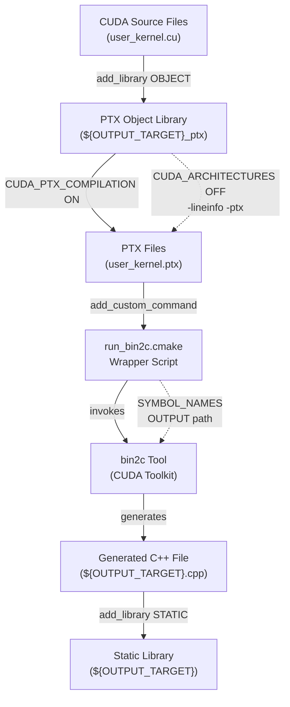
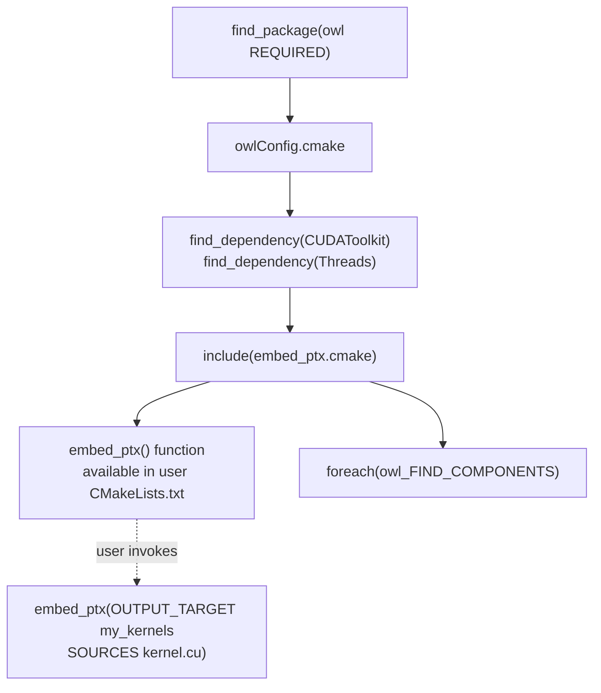
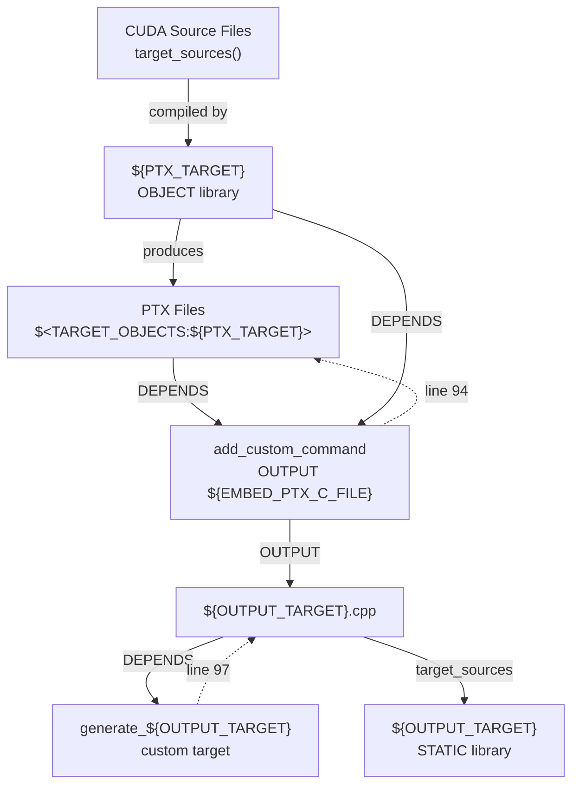

<!-- source: DeepWiki mcp.deepwiki.com · repo NVIDIA/OWL · page 5.3 PTX Embedding · fetched 2026-10-26 -->

# PTX Embedding

<details>
<summary>Relevant source files</summary>

The following files were used as context for generating this wiki page:

- [owl/cmake/embed_ptx.cmake](owl/cmake/embed_ptx.cmake)
- [owl/cmake/owlConfig.cmake.in](owl/cmake/owlConfig.cmake.in)

</details>


## Purpose and Scope

This document describes OWL's PTX embedding system, which provides a CMake utility for compiling CUDA source files into PTX (Parallel Thread Execution) code and embedding it as C++ byte arrays. This allows GPU kernel code to be compiled at build time and included directly in executables without requiring runtime JIT compilation.

The embedding mechanism is defined in [`owl/cmake/embed_ptx.cmake`](owl/cmake/embed_ptx.cmake:1-108)() and automatically exported to downstream projects via [`owl/cmake/owlConfig.cmake.in`](owl/cmake/owlConfig.cmake.in:34)(). For information about the broader CMake package system, see [Package System](#5.2). For general CMake configuration options, see [CMake Configuration](#5.1).

---

## The embed_ptx() Function

The core of OWL's PTX embedding system is the `embed_ptx()` CMake function defined in [`owl/cmake/embed_ptx.cmake`](owl/cmake/embed_ptx.cmake:10-107)(). This function orchestrates the compilation of CUDA sources to PTX, conversion to C++ byte arrays via `bin2c`, and packaging into a static library.

### Function Signature

```cmake
embed_ptx(
  OUTPUT_TARGET <target_name>
  SOURCES <cuda_file1.cu> [<cuda_file2.cu> ...]
  [PTX_TARGET <ptx_target_name>]
  [PTX_LINK_LIBRARIES <lib1> [<lib2> ...]]
  [EMBEDDED_SYMBOL_NAMES <symbol1> [<symbol2> ...]]
)
```

### Parameters

| Parameter | Required | Description |
|-----------|----------|-------------|
| `OUTPUT_TARGET` | Yes | Name of the static library target containing embedded PTX byte arrays |
| `SOURCES` | Yes | List of `.cu` files to compile to PTX and embed |
| `PTX_TARGET` | No | Custom name for intermediate PTX object library (defaults to `${OUTPUT_TARGET}_ptx`) |
| `PTX_LINK_LIBRARIES` | No | Libraries to link against during PTX compilation (e.g., `owl::owl` for device API headers) |
| `EMBEDDED_SYMBOL_NAMES` | No | C++ symbol names for each PTX byte array (defaults to `${filename}_ptx`) |

The function performs validation at [`owl/cmake/embed_ptx.cmake:15-30`](), ensuring that if `EMBEDDED_SYMBOL_NAMES` is provided, it contains exactly one name per source file.

**Sources:** [`owl/cmake/embed_ptx.cmake`](owl/cmake/embed_ptx.cmake:10-107)()

---

## Build Process Overview

The PTX embedding process involves multiple stages, coordinated by CMake custom commands and targets:



**Diagram: PTX Embedding Pipeline**

### Stage 1: PTX Compilation

The function creates an `OBJECT` library target for PTX generation at [`owl/cmake/embed_ptx.cmake:61-80`](). Key configuration:

- **CUDA_PTX_COMPILATION**: Enabled via `set_property(TARGET ${PTX_TARGET} PROPERTY CUDA_PTX_COMPILATION ON)` at line 78
- **CUDA_ARCHITECTURES**: Set to `OFF` (line 79) to generate generic PTX rather than architecture-specific SASS
- **Compile Options**: `-lineinfo -ptx` (line 80) for debugging support and explicit PTX output

### Stage 2: Binary-to-C Conversion

A custom command at [`owl/cmake/embed_ptx.cmake:85-96`]() invokes `bin2c` through a wrapper script:

- **bin2c Discovery**: Located in CUDA compiler directory at [`owl/cmake/embed_ptx.cmake:42-50`]()
- **Wrapper Script**: `run_bin2c.cmake` handles multiple PTX files and symbol naming
- **Output File**: Generated at `${CMAKE_CURRENT_BINARY_DIR}/${CMAKE_BUILD_TYPE}/${OUTPUT_TARGET}.cpp`

The custom command depends on `$<TARGET_OBJECTS:${PTX_TARGET}>`, ensuring PTX files are built before conversion.

### Stage 3: Static Library Creation

Finally, a static library is created at [`owl/cmake/embed_ptx.cmake:99-105`]() containing the generated C++ file. The library has default visibility preset (lines 101-105), making embedded symbols accessible to linkers.

**Sources:** [`owl/cmake/embed_ptx.cmake`](owl/cmake/embed_ptx.cmake:61-105)()

---

## Integration with OWL Package System

The `embed_ptx.cmake` module is automatically included when downstream projects use `find_package(owl)`. This occurs via [`owl/cmake/owlConfig.cmake.in:34`]():

```cmake
include(${CMAKE_CURRENT_LIST_DIR}/embed_ptx.cmake)
```

This inclusion happens after dependency resolution (CUDA Toolkit, Threads, optional TBB) but before component loading, making the `embed_ptx()` function available to all OWL consumers.



**Diagram: embed_ptx.cmake Availability to Downstream Projects**

The `EMBED_PTX_DIR` variable is cached at [`owl/cmake/embed_ptx.cmake:8`]() to locate the `run_bin2c.cmake` script, which is installed alongside `embed_ptx.cmake` in the package's CMake directory.

**Sources:** [`owl/cmake/owlConfig.cmake.in`](owl/cmake/owlConfig.cmake.in:31-34)(), [`owl/cmake/embed_ptx.cmake`](owl/cmake/embed_ptx.cmake:8)()

---

## Usage in Downstream Projects

### Basic Usage Pattern

After `find_package(owl)`, downstream projects can embed their own CUDA kernels:

```cmake
find_package(owl REQUIRED)

# Compile CUDA kernels to embedded PTX
embed_ptx(
  OUTPUT_TARGET my_device_programs
  SOURCES 
    raygen.cu
    closesthit.cu
    miss.cu
  PTX_LINK_LIBRARIES 
    owl::owl  # Provides owl_device.h for OPTIX_RAYGEN_PROGRAM macros
)

# Link the embedded PTX library
add_executable(my_app main.cpp)
target_link_libraries(my_app PRIVATE owl::owl my_device_programs)
```

### Symbol Name Mapping

By default, symbol names are derived from source filenames. For `raygen.cu`, the generated C++ file contains:

```cpp
extern "C" const unsigned long raygen_ptx_size;
extern "C" const unsigned char raygen_ptx[];
```

Custom symbol names can be specified via `EMBEDDED_SYMBOL_NAMES` to avoid conflicts or improve clarity:

```cmake
embed_ptx(
  OUTPUT_TARGET kernels
  SOURCES kernel_v1.cu kernel_v2.cu
  EMBEDDED_SYMBOL_NAMES kernel_version_1_ptx kernel_version_2_ptx
)
```

The validation logic at [`owl/cmake/embed_ptx.cmake:15-23`]() ensures the lists match in length.

### Accessing Embedded PTX at Runtime

The embedded byte arrays can be passed directly to `owlModuleCreate()`:

```cpp
extern "C" const unsigned char raygen_ptx[];
extern "C" const unsigned long raygen_ptx_size;

OWLModule module = owlModuleCreate(
    context,
    (const char*)raygen_ptx
);
```

OWL's host API reads the null-terminated PTX string from the embedded array and compiles it via OptiX.

**Sources:** [`owl/cmake/embed_ptx.cmake`](owl/cmake/embed_ptx.cmake:10-30)()

---

## Implementation Details

### Source Path Normalization

The function normalizes source paths at [`owl/cmake/embed_ptx.cmake:63-73`]() to handle both absolute and relative paths. Relative paths are resolved against `CMAKE_CURRENT_SOURCE_DIR`:

```cmake
foreach(src ${EMBED_PTX_SOURCES_IN})
  cmake_path(IS_ABSOLUTE src is_absolute)
  if (is_absolute)
  else()
    set(src "${CMAKE_CURRENT_SOURCE_DIR}/${src}")
  endif()
  list(APPEND EMBED_PTX_SOURCES_OUT "${src}")
endforeach()
```

### bin2c Tool Discovery

The `bin2c` utility ships with CUDA Toolkit and resides in the same directory as `nvcc`. Discovery occurs at [`owl/cmake/embed_ptx.cmake:42-50`]():

```cmake
get_filename_component(CUDA_COMPILER_BIN "${CMAKE_CUDA_COMPILER}" DIRECTORY)
find_program(BIN_TO_C NAMES bin2c PATHS ${CUDA_COMPILER_BIN})
if(NOT BIN_TO_C)
  message(FATAL_ERROR "bin2c not found...")
endif()
```

This ensures compatibility with the active CUDA installation.

### run_bin2c.cmake Wrapper

The `bin2c` tool only processes one file at a time and writes to stdout. The wrapper script at `owl/cmake/run_bin2c.cmake` (referenced at line 52):

1. Iterates over multiple PTX files from `$<TARGET_OBJECTS:${PTX_TARGET}>`
2. Invokes `bin2c` with `--name` argument for each symbol name
3. Redirects output to a single `.cpp` file
4. Concatenates all embedded arrays

The wrapper is invoked via CMake script mode (`-P`) at [`owl/cmake/embed_ptx.cmake:87-92`]():

```cmake
COMMAND ${CMAKE_COMMAND}
  "-DBIN_TO_C_COMMAND=${BIN_TO_C}"
  "-DOBJECTS=$<TARGET_OBJECTS:${PTX_TARGET}>"
  "-DSYMBOL_NAMES=${EMBED_PTX_EMBEDDED_SYMBOL_NAMES}"
  "-DOUTPUT=${EMBED_PTX_C_FILE}"
  -P ${EMBED_PTX_RUN}
```

Generator expressions (`$<TARGET_OBJECTS:...>`) are evaluated at build time, providing the actual PTX file paths.

### Build-Type-Specific Output

The output C++ file path includes `${CMAKE_BUILD_TYPE}` at [`owl/cmake/embed_ptx.cmake:84`]():

```cmake
set(EMBED_PTX_C_FILE 
  ${CMAKE_CURRENT_BINARY_DIR}/${CMAKE_BUILD_TYPE}/${EMBED_PTX_OUTPUT_TARGET}.cpp)
```

This prevents conflicts when building multiple configurations (Debug/Release) in multi-config generators like Visual Studio or Xcode.

**Sources:** [`owl/cmake/embed_ptx.cmake`](owl/cmake/embed_ptx.cmake:42-96)()

---

## Dependency Chain

The following diagram shows how dependencies ensure correct build ordering:



**Diagram: Build Dependency Chain**

Key dependencies defined at [`owl/cmake/embed_ptx.cmake:94-97`]():

- **Line 94**: `DEPENDS $<TARGET_OBJECTS:${PTX_TARGET}> ${PTX_TARGET}` ensures PTX files exist before `bin2c` runs
- **Line 97**: `add_custom_target(generate_${EMBED_PTX_OUTPUT_TARGET} DEPENDS ${EMBED_PTX_C_FILE})` creates a named target for the generation step
- Implicit dependency from `add_library(${OUTPUT_TARGET} STATIC)` on the source file ensures regeneration triggers rebuild

**Sources:** [`owl/cmake/embed_ptx.cmake`](owl/cmake/embed_ptx.cmake:85-106)()

---

## Summary

The `embed_ptx()` function provides a streamlined workflow for embedding GPU code in C++ applications:

1. **Compile** CUDA sources to PTX with `CUDA_PTX_COMPILATION` property
2. **Convert** PTX files to C byte arrays via CUDA's `bin2c` tool
3. **Package** byte arrays into a static library linkable by host code
4. **Export** the utility to downstream projects via OWL's CMake package

This mechanism eliminates runtime PTX file dependencies and simplifies deployment of OptiX applications built with OWL.

**Sources:** [`owl/cmake/embed_ptx.cmake`](owl/cmake/embed_ptx.cmake:1-108)(), [`owl/cmake/owlConfig.cmake.in`](owl/cmake/owlConfig.cmake.in:34)()

---

