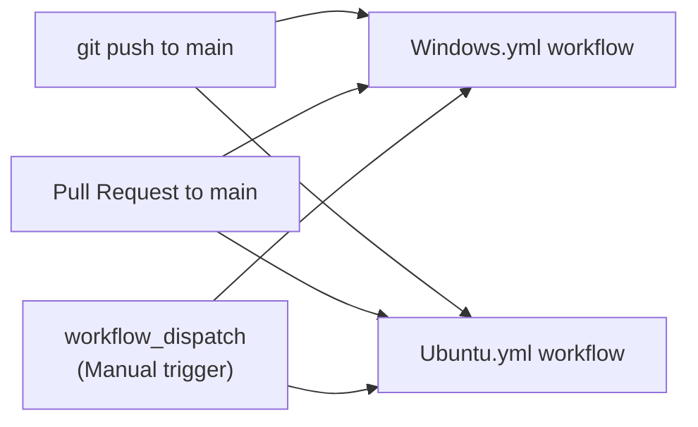
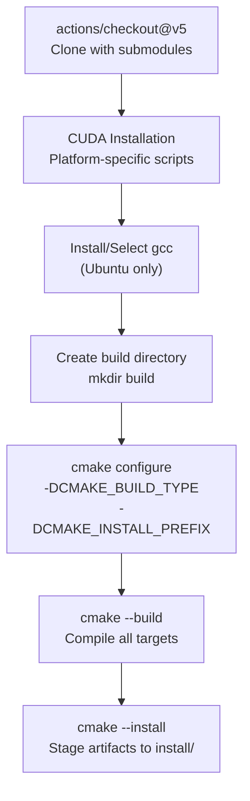
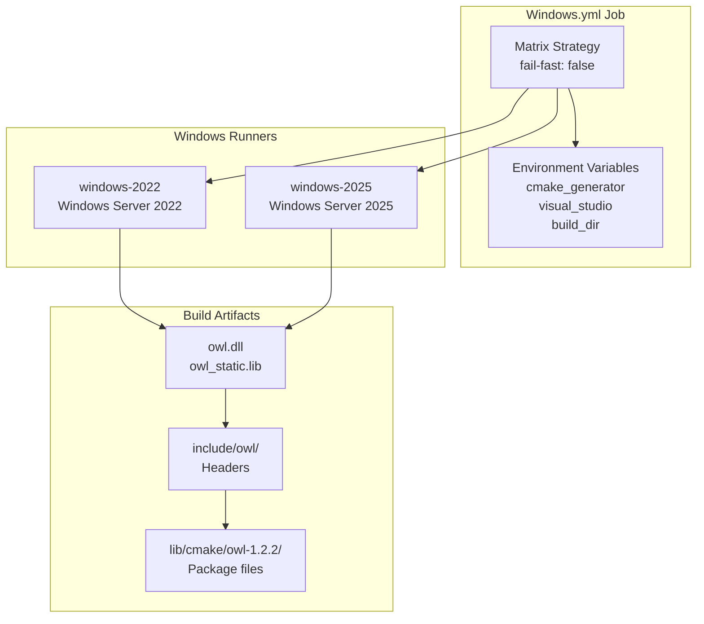
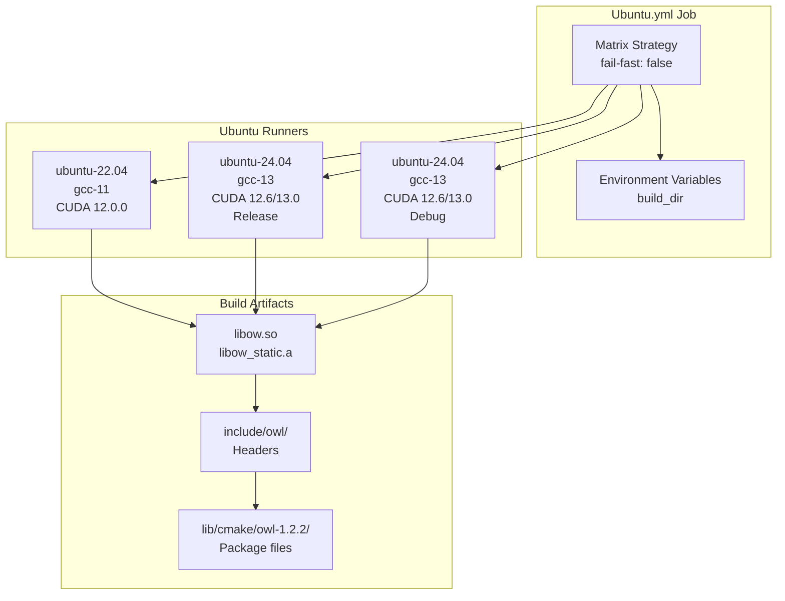
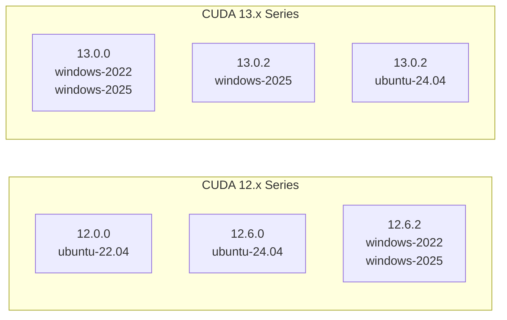

<!-- source: DeepWiki mcp.deepwiki.com · repo NVIDIA/OWL · page 6 CI/CD and Testing · fetched 2026-10-26 -->

# CI/CD and Testing

<details>
<summary>Relevant source files</summary>

The following files were used as context for generating this wiki page:

- [.github/action-scripts/install-cuda-windows.ps1](.github/action-scripts/install-cuda-windows.ps1)
- [.github/action-scripts/install_cuda_ubuntu.sh](.github/action-scripts/install_cuda_ubuntu.sh)
- [.github/workflows/Ubuntu.yml](.github/workflows/Ubuntu.yml)
- [.github/workflows/Windows.yml](.github/workflows/Windows.yml)

</details>


This document describes OWL's continuous integration and deployment infrastructure, which validates that the library builds correctly across multiple platforms, CUDA toolkit versions, and build configurations. The CI/CD system is implemented using GitHub Actions workflows that automatically compile and install OWL on every code change.

For details on the CMake build system that the CI/CD executes, see [Build System](#5). For information about integrating OWL into downstream projects, see [Integration into Projects](#2.3).

## Overview

OWL's CI/CD infrastructure focuses exclusively on **build verification**—there are no unit tests or integration tests in the repository. The system ensures that the library compiles and installs successfully across a matrix of configurations, catching platform-specific compilation errors, CUDA version compatibility issues, and build system regressions.

The CI/CD system consists of:

| Component | Purpose | Files |
|-----------|---------|-------|
| **GitHub Actions Workflows** | Define build matrix and orchestrate builds | [.github/workflows/Windows.yml](), [.github/workflows/Ubuntu.yml]() |
| **CUDA Installation Scripts** | Automate CUDA Toolkit installation on CI runners | [.github/action-scripts/install-cuda-windows.ps1](), [.github/action-scripts/install_cuda_ubuntu.sh]() |
| **CMake Build System** | Configure, compile, and install the library | Root and library CMakeLists.txt files |

**Note:** The current CI/CD implementation does **not** include:
- Unit tests or integration tests
- Code coverage measurement
- Deployment/release automation
- Sample application execution

Sources: [.github/workflows/Windows.yml:1-97](), [.github/workflows/Ubuntu.yml:1-88]()

## Workflow Triggers

Both Windows and Ubuntu workflows respond to three trigger types:



**Trigger Configuration**

The workflows are configured identically for triggers at [.github/workflows/Windows.yml:6-11]() and [.github/workflows/Ubuntu.yml:6-11]():

- `push` events on the `main` branch trigger both workflows
- `pull_request` events targeting `main` trigger both workflows  
- `workflow_dispatch` allows manual execution via GitHub UI

This ensures that all changes to the main branch and all pull requests are validated before merge.

Sources: [.github/workflows/Windows.yml:6-11](), [.github/workflows/Ubuntu.yml:6-11]()

## Build Matrix Strategy

The CI/CD system tests **10 distinct configurations** using an explicit include-based matrix (with `fail-fast: false` to report all failures):

### Windows Configurations (5 total)

| Runner OS | CUDA Version | Compiler | Build Type |
|-----------|-------------|----------|------------|
| `windows-2022` | 12.6.2 | Visual Studio 17 2022 | Release |
| `windows-2022` | 13.0.0 | Visual Studio 17 2022 | Release |
| `windows-2025` | 12.6.2 | Visual Studio 17 2022 | Release |
| `windows-2025` | 13.0.0 | Visual Studio 17 2022 | Release |
| `windows-2025` | 13.0.2 | Visual Studio 17 2022 | Release |

**Note:** All Windows builds use Release configuration only. Debug builds are not tested on Windows.

Sources: [.github/workflows/Windows.yml:20-45]()

### Ubuntu Configurations (5 total)

| Runner OS | CUDA Version | Compiler | Build Type |
|-----------|-------------|----------|------------|
| `ubuntu-24.04` | 13.0.2 | gcc-13 | Release |
| `ubuntu-24.04` | 13.0.2 | gcc-13 | Debug |
| `ubuntu-24.04` | 12.6.0 | gcc-13 | Release |
| `ubuntu-24.04` | 12.6.0 | gcc-13 | Debug |
| `ubuntu-22.04` | 12.0.0 | gcc-11 | Release |

**Note:** Ubuntu tests both Release and Debug builds for most configurations, providing broader coverage of build types.

Sources: [.github/workflows/Ubuntu.yml:20-40]()

## Build Pipeline Stages

Each CI job executes the following stages:



**Stage Details**

### 1. Checkout
Uses `actions/checkout@v5` with `submodules: true` to clone the repository and initialize git submodules (OWL may have dependencies managed as submodules).

Sources: [.github/workflows/Windows.yml:52-55](), [.github/workflows/Ubuntu.yml:46-49]()

### 2. CUDA Installation

**Current Implementation:** Both workflows use the third-party action `Jimver/cuda-toolkit@master` to install CUDA:

- Windows: [.github/workflows/Windows.yml:57-61]()
- Ubuntu: [.github/workflows/Ubuntu.yml:51-57]() with `method: 'network'`

**Legacy Scripts (Commented Out):** The repository contains custom CUDA installation scripts that are currently unused:
- [.github/action-scripts/install-cuda-windows.ps1]() 
- [.github/action-scripts/install_cuda_ubuntu.sh]()

These scripts provide more granular control over package selection and are documented in [CUDA Installation Scripts](#6.2).

Sources: [.github/workflows/Windows.yml:57-75](), [.github/workflows/Ubuntu.yml:51-63]()

### 3. Compiler Selection (Ubuntu Only)

Ubuntu workflows explicitly install and select the appropriate gcc/g++ version:

```bash
sudo apt-get install -y gcc-${{ matrix.gcc }} g++-${{ matrix.gcc }}
echo "CC=/usr/bin/gcc-${{ matrix.gcc }}" >> $GITHUB_ENV
echo "CXX=/usr/bin/g++-${{ matrix.gcc }}" >> $GITHUB_ENV
echo "CUDAHOSTCXX=/usr/bin/g++-${{ matrix.gcc }}" >> $GITHUB_ENV
```

This ensures CUDA uses the correct host compiler by setting `CUDAHOSTCXX`.

Sources: [.github/workflows/Ubuntu.yml:66-71]()

### 4. CMake Configuration

**Windows:**
```powershell
cmake -A x64 -G "Visual Studio 17 2022" .. \
  -DCMAKE_INSTALL_PREFIX=${{github.workspace}}\install \
  -DCMAKE_BUILD_TYPE=${{matrix.config}}
```

**Ubuntu:**
```bash
cmake .. \
  -DCMAKE_INSTALL_PREFIX=${{github.workspace}}/install \
  -DCMAKE_BUILD_TYPE=${{matrix.config}}
```

The configuration stage generates build system files (Visual Studio solutions on Windows, Makefiles on Ubuntu) with the install prefix set to `${{github.workspace}}/install`.

Sources: [.github/workflows/Windows.yml:81-86](), [.github/workflows/Ubuntu.yml:73-77]()

### 5. CMake Build

Compiles all targets using CMake's build-system-agnostic interface:

```bash
cmake --build . --config ${{ matrix.config }}
```

This builds:
- `owl` shared library (if `OWL_BUILD_SHARED` is enabled, which is default)
- `owl_static` static library
- `samples/` example applications (if `OWL_BUILD_SAMPLES` is enabled)
- `prime/` OWL Prime interface

Sources: [.github/workflows/Windows.yml:88-91](), [.github/workflows/Ubuntu.yml:79-82]()

### 6. CMake Install

Stages compiled artifacts to the install prefix:

```bash
cmake --install . --config ${{ matrix.config }}
```

This installs:
- Libraries to `lib/`
- Headers to `include/owl/`
- CMake package files to `lib/cmake/owl-1.2.2/`

The install step verifies that the CMake package generation works correctly (see [Package System](#5.2)).

Sources: [.github/workflows/Windows.yml:93-96](), [.github/workflows/Ubuntu.yml:84-87]()

## Platform-Specific Workflow Details

### Windows Workflow Architecture



**Key Windows-Specific Details:**

- Uses PowerShell as the default shell ([.github/workflows/Windows.yml:24]())
- Specifies Visual Studio generator explicitly with `-G` flag
- Uses x64 architecture flag `-A x64`
- Install directory uses backslashes: `${{github.workspace}}\install`
- Tests newer Windows Server versions (2025) in addition to stable (2022)

Sources: [.github/workflows/Windows.yml:1-97]()

### Ubuntu Workflow Architecture



**Key Ubuntu-Specific Details:**

- Uses bash as the default shell (implicit)
- Requires explicit gcc/g++ installation and selection via environment variables
- Sets `CUDAHOSTCXX` to ensure CUDA uses the correct C++ compiler
- Tests both Release and Debug configurations
- Uses forward slashes for paths: `${{github.workspace}}/install`
- Network installation method for CUDA toolkit with log files

Sources: [.github/workflows/Ubuntu.yml:1-88]()

## CUDA Version Coverage

The build matrix tests CUDA toolkit versions spanning the 12.x and 13.x series:



This coverage ensures OWL remains compatible with:
- **CUDA 12.0.0:** Minimum supported version (legacy compatibility)
- **CUDA 12.6.x:** Current stable 12.x releases
- **CUDA 13.0.x:** Latest major version series

Sources: [.github/workflows/Windows.yml:20-45](), [.github/workflows/Ubuntu.yml:20-40]()

## Limitations and Future Enhancements

The current CI/CD implementation has several notable limitations:

### No Testing Beyond Build Verification

The workflows do **not** execute any tests. They only verify that:
1. The code compiles without errors
2. The CMake install target succeeds
3. The package configuration files are generated

To add testing, future work could:
- Add test execution steps after build
- Run sample applications as smoke tests
- Validate OptiX integration (requires GPU runners)

### No GPU Execution

GitHub Actions runners do not have NVIDIA GPUs, so the CI cannot:
- Execute OptiX ray tracing code
- Test actual rendering functionality
- Validate GPU kernel compilation beyond PTX generation

### No Deployment Automation

The workflows do not publish:
- Release artifacts to GitHub Releases
- Documentation to GitHub Pages
- Packages to any registry

### Limited Sample Testing

While samples are built (via `OWL_BUILD_SAMPLES`), they are not executed or validated beyond compilation.

Sources: [.github/workflows/Windows.yml:88-96](), [.github/workflows/Ubuntu.yml:79-87]()

## Relationship to Build System

The CI/CD workflows exercise the CMake build system documented in [Build System](#5). The workflows validate:

- **Root CMakeLists.txt configuration** ([CMake Configuration](#5.1))
- **Package file generation** ([Package System](#5.2))
- **PTX embedding utilities** ([PTX Embedding](#5.3))

Each successful CI run confirms that downstream projects can integrate OWL using either the submodule or installed package approach described in [Integration into Projects](#2.3).

Sources: [.github/workflows/Windows.yml:81-96](), [.github/workflows/Ubuntu.yml:73-87]()

---

