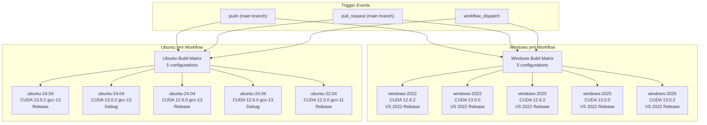
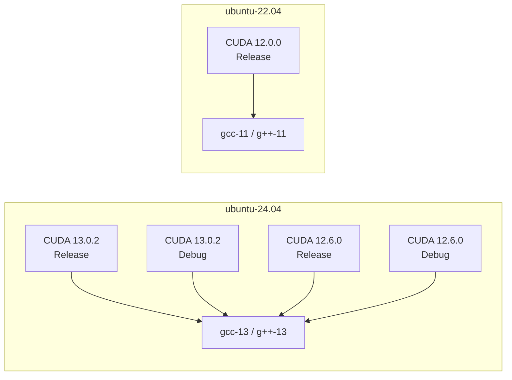
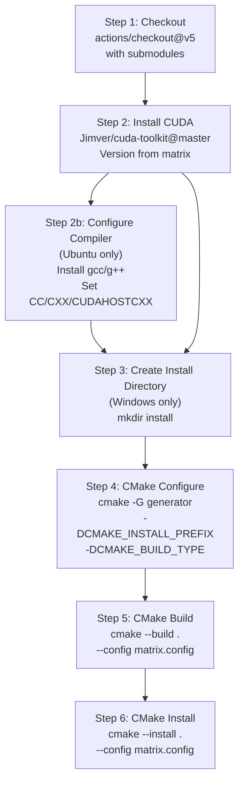

<!-- source: DeepWiki mcp.deepwiki.com · repo NVIDIA/OWL · page 6.1 Build Matrix · fetched 2026-10-26 -->

# Build Matrix

<details>
<summary>Relevant source files</summary>

The following files were used as context for generating this wiki page:

- [.github/workflows/Ubuntu.yml](.github/workflows/Ubuntu.yml)
- [.github/workflows/Windows.yml](.github/workflows/Windows.yml)

</details>


## Purpose and Scope

This document describes OWL's continuous integration build matrix, which tests the library across multiple operating systems, CUDA toolkit versions, and build configurations. The build matrix ensures compatibility and correctness across a wide range of deployment scenarios through automated testing on GitHub Actions.

The build matrix consists of 10 distinct configurations: 5 Windows configurations and 5 Ubuntu configurations. Each configuration tests a specific combination of OS version, CUDA toolkit version, compiler, and build type. The matrix is explicitly defined (not auto-generated) to ensure only validated combinations are tested.

For details on the CUDA installation automation used within these workflows, see [CUDA Installation Scripts](#6.2). For information about the CMake build system that these workflows invoke, see [CMake Configuration](#5.1).

## Matrix Overview

OWL's CI/CD system tests 10 configurations across two platforms, providing comprehensive coverage of supported environments:

| Platform | OS Runner | CUDA Version | Compiler | Build Type | Workflow File |
|----------|-----------|--------------|----------|------------|---------------|
| Windows | windows-2022 | 12.6.2 | Visual Studio 17 2022 | Release | Windows.yml |
| Windows | windows-2022 | 13.0.0 | Visual Studio 17 2022 | Release | Windows.yml |
| Windows | windows-2025 | 12.6.2 | Visual Studio 17 2022 | Release | Windows.yml |
| Windows | windows-2025 | 13.0.0 | Visual Studio 17 2022 | Release | Windows.yml |
| Windows | windows-2025 | 13.0.2 | Visual Studio 17 2022 | Release | Windows.yml |
| Ubuntu | ubuntu-24.04 | 13.0.2 | gcc-13 | Release | Ubuntu.yml |
| Ubuntu | ubuntu-24.04 | 13.0.2 | gcc-13 | Debug | Ubuntu.yml |
| Ubuntu | ubuntu-24.04 | 12.6.0 | gcc-13 | Release | Ubuntu.yml |
| Ubuntu | ubuntu-24.04 | 12.6.0 | gcc-13 | Debug | Ubuntu.yml |
| Ubuntu | ubuntu-22.04 | 12.0.0 | gcc-11 | Release | Ubuntu.yml |

The matrix intentionally uses `fail-fast: false` ([.github/workflows/Windows.yml:17](), [.github/workflows/Ubuntu.yml:17]()), ensuring that all configurations are tested even if one fails. This provides comprehensive failure reporting rather than stopping at the first error.

Sources: [.github/workflows/Windows.yml:1-97](), [.github/workflows/Ubuntu.yml:1-88]()

## Workflow Architecture

### Workflow File Structure and Trigger Mapping



**Workflow Trigger Configuration**

Both workflows respond to three trigger types:
- **`push`**: Automatically triggered when commits are pushed to the `main` branch ([.github/workflows/Windows.yml:8-9](), [.github/workflows/Ubuntu.yml:8-9]())
- **`pull_request`**: Triggered for pull requests targeting the `main` branch ([.github/workflows/Windows.yml:10-11](), [.github/workflows/Ubuntu.yml:10-11]())
- **`workflow_dispatch`**: Manual trigger for on-demand testing ([.github/workflows/Windows.yml:7](), [.github/workflows/Ubuntu.yml:7]())

Sources: [.github/workflows/Windows.yml:6-11](), [.github/workflows/Ubuntu.yml:6-11]()

## Windows Build Matrix

### Configuration Details

The Windows workflow defines 5 explicit configurations in its matrix ([.github/workflows/Windows.yml:16-45]()):

```yaml
strategy:
  fail-fast: false
  matrix:
    include:
      - os: windows-2022
        cuda: "12.6.2"
        visual-studio: "Visual Studio 17 2022"
        config: Release
      - os: windows-2022
        cuda: "13.0.0"
        visual-studio: "Visual Studio 17 2022"
        config: Release
      - os: windows-2025
        cuda: "12.6.2"
        visual-studio: "Visual Studio 17 2022"
        config: Release
      - os: windows-2025
        cuda: "13.0.0"
        visual-studio: "Visual Studio 17 2022"
        config: Release
      - os: windows-2025
        cuda: "13.0.2"
        visual-studio: "Visual Studio 17 2022"
        config: Release
```

### Windows Configuration Characteristics

- **OS Runners**: Tests both `windows-2022` and `windows-2025` GitHub-hosted runners ([.github/workflows/Windows.yml:21,31]())
- **CUDA Versions**: Covers CUDA 12.6.2, 13.0.0, and 13.0.2 ([.github/workflows/Windows.yml:22,27,32,37,42]())
- **Compiler**: All configurations use Visual Studio 17 2022 (VS 2022) ([.github/workflows/Windows.yml:23,28,33,38,43]())
- **Build Type**: Windows only tests Release builds ([.github/workflows/Windows.yml:25,30,35,40,45]())
- **Shell**: All steps use PowerShell ([.github/workflows/Windows.yml:24,29,34,39,44]())

The Windows matrix intentionally focuses on Release builds, as these are the primary deployment configurations for Windows users.

Sources: [.github/workflows/Windows.yml:13-45]()

## Ubuntu Build Matrix

### Configuration Details

The Ubuntu workflow defines 5 explicit configurations ([.github/workflows/Ubuntu.yml:16-40]()):

```yaml
strategy:
  fail-fast: false
  matrix:
    include:
      - os: ubuntu-24.04
        cuda: "13.0.2"
        gcc: 13
        config: Release
      - os: ubuntu-24.04
        cuda: "13.0.2"
        gcc: 13
        config: Debug
      - os: ubuntu-24.04
        cuda: "12.6.0"
        gcc: 13
        config: Release
      - os: ubuntu-24.04
        cuda: "12.6.0"
        gcc: 13
        config: Debug
      - os: ubuntu-22.04
        cuda: "12.0.0"
        gcc: 11
        config: Release
```

### Ubuntu Configuration Characteristics

- **OS Runners**: Tests both `ubuntu-24.04` (4 configurations) and `ubuntu-22.04` (1 configuration) ([.github/workflows/Ubuntu.yml:21,25,29,33,37]())
- **CUDA Versions**: Covers CUDA 12.0.0, 12.6.0, and 13.0.2 ([.github/workflows/Ubuntu.yml:22,26,30,34,38]())
- **GCC Versions**: Uses gcc-13 for Ubuntu 24.04 and gcc-11 for Ubuntu 22.04 ([.github/workflows/Ubuntu.yml:23,27,31,35,39]())
- **Build Types**: Tests both Release and Debug configurations ([.github/workflows/Ubuntu.yml:24,28,32,36,40]())
- **Compiler Selection**: Explicit compiler installation and environment variable configuration ([.github/workflows/Ubuntu.yml:66-71]())

Ubuntu testing is more comprehensive than Windows, including both Debug and Release builds. Debug builds enable additional runtime checks and debugging symbols useful for development.

### GCC Version Mapping



The Ubuntu workflow explicitly installs and configures the appropriate GCC version for each configuration by setting the `CC`, `CXX`, and `CUDAHOSTCXX` environment variables ([.github/workflows/Ubuntu.yml:66-71]()). This ensures CUDA uses the correct host compiler.

Sources: [.github/workflows/Ubuntu.yml:13-71]()

## Build Pipeline

### Standard Build Steps

Both Windows and Ubuntu workflows follow an identical five-step build pipeline:



### Step-by-Step Breakdown

#### Step 1: Repository Checkout

Both workflows check out the OWL repository with submodules:

**Windows** ([.github/workflows/Windows.yml:52-55]()):
```yaml
- name: Checkout owl
  uses: actions/checkout@v5
  with:
    submodules: true
```

**Ubuntu** ([.github/workflows/Ubuntu.yml:46-49]()):
```yaml
- name: Checkout OWL
  uses: actions/checkout@v5
  with:
    submodules: true
```

The `submodules: true` parameter ensures all Git submodules are initialized and cloned, which is critical for OWL's dependencies.

#### Step 2: CUDA Installation

Both workflows use the `Jimver/cuda-toolkit@master` action for automated CUDA installation:

**Windows** ([.github/workflows/Windows.yml:57-61]()):
```yaml
- name: Install CUDA
  uses: Jimver/cuda-toolkit@master
  id: cuda-toolkit
  with:
    cuda: ${{ matrix.cuda }}
```

**Ubuntu** ([.github/workflows/Ubuntu.yml:51-57]()):
```yaml
- name: Install CUDA
  uses: Jimver/cuda-toolkit@master
  id: cuda-toolkit
  with:
    cuda: ${{ matrix.cuda }}
    method: 'network'
    log-file-suffix: '${{matrix.os}}-gcc${{matrix.gcc}}-config${{matrix.config}}.txt'
```

The Ubuntu configuration adds a `log-file-suffix` parameter for detailed installation logging.

#### Step 2b: Compiler Configuration (Ubuntu Only)

Ubuntu requires explicit compiler installation and configuration ([.github/workflows/Ubuntu.yml:66-71]()):

```yaml
- name: Install/Select gcc and g++
  run: |
    sudo apt-get install -y gcc-${{ matrix.gcc }} g++-${{ matrix.gcc }}
    echo "CC=/usr/bin/gcc-${{ matrix.gcc }}" >> $GITHUB_ENV
    echo "CXX=/usr/bin/g++-${{ matrix.gcc }}" >> $GITHUB_ENV
    echo "CUDAHOSTCXX=/usr/bin/g++-${{ matrix.gcc }}" >> $GITHUB_ENV
```

This step:
1. Installs the matrix-specified GCC version using `apt-get`
2. Sets `CC` and `CXX` environment variables for CMake to detect
3. Sets `CUDAHOSTCXX` to ensure NVCC uses the correct host compiler

#### Step 3: Create Install Directory (Windows Only)

Windows creates the install directory explicitly ([.github/workflows/Windows.yml:77-79]()):

```yaml
- name: create shared install dir
  run: |
    mkdir ${{github.workspace}}\install
```

#### Step 4: CMake Configuration

Both workflows configure CMake with similar parameters:

**Windows** ([.github/workflows/Windows.yml:81-86]()):
```yaml
- name: cmake configure
  run: |
    mkdir ${{github.workspace}}\build
    cd ${{github.workspace}}\build
    cmake -A x64 -G "${{ matrix.visual-studio }}" .. \
      -DCMAKE_INSTALL_PREFIX=${{github.workspace}}\install \
      -DCMAKE_BUILD_TYPE=${{matrix.config}}
  shell: powershell
```

**Ubuntu** ([.github/workflows/Ubuntu.yml:73-77]()):
```yaml
- name: cmake configure
  run: |
    mkdir ${{github.workspace}}/build
    cd ${{github.workspace}}/build
    cmake .. \
      -DCMAKE_INSTALL_PREFIX=${{github.workspace}}/install \
      -DCMAKE_BUILD_TYPE=${{matrix.config}}
```

Key differences:
- Windows specifies `-A x64` for 64-bit architecture and `-G` for Visual Studio generator
- Ubuntu uses the default Unix Makefiles generator
- Both set `CMAKE_INSTALL_PREFIX` to a workspace-relative install directory
- Both set `CMAKE_BUILD_TYPE` from the matrix configuration

#### Step 5: CMake Build

Both workflows build the project using CMake's build command:

**Windows** ([.github/workflows/Windows.yml:88-91]()):
```yaml
- name: cmake build
  run: |
    cd ${{github.workspace}}\build
    cmake --build . --config ${{ matrix.config }}
```

**Ubuntu** ([.github/workflows/Ubuntu.yml:79-82]()):
```yaml
- name: cmake build
  run: |
    cd ${{github.workspace}}/build
    cmake --build . --config ${{ matrix.config }}
```

The `--config` flag is necessary for multi-configuration generators like Visual Studio.

#### Step 6: CMake Install

Both workflows install the built artifacts:

**Windows** ([.github/workflows/Windows.yml:93-96]()):
```yaml
- name: cmake install
  run: |
    cd ${{github.workspace}}\build
    cmake --install . --config ${{ matrix.config }}
```

**Ubuntu** ([.github/workflows/Ubuntu.yml:84-87]()):
```yaml
- name: cmake install
  run: |
    cd ${{github.workspace}}/build
    cmake --install . --config ${{ matrix.config }}
```

This stage copies built libraries, headers, and CMake package files to the install directory specified during configuration.

Sources: [.github/workflows/Windows.yml:52-96](), [.github/workflows/Ubuntu.yml:44-87]()

## Matrix Environment Variables

### Windows Environment Configuration

The Windows workflow sets build-wide environment variables ([.github/workflows/Windows.yml:47-50]()):

```yaml
env:
  cmake_generator: "${{ matrix.visual-studio }}"
  visual_studio: "${{ matrix.visual-studio }}"
  build_dir: "build"
```

These variables provide consistent values across all build steps but are not currently referenced in the workflow steps.

### Ubuntu Environment Configuration

The Ubuntu workflow sets a minimal environment ([.github/workflows/Ubuntu.yml:41-42]()):

```yaml
env:
  build_dir: "build"
```

The `build_dir` variable is not actively used in the steps, which hardcode the build directory path.

Sources: [.github/workflows/Windows.yml:47-50](), [.github/workflows/Ubuntu.yml:41-42]()

## Coverage Strategy

### CUDA Version Coverage

The matrix tests three CUDA major versions:
- **CUDA 12.x**: Versions 12.0.0, 12.6.0, and 12.6.2
- **CUDA 13.x**: Versions 13.0.0 and 13.0.2

This ensures compatibility with both the stable CUDA 12 series (which many production systems use) and the newer CUDA 13 series (which introduces new features and optimizations).

### OS Version Coverage

The matrix tests four OS configurations:
- **windows-2022**: Windows Server 2022-based GitHub runner
- **windows-2025**: Windows Server 2025-based GitHub runner (preview)
- **ubuntu-22.04**: Ubuntu 22.04 LTS (Jammy Jellyfish)
- **ubuntu-24.04**: Ubuntu 24.04 LTS (Noble Numbat)

### Build Configuration Coverage

- **Release**: Tested on all 10 configurations (100% coverage)
- **Debug**: Tested only on Ubuntu (4 configurations, 40% coverage)

The focus on Release builds for Windows aligns with typical deployment scenarios, while Ubuntu's Debug coverage supports development and debugging workflows.

### Compiler Coverage

- **Visual Studio 17 2022**: All Windows configurations
- **gcc-11**: Ubuntu 22.04 configuration
- **gcc-13**: Ubuntu 24.04 configurations

This ensures compatibility with both the default Ubuntu 22.04 compiler (gcc-11) and the newer gcc-13 available on Ubuntu 24.04.

Sources: [.github/workflows/Windows.yml:16-45](), [.github/workflows/Ubuntu.yml:16-40]()

---

