<!-- source: DeepWiki mcp.deepwiki.com · repo NVIDIA/OWL · page 6.2 CUDA Installation Scripts · fetched 2026-10-26 -->

# CUDA Installation Scripts

<details>
<summary>Relevant source files</summary>

The following files were used as context for generating this wiki page:

- [.github/action-scripts/install-cuda-windows.ps1](.github/action-scripts/install-cuda-windows.ps1)
- [.github/action-scripts/install_cuda_ubuntu.sh](.github/action-scripts/install_cuda_ubuntu.sh)
- [.github/workflows/Ubuntu.yml](.github/workflows/Ubuntu.yml)
- [.github/workflows/Windows.yml](.github/workflows/Windows.yml)

</details>


## Purpose and Scope

The CUDA Installation Scripts are platform-specific automation tools that handle CUDA Toolkit installation in OWL's continuous integration pipeline. These scripts ensure consistent CUDA environments across the 10-configuration build matrix by managing version-specific package selection, installer downloads, and environment variable setup. The scripts are invoked by the GitHub Actions workflows described in [Build Matrix](#6.1).

The two scripts serve distinct platforms:
- **`install-cuda-windows.ps1`**: PowerShell script for Windows using NVIDIA network installers
- **`install_cuda_ubuntu.sh`**: Bash script for Ubuntu using APT repository configuration

Both scripts are located in `.github/action-scripts/` and are designed to run as steps in GitHub Actions workflows, though they can also be executed manually for local development environments.

Sources: [.github/action-scripts/install-cuda-windows.ps1:1-257](), [.github/action-scripts/install_cuda_ubuntu.sh:1-199]()

---

## Installation Architecture

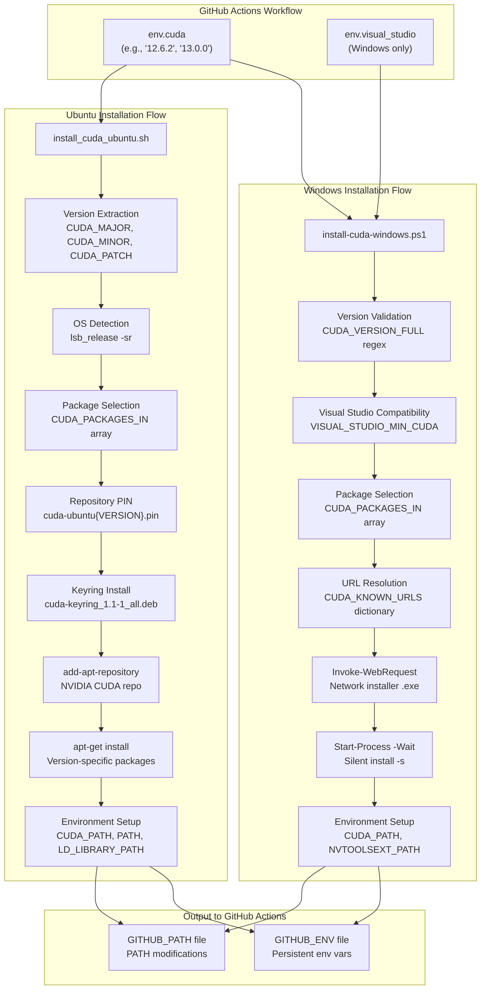

**Platform-Specific Installation Strategies**: Windows uses a centralized network installer approach where a single executable downloads and installs selected CUDA components on demand. Ubuntu uses the APT package manager with NVIDIA's CUDA repository, installing version-specific Debian packages. Both strategies converge on setting standardized environment variables for subsequent CMake configuration steps.

Sources: [.github/action-scripts/install-cuda-windows.ps1:90-255](), [.github/action-scripts/install_cuda_ubuntu.sh:48-198](), [.github/workflows/Windows.yml:57-75](), [.github/workflows/Ubuntu.yml:51-63]()

---

## Windows CUDA Installation

### Version Database and URL Resolution

The Windows script maintains a hardcoded dictionary mapping CUDA versions to their network installer download URLs, as NVIDIA does not follow a consistent URL pattern across releases.

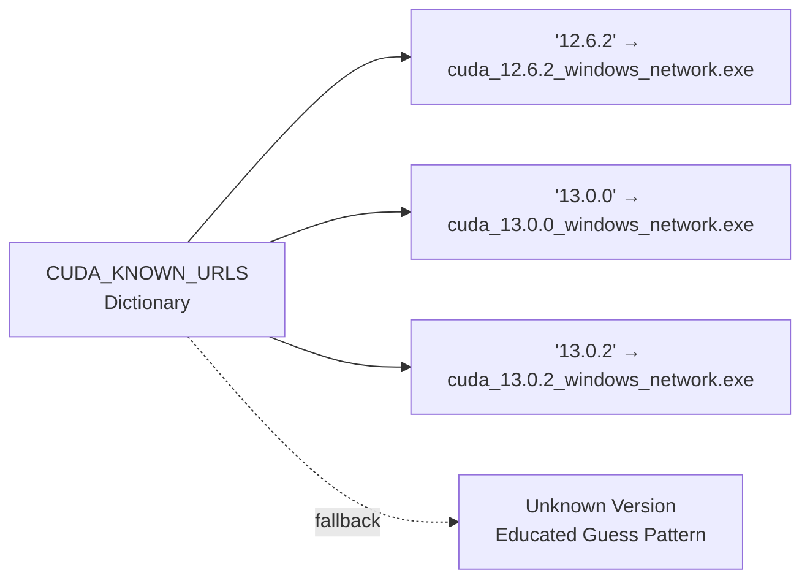

The dictionary covers CUDA versions from 8.0.44 through 13.0.2, with entries like:

| CUDA Version | Download URL Pattern |
|--------------|---------------------|
| 12.6.2 | `https://developer.download.nvidia.com/compute/cuda/12.6.2/network_installers/cuda_12.6.2_windows_network.exe` |
| 13.0.0 | `https://developer.download.nvidia.com/compute/cuda/13.0.0/network_installers/cuda_13.0.0_windows_network.exe` |
| 13.0.2 | `https://developer.download.nvidia.com/compute/cuda/13.0.2/network_installers/cuda_13.0.2_windows_network.exe` |

If a version is not in the dictionary, the script generates a URL using the most recent pattern [.github/action-scripts/install-cuda-windows.ps1:199-202]().

Sources: [.github/action-scripts/install-cuda-windows.ps1:18-60](), [.github/action-scripts/install-cuda-windows.ps1:194-203]()

### Visual Studio Compatibility Validation

The script enforces minimum CUDA version requirements for each Visual Studio version to prevent incompatible configurations:

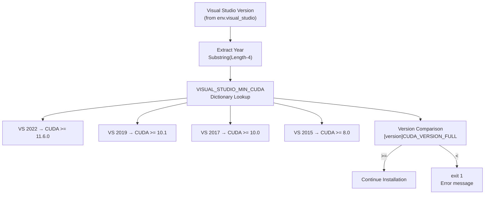

The validation logic [.github/action-scripts/install-cuda-windows.ps1:111-123]() extracts the Visual Studio year from the environment variable and compares the requested CUDA version against the minimum requirement. For example, Visual Studio 2022 requires CUDA >= 11.6.0.

Sources: [.github/action-scripts/install-cuda-windows.ps1:63-68](), [.github/action-scripts/install-cuda-windows.ps1:111-123]()

### Dynamic Package Selection

The Windows script builds a CUDA package list dynamically based on the requested CUDA version, accounting for package name changes and additions across CUDA releases.

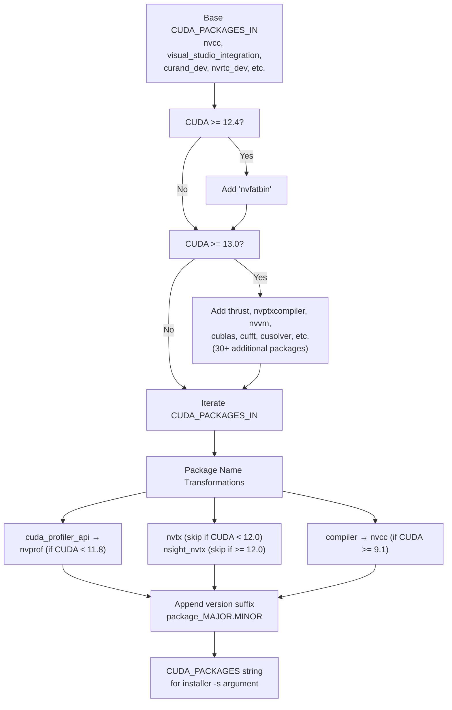

**Base Packages**: The script starts with a core set of packages required for OWL [.github/action-scripts/install-cuda-windows.ps1:72-82]():
- `nvcc`: CUDA compiler
- `visual_studio_integration`: MSBuild integration
- `curand_dev`: Random number generation
- `nvrtc_dev`: Runtime compilation
- `nsight_nvtx` / `nvtx`: Profiling markers
- `cudart`: CUDA runtime
- `cuda_profiler_api`: Profiling API

**Version-Specific Additions**:
- **CUDA >= 12.4**: Adds `nvfatbin` package [.github/action-scripts/install-cuda-windows.ps1:131-133]()
- **CUDA >= 13.0**: Adds 30+ packages including `thrust`, `nvptxcompiler`, `nvvm`, `cublas`, `cufft`, `cusolver`, Nsight tools, and more [.github/action-scripts/install-cuda-windows.ps1:135-167]()

**Package Name Normalization**: The script handles package name changes across CUDA versions:
- `cuda_profiler_api` becomes `nvprof` for CUDA < 11.8 [.github/action-scripts/install-cuda-windows.ps1:171-173]()
- `nsight_nvtx` used for CUDA < 12.0, `nvtx` for >= 12.0 [.github/action-scripts/install-cuda-windows.ps1:174-179]()
- `compiler` becomes `nvcc` for CUDA >= 9.1 [.github/action-scripts/install-cuda-windows.ps1:180-184]()

Each package name receives a version suffix (`package_MAJOR.MINOR`) [.github/action-scripts/install-cuda-windows.ps1:185]() to create the final package list passed to the installer.

Sources: [.github/action-scripts/install-cuda-windows.ps1:72-188]()

### Installation and Environment Setup

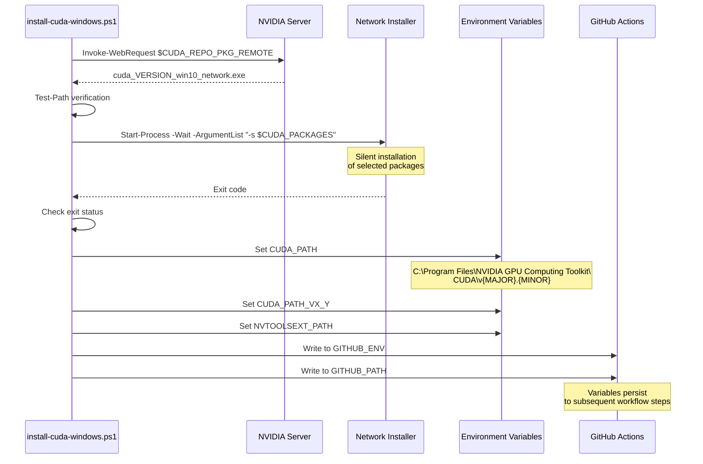

The installation process [.github/action-scripts/install-cuda-windows.ps1:210-228]():
1. Downloads the network installer using `Invoke-WebRequest`
2. Verifies the download succeeded with `Test-Path`
3. Invokes silent installation: `Start-Process -Wait -FilePath .\cuda_VERSION_win10_network.exe -ArgumentList "-s $CUDA_PACKAGES"`
4. Checks the installer's exit code

**Environment Variables**: The script configures three primary environment variables [.github/action-scripts/install-cuda-windows.ps1:231-240]():
- `CUDA_PATH`: `C:\Program Files\NVIDIA GPU Computing Toolkit\CUDA\v{MAJOR}.{MINOR}`
- `CUDA_PATH_VX_Y`: Dynamic variable name (e.g., `CUDA_PATH_V12_6`)
- `NVTOOLSEXT_PATH`: `C:\Program Files\NVIDIA GPU Computing Toolkit\nvToolsExt`

**GitHub Actions Integration**: When running in GitHub Actions, the script writes to special files [.github/action-scripts/install-cuda-windows.ps1:248-255]():
- `$env:GITHUB_ENV`: Persists environment variables to subsequent workflow steps
- `$env:GITHUB_PATH`: Appends `$CUDA_PATH/bin` to the PATH

Sources: [.github/action-scripts/install-cuda-windows.ps1:210-255]()

---

## Ubuntu CUDA Installation

### Version Parsing and OS Detection

The Ubuntu script extracts version components and detects the Ubuntu release to construct version-specific APT repository URLs.

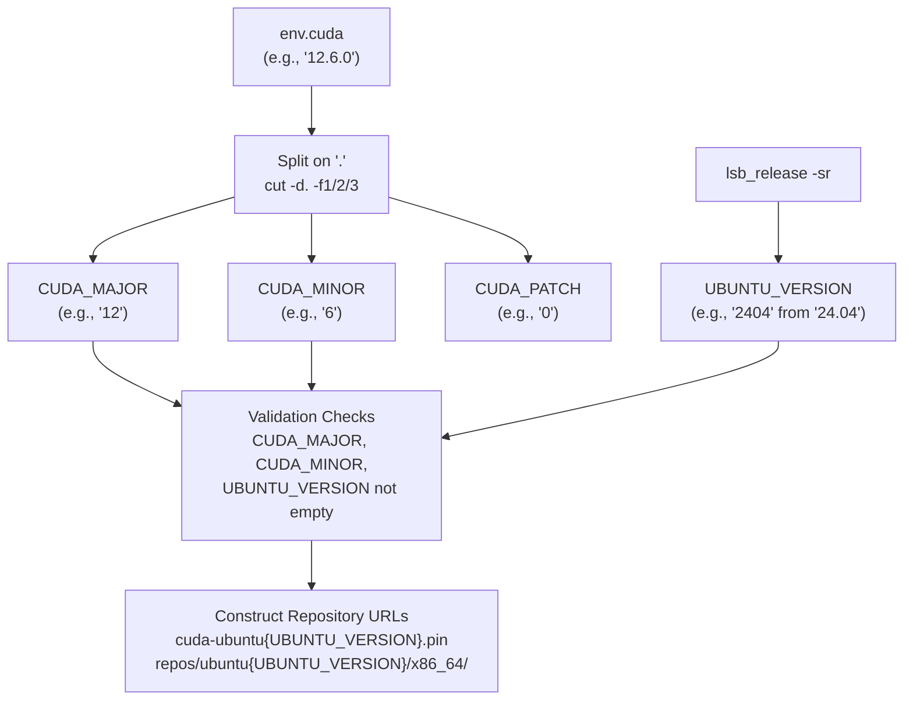

Version extraction [.github/action-scripts/install_cuda_ubuntu.sh:53-68]():
- `CUDA_MAJOR`: Extracted with `cut -d. -f1`
- `CUDA_MINOR`: Extracted with `cut -d. -f2`
- `CUDA_PATCH`: Extracted with `cut -d. -f3`
- `UBUNTU_VERSION`: Obtained from `lsb_release -sr`, with dots removed (e.g., `24.04` → `2404`)

The script validates that all required version components exist [.github/action-scripts/install_cuda_ubuntu.sh:71-83](), aborting if any are missing.

Sources: [.github/action-scripts/install_cuda_ubuntu.sh:53-83]()

### Package Selection and Transformation

Ubuntu package naming differs from Windows and changes across CUDA versions, requiring version-aware transformations.

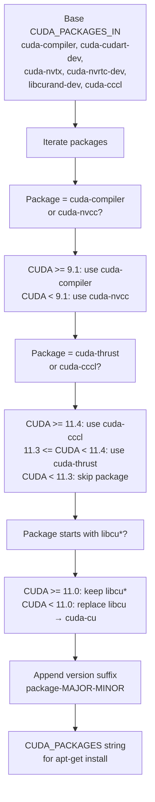

**Base Package List** [.github/action-scripts/install_cuda_ubuntu.sh:11-18]():
- `cuda-compiler`: CUDA compiler (nvcc)
- `cuda-cudart-dev`: CUDA runtime development files
- `cuda-nvtx`: NVIDIA Tools Extension
- `cuda-nvrtc-dev`: Runtime compilation development
- `libcurand-dev`: Random number generation (CUDA 11+)
- `cuda-cccl`: CUB and Thrust libraries (CUDA 11.4+)

**Package Name Transformations** [.github/action-scripts/install_cuda_ubuntu.sh:90-117]():

1. **Compiler Package** [.github/action-scripts/install_cuda_ubuntu.sh:94-97]():
   - CUDA >= 9.1: Use `cuda-compiler`
   - CUDA < 9.1: Use `cuda-nvcc`

2. **CUB/Thrust Package** [.github/action-scripts/install_cuda_ubuntu.sh:99-109]():
   - CUDA >= 11.4: Use `cuda-cccl` (CUDA C++ Core Libraries)
   - CUDA >= 11.3 and < 11.4: Use `cuda-thrust`
   - CUDA < 11.3: Skip package entirely

3. **Library Packages** [.github/action-scripts/install_cuda_ubuntu.sh:112-114]():
   - CUDA >= 11.0: Package names start with `libcu*` (e.g., `libcurand-dev`)
   - CUDA < 11.0: Package names use `cuda-cu*` prefix (e.g., `cuda-curand-dev`)

Each transformed package receives the version suffix `package-MAJOR-MINOR` (e.g., `cuda-compiler-12-6`) [.github/action-scripts/install_cuda_ubuntu.sh:116]().

Sources: [.github/action-scripts/install_cuda_ubuntu.sh:11-118]()

### Repository Configuration and Installation

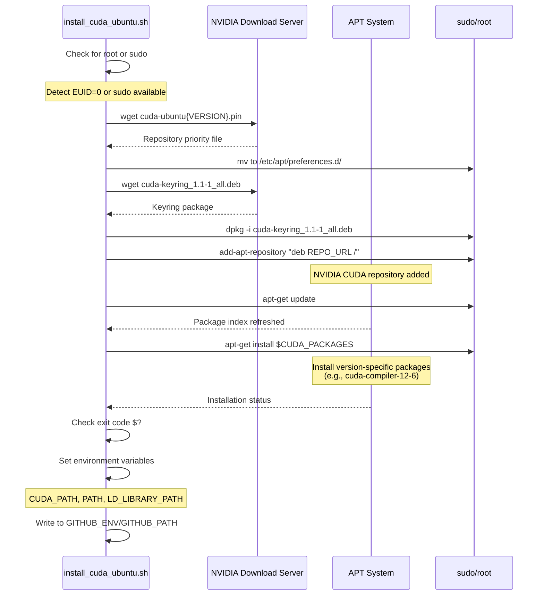

**Root/Sudo Detection** [.github/action-scripts/install_cuda_ubuntu.sh:139-157]():
The script detects whether it's running as root (`EUID == 0`) or if `sudo` is available, aborting if neither condition is met. It sets `USE_SUDO` appropriately for subsequent commands.

**Repository Setup** [.github/action-scripts/install_cuda_ubuntu.sh:162-167]():
1. Downloads and installs repository PIN file to `/etc/apt/preferences.d/` for package priority
2. Downloads and installs `cuda-keyring_1.1-1_all.deb` for GPG key management
3. Adds NVIDIA's CUDA repository: `deb https://developer.download.nvidia.com/compute/cuda/repos/ubuntu{VERSION}/x86_64/ /`
4. Runs `apt-get update` to refresh package indices

**Package Installation** [.github/action-scripts/install_cuda_ubuntu.sh:169-175]():
Installs the transformed package list with `apt-get -y install ${CUDA_PACKAGES}`, checking the exit code for errors.

**Environment Variables** [.github/action-scripts/install_cuda_ubuntu.sh:181-198]():
- `CUDA_PATH`: `/usr/local/cuda-{MAJOR}.{MINOR}`
- `PATH`: Prepends `$CUDA_PATH/bin`
- `LD_LIBRARY_PATH`: Adds `$CUDA_PATH/lib` and `$CUDA_PATH/lib64`

When running in GitHub Actions, writes to `$GITHUB_ENV` and `$GITHUB_PATH` for persistence [.github/action-scripts/install_cuda_ubuntu.sh:191-198]().

Sources: [.github/action-scripts/install_cuda_ubuntu.sh:139-198]()

---

## Version Compatibility Matrix

The scripts support a wide range of CUDA versions with platform-specific constraints:

| CUDA Version | Windows Support | Ubuntu Support | Notes |
|--------------|----------------|----------------|-------|
| 8.0.x - 9.0.x | ✓ (deprecated) | ✓ (deprecated) | Legacy compiler package names |
| 10.0.x - 10.2.x | ✓ | ✓ | VS 2017+ required for Windows |
| 11.0.x - 11.5.x | ✓ | ✓ | VS 2019+ for Windows; libcu* packages on Ubuntu |
| 11.6.x - 11.8.x | ✓ | ✓ | VS 2022+ for Windows |
| 12.0.x - 12.6.x | ✓ | ✓ | nvtx package name change at 12.0 |
| 13.0.x | ✓ | ✓ | Expanded package set (30+ additional) |

**Current OWL Build Matrix Usage** (from [Build Matrix](#6.1)):
- **Windows**: CUDA 12.6.2, 13.0.0, 13.0.2 with Visual Studio 2022
- **Ubuntu**: CUDA 12.0.0, 12.6.0, 13.0.2 with gcc-11/gcc-13

Sources: [.github/workflows/Windows.yml:20-45](), [.github/workflows/Ubuntu.yml:20-40](), [.github/action-scripts/install-cuda-windows.ps1:18-60]()

---

## Workflow Integration

### GitHub Actions Usage

The scripts are invoked from workflow YAML files, though the current implementation uses the third-party `Jimver/cuda-toolkit` action instead:

**Windows Workflow** [.github/workflows/Windows.yml:57-61]():
```yaml
- name: Install CUDA
  uses: Jimver/cuda-toolkit@master
  id: cuda-toolkit
  with:
    cuda: ${{ matrix.cuda }}
```

**Ubuntu Workflow** [.github/workflows/Ubuntu.yml:51-57]():
```yaml
- name: Install CUDA
  uses: Jimver/cuda-toolkit@master
  id: cuda-toolkit
  with:
    cuda: ${{ matrix.cuda }}
    method: 'network'
    log-file-suffix: '${{matrix.os}}-gcc${{matrix.gcc}}-config${{matrix.config}}.txt'
```

The custom scripts remain in the repository (commented out in workflows) as alternative implementations and for potential local development use [.github/workflows/Windows.yml:70-75](), [.github/workflows/Ubuntu.yml:59-63]().

### Environment Variable Propagation

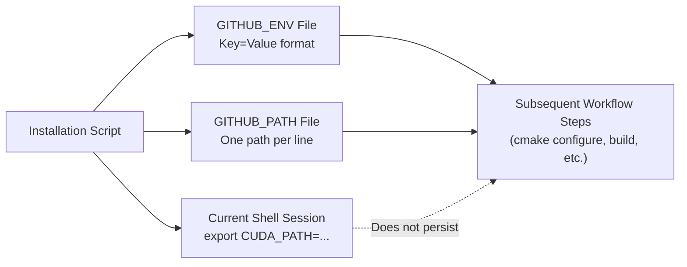

Both scripts detect GitHub Actions execution and write environment modifications to special files:
- **Windows** [.github/action-scripts/install-cuda-windows.ps1:248-255](): Writes to `$env:GITHUB_ENV` and `$env:GITHUB_PATH`
- **Ubuntu** [.github/action-scripts/install_cuda_ubuntu.sh:191-198](): Writes to `$GITHUB_ENV` and `$GITHUB_PATH`

This ensures variables like `CUDA_PATH` and updated `PATH` entries persist to CMake configuration, build, and install steps that follow in the workflow.

Sources: [.github/action-scripts/install-cuda-windows.ps1:248-255](), [.github/action-scripts/install_cuda_ubuntu.sh:191-198](), [.github/workflows/Windows.yml:81-96](), [.github/workflows/Ubuntu.yml:73-87]()

---

## Error Handling and Validation

### Windows Error Detection

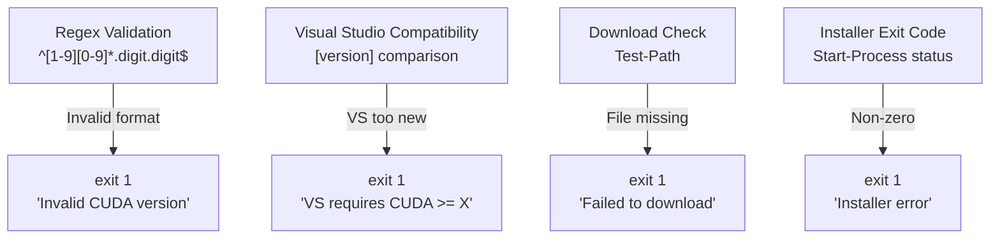

The Windows script performs multiple validation checks [.github/action-scripts/install-cuda-windows.ps1:98-102](), [.github/action-scripts/install-cuda-windows.ps1:116-118](), [.github/action-scripts/install-cuda-windows.ps1:213-218](), [.github/action-scripts/install-cuda-windows.ps1:225-228]():
1. **Version format validation**: Ensures CUDA version matches `major.minor.patch` pattern
2. **Visual Studio compatibility**: Verifies CUDA version meets minimum requirement for the specified VS version
3. **Download verification**: Confirms network installer was successfully downloaded
4. **Installation status**: Checks the installer's exit code

### Ubuntu Error Handling

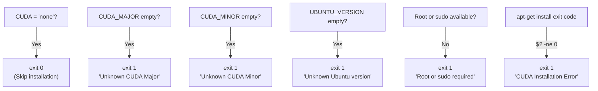

The Ubuntu script validates [.github/action-scripts/install_cuda_ubuntu.sh:48-50](), [.github/action-scripts/install_cuda_ubuntu.sh:71-83](), [.github/action-scripts/install_cuda_ubuntu.sh:150-157](), [.github/action-scripts/install_cuda_ubuntu.sh:172-175]():
1. **Early exit for 'none'**: Allows skipping CUDA installation if `cuda=none`
2. **Version component validation**: Ensures CUDA_MAJOR, CUDA_MINOR, and UBUNTU_VERSION are non-empty
3. **Permission check**: Verifies root access or sudo availability before attempting system modifications
4. **Installation verification**: Checks apt-get exit code (`$?`)

Sources: [.github/action-scripts/install-cuda-windows.ps1:98-102](), [.github/action-scripts/install-cuda-windows.ps1:116-118](), [.github/action-scripts/install-cuda-windows.ps1:213-228](), [.github/action-scripts/install_cuda_ubuntu.sh:48-50](), [.github/action-scripts/install_cuda_ubuntu.sh:71-83](), [.github/action-scripts/install_cuda_ubuntu.sh:150-175]()

---

## Local Development Usage

While designed for CI/CD, the scripts can be used for local CUDA installation:

**Windows (PowerShell)**:
```powershell
$env:cuda = "12.6.2"
$env:visual_studio = "Visual Studio 17 2022"
.\.github\action-scripts\install-cuda-windows.ps1
```

**Ubuntu (Bash)**:
```bash
export cuda="12.6.0"
./.github/action-scripts/install_cuda_ubuntu.sh
```

The scripts will execute normally, but GitHub Actions-specific environment variable exports (to `GITHUB_ENV`/`GITHUB_PATH`) will be skipped if the `GITHUB_ACTIONS` environment variable is not set [.github/action-scripts/install-cuda-windows.ps1:248](), [.github/action-scripts/install_cuda_ubuntu.sh:191]().

Sources: [.github/action-scripts/install-cuda-windows.ps1:90-95](), [.github/action-scripts/install_cuda_ubuntu.sh:48-53](), [.github/action-scripts/install-cuda-windows.ps1:248-255](), [.github/action-scripts/install_cuda_ubuntu.sh:191-198]()

---

