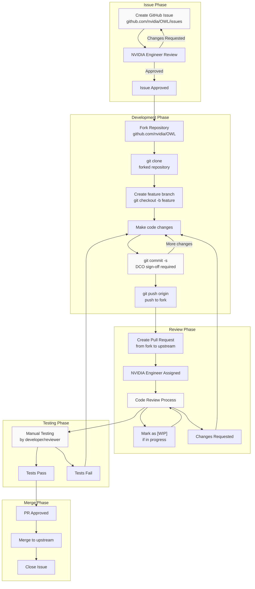
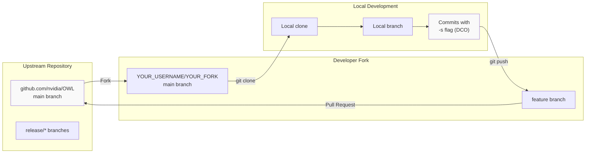
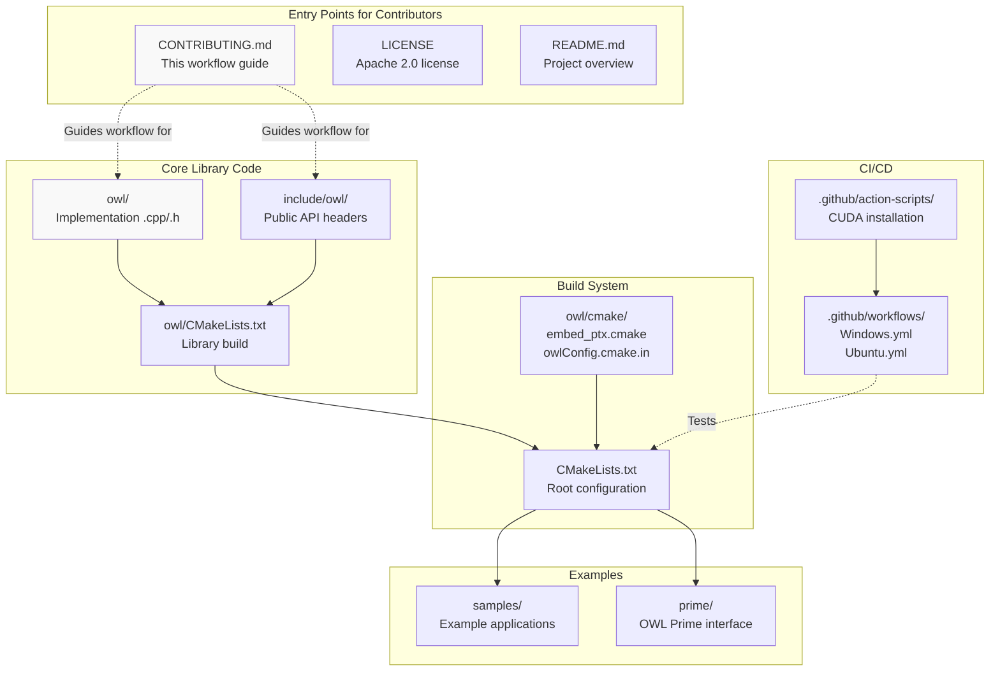

<!-- source: DeepWiki mcp.deepwiki.com · repo NVIDIA/OWL · page 7 Contributing · fetched 2026-10-26 -->

# Contributing

<details>
<summary>Relevant source files</summary>

The following files were used as context for generating this wiki page:

- [CONTRIBUTING.md](CONTRIBUTING.md)
- [LICENSE](LICENSE)

</details>


**Purpose**: This page provides an overview of the contribution process for the OWL repository, including issue tracking requirements, the fork-and-pull-request workflow, commit signing with Developer Certificate of Origin (DCO), and licensing terms. For detailed workflow steps and PR guidelines, see [Contribution Workflow](#7.1). For complete licensing information, see [License](#7.2).

## Overview

The OWL project accepts community contributions through GitHub following a structured process. All code contributions, enhancements, bug fixes, and change requests must:

1. Begin with a GitHub issue that is reviewed and approved by NVIDIA engineers
2. Follow the fork-and-pull-request development model
3. Include DCO (Developer Certificate of Origin) sign-off on all commits
4. Undergo code review by at least one assigned NVIDIA engineer
5. Be manually tested by the contributor and/or reviewing engineer

The project is licensed under **Apache License 2.0** with copyright held by NVIDIA CORPORATION & AFFILIATES.

**Sources**: [CONTRIBUTING.md:1-76](), [LICENSE:189-201]()

## Contribution Process Flow

The following diagram illustrates the complete contribution lifecycle from issue creation through code merge:



**Sources**: [CONTRIBUTING.md:4-31]()

## Key Requirements

### Issue Tracking

All contributions must begin with a GitHub issue:

| Requirement | Description |
|-------------|-------------|
| **Issue Creation** | Create issue at `https://github.com/nvidia/OWL/issues` before starting work |
| **Issue Content** | Describe enhancement, bug fix, or change request with sufficient detail |
| **Review Required** | NVIDIA engineers must review and approve the issue before code review |
| **Issue Reference** | Link the issue number in the pull request description |

Without an approved issue, pull requests will not be accepted for review.

**Sources**: [CONTRIBUTING.md:4-7]()

### Fork-and-Pull-Request Model

OWL uses the standard GitHub fork-and-pull-request workflow:



The workflow steps are:

1. **Fork**: Create a personal fork of `github.com/nvidia/OWL`
2. **Clone**: Clone the forked repository to local machine
3. **Branch**: Create a feature branch for changes
4. **Commit**: Make commits with DCO sign-off (`-s` flag)
5. **Push**: Push commits to the fork's remote branch
6. **Pull Request**: Create PR from fork branch to upstream branch

When creating the pull request:
- Carefully select source (fork branch) and target (upstream branch) branches
- Note that versioned releases are posted to `release/*` branches
- PR creation initiates the code review process
- At least one NVIDIA engineer will be assigned as reviewer
- Mark PRs as work-in-progress by prefixing title with `[WIP]`

**Sources**: [CONTRIBUTING.md:10-30]()

### Developer Certificate of Origin (DCO)

All commits must include DCO sign-off, which certifies that the contributor has the right to submit the code:

| Aspect | Requirement |
|--------|-------------|
| **Sign-off Method** | Use `git commit -s` or `git commit --signoff` when committing |
| **Signature Format** | Appends `Signed-off-by: Your Name <your@email.com>` to commit message |
| **Enforcement** | Any PR containing unsigned commits will not be accepted |
| **DCO Version** | Developer Certificate of Origin 1.1 |

Example commit with sign-off:

```bash
$ git commit -s -m "Add cool feature."
```

This produces a commit message like:

```
Add cool feature.

Signed-off-by: Your Name <your@email.com>
```

The DCO certifies that:
- (a) The contribution was created by the contributor with right to submit under the open source license
- (b) The contribution is based on previous work covered under appropriate open source license
- (c) The contribution was provided by another person who certified (a), (b), or (c)
- (d) The contributor understands the contribution is public and recorded indefinitely

**Sources**: [CONTRIBUTING.md:34-75]()

## Code Review Process

The code review phase involves:

| Stage | Description |
|-------|-------------|
| **Assignment** | At least one NVIDIA engineer assigned to review |
| **Review Iterations** | Reviewer provides feedback; contributor addresses comments |
| **Work-in-Progress** | Use `[WIP]` prefix in PR title during active development |
| **Branch Selection** | Exercise caution when selecting target branch (main vs release/*) |

Currently, there is no automated CI/CD pipeline for external pull requests. The CI/CD workflows documented in [Build Matrix](#6.1) run only on the upstream repository.

**Sources**: [CONTRIBUTING.md:27-31]()

## Testing Requirements

Due to the absence of automated CI/CD for external contributions:

| Requirement | Description |
|-------------|-------------|
| **Manual Testing** | Developer must test changes locally across relevant configurations |
| **Build Verification** | Ensure code builds on target platforms (see [Building from Source](#2.2)) |
| **Reviewer Testing** | NVIDIA engineer may perform additional manual testing |
| **Acceptance Criteria** | PR accepted only after adequate testing is completed |

Contributors should test their changes against:
- Multiple CUDA versions (12.x and 13.x preferred)
- Target operating systems (Ubuntu and/or Windows)
- Both Release and Debug build configurations where applicable

**Sources**: [CONTRIBUTING.md:31-31]()

## Licensing

All contributions are subject to the Apache License 2.0:

| Aspect | Details |
|--------|---------|
| **License** | Apache License, Version 2.0, January 2004 |
| **Copyright Holder** | NVIDIA CORPORATION & AFFILIATES |
| **License URL** | `http://www.apache.org/licenses/LICENSE-2.0` |
| **Full Text** | See [License](#7.2) page or [LICENSE]() file |

By submitting a contribution, contributors agree that:
- The contribution is submitted under Apache License 2.0 terms
- No additional terms or conditions apply (unless separate license agreement executed with NVIDIA)
- Contributors retain ability to add their own copyright statement to modifications

**Sources**: [LICENSE:1-201]()

## Repository Structure for Contributors

Understanding the repository structure helps contributors locate relevant code:



Typical contribution targets:

| Directory | Purpose | Common Changes |
|-----------|---------|----------------|
| `include/owl/` | Public API headers | API additions, documentation |
| `owl/` | Library implementation | Bug fixes, feature implementations |
| `owl/cmake/` | CMake modules | Build system improvements |
| `samples/` | Example code | New samples, sample fixes |
| `.github/workflows/` | CI/CD definitions | Workflow updates (NVIDIA only) |

**Sources**: [CONTRIBUTING.md:1-76]()

## Summary

Contributing to OWL requires:

1. **Issue First**: Create and get approval for GitHub issue
2. **Fork and Branch**: Fork repository and work in feature branch
3. **Sign Commits**: Use `git commit -s` for DCO sign-off
4. **Test Locally**: Verify changes build and function correctly
5. **Submit PR**: Create pull request with clear description linking issue
6. **Code Review**: Address feedback from assigned NVIDIA engineer
7. **Manual Testing**: Ensure adequate testing before merge
8. **Apache 2.0**: All code licensed under Apache License 2.0

For step-by-step workflow details, see [Contribution Workflow](#7.1). For complete licensing terms, see [License](#7.2).

**Sources**: [CONTRIBUTING.md:1-76](), [LICENSE:189-201]()

---

