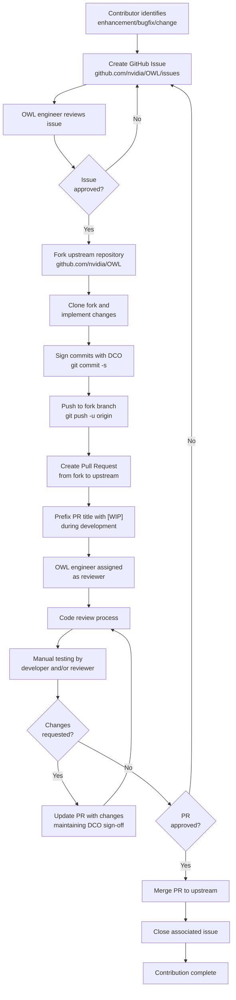
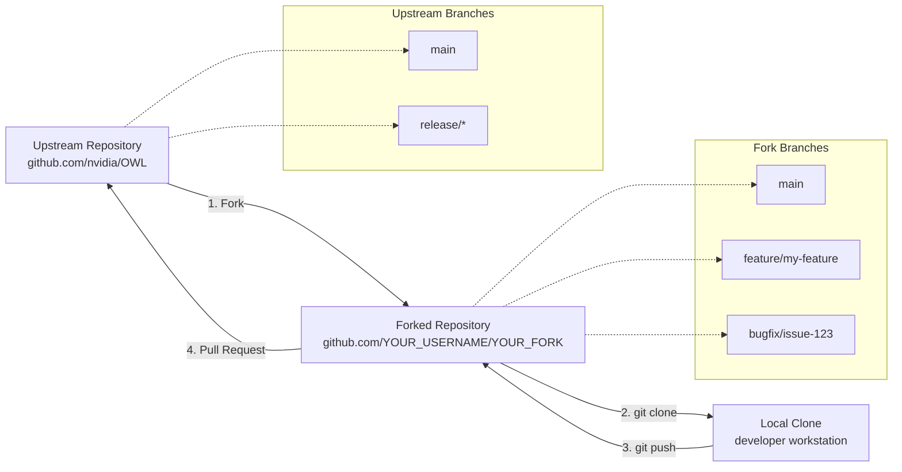
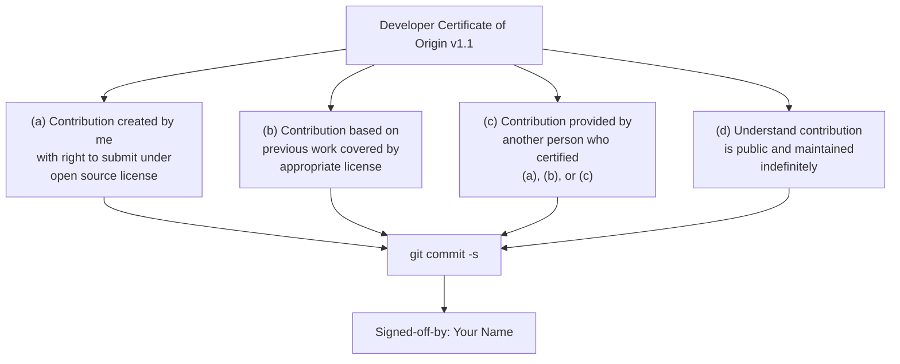
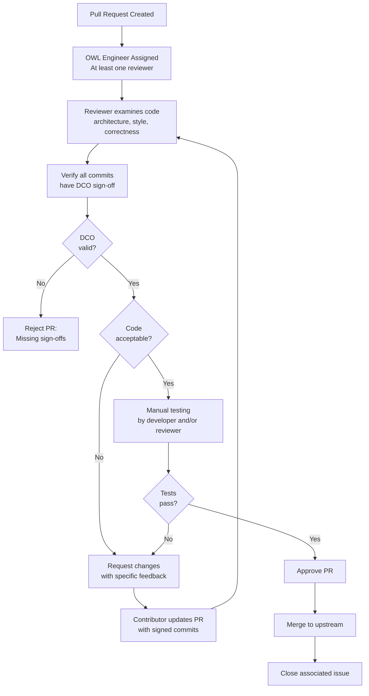

<!-- source: DeepWiki mcp.deepwiki.com · repo NVIDIA/OWL · page 7.1 Contribution Workflow · fetched 2026-10-26 -->

# Contribution Workflow

<details>
<summary>Relevant source files</summary>

The following files were used as context for generating this wiki page:

- [CONTRIBUTING.md](CONTRIBUTING.md)

</details>


## Purpose and Scope

This document explains the process for contributing code, bug fixes, and enhancements to the OWL repository. It covers the required fork-and-pull-request workflow, issue tracking requirements, commit signing via Developer Certificate of Origin (DCO), and the code review process. For information about the license terms governing contributions, see [License](#7.2).

All contributions to OWL must follow the workflow defined in [CONTRIBUTING.md:1-76](), which establishes a mandatory issue-first approach with signed commits and manual testing verification.

**Sources:** [CONTRIBUTING.md:1-76]()

---

## Contribution Process Overview

The OWL contribution process follows a structured workflow that ensures all changes are reviewed, tested, and properly attributed. The process begins with issue creation and ends with merge after approval.

### End-to-End Workflow



**Sources:** [CONTRIBUTING.md:1-32]()

---

## Issue Tracking Requirements

All code contributions must begin with the creation of a GitHub issue. This requirement applies to enhancements, bug fixes, and any change requests, regardless of size. Direct pull requests without associated issues are not accepted.

### Issue Creation Process

| Step | Action | Location |
|------|--------|----------|
| 1 | Navigate to issue tracker | [https://github.com/nvidia/OWL/issues](https://github.com/nvidia/OWL/issues) |
| 2 | Create new issue describing change | Provide clear description of enhancement/bugfix |
| 3 | Wait for engineer review | OWL engineer will review and respond |
| 4 | Receive approval | Issue must be approved before code submission |

The issue serves as the record of the change request and must be referenced in the pull request. According to [CONTRIBUTING.md:6-7](), "The issue request must be reviewed by OWL engineers and approved prior to code review."

### Issue Requirements

An issue should contain:

- **Clear title**: Concisely describe the change
- **Description**: Explain what needs to change and why
- **Use case**: Describe the problem being solved or feature being added
- **Expected behavior**: For bugs, explain what should happen vs. what does happen
- **Environment**: Platform, CUDA version, OptiX version if relevant

**Sources:** [CONTRIBUTING.md:4-8]()

---

## Fork and Pull Request Workflow

OWL uses a fork-and-pull-request model where contributors work on personal forks and submit changes via pull requests to the upstream repository at `github.com/nvidia/OWL`.

### Repository Structure



### Step-by-Step Fork Workflow

#### 1. Fork the Repository

Navigate to [https://github.com/nvidia/OWL](https://github.com/nvidia/OWL) and click the "Fork" button. This creates a copy under your GitHub account at `github.com/YOUR_USERNAME/YOUR_FORK`.

**Sources:** [CONTRIBUTING.md:13]()

#### 2. Clone Your Fork

Clone the forked repository to your local development environment:

```bash
git clone https://github.com/YOUR_USERNAME/YOUR_FORK.git OWL
cd OWL
```

**Sources:** [CONTRIBUTING.md:18]()

#### 3. Create a Feature Branch

```bash
# Checkout the targeted branch (typically main)
git checkout main

# Create and switch to a new branch for your changes
git checkout -b feature/my-feature

# Make your changes, then stage and commit
git add .
git commit -s -m "Add feature: description"
```

The `-s` flag is critical—it adds the DCO sign-off (see [DCO Signing](#dco-signing) below).

**Sources:** [CONTRIBUTING.md:19-21]()

#### 4. Push to Fork

```bash
# Push commits to a branch on the fork (remote)
git push -u origin feature/my-feature
```

This command creates the branch `feature/my-feature` on your fork and sets up tracking between your local and remote branches.

**Sources:** [CONTRIBUTING.md:21]()

#### 5. Create Pull Request

Once code is staged on your fork and ready for review:

1. Navigate to your fork on GitHub
2. Click "Pull Request" button
3. Select source branch (your feature branch) and target branch (upstream `main` or appropriate release branch)
4. Provide descriptive title and description
5. Reference the approved issue number

**Critical:** [CONTRIBUTING.md:25-26]() warns: "Exercise caution when selecting the source and target branches for the PR. Note that versioned releases of OWL OSS are posted to `release/` branches of the upstream repo."

**Sources:** [CONTRIBUTING.md:24-27]()

---

## Developer Certificate of Origin (DCO)

OWL requires all contributors to sign-off on their commits using the Developer Certificate of Origin (DCO). This certifies that you have the right to submit the contribution under the project's license.

### DCO Sign-Off Requirement

According to [CONTRIBUTING.md:38](), "Any contribution which contains commits that are not Signed-Off will not be accepted." This is a hard requirement—pull requests with unsigned commits will be rejected.

### Signing Commits

Add the sign-off to every commit using the `--signoff` or `-s` flag:

```bash
git commit -s -m "Add cool feature."
```

This appends the following to your commit message:

```
Signed-off-by: Your Name <your@email.com>
```

The name and email are automatically extracted from your Git configuration (`git config user.name` and `git config user.email`).

**Sources:** [CONTRIBUTING.md:40-47]()

### DCO Certificate Text



The full DCO text is available in [CONTRIBUTING.md:49-75](). By signing off, you certify one of:

- **(a)** The contribution was created in whole or in part by you with the right to submit it under the indicated open source license
- **(b)** The contribution is based on previous work covered by an appropriate license, and you have the right to submit modifications under the same license
- **(c)** The contribution was provided by another person who certified (a), (b), or (c), and you have not modified it
- **(d)** You understand the contribution is public and maintained indefinitely

**Sources:** [CONTRIBUTING.md:34-75]()

---

## Code Review Process

After creating a pull request, OWL engineers will review the code. At least one OWL engineer will be assigned as reviewer, as stated in [CONTRIBUTING.md:28]().

### Review States

| State | PR Title Prefix | Description |
|-------|----------------|-------------|
| Work in Progress | `[WIP]` | Changes still being made by contributor |
| Ready for Review | None | Contributor considers code complete |
| Changes Requested | None | Reviewer requested modifications |
| Approved | None | Reviewer approved for merge |

According to [CONTRIBUTING.md:29](), "While under review, mark your PRs as work-in-progress by prefixing the PR title with [WIP]."

### Review Workflow



**Sources:** [CONTRIBUTING.md:27-32]()

---

## Manual Testing Requirements

OWL currently requires manual testing verification before accepting pull requests. According to [CONTRIBUTING.md:31](), "Since there is no CI/CD process in place yet, the PR will be accepted and the corresponding issue closed only after adequate testing has been completed, manually, by the developer and/or OWL engineer reviewing the code."

### Testing Responsibilities

| Role | Responsibility |
|------|---------------|
| Contributor | Test changes on relevant platforms and CUDA versions |
| Reviewer | May perform additional testing to verify functionality |
| Both | Document testing performed in PR comments |

### Testing Considerations

When testing your contribution, consider:

- **Platform coverage**: Test on Ubuntu and/or Windows if applicable
- **CUDA versions**: Verify compatibility with CUDA 12.x and 13.x (see [Build Matrix](#6.1))
- **Build configurations**: Test both Release and Debug builds
- **Samples**: If modifying core library, test relevant samples in `samples/` directory
- **Multi-GPU**: Test multi-GPU scenarios if your change affects device management

While the repository has CI/CD infrastructure (see [CI/CD and Testing](#6)), the CONTRIBUTING.md note about manual testing suggests that automated testing may not cover all scenarios, or that manual verification is required in addition to automated checks.

**Sources:** [CONTRIBUTING.md:31]()

---

## Summary Checklist

Before submitting a pull request, verify:

- [ ] Created and received approval for GitHub issue
- [ ] Forked repository and cloned to local environment
- [ ] Created feature branch from appropriate base branch
- [ ] Made changes with clear, logical commits
- [ ] Signed all commits with DCO (`git commit -s`)
- [ ] Tested changes manually on relevant platforms
- [ ] Pushed to fork branch
- [ ] Created pull request with descriptive title and description
- [ ] Referenced approved issue number in PR
- [ ] Marked PR as `[WIP]` if still making changes
- [ ] Responded to reviewer feedback promptly
- [ ] Maintained DCO sign-off on all commits, including updates

**Sources:** [CONTRIBUTING.md:1-76]()

---

