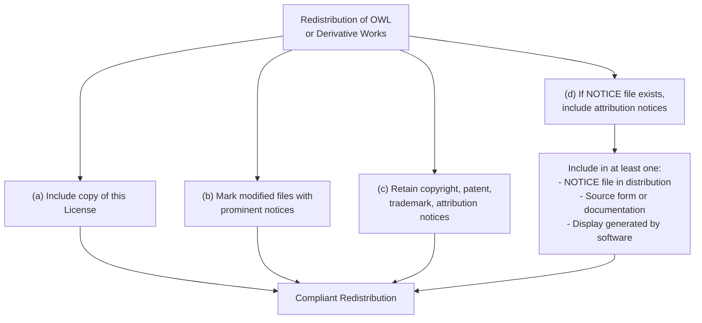
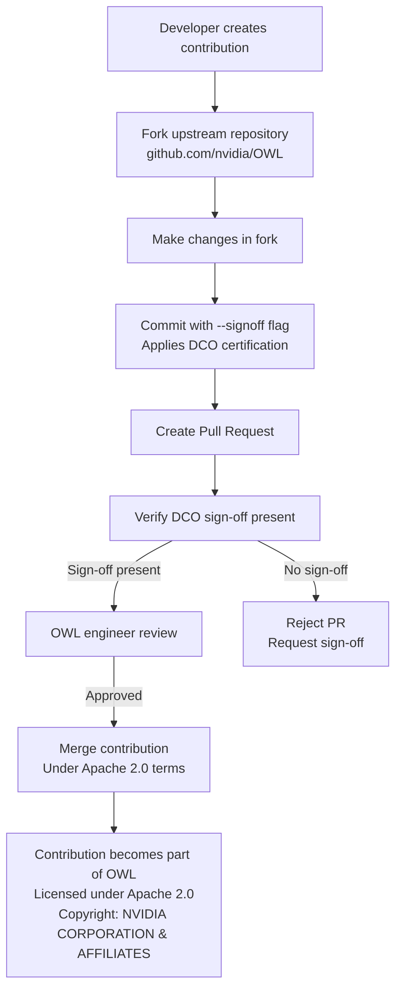
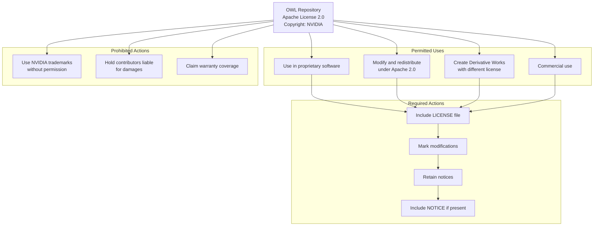

<!-- source: DeepWiki mcp.deepwiki.com · repo NVIDIA/OWL · page 7.2 License · fetched 2026-10-26 -->

# License

<details>
<summary>Relevant source files</summary>

The following files were used as context for generating this wiki page:

- [CONTRIBUTING.md](CONTRIBUTING.md)
- [LICENSE](LICENSE)

</details>


This page documents the licensing terms for the OWL (OptiX Wrapper Library) repository. It covers the Apache License 2.0 under which OWL is distributed, copyright ownership, key permissions and restrictions, and contribution licensing requirements. For information about the contribution workflow and code standards, see [Contribution Workflow](#7.1).

## License Type and Copyright

OWL is distributed under the **Apache License, Version 2.0**, dated January 2004. The copyright is held by **NVIDIA CORPORATION & AFFILIATES**.

The full license text is located at [LICENSE:1-202]().

**Copyright Notice:**
```
Copyright (c) 2025 NVIDIA CORPORATION & AFFILIATES. All rights reserved.
```

**Sources:** [LICENSE:189]()

## Apache License 2.0 Structure

The Apache License 2.0 consists of nine sections that define terms, grant permissions, and specify conditions. The following diagram illustrates the major components:

```mermaid
graph TB
    subgraph "Apache License 2.0"
        DEFS["Section 1: Definitions<br/>License, Licensor, Work, Derivative Works,<br/>Contribution, Contributor"]
        COPYRIGHT["Section 2: Grant of Copyright License<br/>Perpetual, worldwide, non-exclusive,<br/>royalty-free, irrevocable"]
        PATENT["Section 3: Grant of Patent License<br/>Covers patent claims in Contributions<br/>Terminates on patent litigation"]
        REDIST["Section 4: Redistribution<br/>Must include License copy<br/>Must mark modifications<br/>Must retain notices"]
        CONTRIB["Section 5: Submission of Contributions<br/>Contributions under same terms<br/>Unless explicitly stated otherwise"]
        TRADEMARK["Section 6: Trademarks<br/>No trademark permission granted"]
        WARRANTY["Section 7: Disclaimer of Warranty<br/>AS IS BASIS, no warranties"]
        LIABILITY["Section 8: Limitation of Liability<br/>No liability for damages"]
        ACCEPTING["Section 9: Accepting Warranty or Additional Liability<br/>User may offer support at own risk"]
    end
    
    DEFS --> COPYRIGHT
    COPYRIGHT --> PATENT
    PATENT --> REDIST
    REDIST --> CONTRIB
    CONTRIB --> TRADEMARK
    TRADEMARK --> WARRANTY
    WARRANTY --> LIABILITY
    LIABILITY --> ACCEPTING
```



**Sources:** [LICENSE:1-176]()

## Key Permissions

The Apache License 2.0 grants the following permissions to users:

| Permission | Scope | Conditions |
|------------|-------|------------|
| **Reproduce** | Create copies of the Work | Must comply with redistribution terms |
| **Prepare Derivative Works** | Modify, adapt, create works based on OWL | Must mark modifications, retain notices |
| **Publicly Display** | Display the Work | - |
| **Publicly Perform** | Perform the Work | - |
| **Sublicense** | Grant rights to others | Must pass License along |
| **Distribute** | Share Source or Object form | Must include License, mark changes |
| **Commercial Use** | Use for commercial purposes | Fully permitted under same terms |

The license is:
- **Perpetual**: No expiration date
- **Worldwide**: Valid in all jurisdictions
- **Non-exclusive**: Others retain same rights
- **No-charge**: No royalties or fees
- **Royalty-free**: No ongoing payments
- **Irrevocable**: Cannot be revoked (except patent clause)

**Sources:** [LICENSE:66-71]()

## Redistribution Requirements

When redistributing OWL or Derivative Works, the following conditions must be met:



**Key Redistribution Rules:**

1. **License Inclusion**: Recipients must receive a copy of [LICENSE:1-202]()
2. **Modification Marking**: Modified files must carry prominent notices per [LICENSE:97-98]()
3. **Notice Retention**: All copyright, patent, trademark, and attribution notices from Source form must be retained per [LICENSE:100-104]()
4. **NOTICE File**: If present, attribution notices must be included per [LICENSE:106-121]()

**Sources:** [LICENSE:89-128]()

## Contribution Licensing

All contributions to OWL must comply with the **Developer Certificate of Origin (DCO)** Version 1.1. This certifies that contributors have the right to submit code under the Apache License 2.0.

### DCO Requirements

Contributors must sign-off on all commits using the `--signoff` or `-s` flag:

```bash
git commit -s -m "Add cool feature."
```

This appends the following to the commit message:
```
Signed-off-by: Your Name <your@email.com>
```

**Unsigned commits will not be accepted.**

**Sources:** [CONTRIBUTING.md:34-47]()

### DCO Certification

By signing off, contributors certify that:

| Clause | Certification |
|--------|---------------|
| **(a)** | Contribution created by contributor with right to submit under open source license |
| **(b)** | Contribution based on previous work covered under appropriate license with right to submit modifications |
| **(c)** | Contribution provided by another person who certified (a), (b), or (c), unmodified |
| **(d)** | Understands contribution and record are public and maintained indefinitely |

**Full DCO Text:**
```
Developer Certificate of Origin
Version 1.1

Copyright (C) 2004, 2006 The Linux Foundation and its contributors.
```

The complete DCO text is available at [CONTRIBUTING.md:49-75]().

**Sources:** [CONTRIBUTING.md:49-75]()

### Contribution Licensing Flow



**Sources:** [CONTRIBUTING.md:11-31](), [CONTRIBUTING.md:34-47]()

## License Terms for Contributions

All contributions submitted to OWL are licensed under the same Apache License 2.0 terms unless explicitly stated otherwise:

> "Unless You explicitly state otherwise, any Contribution intentionally submitted for inclusion in the Work by You to the Licensor shall be under the terms and conditions of this License, without any additional terms or conditions."

[LICENSE:130-133]()

This means:
- Contributions do not require separate licensing agreements
- Contributors grant the same perpetual, royalty-free rights to their code
- NVIDIA maintains copyright on the combined Work
- Contributors retain copyright on their specific Contributions

**Sources:** [LICENSE:130-136]()

## Patent License

The Apache License 2.0 includes a patent license grant with a defensive termination clause:

**Grant**: Contributors grant a perpetual, worldwide, non-exclusive, royalty-free, irrevocable patent license covering patent claims necessarily infringed by their Contribution(s).

**Termination**: If you institute patent litigation alleging the Work or a Contribution constitutes patent infringement, all patent licenses granted to you under this License terminate as of the filing date.

**Sources:** [LICENSE:73-87]()

## Disclaimer of Warranty

OWL is provided "AS IS" without warranties:

> "Unless required by applicable law or agreed to in writing, Licensor provides the Work (and each Contributor provides its Contributions) on an "AS IS" BASIS, WITHOUT WARRANTIES OR CONDITIONS OF ANY KIND, either express or implied, including, without limitation, any warranties or conditions of TITLE, NON-INFRINGEMENT, MERCHANTABILITY, or FITNESS FOR A PARTICULAR PURPOSE."

This applies to:
- **Title**: No warranty of ownership
- **Non-infringement**: No warranty against third-party claims
- **Merchantability**: No warranty of fitness for sale
- **Fitness for a Particular Purpose**: No warranty of suitability

**Sources:** [LICENSE:143-151]()

## Limitation of Liability

Contributors and the Licensor have no liability for damages:

> "In no event and under no legal theory, whether in tort (including negligence), contract, or otherwise... shall any Contributor be liable to You for damages, including any direct, indirect, special, incidental, or consequential damages..."

This includes but is not limited to:
- Loss of goodwill
- Work stoppage
- Computer failure or malfunction
- Commercial damages or losses

**Sources:** [LICENSE:153-163]()

## Trademark Restrictions

The Apache License 2.0 does not grant permission to use NVIDIA's trade names, trademarks, service marks, or product names, except as required for:
- Reasonable and customary use describing the origin of the Work
- Reproducing the content of the NOTICE file

**Sources:** [LICENSE:138-141]()

## Applying the License to Derivative Works

When creating Derivative Works of OWL, you may:

1. **Add your own copyright statement** to your modifications
2. **Provide additional or different license terms** for your modifications or the Derivative Work as a whole

**Condition**: Your use, reproduction, and distribution of the original Work must comply with the Apache License 2.0 terms.

This allows:
- Proprietary applications built on OWL
- Dual-licensing of modifications
- Commercial products incorporating OWL

**Sources:** [LICENSE:123-128]()

## License Application Diagram



**Sources:** [LICENSE:1-202](), [CONTRIBUTING.md:1-76]()

## Full License Reference

The complete text of the Apache License, Version 2.0 is available at:
- **Repository**: [LICENSE:1-202]()
- **Online**: http://www.apache.org/licenses/LICENSE-2.0

The copyright notice and boilerplate are located at [LICENSE:189-201]().

For contribution guidelines and the DCO certification process, see [CONTRIBUTING.md:1-76]() and [Contribution Workflow](#7.1).

**Sources:** [LICENSE:1-202](), [LICENSE:189-201](), [CONTRIBUTING.md:1-76]()