# Page: Overview

# Overview

<details>
<summary>Relevant source files</summary>

The following files were used as context for generating this wiki page:

- [3rdParty.txt](3rdParty.txt)
- [README.md](README.md)
- [include/owl/owl.h](include/owl/owl.h)

</details>


This page introduces the OWL (OptiX Wrapper Library) repository, explaining its purpose as a productivity-oriented C++ library for NVIDIA OptiX ray tracing. This overview covers the library's design goals, target users, and high-level architecture. For detailed API reference, see [Host API Reference](#3) and [Device API Reference](#4). For build and integration instructions, see [Getting Started](#2).

## What is OWL

OWL is a convenience and productivity-oriented library built on top of NVIDIA OptiX 7.x and newer. It simplifies OptiX programming by abstracting complex, error-prone tasks that would otherwise require extensive boilerplate code. The library specifically targets two areas of complexity:

1. **Shader Binding Table (SBT) Construction**: OptiX requires manual construction and population of the SBT, a complex data structure that binds shader programs to geometric primitives. OWL automates this with `owlBuildSBT(context)`.

2. **Acceleration Structure Management**: Building, compacting, and refitting BVH acceleration structures involves multiple OptiX API calls and temporary buffer management. OWL provides high-level functions like `owlGroupBuildAccel()` that handle these operations automatically, including BVH compaction.

Beyond these core abstractions, OWL provides higher-level interfaces for buffer management, program compilation, multi-GPU coordination, and pipeline construction compared to raw OptiX and CUDA.

**Sources:** [README.md:8-24]()

## Target Users

OWL targets two primary user groups:

| User Profile | Characteristics | Use Case |
|-------------|-----------------|----------|
| **Entry-Level RTX Users** | Familiar with GPU concepts (device memory, ray tracing pipeline, shader programs, basic CUDA) but not expert in OptiX/Vulkan/DirectX internals | Want to use GPU ray tracing and RTX hardware acceleration without mastering SBT layout, BVH compaction mechanics, async launch details, or refitting specifics |
| **Advanced Users** | Understand low-level OptiX concepts but prefer productivity | Willing to trade minimal low-level control for faster development; prefer to focus on shader logic and application functionality rather than infrastructure code |

Both groups benefit from OWL's ability to mix with manual CUDA code. OWL provides functions to query CUDA device addresses of buffers, `OptixTraversableHandle`s from groups, and CUDA streams from launches, enabling hybrid OWL/CUDA applications (e.g., CUDA-based shading with OWL-based ray tracing).

**Sources:** [README.md:25-141]()

## API Architecture

OWL implements a three-layer architecture that separates host-side application logic from device-side GPU execution:

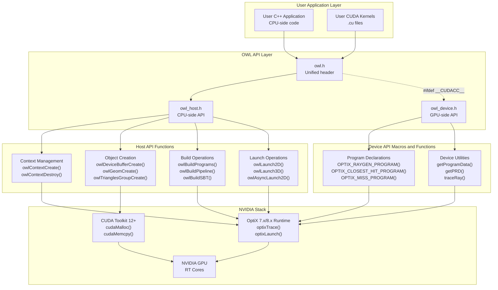

The header [include/owl/owl.h:1-20]() serves as the unified entry point. It unconditionally includes `owl_host.h` (since CUDA understands full C++), allowing device code to reference host-side types like `OWLContext`. The device API `owl_device.h` is conditionally included only when compiling with `nvcc` (detected via `__CUDACC__`), as it contains CUDA-specific types like `float4`.

**Sources:** [include/owl/owl.h:1-20](), [README.md:8-24]()

## Object Type Hierarchy

OWL uses opaque handle types to represent GPU objects. All handles follow the naming convention `OWL*` and are created through corresponding `owl*Create()` functions:

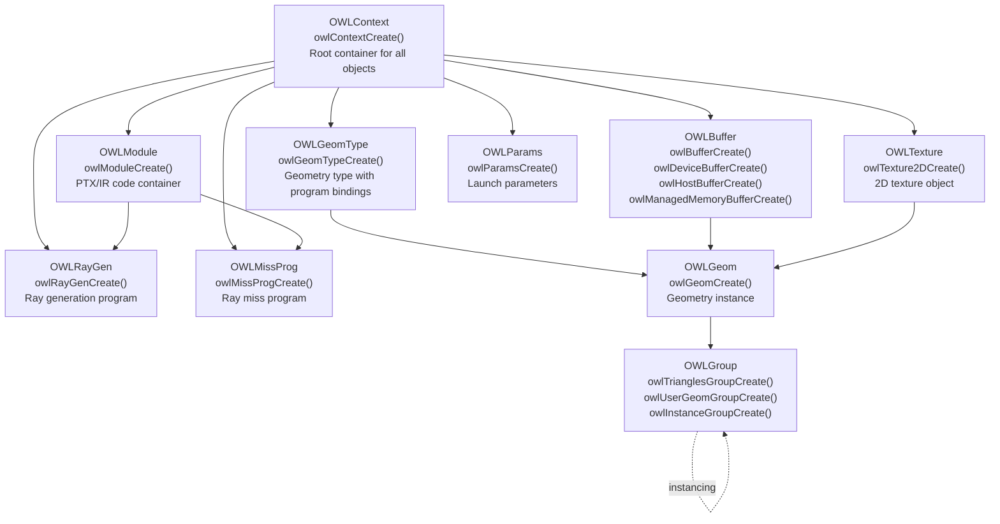

The object hierarchy flows from `OWLContext` (created via `owlContextCreate()`) to all other resources. Programs are loaded from `OWLModule` objects. Geometries are instantiated from `OWLGeomType` templates that define their associated programs (closest hit, any hit, intersection). `OWLGroup` objects represent acceleration structures: either bottom-level (BLAS, grouping geometries) or top-level (IAS, grouping instances with transforms).

**Sources:** [README.md:63-96]()

## Key Features

OWL supports advanced ray tracing features while maintaining a simplified API:

| Feature Category | Capabilities |
|-----------------|--------------|
| **Instancing** | Multi-level instancing with transforms; instance groups can reference other instance groups |
| **Acceleration Structures** | Automatic BVH compaction; acceleration structure refitting for dynamic scenes |
| **Programs** | Multiple ray generation programs; multiple ray types with distinct miss/hit programs |
| **Motion Blur** | Geometry motion blur; instance motion blur with time-based transforms |
| **Multi-GPU** | Automatic multi-GPU coordination; per-GPU handling of buffers, traversables, and textures |
| **Asynchronous Operations** | Async launches with CUDA stream management |
| **Memory Management** | Multiple buffer types: device, host-pinned, managed, user-provided, graphics interop; buffers of buffers; buffers of traversables; buffers of textures |
| **Textures** | 2D textures with configurable formats and filter modes |
| **Geometry Types** | Triangle meshes, user-defined geometry, curves (OptiX 7.2+), spheres |

**Sources:** [README.md:106-128]()

## Repository Structure

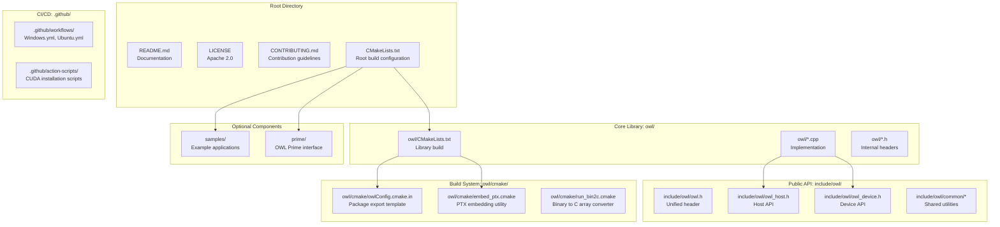

The repository follows a standard CMake project layout. The core library resides in `owl/` with public headers in `include/owl/`. The build system in `owl/cmake/` provides both library builds and utilities for downstream projects (notably `embed_ptx.cmake` for compiling CUDA to PTX). CI/CD workflows in `.github/` test across 10 configurations: 5 Windows (multiple CUDA versions) and 5 Ubuntu (multiple CUDA versions and build types).

**Sources:** [README.md:163-208](), [3rdParty.txt:1-51]()

## Development Status and Version

OWL was first publicly released in early 2019 and has maintained a stable API since then. The current version is **1.2.2**. The library is actively maintained and used in numerous research projects and production applications. Recent development (October 2025) moved the project to the official NVIDIA GitHub repository at `https://github.com/NVIDIA/OWL`.

The library requires:
- OptiX 7.x or 8.x (header shipped with OWL; driver must support OptiX)
- CUDA Toolkit version 12 or newer
- C++17 capable compiler (gcc-11+ on Ubuntu, Visual Studio 2017+ on Windows)

**Sources:** [README.md:143-161](), [README.md:165-172](), [README.md:474-477]()

## Integration Modes

OWL supports two primary integration approaches for downstream projects:

1. **Git Submodule Integration (Recommended)**: Add OWL as a git submodule and use `add_subdirectory()` in CMake with the `EXCLUDE_FROM_ALL` flag. Link against the `owl::owl` target to automatically bring in headers, libraries, and dependencies. See [Integration into Projects](#2.3) for details.

2. **Installed Package Integration**: Build and install OWL to a prefix, then use CMake's `find_package(owl)` to locate the installed package. This approach uses the generated `owlConfig.cmake` files. See [Package System](#5.2) for details.

Both modes provide access to the `embed_ptx.cmake` utility, allowing downstream projects to compile their own CUDA kernels to PTX and embed them as C++ byte arrays (see [PTX Embedding](#5.3)).

**Sources:** [README.md:210-240]()

---

# Page: Architecture Overview

# Architecture Overview

<details>
<summary>Relevant source files</summary>

The following files were used as context for generating this wiki page:

- [include/owl/owl.h](include/owl/owl.h)
- [include/owl/owl_device.h](include/owl/owl_device.h)
- [include/owl/owl_host.h](include/owl/owl_host.h)

</details>


This document explains OWL's layered architecture, focusing on the separation between CPU-side (Host API) and GPU-side (Device API) interfaces, the internal implementation layer, and how OWL abstracts the underlying OptiX and CUDA runtimes. For specific API functions and their usage, see the Host API Reference ([3](#3)) and Device API Reference ([4](#4)) sections. For build system integration details, see the Build System section ([5](#5)).

## Three-Layer Architecture

OWL follows a three-layer architecture that separates concerns between host code execution, device code execution, and the underlying ray tracing infrastructure:

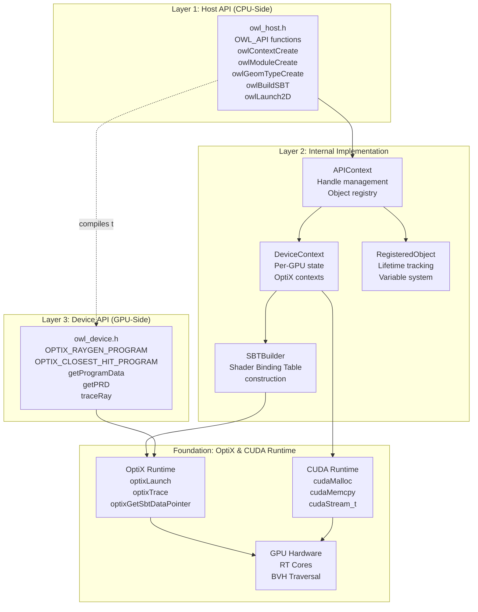

**Sources:** [include/owl/owl_host.h:1-2500](), [include/owl/owl_device.h:1-374](), [include/owl/owl.h:1-20]()

## Header Organization and Compilation Model

OWL uses a split-header design that adapts to the compilation context:

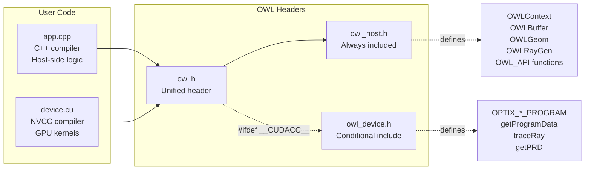

The unified header [include/owl/owl.h:1-20]() conditionally includes device-side definitions only when compiled with NVCC:

| Compiler Context | Headers Included | Available Types |
|-----------------|------------------|-----------------|
| C++ (g++, MSVC) | `owl_host.h` only | Host API types and functions |
| NVCC | `owl_host.h` + `owl_device.h` | Both host and device APIs |

**Sources:** [include/owl/owl.h:1-20](), [include/owl/owl_host.h:1-55](), [include/owl/owl_device.h:1-23]()

## Host API Layer (CPU-Side)

The Host API provides C-style functions with opaque handle types for managing ray tracing resources on the CPU side.

### Core Handle Types

| Handle Type | Purpose | Creation Function | Release Function |
|------------|---------|------------------|------------------|
| `OWLContext` | Root container, multi-GPU coordinator | `owlContextCreate` | `owlContextDestroy` |
| `OWLModule` | PTX/IR code container | `owlModuleCreate` | `owlModuleRelease` |
| `OWLGeomType` | Geometry type with program bindings | `owlGeomTypeCreate` | N/A |
| `OWLGeom` | Geometry instance | `owlGeomCreate` | `owlGeomRelease` |
| `OWLGroup` | Acceleration structure (BLAS or IAS) | `owlTrianglesGeomGroupCreate`, `owlInstanceGroupCreate` | `owlGroupRelease` |
| `OWLBuffer` | GPU memory allocation | `owlDeviceBufferCreate`, `owlHostPinnedBufferCreate` | `owlBufferRelease` |
| `OWLTexture` | 2D texture | `owlTexture2DCreate` | `owlTexture2DDestroy` |
| `OWLRayGen` | Ray generation program | `owlRayGenCreate` | `owlRayGenRelease` |
| `OWLMissProg` | Miss program | `owlMissProgCreate` | N/A |
| `OWLParams` | Launch parameters | `owlParamsCreate` | N/A |

**Sources:** [include/owl/owl_host.h:310-329](), [include/owl/owl_host.h:331-466]()

### API Function Categories

The Host API [include/owl/owl_host.h:331-2500]() is organized into functional categories:

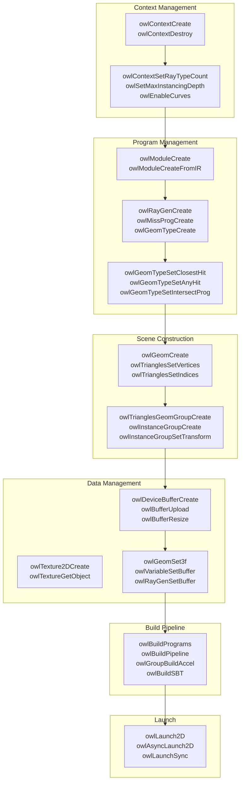

**Sources:** [include/owl/owl_host.h:331-904]()

### Variable System

OWL provides a flexible variable system for setting parameters on geometry, programs, and launch params:

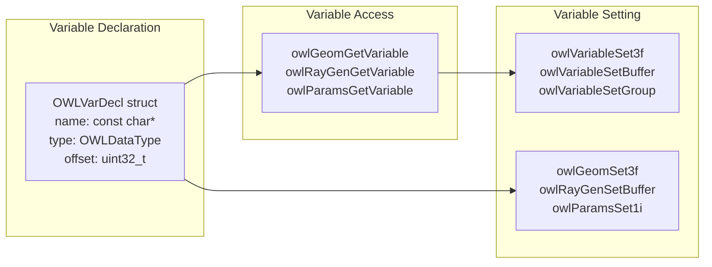

The variable system supports these data types [include/owl/owl_host.h:94-206]():

| Type Category | OWLDataType Enums | Description |
|--------------|-------------------|-------------|
| Scalar | `OWL_FLOAT`, `OWL_INT`, `OWL_DOUBLE`, `OWL_BOOL` | Basic numeric types |
| Vector | `OWL_FLOAT2/3/4`, `OWL_INT2/3/4`, `OWL_DOUBLE2/3/4` | Vector types |
| Object References | `OWL_BUFFER`, `OWL_GROUP`, `OWL_TEXTURE` | Handles to other OWL objects |
| Special | `OWL_BUFFER_POINTER`, `OWL_RAW_POINTER`, `OWL_DEVICE` | Translated types |
| Matrix | `OWL_AFFINE3F` | 4x3 affine transform |

**Sources:** [include/owl/owl_host.h:258-268](), [include/owl/owl_host.h:1080-1210]()

## Device API Layer (GPU-Side)

The Device API provides macros and inline functions for writing GPU-side ray tracing programs in CUDA.

### Program Declaration Macros

OWL maps user program functions to OptiX entry points using preprocessor macros [include/owl/owl_device.h:244-295]():

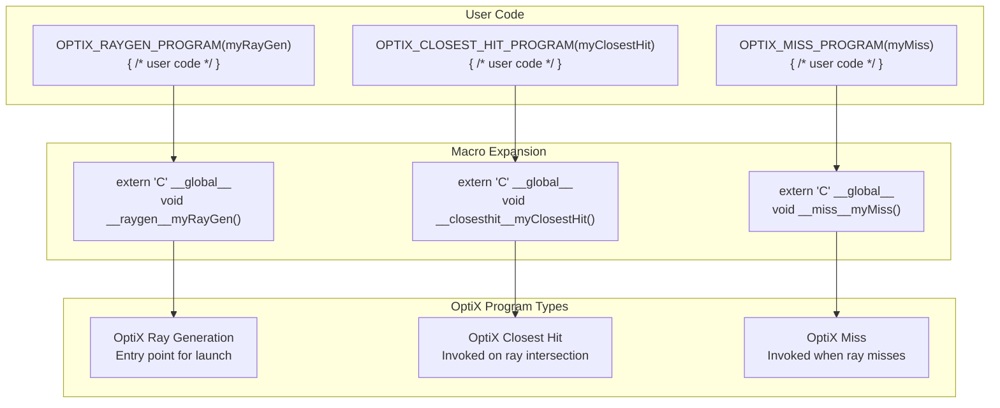

| Macro | Expands To | OptiX Program Type | Purpose |
|-------|-----------|-------------------|---------|
| `OPTIX_RAYGEN_PROGRAM` | `__raygen__` prefix | Ray generation | Launch entry point |
| `OPTIX_CLOSEST_HIT_PROGRAM` | `__closesthit__` prefix | Closest hit | Intersection handling |
| `OPTIX_ANY_HIT_PROGRAM` | `__anyhit__` prefix | Any hit | Early intersection testing |
| `OPTIX_MISS_PROGRAM` | `__miss__` prefix | Miss | Ray miss handling |
| `OPTIX_INTERSECT_PROGRAM` | `__intersection__` prefix | Intersection | Custom primitive intersection |
| `OPTIX_BOUNDS_PROGRAM` | `__boundsFunc__` prefix | Bounds | Custom primitive AABB |

**Sources:** [include/owl/owl_device.h:244-295](), [include/owl/owl_device.h:266-295](), [include/owl/owl_device.h:338-373]()

### Device-Side Data Access

Device programs access data through inline functions that wrap OptiX built-ins:

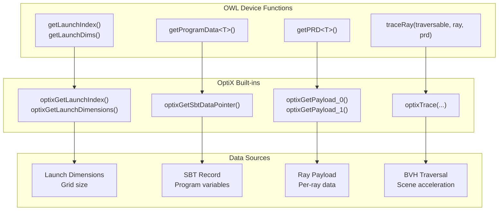

**Key device-side functions:**

| Function | Purpose | Returns | OptiX Equivalent |
|----------|---------|---------|-----------------|
| `getLaunchIndex()` | Current thread coordinates | `vec2i` | `optixGetLaunchIndex()` |
| `getLaunchDims()` | Launch grid dimensions | `vec2i` | `optixGetLaunchDimensions()` |
| `getProgramData<T>()` | SBT record data | `const T&` | `optixGetSbtDataPointer()` |
| `getPRD<T>()` | Per-ray data payload | `T&` | `optixGetPayload_*()` |
| `traceRay(...)` | Trace a ray through scene | void | `optixTrace(...)` |

**Sources:** [include/owl/owl_device.h:28-130](), [include/owl/owl_device.h:156-235]()

### Ray Tracing Template Types

OWL provides a templated `RayT` type [include/owl/owl_device.h:131-153]() for type-safe ray tracing:

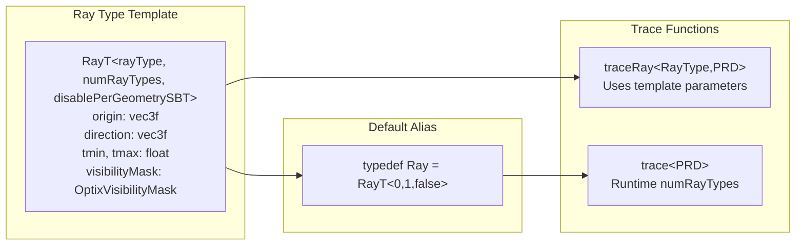

**Sources:** [include/owl/owl_device.h:131-235]()

## Internal Implementation Layer

While not directly visible to users, understanding the internal layer helps clarify OWL's abstraction strategy:

### Key Internal Classes

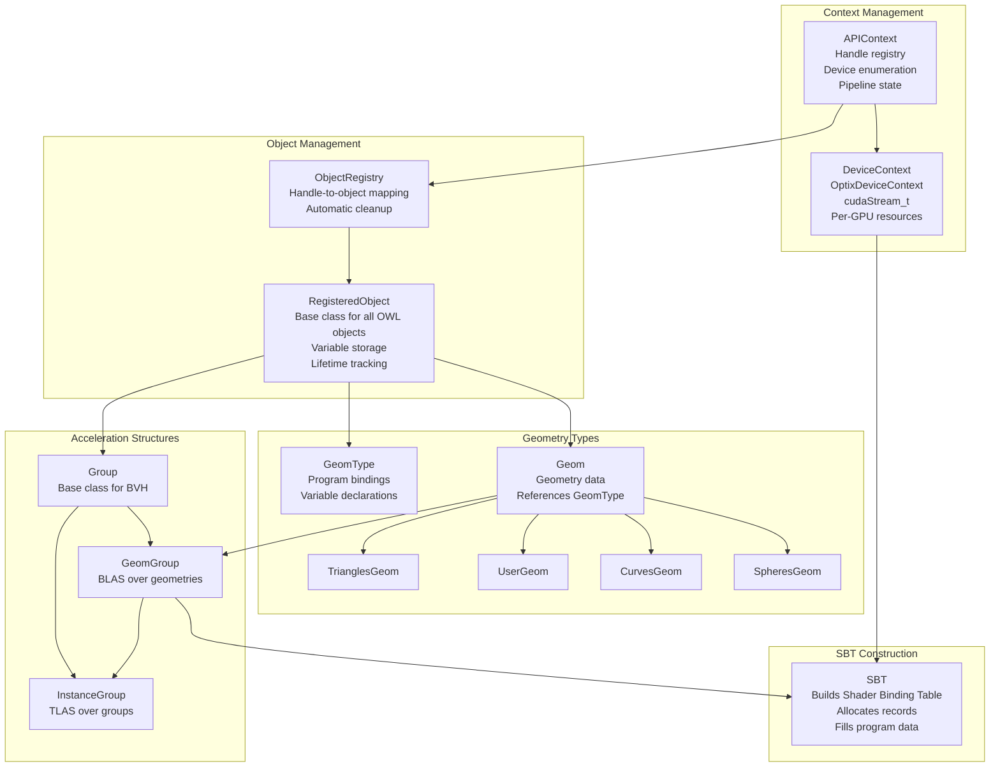

**Sources:** Architecture inferred from [include/owl/owl_host.h:310-329]() handle types and typical OptiX wrapper patterns

## Foundation Layer: OptiX and CUDA

OWL builds directly on the NVIDIA OptiX and CUDA runtimes:

### OptiX Abstraction Strategy

| OptiX Complexity | OWL Abstraction | Benefit |
|-----------------|-----------------|---------|
| Manual SBT record layout | Automatic SBT construction via `owlBuildSBT` | Eliminates error-prone manual offset calculations |
| Per-device OptixDeviceContext creation | Single `OWLContext` manages all devices | Simplified multi-GPU coordination |
| Explicit program group creation and linking | Automatic pipeline from `owlBuildPrograms` and `owlBuildPipeline` | Reduces boilerplate |
| Manual acceleration structure memory management | Automatic compaction in `owlGroupBuildAccel` | Optimized memory usage |
| Raw optixTrace calls | Type-safe `traceRay<RayType,PRD>` templates | Compile-time safety |

**Sources:** [include/owl/owl_host.h:331-334]() for build functions, [include/owl/owl_device.h:156-235]() for tracing

### CUDA Integration

OWL exposes CUDA primitives for interoperability:

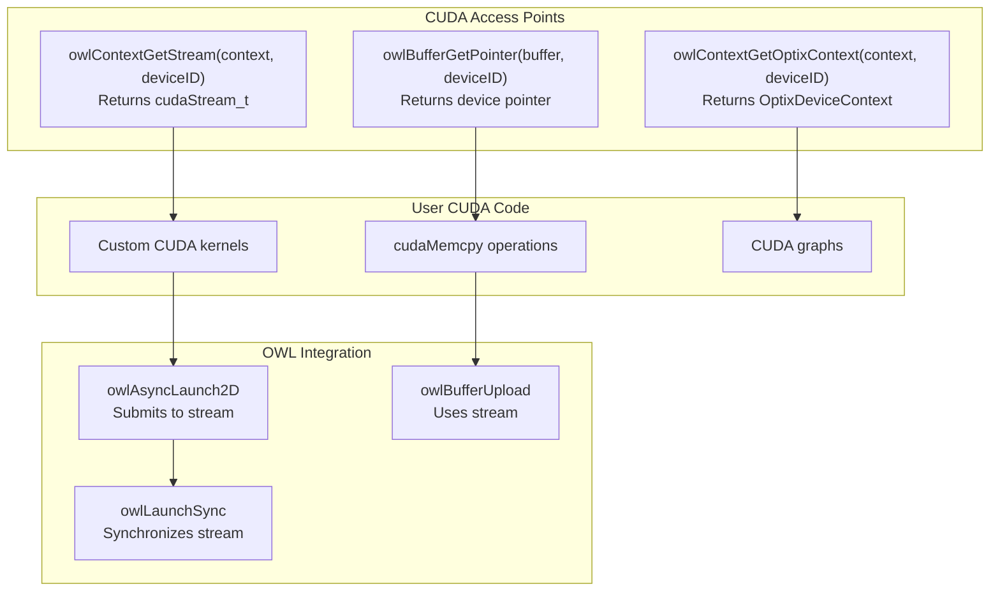

**Sources:** [include/owl/owl_host.h:448-454]() for stream access, [include/owl/owl_host.h:809-810]() for pointer access

## Build and Launch Pipeline

The typical OWL workflow follows this pipeline:

```mermaid
graph TB
    subgraph "1. Initialization"
        CTX["owlContextCreate()<br/>Create multi-GPU context"]
        RAY_TYPES["owlContextSetRayTypeCount()<br/>Configure ray types"]
    end
    
    subgraph "2. Program Setup"
        MODULE["owlModuleCreate(ptxCode)<br/>Load device programs"]
        GEOM_TYPE["owlGeomTypeCreate()<br/>Define geometry types"]
        SET_PROGS["owlGeomTypeSetClosestHit()<br/>Bind hit programs"]
        RAYGEN["owlRayGenCreate()<br/>Create ray gen program"]
        MISS["owlMissProgCreate()<br/>Create miss program"]
    end
    
    subgraph "3. Scene Construction"
        BUFFERS["owlDeviceBufferCreate()<br/>Allocate vertex/index data"]
        GEOMS["owlGeomCreate()<br/>Create geometry instances"]
        SET_VERTS["owlTrianglesSetVertices()<br/>Configure geometry data"]
        GROUPS["owlTrianglesGeomGroupCreate()<br/>Create BLAS/TLAS"]
    end
    
    subgraph "4. Variable Setting"
        SET_GEOM_VARS["owlGeomSet3f()<br/>Set geometry variables"]
        SET_RAYGEN_VARS["owlRayGenSetBuffer()<br/>Set program variables"]
    end
    
    subgraph "5. Build Pipeline"
        BUILD_PROGS["owlBuildPrograms()<br/>Compile all modules"]
        BUILD_PIPE["owlBuildPipeline()<br/>Link pipeline"]
        BUILD_ACCEL["owlGroupBuildAccel()<br/>Build BVHs"]
        BUILD_SBT["owlBuildSBT()<br/>Generate SBT"]
    end
    
    subgraph "6. Launch"
        LAUNCH["owlLaunch2D(rayGen, w, h, params)<br/>Execute ray tracing"]
    end
    
    CTX --> RAY_TYPES
    RAY_TYPES --> MODULE
    MODULE --> GEOM_TYPE
    GEOM_TYPE --> SET_PROGS
    SET_PROGS --> RAYGEN
    RAYGEN --> MISS
    
    MISS --> BUFFERS
    BUFFERS --> GEOMS
    GEOMS --> SET_VERTS
    SET_VERTS --> GROUPS
    
    GROUPS --> SET_GEOM_VARS
    SET_GEOM_VARS --> SET_RAYGEN_VARS
    
    SET_RAYGEN_VARS --> BUILD_PROGS
    BUILD_PROGS --> BUILD_PIPE
    BUILD_PIPE --> BUILD_ACCEL
    BUILD_ACCEL --> BUILD_SBT
    
    BUILD_SBT --> LAUNCH
```

**Sources:** [include/owl/owl_host.h:331-904]() for all pipeline functions

## Multi-GPU Architecture

OWL automatically manages multiple GPUs through a unified context:

| Aspect | Single-GPU Behavior | Multi-GPU Behavior |
|--------|--------------------|--------------------|
| Context creation | `owlContextCreate(nullptr, 1)` | `owlContextCreate(nullptr, 0)` for all GPUs |
| Buffer allocation | Single device buffer | Replicated buffers across devices |
| Acceleration structures | Single BVH | Replicated BVHs per device |
| Launches | `owlLaunch2D` on device 0 | Automatic distribution or `owlAsyncLaunch2DOnDevice` |
| Streams | Single CUDA stream | Per-device streams via `owlContextGetStream` |

**Sources:** [include/owl/owl_host.h:340-361]() for context creation, [include/owl/owl_host.h:448-454]() for device-specific operations

---

# Page: Key Concepts

# Key Concepts

<details>
<summary>Relevant source files</summary>

The following files were used as context for generating this wiki page:

- [3rdParty.txt](3rdParty.txt)
- [README.md](README.md)
- [include/owl/owl_host.h](include/owl/owl_host.h)
- [owl/APIHandle.h](owl/APIHandle.h)

</details>


This page introduces the fundamental concepts required to understand and use OWL effectively. It covers the object model, lifecycle management, the host-device programming split, acceleration structure organization, and the data flow mechanisms that enable GPU ray tracing.

For details on the Host API functions themselves, see [Host API Reference](#3). For information on writing GPU-side device code, see [Device API Reference](#4). For the overall architecture, see [Architecture Overview](#1.1).

---

## Object Model and Lifecycle

OWL organizes ray tracing components into a hierarchy of typed handles that manage GPU resources and OptiX state. All objects are created through an `OWLContext` and follow a reference-counted lifecycle.

### Core Handle Types

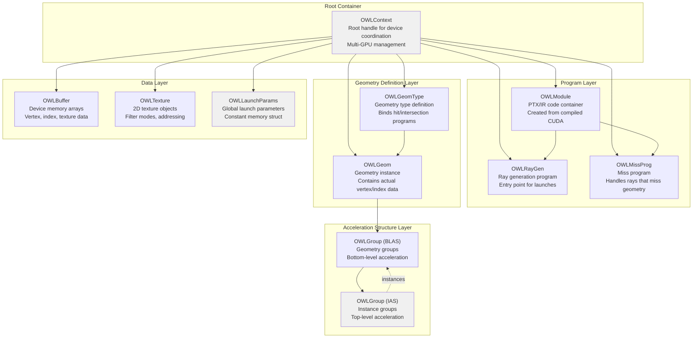

**Handle Types and Their Roles:**

| Handle Type | Definition | Purpose | Key Functions |
|------------|------------|---------|---------------|
| `OWLContext` | [include/owl/owl_host.h:310]() | Root container managing devices and object registry | `owlContextCreate`, `owlContextDestroy` |
| `OWLModule` | [include/owl/owl_host.h:316]() | Compiled PTX/IR code containing device programs | `owlModuleCreate`, `owlModuleCreateFromIR` |
| `OWLRayGen` | [include/owl/owl_host.h:318]() | Ray generation program entry point | `owlRayGenCreate`, `owlLaunch2D` |
| `OWLMissProg` | [include/owl/owl_host.h:319]() | Ray miss handler program | `owlMissProgCreate`, `owlMissProgSet` |
| `OWLGeomType` | [include/owl/owl_host.h:314]() | Geometry type with program bindings | `owlGeomTypeCreate`, `owlGeomTypeSetClosestHit` |
| `OWLGeom` | [include/owl/owl_host.h:313]() | Geometry instance with data | `owlGeomCreate`, `owlTrianglesSetVertices` |
| `OWLGroup` | [include/owl/owl_host.h:317]() | Acceleration structure (BLAS or IAS) | `owlTrianglesGeomGroupCreate`, `owlInstanceGroupCreate` |
| `OWLBuffer` | [include/owl/owl_host.h:311]() | Device memory buffer | `owlDeviceBufferCreate`, `owlBufferUpload` |
| `OWLTexture` | [include/owl/owl_host.h:312]() | 2D texture object | `owlTexture2DCreate`, `owlTextureGetObject` |
| `OWLLaunchParams` | [include/owl/owl_host.h:329]() | Global parameters accessible to all programs | `owlParamsCreate`, `owlParamsSet3f` |

Sources: [include/owl/owl_host.h:310-329](), [README.md:43-104]()

### Object Lifecycle and Reference Counting

All OWL objects are internally reference-counted and managed through shared pointers. The API layer wraps these with opaque handles for C compatibility.

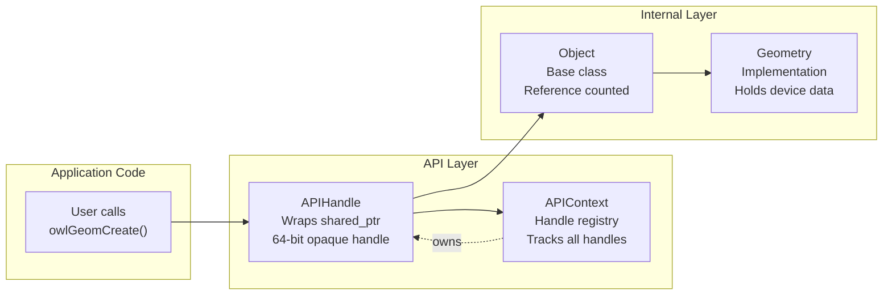

**Key Lifecycle Functions:**

- **Creation:** Objects created via `owl*Create()` functions return handles with initial refcount
- **Release:** Explicit `owlGeomRelease()` decrements app-side refcount
- **Destroy:** `owlBufferDestroy()` forces immediate deallocation (use with caution)
- **Context Destruction:** `owlContextDestroy()` releases all handles in the registry

Sources: [owl/APIHandle.h:12-40](), [include/owl/owl_host.h:468-473]()

---

## Host-Device Programming Model

OWL enforces a strict separation between CPU-side (host) and GPU-side (device) code, mirroring CUDA's programming model but adapted for ray tracing.

### API Split

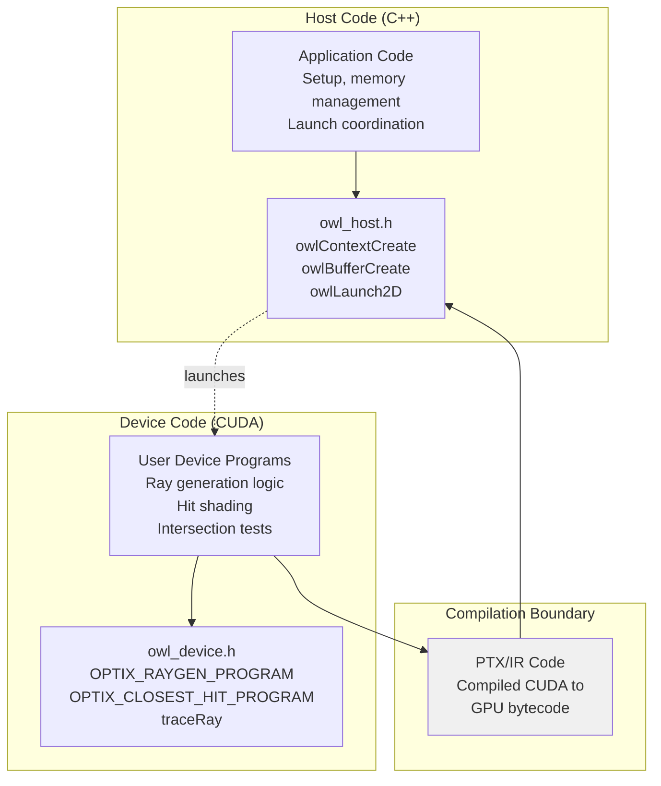

**Host API ([include/owl/owl_host.h:1-1893]()):**
- Context and device management
- Memory allocation (`owlDeviceBufferCreate`, `owlHostPinnedBufferCreate`)
- Object creation (geometries, groups, programs)
- Acceleration structure building (`owlGroupBuildAccel`)
- Variable setting (`owlGeomSet3f`, `owlVariableSetBuffer`)
- Launch operations (`owlLaunch2D`, `owlAsyncLaunch2D`)

**Device API ([include/owl/owl_device.h]()):**
- Program declaration macros (`OPTIX_RAYGEN_PROGRAM`, `OPTIX_CLOSEST_HIT_PROGRAM`)
- Ray tracing functions (`traceRay`, `optixTrace`)
- Data access utilities (`getProgramData`, `getPRD`)
- Launch index queries (`getLaunchIndex`, `getLaunchDims`)

**Compilation Flow:**
1. Device code (`.cu` files) compiled to PTX using `nvcc`
2. PTX loaded into `OWLModule` via `owlModuleCreate(context, ptxCode)`
3. Programs extracted from module by name
4. Programs linked into OptiX pipeline during `owlBuildPipeline()`

Sources: [include/owl/owl_host.h:1-60](), [README.md:10-24]()

---

## Geometry Types and Instances

OWL distinguishes between geometry *types* (which define program bindings) and geometry *instances* (which hold actual data). This separation enables efficient sharing of hit programs across many geometries.

### Geometry Type System

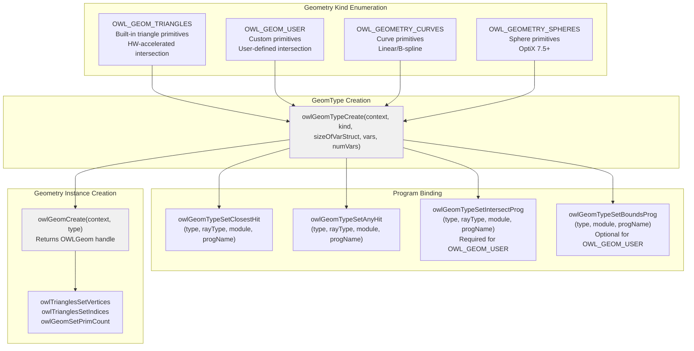

**Geometry Kind Definitions:**

| Kind | Constant | Intersection | Use Cases | Required Functions |
|------|----------|--------------|-----------|-------------------|
| Triangles | `OWL_GEOM_TRIANGLES` | Hardware-accelerated | Triangle meshes | `owlTrianglesSetVertices`, `owlTrianglesSetIndices` |
| User | `OWL_GEOM_USER` | Custom program | Implicit surfaces, procedural | `owlGeomTypeSetIntersectProg`, `owlGeomSetPrimCount` |
| Curves | `OWL_GEOMETRY_CURVES` | OptiX built-in | Hair, cables | `owlCurvesSetDegree`, `owlCurvesSetControlPoints` |
| Spheres | `OWL_GEOMETRY_SPHERES` | OptiX built-in | Particles, atoms | `owlSpheresSetVertices` |

Sources: [include/owl/owl_host.h:207-223](), [include/owl/owl_host.h:691-696](), [include/owl/owl_host.h:468-470]()

---

## Acceleration Structures

OWL implements OptiX's two-level acceleration structure model: bottom-level acceleration structures (BLAS) for geometry and top-level acceleration structures (IAS/TLAS) for instances.

### Two-Level Hierarchy

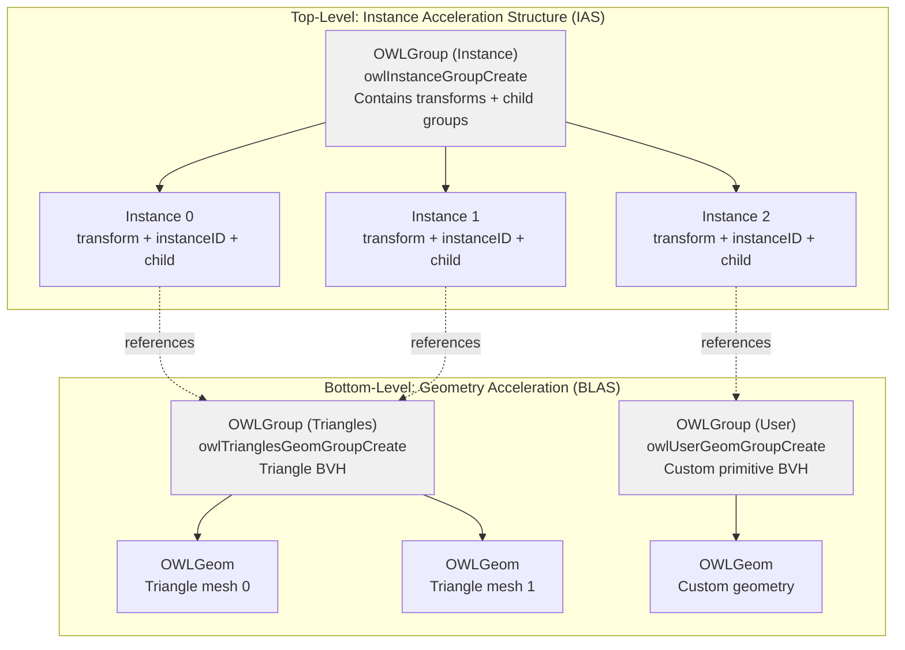

**Key Acceleration Structure Concepts:**

| Concept | Description | OWL Type | Build Function |
|---------|-------------|----------|----------------|
| BLAS (Bottom-Level) | Acceleration structure over geometry primitives | `OWLGroup` created via `owlTrianglesGeomGroupCreate` | `owlGroupBuildAccel(blas)` |
| IAS/TLAS (Top-Level) | Acceleration structure over instances with transforms | `OWLGroup` created via `owlInstanceGroupCreate` | `owlGroupBuildAccel(ias)` |
| Multi-Level Instancing | IAS can instance other IAS (depth configurable) | Same `OWLGroup` handle | `owlSetMaxInstancingDepth(context, depth)` |
| BVH Compaction | Automatic memory optimization after build | Built-in (always enabled) | Automatic during `owlGroupBuildAccel` |
| Refitting | Update acceleration without full rebuild | Same `OWLGroup` | `owlGroupRefitAccel(group)` |

**Build Flags:**

OWL accepts OptiX build flags when creating groups (defaulting to sensible values if `0` is passed):
- `OPTIX_BUILD_FLAG_ALLOW_UPDATE` - Enable refitting
- `OPTIX_BUILD_FLAG_ALLOW_COMPACTION` - Enable compaction (default)
- `OPTIX_BUILD_FLAG_PREFER_FAST_TRACE` - Optimize for trace performance
- `OPTIX_BUILD_FLAG_PREFER_FAST_BUILD` - Optimize for build speed

Sources: [include/owl/owl_host.h:528-665](), [include/owl/owl_host.h:671-672](), [README.md:63-96]()

---

## Shader Binding Table (SBT) Abstraction

The Shader Binding Table is OptiX's mechanism for associating geometry instances with shader programs and per-geometry data. OWL's primary value proposition is automating SBT construction, which is complex and error-prone in raw OptiX.

### SBT Structure and OWL's Automation

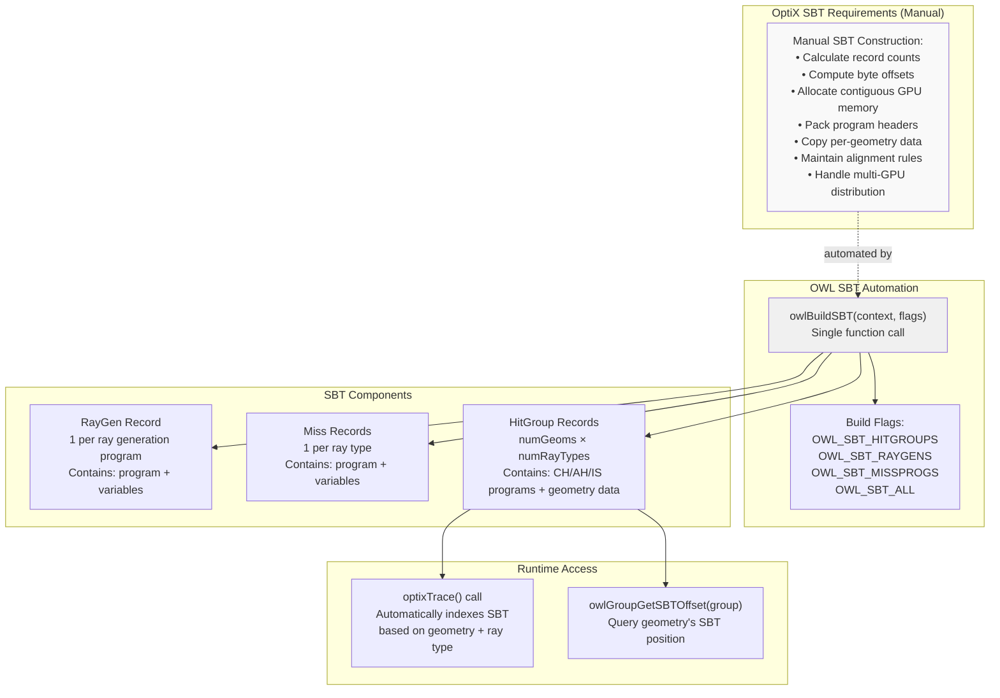

**SBT Record Layout:**

For a scene with N geometries and M ray types, the SBT hitgroup section contains N×M records:

| Record Index | Geometry | Ray Type | Content |
|-------------|----------|----------|---------|
| 0 | Geom 0 | Ray Type 0 | ClosestHit₀, AnyHit₀, Intersection₀, Variables₀ |
| 1 | Geom 0 | Ray Type 1 | ClosestHit₁, AnyHit₁, Intersection₁, Variables₀ |
| ... | ... | ... | ... |
| M | Geom 1 | Ray Type 0 | ClosestHit₀, AnyHit₀, Intersection₀, Variables₁ |
| M+1 | Geom 1 | Ray Type 1 | ClosestHit₁, AnyHit₁, Intersection₁, Variables₁ |

**Build Pipeline Sequence:**

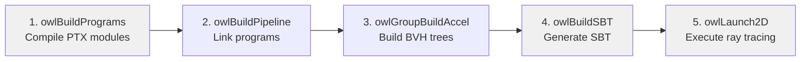

Sources: [include/owl/owl_host.h:331-334](), [README.md:10-18](), [include/owl/owl_host.h:688-689]()

---

## Variable System and Data Flow

OWL provides a type-safe variable system for passing data from host to device. Variables can be attached to geometries, programs, and launch parameters, and are automatically populated into the SBT or device memory.

### Variable Declaration and Setting

```mermaid
graph TB
    subgraph "Host-Side Variable Declaration"
        VARDECL["OWLVarDecl array<br/>{ name, type, offset }"]
        CREATE["owlGeomTypeCreate(context, kind,<br/>sizeof(MyGeomData), vars, numVars)"]
    end
    
    subgraph "Variable Setting Mechanisms"
        DIRECT["Direct Setting:<br/>owlGeomSet3f(geom, 'color', r, g, b)<br/>owlGeomSetBuffer(geom, 'vertices', buffer)"]
        HANDLE["Handle-Based:<br/>OWLVariable var = owlGeomGetVariable(geom, 'color')<br/>owlVariableSet3f(var, r, g, b)<br/>owlVariableRelease(var)"]
    end
    
    subgraph "Variable Types"
        SCALAR["Scalar Types:<br/>float, int, double<br/>vec2/3/4 variants"]
        OBJECT["Object Types:<br/>OWL_BUFFER → device pointer<br/>OWL_GROUP → traversable handle<br/>OWL_TEXTURE → texture object"]
    end
    
    subgraph "Device-Side Access"
        DEVICE_STRUCT["Device Code:<br/>struct MyGeomData {<br/>  float3 color;<br/>  float3 *vertices;<br/>};<br/>MyGeomData &data = getProgramData<MyGeomData>();"]
    end
    
    VARDECL --> CREATE
    CREATE --> DIRECT
    CREATE --> HANDLE
    
    SCALAR --> DIRECT
    OBJECT --> DIRECT
    
    DIRECT --> DEVICE_STRUCT
    HANDLE --> DEVICE_STRUCT
    
    style CREATE fill:#f0f0f0
    style DEVICE_STRUCT fill:#f0f0f0
```

**Variable Type Mapping:**

| Host Type | Device Type | Translation | Example |
|-----------|-------------|-------------|---------|
| `OWL_FLOAT3` | `float3` | Direct copy | `owlGeomSet3f(geom, "color", 1.f, 0.f, 0.f)` |
| `OWL_BUFFER` | `T*` (device pointer) | Resolved at SBT build | `owlVariableSetBuffer(var, vertexBuffer)` |
| `OWL_GROUP` | `OptixTraversableHandle` | Resolved at SBT build | `owlVariableSetGroup(var, instanceGroup)` |
| `OWL_TEXTURE` | `cudaTextureObject_t` | Resolved at SBT build | `owlVariableSetTexture(var, texture)` |
| `OWL_USER_TYPE(T)` | `T` (any struct) | Memcpy of `sizeof(T)` bytes | For custom types |

**Attachment Points:**

Variables can be attached to three categories of objects:

1. **Geometry Variables** - Per-geometry data in SBT hitgroup records
   - Set via `owlGeomSet*()` functions
   - Accessed via `getProgramData<T>()` in hit programs

2. **Program Variables** - Per-program data in SBT raygen/miss records
   - Set via `owlRayGenSet*()` or `owlMissProgSet*()` functions
   - Accessed via `getProgramData<T>()` in respective programs

3. **Launch Parameters** - Global data in CUDA constant memory
   - Set via `owlParamsSet*()` functions
   - Accessed via `__constant__ MyLaunchParams optixLaunchParams;`

Sources: [include/owl/owl_host.h:258-262](), [include/owl/owl_host.h:1080-1211](), [include/owl/owl_host.h:95-204]()

---

## Ray Types and Program Bindings

OWL supports multiple ray types to enable different shading modes (primary rays, shadow rays, ambient occlusion, etc.) within a single pipeline. Each geometry type can bind different programs per ray type.

### Ray Type Configuration

```mermaid
graph TB
    subgraph "Context Ray Type Configuration"
        SET_COUNT["owlContextSetRayTypeCount(context, numRayTypes)<br/>Must be called before creating programs"]
        EXAMPLE["Example: numRayTypes = 2<br/>Ray Type 0: Primary rays (shading)<br/>Ray Type 1: Shadow rays (visibility)"]
    end
    
    subgraph "GeomType Program Binding"
        BIND_CH0["owlGeomTypeSetClosestHit(type, 0, module, 'primaryCH')"]
        BIND_CH1["owlGeomTypeSetClosestHit(type, 1, module, 'shadowCH')"]
        BIND_AH0["owlGeomTypeSetAnyHit(type, 0, module, 'primaryAH')<br/>Optional: for alpha testing"]
        BIND_AH1["owlGeomTypeSetAnyHit(type, 1, module, 'shadowAH')<br/>Optional: for transparent shadows"]
    end
    
    subgraph "Miss Program Assignment"
        MISS0["owlMissProgCreate → Miss Prog 0<br/>owlMissProgSet(context, 0, missProg0)"]
        MISS1["owlMissProgCreate → Miss Prog 1<br/>owlMissProgSet(context, 1, missProg1)"]
    end
    
    subgraph "Device-Side Ray Tracing"
        TRACE["traceRay(world, ray, 0.f, 1e20f,<br/>  0.f, 0xff, rayType, ...)"]
        INDEX["rayType parameter selects<br/>which programs execute"]
    end
    
    SET_COUNT --> EXAMPLE
    EXAMPLE --> BIND_CH0
    EXAMPLE --> BIND_CH1
    EXAMPLE --> BIND_AH0
    EXAMPLE --> BIND_AH1
    EXAMPLE --> MISS0
    EXAMPLE --> MISS1
    
    BIND_CH0 --> TRACE
    BIND_CH1 --> TRACE
    MISS0 --> TRACE
    MISS1 --> TRACE
    
    TRACE --> INDEX
    
    style SET_COUNT fill:#f0f0f0
    style TRACE fill:#f0f0f0
```

**Program Type Mapping:**

| Program Type | Host Binding Function | Device Macro | When Executed |
|--------------|----------------------|--------------|---------------|
| Ray Generation | `owlRayGenCreate` | `OPTIX_RAYGEN_PROGRAM(name)` | Entry point, once per pixel/thread |
| Miss | `owlMissProgSet` | `OPTIX_MISS_PROGRAM(name)` | When ray misses all geometry |
| Closest Hit | `owlGeomTypeSetClosestHit` | `OPTIX_CLOSEST_HIT_PROGRAM(name)` | After traversal, on closest intersection |
| Any Hit | `owlGeomTypeSetAnyHit` | `OPTIX_ANY_HIT_PROGRAM(name)` | During traversal, on each intersection |
| Intersection | `owlGeomTypeSetIntersectProg` | `OPTIX_INTERSECT_PROGRAM(name)` | For user geometries, test ray-primitive |
| Bounds | `owlGeomTypeSetBoundsProg` | Not exposed to device | For user geometries, compute AABB |

Sources: [include/owl/owl_host.h:394-396](), [include/owl/owl_host.h:1031-1056](), [include/owl/owl_host.h:507-511]()

---

## Build Pipeline and Launch Sequence

OWL enforces a specific sequence of build operations to ensure GPU state is properly initialized before ray tracing.

### Required Build Sequence

```mermaid
graph TB
    START["Application Setup"]
    
    CONTEXT_CREATE["owlContextCreate(deviceIDs, numDevices)<br/>Initialize context + devices"]
    
    CONFIG["Configuration Phase:<br/>owlContextSetRayTypeCount<br/>owlEnableMotionBlur (optional)<br/>owlEnableCurves (optional)"]
    
    CREATE_OBJECTS["Object Creation:<br/>owlModuleCreate (PTX)<br/>owlGeomTypeCreate<br/>owlGeomCreate<br/>owlBufferCreate<br/>owlParamsCreate"]
    
    SET_DATA["Data Configuration:<br/>owlTrianglesSetVertices<br/>owlBufferUpload<br/>owlGeomSet* (variables)"]
    
    BUILD_PROGRAMS["owlBuildPrograms(context)<br/>Compile modules → OptiX programs"]
    
    BUILD_PIPELINE["owlBuildPipeline(context)<br/>Link programs → OptiX pipeline"]
    
    CREATE_GROUPS["Group Creation:<br/>owlTrianglesGeomGroupCreate<br/>owlInstanceGroupCreate"]
    
    BUILD_ACCEL["owlGroupBuildAccel(group)<br/>Construct BVH acceleration structures"]
    
    BUILD_SBT["owlBuildSBT(context)<br/>Generate Shader Binding Table"]
    
    LAUNCH["owlLaunch2D(rayGen, width, height, params)<br/>Execute ray tracing"]
    
    REFIT["Optional: owlGroupRefitAccel(group)<br/>Update acceleration after geometry changes"]
    
    DESTROY["owlContextDestroy(context)<br/>Cleanup all resources"]
    
    START --> CONTEXT_CREATE
    CONTEXT_CREATE --> CONFIG
    CONFIG --> CREATE_OBJECTS
    CREATE_OBJECTS --> SET_DATA
    SET_DATA --> BUILD_PROGRAMS
    BUILD_PROGRAMS --> BUILD_PIPELINE
    BUILD_PIPELINE --> CREATE_GROUPS
    CREATE_GROUPS --> BUILD_ACCEL
    BUILD_ACCEL --> BUILD_SBT
    BUILD_SBT --> LAUNCH
    LAUNCH --> REFIT
    REFIT -.re-launch.-> LAUNCH
    LAUNCH --> DESTROY
    
    style CONTEXT_CREATE fill:#f0f0f0
    style BUILD_PROGRAMS fill:#f0f0f0
    style BUILD_PIPELINE fill:#f0f0f0
    style BUILD_ACCEL fill:#f0f0f0
    style BUILD_SBT fill:#f0f0f0
    style LAUNCH fill:#f0f0f0
```

**Critical Ordering Constraints:**

1. **Context Configuration Before Programs:**
   - `owlContextSetRayTypeCount()` must precede program creation
   - `owlEnableMotionBlur()` must precede geometry creation
   - `owlEnableCurves()` must precede pipeline build

2. **Build Programs Before Pipeline:**
   - `owlBuildPrograms()` compiles PTX to OptiX programs
   - `owlBuildPipeline()` links programs (requires compiled programs)

3. **Build Pipeline Before SBT:**
   - SBT generation requires compiled pipeline
   - Cannot build SBT without pipeline

4. **Build Acceleration Before Launch:**
   - `owlGroupBuildAccel()` must complete before SBT build
   - Traversable handles created during acceleration build

5. **SBT Before Launch:**
   - `owlBuildSBT()` must complete before `owlLaunch2D()`
   - Can rebuild SBT independently if only variables change

**Incremental Updates:**

After initial build, certain operations can be updated without full rebuild:

| Update Type | Required Rebuild | Function |
|------------|------------------|----------|
| Variable values | SBT only | `owlBuildSBT(context, flags)` |
| Geometry positions (refit) | Acceleration + SBT | `owlGroupRefitAccel(group)` |
| Geometry topology | Full acceleration + SBT | `owlGroupBuildAccel(group)` |
| Add/remove geometries | Full acceleration + SBT | Rebuild groups |
| Change programs | Pipeline + SBT | `owlBuildPipeline()` |

Sources: [include/owl/owl_host.h:331-334](), [include/owl/owl_host.h:671-672](), [README.md:98-104]()

---

## Multi-GPU Support

OWL provides transparent multi-GPU support through device-replicated objects and per-device data access.

### Device Coordination

```mermaid
graph TB
    subgraph "Context with Multiple Devices"
        CONTEXT["OWLContext<br/>Coordinates N devices"]
        DEV0["DeviceContext 0<br/>GPU 0: OptiX context + CUDA stream"]
        DEV1["DeviceContext 1<br/>GPU 1: OptiX context + CUDA stream"]
        DEVN["DeviceContext N-1<br/>GPU N-1: OptiX context + CUDA stream"]
        
        CONTEXT --> DEV0
        CONTEXT --> DEV1
        CONTEXT --> DEVN
    end
    
    subgraph "Buffer Replication"
        DEVICE_BUF["OWLBuffer (Device)<br/>Separate allocation per GPU<br/>owlBufferGetPointer(buf, deviceID)"]
        MANAGED_BUF["OWLBuffer (Managed)<br/>Single CUDA managed memory<br/>Accessible from all devices"]
        PINNED_BUF["OWLBuffer (Host Pinned)<br/>Single pinned host memory<br/>Accessible from all devices"]
    end
    
    subgraph "Traversable Handles"
        GROUP_HANDLE["OWLGroup<br/>Different traversable per device<br/>owlGroupGetTraversable(group, deviceID)"]
    end
    
    subgraph "Launch Distribution"
        LAUNCH_ALL["owlLaunch2D(rayGen, w, h, params)<br/>Executes on all devices (work split)"]
        LAUNCH_SINGLE["owlAsyncLaunch2DOnDevice(rayGen, w, h, devID, params)<br/>Executes on specific device"]
    end
    
    DEV0 --> DEVICE_BUF
    DEV1 --> DEVICE_BUF
    DEV0 --> GROUP_HANDLE
    
    CONTEXT --> LAUNCH_ALL
    CONTEXT --> LAUNCH_SINGLE
    
    style CONTEXT fill:#f0f0f0
    style DEVICE_BUF fill:#f0f0f0
```

**Device-Specific Queries:**

| Function | Purpose | Returns |
|----------|---------|---------|
| `owlGetDeviceCount(context)` | Query number of devices | Integer count |
| `owlBufferGetPointer(buffer, deviceID)` | Get device-specific pointer | `void*` (device address) |
| `owlGroupGetTraversable(group, deviceID)` | Get device-specific handle | `OptixTraversableHandle` |
| `owlContextGetStream(context, deviceID)` | Get device CUDA stream | `cudaStream_t` |
| `owlContextGetOptixContext(context, deviceID)` | Get device OptiX context | `OptixDeviceContext` |

Sources: [include/owl/owl_host.h:336-338](), [include/owl/owl_host.h:449-454](), [include/owl/owl_host.h:809-813](), [include/owl/owl_host.h:891-895]()

---

# Page: Getting Started

# Getting Started

<details>
<summary>Relevant source files</summary>

The following files were used as context for generating this wiki page:

- [3rdParty.txt](3rdParty.txt)
- [CMakeLists.txt](CMakeLists.txt)
- [README.md](README.md)

</details>


This document guides users through the initial setup and first steps with OWL (OptiX Wrapper Library). It covers prerequisite dependencies, build procedures, and integration into downstream projects. 

For detailed dependency requirements and platform-specific considerations, see [System Requirements](#2.1). For complete build instructions with configuration options, see [Building from Source](#2.2). For integrating OWL into your own projects, see [Integration into Projects](#2.3).

For understanding OWL's architecture and programming model before beginning, see [Architecture Overview](#1.1) and [Key Concepts](#1.2).

## Overview

OWL simplifies OptiX ray tracing development by abstracting complex operations like Shader Binding Table (SBT) construction, acceleration structure management, and multi-GPU coordination. The library requires NVIDIA hardware with ray tracing support, the OptiX driver, and CUDA Toolkit 12 or newer.

Getting started involves three main steps:

1. **Verify Prerequisites**: Ensure CUDA Toolkit 12+, OptiX driver, and build tools are installed
2. **Obtain OWL**: Clone the repository or add as a Git submodule to your project
3. **Build or Integrate**: Either build OWL standalone or integrate directly into your CMake project

The recommended workflow uses OWL as a Git submodule with CMake's `add_subdirectory()`, avoiding separate installation steps.

## Getting Started Workflow

```mermaid
flowchart TD
    Start["User wants to use OWL"]
    
    CheckDeps["Verify dependencies:<br/>- CUDA Toolkit 12+<br/>- OptiX in driver<br/>- CMake 3.24+<br/>- C++17 compiler"]
    
    ChooseMethod{"Integration<br/>approach?"}
    
    Submodule["Add as Git submodule<br/>(Recommended)"]
    Standalone["Build OWL standalone"]
    
    SubmoduleAdd["git submodule add<br/>https://github.com/NVIDIA/owl"]
    SubmoduleCMake["Add to CMakeLists.txt:<br/>add_subdirectory(owl EXCLUDE_FROM_ALL)<br/>target_link_libraries(myapp owl::owl)"]
    
    CloneRepo["git clone<br/>https://github.com/NVIDIA/owl"]
    ConfigureBuild["mkdir build && cd build<br/>cmake ..<br/>cmake --build ."]
    InstallOWL["cmake --install .<br/>--prefix=/install/path"]
    UseFindPackage["In project CMakeLists.txt:<br/>find_package(owl REQUIRED)<br/>target_link_libraries(myapp owl::owl)"]
    
    WriteCode["Write application code:<br/>#include &lt;owl/owl.h&gt;<br/>OWLContext ctx = owlContextCreate()"]
    BuildApp["Build application:<br/>cmake --build ."]
    RunApp["Run application with<br/>OptiX-capable GPU"]
    
    Start --> CheckDeps
    CheckDeps --> ChooseMethod
    
    ChooseMethod -->|"Submodule"| Submodule
    ChooseMethod -->|"Standalone"| Standalone
    
    Submodule --> SubmoduleAdd
    SubmoduleAdd --> SubmoduleCMake
    SubmoduleCMake --> WriteCode
    
    Standalone --> CloneRepo
    CloneRepo --> ConfigureBuild
    ConfigureBuild --> InstallOWL
    InstallOWL --> UseFindPackage
    UseFindPackage --> WriteCode
    
    WriteCode --> BuildApp
    BuildApp --> RunApp
```

**Sources**: [README.md:163-241](), [CMakeLists.txt:1-187]()

## Integration Approaches

OWL supports two primary integration methods, both using CMake. The submodule approach is recommended for most users as it requires no installation step and ensures version consistency.

```mermaid
flowchart LR
    subgraph "Submodule Integration (Recommended)"
        UserProject1["User Project<br/>CMakeLists.txt"]
        AddSubdir["add_subdirectory(owl<br/>EXCLUDE_FROM_ALL)"]
        LinkTarget1["target_link_libraries(<br/>myapp PRIVATE owl::owl)"]
        OwlBuild1["OWL builds as part<br/>of user project"]
        
        UserProject1 --> AddSubdir
        AddSubdir --> LinkTarget1
        LinkTarget1 --> OwlBuild1
    end
    
    subgraph "Installed Package Integration"
        InstallOwl["OWL installed to<br/>CMAKE_INSTALL_PREFIX"]
        UserProject2["User Project<br/>CMakeLists.txt"]
        FindPkg["find_package(owl REQUIRED)"]
        LinkTarget2["target_link_libraries(<br/>myapp PRIVATE owl::owl)"]
        ConfigFile["owlConfig.cmake<br/>provides owl::owl target"]
        
        InstallOwl --> ConfigFile
        UserProject2 --> FindPkg
        FindPkg --> ConfigFile
        ConfigFile --> LinkTarget2
    end
    
    subgraph "What owl::owl Provides"
        IncludeDirs["Include directories:<br/>include/owl/*.h"]
        LinkLibs["Link libraries:<br/>libow.so or owl.lib"]
        CudaDeps["CUDA dependencies:<br/>CUDA::cudart_static"]
        TbbDeps["Optional TBB:<br/>TBB::tbb (if OWL_HAVE_TBB)"]
        
        LinkTarget1 --> IncludeDirs
        LinkTarget1 --> LinkLibs
        LinkTarget1 --> CudaDeps
        LinkTarget1 --> TbbDeps
        
        LinkTarget2 --> IncludeDirs
        LinkTarget2 --> LinkLibs
        LinkTarget2 --> CudaDeps
        LinkTarget2 --> TbbDeps
    end
```

**Sources**: [README.md:210-241](), [CMakeLists.txt:22-26](), [CMakeLists.txt:159-185]()

## CMake Target and Build Options

When OWL is configured via CMake, several key entities control the build and integration:

| Entity | Type | Purpose | Default |
|--------|------|---------|---------|
| `owl::owl` | CMake Target | Primary interface target for linking OWL into applications | N/A |
| `owl::owl_static` | CMake Target | Static library variant (always built) | N/A |
| `OWL_IS_SUBPROJECT` | CMake Variable | Auto-detected; `ON` if OWL is added via `add_subdirectory()` | Auto |
| `OWL_BUILD_SAMPLES` | CMake Option | Whether to build sample programs in `samples/` directory | `ON` if not subproject, else `OFF` |
| `OWL_BUILD_SHARED` | CMake Option | Build shared library (`libow.so`/`owl.dll`) in addition to static | `OFF` |
| `CMAKE_CUDA_ARCHITECTURES` | CMake Variable | GPU architectures to compile for | `"native"` (CMake 3.24+) |

**Sources**: [CMakeLists.txt:22-26](), [CMakeLists.txt:63-70](), [CMakeLists.txt:79-80](), [CMakeLists.txt:159-160]()

## Minimal Example

This minimal example demonstrates the complete workflow for integrating OWL as a submodule:

**Directory structure:**
```
myproject/
├── CMakeLists.txt
├── main.cpp
└── owl/              # git submodule
```

**CMakeLists.txt:**
```cmake
cmake_minimum_required(VERSION 3.24)
project(MyOwlApp LANGUAGES CXX CUDA)

# Add OWL as subdirectory
add_subdirectory(owl EXCLUDE_FROM_ALL)

# Create executable and link OWL
add_executable(myapp main.cpp)
target_link_libraries(myapp PRIVATE owl::owl)
```

**main.cpp:**
```cpp
#include <owl/owl.h>
#include <iostream>

int main() {
    // Create OWL context
    OWLContext context = owlContextCreate(nullptr, 0);
    
    // Query number of GPUs
    int numGPUs = owlGetDeviceCount(context);
    std::cout << "Found " << numGPUs << " OptiX-capable GPUs" << std::endl;
    
    // Clean up
    owlContextDestroy(context);
    return 0;
}
```

**Build commands:**
```bash
mkdir build && cd build
cmake ..
cmake --build .
./myapp
```

**Sources**: [README.md:210-231](), [CMakeLists.txt:36-48]()

## Quick Reference: Common Scenarios

```mermaid
flowchart TD
    subgraph "Scenario 1: First-time User"
        S1Start["Clone OWL repository"]
        S1Build["cd owl && mkdir build<br/>cmake .. && cmake --build ."]
        S1Run["Run samples:<br/>./s01-singleGPU<br/>./s02-multiGPU"]
        
        S1Start --> S1Build --> S1Run
    end
    
    subgraph "Scenario 2: Integrating into Existing Project"
        S2Add["Add as submodule:<br/>git submodule add<br/>https://github.com/NVIDIA/owl"]
        S2CMake["Edit CMakeLists.txt:<br/>add_subdirectory(owl EXCLUDE_FROM_ALL)"]
        S2Link["Link target:<br/>target_link_libraries(myapp owl::owl)"]
        S2Include["Include headers:<br/>#include &lt;owl/owl.h&gt;"]
        
        S2Add --> S2CMake --> S2Link --> S2Include
    end
    
    subgraph "Scenario 3: Installed System Library"
        S3Install["Install OWL:<br/>cmake --install .<br/>--prefix=/usr/local"]
        S3PrefixPath["Set CMAKE_PREFIX_PATH<br/>to install location"]
        S3Find["find_package(owl REQUIRED)"]
        S3Link2["target_link_libraries(myapp owl::owl)"]
        
        S3Install --> S3PrefixPath --> S3Find --> S3Link2
    end
```

**Sources**: [README.md:163-208](), [README.md:210-241]()

## System Configuration Detection

OWL's `CMakeLists.txt` automatically detects and configures several aspects of the build environment:

```mermaid
flowchart TD
    CMakeStart["CMake configures OWL"]
    
    CheckSubproject{"CMAKE_SOURCE_DIR ==<br/>CMAKE_CURRENT_SOURCE_DIR?"}
    SetSubproject1["OWL_IS_SUBPROJECT = OFF<br/>OWL_BUILD_SAMPLES = ON"]
    SetSubproject2["OWL_IS_SUBPROJECT = ON<br/>OWL_BUILD_SAMPLES = OFF"]
    
    CheckCMakeVer{"CMake version<br/>&gt;= 3.24?"}
    SetArchNew["CMAKE_CUDA_ARCHITECTURES<br/>= 'native'"]
    SetArchOld["CMAKE_CUDA_ARCHITECTURES<br/>= (unset, use CUDA default)"]
    
    CheckBuildType{"CMAKE_BUILD_TYPE<br/>set?"}
    SetRelease["CMAKE_BUILD_TYPE = Release"]
    KeepBuildType["Keep existing<br/>CMAKE_BUILD_TYPE"]
    
    ConfigTBB["Check for Intel TBB:<br/>configure_tbb.cmake"]
    SetTBBFlag["Set OWL_HAVE_TBB if found"]
    
    AddOwlSubdir["add_subdirectory(owl)"]
    BuildTargets["Build owl and owl_static"]
    
    CMakeStart --> CheckSubproject
    CheckSubproject -->|"Yes"| SetSubproject1
    CheckSubproject -->|"No"| SetSubproject2
    
    SetSubproject1 --> CheckCMakeVer
    SetSubproject2 --> CheckCMakeVer
    
    CheckCMakeVer -->|"Yes"| SetArchNew
    CheckCMakeVer -->|"No"| SetArchOld
    
    SetArchNew --> CheckBuildType
    SetArchOld --> CheckBuildType
    
    CheckBuildType -->|"Not subproject<br/>and not set"| SetRelease
    CheckBuildType -->|"Already set or<br/>is subproject"| KeepBuildType
    
    SetRelease --> ConfigTBB
    KeepBuildType --> ConfigTBB
    
    ConfigTBB --> SetTBBFlag
    SetTBBFlag --> AddOwlSubdir
    AddOwlSubdir --> BuildTargets
```

**Sources**: [CMakeLists.txt:22-26](), [CMakeLists.txt:39-48](), [CMakeLists.txt:50-59](), [CMakeLists.txt:63-70](), [CMakeLists.txt:83-84]()

## Next Steps

After completing the initial setup:

1. **Review System Requirements** ([#2.1](#2.1)): Verify all dependencies and platform-specific details
2. **Build from Source** ([#2.2](#2.2)): Learn about build configuration options and troubleshooting
3. **Integrate into Projects** ([#2.3](#2.3)): Detailed integration patterns and CMake best practices
4. **Explore Host API** ([#3](#3)): Learn the CPU-side API for creating contexts, buffers, and geometries
5. **Study Examples**: Review sample code in the `samples/` directory for complete working examples

For architectural understanding:
- [Architecture Overview](#1.1): Three-layer architecture (Host, Device, OptiX/CUDA)
- [Key Concepts](#1.2): Fundamental OWL programming model concepts

**Sources**: [README.md:1-241](), [CMakeLists.txt:1-187]()

---

# Page: System Requirements

# System Requirements

<details>
<summary>Relevant source files</summary>

The following files were used as context for generating this wiki page:

- [.github/action-scripts/install-cuda-windows.ps1](.github/action-scripts/install-cuda-windows.ps1)
- [.github/action-scripts/install_cuda_ubuntu.sh](.github/action-scripts/install_cuda_ubuntu.sh)
- [3rdParty.txt](3rdParty.txt)
- [CMakeLists.txt](CMakeLists.txt)
- [README.md](README.md)

</details>


This page details the software and hardware requirements for building and running OWL (OptiX Wrapper Library). It covers required dependencies (CUDA, OptiX, compilers, CMake), supported platforms, optional dependencies, and hardware requirements. For information about building OWL from source, see [Building from Source](#2.2). For integration into downstream projects, see [Integration into Projects](#2.3).

## Overview

OWL requires a modern development environment with GPU ray tracing support. The library has been designed to work across Windows and Linux platforms with recent CUDA and OptiX versions. The CI/CD system continuously validates compatibility across multiple configuration combinations.

## Required Dependencies

### CUDA Toolkit

**Version Requirement:** CUDA 12.0 or newer

OWL requires CUDA Toolkit version 12.0 or later. The project is actively tested with CUDA versions 12.0.0 through 13.0.2 across the CI/CD matrix.

**Tested Versions:**
| CUDA Version | Ubuntu 22.04 | Ubuntu 24.04 | Windows 2022 | Windows 2025 |
|--------------|--------------|--------------|--------------|--------------|
| 12.0.0       | ✓            | -            | -            | -            |
| 12.6.0       | -            | ✓            | -            | -            |
| 12.6.2       | -            | ✓            | ✓            | ✓            |
| 13.0.0       | -            | -            | ✓            | ✓            |
| 13.0.2       | -            | ✓            | -            | ✓            |

**Required CUDA Components:**

On Windows, the following CUDA packages are installed by the CI system:
- `nvcc` - CUDA compiler
- `visual_studio_integration` - Visual Studio integration
- `curand_dev` - CUDA Random Number Generation
- `nvrtc_dev` - Runtime compilation
- `cudart` - CUDA runtime
- `cuda_profiler_api` - Profiling support
- Additional packages for CUDA 12.4+: `nvfatbin`
- Additional packages for CUDA 13.0+: `thrust`, `nvptxcompiler`, `nvvm`, `npp`, `cublas`, `cufft`, `cusolver`, `cusparse`, and development variants

On Ubuntu, the following packages are required:
- `cuda-compiler` (or `cuda-nvcc` for CUDA < 9.1)
- `cuda-cudart-dev`
- `cuda-nvtx`
- `cuda-nvrtc-dev`
- `libcurand-dev`
- `cuda-cccl` (CUDA 11.4+, provides CUB and Thrust)

**Verification:**
```bash
nvcc --version
```

Sources: [.github/action-scripts/install-cuda-windows.ps1:72-167](), [.github/action-scripts/install_cuda_ubuntu.sh:11-18](), [README.md:168]()

### OptiX

**Version Requirement:** OptiX 7.0 or newer (driver-level support required)

OWL requires NVIDIA OptiX 7.0 or later. OptiX headers are included in the OWL distribution at [3rdParty/optix/include](). While OWL ships with recent `optix.h` headers, the OptiX runtime must be present in the GPU driver.

**Provided Headers:**
The repository includes OptiX headers under [3rdParty/optix/](). These can be used for compilation, but driver support for OptiX is still required at runtime.

**Custom OptiX Headers:**
To use your own OptiX headers instead of the bundled versions, add your OptiX SDK directory to `CMAKE_PREFIX_PATH` during CMake configuration.

Sources: [README.md:166-167](), [README.md:232-238](), [3rdParty.txt:45-50]()

### C++ Compiler

**Requirement:** C++17-capable compiler

OWL requires a compiler with C++17 support, as specified in [CMakeLists.txt:73-74]():
```cmake
set(CMAKE_CXX_STANDARD 17)
set(CMAKE_CXX_STANDARD_REQUIRED ON)
```

**Supported Compilers:**

| Platform | Compiler | Minimum Version | Tested Configurations |
|----------|----------|-----------------|----------------------|
| Windows  | Visual Studio | 2017 (with CUDA 10.0+) | VS 2022 (CI tested) |
| Windows  | Visual Studio | 2019 (with CUDA 10.1+) | - |
| Windows  | Visual Studio | 2022 (with CUDA 11.6+) | VS 2022 (CI tested) |
| Ubuntu   | GCC | 11 | gcc-11 with CUDA 12.0.0 |
| Ubuntu   | GCC | 13 | gcc-13 with CUDA 12.6.0, 13.0.2 |

**Visual Studio and CUDA Compatibility:**

The CI system enforces minimum CUDA versions for Visual Studio:
- Visual Studio 2022 requires CUDA 11.6.0 or newer
- Visual Studio 2019 requires CUDA 10.1 or newer
- Visual Studio 2017 requires CUDA 10.0 or newer

These constraints are validated in [.github/action-scripts/install-cuda-windows.ps1:63-123]().

Sources: [CMakeLists.txt:73-74](), [.github/action-scripts/install-cuda-windows.ps1:63-68](), [README.md:169-170](), [README.md:189]()

### CMake

**Minimum Version:** 3.24

CMake 3.24 or newer is required, as specified in [CMakeLists.txt:9]():
```cmake
cmake_minimum_required(VERSION 3.24)
```

CMake 3.24 introduced the `native` option for `CMAKE_CUDA_ARCHITECTURES`, which allows automatic detection of the build host's GPU architecture. For earlier CMake versions, no architecture flags are specified, defaulting to CUDA's behavior.

**CUDA Architecture Selection:**

The build system automatically configures CUDA architectures:
```cmake
if (NOT CMAKE_CUDA_ARCHITECTURES)
  if (${CMAKE_VERSION} VERSION_LESS 3.24)
    # cmake < 3.24 doesn't know 'native', so leave it off
  else()
    set(CMAKE_CUDA_ARCHITECTURES "native")
  endif()
endif()
```

Sources: [CMakeLists.txt:9](), [CMakeLists.txt:39-48](), [README.md:179]()

## Platform Support

### Dependency Version Matrix

```mermaid
graph TB
    subgraph "Windows Support"
        W2022["windows-2022<br/>GitHub Runner"]
        W2025["windows-2025<br/>GitHub Runner"]
        
        W2022 --> CUDA1262W["CUDA 12.6.2"]
        W2022 --> CUDA1300W["CUDA 13.0.0"]
        
        W2025 --> CUDA1262W2["CUDA 12.6.2"]
        W2025 --> CUDA1300W2["CUDA 13.0.0"]
        W2025 --> CUDA1302W["CUDA 13.0.2"]
        
        CUDA1262W --> VS2022_1["Visual Studio 2022<br/>Release Build"]
        CUDA1300W --> VS2022_2["Visual Studio 2022<br/>Release Build"]
        CUDA1262W2 --> VS2022_3["Visual Studio 2022<br/>Release Build"]
        CUDA1300W2 --> VS2022_4["Visual Studio 2022<br/>Release Build"]
        CUDA1302W --> VS2022_5["Visual Studio 2022<br/>Release Build"]
    end
    
    subgraph "Ubuntu Support"
        U2204["ubuntu-22.04<br/>GitHub Runner"]
        U2404["ubuntu-24.04<br/>GitHub Runner"]
        
        U2204 --> CUDA1200U["CUDA 12.0.0"]
        
        U2404 --> CUDA1260U["CUDA 12.6.0"]
        U2404 --> CUDA1302U["CUDA 13.0.2"]
        
        CUDA1200U --> GCC11["gcc-11<br/>Release Build"]
        
        CUDA1260U --> GCC13_1["gcc-13<br/>Release Build"]
        CUDA1260U --> GCC13_2["gcc-13<br/>Debug Build"]
        CUDA1302U --> GCC13_3["gcc-13<br/>Release Build"]
        CUDA1302U --> GCC13_4["gcc-13<br/>Debug Build"]
    end
```

Sources: [.github/workflows/Windows.yml](), [.github/workflows/Ubuntu.yml]()

### Windows

**Supported Versions:**
- Windows Server 2022 (actively tested)
- Windows 10 and later (expected to work)

**Build Configuration:**
- Visual Studio 2022 (primary tested configuration)
- Visual Studio 2017 and 2019 (supported with appropriate CUDA versions)
- Release build type only in CI (Debug builds supported locally)

**Required Tools:**
- Visual Studio with C++ development tools
- CMake 3.24 or newer
- CUDA Toolkit (see version requirements above)

**CUDA Installation on Windows:**

The CI system uses network installers for CUDA on Windows. The installation process:
1. Downloads CUDA network installer from NVIDIA developer site
2. Installs selected component packages
3. Sets environment variables: `CUDA_PATH`, `CUDA_PATH_V{MAJOR}_{MINOR}`, `NVTOOLSEXT_PATH`
4. Updates `PATH` to include CUDA binaries

The complete installation logic is in [.github/action-scripts/install-cuda-windows.ps1]().

**Building on Windows:**

From command line:
```cmd
mkdir build
cd build
cmake ..
cmake --build . --config Release
```

Sources: [README.md:188-199](), [.github/action-scripts/install-cuda-windows.ps1:1-257]()

### Linux (Ubuntu)

**Supported Versions:**
- Ubuntu 22.04 LTS (with gcc-11, CUDA 12.0.0)
- Ubuntu 24.04 LTS (with gcc-13, CUDA 12.6.0, 13.0.2)
- Ubuntu 18.04, 20.04 (historically supported, no longer in CI)

**Build Configuration:**
- Both Release and Debug builds tested
- gcc-11 or gcc-13 required depending on CUDA version

**Required Packages:**
```bash
sudo apt install cmake cmake-curses-gui build-essential
```

**CUDA Installation on Ubuntu:**

The CI system uses APT repository installation for CUDA on Ubuntu. The process:
1. Downloads and installs CUDA repository pinning file
2. Installs CUDA keyring package
3. Adds CUDA APT repository
4. Installs selected CUDA packages
5. Sets environment variables: `CUDA_PATH`, updates `PATH` and `LD_LIBRARY_PATH`

The complete installation logic is in [.github/action-scripts/install_cuda_ubuntu.sh]().

**Package Name Transformations:**

The Ubuntu installation script handles version-specific package naming:
- CUDA 9.1+: `cuda-compiler` (earlier versions: `cuda-nvcc`)
- CUDA 11.4+: `cuda-cccl` (CUDA 11.3: `cuda-thrust`, earlier: not included)
- CUDA 11.0+: `libcu*` prefix (earlier: `cuda-cu*` prefix)

**Building on Ubuntu:**

```bash
mkdir build
cd build
cmake ..
make
```

Sources: [README.md:175-187](), [.github/action-scripts/install_cuda_ubuntu.sh:1-199]()

## Optional Dependencies

### Intel Threading Building Blocks (TBB)

**Status:** Optional

TBB provides optional CPU parallelism support. When TBB is detected, OWL enables additional parallel processing capabilities on the host side.

**Configuration:**

TBB support is configured via [owl/cmake/configure_tbb.cmake](), included at [CMakeLists.txt:83]():
```cmake
include(owl/cmake/configure_tbb.cmake)
```

When TBB is found, the CMake variable `OWL_HAVE_TBB` is set, which affects:
- Build flags in the OWL library
- Dependency resolution in `owlConfig.cmake` for downstream projects

**Downstream Impact:**

The generated `owlConfig.cmake` conditionally includes TBB as a dependency:
```cmake
find_dependency(TBB) if OWL_HAVE_TBB
```

This ensures that projects linking against OWL will automatically find TBB if it was used during OWL's build.

Sources: [CMakeLists.txt:83](), [owl/cmake/owlConfig.cmake.in]()

### OpenGL

**Status:** Optional (required for viewer samples)

OpenGL is not required for core OWL functionality but is needed for samples with interactive visualization. The README mentions OpenGL as a general requirement, likely for the sample applications rather than the library itself.

Sources: [README.md:171]()

## Hardware Requirements

### GPU Requirements

**Minimum Hardware:**
- NVIDIA GPU with RT Cores (Turing architecture or newer)
- RTX 2000 series or newer (consumer GPUs)
- Quadro RTX series or newer (professional GPUs)
- Tesla T4 or newer (data center GPUs)

**OptiX Support:**
The GPU driver must support OptiX 7.0 or later. This generally requires:
- Driver version 435.80 or newer (for OptiX 7.0)
- More recent drivers recommended for newer OptiX versions

**Architecture Considerations:**

OWL automatically detects and uses the build host's GPU architecture via `CMAKE_CUDA_ARCHITECTURES="native"` when using CMake 3.24+. For cross-compilation or targeting specific architectures, set `CMAKE_CUDA_ARCHITECTURES` explicitly:

```bash
cmake .. -DCMAKE_CUDA_ARCHITECTURES="75;86"  # Turing + Ampere
```

Sources: [CMakeLists.txt:39-48](), [README.md:27-34]()

## Dependency Resolution Flow

```mermaid
graph TB
    subgraph "Build-Time Dependencies"
        CMAKE["CMake 3.24+<br/>cmake_minimum_required"]
        CUDA["CUDA Toolkit 12.0+<br/>LANGUAGES CUDA"]
        CXX["C++17 Compiler<br/>CMAKE_CXX_STANDARD 17"]
        OPTIX["OptiX Headers<br/>3rdParty/optix/include"]
        TBB["Intel TBB<br/>Optional<br/>configure_tbb.cmake"]
    end
    
    subgraph "Runtime Dependencies"
        OPTIX_DRIVER["OptiX Driver<br/>GPU driver support"]
        CUDA_RUNTIME["CUDA Runtime<br/>cudart"]
        TBB_RUNTIME["TBB Runtime<br/>If OWL_HAVE_TBB"]
    end
    
    subgraph "Platform-Specific"
        WINDOWS["Windows<br/>Visual Studio 2017+<br/>CUDA 10.0+ match"]
        UBUNTU["Ubuntu 22.04/24.04<br/>gcc-11/13<br/>build-essential"]
    end
    
    CMAKE --> CUDA
    CMAKE --> CXX
    CMAKE --> OPTIX
    CMAKE --> TBB
    
    CUDA --> CUDA_RUNTIME
    OPTIX --> OPTIX_DRIVER
    TBB --> TBB_RUNTIME
    
    CXX --> WINDOWS
    CXX --> UBUNTU
    
    WINDOWS --> "owlConfig.cmake"
    UBUNTU --> "owlConfig.cmake"
    
    CUDA_RUNTIME --> "Link owl::owl"
    TBB_RUNTIME -.-> "Link owl::owl"
    OPTIX_DRIVER --> "Runtime Execution"
```

Sources: [CMakeLists.txt:9-90](), [owl/cmake/owlConfig.cmake.in]()

## Verification Checklist

Before building OWL, verify your environment meets these requirements:

**Required Components:**
- [ ] CMake 3.24 or newer installed: `cmake --version`
- [ ] CUDA Toolkit 12.0+ installed: `nvcc --version`
- [ ] C++17 compiler available (gcc-11+, VS 2017+, or equivalent)
- [ ] OptiX driver support in GPU driver
- [ ] NVIDIA GPU with RT Cores

**Platform-Specific:**
- [ ] **Windows:** Visual Studio 2017+ with matching CUDA version
- [ ] **Ubuntu:** `build-essential` package installed
- [ ] **Ubuntu:** gcc version compatible with CUDA version

**Optional:**
- [ ] Intel TBB for CPU parallelism
- [ ] OpenGL for viewer samples

**Environment Variables (Auto-configured by installation scripts):**
- `CUDA_PATH` - Points to CUDA installation directory
- `PATH` - Includes CUDA binary directory
- `LD_LIBRARY_PATH` (Linux) - Includes CUDA library directories

Sources: [CMakeLists.txt:9-90](), [.github/action-scripts/install-cuda-windows.ps1:230-255](), [.github/action-scripts/install_cuda_ubuntu.sh:177-198]()

---

# Page: Building from Source

# Building from Source

<details>
<summary>Relevant source files</summary>

The following files were used as context for generating this wiki page:

- [.github/workflows/Ubuntu.yml](.github/workflows/Ubuntu.yml)
- [.github/workflows/Windows.yml](.github/workflows/Windows.yml)
- [3rdParty.txt](3rdParty.txt)
- [CMakeLists.txt](CMakeLists.txt)
- [README.md](README.md)

</details>


This page explains how to compile OWL from source code using CMake. It covers platform-specific build procedures, configuration options, and installation steps. For dependency requirements, see [System Requirements](#2.1). For integrating a built OWL library into downstream projects, see [Integration into Projects](#2.3). For detailed CMake configuration internals, see [CMake Configuration](#5.1).

## Build Process Overview

OWL uses a standard CMake-based build system that produces both shared and static libraries. The build process involves:

1. Cloning the repository with submodules
2. Configuring the build with CMake
3. Compiling with platform-specific toolchains
4. Optionally installing artifacts to a prefix directory

The CI workflows in [.github/workflows/Windows.yml:1-97]() and [.github/workflows/Ubuntu.yml:1-88]() demonstrate the complete build process across multiple platforms and configurations.

### Build Workflow Diagram

```mermaid
graph TB
    subgraph "Source Preparation"
        CLONE["git clone<br/>https://github.com/NVIDIA/owl"]
        SUBMODULES["git submodule update --init<br/>Initialize 3rdParty dependencies"]
        CLONE --> SUBMODULES
    end
    
    subgraph "CMake Configuration"
        MKDIR["mkdir build<br/>cd build"]
        CMAKE_CONFIG["cmake ..<br/>-DCMAKE_BUILD_TYPE=Release<br/>-DCMAKE_INSTALL_PREFIX=path"]
        SUBMODULES --> MKDIR
        MKDIR --> CMAKE_CONFIG
    end
    
    subgraph "Compilation"
        CMAKE_BUILD["cmake --build .<br/>--config Release"]
        TARGETS["Targets:<br/>owl (shared lib)<br/>owl_static (static lib)<br/>samples (optional)"]
        CMAKE_CONFIG --> CMAKE_BUILD
        CMAKE_BUILD --> TARGETS
    end
    
    subgraph "Installation (Optional)"
        CMAKE_INSTALL["cmake --install .<br/>--config Release"]
        ARTIFACTS["Installed:<br/>lib/libow.so<br/>include/owl/*.h<br/>lib/cmake/owl-1.2.2/"]
        TARGETS --> CMAKE_INSTALL
        CMAKE_INSTALL --> ARTIFACTS
    end
    
    subgraph "Configuration Options"
        OPT_SHARED["OWL_BUILD_SHARED<br/>Default: OFF"]
        OPT_SAMPLES["OWL_BUILD_SAMPLES<br/>Default: ON (standalone)<br/>OFF (subproject)"]
        OPT_BUILD_TYPE["CMAKE_BUILD_TYPE<br/>Release | Debug | RelWithDebInfo"]
        
        CMAKE_CONFIG -.-> OPT_SHARED
        CMAKE_CONFIG -.-> OPT_SAMPLES
        CMAKE_CONFIG -.-> OPT_BUILD_TYPE
    end
```

**Sources:** [.github/workflows/Windows.yml:52-96](), [.github/workflows/Ubuntu.yml:46-87](), [CMakeLists.txt:1-187]()

## Prerequisites

Before building OWL, ensure the following dependencies are installed on your system:

| Dependency | Minimum Version | Notes |
|------------|----------------|-------|
| **CMake** | 3.24+ | Required for configuration |
| **CUDA Toolkit** | 12.0+ | Versions 12.x and 13.x tested in CI |
| **C++ Compiler** | C++17 capable | gcc-11+, Visual Studio 2022 |
| **OptiX Headers** | 7.x or 8.x | Shipped with OWL in `3rdParty/optix/` |
| **Git** | Any recent version | Required for cloning submodules |

See [System Requirements](#2.1) for detailed dependency information.

**Sources:** [CMakeLists.txt:9-48](), [README.md:165-172]()

## Cloning the Repository

OWL uses Git submodules for third-party dependencies. Clone with submodule initialization:

```bash
git clone https://github.com/NVIDIA/owl.git
cd owl
git submodule update --init --recursive
```

Alternatively, use `--recurse-submodules` during initial clone:

```bash
git clone --recurse-submodules https://github.com/NVIDIA/owl.git
```

The CI workflows use `actions/checkout@v5` with `submodules: true` ([.github/workflows/Windows.yml:52-55](), [.github/workflows/Ubuntu.yml:46-49]()).

**Sources:** [.github/workflows/Windows.yml:52-55](), [.github/workflows/Ubuntu.yml:46-49]()

## Platform-Specific Build Instructions

### Ubuntu / Linux

#### Install Build Dependencies

```bash
sudo apt install cmake cmake-curses-gui build-essential
```

For specific GCC versions tested in CI:

```bash
sudo apt install gcc-11 g++-11  # For ubuntu-22.04
sudo apt install gcc-13 g++-13  # For ubuntu-24.04
```

**Sources:** [README.md:177-179](), [.github/workflows/Ubuntu.yml:66-71]()

#### Configure and Build

Standard Release build:

```bash
mkdir build
cd build
cmake .. -DCMAKE_BUILD_TYPE=Release
cmake --build . --config Release
```

Debug build (used in CI for testing):

```bash
mkdir build
cd build
cmake .. -DCMAKE_BUILD_TYPE=Debug
cmake --build . --config Debug
```

Specify compiler explicitly (as done in CI):

```bash
export CC=/usr/bin/gcc-13
export CXX=/usr/bin/g++-13
export CUDAHOSTCXX=/usr/bin/g++-13
cmake .. -DCMAKE_BUILD_TYPE=Release
cmake --build .
```

**Sources:** [README.md:182-187](), [.github/workflows/Ubuntu.yml:66-82]()

#### Install to Custom Prefix

```bash
mkdir build
cd build
cmake .. -DCMAKE_BUILD_TYPE=Release \
         -DCMAKE_INSTALL_PREFIX=/path/to/install
cmake --build . --config Release
cmake --install . --config Release
```

**Sources:** [.github/workflows/Ubuntu.yml:73-87]()

### Windows

#### Install Build Dependencies

- **Visual Studio 2022** (or 2019) with C++ desktop development workload
- **CUDA Toolkit 12.x or 13.x** from NVIDIA website
- **CMake** 3.24 or newer

The CI workflows test Visual Studio 2022 with multiple CUDA versions ([.github/workflows/Windows.yml:20-45]()).

**Sources:** [README.md:188-191](), [.github/workflows/Windows.yml:20-45]()

#### Configure and Build (Command Line)

Using PowerShell or Command Prompt:

```powershell
mkdir build
cd build
cmake .. -G "Visual Studio 17 2022" -A x64 ^
         -DCMAKE_BUILD_TYPE=Release ^
         -DCMAKE_INSTALL_PREFIX=C:\path\to\install
cmake --build . --config Release
```

**Sources:** [.github/workflows/Windows.yml:81-91](), [README.md:193-199]()

#### Configure and Build (CMake GUI)

1. Open CMake GUI
2. Set **Source Directory**: `path/to/owl`
3. Set **Build Directory**: `path/to/owl/build`
4. Click **Configure**, select **Visual Studio 17 2022**, platform **x64**
5. Adjust options (see Configuration Options below)
6. Click **Generate**
7. Open `build/OWL.sln` in Visual Studio
8. Build the **ALL_BUILD** project in Release configuration

**Sources:** [README.md:191-192]()

#### Install (Windows)

```powershell
cd build
cmake --install . --config Release
```

This installs to `CMAKE_INSTALL_PREFIX`, placing DLLs in `bin/`, import libraries in `lib/`, and headers in `include/owl/`.

**Sources:** [.github/workflows/Windows.yml:93-96](), [README.md:200-207]()

## CMake Configuration Options

The root [CMakeLists.txt:1-187]() defines several configuration options:

### Build Options Table

| Option | Type | Default | Description |
|--------|------|---------|-------------|
| `CMAKE_BUILD_TYPE` | STRING | `Release` | Build configuration: `Release`, `Debug`, `RelWithDebInfo`, `MinSizeRel` |
| `CMAKE_INSTALL_PREFIX` | PATH | System default | Installation directory for libraries and headers |
| `OWL_BUILD_SHARED` | BOOL | `OFF` | Build shared library (`ON`) or static library (`OFF`) |
| `OWL_BUILD_SAMPLES` | BOOL | `ON` (standalone)<br/>`OFF` (subproject) | Include sample programs in build |
| `CMAKE_CUDA_ARCHITECTURES` | STRING | `native` (CMake 3.24+) | Target GPU architectures; auto-detected if not set |

**Sources:** [CMakeLists.txt:28-80]()

### Configuration Option Details

#### OWL_BUILD_SHARED

Controls whether OWL is built as a shared library (`.so`/`.dll`) or static library (`.a`/`.lib`):

```cmake
cmake .. -DOWL_BUILD_SHARED=ON  # Build libow.so / owl.dll
cmake .. -DOWL_BUILD_SHARED=OFF # Build libow_static.a / owl_static.lib (default)
```

Both targets are always built; this option sets `BUILD_SHARED_LIBS` to determine the default `owl::owl` target linkage ([CMakeLists.txt:79-80]()).

**Sources:** [CMakeLists.txt:79-80]()

#### OWL_BUILD_SAMPLES

Controls sample program compilation:

```cmake
cmake .. -DOWL_BUILD_SAMPLES=ON  # Build samples/ directory
cmake .. -DOWL_BUILD_SAMPLES=OFF # Skip samples
```

When OWL is used as a subproject (`OWL_IS_SUBPROJECT=ON`), samples are automatically disabled ([CMakeLists.txt:63-70]()).

**Sources:** [CMakeLists.txt:63-70](), [CMakeLists.txt:108-110]()

#### CMAKE_CUDA_ARCHITECTURES

Specifies target NVIDIA GPU architectures:

```cmake
# Auto-detect local GPU (default for CMake 3.24+)
cmake .. # Uses CMAKE_CUDA_ARCHITECTURES=native

# Target specific architectures
cmake .. -DCMAKE_CUDA_ARCHITECTURES="75;86;89"

# Target all major architectures
cmake .. -DCMAKE_CUDA_ARCHITECTURES="all-major"
```

If not specified, CMake 3.24+ defaults to `native`, detecting the build system's GPU ([CMakeLists.txt:39-48]()).

**Sources:** [CMakeLists.txt:39-48]()

### Subproject Detection

OWL automatically detects when used as a CMake subproject via `add_subdirectory()`:

```cmake
if (NOT (${CMAKE_CURRENT_SOURCE_DIR} STREQUAL ${CMAKE_SOURCE_DIR}))
  set(OWL_IS_SUBPROJECT ON)
else()
  set(OWL_IS_SUBPROJECT OFF)
endif()
```

When `OWL_IS_SUBPROJECT=ON`:
- Samples are disabled by default
- Output directories are not redirected
- `CMAKE_MODULE_PATH` is propagated to parent scope

**Sources:** [CMakeLists.txt:22-70]()

## Build System Architecture

### CMake Project Structure Diagram

```mermaid
graph TB
    subgraph "Root CMakeLists.txt"
        ROOT["project(OWL VERSION 1.2.2)<br/>Languages: C CXX CUDA"]
        VERSION["OWL_VERSION_MAJOR=1<br/>OWL_VERSION_MINOR=2<br/>OWL_VERSION_PATCH=2"]
        POLICIES["CMake Policies:<br/>CMP0104, CMP0079<br/>CMP0076, CMP0063"]
        ROOT --> VERSION
        ROOT --> POLICIES
    end
    
    subgraph "Subproject Detection"
        IS_SUBPROJ["OWL_IS_SUBPROJECT<br/>= CMAKE_SOURCE_DIR check"]
        COND_SAMPLES["if OWL_IS_SUBPROJECT:<br/>  OWL_BUILD_SAMPLES=OFF<br/>else:<br/>  OWL_BUILD_SAMPLES=ON"]
        IS_SUBPROJ --> COND_SAMPLES
    end
    
    subgraph "Configuration Loading"
        MODULE_PATH["CMAKE_MODULE_PATH +=<br/>owl/cmake/"]
        EMBED_PTX["include(embed_ptx)"]
        EMBED_IR["include(embed_optixir)"]
        CONFIGURE_TBB["include(configure_tbb.cmake)"]
        
        MODULE_PATH --> EMBED_PTX
        MODULE_PATH --> EMBED_IR
        MODULE_PATH --> CONFIGURE_TBB
    end
    
    subgraph "Subdirectories"
        OWL_DIR["add_subdirectory(owl)<br/>Core library build"]
        THIRDPARTY["add_subdirectory(3rdParty)<br/>STB, other helpers"]
        PRIME["add_subdirectory(prime)<br/>OWL Prime interface"]
        SAMPLES["add_subdirectory(samples)<br/>if OWL_BUILD_SAMPLES"]
        
        ROOT --> OWL_DIR
        ROOT --> THIRDPARTY
        ROOT --> PRIME
        COND_SAMPLES --> SAMPLES
    end
    
    subgraph "Install Configuration"
        CONFIG_GEN["configure_package_config_file<br/>owlConfig.cmake.in<br/>-> owlConfig.cmake"]
        VERSION_GEN["write_basic_package_version_file<br/>-> owlConfigVersion.cmake"]
        INSTALL_TARGETS["install(TARGETS owl owl_static)<br/>EXPORT owl-config"]
        INSTALL_HEADERS["install(DIRECTORY include/owl)"]
        
        OWL_DIR --> CONFIG_GEN
        VERSION --> VERSION_GEN
        CONFIG_GEN --> INSTALL_TARGETS
        INSTALL_TARGETS --> INSTALL_HEADERS
    end
    
    ROOT --> MODULE_PATH
    MODULE_PATH --> OWL_DIR
```

**Sources:** [CMakeLists.txt:1-187]()

## Build Targets

The OWL build system produces the following targets:

### Library Targets

| Target | Type | Description | Output |
|--------|------|-------------|--------|
| `owl` | Library | Main OWL library (shared or static based on `OWL_BUILD_SHARED`) | `libow.so` / `owl.dll` / `libow_static.a` |
| `owl_static` | Static Library | Always static variant | `libow_static.a` / `owl_static.lib` |
| `owl::owl` | Alias | CMake namespace alias for consumption | Links to `owl` |

Both targets are always built ([CMakeLists.txt:159]()). The `owl::owl` namespace alias is used in downstream projects via `target_link_libraries()`.

**Sources:** [CMakeLists.txt:159-175]()

### Sample Targets

When `OWL_BUILD_SAMPLES=ON`, the `samples/` subdirectory builds example programs demonstrating OWL usage. These are not installed.

**Sources:** [CMakeLists.txt:108-110]()

## Installation Layout

Running `cmake --install` creates the following directory structure:

```
${CMAKE_INSTALL_PREFIX}/
├── bin/                          (Windows only)
│   └── owl.dll                   (if OWL_BUILD_SHARED=ON)
├── lib/
│   ├── libow.so                  (Linux, if OWL_BUILD_SHARED=ON)
│   ├── libow_static.a            (Linux static)
│   ├── owl_static.lib            (Windows static)
│   └── cmake/
│       └── owl-1.2.2/
│           ├── owlConfig.cmake
│           ├── owlConfigVersion.cmake
│           ├── owl-config.cmake  (exported targets)
│           ├── embed_ptx.cmake
│           └── run_bin2c.cmake
└── include/
    └── owl/
        ├── owl.h
        ├── owl_host.h
        ├── owl_device.h
        └── optix/
            └── include/          (OptiX headers)
```

**Sources:** [CMakeLists.txt:122-185]()

### Installation Components

The installation includes:

1. **Libraries** ([CMakeLists.txt:161-171]()): Both shared and static variants
2. **Headers** ([CMakeLists.txt:177-184]()): Public API from `include/owl/` and bundled OptiX headers
3. **CMake Package Files** ([CMakeLists.txt:142-149]()): `owlConfig.cmake`, version file, and utility scripts
4. **Build Utilities** ([CMakeLists.txt:145-146]()): `embed_ptx.cmake` and `run_bin2c.cmake` for downstream PTX embedding

The CMake package files enable downstream projects to locate OWL via `find_package(owl)`. See [Integration into Projects](#2.3) for usage.

**Sources:** [CMakeLists.txt:122-185]()

## CI Build Matrix

The OWL continuous integration system validates builds across multiple configurations:

### CI Configuration Matrix Diagram

```mermaid
graph LR
    subgraph "Windows Configurations"
        W1["windows-2022<br/>CUDA 12.6.2<br/>VS 2022 Release"]
        W2["windows-2022<br/>CUDA 13.0.0<br/>VS 2022 Release"]
        W3["windows-2025<br/>CUDA 12.6.2<br/>VS 2022 Release"]
        W4["windows-2025<br/>CUDA 13.0.0<br/>VS 2022 Release"]
        W5["windows-2025<br/>CUDA 13.0.2<br/>VS 2022 Release"]
    end
    
    subgraph "Ubuntu Configurations"
        U1["ubuntu-24.04<br/>CUDA 13.0.2<br/>gcc-13 Release"]
        U2["ubuntu-24.04<br/>CUDA 13.0.2<br/>gcc-13 Debug"]
        U3["ubuntu-24.04<br/>CUDA 12.6.0<br/>gcc-13 Release"]
        U4["ubuntu-24.04<br/>CUDA 12.6.0<br/>gcc-13 Debug"]
        U5["ubuntu-22.04<br/>CUDA 12.0.0<br/>gcc-11 Release"]
    end
    
    subgraph "Build Steps"
        CHECKOUT["actions/checkout@v5<br/>submodules: true"]
        CUDA_INSTALL["Install CUDA Toolkit<br/>Jimver/cuda-toolkit@master"]
        CMAKE_CFG["cmake configure"]
        CMAKE_BLD["cmake --build"]
        CMAKE_INST["cmake --install"]
    end
    
    W1 --> CHECKOUT
    W2 --> CHECKOUT
    W3 --> CHECKOUT
    W4 --> CHECKOUT
    W5 --> CHECKOUT
    U1 --> CHECKOUT
    U2 --> CHECKOUT
    U3 --> CHECKOUT
    U4 --> CHECKOUT
    U5 --> CHECKOUT
    
    CHECKOUT --> CUDA_INSTALL
    CUDA_INSTALL --> CMAKE_CFG
    CMAKE_CFG --> CMAKE_BLD
    CMAKE_BLD --> CMAKE_INST
```

**Sources:** [.github/workflows/Windows.yml:16-45](), [.github/workflows/Ubuntu.yml:16-40]()

### Tested Configurations Summary

| Platform | OS Versions | CUDA Versions | Compilers | Build Types |
|----------|-------------|---------------|-----------|-------------|
| **Windows** | 2022, 2025 | 12.6.2, 13.0.0, 13.0.2 | Visual Studio 2022 | Release only |
| **Ubuntu** | 22.04, 24.04 | 12.0.0, 12.6.0, 13.0.2 | gcc-11, gcc-13 | Release, Debug |

All configurations use `fail-fast: false` to report all build failures rather than stopping at the first failure ([.github/workflows/Windows.yml:17](), [.github/workflows/Ubuntu.yml:17]()).

**Sources:** [.github/workflows/Windows.yml:16-45](), [.github/workflows/Ubuntu.yml:16-40]()

## Build Verification

After building, verify the build succeeded:

### Check Built Libraries

**Linux:**
```bash
ls build/libow*.{so,a}
# Expected output:
# build/libow.so (if OWL_BUILD_SHARED=ON)
# build/libow_static.a
```

**Windows:**
```powershell
dir build\Release\owl*.{dll,lib}
# Expected output:
# build\Release\owl.dll (if OWL_BUILD_SHARED=ON)
# build\Release\owl.lib (import library)
# build\Release\owl_static.lib
```

### Check Installed Files

After `cmake --install`:

```bash
tree $CMAKE_INSTALL_PREFIX
# Verify presence of:
# - lib/libow* or bin/owl.dll
# - include/owl/owl.h
# - lib/cmake/owl-1.2.2/owlConfig.cmake
```

### Test with Sample Program

If `OWL_BUILD_SAMPLES=ON`, verify samples build:

```bash
ls build/samples/
# Should show compiled sample executables
```

**Sources:** [CMakeLists.txt:108-110]()

## Troubleshooting

### Common Build Issues

| Issue | Solution |
|-------|----------|
| **CMake version too old** | Upgrade to CMake 3.24+; OWL requires modern CMake policies ([CMakeLists.txt:9]()) |
| **CUDA not found** | Ensure CUDA Toolkit installed and `nvcc` in `PATH`; set `CMAKE_CUDA_COMPILER` if needed |
| **Submodules not initialized** | Run `git submodule update --init --recursive` |
| **OptiX headers missing** | OptiX headers shipped in `3rdParty/optix/`; no separate OptiX SDK installation needed for building |
| **C++17 not supported** | Use gcc-11+, MSVC 2017+, or other C++17-capable compiler ([CMakeLists.txt:73-74]()) |
| **Link errors on Windows** | Ensure building for x64 (`-A x64`), not x86; check Visual Studio platform selection |

**Sources:** [CMakeLists.txt:9](), [CMakeLists.txt:73-74](), [README.md:165-207]()

### Verbose Build Output

For detailed build diagnostics:

```bash
# Linux/macOS
cmake --build . --config Release -- VERBOSE=1

# Windows
cmake --build . --config Release -- /v:detailed
```

### Clean Rebuild

If encountering persistent issues:

```bash
rm -rf build/
mkdir build
cd build
cmake .. -DCMAKE_BUILD_TYPE=Release
cmake --build .
```

**Sources:** [.github/workflows/Windows.yml:81-91](), [.github/workflows/Ubuntu.yml:73-82]()

---

# Page: Integration into Projects

# Integration into Projects

<details>
<summary>Relevant source files</summary>

The following files were used as context for generating this wiki page:

- [3rdParty.txt](3rdParty.txt)
- [CMakeLists.txt](CMakeLists.txt)
- [README.md](README.md)
- [owl/cmake/owlConfig.cmake.in](owl/cmake/owlConfig.cmake.in)

</details>


This page explains how to integrate the OWL library into downstream CMake projects. It covers the two primary integration methods: Git submodule integration (recommended) and installed package integration. Both approaches use CMake's target-based dependency management to automatically handle transitive dependencies and include paths.

For information about building OWL itself from source, see [Building from Source](#2.2). For details on the CMake package configuration system, see [Package System](#5.2). For details on compiling device code to PTX, see [PTX Embedding](#5.3).

---

## Integration Modes Overview

OWL supports two integration patterns, each suited to different project workflows. The submodule approach builds OWL as part of your project, while the installed package approach consumes a pre-built installation.

**Comparison of Integration Modes**

```mermaid
graph TB
    subgraph "Git Submodule Integration (Recommended)"
        USER_PROJECT_SUB["User CMakeLists.txt"]
        ADD_SUBDIR["add_subdirectory(owl EXCLUDE_FROM_ALL)"]
        LINK_SUB["target_link_libraries(myApp owl::owl)"]
        BUILD_OWL_SUB["OWL builds as part of project"]
        
        USER_PROJECT_SUB --> ADD_SUBDIR
        ADD_SUBDIR --> LINK_SUB
        LINK_SUB --> BUILD_OWL_SUB
    end
    
    subgraph "Installed Package Integration"
        USER_PROJECT_INST["User CMakeLists.txt"]
        FIND_PKG["find_package(owl REQUIRED)"]
        LINK_INST["target_link_libraries(myApp owl::owl)"]
        USE_INSTALLED["Uses pre-installed OWL"]
        
        USER_PROJECT_INST --> FIND_PKG
        FIND_PKG --> LINK_INST
        LINK_INST --> USE_INSTALLED
    end
    
    OWL_TARGET["owl::owl target"]
    BUILD_OWL_SUB --> OWL_TARGET
    USE_INSTALLED --> OWL_TARGET
    
    OWL_TARGET --> HEADERS["include/owl/*.h"]
    OWL_TARGET --> LIBS["libow.so / owl.dll"]
    OWL_TARGET --> CUDA_DEPS["CUDA::cudart_static"]
    OWL_TARGET --> UTILS["embed_ptx.cmake"]
```

**Sources:** [CMakeLists.txt:22-26](), [README.md:210-239](), [owl/cmake/owlConfig.cmake.in:1-50]()

---

## Git Submodule Integration (Recommended)

The recommended integration method uses Git submodules with CMake's `add_subdirectory()`. This approach builds OWL alongside your project, ensuring consistent compiler flags and build configuration.

### Project Structure

```
my-owl-project/
├── CMakeLists.txt
├── src/
│   └── main.cpp
├── device/
│   └── kernels.cu
└── external/
    └── owl/               # Git submodule
        ├── CMakeLists.txt
        ├── owl/
        └── include/
```

### CMakeLists.txt Configuration

The minimal configuration requires two CMake commands: `add_subdirectory()` to incorporate OWL's build system and `target_link_libraries()` to link against the `owl::owl` target.

```cmake
cmake_minimum_required(VERSION 3.24)
project(MyOwlApp LANGUAGES C CXX CUDA)

# Add OWL as a subdirectory
# EXCLUDE_FROM_ALL prevents building OWL samples/tests
add_subdirectory(external/owl EXCLUDE_FROM_ALL)

# Define your application
add_executable(myOwlApp src/main.cpp)

# Link against OWL - this brings in all necessary dependencies
target_link_libraries(myOwlApp PRIVATE owl::owl)
```

**Sources:** [README.md:210-230](), [CMakeLists.txt:22-26]()

### Subproject Detection

OWL automatically detects when it is being built as a subproject and adjusts its behavior accordingly. When `OWL_IS_SUBPROJECT` is true, sample building is disabled by default and CMake output directories are not overridden.

```mermaid
graph LR
    CMAKE_ROOT["CMAKE_CURRENT_SOURCE_DIR"]
    CMAKE_PARENT["CMAKE_SOURCE_DIR"]
    COMPARE["Compare paths"]
    
    CMAKE_ROOT --> COMPARE
    CMAKE_PARENT --> COMPARE
    
    COMPARE -->|Equal| STANDALONE["OWL_IS_SUBPROJECT = OFF<br/>Build samples by default"]
    COMPARE -->|Different| SUBPROJECT["OWL_IS_SUBPROJECT = ON<br/>Skip samples<br/>Don't override output dirs"]
```

**Sources:** [CMakeLists.txt:22-26](), [CMakeLists.txt:50-70](), [CMakeLists.txt:102-106]()

---

## Installed Package Integration

For projects that prefer to use a pre-installed OWL library, the standard CMake package discovery mechanism is supported. This requires installing OWL to a specific prefix and then pointing CMake to that location.

### Installation Process

First, build and install OWL to a chosen installation prefix:

```bash
# Build OWL
mkdir build
cd build
cmake .. -DCMAKE_INSTALL_PREFIX=/path/to/install
cmake --build . --config Release

# Install to the prefix location
cmake --install . --config Release
```

### Installed Directory Structure

The installation creates a standard CMake package layout:

```
/path/to/install/
├── lib/
│   ├── libow.so              # Shared library (or owl.dll on Windows)
│   ├── libow_static.a        # Static library
│   └── cmake/
│       └── owl-1.2.2/
│           ├── owlConfig.cmake
│           ├── owlConfigVersion.cmake
│           ├── owl-config.cmake       # Target definitions
│           ├── embed_ptx.cmake
│           └── run_bin2c.cmake
├── include/
│   └── owl/
│       ├── owl.h
│       ├── owl_host.h
│       ├── owl_device.h
│       └── optix/           # Bundled OptiX headers
└── bin/
    └── owl.dll              # Windows only
```

**Sources:** [CMakeLists.txt:122-185]()

### CMakeLists.txt Configuration

Downstream projects use `find_package()` to locate the installed OWL package:

```cmake
cmake_minimum_required(VERSION 3.24)
project(MyOwlApp LANGUAGES C CXX CUDA)

# Method 1: Set CMAKE_PREFIX_PATH (as environment variable or CMake variable)
set(CMAKE_PREFIX_PATH "/path/to/install" ${CMAKE_PREFIX_PATH})
find_package(owl REQUIRED)

# Or Method 2: Set owl_DIR directly
# set(owl_DIR "/path/to/install/lib/cmake/owl-1.2.2")
# find_package(owl REQUIRED)

add_executable(myOwlApp src/main.cpp)
target_link_libraries(myOwlApp PRIVATE owl::owl)
```

**Sources:** [README.md:200-207](), [owl/cmake/owlConfig.cmake.in:1-50]()

---

## The owl::owl Target

Both integration methods provide the `owl::owl` CMake target, which encapsulates all necessary dependencies and configuration. Linking against this target automatically propagates include directories, libraries, and compile definitions.

### Target Dependency Graph

```mermaid
graph TB
    USER_APP["User Application"]
    OWL_TARGET["owl::owl target"]
    OWL_LIB["libow library"]
    
    INCLUDES["INTERFACE includes<br/>include/owl/"]
    CUDA_RT["INTERFACE CUDA::cudart_static"]
    THREADS["INTERFACE Threads::Threads"]
    TBB["INTERFACE TBB::tbb<br/>(if OWL_HAVE_TBB)"]
    
    USER_APP -->|"target_link_libraries"| OWL_TARGET
    
    OWL_TARGET --> OWL_LIB
    OWL_TARGET --> INCLUDES
    OWL_TARGET --> CUDA_RT
    OWL_TARGET --> THREADS
    OWL_TARGET -.->|conditional| TBB
    
    INCLUDES -->|"Automatic #include path"| OWL_HEADERS["owl.h<br/>owl_host.h<br/>owl_device.h"]
    CUDA_RT -->|"Automatic linking"| USER_APP
```

**Sources:** [owl/cmake/owlConfig.cmake.in:31-33](), [owl/cmake/owlConfig.cmake.in:8-9](), [owl/cmake/owlConfig.cmake.in:26-29]()

### Transitive Dependencies

The `owlConfig.cmake` file automatically resolves and links transitive dependencies when `find_package(owl)` is invoked:

| Dependency | Requirement | Configuration |
|------------|-------------|---------------|
| `Threads` | Always | `find_dependency(Threads)` with `THREADS_PREFER_PTHREAD_FLAG` |
| `CUDAToolkit` | Always | `find_package(CUDAToolkit REQUIRED)` |
| `CUDA::cudart_static` | Always | Linked as `INTERFACE` dependency of `owl::owl` |
| `TBB` | Conditional | `find_dependency(TBB)` only if `OWL_HAVE_TBB` was ON during build |

**Sources:** [owl/cmake/owlConfig.cmake.in:6-33]()

### Build Directory Usage Prevention

The package configuration explicitly prevents usage from OWL's build directory, requiring a proper installation:

```cmake
if (NOT TARGET owl::owl)
  message(FATAL_ERROR "CMAKE_PREFIX_PATH or owl_DIR are pointing to a \
  owl build directory. Please do a full install of owl \
  (e.g. 'make install') and point to where you installed it \
  (CMAKE_INSTALL_PREFIX in your build of owl). \
  Consuming owl from a build directory is not supported.")
endif()
```

**Sources:** [owl/cmake/owlConfig.cmake.in:13-19]()

---

## PTX Embedding for Device Code

Both integration methods provide access to the `embed_ptx.cmake` module, which enables downstream projects to compile their own CUDA device programs to PTX and embed them as C++ byte arrays. This is essential for creating OptiX programs that run on the GPU.

### embed_ptx Usage Pattern

```mermaid
graph LR
    DEVICE_CU["device/kernels.cu<br/>CUDA device code"]
    EMBED_PTX["embed_ptx_from_file()"]
    PTX_FILE["kernels.ptx<br/>Intermediate"]
    CPP_ARRAY["kernels.ptx.cpp<br/>Embedded byte array"]
    APP_LINK["myOwlApp<br/>Linked executable"]
    
    DEVICE_CU -->|nvcc compile| EMBED_PTX
    EMBED_PTX --> PTX_FILE
    PTX_FILE -->|bin2c conversion| CPP_ARRAY
    CPP_ARRAY -->|target_sources| APP_LINK
    
    OWL_MODULE["owlModuleCreate()"]
    APP_LINK -->|"Runtime: PTX bytes"| OWL_MODULE
```

### CMakeLists.txt Example

```cmake
# Include embed_ptx module (automatically available when using owl::owl)
include(embed_ptx)

# Compile device code to embedded PTX
embed_ptx_from_file(
    OUTPUT_TARGET
        deviceProgramsPTX
    PTX_LINK_LIBRARIES
        owl::owl
    SOURCES
        device/kernels.cu
)

# Your application executable
add_executable(myOwlApp src/main.cpp)

# Link both OWL and the generated PTX
target_link_libraries(myOwlApp PRIVATE 
    owl::owl
    deviceProgramsPTX
)
```

In application code, the embedded PTX is accessible as a C-style string:

```cpp
extern "C" char deviceCode_ptx[];

// Create OWL module from embedded PTX
OWLModule module = owlModuleCreate(context, deviceCode_ptx);
```

**Sources:** [CMakeLists.txt:76-77](), [owl/cmake/owlConfig.cmake.in:34](), [CMakeLists.txt:145-146]()

---

## OptiX Header Location

OWL includes bundled OptiX headers in its distribution, but projects can specify a custom OptiX installation using CMake's standard prefix path mechanism.

### Specifying OptiX Location

OptiX is located using CMake's module system. There are three ways to specify the OptiX location:

**Method 1: Environment Variable**
```bash
export CMAKE_PREFIX_PATH="/opt/optix:$CMAKE_PREFIX_PATH"
cmake ..
```

**Method 2: CMake Variable**
```bash
cmake .. -DCMAKE_PREFIX_PATH="/opt/optix"
```

**Method 3: Use Bundled Headers**
```bash
# No action needed - OWL ships with optix.h
cmake ..
```

The bundled OptiX headers are installed to:
```
<install-prefix>/include/owl/optix/
```

**Sources:** [README.md:232-238](), [CMakeLists.txt:181-184]()

---

## Component System

The package configuration supports optional components through CMake's component mechanism. When requesting OWL with specific components, the configuration loads additional component-specific config files.

```mermaid
graph TB
    FIND_PKG["find_package(owl COMPONENTS comp1 comp2)"]
    
    MAIN_CONFIG["owlConfig.cmake"]
    FOREACH["Loop owl_FIND_COMPONENTS"]
    
    COMP1_CHECK{"comp1-config.cmake<br/>exists?"}
    COMP1_LOAD["include(comp1-config.cmake)<br/>Set comp1_FOUND = ON"]
    COMP1_FAIL["Set comp1_FOUND = OFF"]
    
    COMP2_CHECK{"comp2-config.cmake<br/>exists?"}
    COMP2_LOAD["include(comp2-config.cmake)<br/>Set comp2_FOUND = ON"]
    COMP2_FAIL["Set comp2_FOUND = OFF"]
    
    CHECK_REQ["check_required_components(OWL)"]
    
    FIND_PKG --> MAIN_CONFIG
    MAIN_CONFIG --> FOREACH
    
    FOREACH --> COMP1_CHECK
    COMP1_CHECK -->|Yes| COMP1_LOAD
    COMP1_CHECK -->|No| COMP1_FAIL
    
    FOREACH --> COMP2_CHECK
    COMP2_CHECK -->|Yes| COMP2_LOAD
    COMP2_CHECK -->|No| COMP2_FAIL
    
    COMP1_LOAD --> CHECK_REQ
    COMP1_FAIL --> CHECK_REQ
    COMP2_LOAD --> CHECK_REQ
    COMP2_FAIL --> CHECK_REQ
```

**Sources:** [owl/cmake/owlConfig.cmake.in:36-47]()

---

## Complete Integration Examples

### Example 1: Simple Submodule Project

**File: `CMakeLists.txt`**
```cmake
cmake_minimum_required(VERSION 3.24)
project(SimpleRayTracer LANGUAGES C CXX CUDA)

# Add OWL as submodule
add_subdirectory(external/owl EXCLUDE_FROM_ALL)

# Compile device programs to PTX
include(embed_ptx)
embed_ptx_from_file(
    OUTPUT_TARGET devicePTX
    PTX_LINK_LIBRARIES owl::owl
    SOURCES device/raygen.cu device/closesthit.cu
)

# Build application
add_executable(raytracer src/main.cpp)
target_link_libraries(raytracer PRIVATE owl::owl devicePTX)
```

### Example 2: Installed Package with Custom OptiX

**File: `CMakeLists.txt`**
```cmake
cmake_minimum_required(VERSION 3.24)
project(AdvancedRenderer LANGUAGES C CXX CUDA)

# Point to custom OptiX and installed OWL
set(CMAKE_PREFIX_PATH 
    "/opt/optix-8.0"
    "/usr/local/owl"
    ${CMAKE_PREFIX_PATH}
)

# Find OWL package
find_package(owl 1.2 REQUIRED)

# Device code compilation
include(embed_ptx)
embed_ptx_from_file(
    OUTPUT_TARGET rendererPTX
    PTX_LINK_LIBRARIES owl::owl
    SOURCES 
        device/raygen.cu
        device/miss.cu
        device/hit.cu
)

# Application with multiple source files
add_executable(renderer
    src/main.cpp
    src/scene.cpp
    src/camera.cpp
)

target_link_libraries(renderer PRIVATE 
    owl::owl 
    rendererPTX
)
```

**Sources:** [README.md:210-239](), [CMakeLists.txt:76-77]()

---

## Summary

OWL provides two flexible integration methods suitable for different project structures:

| Aspect | Git Submodule | Installed Package |
|--------|---------------|-------------------|
| **Setup** | `add_subdirectory(owl EXCLUDE_FROM_ALL)` | `find_package(owl REQUIRED)` |
| **Build Time** | Builds with your project | Uses pre-built libraries |
| **CMake Version** | Requires consistent flags | Independent build |
| **Updates** | Git submodule update | Re-install from new build |
| **Recommended For** | Active development, consistent builds | Stable OWL version, multiple projects |

Both methods provide the same `owl::owl` target with automatic dependency resolution, header includes, and access to the `embed_ptx.cmake` utility for compiling device code.

**Sources:** [CMakeLists.txt:1-187](), [README.md:210-239](), [owl/cmake/owlConfig.cmake.in:1-50]()

---

# Page: Host API Reference

# Host API Reference

<details>
<summary>Relevant source files</summary>

The following files were used as context for generating this wiki page:

- [include/owl/owl_host.h](include/owl/owl_host.h)
- [owl/impl.cpp](owl/impl.cpp)

</details>


## Purpose and Scope

The OWL Host API is the CPU-side C/C++ interface exposed in [include/owl/owl_host.h](). It provides functions for creating and managing ray tracing resources, configuring acceleration structures, setting program parameters, and launching ray tracing kernels. All host API functions are prefixed with `owl` and operate on opaque handle types.

This page provides an overview of the Host API architecture, common patterns, and function organization. For detailed documentation of specific subsystems, see:
- Context and device management: [3.1](#3.1)
- Buffer and texture operations: [3.2](#3.2)
- Geometry types and instances: [3.3](#3.3)
- Groups and acceleration structures: [3.4](#3.4)
- Programs and modules: [3.5](#3.5)
- Variable system: [3.6](#3.6)
- Launch operations: [3.7](#3.7)

For GPU-side device functions, see [4](#4).

**Sources:** [include/owl/owl_host.h:1-1809]()

## API Architecture

### Handle-Based Object Model

OWL uses an opaque handle-based API where all resources are represented by typed pointers. Each handle type corresponds to an internal object managed by the library.

**Handle Types and Relationships**

```mermaid
graph TB
    OWLContext["OWLContext<br/>(Root container)"]
    OWLModule["OWLModule<br/>(PTX/IR code)"]
    OWLGeomType["OWLGeomType<br/>(Geometry type definition)"]
    OWLGeom["OWLGeom<br/>(Geometry instance)"]
    OWLGroup["OWLGroup<br/>(Acceleration structure)"]
    OWLBuffer["OWLBuffer<br/>(Device memory)"]
    OWLTexture["OWLTexture<br/>(2D texture)"]
    OWLRayGen["OWLRayGen<br/>(Ray generation program)"]
    OWLMissProg["OWLMissProg<br/>(Miss program)"]
    OWLParams["OWLParams<br/>(Launch parameters)"]
    OWLVariable["OWLVariable<br/>(Variable reference)"]
    
    OWLContext --> OWLModule
    OWLContext --> OWLGeomType
    OWLContext --> OWLBuffer
    OWLContext --> OWLTexture
    OWLContext --> OWLRayGen
    OWLContext --> OWLMissProg
    OWLContext --> OWLParams
    
    OWLModule --> OWLRayGen
    OWLModule --> OWLMissProg
    OWLModule --> OWLGeomType
    
    OWLGeomType --> OWLGeom
    OWLGeom --> OWLGroup
    OWLGroup -.instances.-> OWLGroup
    
    OWLGeom --> OWLVariable
    OWLRayGen --> OWLVariable
    OWLMissProg --> OWLVariable
    OWLParams --> OWLVariable
    
    OWLVariable -.references.-> OWLBuffer
    OWLVariable -.references.-> OWLTexture
    OWLVariable -.references.-> OWLGroup
```

**Sources:** [include/owl/owl_host.h:310-329](), [owl/impl.cpp:54-60]()

### Core Handle Types

| Handle Type | Description | Created By | Manages |
|-------------|-------------|------------|---------|
| `OWLContext` | Root container managing all resources and devices | `owlContextCreate()` | Multi-GPU coordination, global state |
| `OWLModule` | Compiled PTX/IR code module | `owlModuleCreate()` | Device program code |
| `OWLGeomType` | Geometry type with program bindings | `owlGeomTypeCreate()` | Hit/intersection programs, variable layout |
| `OWLGeom` | Geometry instance with data | `owlGeomCreate()` | Vertex/index buffers, per-geometry variables |
| `OWLGroup` | Acceleration structure (BLAS or IAS) | `owlTrianglesGeomGroupCreate()`, `owlInstanceGroupCreate()`, etc. | BVH structures, child geometries/instances |
| `OWLBuffer` | Device memory buffer | `owlDeviceBufferCreate()`, `owlHostPinnedBufferCreate()`, etc. | GPU-accessible memory |
| `OWLTexture` | 2D texture object | `owlTexture2DCreate()` | Sampled texture data |
| `OWLRayGen` | Ray generation program | `owlRayGenCreate()` | Entry point for ray tracing |
| `OWLMissProg` | Miss program for ray type | `owlMissProgCreate()` | Ray miss handling |
| `OWLParams` | Launch parameters (globals) | `owlParamsCreate()` | Global constant memory accessible to all programs |
| `OWLVariable` | Variable reference handle | `owlGeomGetVariable()`, etc. | Deferred variable setting |

**Sources:** [include/owl/owl_host.h:310-329]()

## API Organization by Subsystem

The Host API is organized into functional subsystems, each with a dedicated documentation page.

**Functional Organization**

```mermaid
graph TB
    subgraph Context["Context Management (3.1)"]
        owlContextCreate["owlContextCreate()"]
        owlContextDestroy["owlContextDestroy()"]
        owlContextSetRayTypeCount["owlContextSetRayTypeCount()"]
        owlEnableMotionBlur["owlEnableMotionBlur()"]
        owlEnableCurves["owlEnableCurves()"]
        owlGetDeviceCount["owlGetDeviceCount()"]
    end
    
    subgraph Buffers["Buffers & Textures (3.2)"]
        owlDeviceBufferCreate["owlDeviceBufferCreate()"]
        owlHostPinnedBufferCreate["owlHostPinnedBufferCreate()"]
        owlManagedMemoryBufferCreate["owlManagedMemoryBufferCreate()"]
        owlUserBufferCreate["owlUserBufferCreate()"]
        owlGraphicsBufferCreate["owlGraphicsBufferCreate()"]
        owlBufferUpload["owlBufferUpload()"]
        owlTexture2DCreate["owlTexture2DCreate()"]
    end
    
    subgraph Geometry["Geometry Types & Instances (3.3)"]
        owlGeomTypeCreate["owlGeomTypeCreate()"]
        owlGeomCreate["owlGeomCreate()"]
        owlTrianglesSetVertices["owlTrianglesSetVertices()"]
        owlTrianglesSetIndices["owlTrianglesSetIndices()"]
        owlGeomSetPrimCount["owlGeomSetPrimCount()"]
        owlGeomTypeSetClosestHit["owlGeomTypeSetClosestHit()"]
    end
    
    subgraph Groups["Groups & Acceleration (3.4)"]
        owlTrianglesGeomGroupCreate["owlTrianglesGeomGroupCreate()"]
        owlUserGeomGroupCreate["owlUserGeomGroupCreate()"]
        owlInstanceGroupCreate["owlInstanceGroupCreate()"]
        owlGroupBuildAccel["owlGroupBuildAccel()"]
        owlGroupRefitAccel["owlGroupRefitAccel()"]
        owlInstanceGroupSetTransform["owlInstanceGroupSetTransform()"]
    end
    
    subgraph Programs["Programs & Modules (3.5)"]
        owlModuleCreate["owlModuleCreate()"]
        owlRayGenCreate["owlRayGenCreate()"]
        owlMissProgCreate["owlMissProgCreate()"]
        owlBuildPrograms["owlBuildPrograms()"]
        owlBuildPipeline["owlBuildPipeline()"]
        owlMissProgSet["owlMissProgSet()"]
    end
    
    subgraph Variables["Variable System (3.6)"]
        owlGeomGetVariable["owlGeomGetVariable()"]
        owlGeomSet3f["owlGeomSet3f()"]
        owlGeomSetBuffer["owlGeomSetBuffer()"]
        owlVariableSet3f["owlVariableSet3f()"]
        owlVariableSetBuffer["owlVariableSetBuffer()"]
    end
    
    subgraph Launch["Launch Operations (3.7)"]
        owlParamsCreate["owlParamsCreate()"]
        owlBuildSBT["owlBuildSBT()"]
        owlLaunch2D["owlLaunch2D()"]
        owlAsyncLaunch2D["owlAsyncLaunch2D()"]
        owlLaunchSync["owlLaunchSync()"]
    end
```

**Sources:** [include/owl/owl_host.h:1-1809]()

### Subsystem Summary

| Subsystem | Page | Key Responsibilities |
|-----------|------|---------------------|
| **Context Management** | [3.1](#3.1) | Context creation/destruction, device enumeration, global settings (ray types, instancing depth, motion blur) |
| **Buffers & Textures** | [3.2](#3.2) | Memory allocation (device/host-pinned/managed/user/graphics), upload/download, texture creation |
| **Geometry Types & Instances** | [3.3](#3.3) | Geometry type definition with variable layout, geometry instantiation, vertex/index data configuration |
| **Groups & Acceleration** | [3.4](#3.4) | Geometry groups (BLAS), instance groups (IAS), BVH building/refitting, transform management |
| **Programs & Modules** | [3.5](#3.5) | Module creation from PTX/IR, program creation (raygen, miss, hit), pipeline compilation |
| **Variable System** | [3.6](#3.6) | Variable declaration, type-safe setters, buffer/texture/group binding |
| **Launch Operations** | [3.7](#3.7) | Launch parameter setup, SBT building, synchronous/asynchronous launches |

**Sources:** [include/owl/owl_host.h:1-1809]()

## Common API Patterns

### Handle Lifecycle Pattern

All OWL objects follow a create-use-release lifecycle:

```mermaid
sequenceDiagram
    participant App as "Application"
    participant API as "OWL API"
    participant Internal as "Internal Objects"
    
    App->>API: owlXxxCreate(...)
    API->>Internal: Allocate object
    API->>Internal: Create APIHandle
    API-->>App: Return OWLXxx handle
    
    Note over App,Internal: Use object (set variables, build, launch)
    
    App->>API: owlXxxRelease(handle)
    API->>Internal: Decrement ref count
    alt Last reference
        Internal->>Internal: Free resources
    end
```

**Sources:** [owl/impl.cpp:1050-1092]()

### Variable Declaration and Setting

Variables are declared with `OWLVarDecl` arrays and set using type-specific functions:

**Variable Declaration Pattern**
```c
// Define variable layout
OWLVarDecl geomVars[] = {
  { "color",    OWL_FLOAT3, offsetof(MyGeomData, color) },
  { "vertices", OWL_BUFFER, offsetof(MyGeomData, vertices) },
  { /* sentinel */ }
};

// Create type with variable layout
OWLGeomType type = owlGeomTypeCreate(context, OWL_GEOM_TRIANGLES,
                                     sizeof(MyGeomData), geomVars, -1);
```

**Variable Setting Pattern (Two Approaches)**

1. **Direct setting by name:**
```c
owlGeomSet3f(geom, "color", 1.0f, 0.0f, 0.0f);
owlGeomSetBuffer(geom, "vertices", vertexBuffer);
```

2. **Via variable handle (for repeated updates):**
```c
OWLVariable colorVar = owlGeomGetVariable(geom, "color");
owlVariableSet3f(colorVar, 1.0f, 0.0f, 0.0f);
owlVariableRelease(colorVar);
```

**Sources:** [include/owl/owl_host.h:258-267](), [include/owl/owl_host.h:1080-1097](), [include/owl/owl_host.h:1151-1157](), [owl/impl.cpp:329-383]()

### Build Phase Workflow

OWL uses explicit build phases to compile and link ray tracing resources:

```mermaid
graph LR
    Create["Create Resources<br/>(Modules, Types, Geoms)"]
    SetData["Set Data<br/>(Vertices, Indices, Variables)"]
    BuildProg["owlBuildPrograms()<br/>(Compile modules)"]
    BuildPipe["owlBuildPipeline()<br/>(Link pipeline)"]
    BuildAccel["owlGroupBuildAccel()<br/>(Build BVHs)"]
    BuildSBT["owlBuildSBT()<br/>(Build shader table)"]
    Launch["owlLaunch2D()<br/>(Execute)"]
    
    Create --> SetData
    SetData --> BuildProg
    BuildProg --> BuildPipe
    BuildPipe --> BuildAccel
    BuildAccel --> BuildSBT
    BuildSBT --> Launch
```

**Sources:** [include/owl/owl_host.h:331-334](), [owl/impl.cpp:193-212]()

### Multi-Device Handling

`OWLContext` can manage multiple GPUs. Device-specific operations accept a `deviceID` parameter:

```c
// Create context with specific devices
int devices[] = {0, 2};  // Use GPUs 0 and 2
OWLContext ctx = owlContextCreate(devices, 2);

// Get device-specific pointer
const void* ptr = owlBufferGetPointer(buffer, 0);  // Device 0

// Get device stream
cudaStream_t stream = owlContextGetStream(ctx, 1);  // Device 1
```

**Sources:** [include/owl/owl_host.h:340-360](), [owl/impl.cpp:44-52](), [owl/impl.cpp:71-84]()

## Function Naming Conventions

The Host API follows consistent naming patterns for predictability:

| Pattern | Purpose | Examples |
|---------|---------|----------|
| `owlContextXxx()` | Context/global operations | `owlContextCreate()`, `owlContextSetRayTypeCount()` |
| `owlXxxCreate()` | Object creation | `owlModuleCreate()`, `owlBufferCreate()`, `owlGeomCreate()` |
| `owlXxxDestroy()` | Immediate destruction | `owlBufferDestroy()`, `owlTexture2DDestroy()` |
| `owlXxxRelease()` | Reference-counted release | `owlBufferRelease()`, `owlModuleRelease()` |
| `owlXxxSetY()` | Type-specific setter | `owlGeomSet3f()`, `owlRayGenSetBuffer()` |
| `owlXxxGetVariable()` | Get variable handle | `owlGeomGetVariable()`, `owlParamsGetVariable()` |
| `owlVariableSetY()` | Generic variable setter | `owlVariableSet3f()`, `owlVariableSetBuffer()` |
| `owlBuildXxx()` | Compilation/build operations | `owlBuildPrograms()`, `owlBuildPipeline()`, `owlBuildSBT()` |
| `owlGroupXxx()` | Group/acceleration structure ops | `owlGroupBuildAccel()`, `owlGroupRefitAccel()` |
| `owlInstanceGroupXxx()` | Instance-specific operations | `owlInstanceGroupSetTransform()`, `owlInstanceGroupSetChild()` |
| `owlTrianglesXxx()` | Triangle mesh operations | `owlTrianglesSetVertices()`, `owlTrianglesSetIndices()` |
| `owlLaunchXxx()` / `owlAsyncLaunchXxx()` | Launch operations | `owlLaunch2D()`, `owlAsyncLaunch3D()`, `owlLaunchSync()` |

**Sources:** [include/owl/owl_host.h:1-1809]()

## Data Type System

### OWLDataType Enumeration

The `OWLDataType` enum defines all supported data types for variables and buffers:

| Category | Types | Description |
|----------|-------|-------------|
| **Scalar Types** | `OWL_FLOAT`, `OWL_INT`, `OWL_UINT`, `OWL_LONG`, `OWL_ULONG`, `OWL_DOUBLE`, `OWL_CHAR`, `OWL_UCHAR`, `OWL_SHORT`, `OWL_USHORT`, `OWL_BOOL` | Basic numeric types |
| **Vector Types** | `OWL_FLOAT2/3/4`, `OWL_INT2/3/4`, `OWL_UINT2/3/4`, etc. | 2D/3D/4D vectors |
| **Matrix Types** | `OWL_AFFINE3F` | 4x3 affine transformation matrix |
| **Object Types** | `OWL_BUFFER`, `OWL_GROUP`, `OWL_TEXTURE` | References to OWL objects |
| **Derived Types** | `OWL_BUFFER_SIZE`, `OWL_BUFFER_ID`, `OWL_BUFFER_POINTER` | Buffer metadata access |
| **Special Types** | `OWL_DEVICE`, `OWL_RAW_POINTER` | Device index, raw device pointers |
| **User Types** | `OWL_USER_TYPE(T)` | Custom struct types via macro |

**Sources:** [include/owl/owl_host.h:85-206]()

### Variable Setter Coverage

For each scalar type, OWL provides comprehensive setter variants:

```c
// Pattern: owlXxxSet[1234][type][v]()
// Examples for float:
owlGeomSet1f(geom, "scalar", 1.0f);
owlGeomSet2f(geom, "vec2", 1.0f, 2.0f);
owlGeomSet3f(geom, "vec3", 1.0f, 2.0f, 3.0f);
owlGeomSet4f(geom, "vec4", 1.0f, 2.0f, 3.0f, 4.0f);
owlGeomSet3fv(geom, "vec3", floatArray);  // Array variant
```

This pattern applies to: `RayGen`, `MissProg`, `Geom`, `Params` objects and all numeric types (`f`, `i`, `ui`, `l`, `ul`, `d`, `c`, `uc`, `s`, `us`, `b`).

**Sources:** [include/owl/owl_host.h:1151-1652](), [owl/impl.cpp:1372-1590]()

## Typical Usage Workflow

A complete OWL application follows this sequence:

```mermaid
graph TB
    Init["1. Initialize<br/>owlContextCreate()"]
    Config["2. Configure Context<br/>owlContextSetRayTypeCount()<br/>owlEnableMotionBlur(), etc."]
    LoadPTX["3. Load Programs<br/>owlModuleCreate()"]
    CreateTypes["4. Create Types<br/>owlGeomTypeCreate()<br/>owlRayGenCreate()<br/>owlMissProgCreate()"]
    SetProgs["5. Bind Programs<br/>owlGeomTypeSetClosestHit()<br/>owlMissProgSet()"]
    CreateData["6. Create Data<br/>owlDeviceBufferCreate()<br/>owlTexture2DCreate()"]
    CreateGeoms["7. Create Geometries<br/>owlGeomCreate()<br/>owlTrianglesSetVertices()"]
    SetVars["8. Set Variables<br/>owlGeomSet3f()<br/>owlGeomSetBuffer()"]
    CreateGroups["9. Create Groups<br/>owlTrianglesGeomGroupCreate()<br/>owlInstanceGroupCreate()"]
    BuildProg["10. Build Programs<br/>owlBuildPrograms()"]
    BuildPipe["11. Build Pipeline<br/>owlBuildPipeline()"]
    BuildAccel["12. Build Acceleration<br/>owlGroupBuildAccel()"]
    BuildSBT["13. Build SBT<br/>owlBuildSBT()"]
    CreateParams["14. Create Launch Params<br/>owlParamsCreate()"]
    SetLaunchVars["15. Set Launch Variables<br/>owlParamsSetBuffer(), etc."]
    
    Render["16. Render Loop"]
    UpdateVars["Update Variables<br/>owlGeomSet*(), owlParamsSet*()"]
    Refit["Refit (optional)<br/>owlGroupRefitAccel()"]
    RebuildSBT["Rebuild SBT (if needed)<br/>owlBuildSBT()"]
    Launch["Launch<br/>owlLaunch2D()"]
    
    Cleanup["17. Cleanup<br/>owlContextDestroy()"]
    
    Init --> Config
    Config --> LoadPTX
    LoadPTX --> CreateTypes
    CreateTypes --> SetProgs
    SetProgs --> CreateData
    CreateData --> CreateGeoms
    CreateGeoms --> SetVars
    SetVars --> CreateGroups
    CreateGroups --> BuildProg
    BuildProg --> BuildPipe
    BuildPipe --> BuildAccel
    BuildAccel --> BuildSBT
    BuildSBT --> CreateParams
    CreateParams --> SetLaunchVars
    SetLaunchVars --> Render
    
    Render --> UpdateVars
    UpdateVars --> Refit
    Refit --> RebuildSBT
    RebuildSBT --> Launch
    Launch --> Render
    
    Render --> Cleanup
```

**Key Phases:**

1. **Initialization (Steps 1-2):** Create context and configure global settings
2. **Resource Creation (Steps 3-9):** Load programs, create types, data, geometries, and groups
3. **Compilation (Steps 10-11):** Compile modules and link pipeline
4. **Acceleration Structure Building (Step 12):** Build BVHs for ray tracing
5. **SBT Building (Step 13):** Generate shader binding table
6. **Launch Setup (Steps 14-15):** Create and configure launch parameters
7. **Render Loop (Step 16):** Update state, launch kernels, repeat
8. **Cleanup (Step 17):** Destroy context and free all resources

**Sources:** [include/owl/owl_host.h:1-1809](), [owl/impl.cpp:1-1918]()

## API Compatibility and Platform Support

### C/C++ API Exposure

The API is declared with `extern "C"` linkage for C compatibility, with C++-only convenience overloads:

```c
#ifdef __cplusplus
#  define OWL_API extern "C" OWL_INTERFACE
#else
#  define OWL_API /* bla */ OWL_INTERFACE
#endif
```

C++-specific features (enabled with `__cplusplus`):
- Bool type setters (`owlVariableSet1b()`, etc.)
- Struct overloads for vector types (e.g., `owlParamsSet3f(params, "vec", owl3f{x,y,z})`)
- `owl4x3f` matrix convenience wrappers

**Sources:** [include/owl/owl_host.h:44-55](), [include/owl/owl_host.h:1104-1112](), [include/owl/owl_host.h:1696-1808]()

### Optional Features

Some features require OptiX version checks and explicit enabling:

| Feature | OptiX Version | Enable Function |
|---------|---------------|-----------------|
| Curves geometry | 7.4+ (`OWL_CAN_DO_CURVES`) | `owlEnableCurves()` |
| Sphere geometry | 7.5+ (`OWL_CAN_DO_SPHERES`) | `owlEnableSpheres()` |
| Motion blur | Any | `owlEnableMotionBlur()` |

**Sources:** [include/owl/owl_host.h:20-28](), [include/owl/owl_host.h:362-381]()

### Build Flags and Options

Several build-time flags affect API behavior:

- `OWL_INTERFACE`: Platform-specific DLL export/import macros (Windows/Linux)
- `owl_static_STATIC`: Disables DLL decorations for static linking
- Default calling convention: C linkage (`extern "C"`)

**Sources:** [include/owl/owl_host.h:30-54]()

## Error Handling

OWL uses assertions and exceptions for error reporting. Invalid parameters or state typically trigger:
- Fatal errors via `OWL_RAISE()` macro (throws/terminates)
- Assertions for null checks and preconditions
- Logged warnings/errors when `Context::logging()` is enabled

Example error patterns:
```c
// Null handle check
if (!_rayGen) OWL_RAISE("invalid null rayGen program handle");

// State validation
assert("geometry multiplier must be disabled" && context->perGeometrySBTRecordsDisabled);
```

**Sources:** [owl/impl.cpp:251-260](), [owl/impl.cpp:1749-1750]()

## Performance Considerations

### Asynchronous Operations

Launch operations have both synchronous and asynchronous variants:

| Synchronous | Asynchronous | Notes |
|-------------|--------------|-------|
| `owlLaunch2D()` | `owlAsyncLaunch2D()` + `owlLaunchSync()` | Async enables pipelining |
| Waits for completion | Returns immediately | Use `owlLaunchSync()` to wait |
| Simpler API | Requires explicit sync | Better for multi-frame overlap |

Each `OWLParams` maintains a dedicated CUDA stream for asynchronous execution.

**Sources:** [include/owl/owl_host.h:856-903](), [owl/impl.cpp:214-297]()

### Acceleration Structure Building

- **Initial build:** `owlGroupBuildAccel()` constructs BVH from scratch
- **Refit:** `owlGroupRefitAccel()` updates BVH for modified geometry (faster but lower quality)
- **Build flags:** Pass `OptixBuildFlags` to control compaction, fast trace vs. fast build trade-offs

**Sources:** [include/owl/owl_host.h:671-672](), [owl/impl.cpp:1155-1226]()

### Variable Updates

- Direct setters (`owlGeomSet3f()`) are one-liners but look up variable by name each call
- Variable handles (`owlGeomGetVariable()` + `owlVariableSet3f()`) amortize lookup cost for repeated updates
- SBT must be rebuilt (`owlBuildSBT()`) after variable changes affecting shader records

**Sources:** [include/owl/owl_host.h:1080-1097](), [owl/impl.cpp:329-383]()

---

For detailed documentation of each subsystem, navigate to the respective child pages linked at the top of this document.

---

# Page: Context and Device Management

# Context and Device Management

<details>
<summary>Relevant source files</summary>

The following files were used as context for generating this wiki page:

- [include/owl/owl_host.h](include/owl/owl_host.h)
- [owl/APIHandle.h](owl/APIHandle.h)
- [owl/impl.cpp](owl/impl.cpp)

</details>


This document describes OWL's context and device management system, which provides the foundation for all ray tracing operations. An `OWLContext` serves as the root container that coordinates multi-GPU execution, manages object lifetimes, and maintains per-device OptiX and CUDA resources.

For information about creating programs and modules within a context, see [Programs and Modules](#3.5). For details on launching ray tracing operations, see [Launch Operations](#3.7).

## Purpose and Architecture

The `OWLContext` is the first object created in any OWL application and the last to be destroyed. It encapsulates:

- **Device selection and management** for single-GPU or multi-GPU configurations
- **Per-device OptiX contexts** and CUDA streams
- **Object registry** for lifetime management of all OWL objects (buffers, geometries, groups, programs)
- **Global pipeline configuration** (ray types, instancing depth, motion blur, etc.)

```mermaid
graph TB
    subgraph "Application Layer"
        APP["User Application"]
    end
    
    subgraph "C API Layer"
        HANDLE["OWLContext Handle<br/>(opaque pointer)"]
    end
    
    subgraph "Implementation Layer"
        APIHANDLE["APIHandle<br/>Handle wrapper"]
        APICONTEXT["APIContext<br/>Context implementation"]
        REGISTRY["ObjectRegistry<br/>Lifetime management"]
    end
    
    subgraph "Per-Device Resources"
        DEV0["DeviceContext 0<br/>GPU 0"]
        DEV1["DeviceContext 1<br/>GPU 1"]
        DEVN["DeviceContext N<br/>GPU N"]
    end
    
    subgraph "Device Resources"
        OPTIX0["OptixDeviceContext"]
        STREAM0["CUstream"]
        OPTIX1["OptixDeviceContext"]
        STREAM1["CUstream"]
    end
    
    APP --> HANDLE
    HANDLE --> APIHANDLE
    APIHANDLE --> APICONTEXT
    APICONTEXT --> REGISTRY
    APICONTEXT --> DEV0
    APICONTEXT --> DEV1
    APICONTEXT --> DEVN
    DEV0 --> OPTIX0
    DEV0 --> STREAM0
    DEV1 --> OPTIX1
    DEV1 --> STREAM1
    
    style APICONTEXT fill:#f9f9f9
    style DEV0 fill:#f9f9f9
    style DEV1 fill:#f9f9f9
```

**Diagram: OWL Context Architecture and Device Management**

Sources: [include/owl/owl_host.h:310-361](), [owl/APIHandle.h:10-40](), [owl/impl.cpp:44-60]()

## Context Creation

### Basic Context Creation

The `owlContextCreate()` function initializes a context with GPU device selection:

```c
OWLContext owlContextCreate(int32_t *requestedDeviceIDs,
                            int numDevices);
```

**Device Selection Rules:**

| `requestedDeviceIDs` | `numDevices` | Behavior |
|---------------------|-------------|----------|
| `nullptr` | `0` or `<0` | Use all available GPUs |
| `nullptr` | `1` | Use GPU 0 only |
| `nullptr` | `N > 1` | Use first N GPUs (0, 1, ..., N-1) |
| `int[] {2,5}` | `2` | Use specific GPUs with CUDA ordinals 2 and 5 |

**Example Usage:**

```c
// Single GPU (device 0)
OWLContext ctx = owlContextCreate(nullptr, 1);

// All available GPUs
OWLContext ctx = owlContextCreate(nullptr, 0);

// Specific GPU subset
int32_t devices[] = {0, 2};
OWLContext ctx = owlContextCreate(devices, 2);
```

**Important:** Once created, device indices are remapped to OWL's internal numbering (0 to N-1). A context created with `devices={2,5}` will refer to them as device 0 and device 1 in all subsequent API calls.

Sources: [include/owl/owl_host.h:340-361](), [owl/impl.cpp:44-52]()

### Device Count Querying

```c
int32_t owlGetDeviceCount(OWLContext context);
```

Returns the number of devices in the context (not the number of devices in the system).

Sources: [include/owl/owl_host.h:336-338](), [owl/impl.cpp:317-322]()

## Context Configuration

Configuration functions modify global pipeline settings and **must be called before** `owlBuildPrograms()`, `owlBuildPipeline()`, or creating geometries. Changing these settings after pipeline construction results in undefined behavior.

### Ray Type Configuration

```c
void owlContextSetRayTypeCount(OWLContext context, size_t numRayTypes);
```

Sets the number of ray types used by the application. Each ray type can have separate miss programs and per-geometry hit programs. Default is 1.

**Example:** A path tracer might use 2 ray types—one for camera rays, one for shadow rays.

Sources: [include/owl/owl_host.h:394-396](), [owl/impl.cpp:89-95]()

### Payload and Attribute Configuration

```c
void owlContextSetNumPayloadValues(OWLContext context, 
                                   size_t numRayPayloadValues);

void owlContextSetNumAttributeValues(OWLContext context, 
                                     size_t numAttributeValues);
```

- **Payload Values:** Number of 32-bit registers passed through ray tracing calls as payload (default: depends on OptiX version, typically 32)
- **Attribute Values:** Number of 32-bit registers passed from intersection programs to hit programs (default: 2, sufficient for triangle barycentric coordinates)

Reducing these values can improve occupancy on the GPU. Increasing beyond defaults requires OptiX 7.2+.

Sources: [include/owl/owl_host.h:398-409](), [owl/impl.cpp:97-109]()

### Instancing Depth

```c
void owlSetMaxInstancingDepth(OWLContext context, 
                              int32_t maxInstanceDepth);
```

Configures the maximum nesting level of instance groups:

| Value | Meaning | Hardware Acceleration |
|-------|---------|----------------------|
| `1` | Two-level scene (BLAS + single IAS layer) | Full |
| `2+` | Multi-level instancing (nested IAS) | Partial (software traversal) |

**Default:** 1 (recommended). Values > 1 incur performance penalties.

Sources: [include/owl/owl_host.h:422-446](), [owl/impl.cpp:156-162]()

### Feature Enablement

```c
void owlEnableMotionBlur(OWLContext context);
void owlEnableCurves(OWLContext context);
void owlEnableSpheres(OWLContext context);
```

Enables optional OptiX features. **Must be called before pipeline construction.**

- **Motion Blur:** Enables time-varying transforms and geometry (2 keyframes: t=0 and t=1)
- **Curves:** Enables curve geometry primitives (requires OptiX 7.4+)
- **Spheres:** Enables sphere geometry primitives (requires OptiX 7.5+)

**Ordering Requirement:** If using both motion blur and curves/spheres, enable motion blur first.

Sources: [include/owl/owl_host.h:362-382](), [owl/impl.cpp:165-191]()

### SBT Record Configuration

```c
void owlContextDisablePerGeometrySBTRecords(OWLContext context);
```

By default, OWL creates separate Shader Binding Table (SBT) records for each geometry in a geometry group, allowing per-geometry variables. Disabling this optimization shares a single SBT record across all geometries in a BLAS, enabling:

- **Device-side SBT offset calculations** for interactive manipulation of millions of instances
- **Instance programs** (see [Groups and Acceleration Structures](#3.4))

Calculating offsets becomes: `baseIndex + blasIndex * numRayTypes` instead of `baseIndex + (geomIndexInBLAS) * numRayTypes`.

Sources: [include/owl/owl_host.h:383-389](), [owl/impl.cpp:173-177]()

### Bound Launch Parameters

```c
void owlContextSetBoundLaunchParamValues(
    OWLContext context,
    const OWLBoundValueDecl *boundValues,
    int numBoundValues);
```

Specifies launch parameter values to be baked into module compilation (OptiX 7.2+). This is an advanced optimization that allows OptiX to specialize kernels for specific launch parameter values, ignoring them at runtime.

Sources: [include/owl/owl_host.h:411-420](), [owl/impl.cpp:112-134]()

## Device Management

### Per-Device Resource Access

OWL maintains separate OptiX contexts and CUDA streams for each device:

```c
cudaStream_t owlContextGetStream(OWLContext context, int deviceID);
OptixDeviceContext owlContextGetOptixContext(OWLContext context, int deviceID);
```

**Use Cases:**
- **Custom CUDA operations** requiring stream synchronization
- **OptiX interop** for direct API calls (advanced users)
- **Stream-ordered operations** for asynchronous launches

**Example:**

```c
// Synchronize with OWL's internal stream
cudaStream_t stream = owlContextGetStream(context, 0);
cudaStreamSynchronize(stream);

// Direct OptiX API access
OptixDeviceContext optixContext = owlContextGetOptixContext(context, 0);
// Use optixContext for low-level OptiX calls...
```

Sources: [include/owl/owl_host.h:448-454](), [owl/impl.cpp:71-84]()

### Multi-GPU Coordination

```mermaid
graph TB
    subgraph "APIContext"
        DEVICES["std::vector<DeviceContext::SP>"]
        OBJECTS["ObjectRegistry"]
    end
    
    subgraph "Device 0"
        DC0["DeviceContext 0"]
        OPT0["OptixDeviceContext"]
        STR0["CUstream"]
        MEM0["Device Memory"]
    end
    
    subgraph "Device 1"
        DC1["DeviceContext 1"]
        OPT1["OptixDeviceContext"]
        STR1["CUstream"]
        MEM1["Device Memory"]
    end
    
    subgraph "Shared Objects"
        BUF["Buffer<br/>(per-device data)"]
        GRP["Group<br/>(per-device AS)"]
        GEOM["Geometry<br/>(per-device setup)"]
    end
    
    DEVICES --> DC0
    DEVICES --> DC1
    DC0 --> OPT0
    DC0 --> STR0
    DC0 --> MEM0
    DC1 --> OPT1
    DC1 --> STR1
    DC1 --> MEM1
    
    OBJECTS --> BUF
    OBJECTS --> GRP
    OBJECTS --> GEOM
    
    BUF -.per-device data.-> MEM0
    BUF -.per-device data.-> MEM1
    GRP -.per-device AS.-> MEM0
    GRP -.per-device AS.-> MEM1
    
    style DC0 fill:#f9f9f9
    style DC1 fill:#f9f9f9
```

**Diagram: Multi-GPU Resource Distribution**

OWL automatically replicates data and acceleration structures across all devices in the context. Each `owlBufferCreate()` allocates memory on all devices; each `owlGroupBuildAccel()` builds acceleration structures on all devices.

**Data Distribution Strategies:**

| Buffer Type | Distribution | Use Case |
|-------------|-------------|----------|
| Device Buffer | Replicated copy per GPU | Read-only scene data, textures |
| Host-Pinned Buffer | Single shared allocation | Render targets, frame buffers |
| Managed Memory | CUDA unified memory | Small datasets, convenience |
| User Buffer | User-provided per-device pointers | Custom memory management |

Sources: [include/owl/owl_host.h:736-780]()

## Handle System and Object Lifetime

### Handle-Based API

OWL uses an opaque handle system to manage object lifetimes and enable C API compatibility:

```mermaid
graph LR
    subgraph "C API Space"
        HANDLE["OWLContext<br/>(uint64_t handle)"]
    end
    
    subgraph "Implementation Space"
        APIHANDLE["APIHandle<br/>wrapper object"]
        OBJECT["APIContext<br/>(shared_ptr)"]
    end
    
    subgraph "Ownership"
        CONTEXT["APIContext maintains<br/>std::map<uint64_t, APIHandle*>"]
    end
    
    HANDLE -->|"dereference"| APIHANDLE
    APIHANDLE -->|"holds shared_ptr"| OBJECT
    OBJECT -->|"owns"| CONTEXT
    
    style OBJECT fill:#f9f9f9
```

**Diagram: Handle System Architecture**

**Key Properties:**
- Handles are opaque 64-bit pointers to `APIHandle` wrapper objects
- `APIHandle` holds a `shared_ptr` to the actual object
- `APIContext` maintains a registry of all handles it creates
- Reference counting ensures objects live until last reference is released

Sources: [owl/APIHandle.h:23-40]()

### Object Lifetime Management

```c
// All OWL objects provide release functions
void owlBufferRelease(OWLBuffer buffer);
void owlGroupRelease(OWLGroup group);
void owlRayGenRelease(OWLRayGen rayGen);
void owlVariableRelease(OWLVariable variable);
// etc.
```

**Lifetime Rules:**

1. **Creation** returns a handle with reference count 1
2. **Release** decrements reference count; if 0, frees the handle
3. **Internal references** may keep objects alive (e.g., geometries referenced by groups)
4. **Context destruction** releases all handles, then releases internal references

**Example:**

```c
OWLBuffer buffer = owlDeviceBufferCreate(context, OWL_FLOAT3, 1000, nullptr);
// buffer refcount = 1

owlGeomSetBuffer(geom, "vertices", buffer);
// buffer refcount = 2 (handle + geometry reference)

owlBufferRelease(buffer);
// buffer refcount = 1 (handle released, geometry still references it)
// Buffer memory remains valid because geometry holds a reference

owlGeomRelease(geom);
// buffer refcount = 0, buffer memory freed
```

Sources: [owl/impl.cpp:1048-1092]()

## Context Destruction

```c
void owlContextDestroy(OWLContext context);
```

Destroys the context and releases all resources:

1. **Releases all handles** in the context's registry
2. **Decrements internal references** to all objects
3. **Frees objects** with zero remaining references
4. **Destroys per-device resources** (OptiX contexts, CUDA streams)
5. **Invalidates the context handle**

**Order of Operations:**

```mermaid
graph TB
    START["owlContextDestroy called"]
    HOLD["Hold shared_ptr to context<br/>(prevents premature destruction)"]
    RELEASE["context->releaseAll()<br/>(frees all APIHandles)"]
    REFCOUNT["Internal refcounting<br/>frees unreferenced objects"]
    DEVICES["DeviceContext destructors<br/>(free OptiX contexts, streams)"]
    END["Context destroyed"]
    
    START --> HOLD
    HOLD --> RELEASE
    RELEASE --> REFCOUNT
    REFCOUNT --> DEVICES
    DEVICES --> END
```

**Diagram: Context Destruction Sequence**

**Important:** After `owlContextDestroy()`, all handles derived from that context (buffers, geometries, groups, etc.) are invalid and must not be used.

Sources: [include/owl/owl_host.h:359-360](), [owl/impl.cpp:657-664]()

## Configuration Summary

The following table summarizes all context configuration functions and their constraints:

| Function | Purpose | Must Call Before | Default Value |
|----------|---------|------------------|---------------|
| `owlContextSetRayTypeCount` | Set number of ray types | Pipeline build | 1 |
| `owlContextSetNumPayloadValues` | Set ray payload size | Pipeline build | OptiX default (~32) |
| `owlContextSetNumAttributeValues` | Set intersection attribute size | Pipeline build | 2 |
| `owlSetMaxInstancingDepth` | Set max IAS nesting | Pipeline build | 1 |
| `owlEnableMotionBlur` | Enable motion blur | Pipeline build, geometry creation | Disabled |
| `owlEnableCurves` | Enable curve primitives | Pipeline build | Disabled |
| `owlEnableSpheres` | Enable sphere primitives | Pipeline build | Disabled |
| `owlContextDisablePerGeometrySBTRecords` | Optimize SBT for many instances | Pipeline build | Enabled |
| `owlContextSetBoundLaunchParamValues` | Bind launch params for compilation | Module creation | None |

Sources: [include/owl/owl_host.h:86-446](), [owl/impl.cpp:89-191]()

## Complete Context Lifecycle Example

```c
// 1. Create context with 2 GPUs
int32_t devices[] = {0, 1};
OWLContext context = owlContextCreate(devices, 2);

// 2. Configure before building
owlContextSetRayTypeCount(context, 2);  // Primary + shadow rays
owlEnableMotionBlur(context);
owlSetMaxInstancingDepth(context, 1);   // Two-level scene

// 3. Create modules, programs, geometries...
OWLModule module = owlModuleCreate(context, ptxCode);
OWLRayGen rayGen = owlRayGenCreate(context, module, "rayGen", ...);
// ...

// 4. Build pipeline
owlBuildPrograms(context);
owlBuildPipeline(context);
owlBuildSBT(context);

// 5. Launch ray tracing
owlLaunch2D(rayGen, width, height, launchParams);

// 6. Cleanup
owlContextDestroy(context);  // Frees all resources
```

Sources: [include/owl/owl_host.h:331-450](), [owl/impl.cpp:44-212]()

---

# Page: Buffers and Textures

# Buffers and Textures

<details>
<summary>Relevant source files</summary>

The following files were used as context for generating this wiki page:

- [include/owl/owl_host.h](include/owl/owl_host.h)
- [owl/impl.cpp](owl/impl.cpp)

</details>


This page documents OWL's buffer and texture management system, covering memory allocation strategies, data types, upload operations, and integration with the ray tracing pipeline. Buffers store geometry data, indices, and other per-primitive information, while textures provide 2D sampled data for shading. For information about using buffers and textures within geometry or programs, see [Variable System](#3.6). For geometry-specific data configuration, see [Geometry Types and Instances](#3.3).

## Buffer Types

OWL provides five distinct buffer types, each optimized for different usage patterns and memory accessibility requirements:

```mermaid
graph TB
    subgraph "Buffer Type Creation Functions"
        DEVICE["owlDeviceBufferCreate()<br/>Per-device memory<br/>Highest performance"]
        PINNED["owlHostPinnedBufferCreate()<br/>Host-pinned memory<br/>Zero-copy host access"]
        MANAGED["owlManagedMemoryBufferCreate()<br/>CUDA managed memory<br/>Automatic migration"]
        USER["owlUserBufferCreate()<br/>Externally managed<br/>User-provided pointers"]
        GRAPHICS["owlGraphicsBufferCreate()<br/>OpenGL/D3D interop<br/>cudaGraphicsResource_t"]
    end
    
    subgraph "Common Operations"
        UPLOAD["owlBufferUpload()"]
        RESIZE["owlBufferResize()"]
        CLEAR["owlBufferClear()"]
        GETPTR["owlBufferGetPointer()"]
        DESTROY["owlBufferDestroy()"]
        RELEASE["owlBufferRelease()"]
    end
    
    subgraph "Graphics-Specific"
        MAP["owlGraphicsBufferMap()"]
        UNMAP["owlGraphicsBufferUnmap()"]
    end
    
    DEVICE --> UPLOAD
    PINNED --> UPLOAD
    MANAGED --> UPLOAD
    USER --> GETPTR
    GRAPHICS --> MAP
    GRAPHICS --> UNMAP
    
    UPLOAD --> RESIZE
    RESIZE --> CLEAR
    CLEAR --> GETPTR
    GETPTR --> DESTROY
    DESTROY --> RELEASE
    
    style DEVICE fill:#f9f9f9
    style PINNED fill:#f9f9f9
    style MANAGED fill:#f9f9f9
    style USER fill:#f9f9f9
    style GRAPHICS fill:#f9f9f9
```

**Sources:** [include/owl/owl_host.h:668-840]()

### Device Buffers

Device buffers allocate separate memory on each GPU in the context. This is the most common buffer type for geometry data that does not require host access during rendering.

**API Function:**
```c
OWLBuffer owlDeviceBufferCreate(OWLContext context,
                                OWLDataType type,
                                size_t count,
                                const void *init);
```

**Parameters:**
- `context`: The OWL context
- `type`: Data type from `OWLDataType` enum (e.g., `OWL_FLOAT3`, `OWL_INT`, `OWL_USER_TYPE(MyStruct)`)
- `count`: Number of elements
- `init`: Optional host data to initialize buffer (can be `nullptr`)

**Use Cases:**
- Triangle vertex positions and normals
- Index buffers
- Per-primitive data that changes infrequently

**Sources:** [include/owl/owl_host.h:668-679](), [owl/impl.cpp:668-679]()

### Host-Pinned Buffers

Host-pinned buffers use CUDA pinned memory, accessible from both host and all GPUs without explicit copies. Memory is allocated once and shared across devices.

**API Function:**
```c
OWLBuffer owlHostPinnedBufferCreate(OWLContext context,
                                    OWLDataType type,
                                    size_t count);
```

**Use Cases:**
- Frequently updated data (e.g., camera parameters, per-frame state)
- Output buffers for readback
- Staging buffers for incremental uploads

**Performance Note:** While convenient, pinned memory transfers may be slower than device-local access for data used every frame on the GPU.

**Sources:** [include/owl/owl_host.h:796-808](), [owl/impl.cpp:796-808]()

### Managed Memory Buffers

Managed memory buffers use CUDA's unified memory system, with automatic page migration between host and device.

**API Function:**
```c
OWLBuffer owlManagedMemoryBufferCreate(OWLContext context,
                                       OWLDataType type,
                                       size_t count,
                                       const void *init);
```

**Use Cases:**
- Prototyping and development
- Data with unpredictable access patterns
- Simplified memory management when performance is not critical

**Caveats:** Managed memory may introduce latency due to page faults during first access. For production code, explicit device buffers with controlled uploads typically perform better.

**Sources:** [include/owl/owl_host.h:813-825](), [owl/impl.cpp:813-825]()

### User Buffers

User buffers wrap externally-managed device pointers, allowing integration with existing CUDA code or custom allocators.

**API Function:**
```c
OWLBuffer owlUserBufferCreate(OWLContext context,
                              OWLDataType type,
                              size_t count,
                              void **addresses,
                              int numAddresses);
```

**Parameters:**
- `addresses`: Array of device pointers, one per GPU in context
- `numAddresses`: Must match number of devices in context, or 1 for single-pointer mode

**Constraints:**
- OWL does **not** allocate, free, or upload data for user buffers
- Application is responsible for lifetime management
- Only works with POD (plain old data) types

**Use Cases:**
- CUDA-interop scenarios
- Custom memory pools
- Zero-copy integration with existing GPU data structures

**Sources:** [include/owl/owl_host.h:687-702](), [owl/impl.cpp:687-702]()

### Graphics Buffers

Graphics buffers wrap CUDA graphics resources for OpenGL or Direct3D interoperability.

**API Function:**
```c
OWLBuffer owlGraphicsBufferCreate(OWLContext context,
                                  OWLDataType type,
                                  size_t count,
                                  cudaGraphicsResource_t resource);
```

**Workflow:**
1. Register OpenGL/D3D buffer with CUDA using `cudaGraphicsGLRegisterBuffer` or equivalent
2. Create OWL graphics buffer wrapper
3. Call `owlGraphicsBufferMap()` before use in ray tracing
4. Call `owlGraphicsBufferUnmap()` after use, before graphics API consumes buffer

**Use Cases:**
- Direct rendering to OpenGL VBOs
- Sharing data with rasterization pipeline
- Displaying ray traced results in OpenGL textures

**Sources:** [include/owl/owl_host.h:827-860](), [owl/impl.cpp:827-860]()

## Data Types

OWL buffers are strongly typed via the `OWLDataType` enum, which specifies element size and interpretation:

| Category | Types | Description |
|----------|-------|-------------|
| **Scalars** | `OWL_FLOAT`, `OWL_INT`, `OWL_UINT`, `OWL_LONG`, `OWL_ULONG`, `OWL_DOUBLE`, `OWL_CHAR`, `OWL_UCHAR`, `OWL_SHORT`, `OWL_USHORT`, `OWL_BOOL` | Single-component values |
| **Vectors** | `OWL_FLOAT2/3/4`, `OWL_INT2/3/4`, `OWL_UINT2/3/4`, etc. | 2, 3, or 4-component vectors |
| **Matrices** | `OWL_AFFINE3F` | 4x3 affine transformation matrix |
| **Meta-types** | `OWL_BUFFER`, `OWL_BUFFER_SIZE`, `OWL_BUFFER_ID`, `OWL_BUFFER_POINTER`, `OWL_GROUP`, `OWL_TEXTURE`, `OWL_DEVICE` | Handle/reference types |
| **User-defined** | `OWL_USER_TYPE(T)` | Custom structs (use macro `OWL_USER_TYPE(MyStruct)`) |

**User-defined types** are specified via the `OWL_USER_TYPE` macro:
```c
struct MyVertex {
  float3 position;
  float3 normal;
  float2 texCoord;
};

OWLBuffer vertices = owlDeviceBufferCreate(
  context,
  OWL_USER_TYPE(MyVertex),  // Expands to OWL_USER_TYPE_BEGIN + sizeof(MyVertex)
  vertexCount,
  hostData
);
```

**Sources:** [include/owl/owl_host.h:85-206]()

## Buffer Operations

### Uploading Data

```mermaid
graph LR
    HOST["Host Memory<br/>(CPU)"]
    BUFFER["OWLBuffer<br/>(GPU)"]
    IMPL["Buffer::upload()<br/>owl/impl.cpp"]
    
    HOST -->|"owlBufferUpload(buffer, hostPtr, offset, count)"| IMPL
    IMPL -->|"cudaMemcpy per device"| BUFFER
    
    style HOST fill:#f9f9f9
    style BUFFER fill:#f9f9f9
```

**API Function:**
```c
void owlBufferUpload(OWLBuffer buffer,
                     const void *hostPtr,
                     size_t destItemOffset,
                     size_t numItems);
```

**Parameters:**
- `destItemOffset`: Offset in **typed elements** (not bytes). Default is 0.
- `numItems`: Number of elements to upload. Use `(size_t)-1` to upload entire buffer capacity.

**Example:**
```c
// Upload 100 float3 vertices starting at element 50
float3 hostVertices[100];
owlBufferUpload(vertexBuffer, hostVertices, 50, 100);
```

**Implementation Detail:** For device buffers, `owlBufferUpload` performs a `cudaMemcpy` to each GPU. For pinned/managed buffers, memory is already shared, so the operation is a no-op or synchronization point.

**Sources:** [include/owl/owl_host.h:843-847](), [owl/impl.cpp:913-924]()

### Resizing Buffers

```c
void owlBufferResize(OWLBuffer buffer, size_t newItemCount);
```

Resizes the buffer to hold `newItemCount` elements. Existing data may be preserved or lost depending on internal implementation. For production code, prefer creating buffers with correct size upfront.

**Sources:** [include/owl/owl_host.h:893-901](), [owl/impl.cpp:893-901]()

### Clearing Buffers

```c
void owlBufferClear(OWLBuffer buffer);
```

Sets entire buffer memory to zero using `cudaMemset`. Only supported for buffers of copyable data types (not object buffers).

**Sources:** [include/owl/owl_host.h:849-853](), [owl/impl.cpp:708-715]()

### Accessing Buffer Pointers

```c
const void *owlBufferGetPointer(OWLBuffer buffer, int deviceID);
```

Returns the device pointer for the specified GPU. For device buffers, each GPU may have a different address. For pinned/managed buffers, the pointer is consistent across devices and valid on the host.

**Use Cases:**
- CUDA interop (e.g., custom kernels operating on OWL buffers)
- Debugging (inspecting buffer addresses)
- Direct `cudaMemcpy` operations

**Sources:** [include/owl/owl_host.h:809-810](), [owl/impl.cpp:862-870]()

### Destroying vs. Releasing Buffers

OWL objects use reference counting. Two functions control buffer lifetime:

```c
void owlBufferRelease(OWLBuffer buffer);  // Decrement refcount
void owlBufferDestroy(OWLBuffer buffer);  // Force immediate destruction
```

**`owlBufferRelease`:** Decrements the reference count. When count reaches zero, the buffer is freed. This is the standard cleanup path.

**`owlBufferDestroy`:** Immediately destroys the buffer and frees device memory, even if other objects hold references to the handle. Use with caution—references from geometries or variables will become invalid.

**Sources:** [include/owl/owl_host.h:782-943](), [owl/impl.cpp:930-943]()

## Textures

OWL supports 2D textures for sampled data in shaders. Textures are created with specific formats, filtering modes, and addressing behavior.

```mermaid
graph TB
    subgraph "Texture Creation"
        CREATE["owlTexture2DCreate()<br/>texelFormat, size, filterMode,<br/>addressMode, colorSpace"]
        UPLOAD["Host texel data"]
    end
    
    subgraph "Texture Formats"
        RGBA8["OWL_TEXEL_FORMAT_RGBA8<br/>4x 8-bit unsigned"]
        RGBA32F["OWL_TEXEL_FORMAT_RGBA32F<br/>4x 32-bit float"]
        R8["OWL_TEXEL_FORMAT_R8<br/>1x 8-bit unsigned"]
        R32F["OWL_TEXEL_FORMAT_R32F<br/>1x 32-bit float"]
    end
    
    subgraph "Filter Modes"
        NEAREST["OWL_TEXTURE_NEAREST"]
        LINEAR["OWL_TEXTURE_LINEAR"]
    end
    
    subgraph "Address Modes"
        WRAP["OWL_TEXTURE_WRAP"]
        CLAMP["OWL_TEXTURE_CLAMP"]
        BORDER["OWL_TEXTURE_BORDER"]
        MIRROR["OWL_TEXTURE_MIRROR"]
    end
    
    subgraph "Usage"
        GETOBJ["owlTextureGetObject()<br/>deviceID"]
        GETDIMS["owlTextureGetDimensions()"]
        DESTROY["owlTexture2DDestroy()"]
    end
    
    UPLOAD --> CREATE
    CREATE --> RGBA8
    CREATE --> RGBA32F
    CREATE --> R8
    CREATE --> R32F
    
    CREATE --> NEAREST
    CREATE --> LINEAR
    
    CREATE --> WRAP
    CREATE --> CLAMP
    CREATE --> BORDER
    CREATE --> MIRROR
    
    CREATE --> GETOBJ
    GETOBJ --> GETDIMS
    GETDIMS --> DESTROY
    
    style CREATE fill:#f9f9f9
```

**Sources:** [include/owl/owl_host.h:270-301](), [include/owl/owl_host.h:703-733]()

### Texture Creation

```c
OWLTexture owlTexture2DCreate(OWLContext context,
                              OWLTexelFormat texelFormat,
                              uint32_t size_x,
                              uint32_t size_y,
                              const void *texels,
                              OWLTextureFilterMode filterMode,
                              OWLTextureAddressMode addressMode_x,
                              OWLTextureAddressMode addressMode_y,
                              OWLTextureColorSpace colorSpace,
                              uint32_t linePitchInBytes);
```

**Parameters:**

| Parameter | Description | Default |
|-----------|-------------|---------|
| `texelFormat` | Pixel format (`OWL_TEXEL_FORMAT_RGBA8`, `OWL_TEXEL_FORMAT_RGBA32F`, `OWL_TEXEL_FORMAT_R8`, `OWL_TEXEL_FORMAT_R32F`) | Required |
| `size_x`, `size_y` | Texture dimensions in pixels | Required |
| `texels` | Host data in row-major order | Required |
| `filterMode` | `OWL_TEXTURE_NEAREST` or `OWL_TEXTURE_LINEAR` | `OWL_TEXTURE_LINEAR` |
| `addressMode_x`, `addressMode_y` | Wrap behavior: `WRAP`, `CLAMP`, `BORDER`, `MIRROR` | `OWL_TEXTURE_CLAMP` |
| `colorSpace` | `OWL_COLOR_SPACE_LINEAR` or `OWL_COLOR_SPACE_SRGB` | `OWL_COLOR_SPACE_LINEAR` |
| `linePitchInBytes` | Bytes between rows. 0 means `size_x * texelSize` | 0 (automatic) |

**Example:**
```c
// Create 512x512 RGBA8 texture with bilinear filtering
uint8_t texels[512 * 512 * 4];  // RGBA data
OWLTexture tex = owlTexture2DCreate(
  context,
  OWL_TEXEL_FORMAT_RGBA8,
  512, 512,
  texels,
  OWL_TEXTURE_LINEAR,     // Bilinear filtering
  OWL_TEXTURE_WRAP,       // Wrap in X
  OWL_TEXTURE_WRAP,       // Wrap in Y
  OWL_COLOR_SPACE_SRGB,   // sRGB color space
  0                       // Automatic pitch
);
```

**Sources:** [include/owl/owl_host.h:703-751](), [owl/impl.cpp:721-751]()

### Texture Operations

**Get Texture Object:**
```c
cudaTextureObject_t owlTextureGetObject(OWLTexture texture, int deviceID);
```
Returns the CUDA texture object handle for direct use in custom CUDA kernels. Useful for advanced interop scenarios.

**Get Dimensions:**
```c
owl2ui owlTextureGetDimensions(OWLTexture texture);
```
Returns the texture size as a 2D unsigned integer vector (`owl2ui` with `.x` and `.y` fields).

**Destroy Texture:**
```c
void owlTexture2DDestroy(OWLTexture texture);
```
Immediately frees texture memory and invalidates the handle.

**Sources:** [include/owl/owl_host.h:725-733](), [owl/impl.cpp:754-791]()

## Integration with Variables

Buffers and textures are passed to device programs via the variable system. Use `owlGeomSetBuffer`, `owlGeomSetTexture`, `owlParamsSetBuffer`, etc., to bind them to shader variables.

```mermaid
graph LR
    subgraph "Host Side"
        BUFFER["OWLBuffer<br/>Vertex data"]
        TEXTURE["OWLTexture<br/>Material texture"]
        GEOM["OWLGeom<br/>Geometry instance"]
        PARAMS["OWLParams<br/>Launch params"]
    end
    
    subgraph "Binding Operations"
        SETBUF["owlGeomSetBuffer(geom, 'vertices', buffer)"]
        SETTEX["owlGeomSetTexture(geom, 'albedo', texture)"]
        SETPARAM["owlParamsSetBuffer(params, 'framebuffer', outputBuffer)"]
    end
    
    subgraph "Device Side"
        DEVBUF["float3* vertices"]
        DEVTEX["cudaTextureObject_t albedo"]
        DEVPARAM["uint32_t* framebuffer"]
    end
    
    BUFFER --> SETBUF
    SETBUF --> DEVBUF
    
    TEXTURE --> SETTEX
    SETTEX --> DEVTEX
    
    PARAMS --> SETPARAM
    SETPARAM --> DEVPARAM
    
    style BUFFER fill:#f9f9f9
    style TEXTURE fill:#f9f9f9
    style GEOM fill:#f9f9f9
    style PARAMS fill:#f9f9f9
```

**Example Workflow:**

1. **Create buffer and texture:**
```c
OWLBuffer vertexBuffer = owlDeviceBufferCreate(context, OWL_FLOAT3, numVertices, vertices);
OWLTexture albedoTexture = owlTexture2DCreate(context, OWL_TEXEL_FORMAT_RGBA8, 1024, 1024, texels, ...);
```

2. **Bind to geometry:**
```c
owlGeomSetBuffer(geom, "vertices", vertexBuffer);
owlGeomSetTexture(geom, "albedo", albedoTexture);
```

3. **Access in device code:**
```cuda
// Device-side program data structure
struct MyGeomData {
  float3* vertices;
  cudaTextureObject_t albedo;
};

OPTIX_CLOSEST_HIT_PROGRAM(MyClosestHit)() {
  const MyGeomData& self = owl::getProgramData<MyGeomData>();
  float3 vertex = self.vertices[primitiveID];
  float4 color = tex2D<float4>(self.albedo, u, v);
  // ...
}
```

For detailed information on the variable system, see [Variable System](#3.6).

**Sources:** [include/owl/owl_host.h:1669-1690](), [owl/impl.cpp:1598-1636]()

## Memory Layout and Device Coordination

For multi-GPU contexts, OWL manages per-device copies transparently:

```mermaid
graph TB
    subgraph "OWLContext<br/>Multi-GPU"
        DEV0["DeviceContext 0<br/>GPU 0"]
        DEV1["DeviceContext 1<br/>GPU 1"]
        DEV2["DeviceContext 2<br/>GPU 2"]
    end
    
    subgraph "Device Buffer"
        BUFDEV0["Device memory 0<br/>Pointer A"]
        BUFDEV1["Device memory 1<br/>Pointer B"]
        BUFDEV2["Device memory 2<br/>Pointer C"]
    end
    
    subgraph "Pinned/Managed Buffer"
        SHARED["Shared memory<br/>Single pointer"]
    end
    
    DEV0 --> BUFDEV0
    DEV1 --> BUFDEV1
    DEV2 --> BUFDEV2
    
    DEV0 --> SHARED
    DEV1 --> SHARED
    DEV2 --> SHARED
    
    style DEV0 fill:#f9f9f9
    style DEV1 fill:#f9f9f9
    style DEV2 fill:#f9f9f9
```

**Device buffers** maintain separate allocations per GPU, each with potentially different addresses. `owlBufferUpload` copies data to all devices. `owlBufferGetPointer(buffer, deviceID)` returns the device-specific pointer.

**Pinned/managed buffers** use a single shared allocation accessible from all GPUs and the host. All devices see the same address.

**Sources:** [include/owl/owl_host.h:668-840](), [owl/impl.cpp:668-840]()

## Buffer and Texture Handles

Both `OWLBuffer` and `OWLTexture` are opaque handles managed by the `APIHandle` system:

```mermaid
graph LR
    OWLBUFFER["OWLBuffer<br/>Opaque handle"]
    OWLTEXTURE["OWLTexture<br/>Opaque handle"]
    
    APIHANDLE["APIHandle<br/>Reference-counted wrapper"]
    
    BUFFER_SP["Buffer::SP<br/>Shared pointer to Buffer"]
    TEXTURE_SP["Texture::SP<br/>Shared pointer to Texture"]
    
    BUFFER_IMPL["Buffer<br/>Abstract base class"]
    TEXTURE_IMPL["Texture<br/>Implementation"]
    
    DEVBUFFER["DeviceBuffer"]
    PINNEDBUFFER["HostPinnedBuffer"]
    MANAGEDBUFFER["ManagedMemoryBuffer"]
    USERBUFFER["UserBuffer"]
    GRAPHICSBUFFER["GraphicsBuffer"]
    
    OWLBUFFER --> APIHANDLE
    APIHANDLE --> BUFFER_SP
    BUFFER_SP --> BUFFER_IMPL
    
    BUFFER_IMPL --> DEVBUFFER
    BUFFER_IMPL --> PINNEDBUFFER
    BUFFER_IMPL --> MANAGEDBUFFER
    BUFFER_IMPL --> USERBUFFER
    BUFFER_IMPL --> GRAPHICSBUFFER
    
    OWLTEXTURE --> APIHANDLE
    APIHANDLE --> TEXTURE_SP
    TEXTURE_SP --> TEXTURE_IMPL
    
    style OWLBUFFER fill:#f9f9f9
    style OWLTEXTURE fill:#f9f9f9
```

Internally, all OWL API handles are instances of `APIHandle`, which holds a reference-counted shared pointer to the actual object. This enables safe handle management and automatic cleanup when the last reference is released.

**Sources:** [owl/impl.cpp:54-68](), [owl/impl.cpp:758-791]()

## Performance Considerations

| Buffer Type | Allocation Cost | Upload Cost | Device Access | Host Access | Best Use Case |
|-------------|-----------------|-------------|---------------|-------------|---------------|
| **Device** | Medium | High (explicit copy) | Fastest | None | Static geometry, frequently accessed on GPU |
| **Host-Pinned** | Low | Low (already shared) | Slower than device | Fast | Dynamic data, CPU readback |
| **Managed** | Low | Low (page migration) | Variable (page faults) | Fast | Prototyping, unpredictable patterns |
| **User** | None (external) | Manual | Fastest | Depends | CUDA interop, custom allocators |
| **Graphics** | None (external) | None | Fast | Via graphics API | OpenGL/D3D interop |

**Recommendations:**
- Use **device buffers** for static or infrequently-updated data accessed every frame
- Use **pinned buffers** for per-frame parameters or output buffers
- Avoid **managed memory** in performance-critical paths due to page migration overhead
- Use **user buffers** when integrating with existing CUDA memory management
- Use **graphics buffers** only when sharing data with rasterization pipeline

**Sources:** [include/owl/owl_host.h:668-840](), [owl/impl.cpp:668-860]()

---

# Page: Geometry Types and Instances

# Geometry Types and Instances

<details>
<summary>Relevant source files</summary>

The following files were used as context for generating this wiki page:

- [include/owl/owl_host.h](include/owl/owl_host.h)
- [owl/UserGeomGroup.h](owl/UserGeomGroup.h)
- [owl/impl.cpp](owl/impl.cpp)

</details>


## Purpose and Scope

This page documents the OWL Host API for creating and configuring geometry types and geometry instances. Geometry types (`OWLGeomType`) define the ray tracing program bindings (closest hit, any hit, intersection, bounds) and variable layout, while geometry instances (`OWLGeom`) contain the actual geometric data (vertices, indices, primitives). Together, these form the foundation for building acceleration structures.

For information about organizing geometries into groups and building acceleration structures, see [Groups and Acceleration Structures](#3.4). For details on the variable system used to configure geometry data, see [Variable System](#3.6). For information on creating the programs that bind to geometry types, see [Programs and Modules](#3.5).

---

## Geometry Type System

### Concept: Type vs Instance

OWL follows a two-level pattern for geometries: **geometry types** define program bindings and variable layout, while **geometry instances** hold actual data. This separation enables efficient reuse—multiple geometry instances can share the same type (and thus the same shader programs and variable layout) while having different data.

```mermaid
graph TB
    subgraph "Type Level (Blueprint)"
        GT[OWLGeomType]
        CHPROG["Closest Hit Program"]
        AHPROG["Any Hit Program"]
        ISPROG["Intersection Program<br/>(User Geoms only)"]
        BPROG["Bounds Program<br/>(User Geoms only)"]
        VARDECL["Variable Declarations"]
        
        GT --> CHPROG
        GT --> AHPROG
        GT --> ISPROG
        GT --> BPROG
        GT --> VARDECL
    end
    
    subgraph "Instance Level (Data)"
        G1[OWLGeom Instance 1]
        G2[OWLGeom Instance 2]
        G3[OWLGeom Instance 3]
        
        DATA1["Vertices/Indices"]
        DATA2["Vertices/Indices"]
        DATA3["Vertices/Indices"]
        
        VAR1["Variable Values"]
        VAR2["Variable Values"]
        VAR3["Variable Values"]
        
        G1 --> DATA1
        G1 --> VAR1
        G2 --> DATA2
        G2 --> VAR2
        G3 --> DATA3
        G3 --> VAR3
    end
    
    GT -.defines structure.-> G1
    GT -.defines structure.-> G2
    GT -.defines structure.-> G3
```

**Diagram: Geometry Type-Instance Relationship**

Sources: [include/owl/owl_host.h:310-314](), [include/owl/owl_host.h:691-696](), [include/owl/owl_host.h:468-473]()

### Geometry Kinds

OWL supports four geometry kinds, defined by the `OWLGeomKind` enum:

| Geometry Kind | Enum Value | Description | OptiX Mapping |
|---------------|------------|-------------|---------------|
| Triangles | `OWL_GEOM_TRIANGLES` | Built-in triangle primitives with hardware-accelerated intersection | `OPTIX_BUILD_INPUT_TYPE_TRIANGLES` |
| User-Defined | `OWL_GEOM_USER` | Custom primitives with user-provided intersection and bounds programs | `OPTIX_BUILD_INPUT_TYPE_CUSTOM_PRIMITIVES` |
| Curves | `OWL_GEOMETRY_CURVES` | Built-in curve primitives (linear, quadratic, cubic b-spline) | `OPTIX_BUILD_INPUT_TYPE_CURVES` |
| Spheres | `OWL_GEOMETRY_SPHERES` | Built-in sphere primitives | `OPTIX_BUILD_INPUT_TYPE_SPHERES` |

Sources: [include/owl/owl_host.h:207-223]()

**Note:** Curves require OptiX 7.4+ and must be enabled with `owlEnableCurves()` before pipeline compilation. Spheres require OptiX 7.5+ and must be enabled with `owlEnableSpheres()`.

### Creating a Geometry Type

```c++
OWLGeomType owlGeomTypeCreate(
    OWLContext       context,
    OWLGeomKind      kind,
    size_t           sizeOfVarStruct,
    const OWLVarDecl *vars,
    int              numVars
);
```

**Parameters:**
- `context`: The OWL context
- `kind`: One of the `OWLGeomKind` values
- `sizeOfVarStruct`: Size of the data structure that will be written to the SBT for each geometry instance
- `vars`: Array of variable declarations (can be `nullptr` if `numVars` is 0)
- `numVars`: Number of variables, or `-1` for null-terminated array

**Returns:** Handle to the created geometry type

Sources: [include/owl/owl_host.h:691-696](), [owl/impl.cpp:945-961]()

### Setting Program Bindings

Geometry types require program bindings that define what code executes during ray tracing. Different geometry kinds support different program types:

```mermaid
graph LR
    subgraph "All Geometry Kinds"
        CH["owlGeomTypeSetClosestHit<br/>(rayType, module, progName)"]
        AH["owlGeomTypeSetAnyHit<br/>(rayType, module, progName)"]
    end
    
    subgraph "User Geoms Only"
        IS["owlGeomTypeSetIntersectProg<br/>(rayType, module, progName)"]
        BP["owlGeomTypeSetBoundsProg<br/>(module, progName)"]
        MBP["owlGeomTypeSetMotionBoundsProg<br/>(module, progName)"]
    end
    
    TRIANGLES[OWL_GEOM_TRIANGLES]
    USER[OWL_GEOM_USER]
    CURVES[OWL_GEOMETRY_CURVES]
    SPHERES[OWL_GEOMETRY_SPHERES]
    
    TRIANGLES --> CH
    TRIANGLES --> AH
    
    USER --> CH
    USER --> AH
    USER --> IS
    USER --> BP
    USER --> MBP
    
    CURVES --> CH
    CURVES --> AH
    
    SPHERES --> CH
    SPHERES --> AH
```

**Diagram: Program Binding APIs by Geometry Kind**

#### Closest Hit Program

```c++
void owlGeomTypeSetClosestHit(
    OWLGeomType type,
    int         rayType,
    OWLModule   module,
    const char  *progName
);
```

Sets the closest hit program for a specific ray type. This program executes when a ray's closest intersection belongs to a geometry of this type.

Sources: [include/owl/owl_host.h:1031-1034](), [owl/impl.cpp:1254-1275]()

#### Any Hit Program

```c++
void owlGeomTypeSetAnyHit(
    OWLGeomType type,
    int         rayType,
    OWLModule   module,
    const char  *progName
);
```

Sets the any hit program for a specific ray type. This program executes for every potential intersection during traversal, enabling effects like alpha-tested transparency.

Sources: [include/owl/owl_host.h:1036-1040](), [owl/impl.cpp:1277-1298]()

#### Intersection Program (User Geoms Only)

```c++
void owlGeomTypeSetIntersectProg(
    OWLGeomType type,
    int         rayType,
    OWLModule   module,
    const char  *progName
);
```

Sets the intersection program for user-defined geometries. This program computes ray-primitive intersections for custom primitive types.

Sources: [include/owl/owl_host.h:1042-1046](), [owl/impl.cpp:1300-1321]()

#### Bounds Program (User Geoms Only)

```c++
void owlGeomTypeSetBoundsProg(
    OWLGeomType type,
    OWLModule   module,
    const char  *progName
);
```

Sets the bounds program for user-defined geometries. This program computes the axis-aligned bounding box (AABB) for each primitive, used during acceleration structure construction.

Sources: [include/owl/owl_host.h:1048-1051](), [owl/impl.cpp:1323-1343]()

#### Motion Bounds Program (User Geoms Only)

```c++
void owlGeomTypeSetMotionBoundsProg(
    OWLGeomType type,
    OWLModule   module,
    const char  *progName
);
```

Sets the motion bounds program for user-defined geometries with motion blur. This program computes time-varying AABBs.

Sources: [include/owl/owl_host.h:1053-1056](), [owl/impl.cpp:1345-1365]()

---

## Geometry Instances

### Creating a Geometry Instance

```c++
OWLGeom owlGeomCreate(
    OWLContext  context,
    OWLGeomType type
);
```

Creates a geometry instance of the specified type. The instance inherits the program bindings and variable layout from its type.

**Parameters:**
- `context`: The OWL context
- `type`: The geometry type to instantiate

**Returns:** Handle to the created geometry instance

Sources: [include/owl/owl_host.h:468-473](), [owl/impl.cpp:963-979]()

### Releasing a Geometry Instance

```c++
void owlGeomRelease(OWLGeom geometry);
```

Releases the API handle to a geometry instance. OWL uses reference counting, so the underlying object is freed when all references are released.

Sources: [include/owl/owl_host.h:472-473](), [owl/impl.cpp:1088-1092]()

---

## Triangle Geometries

Triangle geometries (`OWL_GEOM_TRIANGLES`) use hardware-accelerated ray-triangle intersection. They are the most common geometry type and offer the best performance for triangle meshes.

```mermaid
graph TB
    TGEOM[OWLGeom<br/>Triangle Geometry]
    
    VBUF["Vertex Buffer<br/>(OWLBuffer)"]
    IBUF["Index Buffer<br/>(OWLBuffer)"]
    
    VMOT["Motion Vertex Buffers<br/>(multiple OWLBuffer)"]
    
    SETV["owlTrianglesSetVertices<br/>(vertices, count, stride, offset)"]
    SETMV["owlTrianglesSetMotionVertices<br/>(numKeys, vertexArrays, count, stride, offset)"]
    SETI["owlTrianglesSetIndices<br/>(indices, count, stride, offset)"]
    
    TGEOM --> SETV
    TGEOM --> SETMV
    TGEOM --> SETI
    
    SETV --> VBUF
    SETMV --> VMOT
    SETI --> IBUF
```

**Diagram: Triangle Geometry Data Configuration**

### Setting Vertices

```c++
void owlTrianglesSetVertices(
    OWLGeom   triangles,
    OWLBuffer vertices,
    size_t    count,
    size_t    stride,
    size_t    offset
);
```

Configures the vertex buffer for a triangle geometry.

**Parameters:**
- `triangles`: The triangle geometry to configure
- `vertices`: Buffer containing vertex positions (typically `float3` or compatible type)
- `count`: Number of vertices
- `stride`: Byte offset between consecutive vertices (0 means tightly packed)
- `offset`: Byte offset to the first vertex in the buffer

Sources: [include/owl/owl_host.h:908-912](), [owl/impl.cpp:1097-1118]()

### Setting Motion Vertices

```c++
void owlTrianglesSetMotionVertices(
    OWLGeom   triangles,
    size_t    numKeys,
    OWLBuffer *vertexArrays,
    size_t    count,
    size_t    stride,
    size_t    offset
);
```

Configures time-varying vertices for motion blur. The first array represents `t=0`, the last represents `t=1`, with linear interpolation between keys.

**Parameters:**
- `triangles`: The triangle geometry to configure
- `numKeys`: Number of time steps (must be ≥ 2)
- `vertexArrays`: Array of `numKeys` vertex buffers
- `count`: Number of vertices per time step
- `stride`: Byte offset between consecutive vertices
- `offset`: Byte offset to the first vertex in each buffer

**Requirements:** Motion blur must be enabled with `owlEnableMotionBlur()` before creating geometries.

Sources: [include/owl/owl_host.h:913-925](), [owl/impl.cpp:1120-1153]()

### Setting Indices

```c++
void owlTrianglesSetIndices(
    OWLGeom   triangles,
    OWLBuffer indices,
    size_t    count,
    size_t    stride,
    size_t    offset
);
```

Configures the index buffer for a triangle geometry. Indices are triplets of vertex indices defining triangles.

**Parameters:**
- `triangles`: The triangle geometry to configure
- `indices`: Buffer containing index triplets (typically `int3` or `uint3`)
- `count`: Number of index triplets (i.e., number of triangles)
- `stride`: Byte offset between consecutive triplets (0 means tightly packed)
- `offset`: Byte offset to the first triplet in the buffer

**Note:** If no index buffer is set, vertices are interpreted as a flat list of triangles (every 3 vertices form a triangle).

Sources: [include/owl/owl_host.h:926-930](), [owl/impl.cpp:1228-1249]()

---

## User-Defined Geometries

User-defined geometries (`OWL_GEOM_USER`) enable custom primitive types with user-provided intersection and bounds programs. Examples include spheres, cylinders, implicit surfaces, or domain-specific primitives.

```mermaid
graph TB
    UGEOM[OWLGeom<br/>User Geometry]
    
    PRIMCOUNT["Primitive Count<br/>(size_t)"]
    AABBBUF["AABB Buffer<br/>(OWLBuffer, optional)"]
    MOTAABB["Motion AABB Buffers<br/>(2 OWLBuffer, optional)"]
    
    SETPC["owlGeomSetPrimCount<br/>(primCount)"]
    SETBB["owlGeomSetBoundsBuffer<br/>(aabbArray)"]
    SETMBB["owlGeomSetMotionBoundsBuffers<br/>(aabbKey0, aabbKey1)"]
    
    ISPROG["Intersection Program<br/>(computes ray-primitive hits)"]
    BPROG["Bounds Program<br/>(computes AABBs)"]
    
    UGEOM --> SETPC
    UGEOM --> SETBB
    UGEOM --> SETMBB
    
    SETPC --> PRIMCOUNT
    SETBB --> AABBBUF
    SETMBB --> MOTAABB
    
    UGEOM -.requires.-> ISPROG
    UGEOM -.requires.-> BPROG
```

**Diagram: User Geometry Configuration**

### Setting Primitive Count

```c++
void owlGeomSetPrimCount(
    OWLGeom geom,
    size_t  primCount
);
```

Sets the number of primitives in a user-defined geometry. **This must be called before building the acceleration structure containing this geometry.**

**Parameters:**
- `geom`: The user geometry to configure
- `primCount`: Number of primitives

Sources: [include/owl/owl_host.h:1060-1062](), [owl/impl.cpp:984-991]()

### Setting Bounds Buffer (Optional)

```c++
void owlGeomSetBoundsBuffer(
    OWLGeom   geom,
    OWLBuffer aabbArray
);
```

Optionally provides a pre-computed AABB buffer for user geometries. This can improve performance by avoiding repeated malloc/free during real-time acceleration structure rebuilds.

**Parameters:**
- `geom`: The user geometry to configure
- `aabbArray`: Buffer containing AABBs (typically 6 floats per primitive: min.x, min.y, min.z, max.x, max.y, max.z)

**Note:** If not provided, AABBs are computed dynamically by calling the bounds program.

Sources: [include/owl/owl_host.h:1065-1068](), [owl/impl.cpp:993-1004]()

### Setting Motion Bounds Buffers (Optional)

```c++
void owlGeomSetMotionBoundsBuffers(
    OWLGeom   geom,
    OWLBuffer aabbArrayKey0,
    OWLBuffer aabbArrayKey1
);
```

Provides pre-computed time-varying AABB buffers for user geometries with motion blur.

**Parameters:**
- `geom`: The user geometry to configure
- `aabbArrayKey0`: AABB buffer at `t=0`
- `aabbArrayKey1`: AABB buffer at `t=1`

Sources: [include/owl/owl_host.h:1070-1075](), [owl/impl.cpp:1006-1020]()

---

## Curves Geometries

Curves geometries (`OWL_GEOMETRY_CURVES`) provide built-in support for rendering curves such as hair, fur, or wire frames. Curves can be linear, quadratic b-spline, or cubic b-spline.

```mermaid
graph TB
    CGEOM[OWLGeom<br/>Curves Geometry]
    CTYPE[OWLGeomType<br/>Curves Type]
    
    DEGREE["Curve Degree<br/>(1=linear, 2=quadratic, 3=cubic)"]
    CAPS["End Caps<br/>(bool)"]
    
    CPBUF["Control Points Buffer<br/>(OWLBuffer, vec3f)"]
    WBUF["Widths Buffer<br/>(OWLBuffer, float)"]
    SIBUF["Segment Indices Buffer<br/>(OWLBuffer, optional)"]
    
    SETDEG["owlCurvesSetDegree<br/>(degree, forceCaps)"]
    SETCP["owlCurvesSetControlPoints<br/>(numCP, vertices, widths)"]
    SETSI["owlCurvesSetSegmentIndices<br/>(numSeg, segmentIndices)"]
    
    CTYPE --> SETDEG
    SETDEG --> DEGREE
    SETDEG --> CAPS
    
    CGEOM --> SETCP
    CGEOM --> SETSI
    
    SETCP --> CPBUF
    SETCP --> WBUF
    SETSI --> SIBUF
```

**Diagram: Curves Geometry Configuration**

### Setting Curve Degree

```c++
void owlCurvesSetDegree(
    OWLGeomType curvesGeomType,
    int         degree,
    bool        forceCaps
);
```

Configures the curve degree and end-cap behavior for a curves geometry type.

**Parameters:**
- `curvesGeomType`: The curves geometry type to configure
- `degree`: Curve degree (1 = linear, 2 = quadratic b-spline, 3 = cubic b-spline)
- `forceCaps`: Whether to add end-caps for non-linear curves (linear curves always have end-caps)

**Requirements:** Curves support requires OptiX 7.4+. Call `owlEnableCurves()` before pipeline compilation.

Sources: [include/owl/owl_host.h:936-942](), [owl/impl.cpp:1819-1832]()

### Setting Control Points

```c++
void owlCurvesSetControlPoints(
    OWLGeom   curvesGeom,
    int       numControlPoints,
    OWLBuffer vertices,
    OWLBuffer widths
);
```

Configures the control points and widths for a curves geometry.

**Parameters:**
- `curvesGeom`: The curves geometry to configure
- `numControlPoints`: Number of control points
- `vertices`: Buffer of control point positions (vec3f per control point)
- `widths`: Buffer of curve widths (float per control point)

Sources: [include/owl/owl_host.h:944-956](), [owl/impl.cpp:1836-1867]()

### Setting Segment Indices

```c++
void owlCurvesSetSegmentIndices(
    OWLGeom   curvesGeom,
    int       numSegmentIndices,
    OWLBuffer segmentIndices
);
```

Configures segment indices for a curves geometry. If not set, control points are interpreted as consecutive curve segments.

**Parameters:**
- `curvesGeom`: The curves geometry to configure
- `numSegmentIndices`: Number of segments
- `segmentIndices`: Buffer of segment indices

Sources: [include/owl/owl_host.h:958-960](), [owl/impl.cpp:1869-1887]()

---

## Sphere Geometries

Sphere geometries (`OWL_GEOMETRY_SPHERES`) provide built-in support for rendering spheres with hardware-accelerated ray-sphere intersection.

```mermaid
graph TB
    SGEOM[OWLGeom<br/>Sphere Geometry]
    
    CBUF["Centers Buffer<br/>(OWLBuffer, vec3f)"]
    RBUF["Radii Buffer<br/>(OWLBuffer, float)"]
    
    SETV["owlSpheresSetVertices<br/>(numSpheres, vertices, radii)"]
    
    SGEOM --> SETV
    SETV --> CBUF
    SETV --> RBUF
```

**Diagram: Sphere Geometry Configuration**

### Setting Vertices and Radii

```c++
void owlSpheresSetVertices(
    OWLGeom   spheresGeom,
    int       numSpheres,
    OWLBuffer vertices,
    OWLBuffer radii
);
```

Configures sphere centers and radii for a sphere geometry.

**Parameters:**
- `spheresGeom`: The sphere geometry to configure
- `numSpheres`: Number of spheres
- `vertices`: Buffer of sphere centers (vec3f per sphere)
- `radii`: Buffer of sphere radii (float per sphere)

**Requirements:** Sphere support requires OptiX 7.5+. Call `owlEnableSpheres()` before pipeline compilation.

Sources: [include/owl/owl_host.h:966-975](), [owl/impl.cpp:1889-1917]()

---

## Workflow Summary

The typical workflow for creating and using geometries:

```mermaid
graph TB
    START[Start]
    
    CREATETYPE["1. owlGeomTypeCreate<br/>(context, kind, varSize, vars)"]
    SETPROGS["2. Set Program Bindings<br/>(Closest Hit, Any Hit, etc.)"]
    CREATEINST["3. owlGeomCreate<br/>(context, geomType)"]
    SETDATA["4. Set Geometry Data<br/>(vertices, indices, etc.)"]
    SETVARS["5. Set Variable Values<br/>(see Variable System)"]
    CREATEGROUP["6. Add to Group<br/>(see Groups & Accel Structures)"]
    BUILD["7. Build Acceleration Structure<br/>(owlGroupBuildAccel)"]
    BUILDSBT["8. Build SBT<br/>(owlBuildSBT)"]
    LAUNCH["9. Launch Ray Tracing<br/>(owlLaunch2D/3D)"]
    
    START --> CREATETYPE
    CREATETYPE --> SETPROGS
    SETPROGS --> CREATEINST
    CREATEINST --> SETDATA
    SETDATA --> SETVARS
    SETVARS --> CREATEGROUP
    CREATEGROUP --> BUILD
    BUILD --> BUILDSBT
    BUILDSBT --> LAUNCH
```

**Diagram: Geometry Setup Workflow**

Sources: [owl/impl.cpp:945-979](), [owl/impl.cpp:1254-1365](), [owl/impl.cpp:1097-1249]()

---

## Implementation Details

### Internal Class Hierarchy

Internally, OWL implements geometry types through a class hierarchy:

| Host API Type | Internal Class | File |
|---------------|----------------|------|
| `OWLGeomType` (triangles) | `TrianglesGeomType` | `owl/Triangles.h` |
| `OWLGeomType` (user) | `UserGeomType` | `owl/UserGeom.h` |
| `OWLGeomType` (curves) | `CurvesGeomType` | `owl/CurvesGeom.h` |
| `OWLGeomType` (spheres) | `SphereGeomType` | `owl/SphereGeom.h` |
| `OWLGeom` (triangles) | `TrianglesGeom` | `owl/Triangles.h` |
| `OWLGeom` (user) | `UserGeom` | `owl/UserGeom.h` |
| `OWLGeom` (curves) | `CurvesGeom` | `owl/CurvesGeom.h` |
| `OWLGeom` (spheres) | `SphereGeom` | `owl/SphereGeom.h` |

The `APIHandle` system (defined in `owl/APIHandle.h`) provides the bridge between opaque API handles and internal shared pointers.

Sources: [owl/impl.cpp:54-68](), [owl/impl.cpp:329-350]()

### Memory Management

OWL uses reference-counted shared pointers internally. The `owlGeomRelease()` function decrements the reference count; the geometry is freed when the count reaches zero. This allows geometries to be safely shared across groups and contexts.

Sources: [owl/impl.cpp:1050-1092]()

---

# Page: Groups and Acceleration Structures

# Groups and Acceleration Structures

<details>
<summary>Relevant source files</summary>

The following files were used as context for generating this wiki page:

- [include/owl/owl_host.h](include/owl/owl_host.h)
- [owl/Group.h](owl/Group.h)
- [owl/UserGeomGroup.h](owl/UserGeomGroup.h)

</details>


## Purpose and Scope

This document describes OWL's group abstraction for managing OptiX acceleration structures. Groups organize geometries and instances into Bounding Volume Hierarchies (BVHs) that enable efficient ray tracing. OWL provides two primary group types: **Geometry Groups** (BLAS - Bottom-Level Acceleration Structures) that contain primitives, and **Instance Groups** (IAS - Instance/Top-Level Acceleration Structures) that enable multi-level instancing with transforms.

For information about creating geometries to place in groups, see [Geometry Types and Instances](#3.3). For information about how groups participate in the Shader Binding Table, see [Programs and Modules](#3.5).

---

## Group Type Hierarchy

OWL implements OptiX's two-level acceleration structure model through an abstract `Group` base class with specialized subclasses for different primitive types and instancing.

### Group Class Hierarchy

```mermaid
classDiagram
    class Group {
        <<abstract>>
        +buildAccel(LaunchParams)
        +refitAccel(LaunchParams)
        +getSBTOffset() int
        +getTraversable(device) OptixTraversableHandle
        +getAccelSize(memFinal, memPeak)
        +bounds[2] box3f
    }
    
    class DeviceData {
        +traversable OptixTraversableHandle
        +bvhMemory DeviceMemory
        +memFinal size_t
        +memPeak size_t
    }
    
    class GeomGroup {
        +geometries vector~Geom~
        +sbtOffset int
        +setChild(childID, child)
    }
    
    class TrianglesGeomGroup {
        +buildFlags unsigned int
    }
    
    class UserGeomGroup {
        +buildFlags unsigned int
        +buildOrRefit(FULL_REBUILD)
    }
    
    class CurvesGeomGroup {
        +buildFlags unsigned int
    }
    
    class SpheresGeomGroup {
        +buildFlags unsigned int
    }
    
    class InstanceGroup {
        +children vector~Group~
        +transforms vector~affine3f~
        +instanceIDs vector~uint32_t~
    }
    
    Group *-- DeviceData
    Group <|-- GeomGroup
    Group <|-- InstanceGroup
    GeomGroup <|-- TrianglesGeomGroup
    GeomGroup <|-- UserGeomGroup
    GeomGroup <|-- CurvesGeomGroup
    GeomGroup <|-- SpheresGeomGroup
```

**Sources:** [owl/Group.h:18-87](), [owl/Group.h:91-118](), [owl/UserGeomGroup.h:15-41]()

---

## Geometry Groups (BLAS)

Geometry Groups represent bottom-level acceleration structures that contain actual geometric primitives. Each specialized group type corresponds to a specific OptiX primitive type.

### Triangles Geometry Groups

Triangle groups are the most common geometry group type, containing triangle meshes defined by vertex and index buffers.

**Creation:**
```cpp
OWLGroup owlTrianglesGeomGroupCreate(
    OWLContext context,
    size_t numGeometries,
    OWLGeom *arrayOfChildGeoms,
    unsigned int buildFlags = 0
);
```

**Parameters:**
- `numGeometries`: Number of triangle geometry objects in this group (must be non-zero)
- `arrayOfChildGeoms`: Array of `OWLGeom` handles created with `OWL_GEOM_TRIANGLES` type
- `buildFlags`: Combination of `OptixBuildFlags` (0 uses OWL defaults)

**Default Build Flags:** `OPTIX_BUILD_FLAG_PREFER_FAST_TRACE | OPTIX_BUILD_FLAG_ALLOW_COMPACTION`

**Sources:** [include/owl/owl_host.h:550-554]()

### User Geometry Groups

User geometry groups contain custom primitives with application-defined intersection programs and bounding boxes.

**Creation:**
```cpp
OWLGroup owlUserGeomGroupCreate(
    OWLContext context,
    size_t numGeometries,
    OWLGeom *arrayOfChildGeoms,
    unsigned int buildFlags = 0
);
```

**Requirements:**
- All child geometries must be of type `OWL_GEOM_USER`
- Each geometry must have `owlGeomSetPrimCount()` called before building
- Optionally set AABB buffers with `owlGeomSetBoundsBuffer()` to avoid repeated allocations

**Build Process:**

```mermaid
graph TB
    subgraph "UserGeomGroup::buildAccelOn"
        CHECK["Check all children are UserGeom"]
        ALLOC_TEMP["Allocate temporary AABB buffers<br/>if not user-provided"]
        COMPUTE["Call bounds programs to<br/>compute AABBs per primitive"]
        BUILD_INPUT["Create OptixBuildInput<br/>with AABB arrays"]
        OPTIX_BUILD["optixAccelBuild with<br/>OPTIX_BUILD_OPERATION_BUILD"]
        COMPACT["If ALLOW_COMPACTION:<br/>Query compacted size<br/>Allocate final memory<br/>optixAccelCompact"]
    end
    
    CHECK --> ALLOC_TEMP
    ALLOC_TEMP --> COMPUTE
    COMPUTE --> BUILD_INPUT
    BUILD_INPUT --> OPTIX_BUILD
    OPTIX_BUILD --> COMPACT
```

**Sources:** [include/owl/owl_host.h:528-532](), [owl/UserGeomGroup.h:15-41]()

### Curves Geometry Groups

Curves groups contain B-spline curve primitives with configurable degree and end caps.

**Creation:**
```cpp
OWLGroup owlCurvesGeomGroupCreate(
    OWLContext context,
    size_t numCurveGeometries,
    OWLGeom *curveGeometries,
    unsigned int buildFlags = 0
);
```

**Prerequisites:**
- Must call `owlEnableCurves(context)` before pipeline compilation
- Curves support requires OptiX 7.4+

**Configuration:**
```cpp
void owlCurvesSetDegree(
    OWLGeomType curvesGeomType,
    int degree,           // 1=linear, 2=quadratic, 3=cubic
    bool forceCaps        // Add end-caps for non-linear curves
);

void owlCurvesSetControlPoints(
    OWLGeom curvesGeom,
    int numControlPoints,
    OWLBuffer vertices,   // vec3f positions
    OWLBuffer widths      // float radii
);
```

**Sources:** [include/owl/owl_host.h:577-581](), [include/owl/owl_host.h:940-956]()

### Spheres Geometry Groups

Spheres groups contain sphere primitives with per-sphere centers and radii.

**Creation:**
```cpp
OWLGroup owlSphereGeomGroupCreate(
    OWLContext context,
    size_t numGeometries,
    OWLGeom *arrayOfChildGeoms,
    unsigned int buildFlags = 0
);
```

**Prerequisites:**
- Must call `owlEnableSpheres(context)` before pipeline compilation
- Spheres support requires OptiX 7.5+

**Configuration:**
```cpp
void owlSpheresSetVertices(
    OWLGeom spheresGeom,
    int numSpheres,
    OWLBuffer vertices,  // vec3f centers
    OWLBuffer radius     // float radii
);
```

**Sources:** [include/owl/owl_host.h:598-602](), [include/owl/owl_host.h:968-975]()

---

## Instance Groups (IAS)

Instance Groups create top-level acceleration structures that reference other groups (both geometry groups and other instance groups) with per-instance transforms and properties.

### Instance Group Creation

```cpp
OWLGroup owlInstanceGroupCreate(
    OWLContext context,
    size_t numInstances,
    const OWLGroup *initGroups = nullptr,
    const uint32_t *initInstanceIDs = nullptr,
    const float *initTransforms = nullptr,
    OWLMatrixFormat matrixFormat = OWL_MATRIX_FORMAT_OWL,
    unsigned int buildFlags = 0,
    bool useInstanceProgram = false
);
```

**Initialization Options:**
- **Bulk Initialization**: Pass arrays during creation for efficient setup of millions of instances
- **Individual Setup**: Pass `nullptr` and use setter functions for smaller instance counts

| Parameter | Default Behavior if nullptr/0 | Setter Function |
|-----------|-------------------------------|-----------------|
| `initGroups` | Invalid groups (must set later) | `owlInstanceGroupSetChild()` |
| `initInstanceIDs` | Instance i gets ID=i | `owlInstanceGroupSetInstanceIDs()` |
| `initTransforms` | Identity transforms | `owlInstanceGroupSetTransform()` |

**Sources:** [include/owl/owl_host.h:622-665]()

### Instance Transforms

Transforms position, orient, and scale instances in world space. OWL supports two matrix formats:

#### Transform Matrix Formats

```mermaid
graph LR
    subgraph "OWL_MATRIX_FORMAT_COLUMN_MAJOR (OWL_MATRIX_FORMAT_OWL)"
        COL["4x3 column-major<br/>Four vec3f values:<br/>[vx, vy, vz, t]<br/>Matches owl::affine3f"]
    end
    
    subgraph "OWL_MATRIX_FORMAT_ROW_MAJOR"
        ROW["3x4 row-major<br/>Twelve float values<br/>Matches OptiX native format"]
    end
```

**Per-Instance Transform:**
```cpp
void owlInstanceGroupSetTransform(
    OWLGroup group,
    int whichChild,
    const float *floats,
    OWLMatrixFormat matrixFormat = OWL_MATRIX_FORMAT_OWL
);
```

**Bulk Transform Update:**
```cpp
void owlInstanceGroupSetTransforms(
    OWLGroup group,
    uint32_t timeStep,        // 0 for t=0, 1 for t=1 (motion blur)
    const float *floatsForThisTimeStep,
    OWLMatrixFormat matrixFormat = OWL_MATRIX_FORMAT_OWL
);
```

**Sources:** [include/owl/owl_host.h:65-83](), [include/owl/owl_host.h:987-1004]()

### Instance IDs and Visibility

**Instance IDs** are user-defined identifiers accessible in hit programs via `optixGetInstanceId()`. By default, the i-th instance receives ID=i, but this can be customized:

```cpp
void owlInstanceGroupSetInstanceIDs(
    OWLGroup group,
    const uint32_t *instanceIDs  // Array of size numInstances
);
```

**Visibility Masks** control which instances are visible to which rays (using ray masks in trace calls):

```cpp
void owlInstanceGroupSetVisibilityMasks(
    OWLGroup group,
    const uint8_t *visibilityMasks  // 8-bit mask per instance
);
```

**Sources:** [include/owl/owl_host.h:1011-1017]()

### Multi-Level Instancing

OWL supports arbitrary instancing depth, where instance groups can reference other instance groups. The maximum depth is configured via:

```cpp
void owlSetMaxInstancingDepth(
    OWLContext context,
    int32_t maxInstanceDepth
);
```

**Instancing Depth Semantics:**

| Depth | Meaning | Performance |
|-------|---------|-------------|
| 1 | Two-level scene: IAS → BLAS only | Hardware-accelerated (default) |
| 2+ | Multi-level: IAS → IAS → ... → BLAS | Software traversal overhead |

**Recommendation:** Keep `maxInstanceDepth = 1` whenever possible by flattening scene graphs to two levels during preprocessing.

**Sources:** [include/owl/owl_host.h:444-446]()

### Instance Programs

For advanced use cases with millions of instances, custom instance programs can compute `OptixInstance` structures on the GPU:

```cpp
void owlInstanceGroupSetInstanceProg(
    OWLGroup group,
    OWLModule module,
    const char *progName
);
```

**Requirements:**
- Must disable per-geometry SBT records: `owlContextDisablePerGeometrySBTRecords()`
- Enables parallel SBT offset calculation: `baseIndex + blasIndex * numRayTypes`

**Sources:** [include/owl/owl_host.h:1020-1022](), [include/owl/owl_host.h:388-389]()

---

## Acceleration Structure Building

### Build vs. Refit

OWL provides two operations for acceleration structure construction:

| Operation | Function | Use Case | Performance |
|-----------|----------|----------|-------------|
| **Build** | `owlGroupBuildAccel()` | Full reconstruction | Slower, optimal quality |
| **Refit** | `owlGroupRefitAccel()` | Topology-preserving update | Faster, lower quality |

**Building:**
```cpp
void owlGroupBuildAccel(
    OWLGroup group,
    OWLParams params = nullptr  // Optional launch params for context
);
```

**Refitting:**
```cpp
void owlGroupRefitAccel(
    OWLGroup group,
    OWLParams params = nullptr
);
```

**Refit Constraints:**
- Geometry topology must not change (same primitive count)
- Vertex positions and transforms can be updated
- Requires initial build with `OPTIX_BUILD_FLAG_ALLOW_UPDATE`

**Sources:** [include/owl/owl_host.h:671-672]()

### Build Flags

Build flags control acceleration structure construction behavior:

```cpp
unsigned int buildFlags = 
    OPTIX_BUILD_FLAG_PREFER_FAST_TRACE |      // Optimize traversal speed
    OPTIX_BUILD_FLAG_ALLOW_COMPACTION |       // Enable post-build compaction
    OPTIX_BUILD_FLAG_ALLOW_UPDATE;            // Enable refitting
```

**Common Flag Combinations:**

| Use Case | Flags |
|----------|-------|
| Static scene | `PREFER_FAST_TRACE \| ALLOW_COMPACTION` (OWL default) |
| Dynamic scene (refittable) | `PREFER_FAST_TRACE \| ALLOW_UPDATE` |
| Fast build (preview quality) | `PREFER_FAST_BUILD` |

**Sources:** [owl/UserGeomGroup.h:34-36]()

### Build Process Flow

```mermaid
sequenceDiagram
    participant App as "Application"
    participant API as "OWL API"
    participant Device as "DeviceContext"
    participant OptiX as "OptiX Runtime"
    
    App->>API: owlGroupBuildAccel(group)
    
    loop For each device
        API->>Device: buildAccelOn(device)
        
        Device->>Device: Collect geometry build inputs
        Device->>OptiX: optixAccelComputeMemoryUsage()
        Device->>Device: Allocate temp + output buffers
        
        Device->>OptiX: optixAccelBuild(OPERATION_BUILD)
        
        alt If ALLOW_COMPACTION
            Device->>OptiX: optixAccelGetRelocationInfo()
            Device->>Device: Allocate compacted buffer
            Device->>OptiX: optixAccelCompact()
            Device->>Device: Free uncompacted memory
        end
        
        Device->>Device: Store traversable handle
        Device-->>API: Build complete
    end
    
    API-->>App: Return
```

**Sources:** [owl/UserGeomGroup.h:25-32]()

### Memory Management and Compaction

**Querying Acceleration Structure Size:**
```cpp
void owlGroupGetAccelSize(
    OWLGroup group,
    size_t *p_memFinal,  // Final BVH size (after compaction)
    size_t *p_memPeak    // Peak memory during build
);
```

**Compaction Behavior:**
- Enabled by `OPTIX_BUILD_FLAG_ALLOW_COMPACTION`
- OWL automatically compacts if flag is set
- Typical savings: 40-60% memory reduction
- Peak memory is 2-3× final size during construction

**Sources:** [include/owl/owl_host.h:680-683](), [owl/Group.h:78-83]()

---

## Querying Group Information

### Traversable Handles

The `OptixTraversableHandle` is the device-side handle used in `optixTrace()` calls:

```cpp
OptixTraversableHandle owlGroupGetTraversable(
    OWLGroup group,
    int deviceID
);
```

**Usage Pattern:**
```cpp
// Host side: build and get traversable
owlGroupBuildAccel(myGroup);
OptixTraversableHandle handle = owlGroupGetTraversable(myGroup, 0);

// Set as launch parameter variable
owlParamsSetGroup(launchParams, "world", myGroup);

// Device side: automatically available in programs
extern "C" __constant__ LaunchParams optixLaunchParams;
optixTrace(optixLaunchParams.world, ...);
```

**Sources:** [include/owl/owl_host.h:812-813](), [owl/Group.h:69-70](), [owl/Group.h:132-134]()

### SBT Offsets

The Shader Binding Table offset indicates where a group's geometries are written in the SBT:

```cpp
uint32_t owlGroupGetSBTOffset(OWLGroup group);
```

**Use Cases:**
- Custom SBT indexing in instance programs
- Manual ray type calculations
- Debugging SBT layout issues

**Sources:** [include/owl/owl_host.h:688-689](), [owl/Group.h:58-61]()

---

## Complete Example: Two-Level Scene

```mermaid
graph TB
    subgraph "Application Code Flow"
        CREATE_CTX["owlContextCreate()"]
        CREATE_GEOM_TYPE["owlGeomTypeCreate(TRIANGLES)"]
        CREATE_GEOMS["owlGeomCreate() x N<br/>owlTrianglesSetVertices/Indices"]
        
        CREATE_BLAS["owlTrianglesGeomGroupCreate()<br/>with N geometries"]
        BUILD_BLAS["owlGroupBuildAccel(blas)"]
        
        CREATE_IAS["owlInstanceGroupCreate()<br/>with M instances of BLAS"]
        SET_XFORMS["owlInstanceGroupSetTransform()<br/>for each instance"]
        BUILD_IAS["owlGroupBuildAccel(ias)"]
        
        SET_WORLD["owlParamsSetGroup(params, 'world', ias)"]
        LAUNCH["owlLaunch2D(rayGen, ...)"]
    end
    
    CREATE_CTX --> CREATE_GEOM_TYPE
    CREATE_GEOM_TYPE --> CREATE_GEOMS
    CREATE_GEOMS --> CREATE_BLAS
    CREATE_BLAS --> BUILD_BLAS
    BUILD_BLAS --> CREATE_IAS
    CREATE_IAS --> SET_XFORMS
    SET_XFORMS --> BUILD_IAS
    BUILD_IAS --> SET_WORLD
    SET_WORLD --> LAUNCH
```

**Sources:** [include/owl/owl_host.h:550-665](), [include/owl/owl_host.h:671-672]()

---

# Page: Programs and Modules

# Programs and Modules

<details>
<summary>Relevant source files</summary>

The following files were used as context for generating this wiki page:

- [include/owl/owl_host.h](include/owl/owl_host.h)
- [owl/impl.cpp](owl/impl.cpp)

</details>


Programs and Modules form the core of OWL's GPU program management system. A **module** (`OWLModule`) represents compiled PTX or IR code containing one or more device-side programs. **Programs** are extracted from modules by name and represent the various program types that execute during ray tracing: ray generation, miss, closest hit, any hit, intersection, and bounds programs. This page covers module creation, program types, their configuration, and the build process that compiles and links them into an executable OptiX pipeline.

For information about setting variables on programs, see [3.6 Variable System](#3.6). For details on launch operations that execute ray generation programs, see [3.7 Launch Operations](#3.7). For geometry type configuration that uses hit programs, see [3.3 Geometry Types and Instances](#3.3).

## Module Creation and Lifecycle

Modules are the container for compiled GPU code. OWL supports two module creation methods:

| Function | Purpose | Input Format |
|----------|---------|--------------|
| `owlModuleCreate()` | Create module from PTX string | Null-terminated PTX code |
| `owlModuleCreateFromIR()` | Create module from IR bytes | Binary IR data and size |
| `owlModuleRelease()` | Release module reference | - |

**PTX Module Creation:**

```
OWLModule module = owlModuleCreate(context, ptxCode);
```

The `ptxCode` parameter must be a valid null-terminated string containing PTX assembly. Typically, PTX is generated by compiling CUDA device code (`.cu` files) with `nvcc`. The `embed_ptx` CMake utility (see [5.3 PTX Embedding](#5.3)) automates this compilation and embedding process.

**IR Module Creation:**

```
OWLModule module = owlModuleCreateFromIR(context, irBytes, numBytes);
```

IR (Intermediate Representation) modules provide an alternative to PTX, accepting OptiX IR format. Note that bounds programs are not currently supported with IR modules.

**Module Lifecycle:**

Modules are reference-counted. The `owlModuleRelease()` function decrements the reference count, freeing the module when it reaches zero. Programs created from a module hold references to it, so modules remain valid as long as their programs exist.

Sources: [include/owl/owl_host.h:456-466](), [owl/impl.cpp:1022-1045]()

### Module Creation Flow

```mermaid
graph TB
    subgraph "Application Code"
        PTX["PTX String<br/>(from CUDA compilation)"]
        IR["IR Bytes<br/>(OptiX IR format)"]
    end
    
    subgraph "Module Creation"
        CREATE_PTX["owlModuleCreate(context, ptxCode)"]
        CREATE_IR["owlModuleCreateFromIR(context, bytes, numBytes)"]
        MODULE["OWLModule Handle"]
    end
    
    subgraph "Internal Representation"
        API_HANDLE["APIHandle wrapper"]
        MODULE_SP["Module::SP<br/>(shared pointer)"]
        DEVICE_MODULE["DeviceContext::Module<br/>(per-GPU module)"]
    end
    
    PTX --> CREATE_PTX
    IR --> CREATE_IR
    CREATE_PTX --> MODULE
    CREATE_IR --> MODULE
    MODULE --> API_HANDLE
    API_HANDLE --> MODULE_SP
    MODULE_SP --> DEVICE_MODULE
    
    DEVICE_MODULE -.contains.-> OPTIX_MODULE["OptixModule<br/>(OptiX SDK handle)"]
```

Sources: [owl/impl.cpp:1022-1045](), [include/owl/owl_host.h:456-466]()

## Program Types

OWL supports five program types, each serving a distinct role in the ray tracing pipeline:

| Program Type | Trigger Condition | Set On | Created Via |
|--------------|-------------------|--------|-------------|
| Ray Generation | Launch start | Standalone | `owlRayGenCreate()` |
| Miss | Ray misses all geometry | Ray type (context) | `owlMissProgCreate()` + `owlMissProgSet()` |
| Closest Hit | Ray hits geometry | `OWLGeomType` + ray type | `owlGeomTypeSetClosestHit()` |
| Any Hit | Ray candidate intersection | `OWLGeomType` + ray type | `owlGeomTypeSetAnyHit()` |
| Intersection | Ray tests user geometry | `OWLGeomType` + ray type | `owlGeomTypeSetIntersectProg()` |
| Bounds | BVH build for user geometry | `OWLGeomType` | `owlGeomTypeSetBoundsProg()` |

### Ray Generation Programs

Ray generation programs (`OWLRayGen`) are the entry point for ray tracing. Each launch executes one ray generation program across a 2D or 3D grid of threads.

**Creating a Ray Generation Program:**

```
OWLVarDecl rayGenVars[] = {
  { "frameBuffer", OWL_BUFPTR, OWL_OFFSETOF(RayGenData, frameBuffer) },
  { "world",       OWL_GROUP,  OWL_OFFSETOF(RayGenData, world) },
  { /* sentinel */ }
};

OWLRayGen rayGen = owlRayGenCreate(
  context,
  module,
  "rayGenProgram",      // Function name in PTX/IR
  sizeof(RayGenData),   // Size of data struct
  rayGenVars,           // Variable declarations
  -1                    // -1 means null-terminated list
);
```

The `programName` parameter ("rayGenProgram" above) must match a function in the module declared with `OPTIX_RAYGEN_PROGRAM` on the device side (see [4.1 Program Declaration Macros](#4.1)).

**Variable System:**

Ray generation programs support the full variable system (see [3.6 Variable System](#3.6)). Variables are set using:
- `owlRayGenSet*()` functions (e.g., `owlRayGenSet3f()`, `owlRayGenSetBuffer()`)
- `owlRayGenGetVariable()` + `owlVariableSet*()`

**Launching:**

Ray generation programs are launched via `owlLaunch2D()`, `owlLaunch3D()`, or their async variants. See [3.7 Launch Operations](#3.7) for details.

Sources: [include/owl/owl_host.h:481-490](), [owl/impl.cpp:408-430]()

### Miss Programs

Miss programs (`OWLMissProg`) execute when a ray traverses the scene without hitting any geometry. OWL supports multiple ray types, each with its own miss program.

**Creating and Assigning Miss Programs:**

```
OWLVarDecl missVars[] = {
  { "bgColor", OWL_FLOAT3, OWL_OFFSETOF(MissProgData, bgColor) },
  { /* sentinel */ }
};

OWLMissProg missProg = owlMissProgCreate(
  context,
  module,
  "missProgram",        // Function name in PTX/IR
  sizeof(MissProgData),
  missVars,
  -1
);

// Assign to ray type 0 (primary rays)
owlMissProgSet(context, 0, missProg);
```

**Per-Ray-Type Assignment:**

The `owlMissProgSet()` function assigns a miss program to a specific ray type. Different ray types (e.g., primary rays, shadow rays) can use different miss programs:

```
owlMissProgSet(context, 0, primaryMiss);   // Primary rays
owlMissProgSet(context, 1, shadowMiss);    // Shadow rays
```

**Backward Compatibility:**

For backward compatibility, `owlMissProgCreate()` automatically assigns the first created miss program to ray type 0, the second to ray type 1, etc. Explicit assignment via `owlMissProgSet()` overrides this behavior.

Sources: [include/owl/owl_host.h:499-511](), [owl/impl.cpp:452-492]()

### Hit Programs

Hit programs execute when rays intersect geometry. OWL supports two types:

**Closest Hit Programs:**

Execute when a ray's closest intersection is determined. Set per-ray-type on geometry types:

```
owlGeomTypeSetClosestHit(
  geomType,
  0,                    // Ray type
  module,
  "closestHitProgram"   // Function name
);
```

**Any Hit Programs:**

Execute for every potential ray-geometry intersection during traversal, allowing early ray termination or transparency effects:

```
owlGeomTypeSetAnyHit(
  geomType,
  0,                    // Ray type
  module,
  "anyHitProgram"       // Function name
);
```

**Multi-Ray-Type Configuration:**

When `owlContextSetRayTypeCount(context, N)` is called, each geometry type can have different hit programs for each ray type:

```
owlContextSetRayTypeCount(context, 2);

// Ray type 0: primary rays with shading
owlGeomTypeSetClosestHit(geomType, 0, module, "shadingCH");

// Ray type 1: shadow rays with simple occlusion test
owlGeomTypeSetAnyHit(geomType, 1, module, "shadowAH");
```

Sources: [include/owl/owl_host.h:1031-1046](), [owl/impl.cpp:1254-1298]()

### Intersection and Bounds Programs

For user-defined geometry (created with `OWL_GEOM_USER`), custom intersection and bounds programs are required:

**Intersection Programs:**

Define custom ray-primitive intersection logic:

```
owlGeomTypeSetIntersectProg(
  userGeomType,
  0,                        // Ray type
  module,
  "intersectionProgram"     // Function name
);
```

Like hit programs, intersection programs are set per-ray-type. Different ray types can use different intersection algorithms.

**Bounds Programs:**

Compute axis-aligned bounding boxes for primitives during BVH construction:

```
owlGeomTypeSetBoundsProg(
  userGeomType,
  module,
  "boundsProgram"           // Function name
);
```

Bounds programs are not per-ray-type; they execute once during acceleration structure building. They are not currently supported for modules created from IR.

**Motion Blur Support:**

For motion blur, a separate bounds program computes bounding boxes for each time step:

```
owlGeomTypeSetMotionBoundsProg(
  userGeomType,
  module,
  "motionBoundsProgram"
);
```

Sources: [include/owl/owl_host.h:1043-1056](), [owl/impl.cpp:1300-1365]()

## Program Type Configuration Map

```mermaid
graph TB
    subgraph "Standalone Programs"
        RAYGEN["OWLRayGen<br/>owlRayGenCreate()"]
        MISS["OWLMissProg<br/>owlMissProgCreate()"]
    end
    
    subgraph "Context-Level Assignment"
        MISS_SET["owlMissProgSet(context, rayType, miss)"]
        RAYGEN_LAUNCH["owlLaunch2D/3D(rayGen, ...)"]
    end
    
    subgraph "GeomType Programs"
        GEOMTYPE["OWLGeomType"]
        CH["Closest Hit<br/>owlGeomTypeSetClosestHit(type, rayType, ...)"]
        AH["Any Hit<br/>owlGeomTypeSetAnyHit(type, rayType, ...)"]
        IS["Intersection<br/>owlGeomTypeSetIntersectProg(type, rayType, ...)"]
        BOUNDS["Bounds<br/>owlGeomTypeSetBoundsProg(type, ...)"]
    end
    
    MODULE["OWLModule<br/>(PTX/IR container)"]
    
    MODULE --> RAYGEN
    MODULE --> MISS
    MODULE --> CH
    MODULE --> AH
    MODULE --> IS
    MODULE --> BOUNDS
    
    RAYGEN --> RAYGEN_LAUNCH
    MISS --> MISS_SET
    
    GEOMTYPE --> CH
    GEOMTYPE --> AH
    GEOMTYPE --> IS
    GEOMTYPE --> BOUNDS
    
    CH -.per ray type.-> RT["Ray Types<br/>0, 1, 2, ..."]
    AH -.per ray type.-> RT
    IS -.per ray type.-> RT
    MISS_SET -.per ray type.-> RT
```

Sources: [include/owl/owl_host.h:481-511, 1031-1056](), [owl/impl.cpp:408-492, 1254-1365]()

## Build Process

The OWL build process transforms modules and program specifications into an executable OptiX pipeline through three stages:

### Build Stages

| Stage | Function | Purpose | When to Call |
|-------|----------|---------|--------------|
| 1. Compile Programs | `owlBuildPrograms()` | Compile all modules into OptiX modules | After creating all modules and programs, before pipeline creation |
| 2. Link Pipeline | `owlBuildPipeline()` | Link programs into OptiX pipeline | After program compilation, before SBT build |
| 3. Build SBT | `owlBuildSBT()` | Generate Shader Binding Table | After pipeline linking, before launch |

**Typical Build Sequence:**

```
// 1. Create modules and programs
OWLModule module = owlModuleCreate(context, ptxCode);
OWLRayGen rayGen = owlRayGenCreate(context, module, "rayGen", ...);
OWLMissProg miss = owlMissProgCreate(context, module, "miss", ...);
owlGeomTypeSetClosestHit(geomType, 0, module, "closestHit");

// 2. Build programs (compile modules)
owlBuildPrograms(context);

// 3. Build pipeline (link programs)
owlBuildPipeline(context);

// 4. Build SBT (must be done after creating geometries)
owlBuildSBT(context);
```

**Program Compilation (`owlBuildPrograms`):**

Compiles all created modules into OptiX module objects. This involves:
- Passing PTX/IR to OptiX for compilation
- Creating `OptixModule` handles for each module
- Validating program names exist in modules

This step must be called after all modules are created but before pipeline linking.

**Pipeline Linking (`owlBuildPipeline`):**

Links all programs into a single OptiX pipeline. This involves:
- Creating `OptixProgramGroup` objects for each program
- Configuring pipeline options (trace depth, payload size, etc.)
- Linking program groups into an `OptixPipeline`

Configuration options like ray payload size (`owlContextSetNumPayloadValues()`) and max instancing depth (`owlSetMaxInstancingDepth()`) must be set before this call.

**SBT Building (`owlBuildSBT`):**

Generates the Shader Binding Table, which maps geometries to their hit programs and stores program data. This must be called after geometries are created and their acceleration structures are built. See [3.4 Groups and Acceleration Structures](#3.4) for SBT details.

**Incremental Builds:**

After the initial build, `owlBuildSBT()` can be called again to update the SBT after modifying variables or transforms. `owlBuildPrograms()` and `owlBuildPipeline()` typically do not need to be called again unless new modules or programs are added.

Sources: [include/owl/owl_host.h:331-334](), [owl/impl.cpp:193-212]()

### Build Process Flow

```mermaid
graph TB
    subgraph "Module and Program Creation"
        CREATE_MOD["owlModuleCreate(context, ptx)"]
        CREATE_RAYGEN["owlRayGenCreate(context, module, 'rayGen', ...)"]
        CREATE_MISS["owlMissProgCreate(context, module, 'miss', ...)"]
        SET_CH["owlGeomTypeSetClosestHit(geomType, 0, module, 'CH')"]
    end
    
    subgraph "Build Stage 1: Compile Programs"
        BUILD_PROG["owlBuildPrograms(context)"]
        COMPILE_PTX["Compile PTX to OptixModule"]
        CREATE_PG["Create program groups"]
    end
    
    subgraph "Build Stage 2: Link Pipeline"
        BUILD_PIPE["owlBuildPipeline(context)"]
        LINK_PG["Link program groups"]
        CREATE_PIPELINE["Create OptixPipeline"]
    end
    
    subgraph "Build Stage 3: Build SBT"
        BUILD_ACCEL["owlGroupBuildAccel(group)"]
        BUILD_SBT["owlBuildSBT(context)"]
        WRITE_SBT["Write SBT records"]
    end
    
    subgraph "Launch"
        LAUNCH["owlLaunch2D(rayGen, ...)"]
        OPTIX_LAUNCH["optixLaunch()"]
    end
    
    CREATE_MOD --> CREATE_RAYGEN
    CREATE_MOD --> CREATE_MISS
    CREATE_MOD --> SET_CH
    
    CREATE_RAYGEN --> BUILD_PROG
    CREATE_MISS --> BUILD_PROG
    SET_CH --> BUILD_PROG
    
    BUILD_PROG --> COMPILE_PTX
    COMPILE_PTX --> CREATE_PG
    CREATE_PG --> BUILD_PIPE
    
    BUILD_PIPE --> LINK_PG
    LINK_PG --> CREATE_PIPELINE
    
    CREATE_PIPELINE --> BUILD_ACCEL
    BUILD_ACCEL --> BUILD_SBT
    BUILD_SBT --> WRITE_SBT
    
    WRITE_SBT --> LAUNCH
    LAUNCH --> OPTIX_LAUNCH
```

Sources: [owl/impl.cpp:193-212](), [include/owl/owl_host.h:331-334]()

## Variable System Integration

All program types (ray generation and miss programs) support the OWL variable system. Variables are declared during program creation and set using type-specific setter functions.

**Variable Declaration:**

```
struct RayGenData {
  float3 cameraPosition;
  OptixTraversableHandle world;
  float* frameBuffer;
};

OWLVarDecl rayGenVars[] = {
  { "cameraPosition", OWL_FLOAT3,  OWL_OFFSETOF(RayGenData, cameraPosition) },
  { "world",          OWL_GROUP,   OWL_OFFSETOF(RayGenData, world) },
  { "frameBuffer",    OWL_BUFPTR,  OWL_OFFSETOF(RayGenData, frameBuffer) },
  { nullptr }
};
```

**Setting Variables:**

Variables can be set in two ways:

1. **Direct Setter Functions:**
```
owlRayGenSet3f(rayGen, "cameraPosition", 0.f, 5.f, 10.f);
owlRayGenSetGroup(rayGen, "world", topLevelGroup);
owlRayGenSetBuffer(rayGen, "frameBuffer", framebuffer);
```

2. **Variable Handle Pattern:**
```
OWLVariable camPosVar = owlRayGenGetVariable(rayGen, "cameraPosition");
owlVariableSet3f(camPosVar, 0.f, 5.f, 10.f);
owlVariableRelease(camPosVar);
```

**Supported Types:**

Programs support all variable types: primitives (float, int, etc.), vectors (float3, int4), buffers (`OWL_BUFFER`, `OWL_BUFPTR`), textures (`OWL_TEXTURE`), and groups (`OWL_GROUP`).

For complete variable system documentation, see [3.6 Variable System](#3.6).

Sources: [include/owl/owl_host.h:1080-1097, 1419-1691](), [owl/impl.cpp:329-383, 1450-1589]()

## Program Data Access on Device

On the device side (in CUDA kernels), program data is accessed using device-side API functions:

**Program Declaration Macros:**

```cuda
OPTIX_RAYGEN_PROGRAM(rayGenProgram)() {
  const RayGenData& self = owl::getProgramData<RayGenData>();
  // Use self.cameraPosition, self.world, etc.
}

OPTIX_MISS_PROGRAM(missProgram)() {
  const MissProgData& self = owl::getProgramData<MissProgData>();
  // Use self.bgColor, etc.
}

OPTIX_CLOSEST_HIT_PROGRAM(closestHitProgram)() {
  const GeomData& self = owl::getProgramData<GeomData>();
  // Use self.color, self.vertices, etc.
}
```

The `getProgramData<T>()` function retrieves the data structure configured through the variable system. For details on device-side programming, see [4.1 Program Declaration Macros](#4.1) and [4.3 Data Access Utilities](#4.3).

Sources: Device-side API in `include/owl/owl_device.h`

## Context Configuration for Programs

Several context-wide settings affect program behavior and must be configured before building the pipeline:

**Ray Type Count:**

```
owlContextSetRayTypeCount(context, numRayTypes);
```

Sets the number of ray types supported by the pipeline. Each ray type can have its own miss program and per-geometry-type hit programs. Must be set before creating programs or pipeline.

**Payload Size:**

```
owlContextSetNumPayloadValues(context, numPayloadRegisters);
```

Configures the number of 32-bit registers available for ray payload data. Defaults to 2. Must be set before building the pipeline.

**Attribute Values:**

```
owlContextSetNumAttributeValues(context, numAttributeRegisters);
```

Sets the number of attribute registers for passing data from intersection programs to hit programs. Defaults to 2. Only relevant for user-defined geometry.

**Bound Launch Parameters:**

```
OWLBoundValueDecl boundValues[] = {
  { { "frameIndex", OWL_INT, 0 }, &frameIndex },
  { { nullptr } }
};
owlContextSetBoundLaunchParamValues(context, boundValues, -1);
```

Specifies launch parameter values to specialize during module compilation (OptiX 7.2+). This optimization bakes constant values into the compiled code.

Sources: [include/owl/owl_host.h:394-420](), [owl/impl.cpp:89-134]()

## Module and Program Handles Summary

```mermaid
graph TB
    subgraph "Application Layer"
        APP["Application Code"]
    end
    
    subgraph "OWL Handle Types"
        MOD_HANDLE["OWLModule<br/>(opaque pointer)"]
        RAYGEN_HANDLE["OWLRayGen<br/>(opaque pointer)"]
        MISS_HANDLE["OWLMissProg<br/>(opaque pointer)"]
    end
    
    subgraph "Internal Representation"
        API_HANDLE["APIHandle<br/>(wrapper object)"]
        MODULE_SP["Module::SP"]
        RAYGEN_SP["RayGen::SP"]
        MISS_SP["MissProg::SP"]
    end
    
    subgraph "Per-Device State"
        DEV_MODULE["DeviceContext::Module"]
        DEV_RAYGEN["DeviceContext::RayGen"]
        DEV_MISS["DeviceContext::MissProg"]
    end
    
    subgraph "OptiX Objects"
        OPTIX_MODULE["OptixModule"]
        OPTIX_PG_RG["OptixProgramGroup<br/>(ray gen)"]
        OPTIX_PG_MS["OptixProgramGroup<br/>(miss)"]
        OPTIX_PIPE["OptixPipeline"]
    end
    
    APP --> MOD_HANDLE
    APP --> RAYGEN_HANDLE
    APP --> MISS_HANDLE
    
    MOD_HANDLE --> API_HANDLE
    RAYGEN_HANDLE --> API_HANDLE
    MISS_HANDLE --> API_HANDLE
    
    API_HANDLE --> MODULE_SP
    API_HANDLE --> RAYGEN_SP
    API_HANDLE --> MISS_SP
    
    MODULE_SP --> DEV_MODULE
    RAYGEN_SP --> DEV_RAYGEN
    MISS_SP --> DEV_MISS
    
    DEV_MODULE --> OPTIX_MODULE
    DEV_RAYGEN --> OPTIX_PG_RG
    DEV_MISS --> OPTIX_PG_MS
    
    OPTIX_PG_RG --> OPTIX_PIPE
    OPTIX_PG_MS --> OPTIX_PIPE
```

Sources: [owl/impl.cpp:54-60, 408-492, 1022-1045]()

---

# Page: Variable System

# Variable System

<details>
<summary>Relevant source files</summary>

The following files were used as context for generating this wiki page:

- [include/owl/owl_host.h](include/owl/owl_host.h)
- [owl/impl.cpp](owl/impl.cpp)

</details>


The Variable System provides the mechanism for declaring and setting parameters on OWL objects (geometries, ray generation programs, miss programs, and launch parameters) from the host side, making those values accessible to device-side GPU code. This system bridges the gap between host-side C++ configuration and device-side CUDA program execution.

For information about the device-side access to these variables, see [Data Access Utilities](#4.3).

## Overview

The Variable System enables users to:

1. **Declare variables** when creating objects using `OWLVarDecl` structures that specify variable names, types, and memory offsets
2. **Set variable values** from the host using either handle-based or direct setter functions
3. **Access variable values** from device programs through the program data structures

Variables are typed using the `OWLDataType` enum and support both simple types (scalars, vectors) and complex types (buffers, textures, groups). The system automatically handles translation of certain types (e.g., `OWLBuffer` handles to device pointers) during Shader Binding Table (SBT) construction.

Sources: [include/owl/owl_host.h:258-263](), [include/owl/owl_host.h:85-203]()

## Variable Declaration

Variables are declared when creating objects through arrays of `OWLVarDecl` structures:

```mermaid
graph TB
    DECL["OWLVarDecl Array<br/>{name, type, offset}"]
    CREATE_GEOM["owlGeomTypeCreate()"]
    CREATE_RAYGEN["owlRayGenCreate()"]
    CREATE_MISS["owlMissProgCreate()"]
    CREATE_PARAMS["owlParamsCreate()"]
    
    GEOM_TYPE["OWLGeomType"]
    RAYGEN["OWLRayGen"]
    MISS["OWLMissProg"]
    PARAMS["OWLParams"]
    
    DECL --> CREATE_GEOM
    DECL --> CREATE_RAYGEN
    DECL --> CREATE_MISS
    DECL --> CREATE_PARAMS
    
    CREATE_GEOM --> GEOM_TYPE
    CREATE_RAYGEN --> RAYGEN
    CREATE_MISS --> MISS
    CREATE_PARAMS --> PARAMS
```

**OWLVarDecl Structure**

The `OWLVarDecl` structure defines a variable declaration:

| Field | Type | Purpose |
|-------|------|---------|
| `name` | `const char*` | Variable name (must match device-side struct member) |
| `type` | `OWLDataType` | Variable type from the `OWLDataType` enum |
| `offset` | `uint32_t` | Byte offset within the struct (use `OWL_OFFSETOF` macro) |

Variable declarations must match the device-side struct layout. The `sizeOfVarStruct` parameter in creation functions specifies the total struct size.

Sources: [include/owl/owl_host.h:258-262](), [include/owl/owl_host.h:57-60](), [owl/impl.cpp:386-406]()

## Variable Data Types

```mermaid
graph TB
    OWL_DATA_TYPE["OWLDataType Enum"]
    
    SPECIAL["Special Types<br/>OWL_BUFFER<br/>OWL_GROUP<br/>OWL_TEXTURE<br/>OWL_DEVICE"]
    
    COPYABLE["Copyable Types<br/>(_OWL_BEGIN_COPYABLE_TYPES)"]
    
    SCALAR["Scalar Types"]
    VECTOR["Vector Types"]
    MATRIX["Matrix Types"]
    USER["User Types"]
    
    FLOAT["Float Family<br/>OWL_FLOAT/2/3/4"]
    INT["Int Family<br/>OWL_INT/2/3/4"]
    UINT["Uint Family<br/>OWL_UINT/2/3/4"]
    LONG["Long Family<br/>OWL_LONG/2/3/4"]
    ULONG["Ulong Family<br/>OWL_ULONG/2/3/4"]
    DOUBLE["Double Family<br/>OWL_DOUBLE/2/3/4"]
    CHAR["Char Family<br/>OWL_CHAR/2/3/4"]
    UCHAR["Uchar Family<br/>OWL_UCHAR/2/3/4"]
    SHORT["Short Family<br/>OWL_SHORT/2/3/4"]
    USHORT["Ushort Family<br/>OWL_USHORT/2/3/4"]
    BOOL["Bool Family<br/>OWL_BOOL/2/3/4"]
    
    AFFINE["OWL_AFFINE3F"]
    
    USER_BEGIN["OWL_USER_TYPE_BEGIN<br/>+ sizeof(Type)"]
    
    OWL_DATA_TYPE --> SPECIAL
    OWL_DATA_TYPE --> COPYABLE
    
    COPYABLE --> SCALAR
    COPYABLE --> VECTOR
    COPYABLE --> MATRIX
    COPYABLE --> USER
    
    SCALAR --> FLOAT
    SCALAR --> INT
    SCALAR --> UINT
    SCALAR --> LONG
    SCALAR --> ULONG
    SCALAR --> DOUBLE
    SCALAR --> CHAR
    SCALAR --> UCHAR
    SCALAR --> SHORT
    SCALAR --> USHORT
    SCALAR --> BOOL
    
    VECTOR --> FLOAT
    VECTOR --> INT
    VECTOR --> UINT
    VECTOR --> LONG
    VECTOR --> ULONG
    VECTOR --> DOUBLE
    VECTOR --> CHAR
    VECTOR --> UCHAR
    VECTOR --> SHORT
    VECTOR --> USHORT
    VECTOR --> BOOL
    
    MATRIX --> AFFINE
    USER --> USER_BEGIN
```

**Type Categories**

The `OWLDataType` enum divides types into two categories based on the `_OWL_BEGIN_COPYABLE_TYPES` threshold:

**Special Types (< 1000)**: These require translation during SBT build
- `OWL_BUFFER` - Translated to device pointer
- `OWL_BUFFER_SIZE` - Translated to element count
- `OWL_BUFFER_ID` - Buffer identifier
- `OWL_BUFFER_POINTER` - Direct device pointer
- `OWL_GROUP` - Translated to `OptixTraversableHandle`
- `OWL_TEXTURE` - Translated to `cudaTextureObject_t`
- `OWL_DEVICE` - Device index (implicit variable)

**Copyable Types (≥ 1000)**: Copied directly as binary data
- Scalar and vector types for all primitive types (8/16/32/64-bit signed/unsigned integers, floats, doubles, bools)
- `OWL_AFFINE3F` - 4x3 affine transformation matrix
- `OWL_RAW_POINTER` - 64-bit raw pointer (alias for `OWL_ULONG`)
- User-defined types via `OWL_USER_TYPE(T)` macro

Sources: [include/owl/owl_host.h:85-203](), [include/owl/owl_host.h:205]()

## Variable Access Pattern

The Variable System uses a handle-based pattern for type-safe variable access:

```mermaid
sequenceDiagram
    participant User as "User Code"
    participant API as "OWL API"
    participant Object as "Object<br/>(Geom/RayGen/etc)"
    participant Variable as "Variable Instance"
    participant Registry as "ObjectRegistry"
    
    User->>API: owlGeomGetVariable(geom, "varName")
    API->>Object: hasVariable("varName")?
    Object-->>API: true
    API->>Object: getVariable("varName")
    Object-->>API: Variable::SP
    API->>Registry: createHandle(Variable)
    Registry-->>API: OWLVariable handle
    API-->>User: OWLVariable
    
    User->>API: owlVariableSet3f(var, x, y, z)
    API->>Variable: set(vec3f(x,y,z))
    Variable->>Variable: Store value
    
    User->>API: owlVariableRelease(var)
    API->>Registry: Release handle
```

**Variable Retrieval Functions**

| Function | Purpose | Object Type |
|----------|---------|-------------|
| `owlGeomGetVariable` | Get variable from geometry | `OWLGeom` |
| `owlRayGenGetVariable` | Get variable from ray generation program | `OWLRayGen` |
| `owlMissProgGetVariable` | Get variable from miss program | `OWLMissProg` |
| `owlParamsGetVariable` | Get variable from launch parameters | `OWLParams` |

All functions take an object handle and variable name, returning an `OWLVariable` handle. The handle must be released with `owlVariableRelease` when no longer needed.

Sources: [include/owl/owl_host.h:1080-1098](), [owl/impl.cpp:329-383]()

## Setting Variables

The Variable System provides two approaches for setting variable values:

### Handle-Based Approach

1. Get variable handle with `owl<Object>GetVariable`
2. Set value with `owlVariableSet*` functions
3. Release handle with `owlVariableRelease`

**Generic Variable Setters**

```mermaid
graph LR
    VAR["OWLVariable Handle"]
    
    SCALAR["Scalar Setters<br/>owlVariableSet1{b,c,uc,s,us,i,ui,l,ul,f,d}"]
    VEC2["Vector2 Setters<br/>owlVariableSet2{b,c,uc,s,us,i,ui,l,ul,f,d}<br/>owlVariableSet2{b,c,uc,s,us,i,ui,l,ul,f,d}v"]
    VEC3["Vector3 Setters<br/>owlVariableSet3{b,c,uc,s,us,i,ui,l,ul,f,d}<br/>owlVariableSet3{b,c,uc,s,us,i,ui,l,ul,f,d}v"]
    VEC4["Vector4 Setters<br/>owlVariableSet4{b,c,uc,s,us,i,ui,l,ul,f,d}<br/>owlVariableSet4{b,c,uc,s,us,i,ui,l,ul,f,d}v"]
    META["Meta Setters<br/>owlVariableSetBuffer<br/>owlVariableSetTexture<br/>owlVariableSetGroup<br/>owlVariableSetPointer<br/>owlVariableSetRaw"]
    
    VAR --> SCALAR
    VAR --> VEC2
    VAR --> VEC3
    VAR --> VEC4
    VAR --> META
```

Suffix legend: `b`=bool (C++ only), `c`=char, `uc`=uchar, `s`=short, `us`=ushort, `i`=int, `ui`=uint, `l`=long (int64), `ul`=ulong (uint64), `f`=float, `d`=double. The `v` suffix indicates vector input (array pointer).

Sources: [include/owl/owl_host.h:1100-1211](), [owl/impl.cpp:1373-1447]()

### Direct Approach

Convenience functions combine variable retrieval and setting in a single call:

**Object-Specific Setters**

Each object type (`RayGen`, `Geom`, `MissProg`, `Params`) provides direct setter functions:

```
owl<Object>Set1{b,c,uc,s,us,i,ui,l,ul,f,d}(object, "varName", value)
owl<Object>Set2{b,c,uc,s,us,i,ui,l,ul,f,d}(object, "varName", x, y)
owl<Object>Set3{b,c,uc,s,us,i,ui,l,ul,f,d}(object, "varName", x, y, z)
owl<Object>Set4{b,c,uc,s,us,i,ui,l,ul,f,d}(object, "varName", x, y, z, w)
owl<Object>Set{2,3,4}{b,c,uc,s,us,i,ui,l,ul,f,d}v(object, "varName", values)

owl<Object>SetBuffer(object, "varName", buffer)
owl<Object>SetTexture(object, "varName", texture)
owl<Object>SetGroup(object, "varName", group)
owl<Object>SetPointer(object, "varName", pointer)
owl<Object>SetRaw(object, "varName", pointer, devID)
```

These functions internally call `owl<Object>GetVariable`, set the value, and release the handle.

Sources: [include/owl/owl_host.h:1213-1691](), [owl/impl.cpp:1450-1590]()

## Special Variable Types

### Buffer Variables

```mermaid
graph TB
    HOST_BUFFER["OWLBuffer Handle<br/>(Host Side)"]
    VAR_SET["owlVariableSetBuffer<br/>or owlGeomSetBuffer"]
    
    SBT_BUILD["owlBuildSBT()"]
    
    TRANSLATION["Type Translation"]
    
    DEV_PTR["Device Pointer<br/>(void* on GPU)"]
    DEV_SIZE["Buffer Size<br/>(uint64_t count)"]
    DEV_ID["Buffer ID<br/>(uint32_t)"]
    
    HOST_BUFFER --> VAR_SET
    VAR_SET --> SBT_BUILD
    
    SBT_BUILD --> TRANSLATION
    
    TRANSLATION -->|"OWL_BUFFER"| DEV_PTR
    TRANSLATION -->|"OWL_BUFFER_SIZE"| DEV_SIZE
    TRANSLATION -->|"OWL_BUFFER_ID"| DEV_ID
    TRANSLATION -->|"OWL_BUFFER_POINTER"| DEV_PTR
```

Buffer variables declared with `OWL_BUFFER` type are automatically translated to device pointers during SBT construction. Related types:
- `OWL_BUFFER_SIZE` - Translated to the element count (not byte size)
- `OWL_BUFFER_ID` - Translated to buffer identifier
- `OWL_BUFFER_POINTER` (alias `OWL_BUFPTR`) - Direct device pointer access

Sources: [include/owl/owl_host.h:98-103](), [owl/impl.cpp:1625-1636]()

### Texture Variables

Textures are set via `owlVariableSetTexture` or object-specific setters. During SBT build, `OWL_TEXTURE`/`OWL_TEXTURE_2D` types are translated to `cudaTextureObject_t` handles that can be used with CUDA texture sampling functions on the device.

Sources: [include/owl/owl_host.h:114-115](), [owl/impl.cpp:1612-1623]()

### Group Variables

Group variables provide access to acceleration structures from device code:

```mermaid
graph TB
    HOST_GROUP["OWLGroup Handle<br/>(Host Side)"]
    VAR_SET["owlVariableSetGroup<br/>or owlGeomSetGroup"]
    
    SBT_BUILD["owlBuildSBT()"]
    
    TRANSLATION["owlGroupGetTraversable()"]
    
    DEV_TRAV["OptixTraversableHandle<br/>(Device Side)"]
    
    TRACE["optixTrace() Call"]
    
    HOST_GROUP --> VAR_SET
    VAR_SET --> SBT_BUILD
    
    SBT_BUILD --> TRANSLATION
    TRANSLATION --> DEV_TRAV
    DEV_TRAV --> TRACE
```

Group variables declared with `OWL_GROUP` type are translated to `OptixTraversableHandle` values, allowing device programs to recursively trace into acceleration structures.

Sources: [include/owl/owl_host.h:105](), [owl/impl.cpp:1598-1609]()

### Raw and Pointer Variables

**Raw Variables** (`owlVariableSetRaw`): Allows setting arbitrary binary data, optionally per-device. When `devID` is -1, the value is set for all devices; otherwise, only for the specified device. Useful for CUDA interop.

**Pointer Variables** (`owlVariableSetPointer`): Sets a 64-bit raw pointer value (cast to `uint64_t`). The pointer is not translated—it's copied directly. Use `OWL_RAW_POINTER` type for declaration.

Sources: [include/owl/owl_host.h:1208-1210](), [owl/impl.cpp:1638-1664]()

## Variable System Implementation

```mermaid
graph TB
    subgraph "API Layer"
        GET_VAR["owl<Object>GetVariable<br/>(impl.cpp:329-383)"]
        SET_VAR["owlVariableSet*<br/>(impl.cpp:1386-1447)"]
        OBJ_SET["owl<Object>Set*<br/>(impl.cpp:1450-1590)"]
    end
    
    subgraph "Helper Layer"
        GET_HELPER["getVariableHelper<T><br/>(impl.cpp:329-351)"]
        SET_HELPER["setVariable<T><br/>(impl.cpp:1373-1383)"]
        MACROS["Macro Expansion<br/>_OWL_VARIABLE_SETTERS<br/>OBJECT_SETTERS"]
    end
    
    subgraph "Object Layer"
        OBJECT["Object::hasVariable()<br/>Object::getVariable()"]
        VARIABLE["Variable::set()<br/>Variable::setRaw()"]
    end
    
    subgraph "Handle Management"
        API_CONTEXT["APIContext::createHandle()"]
        API_HANDLE["APIHandle Storage"]
    end
    
    GET_VAR --> GET_HELPER
    SET_VAR --> SET_HELPER
    OBJ_SET --> GET_VAR
    OBJ_SET --> SET_VAR
    
    GET_HELPER --> OBJECT
    SET_HELPER --> VARIABLE
    
    GET_HELPER --> API_CONTEXT
    API_CONTEXT --> API_HANDLE
    
    MACROS --> SET_VAR
    MACROS --> OBJ_SET
```

**Key Implementation Details**

1. **Template-Based Retrieval**: The `getVariableHelper<T>` template function provides type-safe variable retrieval for different object types (Geom, RayGen, MissProg, LaunchParams).

2. **Macro-Generated Setters**: The implementation uses macros (`_OWL_VARIABLE_SETTERS`, `OBJECT_SETTERS_T`, `OBJECT_META_SETTERS`) to generate the extensive set of setter functions for all type/dimension combinations. This reduces code duplication for the 100+ setter function variants.

3. **Handle-Based API**: `OWLVariable` is an opaque handle (`APIHandle*`) that wraps a `Variable::SP` shared pointer. This provides safe memory management while maintaining a C-compatible API.

4. **Variable Storage**: Variables store their values internally and apply them to the appropriate device memory during SBT construction or updates. The `Variable::set()` method handles type checking and value storage.

5. **Type Translation**: Special types (`OWL_BUFFER`, `OWL_GROUP`, `OWL_TEXTURE`) are translated during `owlBuildSBT()` by querying the actual object handles and retrieving their device-side representations.

Sources: [owl/impl.cpp:329-383](), [owl/impl.cpp:1373-1665](), [owl/impl.cpp:1386-1447]()

## Variable Declaration Example Pattern

Typical usage pattern for declaring and using variables:

```c++
// Host-side struct (must match device-side)
struct MyGeomData {
    vec3f color;           // offset 0
    float opacity;         // offset 12
    OptixTraversableHandle world;  // offset 16
    float* vertexBuffer;   // offset 24
};

// Variable declarations using OWL_OFFSETOF
OWLVarDecl myVars[] = {
    { "color",   OWL_FLOAT3, OWL_OFFSETOF(MyGeomData, color) },
    { "opacity", OWL_FLOAT,  OWL_OFFSETOF(MyGeomData, opacity) },
    { "world",   OWL_GROUP,  OWL_OFFSETOF(MyGeomData, world) },
    { "vertexBuffer", OWL_BUFFER_POINTER, OWL_OFFSETOF(MyGeomData, vertexBuffer) },
    { nullptr } // null-terminated
};

// Create geometry type with variables
OWLGeomType geomType = owlGeomTypeCreate(
    context, OWL_GEOM_TRIANGLES, 
    sizeof(MyGeomData), myVars, -1  // -1 = null-terminated array
);

// Create geometry instance and set variables
OWLGeom geom = owlGeomCreate(context, geomType);

// Approach 1: Direct setters
owlGeomSet3f(geom, "color", 1.0f, 0.0f, 0.0f);
owlGeomSet1f(geom, "opacity", 0.8f);
owlGeomSetGroup(geom, "world", rootGroup);
owlGeomSetBuffer(geom, "vertexBuffer", vertexBuffer);

// Approach 2: Handle-based
OWLVariable colorVar = owlGeomGetVariable(geom, "color");
owlVariableSet3f(colorVar, 1.0f, 0.0f, 0.0f);
owlVariableRelease(colorVar);
```

Sources: [include/owl/owl_host.h:57-60](), [include/owl/owl_host.h:258-262]()

---

# Page: Launch Operations

# Launch Operations

<details>
<summary>Relevant source files</summary>

The following files were used as context for generating this wiki page:

- [include/owl/owl_host.h](include/owl/owl_host.h)
- [owl/LaunchParams.cpp](owl/LaunchParams.cpp)
- [owl/LaunchParams.h](owl/LaunchParams.h)

</details>


This page documents the host-side API for executing ray tracing launches in OWL. Launch operations trigger the execution of ray generation programs on the GPU, with support for both synchronous and asynchronous execution modes. For information about ray generation program creation, see [Programs and Modules](#3.5). For information about setting variables on programs, see [Variable System](#3.6).

## Overview

OWL provides several launch functions that execute ray generation programs with specified dimensions (2D or 3D). Launch operations can be performed with or without launch parameters (also called "globals"), and can execute synchronously (blocking) or asynchronously (non-blocking). Each launch parameters object maintains its own CUDA stream to enable independent asynchronous launches.

**Sources:** [include/owl/owl_host.h:855-903]()

## Launch Parameters (OWLParams)

Launch parameters, also referred to as "globals" or `OWLParams`, are objects that encapsulate variables accessible to all programs during a launch. These correspond to the `__constant__` CUDA variable on the device side.

### Structure

```mermaid
graph TB
    subgraph "Host Side"
        OWLParams["OWLParams<br/>(typedef OWLLaunchParams, OWLGlobals)"]
        LaunchParams["LaunchParams<br/>C++ implementation"]
        LaunchParamsType["LaunchParamsType<br/>Variable layout"]
    end
    
    subgraph "Per-Device Data"
        DeviceData["LaunchParams::DeviceData"]
        hostMemory["hostMemory<br/>(PinnedHostMem)"]
        deviceMemory["deviceMemory<br/>(DeviceMemory)"]
        stream["stream<br/>(cudaStream_t)"]
        sbt["sbt<br/>(OptixShaderBindingTable)"]
    end
    
    OWLParams --> LaunchParams
    LaunchParams --> LaunchParamsType
    LaunchParams --> DeviceData
    DeviceData --> hostMemory
    DeviceData --> deviceMemory
    DeviceData --> stream
    DeviceData --> sbt
```

Each `OWLParams` object contains:
- **Host memory**: Pinned host-side copy of parameter values for fast async upload
- **Device memory**: GPU-side memory holding parameters during launch
- **CUDA stream**: Dedicated stream for independent asynchronous operations
- **SBT reference**: Shader binding table used for the launch

**Sources:** [owl/LaunchParams.h:36-94](), [owl/LaunchParams.cpp:36-47]()

### Creation

Launch parameters are created by specifying a size and variable declarations:

```c++
OWLParams owlParamsCreate(OWLContext context,
                          size_t sizeOfVarStruct,
                          const OWLVarDecl *vars,
                          int numVars);
```

**Key parameters:**
- `sizeOfVarStruct`: Size of the device-side struct (usually `sizeof(YourLaunchParams)`)
- `vars`: Array of variable declarations describing the struct layout
- `numVars`: Number of variables in the array

**Sources:** [include/owl/owl_host.h:475-479]()

### Setting Variables

Variables on launch parameters are set using the same variable system as other OWL objects. The `owlParamsSet*` family of functions sets parameter values:

| Function Pattern | Description |
|-----------------|-------------|
| `owlParamsSet1f`, `owlParamsSet3f`, etc. | Set scalar/vector floats |
| `owlParamsSet1i`, `owlParamsSet3i`, etc. | Set scalar/vector integers |
| `owlParamsSetBuffer` | Set buffer references |
| `owlParamsSetGroup` | Set group (traversable) references |
| `owlParamsSetTexture` | Set texture references |

For complete variable setting API, see [Variable System](#3.6).

**Sources:** [include/owl/owl_host.h:1244-1332]()

### CUDA Streams

Each `OWLParams` object has a dedicated CUDA stream per device, accessible via:

```c++
cudaTextureObject_t owlParamsGetCudaStream(OWLParams params, int deviceID);
```

This enables:
- Multiple independent asynchronous launches
- Overlapping computation with data transfers
- Per-launch resource management

**Sources:** [include/owl/owl_host.h:898-899](), [owl/LaunchParams.h:82](), [owl/LaunchParams.cpp:87-90]()

## Launch Functions

### Legacy Launches (Without Parameters)

These functions execute launches without launch parameters, using default streams. They are asynchronous and do not wait for completion:

```c++
void owlRayGenLaunch2D(OWLRayGen rayGen, int dims_x, int dims_y);
void owlRayGenLaunch3D(OWLRayGen rayGen, int dims_x, int dims_y, int dims_z);
```

**Use case:** Simple renders where no global parameters are needed.

**Note:** These launches are asynchronous and may not be complete when the function returns.

**Sources:** [include/owl/owl_host.h:855-863]()

### Synchronous Launches

Synchronous launches execute and wait for completion before returning:

```c++
void owlLaunch2D(OWLRayGen rayGen, int dims_x, int dims_y, OWLParams params);
void owlLaunch3D(OWLRayGen rayGen, int dims_x, int dims_y, int dims_z, OWLParams params);
```

**Characteristics:**
- **Blocking**: Function returns only after launch completes
- **Requires params**: Both `rayGen` and `params` must be valid handles
- **Thread-safe**: Each params object has its own stream

**Use case:** Simple rendering loops where you want to ensure completion before the next frame.

**Sources:** [include/owl/owl_host.h:865-876]()

### Asynchronous Launches

Asynchronous launches submit work and return immediately:

```c++
void owlAsyncLaunch2D(OWLRayGen rayGen, int dims_x, int dims_y, OWLParams params);
void owlAsyncLaunch3D(OWLRayGen rayGen, int dims_x, int dims_y, int dims_z, 
                      OWLParams params);
```

**Characteristics:**
- **Non-blocking**: Function returns immediately after submitting work
- **Stream-based**: Uses the dedicated stream from the params object
- **Parallel execution**: Multiple async launches can overlap if using different params objects

**Use case:** Advanced rendering pipelines with overlapping computation and data transfer.

**Sources:** [include/owl/owl_host.h:878-889]()

### Per-Device Launches

For explicit multi-GPU control or dynamic load balancing:

```c++
void owlAsyncLaunch2DOnDevice(OWLRayGen rayGen, int dims_x, int dims_y, 
                              int deviceID, OWLParams params);
```

**Characteristics:**
- **Device-specific**: Launches only on the specified device
- **Asynchronous**: Returns immediately
- **Load balancing**: Enables custom work distribution across GPUs

**Use case:** Dynamic load balancing or heterogeneous GPU configurations.

**Sources:** [include/owl/owl_host.h:891-895]()

## Launch Coordination

### Launch Function Comparison

```mermaid
graph LR
    subgraph "Legacy (No Params)"
        Launch2D["owlRayGenLaunch2D<br/>Async, No Params"]
        Launch3D["owlRayGenLaunch3D<br/>Async, No Params"]
    end
    
    subgraph "Synchronous (With Params)"
        SyncLaunch2D["owlLaunch2D<br/>Blocking, With Params"]
        SyncLaunch3D["owlLaunch3D<br/>Blocking, With Params"]
    end
    
    subgraph "Asynchronous (With Params)"
        AsyncLaunch2D["owlAsyncLaunch2D<br/>Non-blocking, With Params"]
        AsyncLaunch3D["owlAsyncLaunch3D<br/>Non-blocking, With Params"]
        AsyncDevice["owlAsyncLaunch2DOnDevice<br/>Non-blocking, Per-Device"]
    end
    
    subgraph "Synchronization"
        Sync["owlLaunchSync<br/>Wait for async completion"]
    end
    
    AsyncLaunch2D --> Sync
    AsyncLaunch3D --> Sync
    AsyncDevice --> Sync
```

### Synchronization

To wait for asynchronous launches to complete:

```c++
void owlLaunchSync(OWLParams params);
```

This function:
- Synchronizes on the CUDA stream associated with the params object
- Waits across all devices in the context
- Ensures all work submitted with this params object is complete

**Implementation:** Internally calls `cudaStreamSynchronize` on each device's stream.

**Sources:** [include/owl/owl_host.h:901-903](), [owl/LaunchParams.cpp:95-101]()

## Launch Data Flow

```mermaid
sequenceDiagram
    participant App as "Application"
    participant Params as "OWLParams"
    participant Host as "hostMemory<br/>(Pinned)"
    participant Device as "deviceMemory<br/>(GPU)"
    participant Stream as "cudaStream_t"
    participant OptX as "OptiX Launch"
    
    Note over App,Params: 1. Setup Phase
    App->>Params: owlParamsSet3f("variable", x, y, z)
    Params->>Host: Update host copy
    
    Note over App,OptX: 2. Launch Phase (Async)
    App->>Params: owlAsyncLaunch2D(rayGen, w, h, params)
    Params->>Stream: cudaMemcpyAsync(host → device)
    Params->>Stream: optixLaunch(device memory)
    Params-->>App: Return immediately
    
    Note over Stream,OptX: 3. Execution (GPU)
    Stream->>Device: Copy params
    Stream->>OptX: Execute ray generation
    
    Note over App,OptX: 4. Synchronization
    App->>Params: owlLaunchSync(params)
    Params->>Stream: cudaStreamSynchronize()
    Stream-->>Params: Wait for completion
    Params-->>App: Return after sync
```

**Sources:** [owl/LaunchParams.h:43-65](), [owl/LaunchParams.cpp:36-47]()

## Common Usage Patterns

### Pattern 1: Simple Synchronous Rendering

```c++
// Setup
OWLParams params = owlParamsCreate(context, sizeof(LaunchParams), vars, numVars);
OWLRayGen rayGen = owlRayGenCreate(context, module, "renderFrame", ...);

// Per-frame loop
while (rendering) {
    // Update parameters
    owlParamsSetBuffer(params, "frameBuffer", frameBuffer);
    owlParamsSet3f(params, "cameraPos", camPos.x, camPos.y, camPos.z);
    
    // Synchronous launch (blocks until complete)
    owlLaunch2D(rayGen, width, height, params);
    
    // Read results immediately
    readFrameBuffer();
}
```

### Pattern 2: Asynchronous Pipeline

```c++
// Use two params objects for double buffering
OWLParams params[2];
for (int i = 0; i < 2; i++) {
    params[i] = owlParamsCreate(context, sizeof(LaunchParams), vars, numVars);
}

int current = 0;
while (rendering) {
    // Update current params
    owlParamsSetBuffer(params[current], "frameBuffer", frameBuffers[current]);
    
    // Launch asynchronously
    owlAsyncLaunch2D(rayGen, width, height, params[current]);
    
    // Sync previous frame (if any) and display
    if (frameCount > 0) {
        int previous = 1 - current;
        owlLaunchSync(params[previous]);
        displayFrameBuffer(frameBuffers[previous]);
    }
    
    // Swap
    current = 1 - current;
    frameCount++;
}
```

### Pattern 3: Multi-GPU Load Balancing

```c++
// Create params per device
int numDevices = owlGetDeviceCount(context);
std::vector<OWLParams> deviceParams(numDevices);
for (int i = 0; i < numDevices; i++) {
    deviceParams[i] = owlParamsCreate(context, sizeof(LaunchParams), vars, numVars);
}

// Distribute work across devices
for (int dev = 0; dev < numDevices; dev++) {
    int startY = (height * dev) / numDevices;
    int endY = (height * (dev + 1)) / numDevices;
    int devHeight = endY - startY;
    
    // Set device-specific parameters
    owlParamsSet1i(deviceParams[dev], "startY", startY);
    
    // Launch on specific device
    owlAsyncLaunch2DOnDevice(rayGen, width, devHeight, dev, deviceParams[dev]);
}

// Wait for all devices
for (int dev = 0; dev < numDevices; dev++) {
    owlLaunchSync(deviceParams[dev]);
}
```

**Sources:** [include/owl/owl_host.h:855-903]()

## Launch Dimensions

| Function Type | Dimensions | Thread Organization |
|--------------|------------|---------------------|
| `*Launch2D` | `(dims_x, dims_y)` | 2D grid, `optixGetLaunchIndex()` returns `(x, y, 0)` |
| `*Launch3D` | `(dims_x, dims_y, dims_z)` | 3D grid, `optixGetLaunchIndex()` returns `(x, y, z)` |

**Device-side access:**
- Use `optixGetLaunchIndex()` to get the current thread's position
- Use `optixGetLaunchDimensions()` to get the total grid size

For device-side launch utilities, see [Data Access Utilities](#4.3).

**Sources:** [include/owl/owl_host.h:855-889]()

## Implementation Details

### Memory Management

The `LaunchParams::DeviceData` structure manages per-device resources:

| Field | Type | Purpose |
|-------|------|---------|
| `hostMemory` | `PinnedHostMem` | Pinned host memory for fast async transfers |
| `deviceMemory` | `DeviceMemory` | GPU memory holding parameter values |
| `stream` | `cudaStream_t` | Dedicated CUDA stream for this params object |
| `sbt` | `OptixShaderBindingTable` | SBT reference for launches |

**Lifecycle:**
1. **Creation:** Allocates host and device memory, creates CUDA stream
2. **Launch:** Copies host memory to device asynchronously via stream
3. **Destruction:** Destroys CUDA stream, frees memory

**Sources:** [owl/LaunchParams.h:43-65](), [owl/LaunchParams.cpp:36-52]()

### Stream Isolation

Each `OWLParams` object has its own CUDA stream per device, enabling:
- **Concurrent launches:** Different params can launch simultaneously
- **Independent progress:** One launch doesn't block another
- **Resource isolation:** Each launch manages its own async operations

The dedicated stream is created in `LaunchParams::DeviceData` constructor and destroyed in the destructor.

**Sources:** [owl/LaunchParams.cpp:44](), [owl/LaunchParams.cpp:51]()

## Best Practices

1. **Use synchronous launches for simple cases:** When you need results immediately and don't require overlapping work.

2. **Use asynchronous launches for pipelines:** When you can overlap computation with other work (e.g., displaying previous frame while rendering next).

3. **Create multiple params objects for double/triple buffering:** This allows launching the next frame while previous frames are still in flight.

4. **Match launch dimensions to your problem:** Use 2D launches for image rendering, 3D launches for volumetric operations.

5. **Use per-device launches for load balancing:** When GPUs have different performance characteristics or for adaptive load distribution.

6. **Always sync before accessing results:** For async launches, call `owlLaunchSync` before reading output buffers.

7. **Reuse params objects:** Creating params objects has overhead; reuse them across frames by updating variables.

**Sources:** [include/owl/owl_host.h:855-903](), [owl/LaunchParams.h:36-94]()

---

# Page: Device API Reference

# Device API Reference

<details>
<summary>Relevant source files</summary>

The following files were used as context for generating this wiki page:

- [include/owl/owl_device.h](include/owl/owl_device.h)

</details>


This page documents the GPU-side API exposed in `owl_device.h` for writing CUDA device code that executes as OptiX ray tracing programs. The Device API provides macros for declaring OptiX program types, functions for tracing rays and accessing program data, and utility functions for common device-side operations.

**Scope**: This page covers only GPU-side (device) code constructs. For CPU-side API functions that create and manage OptiX objects from the host, see [Host API Reference](#3). For build system utilities that compile CUDA code to PTX, see [PTX Embedding](#5.3).

**Requirements**: All code using the Device API must be compiled with `nvcc` (CUDA compiler). The header enforces this requirement at [include/owl/owl_device.h:20-22](), issuing a compilation error if included in non-CUDA contexts.

## Overview

The Device API operates within OptiX programs that execute on the GPU during ray tracing. Programs are written as CUDA device functions, compiled to PTX, and bound to OptiX pipeline stages through the Host API. At runtime, OptiX invokes these programs at specific pipeline stages (ray generation, intersection testing, hit processing, miss handling).

### Device API Architecture

```mermaid
graph TB
    subgraph "User Device Code .cu file"
        DECL["DECLARE_OPTIX_LAUNCH_PARAMS<br/>macro at compile time"]
        RAYGEN["OPTIX_RAYGEN_PROGRAM(name)<br/>entry point declaration"]
        CLOSEST["OPTIX_CLOSEST_HIT_PROGRAM(name)<br/>hit shader declaration"]
        MISS["OPTIX_MISS_PROGRAM(name)<br/>miss shader declaration"]
        INTERSECT["OPTIX_INTERSECT_PROGRAM(name)<br/>custom intersection"]
    end
    
    subgraph "Device API Functions owl_device.h"
        GET_LAUNCH["getLaunchIndex()<br/>getLaunchDims()<br/>thread position"]
        GET_PROG["getProgramData<T>()<br/>SBT data access"]
        GET_PRD["getPRD<T>()<br/>ray payload access"]
        TRACE_RAY["traceRay(traversable, ray, prd)<br/>trace(traversable, ray, numRayTypes, prd)"]
    end
    
    subgraph "OptiX Runtime"
        OPTIX_TRACE["optixTrace()<br/>BVH traversal"]
        OPTIX_GET["optixGetLaunchIndex()<br/>optixGetLaunchDimensions()<br/>optixGetSbtDataPointer()<br/>optixGetPayload_0/1()"]
    end
    
    subgraph "Execution Flow"
        HOST_LAUNCH["owlLaunch2D/3D<br/>from host"]
        GPU_EXEC["GPU Ray Tracing<br/>RT Cores"]
    end
    
    RAYGEN --> GET_LAUNCH
    RAYGEN --> TRACE_RAY
    RAYGEN --> DECL
    
    CLOSEST --> GET_PROG
    CLOSEST --> GET_PRD
    MISS --> GET_PROG
    MISS --> GET_PRD
    INTERSECT --> GET_PROG
    
    GET_LAUNCH --> OPTIX_GET
    GET_PROG --> OPTIX_GET
    GET_PRD --> OPTIX_GET
    TRACE_RAY --> OPTIX_TRACE
    
    HOST_LAUNCH --> RAYGEN
    RAYGEN --> GPU_EXEC
    TRACE_RAY --> GPU_EXEC
```

**Diagram: Device API Program Structure**

The diagram illustrates how user device code uses OWL macros to declare programs, OWL functions to access data and trace rays, which delegate to underlying OptiX runtime functions. Programs are invoked by host-side `owlLaunch` calls.

**Sources**: [include/owl/owl_device.h:1-374]()

### Namespace and Dependencies

All Device API functions reside in the `owl` namespace [include/owl/owl_device.h:24]() and use types from `owl::common` [include/owl/owl_device.h:26](). The API depends on:

| Dependency | Purpose | Header |
|------------|---------|--------|
| OptiX | Ray tracing runtime API | `<optix.h>` |
| CUDA | GPU programming model | `<cuda.h>` |
| CUDA vector types | Built-in vector types | `<vector_types.h>` |
| OWL math types | `vec2i`, `vec3f`, `vec4f`, `affine3f`, `box3f` | `"owl/common/math/*.h"` |

**Sources**: [include/owl/owl_device.h:8-14]()

## Program Declaration Macros

Program declaration macros define the entry points for OptiX pipeline stages. Each macro expands to an `extern "C" __global__` function with OptiX's required naming convention (double-underscore prefix indicating program type).

### Core Program Types

| Macro | Purpose | OptiX Function Name Pattern | Lines |
|-------|---------|----------------------------|-------|
| `OPTIX_RAYGEN_PROGRAM(name)` | Ray generation entry point, invoked once per launch thread | `__raygen__##name` | [244-246]() |
| `OPTIX_CLOSEST_HIT_PROGRAM(name)` | Closest hit shader, invoked when ray finds nearest intersection | `__closesthit__##name` | [248-250]() |
| `OPTIX_ANY_HIT_PROGRAM(name)` | Any-hit shader, invoked for all intersections (for transparency, etc.) | `__anyhit__##name` | [252-254]() |
| `OPTIX_MISS_PROGRAM(name)` | Miss shader, invoked when ray hits no geometry | `__miss__##name` | [260-262]() |
| `OPTIX_INTERSECT_PROGRAM(name)` | Custom intersection, for procedural geometry | `__intersection__##name` | [256-258]() |

**Usage Pattern**:
```cpp
// Declare ray generation program
OPTIX_RAYGEN_PROGRAM(renderFrame)()
{
  const vec2i pixelID = owl::getLaunchIndex();
  // ... trace rays ...
}

// Declare closest hit program
OPTIX_CLOSEST_HIT_PROGRAM(triangleMesh)()
{
  const TriangleMeshData &self = owl::getProgramData<TriangleMeshData>();
  // ... compute shading ...
}

// Declare miss program
OPTIX_MISS_PROGRAM(radiance)()
{
  PerRayData &prd = owl::getPRD<PerRayData>();
  prd.color = vec3f(0.f); // background color
}
```

**Sources**: [include/owl/owl_device.h:244-262]()

### Extended Program Types

```mermaid
graph LR
    subgraph "Standard Programs"
        RAYGEN["OPTIX_RAYGEN_PROGRAM"]
        HIT["OPTIX_CLOSEST_HIT_PROGRAM<br/>OPTIX_ANY_HIT_PROGRAM"]
        MISS["OPTIX_MISS_PROGRAM"]
        INTERSECT["OPTIX_INTERSECT_PROGRAM"]
    end
    
    subgraph "Extended Programs"
        BOUNDS["OPTIX_BOUNDS_PROGRAM<br/>custom primitive bounds"]
        MOTION_BOUNDS["OPTIX_MOTION_BOUNDS_PROGRAM<br/>motion blur bounds"]
        INSTANCE["OPTIX_INSTANCE_PROGRAM<br/>GPU instance manipulation"]
    end
    
    subgraph "Invocation Context"
        LAUNCH_INVOKE["Invoked by owlLaunch"]
        TRACE_INVOKE["Invoked by optixTrace"]
        ACCEL_INVOKE["Invoked by owlGroupBuildAccel"]
    end
    
    RAYGEN --> LAUNCH_INVOKE
    HIT --> TRACE_INVOKE
    MISS --> TRACE_INVOKE
    INTERSECT --> TRACE_INVOKE
    BOUNDS --> ACCEL_INVOKE
    MOTION_BOUNDS --> ACCEL_INVOKE
    INSTANCE --> ACCEL_INVOKE
```

**Diagram: Program Type Invocation Contexts**

#### OPTIX_BOUNDS_PROGRAM

Computes bounding boxes for custom geometry primitives during acceleration structure building. The macro generates both a CUDA kernel wrapper and the user-implemented bounds function.

**Macro Expansion** [include/owl/owl_device.h:266-295]():
- Declares forward reference for `__boundsFunc__##progName`
- Generates `__boundsFuncKernel__##progName` kernel that launches in parallel over primitives
- User implements inline device function with signature:
  ```cpp
  void __boundsFunc__##progName(const void *geomData,
                                 owl::common::box3f &bounds,
                                 const int32_t primID)
  ```

**Usage Example**:
```cpp
OPTIX_BOUNDS_PROGRAM(sphereBounds)
(const void *geomData, box3f &bounds, const int32_t primID)
{
  const SphereGeomData &self = *(const SphereGeomData*)geomData;
  const vec3f center = self.centers[primID];
  const float radius = self.radii[primID];
  bounds.lower = center - vec3f(radius);
  bounds.upper = center + vec3f(radius);
}
```

#### OPTIX_MOTION_BOUNDS_PROGRAM

Computes bounding boxes for two motion blur keyframes [include/owl/owl_device.h:299-333](). Similar structure to `OPTIX_BOUNDS_PROGRAM` but outputs two bounding boxes:

```cpp
void __motionBoundsFunc__##progName(const void *geomData,
                                     owl::common::box3f &boundskey1,
                                     owl::common::box3f &boundskey2,
                                     const int32_t primID)
```

#### OPTIX_INSTANCE_PROGRAM

Enables GPU-side manipulation of instance properties (transforms, visibility masks, instance IDs) during acceleration structure builds [include/owl/owl_device.h:338-373](). Assumes per-geometry SBT contribution is disabled.

**User Signature**:
```cpp
void __instanceFunc__##progName(const int32_t instanceIndex, 
                                 OptixInstance &instance)
```

The `OptixInstance` struct is initialized with defaults (identity transform, full visibility mask, instance ID = index) and user code modifies fields as needed.

**Sources**: [include/owl/owl_device.h:266-373]()

### Launch Parameters Declaration

The `DECLARE_OPTIX_LAUNCH_PARAMS(type)` macro declares a constant memory variable for global launch parameters [include/owl/owl_device.h:242]():

```cpp
extern __constant__ type optixLaunchParams;
```

**Requirements**:
- Must use the fixed name `optixLaunchParams`
- Must have `__constant__` storage qualifier (OptiX requirement)
- Type must match the type set via `owlParamsSet*` on the host

**Usage**:
```cpp
struct LaunchParams {
  OptixTraversableHandle world;
  uint32_t *frameBuffer;
  vec2i frameSize;
};

DECLARE_OPTIX_LAUNCH_PARAMS(LaunchParams)

OPTIX_RAYGEN_PROGRAM(render)()
{
  const vec2i pixelID = getLaunchIndex();
  // Access global parameters
  const uint32_t fbIndex = pixelID.x + pixelID.y * optixLaunchParams.frameSize.x;
  optixLaunchParams.frameBuffer[fbIndex] = /* ... */;
}
```

**Sources**: [include/owl/owl_device.h:239-242]()

## Ray Tracing Functions

The Device API provides type-safe wrappers around OptiX's `optixTrace` function, managing ray parameters, payload packing, and SBT indexing.

### Ray Type Representation

```mermaid
graph TB
    subgraph "RayT Template Structure"
        RAYT["RayT<rayType, numRayTypes, disablePerGeometrySBTRecords>"]
        MEMBERS["Members:<br/>vec3f origin<br/>vec3f direction<br/>float tmin, tmax, time<br/>OptixVisibilityMask visibilityMask"]
        ENUMS["Compile-time constants:<br/>enum rayType<br/>enum numRayTypes<br/>enum disablePerGeometrySBTRecords"]
    end
    
    subgraph "Typedef Shortcuts"
        RAY["Ray = RayT<0, 1>"]
    end
    
    subgraph "SBT Indexing"
        SBT_OFFSET["SBT offset = ray.rayType + numRayTypes * sbtOffset"]
        SBT_STRIDE["SBT stride = numRayTypes * (disablePerGeom ? 0 : 1)"]
        MISS_INDEX["Miss SBT index = ray.rayType"]
    end
    
    RAYT --> MEMBERS
    RAYT --> ENUMS
    RAYT --> RAY
    
    ENUMS --> SBT_OFFSET
    ENUMS --> SBT_STRIDE
    ENUMS --> MISS_INDEX
```

**Diagram: Ray Type and SBT Indexing**

The `RayT` template [include/owl/owl_device.h:131-152]() encapsulates ray parameters with compile-time configuration for SBT indexing:

| Template Parameter | Type | Purpose |
|-------------------|------|---------|
| `_rayType` | `int` | Ray type index for multi-ray-type rendering (0 for single type) |
| `_numRayTypes` | `int` | Total number of ray types in the system |
| `_disablePerGeometrySBTRecords` | `bool` | If true, use single SBT record for all geometry instances (stride=0) |

**Constructor** [include/owl/owl_device.h:137-147]():
```cpp
RayT(const vec3f &origin,
     const vec3f &direction,
     float tmin,
     float tmax,
     OptixVisibilityMask visibilityMask=(OptixVisibilityMask)(-1))
```

**Default Type**: `Ray` is a typedef for `RayT<0,1>` [include/owl/owl_device.h:153]() representing a single ray type system with per-geometry SBT records enabled.

**Sources**: [include/owl/owl_device.h:131-153]()

### traceRay Function

Template function that traces rays with compile-time SBT configuration [include/owl/owl_device.h:156-180]():

```cpp
template<typename RayType, typename PRD>
inline __device__ void traceRay(OptixTraversableHandle traversable,
                                 const RayType &ray,
                                 PRD &prd,
                                 uint32_t rayFlags = 0u)
```

**Parameters**:

| Parameter | Type | Description |
|-----------|------|-------------|
| `traversable` | `OptixTraversableHandle` | Root acceleration structure handle (typically from `optixLaunchParams`) |
| `ray` | `const RayType &` | Ray parameters with embedded SBT configuration |
| `prd` | `PRD &` | Per-ray data payload (passed by reference, packed into payload registers) |
| `rayFlags` | `uint32_t` | Optional OptiX ray flags (e.g., `OPTIX_RAY_FLAG_DISABLE_ANYHIT`) |

**Implementation Details**:
1. Packs `prd` pointer into two 32-bit payload registers using `packPointer` [include/owl/owl_device.h:165]()
2. Extracts SBT offset, stride, and miss index from `RayType` template parameters [include/owl/owl_device.h:175-177]()
3. Calls `optixTrace` with packed payload [include/owl/owl_device.h:167-179]()

**Usage**:
```cpp
struct PerRayData {
  vec3f color;
  int depth;
};

OPTIX_RAYGEN_PROGRAM(render)()
{
  PerRayData prd;
  prd.depth = 0;
  
  Ray ray(/* origin */ camera.pos,
          /* direction */ normalize(rayDir),
          /* tmin */ 0.001f,
          /* tmax */ 1e20f);
  
  owl::traceRay(optixLaunchParams.world, ray, prd);
  
  // prd.color now contains result from hit/miss programs
}
```

**Sources**: [include/owl/owl_device.h:156-180]()

### trace Function Overloads

Two runtime-configured overloads for backward compatibility and runtime flexibility:

#### Overload 1: Runtime Ray Type Count

```cpp
template<typename PRD>
inline __device__ void trace(OptixTraversableHandle traversable,
                              const Ray &ray,
                              int numRayTypes,
                              PRD &prd,
                              int sbtOffset = 0)
```

**Parameters** [include/owl/owl_device.h:182-207]():
- `numRayTypes`: Passed at runtime instead of compile-time template parameter
- `sbtOffset`: Additional offset for per-geometry SBT indexing
- SBT stride computed as `numRayTypes` (assumes per-geometry records enabled)

#### Overload 2: Runtime Geometry SBT Control

```cpp
template<typename PRD>
inline __device__ void trace(OptixTraversableHandle traversable,
                              const Ray &ray,
                              int numRayTypes,
                              bool disablePerGeometrySBTRecords,
                              PRD &prd,
                              int sbtOffset = 0)
```

**Parameters** [include/owl/owl_device.h:209-235]():
- `disablePerGeometrySBTRecords`: Runtime boolean controlling SBT stride calculation
- SBT stride computed as `numRayTypes * (disablePerGeometrySBTRecords ? 0 : 1)` [include/owl/owl_device.h:231]()

**Comparison**:

| Function | SBT Config | Performance | Use Case |
|----------|-----------|-------------|----------|
| `traceRay` | Compile-time | Optimal (constants) | Known ray type configuration |
| `trace` (overload 1) | Runtime | Moderate | Variable ray types, per-geometry SBT |
| `trace` (overload 2) | Runtime | Moderate | Variable ray types and SBT layout |

**Sources**: [include/owl/owl_device.h:182-235]()

## Data Access Utilities

Functions for accessing OptiX-provided data within device programs.

### Launch Coordinate Queries

```mermaid
graph LR
    subgraph "2D Launch Grid"
        GRID["owlLaunch2D(rayGen, width, height)"]
        THREADS["Thread (x,y) in [0,width) x [0,height)"]
    end
    
    subgraph "Device Queries"
        GET_INDEX["getLaunchIndex() -> vec2i"]
        GET_DIMS["getLaunchDims() -> vec2i"]
    end
    
    subgraph "OptiX Functions"
        OPTIX_INDEX["optixGetLaunchIndex() -> uint3"]
        OPTIX_DIMS["optixGetLaunchDimensions() -> uint3"]
    end
    
    GRID --> THREADS
    THREADS --> GET_INDEX
    THREADS --> GET_DIMS
    
    GET_INDEX --> OPTIX_INDEX
    GET_DIMS --> OPTIX_DIMS
```

**Diagram: Launch Coordinate Query Flow**

#### getLaunchIndex

Returns the current thread's index within the launch grid [include/owl/owl_device.h:28-31]():

```cpp
inline __device__ vec2i getLaunchIndex()
{
  return (vec2i)optixGetLaunchIndex();
}
```

**Returns**: `vec2i` with x,y coordinates for 2D launches (z-coordinate discarded from OptiX's `uint3`)

**Typical Usage**: Computing pixel coordinates in ray generation programs
```cpp
const vec2i pixelID = owl::getLaunchIndex();
const int fbIndex = pixelID.x + pixelID.y * fbWidth;
```

#### getLaunchDims

Returns the dimensions of the launch grid [include/owl/owl_device.h:35-38]():

```cpp
inline __device__ vec2i getLaunchDims()
{
  return (vec2i)optixGetLaunchDimensions();
}
```

**Returns**: `vec2i` with width, height of the launch grid

**Note**: For 1D or 3D launches, use OptiX functions directly. OWL's wrappers are optimized for 2D launches (the most common case for rendering).

**Sources**: [include/owl/owl_device.h:28-38]()

### Program Data Access

Program data (also called "SBT data") contains per-program or per-geometry parameters stored in the Shader Binding Table.

```mermaid
graph TB
    subgraph "Host Setup"
        GEOM_TYPE["owlGeomTypeCreate<br/>defines variable layout"]
        GEOM_SET["owlGeomSet3f, owlGeomSetBuffer, etc.<br/>sets variable values"]
        BUILD_SBT["owlBuildSBT<br/>packs variables into SBT"]
    end
    
    subgraph "Device Access"
        GET_PTR["getProgramDataPointer()<br/>returns void*"]
        GET_TYPED["getProgramData<T>()<br/>returns const T&"]
    end
    
    subgraph "OptiX Runtime"
        SBT["Shader Binding Table<br/>GPU memory"]
        OPTIX_GET_SBT["optixGetSbtDataPointer()"]
    end
    
    GEOM_TYPE --> GEOM_SET
    GEOM_SET --> BUILD_SBT
    BUILD_SBT --> SBT
    
    GET_PTR --> OPTIX_GET_SBT
    GET_TYPED --> GET_PTR
    OPTIX_GET_SBT --> SBT
```

**Diagram: Program Data Flow from Host to Device**

#### getProgramDataPointer

Returns untyped pointer to current program's SBT data [include/owl/owl_device.h:44-47]():

```cpp
inline __device__ const void *getProgramDataPointer()
{
  return (const void*)optixGetSbtDataPointer();
}
```

**Returns**: `const void*` to SBT data for the currently executing program

**Use Case**: When type is determined at runtime or for manual casting

#### getProgramData<T>

Type-safe template wrapper [include/owl/owl_device.h:53-57]():

```cpp
template<typename T>
inline __device__ const T &getProgramData()
{
  return *(const T*)getProgramDataPointer();
}
```

**Template Parameter**: `T` must match the struct type declared with `owlGeomTypeCreate` on the host

**Returns**: `const T&` reference to program data

**Warning**: No runtime type checking is performed. Type mismatch causes undefined behavior.

**Usage Pattern**:
```cpp
// Host side: define variable layout
struct TriangleMeshData {
  vec3f *vertices;
  vec3i *indices;
  vec3f *normals;
  vec2f *texcoords;
};
OWLGeomType geomType = owlGeomTypeCreate(context, OWL_GEOM_TRIANGLES,
                                          sizeof(TriangleMeshData), ...);
owlGeomTypeSetVariables(geomType, ...);

// Device side: access data
OPTIX_CLOSEST_HIT_PROGRAM(mesh)()
{
  const TriangleMeshData &self = owl::getProgramData<TriangleMeshData>();
  const vec3i idx = self.indices[primID];
  const vec3f v0 = self.vertices[idx.x];
  // ...
}
```

**Sources**: [include/owl/owl_device.h:44-57]()

### Payload Data Access

Per-ray data (PRD) is user-defined data passed through ray tracing calls, modified by hit/miss programs.

#### Payload Packing/Unpacking

OptiX passes payload through up to 32 32-bit registers. OWL uses the first two registers to pack a 64-bit pointer [include/owl/owl_device.h:104-117]():

```cpp
static __forceinline__ __device__ void* unpackPointer(uint32_t i0, uint32_t i1)
{
  const uint64_t uptr = static_cast<uint64_t>(i0) << 32 | i1;
  return reinterpret_cast<void*>(uptr); 
}

static __forceinline__ __device__ void packPointer(void* ptr, uint32_t& i0, uint32_t& i1)
{
  const uint64_t uptr = reinterpret_cast<uint64_t>(ptr);
  i0 = uptr >> 32;
  i1 = uptr & 0x00000000ffffffff;
}
```

**Implementation**: Upper 32 bits in `i0`, lower 32 bits in `i1`

#### getPRDPointer

Retrieves untyped pointer from payload registers [include/owl/owl_device.h:120-125]():

```cpp
static __forceinline__ __device__ void *getPRDPointer()
{ 
  const uint32_t u0 = optixGetPayload_0();
  const uint32_t u1 = optixGetPayload_1();
  return unpackPointer(u0, u1);
}
```

**Operation**: Extracts payload registers 0 and 1, unpacks to 64-bit pointer

#### getPRD<T>

Type-safe PRD access [include/owl/owl_device.h:127-129]():

```cpp
template<typename T>
static __forceinline__ __device__ T &getPRD()
{ 
  return *(T*)getPRDPointer(); 
}
```

**Returns**: Non-const reference `T&` (hit/miss programs modify PRD)

**Usage in Hit Program**:
```cpp
struct PerRayData {
  vec3f color;
  vec3f normal;
  float t;
};

OPTIX_CLOSEST_HIT_PROGRAM(shading)()
{
  PerRayData &prd = owl::getPRD<PerRayData>();
  const TriangleMeshData &mesh = owl::getProgramData<TriangleMeshData>();
  
  // Compute and store results in PRD
  prd.normal = computeNormal(mesh, primID);
  prd.color = shade(prd.normal);
  prd.t = optixGetRayTmax();
}
```

**Sources**: [include/owl/owl_device.h:104-129]()

### Data Access Summary Table

| Function | Returns | Const | Use Case | Lines |
|----------|---------|-------|----------|-------|
| `getLaunchIndex()` | `vec2i` | N/A | Thread position in launch grid | [28-31]() |
| `getLaunchDims()` | `vec2i` | N/A | Launch grid dimensions | [35-38]() |
| `getProgramDataPointer()` | `const void*` | Yes | Untyped SBT data access | [44-47]() |
| `getProgramData<T>()` | `const T&` | Yes | Typed SBT data access | [53-57]() |
| `getPRDPointer()` | `void*` | No | Untyped payload pointer | [120-125]() |
| `getPRD<T>()` | `T&` | No | Typed payload reference | [127-129]() |
| `packPointer()` | `void` | N/A | Pack pointer into two uint32_t | [112-117]() |
| `unpackPointer()` | `void*` | N/A | Unpack pointer from two uint32_t | [104-109]() |

**Sources**: [include/owl/owl_device.h:28-129]()

## Device Utilities

Helper functions for common device-side operations.

### Color Conversion

#### linear_to_srgb

Converts linear RGB values to sRGB color space [include/owl/owl_device.h:63-68]():

```cpp
inline __device__ float linear_to_srgb(float x) {
  if (x <= 0.0031308f) {
    return 12.92f * x;
  }
  return 1.055f * pow(x, 1.f/2.4f) - 0.055f;
}
```

**Parameters**: 
- `x`: Linear color component in [0, 1]

**Returns**: sRGB component applying standard gamma correction

**Note**: Apply per-channel before packing to RGBA

#### make_8bit

Quantizes float [0, 1] to 8-bit integer [0, 255] [include/owl/owl_device.h:70-73]():

```cpp
inline __device__ uint32_t make_8bit(const float f)
{
  return min(255, max(0, int(f*256.f)));
}
```

**Clamping**: Ensures result is in valid range even for out-of-bounds inputs

#### make_rgba

Packs color vectors into 32-bit RGBA format [include/owl/owl_device.h:75-90]():

```cpp
// RGB with full opacity
inline __device__ uint32_t make_rgba(const vec3f color)
{
  return
    (make_8bit(color.x) << 0) +
    (make_8bit(color.y) << 8) +
    (make_8bit(color.z) << 16) +
    (0xffU << 24);
}

// RGBA with custom alpha
inline __device__ uint32_t make_rgba(const vec4f color)
{
  return
    (make_8bit(color.x) << 0) +
    (make_8bit(color.y) << 8) +
    (make_8bit(color.z) << 16) +
    (make_8bit(color.w) << 24);
}
```

**Format**: Little-endian RGBA (R in bits 0-7, G in 8-15, B in 16-23, A in 24-31)

**Usage**:
```cpp
OPTIX_RAYGEN_PROGRAM(render)()
{
  vec3f color = computeColor();
  optixLaunchParams.frameBuffer[pixelID] = owl::make_rgba(color);
}
```

**Sources**: [include/owl/owl_device.h:63-90]()

### Transform Utilities

#### initializeTransformToIdentity

Initializes 3x4 row-major transform matrix to identity [include/owl/owl_device.h:92-96]():

```cpp
inline __device__ void initializeTransformToIdentity(float (&t)[12]) {
  t[0] = 1.f; t[1] = 0.f; t[2] = 0.f; t[3] = 0.f;
  t[4] = 0.f; t[5] = 1.f; t[6] = 0.f; t[7] = 0.f;
  t[8] = 0.f; t[9] = 0.f; t[10] = 1.f; t[11] = 0.f;
}
```

**Matrix Layout**: Row-major 3x4 affine transform (3 rows of [basis_x basis_y basis_z translation])

**Use Case**: Initializing transforms in `OPTIX_INSTANCE_PROGRAM`

#### toRowMajor

Converts OWL's `affine3f` to OptiX's 3x4 row-major array [include/owl/owl_device.h:98-102]():

```cpp
inline __device__ void toRowMajor(affine3f tfm, float (&t)[12]) {
  t[0] = tfm.l.vx.x; t[1] = tfm.l.vx.y; t[2] = tfm.l.vx.z; t[3] = tfm.p.x;
  t[4] = tfm.l.vy.x; t[5] = tfm.l.vy.y; t[6] = tfm.l.vy.z; t[7] = tfm.p.y;
  t[8] = tfm.l.vz.x; t[9] = tfm.l.vz.y; t[10] = tfm.l.vz.z; t[11] = tfm.p.z;
}
```

**Parameters**:
- `tfm`: OWL `affine3f` with linear part `l` (basis vectors `vx`, `vy`, `vz`) and translation `p`
- `t`: Output 12-element float array

**Matrix Representation**:
```
[vx.x vx.y vx.z p.x]
[vy.x vy.y vy.z p.y]
[vz.x vz.y vz.z p.z]
```

**Usage Example**:
```cpp
OPTIX_INSTANCE_PROGRAM(transformInstances)
(const int32_t instanceIndex, OptixInstance &instance)
{
  affine3f transform = computeTransform(instanceIndex);
  owl::toRowMajor(transform, instance.transform);
  instance.instanceId = instanceIndex;
}
```

**Sources**: [include/owl/owl_device.h:92-102]()

### Device Utilities Summary

| Function | Purpose | Input Types | Output Type | Lines |
|----------|---------|-------------|-------------|-------|
| `linear_to_srgb(x)` | Linear to sRGB conversion | `float` | `float` | [63-68]() |
| `make_8bit(f)` | Float [0,1] to int [0,255] | `float` | `uint32_t` | [70-73]() |
| `make_rgba(color)` | Pack RGB/RGBA to 32-bit | `vec3f`/`vec4f` | `uint32_t` | [75-90]() |
| `initializeTransformToIdentity(t)` | Set transform to identity | `float[12]&` | `void` | [92-96]() |
| `toRowMajor(tfm, t)` | Convert affine3f to array | `affine3f`, `float[12]&` | `void` | [98-102]() |

**Sources**: [include/owl/owl_device.h:63-102]()

## Complete Device Program Example

The following diagram illustrates data flow through a complete ray tracing program using all major Device API components:

```mermaid
graph TB
    subgraph "Ray Generation Program"
        RAYGEN_DECL["OPTIX_RAYGEN_PROGRAM(render)"]
        GET_INDEX["pixelID = getLaunchIndex()"]
        INIT_PRD["Initialize PerRayData prd"]
        CREATE_RAY["Create Ray from camera"]
        TRACE["traceRay(world, ray, prd)"]
        WRITE_FB["frameBuffer[pixelID] = make_rgba(prd.color)"]
    end
    
    subgraph "Closest Hit Program"
        HIT_DECL["OPTIX_CLOSEST_HIT_PROGRAM(mesh)"]
        GET_PROG["mesh = getProgramData<MeshData>()"]
        GET_PRD_HIT["prd = getPRD<PerRayData>()"]
        COMPUTE["Compute shading"]
        SET_PRD["prd.color = shadedColor"]
    end
    
    subgraph "Miss Program"
        MISS_DECL["OPTIX_MISS_PROGRAM(background)"]
        GET_PRD_MISS["prd = getPRD<PerRayData>()"]
        SET_BG["prd.color = backgroundColor"]
    end
    
    subgraph "Launch Parameters"
        PARAMS["DECLARE_OPTIX_LAUNCH_PARAMS(LaunchParams)<br/>world: OptixTraversableHandle<br/>frameBuffer: uint32_t*"]
    end
    
    RAYGEN_DECL --> GET_INDEX
    GET_INDEX --> INIT_PRD
    INIT_PRD --> CREATE_RAY
    CREATE_RAY --> TRACE
    TRACE --> HIT_DECL
    TRACE --> MISS_DECL
    HIT_DECL --> GET_PROG
    GET_PROG --> GET_PRD_HIT
    GET_PRD_HIT --> COMPUTE
    COMPUTE --> SET_PRD
    MISS_DECL --> GET_PRD_MISS
    GET_PRD_MISS --> SET_BG
    SET_PRD --> WRITE_FB
    SET_BG --> WRITE_FB
    
    PARAMS --> TRACE
    PARAMS --> WRITE_FB
```

**Diagram: Complete Ray Tracing Program Flow**

**Corresponding Code Structure**:

```cpp
// Launch parameters
struct LaunchParams {
  OptixTraversableHandle world;
  uint32_t *frameBuffer;
  vec2i frameSize;
};
DECLARE_OPTIX_LAUNCH_PARAMS(LaunchParams)

// Per-ray data
struct PerRayData {
  vec3f color;
  int depth;
};

// Program data
struct MeshData {
  vec3f *vertices;
  vec3i *indices;
  vec3f *normals;
};

// Ray generation
OPTIX_RAYGEN_PROGRAM(render)()
{
  const vec2i pixelID = owl::getLaunchIndex();
  
  PerRayData prd;
  prd.depth = 0;
  
  Ray ray = generateCameraRay(pixelID);
  owl::traceRay(optixLaunchParams.world, ray, prd);
  
  const int fbIndex = pixelID.x + pixelID.y * optixLaunchParams.frameSize.x;
  optixLaunchParams.frameBuffer[fbIndex] = owl::make_rgba(prd.color);
}

// Closest hit
OPTIX_CLOSEST_HIT_PROGRAM(mesh)()
{
  const MeshData &mesh = owl::getProgramData<MeshData>();
  PerRayData &prd = owl::getPRD<PerRayData>();
  
  const int primID = optixGetPrimitiveIndex();
  const vec3i idx = mesh.indices[primID];
  const vec3f normal = mesh.normals[primID];
  
  prd.color = computeShading(normal);
}

// Miss
OPTIX_MISS_PROGRAM(background)()
{
  PerRayData &prd = owl::getPRD<PerRayData>();
  prd.color = vec3f(0.2f, 0.3f, 0.4f); // sky color
}
```

**Sources**: [include/owl/owl_device.h:1-374]()

---

# Page: Program Declaration Macros

# Program Declaration Macros

<details>
<summary>Relevant source files</summary>

The following files were used as context for generating this wiki page:

- [include/owl/owl_device.h](include/owl/owl_device.h)

</details>


This page documents the device-side program declaration macros that define entry points for GPU kernels in OWL. These macros are used in CUDA code (`.cu` files) to declare OptiX programs that execute on the GPU during ray tracing. For information about creating and managing programs from the host side, see [Programs and Modules](#3.5). For ray tracing functions that invoke these programs, see [Ray Tracing Functions](#4.2).

**Sources:** [include/owl/owl_device.h:1-374]()

## Overview

OWL provides preprocessor macros that wrap OptiX's naming conventions for different program types. Each macro generates an `extern "C" __global__` function with the appropriate OptiX naming prefix, ensuring proper linkage and execution within the OptiX pipeline. These macros simplify program declaration while maintaining full access to OptiX functionality.

### Program Types and Entry Points

The following diagram shows how device-side program declaration macros correspond to OptiX program types and their roles in the ray tracing pipeline:

```mermaid
graph TB
    subgraph "Device Code (CUDA)"
        RAYGEN_MACRO["OPTIX_RAYGEN_PROGRAM(name)<br/>__raygen__name"]
        MISS_MACRO["OPTIX_MISS_PROGRAM(name)<br/>__miss__name"]
        CLOSESTHIT_MACRO["OPTIX_CLOSEST_HIT_PROGRAM(name)<br/>__closesthit__name"]
        ANYHIT_MACRO["OPTIX_ANY_HIT_PROGRAM(name)<br/>__anyhit__name"]
        INTERSECT_MACRO["OPTIX_INTERSECT_PROGRAM(name)<br/>__intersection__name"]
    end
    
    subgraph "OptiX Pipeline Execution"
        LAUNCH["optixLaunch<br/>Launch Dimensions"]
        RAYGEN_EXEC["Ray Generation<br/>Per-pixel entry point"]
        TRACE["optixTrace<br/>BVH Traversal"]
        HIT_EXEC["Hit Programs<br/>Surface interaction"]
        MISS_EXEC["Miss Programs<br/>Background/environment"]
        INTERSECT_EXEC["Intersection<br/>Custom primitives"]
    end
    
    subgraph "Shader Binding Table"
        SBT_RAYGEN["RayGen Record"]
        SBT_MISS["Miss Records"]
        SBT_HIT["HitGroup Records"]
    end
    
    RAYGEN_MACRO -.compiles to.-> SBT_RAYGEN
    MISS_MACRO -.compiles to.-> SBT_MISS
    CLOSESTHIT_MACRO -.compiles to.-> SBT_HIT
    ANYHIT_MACRO -.compiles to.-> SBT_HIT
    INTERSECT_MACRO -.compiles to.-> SBT_HIT
    
    LAUNCH --> RAYGEN_EXEC
    SBT_RAYGEN --> RAYGEN_EXEC
    RAYGEN_EXEC --> TRACE
    TRACE --> HIT_EXEC
    TRACE --> MISS_EXEC
    TRACE --> INTERSECT_EXEC
    SBT_MISS --> MISS_EXEC
    SBT_HIT --> HIT_EXEC
    SBT_HIT --> INTERSECT_EXEC
```

**Sources:** [include/owl/owl_device.h:244-262]()

## Core Program Type Macros

### OPTIX_RAYGEN_PROGRAM

Declares a ray generation program, which serves as the entry point for ray tracing operations. Ray generation programs execute once per launch dimension element (e.g., per pixel for 2D launches).

**Syntax:**
```c++
OPTIX_RAYGEN_PROGRAM(programName)()
{
    // Ray generation code
}
```

**Macro Expansion:**
The macro expands to [include/owl/owl_device.h:244-246]():
```c++
extern "C" __global__ void __raygen__##programName
```

The `extern "C"` linkage ensures the symbol name is not mangled, allowing OptiX to locate it. The `__raygen__` prefix is OptiX's naming convention for ray generation programs.

**Sources:** [include/owl/owl_device.h:244-246]()

### OPTIX_MISS_PROGRAM

Declares a miss program, invoked when a ray does not intersect any geometry. Miss programs typically implement background colors, environment maps, or sky models.

**Syntax:**
```c++
OPTIX_MISS_PROGRAM(programName)()
{
    // Miss handling code
}
```

**Macro Expansion:**
Expands to [include/owl/owl_device.h:260-262]():
```c++
extern "C" __global__ void __miss__##programName
```

Multiple miss programs can be created for different ray types using the SBT miss index.

**Sources:** [include/owl/owl_device.h:260-262]()

### OPTIX_CLOSEST_HIT_PROGRAM

Declares a closest hit program, executed when a ray intersects geometry and no intervening geometry is found. This is the primary location for shading calculations.

**Syntax:**
```c++
OPTIX_CLOSEST_HIT_PROGRAM(programName)()
{
    // Closest hit shading code
}
```

**Macro Expansion:**
Expands to [include/owl/owl_device.h:248-250]():
```c++
extern "C" __global__ void __closesthit__##programName
```

**Sources:** [include/owl/owl_device.h:248-250]()

### OPTIX_ANY_HIT_PROGRAM

Declares an any hit program, invoked for every potential intersection during traversal. Used for alpha testing, shadow transparency, or early ray termination.

**Syntax:**
```c++
OPTIX_ANY_HIT_PROGRAM(programName)()
{
    // Any hit filtering code
    // Can call optixIgnoreIntersection() or optixTerminateRay()
}
```

**Macro Expansion:**
Expands to [include/owl/owl_device.h:252-254]():
```c++
extern "C" __global__ void __anyhit__##programName
```

**Sources:** [include/owl/owl_device.h:252-254]()

### OPTIX_INTERSECT_PROGRAM

Declares an intersection program for custom primitive types (user-defined geometry). The program computes ray-primitive intersections and reports hits using `optixReportIntersection()`.

**Syntax:**
```c++
OPTIX_INTERSECT_PROGRAM(programName)()
{
    // Custom intersection test
    // Call optixReportIntersection() if hit found
}
```

**Macro Expansion:**
Expands to [include/owl/owl_device.h:256-258]():
```c++
extern "C" __global__ void __intersection__##programName
```

**Sources:** [include/owl/owl_device.h:256-258]()

## Launch Parameters Declaration

### DECLARE_OPTIX_LAUNCH_PARAMS

Declares a global constant structure containing launch parameters accessible from all device programs. This structure holds read-only data that remains constant across a single launch.

**Syntax:**
```c++
DECLARE_OPTIX_LAUNCH_PARAMS(LaunchParamsType)
```

**Macro Expansion:**
Expands to [include/owl/owl_device.h:242]():
```c++
extern __constant__ LaunchParamsType optixLaunchParams;
```

The variable name must always be `optixLaunchParams` (OptiX requirement), but the type is user-defined. Launch parameters are set on the host using `owlParamsSet*` functions and accessed directly on the device.

### Host-Device Launch Parameter Flow

```mermaid
graph LR
    subgraph "Host Side"
        CREATE_PARAMS["owlParamsCreate<br/>Allocate LaunchParams"]
        SET_BUFFER["owlParamsSetBuffer<br/>owlParamsSet3f<br/>etc."]
        BUILD_SBT["owlBuildSBT<br/>Finalize"]
        LAUNCH["owlLaunch2D/3D<br/>Execute"]
    end
    
    subgraph "Device Side"
        DECLARE["DECLARE_OPTIX_LAUNCH_PARAMS<br/>extern __constant__"]
        ACCESS["optixLaunchParams.field<br/>Direct access"]
        RAYGEN["OPTIX_RAYGEN_PROGRAM<br/>Read params"]
        HIT["OPTIX_*_HIT_PROGRAM<br/>Read params"]
    end
    
    CREATE_PARAMS --> SET_BUFFER
    SET_BUFFER --> BUILD_SBT
    BUILD_SBT --> LAUNCH
    LAUNCH -.passes to.-> DECLARE
    DECLARE --> ACCESS
    ACCESS --> RAYGEN
    ACCESS --> HIT
```

**Sources:** [include/owl/owl_device.h:239-242]()

## Advanced Program Types

### OPTIX_BOUNDS_PROGRAM

Declares a bounds program for computing axis-aligned bounding boxes of custom primitives. Unlike the other program types that execute via OptiX's pipeline, bounds programs are invoked from CUDA kernels during acceleration structure building.

**Macro Structure:**
The macro [include/owl/owl_device.h:266-294]() generates:
1. A forward declaration of the user's bounds function
2. A `__global__` kernel wrapper (`__boundsFuncKernel__`) that launches on a grid
3. The actual device function signature for user implementation

**Generated Kernel:**
```c++
extern "C" __global__
void __boundsFuncKernel__##progName(
    const void *geomData,
    owl::common::box3f *const boundsArray,
    const uint32_t numPrims)
```

The kernel computes `primID` from thread/block indices and invokes the user's bounds function for valid primitives. The user implements:
```c++
void __boundsFunc__##progName(
    const void *geomData,
    owl::common::box3f &bounds,
    const int32_t primID)
```

**Sources:** [include/owl/owl_device.h:266-295]()

### OPTIX_MOTION_BOUNDS_PROGRAM

Declares a motion bounds program for computing bounding boxes at two time keyframes, enabling motion blur with custom primitives.

**Macro Structure:**
Similar to `OPTIX_BOUNDS_PROGRAM`, the macro [include/owl/owl_device.h:299-332]() generates:
1. Forward declaration for the motion bounds function
2. A `__global__` kernel wrapper (`__motionBoundsFuncKernel__`)
3. User function signature with two bounds outputs

**Generated Kernel:**
```c++
extern "C" __global__
void __motionBoundsFuncKernel__##progName(
    const void *geomData,
    owl::common::box3f *const boundsArrayKey1,
    owl::common::box3f *const boundsArrayKey2,
    const uint32_t numPrims)
```

The user implements:
```c++
void __motionBoundsFunc__##progName(
    const void *geomData,
    owl::common::box3f &boundskey1,
    owl::common::box3f &boundskey2,
    const int32_t primID)
```

**Sources:** [include/owl/owl_device.h:299-333]()

### OPTIX_INSTANCE_PROGRAM

Declares an instance manipulation program for GPU-side control of instance transforms, visibility masks, and flags. This program type requires `disablePerGeometrySBTRecords` to be enabled.

**Macro Structure:**
The macro [include/owl/owl_device.h:338-372]() generates:
1. Forward declaration of the instance function
2. A `__global__` kernel wrapper (`__instanceFuncKernel__`)
3. User function signature receiving an `OptixInstance` structure

**Generated Kernel:**
```c++
extern "C" __global__
void __instanceFuncKernel__##progName(
    OptixInstance *insts,
    uint32_t numInsts,
    uint32_t numRayTypes)
```

The kernel initializes each `OptixInstance` with defaults:
- `flags = OPTIX_INSTANCE_FLAG_NONE`
- `instanceId = instanceIndex`
- `visibilityMask = 255`
- `transform = identity` (via `initializeTransformToIdentity`)

The user implements:
```c++
void __instanceFunc__##progName(
    const int32_t instanceIndex,
    OptixInstance &instance)
```

**Sources:** [include/owl/owl_device.h:338-373]()

## Compilation and Linking Flow

The following diagram illustrates how program declaration macros are compiled and linked into the OptiX pipeline:

```mermaid
graph TB
    subgraph "User CUDA Code (.cu)"
        DEVICE_H["#include <owl/owl_device.h>"]
        DECLARE_RAYGEN["OPTIX_RAYGEN_PROGRAM(myRayGen)()"]
        DECLARE_HIT["OPTIX_CLOSEST_HIT_PROGRAM(myHit)()"]
        DECLARE_MISS["OPTIX_MISS_PROGRAM(myMiss)()"]
    end
    
    subgraph "NVCC Compilation"
        PREPROCESS["Preprocessor<br/>Macro expansion"]
        EXPAND_RAYGEN["extern C __global__<br/>void __raygen__myRayGen"]
        EXPAND_HIT["extern C __global__<br/>void __closesthit__myHit"]
        EXPAND_MISS["extern C __global__<br/>void __miss__myMiss"]
        COMPILE_PTX["nvcc -ptx<br/>Generate PTX"]
        PTX_OUTPUT["programs.ptx<br/>PTX assembly"]
    end
    
    subgraph "Host-Side Integration"
        MODULE_CREATE["owlModuleCreate<br/>Load PTX"]
        RAYGEN_CREATE["owlRayGenCreate<br/>myRayGen"]
        GEOM_TYPE["owlGeomTypeCreate<br/>Set myHit"]
        MISS_CREATE["owlMissProgCreate<br/>myMiss"]
        BUILD_PROGRAMS["owlBuildPrograms<br/>Module compilation"]
        BUILD_PIPELINE["owlBuildPipeline<br/>Link programs"]
        BUILD_SBT["owlBuildSBT<br/>Generate SBT"]
    end
    
    subgraph "Runtime Execution"
        LAUNCH_HOST["owlLaunch2D"]
        OPTIX_LAUNCH["optixLaunch"]
        RAYGEN_EXEC["Execute __raygen__myRayGen"]
        HIT_EXEC["Execute __closesthit__myHit"]
        MISS_EXEC["Execute __miss__myMiss"]
    end
    
    DEVICE_H --> DECLARE_RAYGEN
    DEVICE_H --> DECLARE_HIT
    DEVICE_H --> DECLARE_MISS
    
    DECLARE_RAYGEN --> PREPROCESS
    DECLARE_HIT --> PREPROCESS
    DECLARE_MISS --> PREPROCESS
    
    PREPROCESS --> EXPAND_RAYGEN
    PREPROCESS --> EXPAND_HIT
    PREPROCESS --> EXPAND_MISS
    
    EXPAND_RAYGEN --> COMPILE_PTX
    EXPAND_HIT --> COMPILE_PTX
    EXPAND_MISS --> COMPILE_PTX
    
    COMPILE_PTX --> PTX_OUTPUT
    
    PTX_OUTPUT --> MODULE_CREATE
    MODULE_CREATE --> RAYGEN_CREATE
    MODULE_CREATE --> GEOM_TYPE
    MODULE_CREATE --> MISS_CREATE
    
    RAYGEN_CREATE --> BUILD_PROGRAMS
    GEOM_TYPE --> BUILD_PROGRAMS
    MISS_CREATE --> BUILD_PROGRAMS
    
    BUILD_PROGRAMS --> BUILD_PIPELINE
    BUILD_PIPELINE --> BUILD_SBT
    
    BUILD_SBT --> LAUNCH_HOST
    LAUNCH_HOST --> OPTIX_LAUNCH
    OPTIX_LAUNCH --> RAYGEN_EXEC
    RAYGEN_EXEC --> HIT_EXEC
    RAYGEN_EXEC --> MISS_EXEC
```

**Sources:** [include/owl/owl_device.h:244-262]()

## Usage Patterns

### Basic Program Declaration

The typical pattern for declaring device programs follows this structure:

| Macro | Purpose | When Invoked |
|-------|---------|--------------|
| `OPTIX_RAYGEN_PROGRAM` | Entry point for ray tracing | Once per launch dimension element |
| `OPTIX_CLOSEST_HIT_PROGRAM` | Surface shading | On closest ray-geometry intersection |
| `OPTIX_ANY_HIT_PROGRAM` | Transparency/filtering | On any potential intersection |
| `OPTIX_MISS_PROGRAM` | Background handling | When ray misses all geometry |
| `OPTIX_INTERSECT_PROGRAM` | Custom intersection test | During BVH traversal for user geometry |
| `OPTIX_BOUNDS_PROGRAM` | Bounding box computation | During acceleration structure build |
| `OPTIX_MOTION_BOUNDS_PROGRAM` | Motion blur bounds | During motion-enabled AS build |
| `OPTIX_INSTANCE_PROGRAM` | Instance manipulation | During instance group build |

**Sources:** [include/owl/owl_device.h:244-373]()

### Program Name Binding

The program name specified in the macro must match the name used in host-side program creation:

**Device Code:**
```c++
OPTIX_RAYGEN_PROGRAM(primaryRays)()
{
    // Implementation
}
```

**Host Code:**
```c++
OWLRayGen rayGen = owlRayGenCreate(
    context, module, "primaryRays", 
    sizeof(RayGenData), rayGenVars, -1);
```

The string `"primaryRays"` corresponds to the expanded symbol `__raygen__primaryRays` in the compiled PTX.

**Sources:** [include/owl/owl_device.h:244-262]()

### Kernel vs Pipeline Programs

The program types have different execution models:

```mermaid
graph TB
    subgraph "Pipeline Programs (OptiX-Invoked)"
        RAYGEN["OPTIX_RAYGEN_PROGRAM<br/>OPTIX_MISS_PROGRAM<br/>OPTIX_*_HIT_PROGRAM<br/>OPTIX_INTERSECT_PROGRAM"]
        PIPELINE_EXEC["Invoked by optixLaunch<br/>Automatic scheduling<br/>Part of ray tracing pipeline"]
    end
    
    subgraph "Kernel Programs (CUDA-Invoked)"
        BOUNDS["OPTIX_BOUNDS_PROGRAM<br/>OPTIX_MOTION_BOUNDS_PROGRAM<br/>OPTIX_INSTANCE_PROGRAM"]
        KERNEL_EXEC["Invoked by CUDA kernel launch<br/>Grid/block dimensions<br/>Parallel computation"]
    end
    
    RAYGEN --> PIPELINE_EXEC
    BOUNDS --> KERNEL_EXEC
```

Pipeline programs integrate into OptiX's ray tracing execution model, while kernel programs execute as standard CUDA kernels during build operations.

**Sources:** [include/owl/owl_device.h:266-373]()

### Error Prevention

The file header [include/owl/owl_device.h:20-22]() enforces device-side inclusion:

```c++
#ifndef __CUDACC__
#  error "this file should only ever get included on the device side"
#endif
```

This preprocessor check ensures `owl_device.h` is only included when compiling with `nvcc` (CUDA compiler), preventing accidental use in host code where these macros and device functions are invalid.

**Sources:** [include/owl/owl_device.h:20-22]()

---

# Page: Ray Tracing Functions

# Ray Tracing Functions

<details>
<summary>Relevant source files</summary>

The following files were used as context for generating this wiki page:

- [include/owl/owl_device.h](include/owl/owl_device.h)

</details>


This page documents the device-side ray tracing functions provided by OWL for GPU kernels. These functions wrap OptiX's `optixTrace` API to provide type-safe, convenient ray shooting from ray generation programs, closest hit programs, and other device-side code. The functions handle SBT (Shader Binding Table) indexing, payload management through pointer packing/unpacking, and ray type configuration.

For program declaration macros (OPTIX_RAYGEN_PROGRAM, OPTIX_CLOSEST_HIT_PROGRAM, etc.), see [4.1](#4.1). For accessing program data and payload utilities (getProgramData, getPRD), see [4.3](#4.3).

## Ray Definition

OWL provides the `RayT` template struct to encapsulate ray parameters and configuration. The template defines ray type metadata at compile time, enabling automatic SBT indexing.

### RayT Template Structure

```mermaid
graph TB
    RayT["RayT&lt;rayType, numRayTypes, disablePerGeometrySBTRecords&gt;<br/>Template Parameters"]
    
    Properties["Ray Properties<br/>vec3f origin<br/>vec3f direction<br/>float tmin, tmax, time<br/>OptixVisibilityMask visibilityMask"]
    
    Enums["Compile-Time Constants<br/>enum rayType<br/>enum numRayTypes<br/>enum disablePerGeometrySBTRecords"]
    
    Constructor1["Constructor(origin, direction, tmin, tmax, visibilityMask)<br/>Initialize ray parameters"]
    
    Constructor2["Default Constructor()<br/>Uses default tmin=0, tmax=1e30"]
    
    RayTypeDef["Ray typedef<br/>RayT&lt;0, 1&gt;<br/>Single ray type default"]
    
    RayT --> Properties
    RayT --> Enums
    RayT --> Constructor1
    RayT --> Constructor2
    RayT --> RayTypeDef
    
    Properties --> |"stored in"| RayT
    Enums --> |"control"| SBTIndexing["SBT Indexing Logic"]
```

The `RayT` template [include/owl/owl_device.h:131-153]() defines:

| Template Parameter | Purpose | Default |
|-------------------|---------|---------|
| `_rayType` | Ray type index for multi-type scenarios | 0 |
| `_numRayTypes` | Total number of ray types in scene | 1 |
| `_disablePerGeometrySBTRecords` | Skip per-geometry SBT records | false |

**Member Variables:**

- `vec3f origin, direction` - Ray spatial definition
- `float tmin, tmax` - Ray parameter range (default: 0.0f to 1e30f)
- `float time` - Time value for motion blur (default: 0.0f)
- `OptixVisibilityMask visibilityMask` - 8-bit mask for selective intersection (default: 0xFF, all visible)

**Typedef:**
```cpp
typedef RayT<0,1> Ray;
```
The `Ray` typedef [include/owl/owl_device.h:153]() provides a convenient single-ray-type alias.

**Sources:** [include/owl/owl_device.h:131-153]()

## traceRay Function

The `traceRay` function is the primary ray tracing interface. It is templated on both the ray type and payload type, providing type-safe payload handling.

### Function Signature

```cpp
template<typename RayType, typename PRD>
inline __device__
void traceRay(OptixTraversableHandle traversable,
              const RayType &ray,
              PRD           &prd,
              uint32_t rayFlags = 0u)
```

[include/owl/owl_device.h:156-180]()

### Call Flow Diagram

```mermaid
graph TB
    UserCode["User Device Code<br/>OPTIX_RAYGEN_PROGRAM<br/>OPTIX_CLOSEST_HIT_PROGRAM"]
    
    TraceRay["traceRay&lt;RayType, PRD&gt;()<br/>lines 156-180"]
    
    PackPointer["packPointer(&prd, p0, p1)<br/>lines 112-117<br/>Convert 64-bit pointer to<br/>two 32-bit payload registers"]
    
    OptixTrace["optixTrace()<br/>OptiX Runtime<br/>BVH traversal + intersection"]
    
    ComputeSBT["SBT Indexing Computation<br/>SBToffset = ray.rayType<br/>SBTstride = numRayTypes * (conditional)<br/>missSBTIndex = ray.rayType"]
    
    HitProgram["Hit Program Execution<br/>OPTIX_CLOSEST_HIT_PROGRAM<br/>OPTIX_ANY_HIT_PROGRAM"]
    
    MissProgram["Miss Program Execution<br/>OPTIX_MISS_PROGRAM"]
    
    GetPRD["getPRD&lt;T&gt;()<br/>lines 128-129<br/>Unpack payload registers"]
    
    UserCode --> |"calls"| TraceRay
    TraceRay --> |"packs PRD"| PackPointer
    TraceRay --> |"computes"| ComputeSBT
    PackPointer --> |"p0, p1"| OptixTrace
    ComputeSBT --> |"SBT indices"| OptixTrace
    OptixTrace --> |"on hit"| HitProgram
    OptixTrace --> |"on miss"| MissProgram
    HitProgram --> |"accesses payload"| GetPRD
    MissProgram --> |"accesses payload"| GetPRD
    GetPRD --> |"returns to"| UserCode
```

### Implementation Details

The `traceRay` function [include/owl/owl_device.h:156-180]():

1. **Packs the payload pointer** using `packPointer` [include/owl/owl_device.h:112-117]() into two 32-bit registers `p0` and `p1` (OptiX payload registers)
2. **Extracts ray configuration** from the `RayType` template's compile-time constants:
   - `ray.rayType` - which ray type this is
   - `ray.numRayTypes` - total ray types in the system
   - `ray.disablePerGeometrySBTRecords` - whether to skip per-geometry records
3. **Computes SBT stride**: `numRayTypes * (disablePerGeometrySBTRecords ? 0 : 1)`
4. **Calls optixTrace** with properly computed SBT offsets

### Parameters

| Parameter | Type | Description |
|-----------|------|-------------|
| `traversable` | `OptixTraversableHandle` | Acceleration structure handle (from launch params or group) |
| `ray` | `const RayType &` | Ray object (typically `RayT<>` or `Ray`) |
| `prd` | `PRD &` | Per-ray data payload (passed by reference) |
| `rayFlags` | `uint32_t` | OptiX ray flags (default: 0) |

**Sources:** [include/owl/owl_device.h:156-180](), [include/owl/owl_device.h:112-117]()

## trace Function Overloads

OWL provides simpler `trace` function overloads for scenarios where ray type configuration is determined at runtime rather than compile-time.

### Overload 1: Basic trace

```cpp
template<typename PRD>
inline __device__
void trace(OptixTraversableHandle traversable,
           const Ray &ray,
           int numRayTypes,
           PRD &prd,
           int sbtOffset = 0)
```

[include/owl/owl_device.h:182-207]()

This overload uses the basic `Ray` typedef and requires explicit `numRayTypes` parameter. The SBT offset is computed as:
```
SBToffset = ray.rayType + numRayTypes * sbtOffset
SBTstride = numRayTypes
```

### Overload 2: With disablePerGeometrySBTRecords flag

```cpp
template<typename PRD>
inline __device__
void trace(OptixTraversableHandle traversable,
           const Ray &ray,
           int numRayTypes,
           bool disablePerGeometrySBTRecords,
           PRD &prd,
           int sbtOffset = 0)
```

[include/owl/owl_device.h:209-235]()

This overload adds runtime control over per-geometry SBT record behavior. The SBT stride becomes:
```
SBTstride = numRayTypes * (disablePerGeometrySBTRecords ? 0 : 1)
```

### Comparison Table

| Aspect | traceRay | trace (Overload 1) | trace (Overload 2) |
|--------|----------|-------------------|-------------------|
| Ray type metadata | Compile-time (template) | Runtime parameter | Runtime parameter |
| SBT record control | Compile-time | Always enabled | Runtime parameter |
| Type safety | Strong (templated Ray) | Basic (Ray typedef) | Basic (Ray typedef) |
| Performance | Optimal (constants known) | Slightly slower | Slightly slower |
| Flexibility | Limited to template params | Runtime configuration | Full runtime control |

**Sources:** [include/owl/owl_device.h:182-235]()

## SBT Indexing and Ray Types

Understanding SBT indexing is critical for multi-ray-type scenarios (e.g., separate primary rays, shadow rays, reflection rays).

### SBT Index Calculation

```mermaid
graph TB
    GeomIdx["Geometry Index<br/>Position in geometry group"]
    RayType["Ray Type Index<br/>0 = primary, 1 = shadow, etc."]
    NumRayTypes["Number of Ray Types<br/>Total ray types in scene"]
    SBTOffset["SBT Offset Parameter<br/>Additional offset (optional)"]
    DisableFlag["disablePerGeometrySBTRecords<br/>Boolean flag"]
    
    SBTStride["SBT Stride Calculation<br/>stride = numRayTypes * (disable ? 0 : 1)"]
    
    HitSBT["Hit Group SBT Index<br/>rayType + numRayTypes * sbtOffset"]
    
    MissSBT["Miss Program SBT Index<br/>= rayType"]
    
    ActualIndex["Final SBT Record Index<br/>= baseOffset + geometryIndex * stride + hitSBTIndex"]
    
    NumRayTypes --> SBTStride
    DisableFlag --> SBTStride
    
    RayType --> HitSBT
    NumRayTypes --> HitSBT
    SBTOffset --> HitSBT
    
    RayType --> MissSBT
    
    GeomIdx --> ActualIndex
    SBTStride --> ActualIndex
    HitSBT --> ActualIndex
```

### SBT Indexing Logic

**For Hit Groups** [include/owl/owl_device.h:167-179]():

1. **SBT Offset**: `ray.rayType` (or `ray.rayType + numRayTypes * sbtOffset` in `trace` functions)
2. **SBT Stride**: `ray.numRayTypes * (disablePerGeometrySBTRecords ? 0 : 1)`
   - If `disablePerGeometrySBTRecords` is true: stride = 0 (all geometries share same hit records)
   - If false: stride = numRayTypes (each geometry has its own records for each ray type)

**For Miss Programs** [include/owl/owl_device.h:177]():
- Miss SBT index is always `ray.rayType`
- Each ray type has its own dedicated miss program

### Multi-Ray-Type Example Scenario

Consider a scene with 2 ray types (primary and shadow) and 3 geometries:

| Ray Type | Geometry | disablePerGeometry=false | disablePerGeometry=true |
|----------|----------|-------------------------|------------------------|
| Primary (0) | Geom 0 | Record 0 | Record 0 |
| Shadow (1) | Geom 0 | Record 1 | Record 0 |
| Primary (0) | Geom 1 | Record 2 | Record 0 |
| Shadow (1) | Geom 1 | Record 3 | Record 0 |
| Primary (0) | Geom 2 | Record 4 | Record 0 |
| Shadow (1) | Geom 2 | Record 5 | Record 0 |

When `disablePerGeometrySBTRecords=true`, all geometries use record 0 for primary rays and record 0 for shadow rays (same record, determined only by ray type).

**Sources:** [include/owl/owl_device.h:167-179](), [include/owl/owl_device.h:202-206](), [include/owl/owl_device.h:230-234]()

## Payload Management

Ray payloads (Per-Ray Data or PRD) carry information between ray generation, hit, and miss programs.

### Pointer Packing Mechanism

OptiX provides 32 payload registers (`optixGetPayload_0()` through `optixGetPayload_31()`). OWL uses the first two registers to pass 64-bit pointers:

```mermaid
graph LR
    PRDPointer["PRD Pointer<br/>64-bit address"]
    
    PackPointer["packPointer(ptr, p0, p1)<br/>lines 112-117"]
    
    P0["p0 (32-bit)<br/>Upper 32 bits"]
    P1["p1 (32-bit)<br/>Lower 32 bits"]
    
    OptixPayload["optixTrace(..., p0, p1)<br/>Payload registers 0 and 1"]
    
    GetPayload["optixGetPayload_0()<br/>optixGetPayload_1()<br/>Inside hit/miss programs"]
    
    UnpackPointer["unpackPointer(p0, p1)<br/>lines 104-109"]
    
    ReconstructedPtr["Reconstructed Pointer<br/>64-bit address"]
    
    PRDPointer --> PackPointer
    PackPointer --> P0
    PackPointer --> P1
    P0 --> OptixPayload
    P1 --> OptixPayload
    OptixPayload --> GetPayload
    GetPayload --> UnpackPointer
    UnpackPointer --> ReconstructedPtr
```

### Pack and Unpack Functions

**packPointer** [include/owl/owl_device.h:112-117]():
```cpp
static __forceinline__ __device__ void packPointer(void* ptr, uint32_t& i0, uint32_t& i1)
{
  const uint64_t uptr = reinterpret_cast<uint64_t>(ptr);
  i0 = uptr >> 32;        // Upper 32 bits
  i1 = uptr & 0x00000000ffffffff;  // Lower 32 bits
}
```

**unpackPointer** [include/owl/owl_device.h:104-109]():
```cpp
static __forceinline__ __device__ void* unpackPointer(uint32_t i0, uint32_t i1)
{
  const uint64_t uptr = static_cast<uint64_t>(i0) << 32 | i1;
  void* ptr = reinterpret_cast<void*>(uptr);
  return ptr;
}
```

### Accessing Payload in Device Code

Inside hit or miss programs, retrieve the payload using `getPRD<T>()` [include/owl/owl_device.h:127-129]():

```cpp
template<typename T>
static __forceinline__ __device__ T &getPRD()
{ 
  return *(T*)getPRDPointer();
}
```

This function calls `getPRDPointer()` [include/owl/owl_device.h:120-125](), which unpacks payload registers 0 and 1.

**Important:** The PRD must be passed by reference to `traceRay` or `trace`. The pointer packing ensures the same memory location is accessible in all programs invoked by the ray.

**Sources:** [include/owl/owl_device.h:104-109](), [include/owl/owl_device.h:112-117](), [include/owl/owl_device.h:120-129]()

## Usage Patterns

### Pattern 1: Single Ray Type (Simplest)

```cpp
// Define PRD structure
struct RadiancePRD {
  vec3f color;
  int depth;
};

OPTIX_RAYGEN_PROGRAM(simpleRayGen)()
{
  // Use default Ray (single ray type)
  owl::Ray ray(origin, direction, 0.0f, 1e20f);
  
  RadiancePRD prd;
  prd.color = vec3f(0.0f);
  prd.depth = 0;
  
  // Simple trace - no ray type configuration needed
  owl::traceRay(traversable, ray, prd);
  
  // Use prd.color...
}
```

### Pattern 2: Multiple Ray Types (Compile-Time)

```cpp
struct ShadowPRD {
  float visibility;
};

// Define ray types at compile time
using PrimaryRay = owl::RayT<0, 2>;  // Ray type 0, 2 total types
using ShadowRay = owl::RayT<1, 2>;   // Ray type 1, 2 total types

OPTIX_CLOSEST_HIT_PROGRAM(primaryHit)()
{
  // Cast shadow ray
  ShadowRay shadowRay(hitPoint, lightDir, 0.001f, lightDistance);
  
  ShadowPRD shadowPrd;
  shadowPrd.visibility = 1.0f;
  
  owl::traceRay(traversable, shadowRay, shadowPrd);
  
  // Use shadowPrd.visibility...
}
```

### Pattern 3: Runtime Ray Type Configuration

```cpp
OPTIX_RAYGEN_PROGRAM(flexibleRayGen)()
{
  owl::Ray ray(origin, direction, 0.0f, 1e20f);
  ray.rayType = 0;  // Set at runtime
  
  RadiancePRD prd;
  
  // Use trace with runtime parameters
  int numRayTypes = 2;
  owl::trace(traversable, ray, numRayTypes, prd);
}
```

### Pattern 4: Visibility Masking

```cpp
OPTIX_RAYGEN_PROGRAM(maskedRayGen)()
{
  // Create ray with visibility mask (only intersect objects with matching bits)
  OptixVisibilityMask mask = 0x01;  // Only intersect layer 0
  owl::Ray ray(origin, direction, 0.0f, 1e20f, mask);
  
  RadiancePRD prd;
  owl::traceRay(traversable, ray, prd);
}
```

**Sources:** [include/owl/owl_device.h:131-180](), [include/owl/owl_device.h:182-235]()

## Ray Flags

The `rayFlags` parameter in `traceRay` [include/owl/owl_device.h:161]() accepts OptiX ray flags:

| Flag | Purpose |
|------|---------|
| `OPTIX_RAY_FLAG_NONE` | Default behavior (0u) |
| `OPTIX_RAY_FLAG_DISABLE_ANYHIT` | Skip any-hit programs |
| `OPTIX_RAY_FLAG_ENFORCE_ANYHIT` | Always invoke any-hit even for opaque |
| `OPTIX_RAY_FLAG_TERMINATE_ON_FIRST_HIT` | Stop at first hit (optimization) |
| `OPTIX_RAY_FLAG_DISABLE_CLOSESTHIT` | Skip closest-hit program |
| `OPTIX_RAY_FLAG_CULL_BACK_FACING_TRIANGLES` | Back-face culling |
| `OPTIX_RAY_FLAG_CULL_FRONT_FACING_TRIANGLES` | Front-face culling |
| `OPTIX_RAY_FLAG_CULL_DISABLED_ANYHIT` | Treat geometries without any-hit as opaque |
| `OPTIX_RAY_FLAG_CULL_ENFORCED_ANYHIT` | Treat geometries with any-hit as non-opaque |

The `trace` function overloads always use `rayFlags = 0u` [include/owl/owl_device.h:201](), [include/owl/owl_device.h:229]().

**Sources:** [include/owl/owl_device.h:156-180](), [include/owl/owl_device.h:182-235]()

## Performance Considerations

### Compile-Time vs Runtime Configuration

- **traceRay with RayT template**: Ray type configuration is compile-time constant, enabling compiler optimizations. Preferred for known ray type configurations.
- **trace with runtime parameters**: More flexible but SBT indexing math performed at runtime. Use when ray types determined dynamically.

### disablePerGeometrySBTRecords Optimization

When all geometries in a group share the same hit programs, setting `disablePerGeometrySBTRecords=true` [include/owl/owl_device.h:135]():
- Reduces SBT size (fewer records)
- Reduces memory bandwidth
- Slightly faster SBT lookups

Trade-off: Loss of per-geometry program binding flexibility.

### Payload Size

Payload data (PRD) is passed by pointer (packed into 2 registers). The PRD structure itself should be kept reasonably sized to minimize cache pressure when accessed in hit/miss programs. Consider using device pointers within PRD for large data rather than embedding large arrays directly.

**Sources:** [include/owl/owl_device.h:131-235]()

---

# Page: Data Access Utilities

# Data Access Utilities

<details>
<summary>Relevant source files</summary>

The following files were used as context for generating this wiki page:

- [include/owl/owl_device.h](include/owl/owl_device.h)

</details>


This page documents the device-side utility functions for accessing data within GPU kernels. These functions provide convenient wrappers around OptiX built-in functions and handle the complexities of accessing program data (SBT records), per-ray data (payload), and launch parameters from within ray generation, hit, miss, and intersection programs.

For information about declaring these programs, see [Program Declaration Macros](#4.1). For information about tracing rays, see [Ray Tracing Functions](#4.2). For general device-side helper functions, see [Device Utilities](#4.4).

## Overview of Device Data Access

```mermaid
graph TB
    subgraph "Host API Layer"
        HOST_APP["Host Application"]
        OWL_VARS["owlGeomSet*, owlRayGenSet*<br/>Variable System"]
        OWL_LAUNCH["owlLaunch2D/3D<br/>Launch Parameters"]
    end
    
    subgraph "OptiX SBT & Runtime"
        SBT["Shader Binding Table<br/>Program Records"]
        LAUNCH_PARAMS["__constant__ optixLaunchParams<br/>Global Parameters"]
        PAYLOAD_REGS["Payload Registers<br/>p0, p1, p2...p31"]
        OPTIX_TRACE["optixTrace()"]
    end
    
    subgraph "Device Code Access Functions"
        GET_PROGRAM["getProgramData<T>()<br/>getProgramDataPointer()"]
        GET_LAUNCH["getLaunchIndex()<br/>getLaunchDims()"]
        GET_PRD["getPRD<T>()<br/>getPRDPointer()"]
        PACK_UNPACK["packPointer()<br/>unpackPointer()"]
    end
    
    subgraph "User Device Programs"
        RAYGEN["OPTIX_RAYGEN_PROGRAM"]
        HIT["OPTIX_CLOSEST_HIT_PROGRAM"]
        MISS["OPTIX_MISS_PROGRAM"]
    end
    
    HOST_APP --> OWL_VARS
    HOST_APP --> OWL_LAUNCH
    OWL_VARS --> SBT
    OWL_LAUNCH --> LAUNCH_PARAMS
    
    SBT --> GET_PROGRAM
    LAUNCH_PARAMS --> RAYGEN
    LAUNCH_PARAMS --> HIT
    LAUNCH_PARAMS --> MISS
    
    OWL_LAUNCH --> GET_LAUNCH
    
    OPTIX_TRACE --> PAYLOAD_REGS
    PAYLOAD_REGS --> PACK_UNPACK
    PACK_UNPACK --> GET_PRD
    
    GET_PROGRAM --> RAYGEN
    GET_PROGRAM --> HIT
    GET_PROGRAM --> MISS
    GET_LAUNCH --> RAYGEN
    GET_PRD --> HIT
    GET_PRD --> MISS
    
    RAYGEN --> OPTIX_TRACE
```

**Data Access Flow in OWL Device Code**

Sources: [include/owl/owl_device.h:1-263]()

## Launch Information Access

Device programs can query their execution context using launch information functions. These functions wrap OptiX built-in functions to provide type-safe access.

### getLaunchIndex

```cpp
inline __device__ vec2i getLaunchIndex()
```

Returns the current thread's position within the 2D launch grid as a `vec2i`. This corresponds to the pixel or work item being processed in the current invocation.

**Implementation:** Wraps `optixGetLaunchIndex()` and casts the result to OWL's `vec2i` type.

**Usage Example:**
```cpp
OPTIX_RAYGEN_PROGRAM(renderFrame)()
{
  const vec2i pixelID = getLaunchIndex();
  const vec2i fbSize = getLaunchDims();
  // Generate ray for pixel (pixelID.x, pixelID.y)
}
```

Sources: [include/owl/owl_device.h:28-31]()

### getLaunchDims

```cpp
inline __device__ vec2i getLaunchDims()
```

Returns the dimensions of the 2D launch grid as a `vec2i`. This typically corresponds to the framebuffer or output buffer dimensions.

**Note:** OWL currently provides 2D launch dimension access. For 1D or 3D launches, direct use of OptiX built-ins would be required.

**Implementation:** Wraps `optixGetLaunchDimensions()` and casts the result to OWL's `vec2i` type.

Sources: [include/owl/owl_device.h:35-38]()

## Program Data Access

Program data (also called SBT data) is the per-program or per-geometry data structure stored in the Shader Binding Table. In OWL, this is set on the host using the variable system (see [Variable System](#3.6)).

```mermaid
graph LR
    subgraph "Host Side"
        GEOM_TYPE["OWLGeomType<br/>owlGeomTypeCreate()"]
        GEOM_INST["OWLGeom<br/>owlGeomCreate()"]
        SET_VARS["owlGeomSet3f()<br/>owlGeomSetBuffer()<br/>etc."]
    end
    
    subgraph "SBT Construction"
        BUILD_SBT["owlBuildSBT()"]
        SBT_RECORD["SBT Record<br/>Program + Data"]
    end
    
    subgraph "Device Side"
        OPTIX_SBT_PTR["optixGetSbtDataPointer()"]
        GET_PTR["getProgramDataPointer()"]
        GET_DATA["getProgramData<MyData>()"]
        USER_STRUCT["const MyData& data"]
    end
    
    GEOM_TYPE --> GEOM_INST
    GEOM_INST --> SET_VARS
    SET_VARS --> BUILD_SBT
    BUILD_SBT --> SBT_RECORD
    
    SBT_RECORD --> OPTIX_SBT_PTR
    OPTIX_SBT_PTR --> GET_PTR
    GET_PTR --> GET_DATA
    GET_DATA --> USER_STRUCT
```

**Program Data Flow: Host Variables to Device Access**

Sources: [include/owl/owl_device.h:40-57]()

### getProgramDataPointer

```cpp
inline __device__ const void* getProgramDataPointer()
```

Returns an untyped pointer to the currently executing program's SBT data record. This is a low-level function; prefer the templated `getProgramData<T>()` for type safety.

**Implementation:** Direct wrapper around `optixGetSbtDataPointer()`.

Sources: [include/owl/owl_device.h:44-47]()

### getProgramData&lt;T&gt;

```cpp
template<typename T>
inline __device__ const T& getProgramData()
```

Returns a typed reference to the currently executing program's SBT data record. The type `T` must match the structure defined on the host when setting variables.

**Type Safety:** This function performs a hard cast without runtime type checking. The caller must ensure the type `T` matches the structure layout used during SBT construction.

**Usage Example:**
```cpp
struct TriangleMeshData {
  vec3f* vertices;
  vec3i* indices;
  vec3f color;
};

OPTIX_CLOSEST_HIT_PROGRAM(triangleHit)()
{
  const TriangleMeshData& data = getProgramData<TriangleMeshData>();
  const vec3i index = data.indices[optixGetPrimitiveIndex()];
  // Use vertex data...
}
```

Sources: [include/owl/owl_device.h:49-57]()

## Per-Ray Data Access

Per-Ray Data (PRD) is custom payload data passed through the ray tracing pipeline. OptiX provides 32 payload registers (32-bit unsigned integers) that can carry data between ray generation, hit, and miss programs.

### Payload Register Mechanism

```mermaid
graph TB
    subgraph "Ray Generation Program"
        RAYGEN_PRD["MyPayload prd;<br/>Initialize payload"]
        PACK["packPointer(&prd, p0, p1)"]
        TRACE["optixTrace(..., p0, p1)"]
    end
    
    subgraph "OptiX Payload Registers"
        P0["p0 (uint32_t)"]
        P1["p1 (uint32_t)"]
        P2_31["p2...p31 (uint32_t)"]
    end
    
    subgraph "Hit/Miss Program"
        GET_PAYLOAD["optixGetPayload_0()<br/>optixGetPayload_1()"]
        UNPACK["unpackPointer(p0, p1)"]
        GET_PRD_PTR["getPRDPointer()"]
        GET_PRD_T["getPRD<MyPayload>()"]
        USE_PRD["Modify payload data"]
    end
    
    subgraph "Return to Ray Gen"
        RAYGEN_CONT["Access modified prd"]
    end
    
    RAYGEN_PRD --> PACK
    PACK --> P0
    PACK --> P1
    P0 --> TRACE
    P1 --> TRACE
    
    TRACE --> GET_PAYLOAD
    GET_PAYLOAD --> UNPACK
    UNPACK --> GET_PRD_PTR
    GET_PRD_PTR --> GET_PRD_T
    GET_PRD_T --> USE_PRD
    
    USE_PRD --> RAYGEN_CONT
```

**Payload Data Flow Through Ray Tracing**

Sources: [include/owl/owl_device.h:104-129]()

### packPointer

```cpp
static __forceinline__ __device__ void packPointer(void* ptr, uint32_t& i0, uint32_t& i1)
```

Packs a 64-bit pointer into two 32-bit unsigned integers for storage in OptiX payload registers. This is necessary because OptiX payload registers are 32-bit, but device pointers are 64-bit.

**Parameters:**
- `ptr`: The pointer to pack
- `i0`: Output - high 32 bits of the pointer
- `i1`: Output - low 32 bits of the pointer

**Implementation:** Reinterprets the pointer as a 64-bit unsigned integer, then splits it into high and low 32-bit components.

Sources: [include/owl/owl_device.h:112-117]()

### unpackPointer

```cpp
static __forceinline__ __device__ void* unpackPointer(uint32_t i0, uint32_t i1)
```

Unpacks two 32-bit unsigned integers into a 64-bit pointer. This reverses the operation performed by `packPointer`.

**Parameters:**
- `i0`: High 32 bits of the pointer
- `i1`: Low 32 bits of the pointer

**Returns:** The reconstructed 64-bit pointer

**Implementation:** Combines the two 32-bit values into a 64-bit unsigned integer, then reinterprets as a pointer.

Sources: [include/owl/owl_device.h:104-109]()

### getPRDPointer

```cpp
static __forceinline__ __device__ void* getPRDPointer()
```

Retrieves the per-ray data pointer from OptiX payload registers 0 and 1. This is a convenience function that calls `optixGetPayload_0()` and `optixGetPayload_1()` and unpacks the result.

**Assumptions:** This function assumes the pointer was packed into payload registers 0 and 1 using the `packPointer` function or equivalent logic in `traceRay` (see [Ray Tracing Functions](#4.2)).

Sources: [include/owl/owl_device.h:120-125]()

### getPRD&lt;T&gt;

```cpp
template<typename T>
static __forceinline__ __device__ T& getPRD()
```

Returns a typed reference to the per-ray data. This is the preferred method for accessing PRD in hit and miss programs.

**Type Safety:** The type `T` must match the payload structure passed to `traceRay`. No runtime type checking is performed.

**Usage Example:**
```cpp
struct Payload {
  vec3f color;
  float distance;
  bool hit;
};

OPTIX_CLOSEST_HIT_PROGRAM(closestHit)()
{
  Payload& prd = getPRD<Payload>();
  prd.color = vec3f(1.0f, 0.0f, 0.0f);
  prd.distance = optixGetRayTmax();
  prd.hit = true;
}

OPTIX_MISS_PROGRAM(miss)()
{
  Payload& prd = getPRD<Payload>();
  prd.color = vec3f(0.0f, 0.0f, 0.0f);
  prd.hit = false;
}
```

Sources: [include/owl/owl_device.h:127-129]()

## Data Access Pattern Summary

| Function | Purpose | Returns | Typical Usage |
|----------|---------|---------|---------------|
| `getLaunchIndex()` | Current thread position | `vec2i` | Ray generation, determining pixel coordinates |
| `getLaunchDims()` | Launch grid dimensions | `vec2i` | Ray generation, computing normalized coordinates |
| `getProgramDataPointer()` | SBT data (untyped) | `const void*` | Low-level access (rarely needed) |
| `getProgramData<T>()` | SBT data (typed) | `const T&` | All programs, accessing geometry/program parameters |
| `getPRDPointer()` | Payload pointer | `void*` | Low-level PRD access (rarely needed) |
| `getPRD<T>()` | Payload data (typed) | `T&` | Hit/Miss programs, modifying ray payload |
| `packPointer()` | Pointer → registers | `void` (outputs to refs) | Internal use by `traceRay` |
| `unpackPointer()` | Registers → pointer | `void*` | Internal use by `getPRDPointer` |

## Usage Patterns

### Complete Ray Tracing Example

```cpp
// Host-side structure definition
struct TriangleMeshData {
  vec3f* vertices;
  vec3i* indices;
};

struct Payload {
  vec3f color;
  bool hit;
};

// Device-side ray generation
OPTIX_RAYGEN_PROGRAM(renderFrame)()
{
  const vec2i pixelID = getLaunchIndex();
  const vec2i fbSize = getLaunchDims();
  
  // Create payload
  Payload prd;
  prd.color = vec3f(0.0f);
  prd.hit = false;
  
  // Setup ray
  Ray ray;
  ray.origin = /* camera origin */;
  ray.direction = /* ray direction */;
  
  // Trace (automatically packs &prd into payload registers)
  traceRay(optixLaunchParams.world, ray, prd);
  
  // Use result
  if (prd.hit) {
    // Write color to framebuffer
  }
}

// Device-side closest hit program
OPTIX_CLOSEST_HIT_PROGRAM(triangleHit)()
{
  // Access program data (geometry-specific)
  const TriangleMeshData& data = getProgramData<TriangleMeshData>();
  
  // Access per-ray data (this ray's payload)
  Payload& prd = getPRD<Payload>();
  
  // Compute hit color
  const int primID = optixGetPrimitiveIndex();
  const vec3i index = data.indices[primID];
  prd.color = /* compute color from vertices */;
  prd.hit = true;
}
```

This example demonstrates the three primary data access patterns:
1. Launch information (`getLaunchIndex`, `getLaunchDims`)
2. Program data from SBT (`getProgramData<T>`)
3. Per-ray payload data (`getPRD<T>`)

Sources: [include/owl/owl_device.h:28-129]()

---

# Page: Device Utilities

# Device Utilities

<details>
<summary>Relevant source files</summary>

The following files were used as context for generating this wiki page:

- [include/owl/owl_device.h](include/owl/owl_device.h)

</details>


This page documents convenience helper functions available in the OWL Device API for common GPU-side operations, including color conversion and transform matrix manipulation. These utilities are defined in `owl_device.h` and are designed for use within CUDA device code.

For core data access functions like `getProgramData`, `getPRD`, and pointer packing/unpacking, see [Data Access Utilities](#4.3). For ray tracing operations, see [Ray Tracing Functions](#4.2).

**Sources:** [include/owl/owl_device.h:60-102]()

---

## Overview

Device utilities provide inline device functions that simplify common operations in ray tracing kernels:

```mermaid
graph TB
    subgraph "Color Conversion Pipeline"
        FLOAT3["vec3f/vec4f<br/>Float color values"]
        LINEAR["linear_to_srgb()<br/>Gamma correction"]
        MAKE_8BIT["make_8bit()<br/>Float to 8-bit"]
        RGBA["make_rgba()<br/>Pack RGBA uint32_t"]
        
        FLOAT3 --> MAKE_8BIT
        FLOAT3 -.optional.-> LINEAR
        LINEAR --> MAKE_8BIT
        MAKE_8BIT --> RGBA
    end
    
    subgraph "Transform Utilities"
        AFFINE["affine3f<br/>OWL transform"]
        ROW_MAJOR["float[12]<br/>Row-major array"]
        IDENTITY["initializeTransformToIdentity()<br/>Identity matrix"]
        TO_ROW["toRowMajor()<br/>Convert format"]
        
        IDENTITY --> ROW_MAJOR
        AFFINE --> TO_ROW
        TO_ROW --> ROW_MAJOR
    end
    
    subgraph "Usage Context"
        RAYGEN["OPTIX_RAYGEN_PROGRAM"]
        HIT["OPTIX_CLOSEST_HIT_PROGRAM"]
        INSTANCE["OPTIX_INSTANCE_PROGRAM"]
        
        RAYGEN -.uses.-> RGBA
        HIT -.uses.-> RGBA
        INSTANCE -.uses.-> TO_ROW
        INSTANCE -.uses.-> IDENTITY
    end
```

**Diagram: Device Utilities Architecture**

**Sources:** [include/owl/owl_device.h:63-102]()

---

## Color Conversion Functions

### linear_to_srgb

Converts linear color space values to sRGB gamma-corrected values.

| Function Signature | Return Type | Description |
|-------------------|-------------|-------------|
| `linear_to_srgb(float x)` | `float` | Applies sRGB gamma correction curve |

The function implements the standard sRGB transfer function:
- For `x ≤ 0.0031308`: returns `12.92 * x`
- For `x > 0.0031308`: returns `1.055 * pow(x, 1/2.4) - 0.055`

**Implementation:** [include/owl/owl_device.h:63-68]()

```mermaid
graph LR
    INPUT["Linear float<br/>0.0 to 1.0"]
    BRANCH{x <= 0.0031308?}
    LINEAR_SCALE["12.92 * x"]
    GAMMA["1.055 * pow(x, 1/2.4) - 0.055"]
    OUTPUT["sRGB float<br/>0.0 to 1.0"]
    
    INPUT --> BRANCH
    BRANCH -->|Yes| LINEAR_SCALE
    BRANCH -->|No| GAMMA
    LINEAR_SCALE --> OUTPUT
    GAMMA --> OUTPUT
```

**Diagram: sRGB Conversion Flow**

**Sources:** [include/owl/owl_device.h:63-68]()

---

### make_8bit

Converts a floating-point color component to an 8-bit integer value.

| Function Signature | Return Type | Description |
|-------------------|-------------|-------------|
| `make_8bit(float f)` | `uint32_t` | Clamps to [0, 255] range |

The function multiplies the input by 256, then clamps to the range [0, 255]. Values are truncated (not rounded) to integer.

**Implementation:** [include/owl/owl_device.h:70-73]()

---

### make_rgba

Packs color components into a single 32-bit RGBA value with 8 bits per channel.

| Function Signature | Return Type | Description |
|-------------------|-------------|-------------|
| `make_rgba(vec3f color)` | `uint32_t` | RGB with alpha=255 |
| `make_rgba(vec4f color)` | `uint32_t` | RGBA with all channels |

Both overloads pack channels in little-endian byte order:
- Bits 0-7: Red channel
- Bits 8-15: Green channel  
- Bits 16-23: Blue channel
- Bits 24-31: Alpha channel (0xff for vec3f version)

**Implementation:** [include/owl/owl_device.h:75-90]()

```mermaid
graph TB
    subgraph "vec3f Variant"
        VEC3["vec3f color<br/>(x, y, z)"]
        R3["make_8bit(x)"]
        G3["make_8bit(y)"]
        B3["make_8bit(z)"]
        A3["0xff"]
        PACK3["Bit packing<br/>R|G<<8|B<<16|A<<24"]
        OUT3["uint32_t RGBA"]
        
        VEC3 --> R3
        VEC3 --> G3
        VEC3 --> B3
        R3 --> PACK3
        G3 --> PACK3
        B3 --> PACK3
        A3 --> PACK3
        PACK3 --> OUT3
    end
    
    subgraph "vec4f Variant"
        VEC4["vec4f color<br/>(x, y, z, w)"]
        R4["make_8bit(x)"]
        G4["make_8bit(y)"]
        B4["make_8bit(z)"]
        A4["make_8bit(w)"]
        PACK4["Bit packing<br/>R|G<<8|B<<16|A<<24"]
        OUT4["uint32_t RGBA"]
        
        VEC4 --> R4
        VEC4 --> G4
        VEC4 --> B4
        VEC4 --> A4
        R4 --> PACK4
        G4 --> PACK4
        B4 --> PACK4
        A4 --> PACK4
        PACK4 --> OUT4
    end
```

**Diagram: RGBA Packing Variants**

**Sources:** [include/owl/owl_device.h:75-90]()

---

## Transform Matrix Utilities

### initializeTransformToIdentity

Initializes a 12-element float array to the 3x4 identity transform matrix.

| Function Signature | Return Type | Description |
|-------------------|-------------|-------------|
| `initializeTransformToIdentity(float (&t)[12])` | `void` | Sets `t` to identity matrix |

The resulting matrix represents a 3x4 row-major affine transformation:

```
[1.0  0.0  0.0  0.0]
[0.0  1.0  0.0  0.0]
[0.0  0.0  1.0  0.0]
```

This format is used by OptiX for instance transforms in `OptixInstance::transform`.

**Implementation:** [include/owl/owl_device.h:92-96]()

**Sources:** [include/owl/owl_device.h:92-96]()

---

### toRowMajor

Converts an `affine3f` transform to a 12-element row-major float array.

| Function Signature | Return Type | Description |
|-------------------|-------------|-------------|
| `toRowMajor(affine3f tfm, float (&t)[12])` | `void` | Converts to OptiX format |

The `affine3f` structure from `owl/common/math/AffineSpace.h` contains:
- `affine3f::l`: The 3x3 linear transformation matrix (`vx`, `vy`, `vz` column vectors)
- `affine3f::p`: The translation vector

The conversion maps these to a row-major 3x4 matrix for OptiX:

| Array Index | Matrix Position | Source |
|-------------|-----------------|--------|
| `t[0]`, `t[1]`, `t[2]` | Row 0 (X-axis) | `tfm.l.vx.x`, `tfm.l.vx.y`, `tfm.l.vx.z` |
| `t[3]` | Row 0 (translation) | `tfm.p.x` |
| `t[4]`, `t[5]`, `t[6]` | Row 1 (Y-axis) | `tfm.l.vy.x`, `tfm.l.vy.y`, `tfm.l.vy.z` |
| `t[7]` | Row 1 (translation) | `tfm.p.y` |
| `t[8]`, `t[9]`, `t[10]` | Row 2 (Z-axis) | `tfm.l.vz.x`, `tfm.l.vz.y`, `tfm.l.vz.z` |
| `t[11]` | Row 2 (translation) | `tfm.p.z` |

**Implementation:** [include/owl/owl_device.h:98-102]()

```mermaid
graph TB
    subgraph "Input: affine3f"
        L["l: linear3f<br/>3x3 matrix"]
        VX["vx: vec3f<br/>X-axis column"]
        VY["vy: vec3f<br/>Y-axis column"]
        VZ["vz: vec3f<br/>Z-axis column"]
        P["p: vec3f<br/>Translation"]
        
        L --> VX
        L --> VY
        L --> VZ
    end
    
    subgraph "Conversion"
        R0["Row 0: [vx.x, vx.y, vx.z, p.x]"]
        R1["Row 1: [vy.x, vy.y, vy.z, p.y]"]
        R2["Row 2: [vz.x, vz.y, vz.z, p.z]"]
    end
    
    subgraph "Output: float[12]"
        T["t[0..11]<br/>Row-major array"]
        USAGE["OptixInstance::transform"]
    end
    
    VX --> R0
    P --> R0
    VY --> R1
    P --> R1
    VZ --> R2
    P --> R2
    
    R0 --> T
    R1 --> T
    R2 --> T
    
    T --> USAGE
```

**Diagram: Transform Conversion from affine3f to OptiX Format**

**Sources:** [include/owl/owl_device.h:98-102]()

---

## Usage Patterns

### Color Conversion in Ray Generation Programs

Typical usage in a ray generation program that outputs to a framebuffer:

```cuda
OPTIX_RAYGEN_PROGRAM(renderFrame)()
{
  const vec2i pixelID = getLaunchIndex();
  
  // Trace ray and accumulate color...
  vec3f color = computeRadiance();
  
  // Convert to sRGB and pack to RGBA
  vec3f srgb = vec3f(linear_to_srgb(color.x),
                     linear_to_srgb(color.y),
                     linear_to_srgb(color.z));
  
  uint32_t rgba = make_rgba(srgb);
  
  // Write to framebuffer
  frameBuffer[pixelID] = rgba;
}
```

**Sources:** [include/owl/owl_device.h:63-90]()

---

### Transform Initialization in Instance Programs

The `OPTIX_INSTANCE_PROGRAM` macro uses these utilities internally to set up default transforms. User code can override the transform:

```cuda
OPTIX_INSTANCE_PROGRAM(setupInstances)
(const int32_t instanceIndex, OptixInstance &instance)
{
  // Default identity transform is already set by macro
  // Override with custom transform
  affine3f transform = computeInstanceTransform(instanceIndex);
  toRowMajor(transform, instance.transform);
  
  instance.instanceId = instanceIndex;
  instance.visibilityMask = 0xff;
}
```

The macro wrapper at [include/owl/owl_device.h:339-372]() automatically calls `initializeTransformToIdentity` before invoking user code.

**Sources:** [include/owl/owl_device.h:92-102](), [include/owl/owl_device.h:339-372]()

---

## Implementation Details

All device utilities are defined as `inline __device__` functions, ensuring:
- **Zero overhead**: Inlined at call sites by the CUDA compiler
- **Device-only**: The `__device__` qualifier prevents accidental host-side usage
- **Header-only**: No separate compilation required

The functions use OWL's math types from `owl/common/math/vec.h` and `owl/common/math/AffineSpace.h`, providing seamless integration with the rest of the OWL API.

**Sources:** [include/owl/owl_device.h:1-14](), [include/owl/owl_device.h:63-102]()

---

## Summary Table

| Function | Input | Output | Primary Use Case |
|----------|-------|--------|------------------|
| `linear_to_srgb` | `float` linear | `float` sRGB | Gamma correction for display |
| `make_8bit` | `float` [0,1] | `uint32_t` [0,255] | Color quantization |
| `make_rgba` (vec3f) | `vec3f` RGB | `uint32_t` RGBA | Framebuffer output (opaque) |
| `make_rgba` (vec4f) | `vec4f` RGBA | `uint32_t` RGBA | Framebuffer output (transparent) |
| `initializeTransformToIdentity` | `float[12]&` | - | Default transform setup |
| `toRowMajor` | `affine3f`, `float[12]&` | - | OptiX instance transform conversion |

**Sources:** [include/owl/owl_device.h:63-102]()

---

# Page: Build System

# Build System

<details>
<summary>Relevant source files</summary>

The following files were used as context for generating this wiki page:

- [CMakeLists.txt](CMakeLists.txt)
- [owl/CMakeLists.txt](owl/CMakeLists.txt)

</details>


This document describes OWL's CMake-based build system architecture, including its two-tier structure, version management, target generation, and dependency configuration. For detailed information about CMake configuration options and variables, see [CMake Configuration](#5.1). For the package system and downstream integration, see [Package System](#5.2). For PTX compilation and embedding utilities, see [PTX Embedding](#5.3).

## Overview

OWL uses CMake 3.24+ as its build system, producing both shared (`owl`) and static (`owl_static`) library targets. The build system follows a two-tier architecture: the root [CMakeLists.txt:1-187]() orchestrates the overall project, while [owl/CMakeLists.txt:1-211]() defines the core library build. The system supports both standalone builds and integration as a Git submodule, automatically adjusting behavior based on context.

The build system generates:
- `libow.so` / `owl.dll` (shared library)
- `libow_static.a` / `owl_static.lib` (static library)
- CMake package files for downstream integration
- Optional samples and OWL Prime interface

**Sources:** [CMakeLists.txt:1-187](), [owl/CMakeLists.txt:1-211]()

## Two-Tier CMake Architecture

```mermaid
graph TB
    subgraph "Root CMakeLists.txt"
        VERSION["OWL_VERSION_MAJOR=1<br/>OWL_VERSION_MINOR=2<br/>OWL_VERSION_PATCH=2"]
        PROJECT["project(OWL VERSION 1.2.2<br/>LANGUAGES C CXX CUDA)"]
        SUBPROJECT_DETECT["OWL_IS_SUBPROJECT detection<br/>CMAKE_CURRENT_SOURCE_DIR vs CMAKE_SOURCE_DIR"]
        MODULE_PATH["CMAKE_MODULE_PATH += owl/cmake/"]
        
        VERSION --> PROJECT
        PROJECT --> SUBPROJECT_DETECT
        SUBPROJECT_DETECT --> MODULE_PATH
    end
    
    subgraph "Build Configuration"
        BUILD_TYPE["CMAKE_BUILD_TYPE_INIT = Release<br/>CMAKE_POSITION_INDEPENDENT_CODE = ON"]
        CUDA_ARCH["CMAKE_CUDA_ARCHITECTURES<br/>Default: 'native' (CMake 3.24+)"]
        CXX_STD["CMAKE_CXX_STANDARD = 17<br/>CMAKE_CXX_STANDARD_REQUIRED = ON"]
        OPTIONS["OWL_BUILD_SAMPLES (default ON if standalone)<br/>OWL_BUILD_SHARED (default OFF)"]
        
        MODULE_PATH --> BUILD_TYPE
        BUILD_TYPE --> CUDA_ARCH
        CUDA_ARCH --> CXX_STD
        CXX_STD --> OPTIONS
    end
    
    subgraph "Subdirectories"
        OWL_DIR["add_subdirectory(owl)<br/>Core library build"]
        THIRD_PARTY["add_subdirectory(3rdParty)<br/>Dependencies"]
        PRIME_DIR["add_subdirectory(prime)<br/>OWL Prime interface"]
        SAMPLES_DIR["add_subdirectory(samples)<br/>Conditional on OWL_BUILD_SAMPLES"]
        
        OPTIONS --> OWL_DIR
        OWL_DIR --> THIRD_PARTY
        THIRD_PARTY --> PRIME_DIR
        PRIME_DIR --> SAMPLES_DIR
    end
    
    subgraph "owl/CMakeLists.txt"
        FIND_OPTIX["find_package(OptiX REQUIRED)"]
        OWL_SOURCES["OWL_SOURCES list<br/>118 files: headers, .cpp, .cu"]
        LIB_TARGETS["add_library(owl SHARED)<br/>add_library(owl_static STATIC)"]
        CUDA_PROPS["CUDA_SEPARABLE_COMPILATION ON<br/>CUDA_RESOLVE_DEVICE_SYMBOLS ON<br/>CUDA_USE_STATIC_CUDA_RUNTIME ON"]
        
        OWL_DIR --> FIND_OPTIX
        FIND_OPTIX --> OWL_SOURCES
        OWL_SOURCES --> LIB_TARGETS
        LIB_TARGETS --> CUDA_PROPS
    end
    
    subgraph "Installation"
        INSTALL_CONFIG["install(FILES owlConfig.cmake<br/>owlConfigVersion.cmake<br/>embed_ptx.cmake run_bin2c.cmake)"]
        INSTALL_TARGETS["install(TARGETS owl owl_static<br/>EXPORT owl-config)"]
        INSTALL_HEADERS["install(DIRECTORY include/owl)"]
        
        SAMPLES_DIR --> INSTALL_CONFIG
        CUDA_PROPS --> INSTALL_TARGETS
        INSTALL_TARGETS --> INSTALL_HEADERS
    end
```

**Sources:** [CMakeLists.txt:5-37](), [CMakeLists.txt:22-26](), [CMakeLists.txt:50-59](), [CMakeLists.txt:62-70](), [CMakeLists.txt:90-110](), [owl/CMakeLists.txt:4-5](), [owl/CMakeLists.txt:120-122]()

### Root Layer

The root [CMakeLists.txt:1-187]() serves as the project coordinator:

| Responsibility | Implementation |
|----------------|---------------|
| Version Management | `OWL_VERSION_MAJOR/MINOR/PATCH` variables at lines 5-7, combined into `OWL_VERSION` at line 35 |
| Subproject Detection | Lines 22-26 compare `CMAKE_CURRENT_SOURCE_DIR` vs `CMAKE_SOURCE_DIR` to set `OWL_IS_SUBPROJECT` |
| Build Options | Lines 50-80 configure output directories, build types, and option flags |
| Module Path Setup | Line 62 appends `owl/cmake/` to `CMAKE_MODULE_PATH` for utility scripts |
| Subdirectory Coordination | Lines 90-110 add `owl/`, `3rdParty/`, `prime/`, and conditionally `samples/` |
| Package Export | Lines 123-149 configure and install CMake package files |
| Target Installation | Lines 159-185 install libraries, headers, and CMake exports |

**Sources:** [CMakeLists.txt:5-7](), [CMakeLists.txt:22-26](), [CMakeLists.txt:50-80](), [CMakeLists.txt:90-110](), [CMakeLists.txt:123-149]()

### Library Layer

The [owl/CMakeLists.txt:1-211]() defines the actual library build:

| Component | Lines | Description |
|-----------|-------|-------------|
| OptiX Discovery | 4 | `find_package(OptiX REQUIRED)` locates OptiX SDK |
| Source Collection | 6-118 | `OWL_SOURCES` lists 118 files (headers, .cpp, .cu) |
| Target Creation | 120-122 | Creates `owl` (shared) and `owl_static` (static) targets |
| CUDA Properties | 126-143 | Sets separable compilation, device symbol resolution, static CUDA runtime |
| Interface Target | 120, 145-157 | `owl-config` INTERFACE target for build-time configuration |
| Dependency Linking | 145-189 | Links OptiX, CUDA, and optionally TBB |
| Include Directories | 190-204 | Configures build and install interface include paths |
| Target Aliases | 209-210 | Creates `owl::owl` and `owl::owl_static` aliases |

**Sources:** [owl/CMakeLists.txt:4](), [owl/CMakeLists.txt:6-118](), [owl/CMakeLists.txt:120-143](), [owl/CMakeLists.txt:145-211]()

## Version Management and Project Configuration

```mermaid
graph LR
    subgraph "Version Definition"
        MAJOR["OWL_VERSION_MAJOR = 1"]
        MINOR["OWL_VERSION_MINOR = 2"]
        PATCH["OWL_VERSION_PATCH = 2"]
    end
    
    subgraph "Version Combination"
        COMBINED["OWL_VERSION = 1.2.2"]
    end
    
    subgraph "Project Declaration"
        PROJ["project(OWL VERSION 1.2.2<br/>LANGUAGES C CXX CUDA)"]
    end
    
    subgraph "Package Export"
        CONFIG_DIR["lib/cmake/owl-1.2.2/"]
        CONFIG_FILE["owlConfig.cmake"]
        VERSION_FILE["owlConfigVersion.cmake<br/>COMPATIBILITY SameMajorVersion"]
    end
    
    subgraph "CMake Policies"
        CMP0104["CMP0104 NEW (CMake 3.18+)<br/>CUDA_ARCHITECTURES initialization"]
        CMP0079["CMP0079 NEW<br/>target_link_libraries() scope"]
        CMP0076["CMP0076 NEW<br/>target_sources() relative paths"]
        CMP0063["CMP0063 NEW<br/>Visibility properties"]
    end
    
    MAJOR --> COMBINED
    MINOR --> COMBINED
    PATCH --> COMBINED
    COMBINED --> PROJ
    PROJ --> CONFIG_DIR
    CONFIG_DIR --> CONFIG_FILE
    CONFIG_DIR --> VERSION_FILE
    
    PROJ --> CMP0104
    PROJ --> CMP0079
    PROJ --> CMP0076
    PROJ --> CMP0063
```

Version information is defined at the top of [CMakeLists.txt:5-7]() using three separate variables, then combined at line 35 into `OWL_VERSION` (format `MAJOR.MINOR.PATCH`). The `project()` command at line 36 uses this combined version, enabling CMake's version-aware features.

The version directly determines the package installation directory: `${CMAKE_INSTALL_LIBDIR}/cmake/owl-${OWL_VERSION}` (line 123-125). The [write_basic_package_version_file()](#https://cmake.org/cmake/help/latest/module/CMakePackageConfigHelpers.html) call at lines 136-140 generates version checking logic with `SameMajorVersion` compatibility—downstream projects can use any 1.x.x version of OWL but not 2.x.x without updating their requirements.

**Sources:** [CMakeLists.txt:5-7](), [CMakeLists.txt:35-36](), [CMakeLists.txt:123-125](), [CMakeLists.txt:136-140]()

## Subproject Detection and Conditional Behavior

```mermaid
graph TB
    CMAKE_CHECK{"CMAKE_CURRENT_SOURCE_DIR<br/>== CMAKE_SOURCE_DIR?"}
    
    subgraph "Standalone Build (OWL_IS_SUBPROJECT = OFF)"
        STANDALONE_OUTPUTS["Set output directories:<br/>CMAKE_RUNTIME_OUTPUT_DIRECTORY<br/>CMAKE_LIBRARY_OUTPUT_DIRECTORY<br/>CMAKE_ARCHIVE_OUTPUT_DIRECTORY"]
        STANDALONE_TYPE["Set CMAKE_BUILD_TYPE = Release<br/>(if not already set)"]
        STANDALONE_SAMPLES["OWL_BUILD_SAMPLES = ON<br/>(user can override)"]
        BUILD_SAMPLES["Build samples subdirectory"]
        
        STANDALONE_OUTPUTS --> STANDALONE_TYPE
        STANDALONE_TYPE --> STANDALONE_SAMPLES
        STANDALONE_SAMPLES --> BUILD_SAMPLES
    end
    
    subgraph "Subproject Build (OWL_IS_SUBPROJECT = ON)"
        SUB_MODULE["Export CMAKE_MODULE_PATH<br/>to PARENT_SCOPE"]
        SUB_SAMPLES["OWL_BUILD_SAMPLES = OFF<br/>(forced)"]
        SUB_RETURN["return() after owl/ build<br/>Skip samples/"]
        
        SUB_MODULE --> SUB_SAMPLES
        SUB_SAMPLES --> SUB_RETURN
    end
    
    CMAKE_CHECK -->|"Yes"| STANDALONE_OUTPUTS
    CMAKE_CHECK -->|"No"| SUB_MODULE
```

The build system detects whether OWL is being built standalone or as a subproject by comparing `CMAKE_CURRENT_SOURCE_DIR` with `CMAKE_SOURCE_DIR` at [CMakeLists.txt:22-26](). This boolean `OWL_IS_SUBPROJECT` controls multiple behaviors:

| Aspect | Standalone (`OFF`) | Subproject (`ON`) |
|--------|-------------------|-------------------|
| Output Directories | Lines 51-53: Set to `${PROJECT_BINARY_DIR}` | Left to parent project's configuration |
| Build Type | Lines 54-58: Defaults to `Release` if unset | Inherits from parent project |
| Module Path | Line 62: Used locally | Line 64: Exported to `PARENT_SCOPE` |
| Samples Build | Lines 66-69: `OWL_BUILD_SAMPLES` defaults to `ON` | Line 65: Forced to `OFF` |
| Subdirectories | Lines 108-110: Builds samples if enabled | Lines 102-106: `return()` before samples |

This design allows parent projects to include OWL via `add_subdirectory(owl EXCLUDE_FROM_ALL)` without building unnecessary samples, while standalone builds default to building everything.

**Sources:** [CMakeLists.txt:22-26](), [CMakeLists.txt:50-59](), [CMakeLists.txt:62-70](), [CMakeLists.txt:102-110]()

## Build Targets and Library Configuration

```mermaid
graph TB
    subgraph "Target Creation"
        OWL_SOURCES["OWL_SOURCES variable<br/>118 source files"]
        SHARED["add_library(owl SHARED ${OWL_SOURCES})"]
        STATIC["add_library(owl_static STATIC ${OWL_SOURCES})"]
        CONFIG["add_library(owl-config INTERFACE)"]
        
        OWL_SOURCES --> SHARED
        OWL_SOURCES --> STATIC
    end
    
    subgraph "CUDA Properties (Both Targets)"
        SEP_COMPILE["CUDA_SEPARABLE_COMPILATION ON"]
        PIC["POSITION_INDEPENDENT_CODE ON"]
        RESOLVE_SYM["CUDA_RESOLVE_DEVICE_SYMBOLS ON"]
        STATIC_RT["CUDA_USE_STATIC_CUDA_RUNTIME ON"]
        VISIBILITY["CXX_VISIBILITY_PRESET hidden<br/>CUDA_VISIBILITY_PRESET hidden"]
        
        SEP_COMPILE --> PIC
        PIC --> RESOLVE_SYM
        RESOLVE_SYM --> STATIC_RT
        STATIC_RT --> VISIBILITY
    end
    
    subgraph "Linking Structure"
        LINK_CONFIG["target_link_libraries(owl PUBLIC<br/>&dollar;BUILD_INTERFACE:owl-config>)"]
        LINK_OPTIX["owl-config links OptiX::OptiX"]
        LINK_CUDA["owl-config links CUDA::cudart_static"]
        LINK_TBB["owl links TBB::tbb<br/>(if OWL_HAVE_TBB)"]
        
        LINK_CONFIG --> LINK_OPTIX
        LINK_OPTIX --> LINK_CUDA
        LINK_CUDA --> LINK_TBB
    end
    
    subgraph "Static Library Differences"
        STATIC_DEF["owl_static PUBLIC -Dowl_static_STATIC=1"]
        NO_TBB["owl_static PUBLIC -DOWL_HAVE_TBB=0<br/>(No TBB linking)"]
        
        STATIC_DEF --> NO_TBB
    end
    
    subgraph "Target Aliases"
        ALIAS1["add_library(owl::owl ALIAS owl)"]
        ALIAS2["add_library(owl::owl_static ALIAS owl_static)"]
    end
    
    SHARED --> SEP_COMPILE
    STATIC --> SEP_COMPILE
    SEP_COMPILE --> LINK_CONFIG
    LINK_TBB --> STATIC_DEF
    NO_TBB --> ALIAS1
    ALIAS1 --> ALIAS2
```

OWL produces three CMake targets defined in [owl/CMakeLists.txt:120-211]():

### Primary Targets

1. **`owl` (shared library)**
   - Created at [owl/CMakeLists.txt:121]() from `${OWL_SOURCES}`
   - Compiled with CUDA separable compilation and device symbol resolution (lines 126-134)
   - Links OptiX, CUDA runtime (static), and optionally TBB (lines 151-171)
   - Visibility preset `hidden` for both C++ and CUDA symbols (lines 132-133)
   - RPATH set to `$ORIGIN` on Linux, `$loader_path` on macOS (lines 157-161)

2. **`owl_static` (static library)**
   - Created at [owl/CMakeLists.txt:122]() from same `${OWL_SOURCES}`
   - Same CUDA properties as shared library (lines 135-143)
   - Defines `owl_static_STATIC=1` preprocessor macro (line 124)
   - **Does NOT link TBB** (line 173 comment: "there is no static tbb lib")
   - Forces `OWL_HAVE_TBB=0` to disable TBB code paths (line 173)

3. **`owl-config` (interface library)**
   - Created at [owl/CMakeLists.txt:120]() as INTERFACE-only target
   - Used only during build (`$<BUILD_INTERFACE:...>` generator expressions at lines 152, 155)
   - Encapsulates common dependencies: OptiX (line 146), CUDA (lines 178-188)
   - Defines `OWL_CUDA_STATIC=1` when static CUDA runtime is used (line 123)
   - Sets include directories for build and install contexts (lines 190-196)

Both `owl` and `owl_static` are aliased to `owl::owl` and `owl::owl_static` respectively (lines 209-210) for consistent namespacing.

**Sources:** [owl/CMakeLists.txt:120-143](), [owl/CMakeLists.txt:145-189](), [owl/CMakeLists.txt:209-210]()

## Dependency Configuration

```mermaid
graph TB
    subgraph "Required Dependencies"
        OPTIX_FIND["find_package(OptiX REQUIRED)<br/>owl/CMakeLists.txt:4"]
        CUDA_FIND["find_package(CUDAToolkit REQUIRED)<br/>owl/CMakeLists.txt:176"]
        
        OPTIX_FIND --> CUDA_FIND
    end
    
    subgraph "OptiX Discovery"
        OPTIX_MODULE["owl/cmake/FindOptiX.cmake"]
        OPTIX_TARGET["OptiX::OptiX IMPORTED target"]
        OPTIX_INCLUDE["OptiX include directory"]
        
        OPTIX_FIND --> OPTIX_MODULE
        OPTIX_MODULE --> OPTIX_TARGET
        OPTIX_TARGET --> OPTIX_INCLUDE
    end
    
    subgraph "CUDA Linking"
        CUDA_STATIC_FLAG{"OWL_CUDA_STATIC?"}
        CUDA_STATIC["CUDA::cudart_static"]
        CUDA_DRIVER["CUDA::cuda_driver"]
        
        CUDA_FIND --> CUDA_STATIC_FLAG
        CUDA_STATIC_FLAG -->|"ON (default)"| CUDA_STATIC
        CUDA_STATIC_FLAG -->|"OFF"| CUDA_DRIVER
        CUDA_DRIVER --> CUDA_STATIC
    end
    
    subgraph "Optional TBB"
        TBB_CONFIG["owl/cmake/configure_tbb.cmake<br/>CMakeLists.txt:83"]
        TBB_CHECK{"OWL_HAVE_TBB AND<br/>TBB_FOUND?"}
        TBB_TARGET{"TARGET TBB::tbb<br/>exists?"}
        TBB_MODERN["target_link_libraries(owl PUBLIC TBB::tbb)"]
        TBB_LEGACY["target_link_libraries(owl PUBLIC ${TBB_LIBRARIES})<br/>target_include_directories(owl PUBLIC ${TBB_INCLUDE_DIR})"]
        TBB_DEFINE["target_compile_definitions(owl PUBLIC -DOWL_HAVE_TBB=1)"]
        
        TBB_CONFIG --> TBB_CHECK
        TBB_CHECK -->|"Yes"| TBB_TARGET
        TBB_TARGET -->|"Yes"| TBB_MODERN
        TBB_TARGET -->|"No"| TBB_LEGACY
        TBB_MODERN --> TBB_DEFINE
        TBB_LEGACY --> TBB_DEFINE
    end
    
    subgraph "Include Directories"
        BUILD_INCLUDE["BUILD_INTERFACE:<br/>PROJECT_SOURCE_DIR<br/>PROJECT_SOURCE_DIR/include"]
        INSTALL_INCLUDE["INSTALL_INTERFACE:<br/>CMAKE_INSTALL_INCLUDEDIR<br/>CMAKE_INSTALL_INCLUDEDIR/owl/optix/include"]
        
        OPTIX_INCLUDE --> BUILD_INCLUDE
        BUILD_INCLUDE --> INSTALL_INCLUDE
    end
    
    subgraph "Platform-Specific"
        WIN32_CHECK{"WIN32?"}
        NOMINMAX["target_compile_definitions(owl-config INTERFACE -DNOMINMAX)"]
        
        WIN32_CHECK -->|"Yes"| NOMINMAX
    end
```

### OptiX Discovery

The build system locates OptiX using [owl/cmake/FindOptiX.cmake]() invoked at [owl/CMakeLists.txt:4](). This creates an `OptiX::OptiX` IMPORTED target that is linked to `owl-config` at [owl/CMakeLists.txt:146]().

**Sources:** [owl/CMakeLists.txt:4](), [owl/CMakeLists.txt:145-147]()

### CUDA Configuration

CUDA discovery happens via [find_package(CUDAToolkit REQUIRED)](#https://cmake.org/cmake/help/latest/module/FindCUDAToolkit.html) at [owl/CMakeLists.txt:176](). The build system uses static CUDA runtime by default:

- Line 11: `CMAKE_CUDA_USE_STATIC_CUDA_RUNTIME ON` (root)
- Lines 131, 140: `CUDA_USE_STATIC_CUDA_RUNTIME ON` (per-target)
- Lines 177-188: Links `CUDA::cudart_static` when `OWL_CUDA_STATIC` is true

If `OWL_CUDA_STATIC` is disabled, the build also links `CUDA::cuda_driver` (line 185-186).

**Sources:** [CMakeLists.txt:11](), [owl/CMakeLists.txt:131](), [owl/CMakeLists.txt:176-188]()

### Intel TBB (Optional)

Threading Building Blocks support is configured at [CMakeLists.txt:83]() via `configure_tbb.cmake`. If enabled:

- Lines 163-171: Links TBB to `owl` (shared library only)
- Line 164: Modern CMake uses `TBB::tbb` target
- Lines 167-168: Legacy CMake uses `${TBB_LIBRARIES}` and `${TBB_INCLUDE_DIR}`
- Line 170: Defines `OWL_HAVE_TBB=1` preprocessor macro
- Line 173: `owl_static` explicitly sets `OWL_HAVE_TBB=0` (no TBB linking)

**Sources:** [CMakeLists.txt:83](), [owl/CMakeLists.txt:163-173]()

### Include Directory Configuration

Include paths are configured using [generator expressions](https://cmake.org/cmake/help/latest/manual/cmake-generator-expressions.7.html) at [owl/CMakeLists.txt:190-204]():

| Context | Directories |
|---------|-------------|
| `BUILD_INTERFACE` | `${PROJECT_SOURCE_DIR}`, `${PROJECT_SOURCE_DIR}/include` |
| `INSTALL_INTERFACE` | `${CMAKE_INSTALL_INCLUDEDIR}`, `${CMAKE_INSTALL_INCLUDEDIR}/owl/optix/include` |

The `INSTALL_INTERFACE` includes a bundled copy of OptiX headers under `owl/optix/include` installed at [CMakeLists.txt:182-184]().

**Sources:** [owl/CMakeLists.txt:190-204](), [CMakeLists.txt:182-184]()

## Installation Layout

The build system installs artifacts to standard GNU directories via [CMakeLists.txt:159-184]():

```
${CMAKE_INSTALL_PREFIX}/
├── lib/
│   ├── libow.so (or owl.dll on Windows)
│   ├── libow_static.a (or owl_static.lib on Windows)
│   └── cmake/
│       └── owl-1.2.2/
│           ├── owlConfig.cmake
│           ├── owlConfigVersion.cmake
│           ├── owl-config.cmake (exported targets)
│           ├── embed_ptx.cmake
│           └── run_bin2c.cmake
├── bin/
│   └── owl.dll (Windows shared libraries)
└── include/
    └── owl/
        ├── owl.h
        ├── owl_host.h
        ├── owl_device.h
        ├── common/
        └── optix/
            └── include/ (bundled OptiX headers)
```

Key installation steps:

| Lines | Component | Destination |
|-------|-----------|-------------|
| 142-149 | CMake package files | `lib/cmake/owl-${OWL_VERSION}/` |
| 159-171 | Library targets (`owl`, `owl_static`) | `lib/` (archives), `bin/` (Windows DLLs) |
| 172-175 | Target export file `owl-config.cmake` | `lib/cmake/owl-${OWL_VERSION}/` |
| 177-180 | Public headers from `include/owl/` | `include/owl/` |
| 181-184 | Bundled OptiX headers | `include/owl/optix/include/` |

The `NAMELINK_SKIP` option at line 166 prevents installation of symlink `libow.so` on Linux (only `libow.so.1.2.2` is installed).

**Sources:** [CMakeLists.txt:142-149](), [CMakeLists.txt:159-184]()

---

# Page: CMake Configuration

# CMake Configuration

<details>
<summary>Relevant source files</summary>

The following files were used as context for generating this wiki page:

- [CMakeLists.txt](CMakeLists.txt)
- [owl/CMakeLists.txt](owl/CMakeLists.txt)

</details>


This page documents the root CMake configuration system in OWL, specifically the [CMakeLists.txt:1-187]() file that orchestrates the entire build. It covers version management, build options, subproject detection, CUDA architecture configuration, and how the library targets are defined. For information about CMake package generation and downstream integration, see [Package System](#5.2). For PTX embedding utilities, see [PTX Embedding](#5.3).

## Configuration Overview

The root `CMakeLists.txt` serves as the entry point for building OWL. It manages project-wide settings, detects whether OWL is being built standalone or as a subproject, configures build options, and coordinates subdirectory builds.

```mermaid
graph TB
    CMakeEntry["CMake Entry Point<br/>CMakeLists.txt"]
    VersionVars["Version Variables<br/>OWL_VERSION_MAJOR/MINOR/PATCH"]
    CMakePolicies["CMake Policies<br/>CMP0104, CMP0079, CMP0076, CMP0063"]
    SubprojectDetect["Subproject Detection<br/>OWL_IS_SUBPROJECT"]
    
    ProjectCmd["project(OWL)<br/>VERSION ${OWL_VERSION}<br/>LANGUAGES C CXX CUDA"]
    
    BuildOptions["Build Options<br/>OWL_BUILD_SAMPLES<br/>OWL_BUILD_SHARED"]
    CUDAArch["CUDA Architecture<br/>CMAKE_CUDA_ARCHITECTURES"]
    
    OwlSubdir["add_subdirectory(owl)"]
    ThirdPartySubdir["add_subdirectory(3rdParty)"]
    PrimeSubdir["add_subdirectory(prime)"]
    SamplesSubdir["add_subdirectory(samples)"]
    
    InstallConfig["Install Configuration<br/>owlConfig.cmake generation<br/>Target export"]
    
    CMakeEntry --> VersionVars
    CMakeEntry --> CMakePolicies
    CMakeEntry --> SubprojectDetect
    VersionVars --> ProjectCmd
    CMakePolicies --> ProjectCmd
    SubprojectDetect --> BuildOptions
    ProjectCmd --> CUDAArch
    CUDAArch --> BuildOptions
    
    BuildOptions --> OwlSubdir
    OwlSubdir --> ThirdPartySubdir
    ThirdPartySubdir --> PrimeSubdir
    PrimeSubdir --> SamplesSubdir
    SamplesSubdir --> InstallConfig
```

**Sources:** [CMakeLists.txt:1-187]()

## Version Management

OWL uses semantic versioning defined at the top of the root `CMakeLists.txt`. The version components are set as cache variables before the `project()` command:

| Variable | Value | Line Reference |
|----------|-------|----------------|
| `OWL_VERSION_MAJOR` | `1` | [CMakeLists.txt:5]() |
| `OWL_VERSION_MINOR` | `2` | [CMakeLists.txt:6]() |
| `OWL_VERSION_PATCH` | `2` | [CMakeLists.txt:7]() |

These are combined into `OWL_VERSION` at [CMakeLists.txt:35]() as `${OWL_VERSION_MAJOR}.${OWL_VERSION_MINOR}.${OWL_VERSION_PATCH}`, producing version `1.2.2`. This version is used in:
- The `project()` command [CMakeLists.txt:36]()
- CMake package installation directory `lib/cmake/owl-${OWL_VERSION}` [CMakeLists.txt:124]()
- Package version file generation [CMakeLists.txt:136-140]()

**Sources:** [CMakeLists.txt:5-7](), [CMakeLists.txt:35-36]()

## CMake Policies

OWL sets several CMake policies to enable modern CMake behavior and ensure consistent builds across versions:

```mermaid
graph LR
    CMP0104["CMP0104<br/>CUDA_ARCHITECTURES property<br/>Required for CUDA target arch"]
    CMP0079["CMP0079<br/>target_link_libraries()<br/>in other directories"]
    CMP0076["CMP0076<br/>target_sources()<br/>converts relative paths"]
    CMP0063["CMP0063<br/>Visibility properties<br/>for all target types"]
    
    CMakeVersion["cmake_minimum_required(VERSION 3.24)"]
    
    CMakeVersion --> CMP0104
    CMakeVersion --> CMP0079
    CMakeVersion --> CMP0076
    CMakeVersion --> CMP0063
```

- **CMP0104** (line 14): Set to `NEW` for CMake 3.18+, enables the `CUDA_ARCHITECTURES` target property, which controls which GPU architectures are targeted
- **CMP0079** (line 16): Allows `target_link_libraries()` to be called for targets defined in other directories
- **CMP0076** (line 17): Converts relative paths in `target_sources()` to absolute
- **CMP0063** (line 18): Honors visibility properties (`CXX_VISIBILITY_PRESET`, `CUDA_VISIBILITY_PRESET`) for all target types

**Sources:** [CMakeLists.txt:9-18]()

## Subproject Detection

OWL detects whether it's being built as a standalone project or included as a subproject (e.g., via `add_subdirectory()` from a parent project):

```mermaid
graph TB
    SourceCheck{"CMAKE_CURRENT_SOURCE_DIR ==<br/>CMAKE_SOURCE_DIR?"}
    IsSubproject["OWL_IS_SUBPROJECT = ON"]
    IsStandalone["OWL_IS_SUBPROJECT = OFF"]
    
    SubprojectBehavior["Subproject Behavior:<br/>• OWL_BUILD_SAMPLES = OFF<br/>• Skip output directory config<br/>• Export CMAKE_MODULE_PATH<br/>• Early return before samples"]
    
    StandaloneBehavior["Standalone Behavior:<br/>• OWL_BUILD_SAMPLES = ON (default)<br/>• Configure output directories<br/>• Set CMAKE_BUILD_TYPE<br/>• Build samples"]
    
    SourceCheck -->|No| IsSubproject
    SourceCheck -->|Yes| IsStandalone
    IsSubproject --> SubprojectBehavior
    IsStandalone --> StandaloneBehavior
```

The check occurs at [CMakeLists.txt:22-26](). When `OWL_IS_SUBPROJECT` is `ON`:
- Sample building is disabled [CMakeLists.txt:65]()
- Output directories are not configured [CMakeLists.txt:51-53]()
- `CMAKE_MODULE_PATH` is exported to parent scope [CMakeLists.txt:64]()
- Build returns early before samples [CMakeLists.txt:102-106]()

When `OWL_IS_SUBPROJECT` is `OFF` (standalone):
- Sample building defaults to `ON` but can be disabled with `OWL_BUILD_SAMPLES` option [CMakeLists.txt:69]()
- Output directories consolidate to `${PROJECT_BINARY_DIR}` [CMakeLists.txt:51-53]()
- `CMAKE_BUILD_TYPE` defaults to `Release` [CMakeLists.txt:54-58]()

**Sources:** [CMakeLists.txt:22-26](), [CMakeLists.txt:50-70](), [CMakeLists.txt:102-106]()

## Build Options

OWL provides two primary build options:

| Option | Type | Default | Condition | Line Reference |
|--------|------|---------|-----------|----------------|
| `OWL_BUILD_SAMPLES` | `option()` | `ON` if standalone, `OFF` if subproject | Set at [CMakeLists.txt:65]() or [CMakeLists.txt:69]() | Controls sample builds |
| `OWL_BUILD_SHARED` | `option()` | `OFF` | Always available | [CMakeLists.txt:79]() |
| `CMAKE_BUILD_TYPE` | cache variable | `Release` | Only set if standalone | [CMakeLists.txt:54-58]() |

### OWL_BUILD_SAMPLES

Controls whether the `samples/` directory is built. The logic is:
```cmake
if (OWL_IS_SUBPROJECT)
  set(OWL_BUILD_SAMPLES OFF)
else()
  option(OWL_BUILD_SAMPLES "Build the Samples?" ON)
endif()
```

Samples are only added if this is `ON` [CMakeLists.txt:108-110]().

### OWL_BUILD_SHARED

Controls library type. When `OFF`, builds static library only. When `ON`, builds shared library. This option is aliased to the standard CMake variable `BUILD_SHARED_LIBS` [CMakeLists.txt:80](). Both `owl` (shared) and `owl_static` targets are always created in [owl/CMakeLists.txt:121-122](), regardless of this option.

**Sources:** [CMakeLists.txt:50-70](), [CMakeLists.txt:79-80](), [CMakeLists.txt:108-110]()

## CUDA Architecture Configuration

OWL configures `CMAKE_CUDA_ARCHITECTURES` with version-dependent defaults:

```mermaid
graph TB
    ArchCheck{"CMAKE_CUDA_ARCHITECTURES<br/>already set?"}
    VersionCheck{"CMAKE_VERSION >= 3.24?"}
    UseNative["CMAKE_CUDA_ARCHITECTURES = native"]
    LeaveUnset["Leave CMAKE_CUDA_ARCHITECTURES unset<br/>(CUDA compiler default)"]
    UserProvided["Use user-provided value"]
    
    ArchCheck -->|No| VersionCheck
    ArchCheck -->|Yes| UserProvided
    VersionCheck -->|Yes| UseNative
    VersionCheck -->|No| LeaveUnset
```

The configuration logic at [CMakeLists.txt:39-48]():
- If `CMAKE_CUDA_ARCHITECTURES` is not set:
  - For CMake 3.24+: Set to `"native"` which auto-detects GPU architectures present on the build machine
  - For CMake < 3.24: Leave unset, allowing CUDA compiler to use its default (typically the host GPU)
- If `CMAKE_CUDA_ARCHITECTURES` is already set (e.g., by user or parent project), respect that value

This enables building for the local GPU by default while allowing explicit architecture specification via `-DCMAKE_CUDA_ARCHITECTURES="70;75;80"`.

**Sources:** [CMakeLists.txt:39-48]()

## Project Structure and Subdirectories

The root `CMakeLists.txt` coordinates multiple subdirectories:

```mermaid
graph TB
    Root["Root CMakeLists.txt"]
    
    ModulePath["CMAKE_MODULE_PATH<br/>+= owl/cmake/"]
    Includes["include(embed_ptx)<br/>include(embed_optixir)<br/>include(configure_tbb)"]
    
    OwlDir["owl/<br/>Core library"]
    ThirdParty["3rdParty/<br/>External dependencies"]
    Prime["prime/<br/>OWL Prime interface"]
    Samples["samples/<br/>Example applications"]
    
    OwlLib["Targets: owl, owl_static<br/>owl-config INTERFACE"]
    
    Root --> ModulePath
    ModulePath --> Includes
    Includes --> OwlDir
    OwlDir --> OwlLib
    OwlDir --> ThirdParty
    ThirdParty --> Prime
    Prime --> Samples
    
    SampleCondition["if (OWL_BUILD_SAMPLES)"]
    Samples -.conditional.-> SampleCondition
```

Directory inclusion order:
1. **owl/** [CMakeLists.txt:90]() - Core library defining `owl` and `owl_static` targets
2. **3rdParty/** [CMakeLists.txt:92]() - External dependencies
3. **prime/** [CMakeLists.txt:97]() - OWL Prime interface layer
4. **samples/** [CMakeLists.txt:109]() - Only if `OWL_BUILD_SAMPLES` is `ON`

The module path is extended at [CMakeLists.txt:62]() to include `owl/cmake/`, making utilities like `embed_ptx.cmake` and `configure_tbb.cmake` available.

**Sources:** [CMakeLists.txt:62](), [CMakeLists.txt:76-77](), [CMakeLists.txt:83](), [CMakeLists.txt:90-110]()

## Library Target Configuration

The `owl/` subdirectory defines three related targets:

```mermaid
graph TB
    subgraph "Target Definitions"
        Config["owl-config<br/>(INTERFACE library)"]
        Shared["owl<br/>(SHARED library)"]
        Static["owl_static<br/>(STATIC library)"]
    end
    
    subgraph "Properties"
        SepComp["CUDA_SEPARABLE_COMPILATION ON"]
        PIC["POSITION_INDEPENDENT_CODE ON"]
        ResolveSyms["CUDA_RESOLVE_DEVICE_SYMBOLS ON"]
        StaticRT["CUDA_USE_STATIC_CUDA_RUNTIME ON"]
        Visibility["CXX_VISIBILITY_PRESET hidden<br/>CUDA_VISIBILITY_PRESET hidden"]
    end
    
    subgraph "Dependencies"
        OptiX["OptiX::OptiX"]
        CUDA["CUDA::cudart_static"]
        TBB["TBB::tbb (optional)"]
    end
    
    subgraph "Aliases"
        OwlAlias["owl::owl ALIAS owl"]
        StaticAlias["owl::owl_static ALIAS owl_static"]
    end
    
    Config --> OptiX
    Config --> CUDA
    Shared --> Config
    Static --> Config
    
    SepComp --> Shared
    SepComp --> Static
    PIC --> Shared
    PIC --> Static
    ResolveSyms --> Shared
    ResolveSyms --> Static
    StaticRT --> Shared
    StaticRT --> Static
    Visibility --> Shared
    Visibility --> Static
    
    TBB -.->|owl only| Shared
    
    Shared --> OwlAlias
    Static --> StaticAlias
```

### Target Definitions

Three targets are created in [owl/CMakeLists.txt:120-122]():
- **owl-config** (INTERFACE): Holds common compile definitions and link dependencies
- **owl** (SHARED): Shared library built from sources
- **owl_static** (STATIC): Static library built from same sources

### Common Properties

Both `owl` and `owl_static` share identical properties [owl/CMakeLists.txt:126-143]():
- `CUDA_SEPARABLE_COMPILATION ON` - Enables separate compilation of CUDA device code
- `POSITION_INDEPENDENT_CODE ON` - Required for shared libraries
- `CUDA_RESOLVE_DEVICE_SYMBOLS ON` - Links device symbols at target link time
- `CUDA_USE_STATIC_CUDA_RUNTIME ON` - Links static CUDA runtime
- `CXX_VISIBILITY_PRESET hidden` / `CUDA_VISIBILITY_PRESET hidden` - Default symbol visibility

### Compile Definitions

- `owl-config`: Defines `-DOWL_CUDA_STATIC=1` [owl/CMakeLists.txt:123]()
- `owl_static`: Defines `-Dowl_static_STATIC=1` (PUBLIC) [owl/CMakeLists.txt:124]() and `-DOWL_HAVE_TBB=0` [owl/CMakeLists.txt:173]()
- `owl`: Defines `-DOWL_HAVE_TBB=1` if TBB is available [owl/CMakeLists.txt:170]()

### Aliases

Target aliases enable consistent `owl::` namespace [owl/CMakeLists.txt:209-210]():
- `owl::owl` → `owl`
- `owl::owl_static` → `owl_static`

**Sources:** [owl/CMakeLists.txt:120-143](), [owl/CMakeLists.txt:209-210]()

## Dependency Management

OWL links against OptiX, CUDA, and optionally TBB:

```mermaid
graph TB
    subgraph "Required Dependencies"
        FindOptiX["find_package(OptiX REQUIRED)"]
        FindCUDA["find_package(CUDAToolkit REQUIRED)"]
    end
    
    subgraph "Optional Dependencies"
        ConfigTBB["include(configure_tbb.cmake)"]
        TBBCheck{"OWL_HAVE_TBB AND<br/>TBB_FOUND?"}
        TBBTarget{"TBB::tbb target exists?"}
    end
    
    subgraph "owl-config INTERFACE Dependencies"
        OptiXLink["OptiX::OptiX"]
        CUDALink["CUDA::cudart_static"]
        CUDADriver["CUDA::cuda_driver<br/>(if not OWL_CUDA_STATIC)"]
    end
    
    subgraph "owl Target Dependencies"
        ConfigDep["$<BUILD_INTERFACE:owl-config>"]
        TBBLib["TBB::tbb or ${TBB_LIBRARIES}"]
    end
    
    subgraph "owl_static Target Dependencies"
        ConfigDepStatic["$<BUILD_INTERFACE:owl-config>"]
        NoTBB["No TBB linking"]
    end
    
    FindOptiX --> OptiXLink
    FindCUDA --> CUDALink
    FindCUDA --> CUDADriver
    
    ConfigTBB --> TBBCheck
    TBBCheck -->|Yes| TBBTarget
    TBBTarget -->|Yes| TBBLib
    TBBTarget -->|No| TBBLib
    
    OptiXLink --> ConfigDep
    CUDALink --> ConfigDep
    CUDADriver --> ConfigDep
    
    ConfigDep --> owl["owl target"]
    TBBLib --> owl
    
    ConfigDepStatic --> owl_static["owl_static target"]
    NoTBB --> owl_static
```

### OptiX

Found via custom `FindOptiX.cmake` module at [owl/CMakeLists.txt:4](). Provides `OptiX::OptiX` INTERFACE target linked through `owl-config` [owl/CMakeLists.txt:145-147]().

### CUDA Toolkit

Required by `find_package(CUDAToolkit REQUIRED)` [owl/CMakeLists.txt:176](). Link dependencies depend on `OWL_CUDA_STATIC` variable:
- If `OWL_CUDA_STATIC` is set: Links `CUDA::cudart_static` only [owl/CMakeLists.txt:177-181]()
- Otherwise: Links both `CUDA::cuda_driver` and `CUDA::cudart_static` [owl/CMakeLists.txt:184-187]()

### Intel TBB (Optional)

TBB configuration is handled by `owl/cmake/configure_tbb.cmake` [CMakeLists.txt:83]() and [owl/CMakeLists.txt:36](). If `OWL_HAVE_TBB` and `TBB_FOUND` are both true:
- Check if modern CMake target `TBB::tbb` exists [owl/CMakeLists.txt:164]()
- If yes: Link to `TBB::tbb` [owl/CMakeLists.txt:165]()
- If no: Use legacy variables `${TBB_LIBRARIES}` and `${TBB_INCLUDE_DIR}` [owl/CMakeLists.txt:167-168]()
- Define `-DOWL_HAVE_TBB=1` [owl/CMakeLists.txt:170]()

**Note:** TBB is only linked to the `owl` shared library target, not `owl_static`. The static target explicitly sets `-DOWL_HAVE_TBB=0` [owl/CMakeLists.txt:173]() with the comment "there is not static tbb lib".

### Build Interface Dependencies

Both `owl` and `owl_static` link to `owl-config` using generator expressions [owl/CMakeLists.txt:151-156]():
```cmake
target_link_libraries(owl PUBLIC
  $<BUILD_INTERFACE:owl-config>
)
target_link_libraries(owl_static PUBLIC
  $<BUILD_INTERFACE:owl-config>
)
```

This ensures that `owl-config` dependencies (OptiX, CUDA) are only propagated during the build, not when consuming the installed library (where they're handled by `owlConfig.cmake`).

**Sources:** [owl/CMakeLists.txt:4](), [owl/CMakeLists.txt:145-188](), [owl/CMakeLists.txt:163-173](), [CMakeLists.txt:83]()

## Include Directories

Include paths are configured differently for build-time and install-time:

| Target | Build Interface | Install Interface | Line Reference |
|--------|----------------|-------------------|----------------|
| `owl-config` | `${PROJECT_SOURCE_DIR}`<br/>`${PROJECT_SOURCE_DIR}/include` | `${CMAKE_INSTALL_INCLUDEDIR}` | [owl/CMakeLists.txt:190-196]() |
| `owl` | (inherited from owl-config) | `${CMAKE_INSTALL_INCLUDEDIR}`<br/>`${CMAKE_INSTALL_INCLUDEDIR}/owl/optix/include` | [owl/CMakeLists.txt:197-200]() |
| `owl_static` | (inherited from owl-config) | `${CMAKE_INSTALL_INCLUDEDIR}`<br/>`${CMAKE_INSTALL_INCLUDEDIR}/owl/optix/include` | [owl/CMakeLists.txt:201-204]() |

The build interface uses `$<BUILD_INTERFACE:...>` generator expressions to provide access to the source tree. The install interface uses `$<INSTALL_INTERFACE:...>` to reference the installation prefix structure.

Platform-specific definitions are added at [owl/CMakeLists.txt:205-207]():
```cmake
if (WIN32)
  target_compile_definitions(owl-config INTERFACE -DNOMINMAX)
endif()
```

**Sources:** [owl/CMakeLists.txt:190-207]()

## C++ and CUDA Standards

OWL requires C++17 and configures CUDA compilation standards:

| Variable | Value | Scope | Line Reference |
|----------|-------|-------|----------------|
| `CMAKE_CXX_STANDARD` | `17` | Project-wide | [CMakeLists.txt:73]() |
| `CMAKE_CXX_STANDARD_REQUIRED` | `ON` | Project-wide | [CMakeLists.txt:74]() |
| `CMAKE_CUDA_USE_STATIC_CUDA_RUNTIME` | `ON` | Project-wide | [CMakeLists.txt:11]() |
| `CMAKE_POSITION_INDEPENDENT_CODE` | `ON` | Project-wide | [CMakeLists.txt:29]() |

The minimum CMake version is `3.24` [CMakeLists.txt:9](), enabling features like `CMAKE_CUDA_ARCHITECTURES` with `"native"` support and modern CUDA integration.

**Sources:** [CMakeLists.txt:9](), [CMakeLists.txt:11](), [CMakeLists.txt:29](), [CMakeLists.txt:73-74]()

## Output Directory Configuration

For standalone builds, OWL consolidates build outputs to the project binary directory:

```cmake
set(CMAKE_RUNTIME_OUTPUT_DIRECTORY ${PROJECT_BINARY_DIR})
set(CMAKE_LIBRARY_OUTPUT_DIRECTORY ${PROJECT_BINARY_DIR})
set(CMAKE_ARCHIVE_OUTPUT_DIRECTORY ${PROJECT_BINARY_DIR})
```

This configuration at [CMakeLists.txt:51-53]() places all executables, shared libraries, and static libraries in the same directory, simplifying development and testing. This is skipped when `OWL_IS_SUBPROJECT` is true to avoid interfering with the parent project's output structure.

**Sources:** [CMakeLists.txt:50-59]()

## Installation Configuration

The root `CMakeLists.txt` configures installation of libraries, headers, and CMake package files. The installation destination for CMake config files is:

```cmake
set(OWL_CMAKE_INSTALL_DESTINATION
  ${CMAKE_INSTALL_LIBDIR}/cmake/owl-${OWL_VERSION}
)
```

This evaluates to `lib/cmake/owl-1.2.2/` [CMakeLists.txt:123-125](). The install commands at [CMakeLists.txt:142-185]() install:

1. **CMake package files** to `lib/cmake/owl-1.2.2/`:
   - `owlConfig.cmake` (generated)
   - `owlConfigVersion.cmake` (generated)
   - `embed_ptx.cmake` (utility)
   - `run_bin2c.cmake` (utility)

2. **Library targets** (`owl`, `owl_static`):
   - Shared libraries → `${CMAKE_INSTALL_LIBDIR}`
   - Static libraries → `${CMAKE_INSTALL_LIBDIR}`
   - DLLs on Windows → `${CMAKE_INSTALL_BINDIR}`
   - Export as `owl-config` with `owl::` namespace

3. **Headers**:
   - `include/owl/` → `${CMAKE_INSTALL_INCLUDEDIR}/owl/`
   - `3rdParty/optix/include/` → `${CMAKE_INSTALL_INCLUDEDIR}/owl/optix/include/`

The targets are exported with the `owl::` namespace [CMakeLists.txt:172-175](), enabling downstream projects to link against `owl::owl` or `owl::owl_static`.

**Sources:** [CMakeLists.txt:123-185]()

---

# Page: Package System

# Package System

<details>
<summary>Relevant source files</summary>

The following files were used as context for generating this wiki page:

- [CMakeLists.txt](CMakeLists.txt)
- [owl/cmake/owlConfig.cmake.in](owl/cmake/owlConfig.cmake.in)

</details>


## Purpose and Scope

This document explains OWL's CMake package configuration system, which enables downstream projects to discover, link, and use OWL as a dependency. The package system generates relocatable CMake configuration files, exports targets with proper namespacing, manages transitive dependencies, and provides utility scripts for GPU code compilation.

For information about initial CMake project configuration and build options, see [CMake Configuration](#5.1). For details on the PTX embedding utilities available to downstream projects, see [PTX Embedding](#5.3).

## Package Configuration File Generation

OWL's root `CMakeLists.txt` generates two primary package configuration files during the build process. These files enable CMake's `find_package()` mechanism to locate and configure OWL installations.

```mermaid
graph TB
    subgraph "Build Time Configuration"
        CMAKELISTS["CMakeLists.txt<br/>Root build script"]
        TEMPLATE["owl/cmake/owlConfig.cmake.in<br/>Package config template"]
        VERSION_VAR["OWL_VERSION variables<br/>MAJOR.MINOR.PATCH"]
    end
    
    subgraph "Generation Process"
        CONFIGURE["configure_package_config_file()<br/>Substitutes @VARIABLES@<br/>Generates relocatable paths"]
        VERSION_GEN["write_basic_package_version_file()<br/>Creates version matcher"]
    end
    
    subgraph "Generated Files"
        CONFIG["owlConfig.cmake<br/>Main package config<br/>In build directory"]
        VERSION_FILE["owlConfigVersion.cmake<br/>Version compatibility<br/>SameMajorVersion"]
    end
    
    subgraph "Installation"
        INSTALL_DEST["lib/cmake/owl-1.2.2/<br/>Package installation path<br/>OWL_CMAKE_INSTALL_DESTINATION"]
    end
    
    CMAKELISTS --> VERSION_VAR
    TEMPLATE --> CONFIGURE
    VERSION_VAR --> VERSION_GEN
    CMAKELISTS --> CONFIGURE
    
    CONFIGURE --> CONFIG
    VERSION_GEN --> VERSION_FILE
    
    CONFIG --> INSTALL_DEST
    VERSION_FILE --> INSTALL_DEST
```

**Sources:** [CMakeLists.txt:123-140]()

The generation process uses CMake's `configure_package_config_file()` function [CMakeLists.txt:129-134](), which processes the template file [owl/cmake/owlConfig.cmake.in]() and performs several critical operations:

| Operation | Purpose | Implementation |
|-----------|---------|----------------|
| `@PACKAGE_INIT@` substitution | Generates relocatable path macros | [owlConfig.cmake.in:4]() |
| `@OWL_HAVE_TBB@` substitution | Conditionally enables TBB dependency | [owlConfig.cmake.in:26]() |
| `@PROJECT_NAME@` substitution | Validates required components | [owlConfig.cmake.in:47]() |
| `@CMAKE_INSTALL_DATAROOTDIR@` substitution | Provides data resource path | [owlConfig.cmake.in:23]() |

The version file is generated with `SameMajorVersion` compatibility [CMakeLists.txt:139](), meaning OWL version 1.2.2 is compatible with requests for version 1.x.x but not 2.x.x.

## Installed Directory Structure

Upon installation, OWL creates a standardized directory layout that follows CMake conventions. The package configuration files are installed to a version-specific subdirectory to allow multiple OWL versions to coexist.

```mermaid
graph TB
    subgraph "Installation Root (CMAKE_INSTALL_PREFIX)"
        INCLUDE["include/owl/<br/>owl.h<br/>owl_host.h<br/>owl_device.h<br/>owl_viewer.h<br/>common/"]
        OPTIX_INCLUDE["include/owl/optix/include/<br/>OptiX SDK headers<br/>optix_*.h"]
        
        LIB["lib/<br/>libow.so / owl.dll<br/>libow_static.a"]
        
        CMAKE["lib/cmake/owl-1.2.2/<br/>Package configuration"]
        BIN["bin/<br/>owl.dll (Windows)<br/>Shared library runtime"]
    end
    
    subgraph "Package Configuration Files"
        CONFIG_FILE["owlConfig.cmake<br/>Main configuration"]
        VERSION_FILE["owlConfigVersion.cmake<br/>Version compatibility"]
        EXPORT_FILE["owl-config.cmake<br/>Target definitions"]
        UTIL_PTX["embed_ptx.cmake<br/>PTX compilation utility"]
        UTIL_BIN2C["run_bin2c.cmake<br/>Binary embedding helper"]
        COMPONENT_CONFIGS["component-config.cmake<br/>Optional components"]
    end
    
    CMAKE --> CONFIG_FILE
    CMAKE --> VERSION_FILE
    CMAKE --> EXPORT_FILE
    CMAKE --> UTIL_PTX
    CMAKE --> UTIL_BIN2C
    CMAKE --> COMPONENT_CONFIGS
    
    CONFIG_FILE -.includes.-> EXPORT_FILE
    CONFIG_FILE -.includes.-> UTIL_PTX
```

**Sources:** [CMakeLists.txt:123-184]()

The installation process is executed through multiple `install()` commands:

**Configuration Files Installation** [CMakeLists.txt:142-149]():
- `owlConfig.cmake` - Main package configuration
- `owlConfigVersion.cmake` - Version compatibility checker
- `embed_ptx.cmake` - PTX compilation utility for downstream projects
- `run_bin2c.cmake` - Binary-to-C-array conversion helper

**Additional CMake Utilities Installation** [CMakeLists.txt:151-157]():
- All `.cmake` files from `cmake/` directory
- Excludes `Findowl.cmake` (deprecated finder module)

**Target Libraries Installation** [CMakeLists.txt:161-171]():
- `owl` - Shared or static library (based on `OWL_BUILD_SHARED`)
- `owl_static` - Always static variant
- Shared libraries (`.so`/`.dll`) → `lib/` on Unix, `bin/` on Windows
- Static libraries (`.a`/`.lib`) → `lib/`
- Import libraries (`.lib` on Windows) → `lib/`

**Headers Installation** [CMakeLists.txt:177-184]():
- Public API headers from `include/owl/`
- Bundled OptiX headers from `3rdParty/optix/include/`

## Package Discovery and Loading

When a downstream project executes `find_package(owl)`, CMake searches for `owlConfig.cmake` in standard locations and user-specified paths. The configuration file orchestrates a multi-step loading process.

```mermaid
graph TB
    subgraph "Downstream Project"
        FIND["find_package(owl REQUIRED)<br/>CMake command"]
        PREFIX_PATH["CMAKE_PREFIX_PATH<br/>or owl_DIR variable"]
    end
    
    subgraph "Discovery Phase"
        SEARCH["CMake searches:<br/>PREFIX/lib/cmake/owl-*/<br/>PREFIX/share/owl/<br/>owl_DIR directly"]
        LOCATE["Locates owlConfig.cmake"]
        VERSION_CHECK["Loads owlConfigVersion.cmake<br/>Validates version compatibility"]
    end
    
    subgraph "Configuration Loading (owlConfig.cmake)"
        PACKAGE_INIT["@PACKAGE_INIT@<br/>Sets PACKAGE_PREFIX_DIR<br/>Defines get_filename_component macros"]
        FIND_DEPS["find_dependency(Threads)<br/>find_dependency(TBB) if OWL_HAVE_TBB<br/>find_package(CUDAToolkit REQUIRED)"]
        INCLUDE_EXPORT["include(owl-config.cmake)<br/>Loads exported targets"]
        TARGET_CHECK["Checks owl::owl exists<br/>FATAL_ERROR if build dir"]
        LINK_CUDA["target_link_libraries(owl::owl<br/>INTERFACE CUDA::cudart_static)"]
        INCLUDE_PTX["include(embed_ptx.cmake)<br/>Makes PTX utilities available"]
        COMPONENTS["Load component-config.cmake<br/>For each owl_FIND_COMPONENTS"]
    end
    
    subgraph "Result"
        TARGET_AVAILABLE["owl::owl target available<br/>owl::owl_static target available"]
        UTILITIES["embed_ptx_code() function<br/>run_bin2c() function"]
    end
    
    FIND --> PREFIX_PATH
    PREFIX_PATH --> SEARCH
    SEARCH --> LOCATE
    LOCATE --> VERSION_CHECK
    VERSION_CHECK --> PACKAGE_INIT
    
    PACKAGE_INIT --> FIND_DEPS
    FIND_DEPS --> INCLUDE_EXPORT
    INCLUDE_EXPORT --> TARGET_CHECK
    TARGET_CHECK --> LINK_CUDA
    LINK_CUDA --> INCLUDE_PTX
    INCLUDE_PTX --> COMPONENTS
    
    COMPONENTS --> TARGET_AVAILABLE
    INCLUDE_PTX --> UTILITIES
```

**Sources:** [owlConfig.cmake.in:1-50]()

### Configuration Sequence

**1. Package Initialization** [owlConfig.cmake.in:4]()  
The `@PACKAGE_INIT@` macro expands to code that:
- Defines `PACKAGE_PREFIX_DIR` pointing to the installation root
- Provides relocatable path computation macros
- Enables `set_and_check()` and `check_required_components()` functions

**2. Dependency Resolution** [owlConfig.cmake.in:8-32]()  
Uses `find_dependency()` to locate required dependencies:
```cmake
find_dependency(Threads)                    # Always required
find_dependency(TBB)                        # If @OWL_HAVE_TBB@ is ON
find_package(CUDAToolkit REQUIRED)          # Always required
```

**3. Target Import** [owlConfig.cmake.in:11]()  
Includes `owl-config.cmake`, which contains the actual target definitions exported via `install(EXPORT owl-config ...)` [CMakeLists.txt:172-175]().

**4. Build Directory Detection** [owlConfig.cmake.in:13-19]()  
Prevents accidental use of OWL from its build directory:
```cmake
if (NOT TARGET owl::owl)
  message(FATAL_ERROR "CMAKE_PREFIX_PATH or owl_DIR are pointing to a
  owl build directory. Please do a full install of owl...")
endif()
```

**5. CUDA Runtime Linkage** [owlConfig.cmake.in:32]()  
Adds static CUDA runtime as an `INTERFACE` dependency, automatically propagating to all consumers:
```cmake
target_link_libraries(owl::owl INTERFACE CUDA::cudart_static)
```

**6. Utility Script Inclusion** [owlConfig.cmake.in:34]()  
Makes `embed_ptx.cmake` functions available to downstream projects for compiling their own GPU kernels.

## Target Export System

OWL exports two library targets with the `owl::` namespace, ensuring no naming conflicts with other projects. The export system uses CMake's target export mechanism to generate portable target definitions.

```mermaid
graph TB
    subgraph "OWL Build Targets"
        OWL_TARGET["owl<br/>Shared or static<br/>Based on OWL_BUILD_SHARED"]
        STATIC_TARGET["owl_static<br/>Always static variant"]
    end
    
    subgraph "Export Configuration"
        INSTALL_TARGETS["install(TARGETS owl owl_static<br/>EXPORT owl-config<br/>NAMESPACE owl::)"]
        EXPORT_FILE_GEN["Generates owl-config.cmake<br/>Contains target definitions"]
    end
    
    subgraph "Exported Targets"
        NAMESPACED_OWL["owl::owl<br/>Primary target<br/>Links CUDA::cudart_static"]
        NAMESPACED_STATIC["owl::owl_static<br/>Explicit static target"]
    end
    
    subgraph "Target Properties"
        INCLUDES["INTERFACE_INCLUDE_DIRECTORIES<br/>install/include/owl"]
        LINK_LIBS["INTERFACE_LINK_LIBRARIES<br/>CUDA::cudart_static<br/>Threads::Threads<br/>TBB::tbb (if enabled)"]
        DEFINITIONS["INTERFACE_COMPILE_DEFINITIONS<br/>OWL_HAVE_TBB (if enabled)"]
        LOCATION["IMPORTED_LOCATION<br/>install/lib/libow.so"]
    end
    
    OWL_TARGET --> INSTALL_TARGETS
    STATIC_TARGET --> INSTALL_TARGETS
    INSTALL_TARGETS --> EXPORT_FILE_GEN
    
    EXPORT_FILE_GEN --> NAMESPACED_OWL
    EXPORT_FILE_GEN --> NAMESPACED_STATIC
    
    NAMESPACED_OWL --> INCLUDES
    NAMESPACED_OWL --> LINK_LIBS
    NAMESPACED_OWL --> DEFINITIONS
    NAMESPACED_OWL --> LOCATION
```

**Sources:** [CMakeLists.txt:159-175]()

### Target Installation Details

The `install(TARGETS ...)` command [CMakeLists.txt:161-171]() specifies different destinations for different artifact types:

| Artifact Type | Destination (Unix) | Destination (Windows) | Variable |
|---------------|-------------------|----------------------|----------|
| Shared library | `${CMAKE_INSTALL_LIBDIR}` | `${CMAKE_INSTALL_BINDIR}` (runtime) | Typically `lib/` or `bin/` |
| Import library | `${CMAKE_INSTALL_LIBDIR}` | `${CMAKE_INSTALL_LIBDIR}` | Typically `lib/` |
| Static library | `${CMAKE_INSTALL_LIBDIR}` | `${CMAKE_INSTALL_LIBDIR}` | Typically `lib/` |

The `NAMELINK_SKIP` directive [CMakeLists.txt:166]() excludes symbolic links (e.g., `libow.so` → `libow.so.1.2.2`) from the development installation, as they're handled separately.

### Target Export Mechanics

The `EXPORT owl-config` directive [CMakeLists.txt:164]() groups the targets for export, and the subsequent `install(EXPORT ...)` command [CMakeLists.txt:172-175]() generates the actual CMake target file:

```cmake
install(EXPORT owl-config
  DESTINATION ${OWL_CMAKE_INSTALL_DESTINATION}  # lib/cmake/owl-1.2.2/
  NAMESPACE owl::                                # Prefixes targets
)
```

This produces `owl-config.cmake` containing:
- `add_library(owl::owl SHARED IMPORTED)` or `STATIC IMPORTED`
- `set_target_properties()` calls defining include directories, link libraries, and compile definitions
- `add_library(owl::owl_static STATIC IMPORTED)`
- Corresponding properties for the static variant

## Dependency Resolution

The package system manages three categories of dependencies: required system libraries, optional performance libraries, and the CUDA ecosystem. Dependencies are resolved at the time `find_package(owl)` is invoked.

```mermaid
graph TB
    subgraph "Required Dependencies"
        THREADS["Threads (Pthreads)<br/>find_dependency(Threads)<br/>THREADS_PREFER_PTHREAD_FLAG ON"]
        CUDA["CUDAToolkit<br/>find_package(CUDAToolkit REQUIRED)<br/>Provides CUDA::cudart_static"]
    end
    
    subgraph "Optional Dependencies"
        TBB["Intel TBB<br/>find_dependency(TBB)<br/>Only if OWL_HAVE_TBB"]
    end
    
    subgraph "Transitive Linking"
        OWL_TARGET["owl::owl target"]
        INTERFACE["INTERFACE dependencies<br/>Automatically propagated<br/>to downstream targets"]
    end
    
    subgraph "Downstream Project"
        USER_TARGET["user_target<br/>target_link_libraries(user_target owl::owl)"]
        AUTO_LINK["Automatically links:<br/>CUDA::cudart_static<br/>Threads::Threads<br/>TBB::tbb (if enabled)"]
    end
    
    THREADS --> OWL_TARGET
    CUDA --> OWL_TARGET
    TBB -.optional.-> OWL_TARGET
    
    OWL_TARGET --> INTERFACE
    INTERFACE --> USER_TARGET
    USER_TARGET --> AUTO_LINK
```

**Sources:** [owlConfig.cmake.in:8-32]()

### Dependency Finding Logic

**Threads Library** [owlConfig.cmake.in:8-9]()  
Set `THREADS_PREFER_PTHREAD_FLAG` before finding to prefer `-pthread` flag over `-lpthread` linking:
```cmake
set(THREADS_PREFER_PTHREAD_FLAG ON)
find_dependency(Threads)
```

**TBB (Intel Threading Building Blocks)** [owlConfig.cmake.in:26-29]()  
Conditionally found based on build-time configuration:
```cmake
if (@OWL_HAVE_TBB@)
  find_dependency(TBB)
  set(OWL_HAVE_TBB ON)
endif()
```
The `@OWL_HAVE_TBB@` variable is substituted during configuration from the OWL build's TBB detection [CMakeLists.txt:83]().

**CUDA Toolkit** [owlConfig.cmake.in:31]()  
Always required, provides CUDA runtime and driver API:
```cmake
find_package(CUDAToolkit REQUIRED)
```

**CUDA Runtime Static Linking** [owlConfig.cmake.in:32]()  
Explicitly links static CUDA runtime as an `INTERFACE` dependency:
```cmake
target_link_libraries(owl::owl INTERFACE CUDA::cudart_static)
```

This ensures downstream projects automatically link against CUDA runtime without explicit configuration. The static variant is preferred to avoid runtime DLL/shared library dependencies.

## Component System

OWL's package configuration supports a component system for optional functionality, though currently no standard components are defined. The mechanism allows future extension and modular packaging.

```mermaid
graph TB
    subgraph "find_package Invocation"
        FIND_COMP["find_package(owl REQUIRED<br/>COMPONENTS comp1 comp2)<br/>Sets owl_FIND_COMPONENTS"]
    end
    
    subgraph "Component Loading Loop"
        FOREACH["foreach(component in owl_FIND_COMPONENTS)"]
        CHECK_EXISTS["Check if component-config.cmake exists<br/>in package directory"]
        INCLUDE_COMP["include(component-config.cmake)"]
        SET_FOUND["set(component_FOUND ON/OFF)"]
    end
    
    subgraph "Component Validation"
        CHECK_REQ["check_required_components(owl)<br/>Validates REQUIRED components found"]
        FAIL["FATAL_ERROR if REQUIRED<br/>component missing"]
    end
    
    subgraph "Example Future Components"
        VIEWER["owl_viewer<br/>Interactive viewer utilities"]
        PRIME["owl_prime<br/>Prime interface"]
        NG["owl_ng<br/>Next-generation API"]
    end
    
    FIND_COMP --> FOREACH
    FOREACH --> CHECK_EXISTS
    CHECK_EXISTS -.exists.-> INCLUDE_COMP
    CHECK_EXISTS -.missing.-> SET_FOUND
    INCLUDE_COMP --> SET_FOUND
    SET_FOUND --> CHECK_REQ
    CHECK_REQ -.failure.-> FAIL
    
    VIEWER -.example.-> FOREACH
    PRIME -.example.-> FOREACH
    NG -.example.-> FOREACH
```

**Sources:** [owlConfig.cmake.in:36-47]()

### Component Resolution Implementation

The component loading loop [owlConfig.cmake.in:36-45]() processes each requested component:

```cmake
foreach(component ${owl_FIND_COMPONENTS})
  # For requested component, execute its "config" script
  message("cfind component ${component}")
  if (EXISTS "${CMAKE_CURRENT_LIST_DIR}/${component}-config.cmake")
    include(${CMAKE_CURRENT_LIST_DIR}/${component}-config.cmake)
    set(${component}_FOUND ON)
  else()
    set(${component}_FOUND OFF)
  endif()
endforeach()
```

After processing components, `check_required_components(@PROJECT_NAME@)` [owlConfig.cmake.in:47]() validates that all `REQUIRED` components were successfully found. If any required component has `${component}_FOUND` set to `OFF`, CMake emits a fatal error.

### Component Configuration File Format

Component configuration files follow the naming pattern `${component}-config.cmake` and should:
- Define additional targets (e.g., `owl::viewer`, `owl::prime`)
- Set include directories and link libraries
- Configure component-specific preprocessor definitions
- Set `${component}_FOUND` to indicate successful loading

Currently, no component configuration files are installed [CMakeLists.txt:142-157](), making this a framework for future extensibility.

## Downstream Integration

Downstream projects integrate OWL using CMake's `find_package()` mechanism. The package system provides two integration patterns: submodule-based and installation-based.

### Installation-Based Integration

```mermaid
graph TB
    subgraph "Downstream CMakeLists.txt"
        PROJECT["project(MyRayTracer)"]
        FIND_PKG["find_package(owl 1.2 REQUIRED)"]
        ADD_EXE["add_executable(myapp main.cpp)"]
        LINK["target_link_libraries(myapp PRIVATE owl::owl)"]
    end
    
    subgraph "CMake Configuration"
        PREFIX["CMAKE_PREFIX_PATH=path/to/owl/install<br/>or<br/>owl_DIR=path/to/owl/install/lib/cmake/owl-1.2.2"]
    end
    
    subgraph "Automatic Configuration"
        INCLUDES["Target includes:<br/>path/to/owl/install/include"]
        LIBS["Target links:<br/>libow.so<br/>CUDA::cudart_static<br/>Threads::Threads"]
        DEFINES["Target defines:<br/>OWL_HAVE_TBB (if enabled)"]
    end
    
    subgraph "Build Result"
        EXECUTABLE["myapp executable<br/>Linked against OWL<br/>GPU code ready"]
    end
    
    PROJECT --> FIND_PKG
    PREFIX --> FIND_PKG
    FIND_PKG --> ADD_EXE
    ADD_EXE --> LINK
    
    LINK --> INCLUDES
    LINK --> LIBS
    LINK --> DEFINES
    
    INCLUDES --> EXECUTABLE
    LIBS --> EXECUTABLE
    DEFINES --> EXECUTABLE
```

**Sources:** [README.md]() (typical usage pattern)

Example downstream `CMakeLists.txt`:
```cmake
cmake_minimum_required(VERSION 3.24)
project(MyRayTracer LANGUAGES CXX CUDA)

# Point to OWL installation
set(CMAKE_PREFIX_PATH "/path/to/owl/install")

# Find OWL package
find_package(owl 1.2 REQUIRED)

# Create executable
add_executable(myapp main.cpp)

# Link against OWL (automatically includes headers and dependencies)
target_link_libraries(myapp PRIVATE owl::owl)

# Compile device code to PTX and embed
include(embed_ptx)
embed_ptx_code(
  OUTPUT_TARGET myapp_ptx
  PTX_LINK_LIBRARIES owl::owl
  SOURCES device_code.cu
)
target_link_libraries(myapp PRIVATE myapp_ptx)
```

### Submodule-Based Integration

When OWL is included as a Git submodule, the detection logic [CMakeLists.txt:22-26]() sets `OWL_IS_SUBPROJECT` to `ON`, which:
- Disables sample building [CMakeLists.txt:65]()
- Exposes CMake module path to parent [CMakeLists.txt:64]()
- Returns early from configuration [CMakeLists.txt:105]()
- Makes `owl::owl` target available directly without `find_package()`

Example submodule integration:
```cmake
# Add OWL subdirectory with EXCLUDE_FROM_ALL to skip samples
add_subdirectory(external/owl EXCLUDE_FROM_ALL)

add_executable(myapp main.cpp)
target_link_libraries(myapp PRIVATE owl::owl)
```

The `EXCLUDE_FROM_ALL` flag prevents OWL samples from being built as part of the parent project's default target.

### Available Utilities

Both integration patterns provide access to utility scripts installed alongside the package configuration:

| Utility | Purpose | Availability |
|---------|---------|-------------|
| `embed_ptx.cmake` | Compiles `.cu` files to PTX, embeds as C++ byte arrays | Included via [owlConfig.cmake.in:34]() |
| `run_bin2c.cmake` | Converts binary files to C++ arrays | Available in package directory |

These utilities are documented in detail in [PTX Embedding](#5.3).

### Version Compatibility

The `owlConfigVersion.cmake` file enforces version compatibility rules [CMakeLists.txt:136-140]():
- `COMPATIBILITY SameMajorVersion` - OWL 1.x.x is compatible with any 1.y.z request
- Major version mismatch (e.g., requesting 2.x.x when 1.x.x is installed) causes `find_package()` to fail
- Minor and patch version differences are permitted within the same major version

Example version constraints:
```cmake
find_package(owl 1.2 EXACT REQUIRED)    # Requires exactly 1.2.x
find_package(owl 1.0 REQUIRED)          # Accepts 1.0+, including 1.2.2
find_package(owl 2.0 REQUIRED)          # Fails with installed 1.2.2
```

---

**Key Files:**
- [CMakeLists.txt:122-187]() - Package installation configuration
- [owl/cmake/owlConfig.cmake.in]() - Package configuration template
- [owl/cmake/embed_ptx.cmake]() - PTX compilation utility
- [owl/cmake/run_bin2c.cmake]() - Binary embedding utility

---

# Page: PTX Embedding

# PTX Embedding

<details>
<summary>Relevant source files</summary>

The following files were used as context for generating this wiki page:

- [owl/cmake/embed_ptx.cmake](owl/cmake/embed_ptx.cmake)
- [owl/cmake/owlConfig.cmake.in](owl/cmake/owlConfig.cmake.in)

</details>


## Purpose and Scope

This document describes OWL's PTX embedding system, which provides a CMake utility for compiling CUDA source files into PTX (Parallel Thread Execution) code and embedding it as C++ byte arrays. This allows GPU kernel code to be compiled at build time and included directly in executables without requiring runtime JIT compilation.

The embedding mechanism is defined in [`owl/cmake/embed_ptx.cmake`](owl/cmake/embed_ptx.cmake:1-108)() and automatically exported to downstream projects via [`owl/cmake/owlConfig.cmake.in`](owl/cmake/owlConfig.cmake.in:34)(). For information about the broader CMake package system, see [Package System](#5.2). For general CMake configuration options, see [CMake Configuration](#5.1).

---

## The embed_ptx() Function

The core of OWL's PTX embedding system is the `embed_ptx()` CMake function defined in [`owl/cmake/embed_ptx.cmake`](owl/cmake/embed_ptx.cmake:10-107)(). This function orchestrates the compilation of CUDA sources to PTX, conversion to C++ byte arrays via `bin2c`, and packaging into a static library.

### Function Signature

```cmake
embed_ptx(
  OUTPUT_TARGET <target_name>
  SOURCES <cuda_file1.cu> [<cuda_file2.cu> ...]
  [PTX_TARGET <ptx_target_name>]
  [PTX_LINK_LIBRARIES <lib1> [<lib2> ...]]
  [EMBEDDED_SYMBOL_NAMES <symbol1> [<symbol2> ...]]
)
```

### Parameters

| Parameter | Required | Description |
|-----------|----------|-------------|
| `OUTPUT_TARGET` | Yes | Name of the static library target containing embedded PTX byte arrays |
| `SOURCES` | Yes | List of `.cu` files to compile to PTX and embed |
| `PTX_TARGET` | No | Custom name for intermediate PTX object library (defaults to `${OUTPUT_TARGET}_ptx`) |
| `PTX_LINK_LIBRARIES` | No | Libraries to link against during PTX compilation (e.g., `owl::owl` for device API headers) |
| `EMBEDDED_SYMBOL_NAMES` | No | C++ symbol names for each PTX byte array (defaults to `${filename}_ptx`) |

The function performs validation at [`owl/cmake/embed_ptx.cmake:15-30`](), ensuring that if `EMBEDDED_SYMBOL_NAMES` is provided, it contains exactly one name per source file.

**Sources:** [`owl/cmake/embed_ptx.cmake`](owl/cmake/embed_ptx.cmake:10-107)()

---

## Build Process Overview

The PTX embedding process involves multiple stages, coordinated by CMake custom commands and targets:

```mermaid
graph TB
    CUDA_SRC["CUDA Source Files<br/>(user_kernel.cu)"]
    PTX_TARGET["PTX Object Library<br/>(${OUTPUT_TARGET}_ptx)"]
    PTX_FILES["PTX Files<br/>(user_kernel.ptx)"]
    BIN2C["bin2c Tool<br/>(CUDA Toolkit)"]
    RUN_SCRIPT["run_bin2c.cmake<br/>Wrapper Script"]
    CPP_FILE["Generated C++ File<br/>(${OUTPUT_TARGET}.cpp)"]
    STATIC_LIB["Static Library<br/>(${OUTPUT_TARGET})"]
    
    CUDA_SRC -->|"add_library OBJECT"| PTX_TARGET
    PTX_TARGET -->|"CUDA_PTX_COMPILATION ON"| PTX_FILES
    PTX_FILES -->|"add_custom_command"| RUN_SCRIPT
    RUN_SCRIPT -->|"invokes"| BIN2C
    BIN2C -->|"generates"| CPP_FILE
    CPP_FILE -->|"add_library STATIC"| STATIC_LIB
    
    PTX_TARGET -.->|"CUDA_ARCHITECTURES OFF<br/>-lineinfo -ptx"| PTX_FILES
    RUN_SCRIPT -.->|"SYMBOL_NAMES<br/>OUTPUT path"| BIN2C
```

**Diagram: PTX Embedding Pipeline**

### Stage 1: PTX Compilation

The function creates an `OBJECT` library target for PTX generation at [`owl/cmake/embed_ptx.cmake:61-80`](). Key configuration:

- **CUDA_PTX_COMPILATION**: Enabled via `set_property(TARGET ${PTX_TARGET} PROPERTY CUDA_PTX_COMPILATION ON)` at line 78
- **CUDA_ARCHITECTURES**: Set to `OFF` (line 79) to generate generic PTX rather than architecture-specific SASS
- **Compile Options**: `-lineinfo -ptx` (line 80) for debugging support and explicit PTX output

### Stage 2: Binary-to-C Conversion

A custom command at [`owl/cmake/embed_ptx.cmake:85-96`]() invokes `bin2c` through a wrapper script:

- **bin2c Discovery**: Located in CUDA compiler directory at [`owl/cmake/embed_ptx.cmake:42-50`]()
- **Wrapper Script**: `run_bin2c.cmake` handles multiple PTX files and symbol naming
- **Output File**: Generated at `${CMAKE_CURRENT_BINARY_DIR}/${CMAKE_BUILD_TYPE}/${OUTPUT_TARGET}.cpp`

The custom command depends on `$<TARGET_OBJECTS:${PTX_TARGET}>`, ensuring PTX files are built before conversion.

### Stage 3: Static Library Creation

Finally, a static library is created at [`owl/cmake/embed_ptx.cmake:99-105`]() containing the generated C++ file. The library has default visibility preset (lines 101-105), making embedded symbols accessible to linkers.

**Sources:** [`owl/cmake/embed_ptx.cmake`](owl/cmake/embed_ptx.cmake:61-105)()

---

## Integration with OWL Package System

The `embed_ptx.cmake` module is automatically included when downstream projects use `find_package(owl)`. This occurs via [`owl/cmake/owlConfig.cmake.in:34`]():

```cmake
include(${CMAKE_CURRENT_LIST_DIR}/embed_ptx.cmake)
```

This inclusion happens after dependency resolution (CUDA Toolkit, Threads, optional TBB) but before component loading, making the `embed_ptx()` function available to all OWL consumers.

```mermaid
graph TB
    FIND_PACKAGE["find_package(owl REQUIRED)"]
    OWLCONFIG["owlConfig.cmake"]
    FIND_DEPS["find_dependency(CUDAToolkit)<br/>find_dependency(Threads)"]
    INCLUDE_EMBED["include(embed_ptx.cmake)"]
    EMBED_AVAILABLE["embed_ptx() function<br/>available in user CMakeLists.txt"]
    LOAD_COMPONENTS["foreach(owl_FIND_COMPONENTS)"]
    
    FIND_PACKAGE --> OWLCONFIG
    OWLCONFIG --> FIND_DEPS
    FIND_DEPS --> INCLUDE_EMBED
    INCLUDE_EMBED --> EMBED_AVAILABLE
    INCLUDE_EMBED --> LOAD_COMPONENTS
    
    EMBED_AVAILABLE -.->|"user invokes"| USER_EMBED["embed_ptx(OUTPUT_TARGET my_kernels<br/>SOURCES kernel.cu)"]
```

**Diagram: embed_ptx.cmake Availability to Downstream Projects**

The `EMBED_PTX_DIR` variable is cached at [`owl/cmake/embed_ptx.cmake:8`]() to locate the `run_bin2c.cmake` script, which is installed alongside `embed_ptx.cmake` in the package's CMake directory.

**Sources:** [`owl/cmake/owlConfig.cmake.in`](owl/cmake/owlConfig.cmake.in:31-34)(), [`owl/cmake/embed_ptx.cmake`](owl/cmake/embed_ptx.cmake:8)()

---

## Usage in Downstream Projects

### Basic Usage Pattern

After `find_package(owl)`, downstream projects can embed their own CUDA kernels:

```cmake
find_package(owl REQUIRED)

# Compile CUDA kernels to embedded PTX
embed_ptx(
  OUTPUT_TARGET my_device_programs
  SOURCES 
    raygen.cu
    closesthit.cu
    miss.cu
  PTX_LINK_LIBRARIES 
    owl::owl  # Provides owl_device.h for OPTIX_RAYGEN_PROGRAM macros
)

# Link the embedded PTX library
add_executable(my_app main.cpp)
target_link_libraries(my_app PRIVATE owl::owl my_device_programs)
```

### Symbol Name Mapping

By default, symbol names are derived from source filenames. For `raygen.cu`, the generated C++ file contains:

```cpp
extern "C" const unsigned long raygen_ptx_size;
extern "C" const unsigned char raygen_ptx[];
```

Custom symbol names can be specified via `EMBEDDED_SYMBOL_NAMES` to avoid conflicts or improve clarity:

```cmake
embed_ptx(
  OUTPUT_TARGET kernels
  SOURCES kernel_v1.cu kernel_v2.cu
  EMBEDDED_SYMBOL_NAMES kernel_version_1_ptx kernel_version_2_ptx
)
```

The validation logic at [`owl/cmake/embed_ptx.cmake:15-23`]() ensures the lists match in length.

### Accessing Embedded PTX at Runtime

The embedded byte arrays can be passed directly to `owlModuleCreate()`:

```cpp
extern "C" const unsigned char raygen_ptx[];
extern "C" const unsigned long raygen_ptx_size;

OWLModule module = owlModuleCreate(
    context,
    (const char*)raygen_ptx
);
```

OWL's host API reads the null-terminated PTX string from the embedded array and compiles it via OptiX.

**Sources:** [`owl/cmake/embed_ptx.cmake`](owl/cmake/embed_ptx.cmake:10-30)()

---

## Implementation Details

### Source Path Normalization

The function normalizes source paths at [`owl/cmake/embed_ptx.cmake:63-73`]() to handle both absolute and relative paths. Relative paths are resolved against `CMAKE_CURRENT_SOURCE_DIR`:

```cmake
foreach(src ${EMBED_PTX_SOURCES_IN})
  cmake_path(IS_ABSOLUTE src is_absolute)
  if (is_absolute)
  else()
    set(src "${CMAKE_CURRENT_SOURCE_DIR}/${src}")
  endif()
  list(APPEND EMBED_PTX_SOURCES_OUT "${src}")
endforeach()
```

### bin2c Tool Discovery

The `bin2c` utility ships with CUDA Toolkit and resides in the same directory as `nvcc`. Discovery occurs at [`owl/cmake/embed_ptx.cmake:42-50`]():

```cmake
get_filename_component(CUDA_COMPILER_BIN "${CMAKE_CUDA_COMPILER}" DIRECTORY)
find_program(BIN_TO_C NAMES bin2c PATHS ${CUDA_COMPILER_BIN})
if(NOT BIN_TO_C)
  message(FATAL_ERROR "bin2c not found...")
endif()
```

This ensures compatibility with the active CUDA installation.

### run_bin2c.cmake Wrapper

The `bin2c` tool only processes one file at a time and writes to stdout. The wrapper script at `owl/cmake/run_bin2c.cmake` (referenced at line 52):

1. Iterates over multiple PTX files from `$<TARGET_OBJECTS:${PTX_TARGET}>`
2. Invokes `bin2c` with `--name` argument for each symbol name
3. Redirects output to a single `.cpp` file
4. Concatenates all embedded arrays

The wrapper is invoked via CMake script mode (`-P`) at [`owl/cmake/embed_ptx.cmake:87-92`]():

```cmake
COMMAND ${CMAKE_COMMAND}
  "-DBIN_TO_C_COMMAND=${BIN_TO_C}"
  "-DOBJECTS=$<TARGET_OBJECTS:${PTX_TARGET}>"
  "-DSYMBOL_NAMES=${EMBED_PTX_EMBEDDED_SYMBOL_NAMES}"
  "-DOUTPUT=${EMBED_PTX_C_FILE}"
  -P ${EMBED_PTX_RUN}
```

Generator expressions (`$<TARGET_OBJECTS:...>`) are evaluated at build time, providing the actual PTX file paths.

### Build-Type-Specific Output

The output C++ file path includes `${CMAKE_BUILD_TYPE}` at [`owl/cmake/embed_ptx.cmake:84`]():

```cmake
set(EMBED_PTX_C_FILE 
  ${CMAKE_CURRENT_BINARY_DIR}/${CMAKE_BUILD_TYPE}/${EMBED_PTX_OUTPUT_TARGET}.cpp)
```

This prevents conflicts when building multiple configurations (Debug/Release) in multi-config generators like Visual Studio or Xcode.

**Sources:** [`owl/cmake/embed_ptx.cmake`](owl/cmake/embed_ptx.cmake:42-96)()

---

## Dependency Chain

The following diagram shows how dependencies ensure correct build ordering:

```mermaid
graph TB
    CUDA_FILES["CUDA Source Files<br/>target_sources()"]
    PTX_TARGET["${PTX_TARGET}<br/>OBJECT library"]
    PTX_OBJECTS["PTX Files<br/>$&lt;TARGET_OBJECTS:${PTX_TARGET}&gt;"]
    CUSTOM_CMD["add_custom_command<br/>OUTPUT ${EMBED_PTX_C_FILE}"]
    CUSTOM_TGT["generate_${OUTPUT_TARGET}<br/>custom target"]
    CPP_FILE["${OUTPUT_TARGET}.cpp"]
    OUTPUT_LIB["${OUTPUT_TARGET}<br/>STATIC library"]
    
    CUDA_FILES -->|"compiled by"| PTX_TARGET
    PTX_TARGET -->|"produces"| PTX_OBJECTS
    PTX_OBJECTS -->|"DEPENDS"| CUSTOM_CMD
    PTX_TARGET -->|"DEPENDS"| CUSTOM_CMD
    CUSTOM_CMD -->|"OUTPUT"| CPP_FILE
    CPP_FILE -->|"DEPENDS"| CUSTOM_TGT
    CPP_FILE -->|"target_sources"| OUTPUT_LIB
    
    CUSTOM_CMD -.->|"line 94"| PTX_OBJECTS
    CUSTOM_TGT -.->|"line 97"| CPP_FILE
```

**Diagram: Build Dependency Chain**

Key dependencies defined at [`owl/cmake/embed_ptx.cmake:94-97`]():

- **Line 94**: `DEPENDS $<TARGET_OBJECTS:${PTX_TARGET}> ${PTX_TARGET}` ensures PTX files exist before `bin2c` runs
- **Line 97**: `add_custom_target(generate_${EMBED_PTX_OUTPUT_TARGET} DEPENDS ${EMBED_PTX_C_FILE})` creates a named target for the generation step
- Implicit dependency from `add_library(${OUTPUT_TARGET} STATIC)` on the source file ensures regeneration triggers rebuild

**Sources:** [`owl/cmake/embed_ptx.cmake`](owl/cmake/embed_ptx.cmake:85-106)()

---

## Summary

The `embed_ptx()` function provides a streamlined workflow for embedding GPU code in C++ applications:

1. **Compile** CUDA sources to PTX with `CUDA_PTX_COMPILATION` property
2. **Convert** PTX files to C byte arrays via CUDA's `bin2c` tool
3. **Package** byte arrays into a static library linkable by host code
4. **Export** the utility to downstream projects via OWL's CMake package

This mechanism eliminates runtime PTX file dependencies and simplifies deployment of OptiX applications built with OWL.

**Sources:** [`owl/cmake/embed_ptx.cmake`](owl/cmake/embed_ptx.cmake:1-108)(), [`owl/cmake/owlConfig.cmake.in`](owl/cmake/owlConfig.cmake.in:34)()

---

# Page: CI/CD and Testing

# CI/CD and Testing

<details>
<summary>Relevant source files</summary>

The following files were used as context for generating this wiki page:

- [.github/action-scripts/install-cuda-windows.ps1](.github/action-scripts/install-cuda-windows.ps1)
- [.github/action-scripts/install_cuda_ubuntu.sh](.github/action-scripts/install_cuda_ubuntu.sh)
- [.github/workflows/Ubuntu.yml](.github/workflows/Ubuntu.yml)
- [.github/workflows/Windows.yml](.github/workflows/Windows.yml)

</details>


This document describes OWL's continuous integration and deployment infrastructure, which validates that the library builds correctly across multiple platforms, CUDA toolkit versions, and build configurations. The CI/CD system is implemented using GitHub Actions workflows that automatically compile and install OWL on every code change.

For details on the CMake build system that the CI/CD executes, see [Build System](#5). For information about integrating OWL into downstream projects, see [Integration into Projects](#2.3).

## Overview

OWL's CI/CD infrastructure focuses exclusively on **build verification**—there are no unit tests or integration tests in the repository. The system ensures that the library compiles and installs successfully across a matrix of configurations, catching platform-specific compilation errors, CUDA version compatibility issues, and build system regressions.

The CI/CD system consists of:

| Component | Purpose | Files |
|-----------|---------|-------|
| **GitHub Actions Workflows** | Define build matrix and orchestrate builds | [.github/workflows/Windows.yml](), [.github/workflows/Ubuntu.yml]() |
| **CUDA Installation Scripts** | Automate CUDA Toolkit installation on CI runners | [.github/action-scripts/install-cuda-windows.ps1](), [.github/action-scripts/install_cuda_ubuntu.sh]() |
| **CMake Build System** | Configure, compile, and install the library | Root and library CMakeLists.txt files |

**Note:** The current CI/CD implementation does **not** include:
- Unit tests or integration tests
- Code coverage measurement
- Deployment/release automation
- Sample application execution

Sources: [.github/workflows/Windows.yml:1-97](), [.github/workflows/Ubuntu.yml:1-88]()

## Workflow Triggers

Both Windows and Ubuntu workflows respond to three trigger types:

```mermaid
graph LR
    PUSH["git push to main"]
    PR["Pull Request to main"]
    MANUAL["workflow_dispatch<br/>(Manual trigger)"]
    
    WINDOWS["Windows.yml workflow"]
    UBUNTU["Ubuntu.yml workflow"]
    
    PUSH --> WINDOWS
    PUSH --> UBUNTU
    PR --> WINDOWS
    PR --> UBUNTU
    MANUAL --> WINDOWS
    MANUAL --> UBUNTU
```

**Trigger Configuration**

The workflows are configured identically for triggers at [.github/workflows/Windows.yml:6-11]() and [.github/workflows/Ubuntu.yml:6-11]():

- `push` events on the `main` branch trigger both workflows
- `pull_request` events targeting `main` trigger both workflows  
- `workflow_dispatch` allows manual execution via GitHub UI

This ensures that all changes to the main branch and all pull requests are validated before merge.

Sources: [.github/workflows/Windows.yml:6-11](), [.github/workflows/Ubuntu.yml:6-11]()

## Build Matrix Strategy

The CI/CD system tests **10 distinct configurations** using an explicit include-based matrix (with `fail-fast: false` to report all failures):

### Windows Configurations (5 total)

| Runner OS | CUDA Version | Compiler | Build Type |
|-----------|-------------|----------|------------|
| `windows-2022` | 12.6.2 | Visual Studio 17 2022 | Release |
| `windows-2022` | 13.0.0 | Visual Studio 17 2022 | Release |
| `windows-2025` | 12.6.2 | Visual Studio 17 2022 | Release |
| `windows-2025` | 13.0.0 | Visual Studio 17 2022 | Release |
| `windows-2025` | 13.0.2 | Visual Studio 17 2022 | Release |

**Note:** All Windows builds use Release configuration only. Debug builds are not tested on Windows.

Sources: [.github/workflows/Windows.yml:20-45]()

### Ubuntu Configurations (5 total)

| Runner OS | CUDA Version | Compiler | Build Type |
|-----------|-------------|----------|------------|
| `ubuntu-24.04` | 13.0.2 | gcc-13 | Release |
| `ubuntu-24.04` | 13.0.2 | gcc-13 | Debug |
| `ubuntu-24.04` | 12.6.0 | gcc-13 | Release |
| `ubuntu-24.04` | 12.6.0 | gcc-13 | Debug |
| `ubuntu-22.04` | 12.0.0 | gcc-11 | Release |

**Note:** Ubuntu tests both Release and Debug builds for most configurations, providing broader coverage of build types.

Sources: [.github/workflows/Ubuntu.yml:20-40]()

## Build Pipeline Stages

Each CI job executes the following stages:

```mermaid
graph TB
    CHECKOUT["actions/checkout@v5<br/>Clone with submodules"]
    CUDA_INSTALL["CUDA Installation<br/>Platform-specific scripts"]
    GCC_SELECT["Install/Select gcc<br/>(Ubuntu only)"]
    CMAKE_DIR["Create build directory<br/>mkdir build"]
    CMAKE_CONFIG["cmake configure<br/>-DCMAKE_BUILD_TYPE<br/>-DCMAKE_INSTALL_PREFIX"]
    CMAKE_BUILD["cmake --build<br/>Compile all targets"]
    CMAKE_INSTALL["cmake --install<br/>Stage artifacts to install/"]
    
    CHECKOUT --> CUDA_INSTALL
    CUDA_INSTALL --> GCC_SELECT
    GCC_SELECT --> CMAKE_DIR
    CMAKE_DIR --> CMAKE_CONFIG
    CMAKE_CONFIG --> CMAKE_BUILD
    CMAKE_BUILD --> CMAKE_INSTALL
```

**Stage Details**

### 1. Checkout
Uses `actions/checkout@v5` with `submodules: true` to clone the repository and initialize git submodules (OWL may have dependencies managed as submodules).

Sources: [.github/workflows/Windows.yml:52-55](), [.github/workflows/Ubuntu.yml:46-49]()

### 2. CUDA Installation

**Current Implementation:** Both workflows use the third-party action `Jimver/cuda-toolkit@master` to install CUDA:

- Windows: [.github/workflows/Windows.yml:57-61]()
- Ubuntu: [.github/workflows/Ubuntu.yml:51-57]() with `method: 'network'`

**Legacy Scripts (Commented Out):** The repository contains custom CUDA installation scripts that are currently unused:
- [.github/action-scripts/install-cuda-windows.ps1]() 
- [.github/action-scripts/install_cuda_ubuntu.sh]()

These scripts provide more granular control over package selection and are documented in [CUDA Installation Scripts](#6.2).

Sources: [.github/workflows/Windows.yml:57-75](), [.github/workflows/Ubuntu.yml:51-63]()

### 3. Compiler Selection (Ubuntu Only)

Ubuntu workflows explicitly install and select the appropriate gcc/g++ version:

```bash
sudo apt-get install -y gcc-${{ matrix.gcc }} g++-${{ matrix.gcc }}
echo "CC=/usr/bin/gcc-${{ matrix.gcc }}" >> $GITHUB_ENV
echo "CXX=/usr/bin/g++-${{ matrix.gcc }}" >> $GITHUB_ENV
echo "CUDAHOSTCXX=/usr/bin/g++-${{ matrix.gcc }}" >> $GITHUB_ENV
```

This ensures CUDA uses the correct host compiler by setting `CUDAHOSTCXX`.

Sources: [.github/workflows/Ubuntu.yml:66-71]()

### 4. CMake Configuration

**Windows:**
```powershell
cmake -A x64 -G "Visual Studio 17 2022" .. \
  -DCMAKE_INSTALL_PREFIX=${{github.workspace}}\install \
  -DCMAKE_BUILD_TYPE=${{matrix.config}}
```

**Ubuntu:**
```bash
cmake .. \
  -DCMAKE_INSTALL_PREFIX=${{github.workspace}}/install \
  -DCMAKE_BUILD_TYPE=${{matrix.config}}
```

The configuration stage generates build system files (Visual Studio solutions on Windows, Makefiles on Ubuntu) with the install prefix set to `${{github.workspace}}/install`.

Sources: [.github/workflows/Windows.yml:81-86](), [.github/workflows/Ubuntu.yml:73-77]()

### 5. CMake Build

Compiles all targets using CMake's build-system-agnostic interface:

```bash
cmake --build . --config ${{ matrix.config }}
```

This builds:
- `owl` shared library (if `OWL_BUILD_SHARED` is enabled, which is default)
- `owl_static` static library
- `samples/` example applications (if `OWL_BUILD_SAMPLES` is enabled)
- `prime/` OWL Prime interface

Sources: [.github/workflows/Windows.yml:88-91](), [.github/workflows/Ubuntu.yml:79-82]()

### 6. CMake Install

Stages compiled artifacts to the install prefix:

```bash
cmake --install . --config ${{ matrix.config }}
```

This installs:
- Libraries to `lib/`
- Headers to `include/owl/`
- CMake package files to `lib/cmake/owl-1.2.2/`

The install step verifies that the CMake package generation works correctly (see [Package System](#5.2)).

Sources: [.github/workflows/Windows.yml:93-96](), [.github/workflows/Ubuntu.yml:84-87]()

## Platform-Specific Workflow Details

### Windows Workflow Architecture

```mermaid
graph TB
    subgraph "Windows.yml Job"
        MATRIX["Matrix Strategy<br/>fail-fast: false"]
        ENV["Environment Variables<br/>cmake_generator<br/>visual_studio<br/>build_dir"]
        
        MATRIX --> ENV
    end
    
    subgraph "Windows Runners"
        WIN2022["windows-2022<br/>Windows Server 2022"]
        WIN2025["windows-2025<br/>Windows Server 2025"]
    end
    
    subgraph "Build Artifacts"
        DLL["owl.dll<br/>owl_static.lib"]
        HEADERS["include/owl/<br/>Headers"]
        CMAKE["lib/cmake/owl-1.2.2/<br/>Package files"]
    end
    
    MATRIX --> WIN2022
    MATRIX --> WIN2025
    
    WIN2022 --> DLL
    WIN2025 --> DLL
    
    DLL --> HEADERS
    HEADERS --> CMAKE
```

**Key Windows-Specific Details:**

- Uses PowerShell as the default shell ([.github/workflows/Windows.yml:24]())
- Specifies Visual Studio generator explicitly with `-G` flag
- Uses x64 architecture flag `-A x64`
- Install directory uses backslashes: `${{github.workspace}}\install`
- Tests newer Windows Server versions (2025) in addition to stable (2022)

Sources: [.github/workflows/Windows.yml:1-97]()

### Ubuntu Workflow Architecture

```mermaid
graph TB
    subgraph "Ubuntu.yml Job"
        MATRIX["Matrix Strategy<br/>fail-fast: false"]
        ENV["Environment Variables<br/>build_dir"]
        
        MATRIX --> ENV
    end
    
    subgraph "Ubuntu Runners"
        U2204["ubuntu-22.04<br/>gcc-11<br/>CUDA 12.0.0"]
        U2404R["ubuntu-24.04<br/>gcc-13<br/>CUDA 12.6/13.0<br/>Release"]
        U2404D["ubuntu-24.04<br/>gcc-13<br/>CUDA 12.6/13.0<br/>Debug"]
    end
    
    subgraph "Build Artifacts"
        SO["libow.so<br/>libow_static.a"]
        HEADERS["include/owl/<br/>Headers"]
        CMAKE["lib/cmake/owl-1.2.2/<br/>Package files"]
    end
    
    MATRIX --> U2204
    MATRIX --> U2404R
    MATRIX --> U2404D
    
    U2204 --> SO
    U2404R --> SO
    U2404D --> SO
    
    SO --> HEADERS
    HEADERS --> CMAKE
```

**Key Ubuntu-Specific Details:**

- Uses bash as the default shell (implicit)
- Requires explicit gcc/g++ installation and selection via environment variables
- Sets `CUDAHOSTCXX` to ensure CUDA uses the correct C++ compiler
- Tests both Release and Debug configurations
- Uses forward slashes for paths: `${{github.workspace}}/install`
- Network installation method for CUDA toolkit with log files

Sources: [.github/workflows/Ubuntu.yml:1-88]()

## CUDA Version Coverage

The build matrix tests CUDA toolkit versions spanning the 12.x and 13.x series:

```mermaid
graph LR
    subgraph "CUDA 12.x Series"
        V1200["12.0.0<br/>ubuntu-22.04"]
        V1260["12.6.0<br/>ubuntu-24.04"]
        V1262["12.6.2<br/>windows-2022<br/>windows-2025"]
    end
    
    subgraph "CUDA 13.x Series"
        V1300["13.0.0<br/>windows-2022<br/>windows-2025"]
        V1302W["13.0.2<br/>windows-2025"]
        V1302U["13.0.2<br/>ubuntu-24.04"]
    end
```

This coverage ensures OWL remains compatible with:
- **CUDA 12.0.0:** Minimum supported version (legacy compatibility)
- **CUDA 12.6.x:** Current stable 12.x releases
- **CUDA 13.0.x:** Latest major version series

Sources: [.github/workflows/Windows.yml:20-45](), [.github/workflows/Ubuntu.yml:20-40]()

## Limitations and Future Enhancements

The current CI/CD implementation has several notable limitations:

### No Testing Beyond Build Verification

The workflows do **not** execute any tests. They only verify that:
1. The code compiles without errors
2. The CMake install target succeeds
3. The package configuration files are generated

To add testing, future work could:
- Add test execution steps after build
- Run sample applications as smoke tests
- Validate OptiX integration (requires GPU runners)

### No GPU Execution

GitHub Actions runners do not have NVIDIA GPUs, so the CI cannot:
- Execute OptiX ray tracing code
- Test actual rendering functionality
- Validate GPU kernel compilation beyond PTX generation

### No Deployment Automation

The workflows do not publish:
- Release artifacts to GitHub Releases
- Documentation to GitHub Pages
- Packages to any registry

### Limited Sample Testing

While samples are built (via `OWL_BUILD_SAMPLES`), they are not executed or validated beyond compilation.

Sources: [.github/workflows/Windows.yml:88-96](), [.github/workflows/Ubuntu.yml:79-87]()

## Relationship to Build System

The CI/CD workflows exercise the CMake build system documented in [Build System](#5). The workflows validate:

- **Root CMakeLists.txt configuration** ([CMake Configuration](#5.1))
- **Package file generation** ([Package System](#5.2))
- **PTX embedding utilities** ([PTX Embedding](#5.3))

Each successful CI run confirms that downstream projects can integrate OWL using either the submodule or installed package approach described in [Integration into Projects](#2.3).

Sources: [.github/workflows/Windows.yml:81-96](), [.github/workflows/Ubuntu.yml:73-87]()

---

# Page: Build Matrix

# Build Matrix

<details>
<summary>Relevant source files</summary>

The following files were used as context for generating this wiki page:

- [.github/workflows/Ubuntu.yml](.github/workflows/Ubuntu.yml)
- [.github/workflows/Windows.yml](.github/workflows/Windows.yml)

</details>


## Purpose and Scope

This document describes OWL's continuous integration build matrix, which tests the library across multiple operating systems, CUDA toolkit versions, and build configurations. The build matrix ensures compatibility and correctness across a wide range of deployment scenarios through automated testing on GitHub Actions.

The build matrix consists of 10 distinct configurations: 5 Windows configurations and 5 Ubuntu configurations. Each configuration tests a specific combination of OS version, CUDA toolkit version, compiler, and build type. The matrix is explicitly defined (not auto-generated) to ensure only validated combinations are tested.

For details on the CUDA installation automation used within these workflows, see [CUDA Installation Scripts](#6.2). For information about the CMake build system that these workflows invoke, see [CMake Configuration](#5.1).

## Matrix Overview

OWL's CI/CD system tests 10 configurations across two platforms, providing comprehensive coverage of supported environments:

| Platform | OS Runner | CUDA Version | Compiler | Build Type | Workflow File |
|----------|-----------|--------------|----------|------------|---------------|
| Windows | windows-2022 | 12.6.2 | Visual Studio 17 2022 | Release | Windows.yml |
| Windows | windows-2022 | 13.0.0 | Visual Studio 17 2022 | Release | Windows.yml |
| Windows | windows-2025 | 12.6.2 | Visual Studio 17 2022 | Release | Windows.yml |
| Windows | windows-2025 | 13.0.0 | Visual Studio 17 2022 | Release | Windows.yml |
| Windows | windows-2025 | 13.0.2 | Visual Studio 17 2022 | Release | Windows.yml |
| Ubuntu | ubuntu-24.04 | 13.0.2 | gcc-13 | Release | Ubuntu.yml |
| Ubuntu | ubuntu-24.04 | 13.0.2 | gcc-13 | Debug | Ubuntu.yml |
| Ubuntu | ubuntu-24.04 | 12.6.0 | gcc-13 | Release | Ubuntu.yml |
| Ubuntu | ubuntu-24.04 | 12.6.0 | gcc-13 | Debug | Ubuntu.yml |
| Ubuntu | ubuntu-22.04 | 12.0.0 | gcc-11 | Release | Ubuntu.yml |

The matrix intentionally uses `fail-fast: false` ([.github/workflows/Windows.yml:17](), [.github/workflows/Ubuntu.yml:17]()), ensuring that all configurations are tested even if one fails. This provides comprehensive failure reporting rather than stopping at the first error.

Sources: [.github/workflows/Windows.yml:1-97](), [.github/workflows/Ubuntu.yml:1-88]()

## Workflow Architecture

### Workflow File Structure and Trigger Mapping

```mermaid
graph TB
    subgraph "Trigger Events"
        PUSH["push (main branch)"]
        PR["pull_request (main branch)"]
        MANUAL["workflow_dispatch"]
    end
    
    subgraph "Windows.yml Workflow"
        WIN_MATRIX["Windows Build Matrix<br/>5 configurations"]
        WIN_2022_126["windows-2022<br/>CUDA 12.6.2<br/>VS 2022 Release"]
        WIN_2022_130["windows-2022<br/>CUDA 13.0.0<br/>VS 2022 Release"]
        WIN_2025_126["windows-2025<br/>CUDA 12.6.2<br/>VS 2022 Release"]
        WIN_2025_130["windows-2025<br/>CUDA 13.0.0<br/>VS 2022 Release"]
        WIN_2025_132["windows-2025<br/>CUDA 13.0.2<br/>VS 2022 Release"]
        
        WIN_MATRIX --> WIN_2022_126
        WIN_MATRIX --> WIN_2022_130
        WIN_MATRIX --> WIN_2025_126
        WIN_MATRIX --> WIN_2025_130
        WIN_MATRIX --> WIN_2025_132
    end
    
    subgraph "Ubuntu.yml Workflow"
        UBU_MATRIX["Ubuntu Build Matrix<br/>5 configurations"]
        UBU_24_132_R["ubuntu-24.04<br/>CUDA 13.0.2 gcc-13<br/>Release"]
        UBU_24_132_D["ubuntu-24.04<br/>CUDA 13.0.2 gcc-13<br/>Debug"]
        UBU_24_126_R["ubuntu-24.04<br/>CUDA 12.6.0 gcc-13<br/>Release"]
        UBU_24_126_D["ubuntu-24.04<br/>CUDA 12.6.0 gcc-13<br/>Debug"]
        UBU_22_120["ubuntu-22.04<br/>CUDA 12.0.0 gcc-11<br/>Release"]
        
        UBU_MATRIX --> UBU_24_132_R
        UBU_MATRIX --> UBU_24_132_D
        UBU_MATRIX --> UBU_24_126_R
        UBU_MATRIX --> UBU_24_126_D
        UBU_MATRIX --> UBU_22_120
    end
    
    PUSH --> WIN_MATRIX
    PR --> WIN_MATRIX
    MANUAL --> WIN_MATRIX
    
    PUSH --> UBU_MATRIX
    PR --> UBU_MATRIX
    MANUAL --> UBU_MATRIX
```

**Workflow Trigger Configuration**

Both workflows respond to three trigger types:
- **`push`**: Automatically triggered when commits are pushed to the `main` branch ([.github/workflows/Windows.yml:8-9](), [.github/workflows/Ubuntu.yml:8-9]())
- **`pull_request`**: Triggered for pull requests targeting the `main` branch ([.github/workflows/Windows.yml:10-11](), [.github/workflows/Ubuntu.yml:10-11]())
- **`workflow_dispatch`**: Manual trigger for on-demand testing ([.github/workflows/Windows.yml:7](), [.github/workflows/Ubuntu.yml:7]())

Sources: [.github/workflows/Windows.yml:6-11](), [.github/workflows/Ubuntu.yml:6-11]()

## Windows Build Matrix

### Configuration Details

The Windows workflow defines 5 explicit configurations in its matrix ([.github/workflows/Windows.yml:16-45]()):

```yaml
strategy:
  fail-fast: false
  matrix:
    include:
      - os: windows-2022
        cuda: "12.6.2"
        visual-studio: "Visual Studio 17 2022"
        config: Release
      - os: windows-2022
        cuda: "13.0.0"
        visual-studio: "Visual Studio 17 2022"
        config: Release
      - os: windows-2025
        cuda: "12.6.2"
        visual-studio: "Visual Studio 17 2022"
        config: Release
      - os: windows-2025
        cuda: "13.0.0"
        visual-studio: "Visual Studio 17 2022"
        config: Release
      - os: windows-2025
        cuda: "13.0.2"
        visual-studio: "Visual Studio 17 2022"
        config: Release
```

### Windows Configuration Characteristics

- **OS Runners**: Tests both `windows-2022` and `windows-2025` GitHub-hosted runners ([.github/workflows/Windows.yml:21,31]())
- **CUDA Versions**: Covers CUDA 12.6.2, 13.0.0, and 13.0.2 ([.github/workflows/Windows.yml:22,27,32,37,42]())
- **Compiler**: All configurations use Visual Studio 17 2022 (VS 2022) ([.github/workflows/Windows.yml:23,28,33,38,43]())
- **Build Type**: Windows only tests Release builds ([.github/workflows/Windows.yml:25,30,35,40,45]())
- **Shell**: All steps use PowerShell ([.github/workflows/Windows.yml:24,29,34,39,44]())

The Windows matrix intentionally focuses on Release builds, as these are the primary deployment configurations for Windows users.

Sources: [.github/workflows/Windows.yml:13-45]()

## Ubuntu Build Matrix

### Configuration Details

The Ubuntu workflow defines 5 explicit configurations ([.github/workflows/Ubuntu.yml:16-40]()):

```yaml
strategy:
  fail-fast: false
  matrix:
    include:
      - os: ubuntu-24.04
        cuda: "13.0.2"
        gcc: 13
        config: Release
      - os: ubuntu-24.04
        cuda: "13.0.2"
        gcc: 13
        config: Debug
      - os: ubuntu-24.04
        cuda: "12.6.0"
        gcc: 13
        config: Release
      - os: ubuntu-24.04
        cuda: "12.6.0"
        gcc: 13
        config: Debug
      - os: ubuntu-22.04
        cuda: "12.0.0"
        gcc: 11
        config: Release
```

### Ubuntu Configuration Characteristics

- **OS Runners**: Tests both `ubuntu-24.04` (4 configurations) and `ubuntu-22.04` (1 configuration) ([.github/workflows/Ubuntu.yml:21,25,29,33,37]())
- **CUDA Versions**: Covers CUDA 12.0.0, 12.6.0, and 13.0.2 ([.github/workflows/Ubuntu.yml:22,26,30,34,38]())
- **GCC Versions**: Uses gcc-13 for Ubuntu 24.04 and gcc-11 for Ubuntu 22.04 ([.github/workflows/Ubuntu.yml:23,27,31,35,39]())
- **Build Types**: Tests both Release and Debug configurations ([.github/workflows/Ubuntu.yml:24,28,32,36,40]())
- **Compiler Selection**: Explicit compiler installation and environment variable configuration ([.github/workflows/Ubuntu.yml:66-71]())

Ubuntu testing is more comprehensive than Windows, including both Debug and Release builds. Debug builds enable additional runtime checks and debugging symbols useful for development.

### GCC Version Mapping

```mermaid
graph LR
    subgraph "ubuntu-24.04"
        U24_132R["CUDA 13.0.2<br/>Release"]
        U24_132D["CUDA 13.0.2<br/>Debug"]
        U24_126R["CUDA 12.6.0<br/>Release"]
        U24_126D["CUDA 12.6.0<br/>Debug"]
        GCC13["gcc-13 / g++-13"]
        
        U24_132R --> GCC13
        U24_132D --> GCC13
        U24_126R --> GCC13
        U24_126D --> GCC13
    end
    
    subgraph "ubuntu-22.04"
        U22_120R["CUDA 12.0.0<br/>Release"]
        GCC11["gcc-11 / g++-11"]
        
        U22_120R --> GCC11
    end
```

The Ubuntu workflow explicitly installs and configures the appropriate GCC version for each configuration by setting the `CC`, `CXX`, and `CUDAHOSTCXX` environment variables ([.github/workflows/Ubuntu.yml:66-71]()). This ensures CUDA uses the correct host compiler.

Sources: [.github/workflows/Ubuntu.yml:13-71]()

## Build Pipeline

### Standard Build Steps

Both Windows and Ubuntu workflows follow an identical five-step build pipeline:

```mermaid
graph TD
    CHECKOUT["Step 1: Checkout<br/>actions/checkout@v5<br/>with submodules"]
    CUDA["Step 2: Install CUDA<br/>Jimver/cuda-toolkit@master<br/>Version from matrix"]
    COMPILER["Step 2b: Configure Compiler<br/>(Ubuntu only)<br/>Install gcc/g++<br/>Set CC/CXX/CUDAHOSTCXX"]
    INSTALL_DIR["Step 3: Create Install Directory<br/>(Windows only)<br/>mkdir install"]
    CMAKE_CONFIG["Step 4: CMake Configure<br/>cmake -G generator<br/>-DCMAKE_INSTALL_PREFIX<br/>-DCMAKE_BUILD_TYPE"]
    CMAKE_BUILD["Step 5: CMake Build<br/>cmake --build .<br/>--config matrix.config"]
    CMAKE_INSTALL["Step 6: CMake Install<br/>cmake --install .<br/>--config matrix.config"]
    
    CHECKOUT --> CUDA
    CUDA --> COMPILER
    COMPILER --> INSTALL_DIR
    CUDA --> INSTALL_DIR
    INSTALL_DIR --> CMAKE_CONFIG
    CMAKE_CONFIG --> CMAKE_BUILD
    CMAKE_BUILD --> CMAKE_INSTALL
```

### Step-by-Step Breakdown

#### Step 1: Repository Checkout

Both workflows check out the OWL repository with submodules:

**Windows** ([.github/workflows/Windows.yml:52-55]()):
```yaml
- name: Checkout owl
  uses: actions/checkout@v5
  with:
    submodules: true
```

**Ubuntu** ([.github/workflows/Ubuntu.yml:46-49]()):
```yaml
- name: Checkout OWL
  uses: actions/checkout@v5
  with:
    submodules: true
```

The `submodules: true` parameter ensures all Git submodules are initialized and cloned, which is critical for OWL's dependencies.

#### Step 2: CUDA Installation

Both workflows use the `Jimver/cuda-toolkit@master` action for automated CUDA installation:

**Windows** ([.github/workflows/Windows.yml:57-61]()):
```yaml
- name: Install CUDA
  uses: Jimver/cuda-toolkit@master
  id: cuda-toolkit
  with:
    cuda: ${{ matrix.cuda }}
```

**Ubuntu** ([.github/workflows/Ubuntu.yml:51-57]()):
```yaml
- name: Install CUDA
  uses: Jimver/cuda-toolkit@master
  id: cuda-toolkit
  with:
    cuda: ${{ matrix.cuda }}
    method: 'network'
    log-file-suffix: '${{matrix.os}}-gcc${{matrix.gcc}}-config${{matrix.config}}.txt'
```

The Ubuntu configuration adds a `log-file-suffix` parameter for detailed installation logging.

#### Step 2b: Compiler Configuration (Ubuntu Only)

Ubuntu requires explicit compiler installation and configuration ([.github/workflows/Ubuntu.yml:66-71]()):

```yaml
- name: Install/Select gcc and g++
  run: |
    sudo apt-get install -y gcc-${{ matrix.gcc }} g++-${{ matrix.gcc }}
    echo "CC=/usr/bin/gcc-${{ matrix.gcc }}" >> $GITHUB_ENV
    echo "CXX=/usr/bin/g++-${{ matrix.gcc }}" >> $GITHUB_ENV
    echo "CUDAHOSTCXX=/usr/bin/g++-${{ matrix.gcc }}" >> $GITHUB_ENV
```

This step:
1. Installs the matrix-specified GCC version using `apt-get`
2. Sets `CC` and `CXX` environment variables for CMake to detect
3. Sets `CUDAHOSTCXX` to ensure NVCC uses the correct host compiler

#### Step 3: Create Install Directory (Windows Only)

Windows creates the install directory explicitly ([.github/workflows/Windows.yml:77-79]()):

```yaml
- name: create shared install dir
  run: |
    mkdir ${{github.workspace}}\install
```

#### Step 4: CMake Configuration

Both workflows configure CMake with similar parameters:

**Windows** ([.github/workflows/Windows.yml:81-86]()):
```yaml
- name: cmake configure
  run: |
    mkdir ${{github.workspace}}\build
    cd ${{github.workspace}}\build
    cmake -A x64 -G "${{ matrix.visual-studio }}" .. \
      -DCMAKE_INSTALL_PREFIX=${{github.workspace}}\install \
      -DCMAKE_BUILD_TYPE=${{matrix.config}}
  shell: powershell
```

**Ubuntu** ([.github/workflows/Ubuntu.yml:73-77]()):
```yaml
- name: cmake configure
  run: |
    mkdir ${{github.workspace}}/build
    cd ${{github.workspace}}/build
    cmake .. \
      -DCMAKE_INSTALL_PREFIX=${{github.workspace}}/install \
      -DCMAKE_BUILD_TYPE=${{matrix.config}}
```

Key differences:
- Windows specifies `-A x64` for 64-bit architecture and `-G` for Visual Studio generator
- Ubuntu uses the default Unix Makefiles generator
- Both set `CMAKE_INSTALL_PREFIX` to a workspace-relative install directory
- Both set `CMAKE_BUILD_TYPE` from the matrix configuration

#### Step 5: CMake Build

Both workflows build the project using CMake's build command:

**Windows** ([.github/workflows/Windows.yml:88-91]()):
```yaml
- name: cmake build
  run: |
    cd ${{github.workspace}}\build
    cmake --build . --config ${{ matrix.config }}
```

**Ubuntu** ([.github/workflows/Ubuntu.yml:79-82]()):
```yaml
- name: cmake build
  run: |
    cd ${{github.workspace}}/build
    cmake --build . --config ${{ matrix.config }}
```

The `--config` flag is necessary for multi-configuration generators like Visual Studio.

#### Step 6: CMake Install

Both workflows install the built artifacts:

**Windows** ([.github/workflows/Windows.yml:93-96]()):
```yaml
- name: cmake install
  run: |
    cd ${{github.workspace}}\build
    cmake --install . --config ${{ matrix.config }}
```

**Ubuntu** ([.github/workflows/Ubuntu.yml:84-87]()):
```yaml
- name: cmake install
  run: |
    cd ${{github.workspace}}/build
    cmake --install . --config ${{ matrix.config }}
```

This stage copies built libraries, headers, and CMake package files to the install directory specified during configuration.

Sources: [.github/workflows/Windows.yml:52-96](), [.github/workflows/Ubuntu.yml:44-87]()

## Matrix Environment Variables

### Windows Environment Configuration

The Windows workflow sets build-wide environment variables ([.github/workflows/Windows.yml:47-50]()):

```yaml
env:
  cmake_generator: "${{ matrix.visual-studio }}"
  visual_studio: "${{ matrix.visual-studio }}"
  build_dir: "build"
```

These variables provide consistent values across all build steps but are not currently referenced in the workflow steps.

### Ubuntu Environment Configuration

The Ubuntu workflow sets a minimal environment ([.github/workflows/Ubuntu.yml:41-42]()):

```yaml
env:
  build_dir: "build"
```

The `build_dir` variable is not actively used in the steps, which hardcode the build directory path.

Sources: [.github/workflows/Windows.yml:47-50](), [.github/workflows/Ubuntu.yml:41-42]()

## Coverage Strategy

### CUDA Version Coverage

The matrix tests three CUDA major versions:
- **CUDA 12.x**: Versions 12.0.0, 12.6.0, and 12.6.2
- **CUDA 13.x**: Versions 13.0.0 and 13.0.2

This ensures compatibility with both the stable CUDA 12 series (which many production systems use) and the newer CUDA 13 series (which introduces new features and optimizations).

### OS Version Coverage

The matrix tests four OS configurations:
- **windows-2022**: Windows Server 2022-based GitHub runner
- **windows-2025**: Windows Server 2025-based GitHub runner (preview)
- **ubuntu-22.04**: Ubuntu 22.04 LTS (Jammy Jellyfish)
- **ubuntu-24.04**: Ubuntu 24.04 LTS (Noble Numbat)

### Build Configuration Coverage

- **Release**: Tested on all 10 configurations (100% coverage)
- **Debug**: Tested only on Ubuntu (4 configurations, 40% coverage)

The focus on Release builds for Windows aligns with typical deployment scenarios, while Ubuntu's Debug coverage supports development and debugging workflows.

### Compiler Coverage

- **Visual Studio 17 2022**: All Windows configurations
- **gcc-11**: Ubuntu 22.04 configuration
- **gcc-13**: Ubuntu 24.04 configurations

This ensures compatibility with both the default Ubuntu 22.04 compiler (gcc-11) and the newer gcc-13 available on Ubuntu 24.04.

Sources: [.github/workflows/Windows.yml:16-45](), [.github/workflows/Ubuntu.yml:16-40]()

---

# Page: CUDA Installation Scripts

# CUDA Installation Scripts

<details>
<summary>Relevant source files</summary>

The following files were used as context for generating this wiki page:

- [.github/action-scripts/install-cuda-windows.ps1](.github/action-scripts/install-cuda-windows.ps1)
- [.github/action-scripts/install_cuda_ubuntu.sh](.github/action-scripts/install_cuda_ubuntu.sh)
- [.github/workflows/Ubuntu.yml](.github/workflows/Ubuntu.yml)
- [.github/workflows/Windows.yml](.github/workflows/Windows.yml)

</details>


## Purpose and Scope

The CUDA Installation Scripts are platform-specific automation tools that handle CUDA Toolkit installation in OWL's continuous integration pipeline. These scripts ensure consistent CUDA environments across the 10-configuration build matrix by managing version-specific package selection, installer downloads, and environment variable setup. The scripts are invoked by the GitHub Actions workflows described in [Build Matrix](#6.1).

The two scripts serve distinct platforms:
- **`install-cuda-windows.ps1`**: PowerShell script for Windows using NVIDIA network installers
- **`install_cuda_ubuntu.sh`**: Bash script for Ubuntu using APT repository configuration

Both scripts are located in `.github/action-scripts/` and are designed to run as steps in GitHub Actions workflows, though they can also be executed manually for local development environments.

Sources: [.github/action-scripts/install-cuda-windows.ps1:1-257](), [.github/action-scripts/install_cuda_ubuntu.sh:1-199]()

---

## Installation Architecture

```mermaid
graph TB
    subgraph "GitHub Actions Workflow"
        ENV_CUDA["env.cuda<br/>(e.g., '12.6.2', '13.0.0')"]
        ENV_VS["env.visual_studio<br/>(Windows only)"]
    end
    
    subgraph "Windows Installation Flow"
        WIN_SCRIPT["install-cuda-windows.ps1"]
        WIN_VALIDATE["Version Validation<br/>CUDA_VERSION_FULL regex"]
        WIN_VS_CHECK["Visual Studio Compatibility<br/>VISUAL_STUDIO_MIN_CUDA"]
        WIN_PKG_SELECT["Package Selection<br/>CUDA_PACKAGES_IN array"]
        WIN_URL["URL Resolution<br/>CUDA_KNOWN_URLS dictionary"]
        WIN_DOWNLOAD["Invoke-WebRequest<br/>Network installer .exe"]
        WIN_INSTALL["Start-Process -Wait<br/>Silent install -s"]
        WIN_ENV["Environment Setup<br/>CUDA_PATH, NVTOOLSEXT_PATH"]
        
        ENV_CUDA --> WIN_SCRIPT
        ENV_VS --> WIN_SCRIPT
        WIN_SCRIPT --> WIN_VALIDATE
        WIN_VALIDATE --> WIN_VS_CHECK
        WIN_VS_CHECK --> WIN_PKG_SELECT
        WIN_PKG_SELECT --> WIN_URL
        WIN_URL --> WIN_DOWNLOAD
        WIN_DOWNLOAD --> WIN_INSTALL
        WIN_INSTALL --> WIN_ENV
    end
    
    subgraph "Ubuntu Installation Flow"
        UBU_SCRIPT["install_cuda_ubuntu.sh"]
        UBU_VALIDATE["Version Extraction<br/>CUDA_MAJOR, CUDA_MINOR, CUDA_PATCH"]
        UBU_DETECT["OS Detection<br/>lsb_release -sr"]
        UBU_PKG_SELECT["Package Selection<br/>CUDA_PACKAGES_IN array"]
        UBU_PIN["Repository PIN<br/>cuda-ubuntu{VERSION}.pin"]
        UBU_KEYRING["Keyring Install<br/>cuda-keyring_1.1-1_all.deb"]
        UBU_REPO["add-apt-repository<br/>NVIDIA CUDA repo"]
        UBU_INSTALL["apt-get install<br/>Version-specific packages"]
        UBU_ENV["Environment Setup<br/>CUDA_PATH, PATH, LD_LIBRARY_PATH"]
        
        ENV_CUDA --> UBU_SCRIPT
        UBU_SCRIPT --> UBU_VALIDATE
        UBU_VALIDATE --> UBU_DETECT
        UBU_DETECT --> UBU_PKG_SELECT
        UBU_PKG_SELECT --> UBU_PIN
        UBU_PIN --> UBU_KEYRING
        UBU_KEYRING --> UBU_REPO
        UBU_REPO --> UBU_INSTALL
        UBU_INSTALL --> UBU_ENV
    end
    
    subgraph "Output to GitHub Actions"
        GH_ENV["GITHUB_ENV file<br/>Persistent env vars"]
        GH_PATH["GITHUB_PATH file<br/>PATH modifications"]
        
        WIN_ENV --> GH_ENV
        WIN_ENV --> GH_PATH
        UBU_ENV --> GH_ENV
        UBU_ENV --> GH_PATH
    end
```

**Platform-Specific Installation Strategies**: Windows uses a centralized network installer approach where a single executable downloads and installs selected CUDA components on demand. Ubuntu uses the APT package manager with NVIDIA's CUDA repository, installing version-specific Debian packages. Both strategies converge on setting standardized environment variables for subsequent CMake configuration steps.

Sources: [.github/action-scripts/install-cuda-windows.ps1:90-255](), [.github/action-scripts/install_cuda_ubuntu.sh:48-198](), [.github/workflows/Windows.yml:57-75](), [.github/workflows/Ubuntu.yml:51-63]()

---

## Windows CUDA Installation

### Version Database and URL Resolution

The Windows script maintains a hardcoded dictionary mapping CUDA versions to their network installer download URLs, as NVIDIA does not follow a consistent URL pattern across releases.

```mermaid
graph LR
    CUDA_KNOWN_URLS["CUDA_KNOWN_URLS<br/>Dictionary"]
    V12_6_2["'12.6.2' → <br/>cuda_12.6.2_windows_network.exe"]
    V13_0_0["'13.0.0' → <br/>cuda_13.0.0_windows_network.exe"]
    V13_0_2["'13.0.2' → <br/>cuda_13.0.2_windows_network.exe"]
    GUESS["Unknown Version<br/>Educated Guess Pattern"]
    
    CUDA_KNOWN_URLS --> V12_6_2
    CUDA_KNOWN_URLS --> V13_0_0
    CUDA_KNOWN_URLS --> V13_0_2
    CUDA_KNOWN_URLS -.fallback.-> GUESS
```

The dictionary covers CUDA versions from 8.0.44 through 13.0.2, with entries like:

| CUDA Version | Download URL Pattern |
|--------------|---------------------|
| 12.6.2 | `https://developer.download.nvidia.com/compute/cuda/12.6.2/network_installers/cuda_12.6.2_windows_network.exe` |
| 13.0.0 | `https://developer.download.nvidia.com/compute/cuda/13.0.0/network_installers/cuda_13.0.0_windows_network.exe` |
| 13.0.2 | `https://developer.download.nvidia.com/compute/cuda/13.0.2/network_installers/cuda_13.0.2_windows_network.exe` |

If a version is not in the dictionary, the script generates a URL using the most recent pattern [.github/action-scripts/install-cuda-windows.ps1:199-202]().

Sources: [.github/action-scripts/install-cuda-windows.ps1:18-60](), [.github/action-scripts/install-cuda-windows.ps1:194-203]()

### Visual Studio Compatibility Validation

The script enforces minimum CUDA version requirements for each Visual Studio version to prevent incompatible configurations:

```mermaid
graph TB
    VS_VER["Visual Studio Version<br/>(from env.visual_studio)"]
    EXTRACT["Extract Year<br/>Substring(Length-4)"]
    VS_MIN_CUDA["VISUAL_STUDIO_MIN_CUDA<br/>Dictionary Lookup"]
    
    VS2022["VS 2022 → CUDA >= 11.6.0"]
    VS2019["VS 2019 → CUDA >= 10.1"]
    VS2017["VS 2017 → CUDA >= 10.0"]
    VS2015["VS 2015 → CUDA >= 8.0"]
    
    COMPARE["Version Comparison<br/>[version]CUDA_VERSION_FULL"]
    PASS["Continue Installation"]
    FAIL["exit 1<br/>Error message"]
    
    VS_VER --> EXTRACT
    EXTRACT --> VS_MIN_CUDA
    VS_MIN_CUDA --> VS2022
    VS_MIN_CUDA --> VS2019
    VS_MIN_CUDA --> VS2017
    VS_MIN_CUDA --> VS2015
    VS_MIN_CUDA --> COMPARE
    COMPARE -->|">="| PASS
    COMPARE -->|"<"| FAIL
```

The validation logic [.github/action-scripts/install-cuda-windows.ps1:111-123]() extracts the Visual Studio year from the environment variable and compares the requested CUDA version against the minimum requirement. For example, Visual Studio 2022 requires CUDA >= 11.6.0.

Sources: [.github/action-scripts/install-cuda-windows.ps1:63-68](), [.github/action-scripts/install-cuda-windows.ps1:111-123]()

### Dynamic Package Selection

The Windows script builds a CUDA package list dynamically based on the requested CUDA version, accounting for package name changes and additions across CUDA releases.

```mermaid
graph TB
    BASE_PKGS["Base CUDA_PACKAGES_IN<br/>nvcc, visual_studio_integration,<br/>curand_dev, nvrtc_dev, etc."]
    
    VER_CHECK_124["CUDA >= 12.4?"]
    ADD_NVFATBIN["Add 'nvfatbin'"]
    
    VER_CHECK_130["CUDA >= 13.0?"]
    ADD_130_PKGS["Add thrust, nvptxcompiler, nvvm,<br/>cublas, cufft, cusolver, etc.<br/>(30+ additional packages)"]
    
    ITERATE["Iterate CUDA_PACKAGES_IN"]
    TRANSFORM["Package Name Transformations"]
    
    PROF_API["cuda_profiler_api →<br/>nvprof (if CUDA < 11.8)"]
    NVTX["nvtx (skip if CUDA < 12.0)<br/>nsight_nvtx (skip if >= 12.0)"]
    NVCC["compiler → nvcc (if CUDA >= 9.1)"]
    
    VERSIONED["Append version suffix<br/>package_MAJOR.MINOR"]
    FINAL["CUDA_PACKAGES string<br/>for installer -s argument"]
    
    BASE_PKGS --> VER_CHECK_124
    VER_CHECK_124 -->|Yes| ADD_NVFATBIN
    VER_CHECK_124 -->|No| VER_CHECK_130
    ADD_NVFATBIN --> VER_CHECK_130
    VER_CHECK_130 -->|Yes| ADD_130_PKGS
    VER_CHECK_130 -->|No| ITERATE
    ADD_130_PKGS --> ITERATE
    
    ITERATE --> TRANSFORM
    TRANSFORM --> PROF_API
    TRANSFORM --> NVTX
    TRANSFORM --> NVCC
    
    PROF_API --> VERSIONED
    NVTX --> VERSIONED
    NVCC --> VERSIONED
    VERSIONED --> FINAL
```

**Base Packages**: The script starts with a core set of packages required for OWL [.github/action-scripts/install-cuda-windows.ps1:72-82]():
- `nvcc`: CUDA compiler
- `visual_studio_integration`: MSBuild integration
- `curand_dev`: Random number generation
- `nvrtc_dev`: Runtime compilation
- `nsight_nvtx` / `nvtx`: Profiling markers
- `cudart`: CUDA runtime
- `cuda_profiler_api`: Profiling API

**Version-Specific Additions**:
- **CUDA >= 12.4**: Adds `nvfatbin` package [.github/action-scripts/install-cuda-windows.ps1:131-133]()
- **CUDA >= 13.0**: Adds 30+ packages including `thrust`, `nvptxcompiler`, `nvvm`, `cublas`, `cufft`, `cusolver`, Nsight tools, and more [.github/action-scripts/install-cuda-windows.ps1:135-167]()

**Package Name Normalization**: The script handles package name changes across CUDA versions:
- `cuda_profiler_api` becomes `nvprof` for CUDA < 11.8 [.github/action-scripts/install-cuda-windows.ps1:171-173]()
- `nsight_nvtx` used for CUDA < 12.0, `nvtx` for >= 12.0 [.github/action-scripts/install-cuda-windows.ps1:174-179]()
- `compiler` becomes `nvcc` for CUDA >= 9.1 [.github/action-scripts/install-cuda-windows.ps1:180-184]()

Each package name receives a version suffix (`package_MAJOR.MINOR`) [.github/action-scripts/install-cuda-windows.ps1:185]() to create the final package list passed to the installer.

Sources: [.github/action-scripts/install-cuda-windows.ps1:72-188]()

### Installation and Environment Setup

```mermaid
sequenceDiagram
    participant Script as install-cuda-windows.ps1
    participant Web as NVIDIA Server
    participant Installer as Network Installer
    participant Env as Environment Variables
    participant GHA as GitHub Actions
    
    Script->>Web: Invoke-WebRequest $CUDA_REPO_PKG_REMOTE
    Web-->>Script: cuda_VERSION_win10_network.exe
    Script->>Script: Test-Path verification
    
    Script->>Installer: Start-Process -Wait -ArgumentList "-s $CUDA_PACKAGES"
    Note over Installer: Silent installation<br/>of selected packages
    Installer-->>Script: Exit code
    
    Script->>Script: Check exit status
    
    Script->>Env: Set CUDA_PATH
    Note over Env: C:\Program Files\NVIDIA GPU Computing Toolkit\<br/>CUDA\v{MAJOR}.{MINOR}
    Script->>Env: Set CUDA_PATH_VX_Y
    Script->>Env: Set NVTOOLSEXT_PATH
    
    Script->>GHA: Write to GITHUB_ENV
    Script->>GHA: Write to GITHUB_PATH
    Note over GHA: Variables persist<br/>to subsequent workflow steps
```

The installation process [.github/action-scripts/install-cuda-windows.ps1:210-228]():
1. Downloads the network installer using `Invoke-WebRequest`
2. Verifies the download succeeded with `Test-Path`
3. Invokes silent installation: `Start-Process -Wait -FilePath .\cuda_VERSION_win10_network.exe -ArgumentList "-s $CUDA_PACKAGES"`
4. Checks the installer's exit code

**Environment Variables**: The script configures three primary environment variables [.github/action-scripts/install-cuda-windows.ps1:231-240]():
- `CUDA_PATH`: `C:\Program Files\NVIDIA GPU Computing Toolkit\CUDA\v{MAJOR}.{MINOR}`
- `CUDA_PATH_VX_Y`: Dynamic variable name (e.g., `CUDA_PATH_V12_6`)
- `NVTOOLSEXT_PATH`: `C:\Program Files\NVIDIA GPU Computing Toolkit\nvToolsExt`

**GitHub Actions Integration**: When running in GitHub Actions, the script writes to special files [.github/action-scripts/install-cuda-windows.ps1:248-255]():
- `$env:GITHUB_ENV`: Persists environment variables to subsequent workflow steps
- `$env:GITHUB_PATH`: Appends `$CUDA_PATH/bin` to the PATH

Sources: [.github/action-scripts/install-cuda-windows.ps1:210-255]()

---

## Ubuntu CUDA Installation

### Version Parsing and OS Detection

The Ubuntu script extracts version components and detects the Ubuntu release to construct version-specific APT repository URLs.

```mermaid
graph TB
    ENV_CUDA_IN["env.cuda<br/>(e.g., '12.6.0')"]
    
    SPLIT["Split on '.'<br/>cut -d. -f1/2/3"]
    CUDA_MAJOR["CUDA_MAJOR<br/>(e.g., '12')"]
    CUDA_MINOR["CUDA_MINOR<br/>(e.g., '6')"]
    CUDA_PATCH["CUDA_PATCH<br/>(e.g., '0')"]
    
    LSB["lsb_release -sr"]
    UBUNTU_VER["UBUNTU_VERSION<br/>(e.g., '2404' from '24.04')"]
    
    VALIDATE["Validation Checks<br/>CUDA_MAJOR, CUDA_MINOR,<br/>UBUNTU_VERSION not empty"]
    
    BUILD_URL["Construct Repository URLs<br/>cuda-ubuntu{UBUNTU_VERSION}.pin<br/>repos/ubuntu{UBUNTU_VERSION}/x86_64/"]
    
    ENV_CUDA_IN --> SPLIT
    SPLIT --> CUDA_MAJOR
    SPLIT --> CUDA_MINOR
    SPLIT --> CUDA_PATCH
    
    LSB --> UBUNTU_VER
    
    CUDA_MAJOR --> VALIDATE
    CUDA_MINOR --> VALIDATE
    UBUNTU_VER --> VALIDATE
    
    VALIDATE --> BUILD_URL
```

Version extraction [.github/action-scripts/install_cuda_ubuntu.sh:53-68]():
- `CUDA_MAJOR`: Extracted with `cut -d. -f1`
- `CUDA_MINOR`: Extracted with `cut -d. -f2`
- `CUDA_PATCH`: Extracted with `cut -d. -f3`
- `UBUNTU_VERSION`: Obtained from `lsb_release -sr`, with dots removed (e.g., `24.04` → `2404`)

The script validates that all required version components exist [.github/action-scripts/install_cuda_ubuntu.sh:71-83](), aborting if any are missing.

Sources: [.github/action-scripts/install_cuda_ubuntu.sh:53-83]()

### Package Selection and Transformation

Ubuntu package naming differs from Windows and changes across CUDA versions, requiring version-aware transformations.

```mermaid
graph TB
    BASE["Base CUDA_PACKAGES_IN<br/>cuda-compiler, cuda-cudart-dev,<br/>cuda-nvtx, cuda-nvrtc-dev,<br/>libcurand-dev, cuda-cccl"]
    
    ITERATE["Iterate packages"]
    
    CHECK_COMPILER["Package = cuda-compiler<br/>or cuda-nvcc?"]
    COMPILER_TRANSFORM["CUDA >= 9.1: use cuda-compiler<br/>CUDA < 9.1: use cuda-nvcc"]
    
    CHECK_THRUST["Package = cuda-thrust<br/>or cuda-cccl?"]
    THRUST_TRANSFORM["CUDA >= 11.4: use cuda-cccl<br/>11.3 <= CUDA < 11.4: use cuda-thrust<br/>CUDA < 11.3: skip package"]
    
    CHECK_LIBCU["Package starts with libcu*?"]
    LIBCU_TRANSFORM["CUDA >= 11.0: keep libcu*<br/>CUDA < 11.0: replace libcu → cuda-cu"]
    
    VERSIONED["Append version suffix<br/>package-MAJOR-MINOR"]
    
    FINAL["CUDA_PACKAGES string<br/>for apt-get install"]
    
    BASE --> ITERATE
    ITERATE --> CHECK_COMPILER
    CHECK_COMPILER --> COMPILER_TRANSFORM
    COMPILER_TRANSFORM --> CHECK_THRUST
    
    CHECK_THRUST --> THRUST_TRANSFORM
    THRUST_TRANSFORM --> CHECK_LIBCU
    
    CHECK_LIBCU --> LIBCU_TRANSFORM
    LIBCU_TRANSFORM --> VERSIONED
    
    VERSIONED --> FINAL
```

**Base Package List** [.github/action-scripts/install_cuda_ubuntu.sh:11-18]():
- `cuda-compiler`: CUDA compiler (nvcc)
- `cuda-cudart-dev`: CUDA runtime development files
- `cuda-nvtx`: NVIDIA Tools Extension
- `cuda-nvrtc-dev`: Runtime compilation development
- `libcurand-dev`: Random number generation (CUDA 11+)
- `cuda-cccl`: CUB and Thrust libraries (CUDA 11.4+)

**Package Name Transformations** [.github/action-scripts/install_cuda_ubuntu.sh:90-117]():

1. **Compiler Package** [.github/action-scripts/install_cuda_ubuntu.sh:94-97]():
   - CUDA >= 9.1: Use `cuda-compiler`
   - CUDA < 9.1: Use `cuda-nvcc`

2. **CUB/Thrust Package** [.github/action-scripts/install_cuda_ubuntu.sh:99-109]():
   - CUDA >= 11.4: Use `cuda-cccl` (CUDA C++ Core Libraries)
   - CUDA >= 11.3 and < 11.4: Use `cuda-thrust`
   - CUDA < 11.3: Skip package entirely

3. **Library Packages** [.github/action-scripts/install_cuda_ubuntu.sh:112-114]():
   - CUDA >= 11.0: Package names start with `libcu*` (e.g., `libcurand-dev`)
   - CUDA < 11.0: Package names use `cuda-cu*` prefix (e.g., `cuda-curand-dev`)

Each transformed package receives the version suffix `package-MAJOR-MINOR` (e.g., `cuda-compiler-12-6`) [.github/action-scripts/install_cuda_ubuntu.sh:116]().

Sources: [.github/action-scripts/install_cuda_ubuntu.sh:11-118]()

### Repository Configuration and Installation

```mermaid
sequenceDiagram
    participant Script as install_cuda_ubuntu.sh
    participant NVIDIA as NVIDIA Download Server
    participant APT as APT System
    participant SUDO as sudo/root
    
    Script->>Script: Check for root or sudo
    Note over Script: Detect EUID=0 or sudo available
    
    Script->>NVIDIA: wget cuda-ubuntu{VERSION}.pin
    NVIDIA-->>Script: Repository priority file
    Script->>SUDO: mv to /etc/apt/preferences.d/
    
    Script->>NVIDIA: wget cuda-keyring_1.1-1_all.deb
    NVIDIA-->>Script: Keyring package
    Script->>SUDO: dpkg -i cuda-keyring_1.1-1_all.deb
    
    Script->>SUDO: add-apt-repository "deb REPO_URL /"
    Note over APT: NVIDIA CUDA repository added
    
    Script->>SUDO: apt-get update
    APT-->>Script: Package index refreshed
    
    Script->>SUDO: apt-get install $CUDA_PACKAGES
    Note over APT: Install version-specific packages<br/>(e.g., cuda-compiler-12-6)
    APT-->>Script: Installation status
    
    Script->>Script: Check exit code $?
    
    Script->>Script: Set environment variables
    Note over Script: CUDA_PATH, PATH, LD_LIBRARY_PATH
    
    Script->>Script: Write to GITHUB_ENV/GITHUB_PATH
```

**Root/Sudo Detection** [.github/action-scripts/install_cuda_ubuntu.sh:139-157]():
The script detects whether it's running as root (`EUID == 0`) or if `sudo` is available, aborting if neither condition is met. It sets `USE_SUDO` appropriately for subsequent commands.

**Repository Setup** [.github/action-scripts/install_cuda_ubuntu.sh:162-167]():
1. Downloads and installs repository PIN file to `/etc/apt/preferences.d/` for package priority
2. Downloads and installs `cuda-keyring_1.1-1_all.deb` for GPG key management
3. Adds NVIDIA's CUDA repository: `deb https://developer.download.nvidia.com/compute/cuda/repos/ubuntu{VERSION}/x86_64/ /`
4. Runs `apt-get update` to refresh package indices

**Package Installation** [.github/action-scripts/install_cuda_ubuntu.sh:169-175]():
Installs the transformed package list with `apt-get -y install ${CUDA_PACKAGES}`, checking the exit code for errors.

**Environment Variables** [.github/action-scripts/install_cuda_ubuntu.sh:181-198]():
- `CUDA_PATH`: `/usr/local/cuda-{MAJOR}.{MINOR}`
- `PATH`: Prepends `$CUDA_PATH/bin`
- `LD_LIBRARY_PATH`: Adds `$CUDA_PATH/lib` and `$CUDA_PATH/lib64`

When running in GitHub Actions, writes to `$GITHUB_ENV` and `$GITHUB_PATH` for persistence [.github/action-scripts/install_cuda_ubuntu.sh:191-198]().

Sources: [.github/action-scripts/install_cuda_ubuntu.sh:139-198]()

---

## Version Compatibility Matrix

The scripts support a wide range of CUDA versions with platform-specific constraints:

| CUDA Version | Windows Support | Ubuntu Support | Notes |
|--------------|----------------|----------------|-------|
| 8.0.x - 9.0.x | ✓ (deprecated) | ✓ (deprecated) | Legacy compiler package names |
| 10.0.x - 10.2.x | ✓ | ✓ | VS 2017+ required for Windows |
| 11.0.x - 11.5.x | ✓ | ✓ | VS 2019+ for Windows; libcu* packages on Ubuntu |
| 11.6.x - 11.8.x | ✓ | ✓ | VS 2022+ for Windows |
| 12.0.x - 12.6.x | ✓ | ✓ | nvtx package name change at 12.0 |
| 13.0.x | ✓ | ✓ | Expanded package set (30+ additional) |

**Current OWL Build Matrix Usage** (from [Build Matrix](#6.1)):
- **Windows**: CUDA 12.6.2, 13.0.0, 13.0.2 with Visual Studio 2022
- **Ubuntu**: CUDA 12.0.0, 12.6.0, 13.0.2 with gcc-11/gcc-13

Sources: [.github/workflows/Windows.yml:20-45](), [.github/workflows/Ubuntu.yml:20-40](), [.github/action-scripts/install-cuda-windows.ps1:18-60]()

---

## Workflow Integration

### GitHub Actions Usage

The scripts are invoked from workflow YAML files, though the current implementation uses the third-party `Jimver/cuda-toolkit` action instead:

**Windows Workflow** [.github/workflows/Windows.yml:57-61]():
```yaml
- name: Install CUDA
  uses: Jimver/cuda-toolkit@master
  id: cuda-toolkit
  with:
    cuda: ${{ matrix.cuda }}
```

**Ubuntu Workflow** [.github/workflows/Ubuntu.yml:51-57]():
```yaml
- name: Install CUDA
  uses: Jimver/cuda-toolkit@master
  id: cuda-toolkit
  with:
    cuda: ${{ matrix.cuda }}
    method: 'network'
    log-file-suffix: '${{matrix.os}}-gcc${{matrix.gcc}}-config${{matrix.config}}.txt'
```

The custom scripts remain in the repository (commented out in workflows) as alternative implementations and for potential local development use [.github/workflows/Windows.yml:70-75](), [.github/workflows/Ubuntu.yml:59-63]().

### Environment Variable Propagation

```mermaid
graph LR
    SCRIPT["Installation Script"]
    SESSION["Current Shell Session<br/>export CUDA_PATH=..."]
    
    GH_ENV["GITHUB_ENV File<br/>Key=Value format"]
    GH_PATH["GITHUB_PATH File<br/>One path per line"]
    
    SUBSEQUENT["Subsequent Workflow Steps<br/>(cmake configure, build, etc.)"]
    
    SCRIPT --> SESSION
    SCRIPT --> GH_ENV
    SCRIPT --> GH_PATH
    
    GH_ENV --> SUBSEQUENT
    GH_PATH --> SUBSEQUENT
    
    SESSION -.->|"Does not persist"| SUBSEQUENT
```

Both scripts detect GitHub Actions execution and write environment modifications to special files:
- **Windows** [.github/action-scripts/install-cuda-windows.ps1:248-255](): Writes to `$env:GITHUB_ENV` and `$env:GITHUB_PATH`
- **Ubuntu** [.github/action-scripts/install_cuda_ubuntu.sh:191-198](): Writes to `$GITHUB_ENV` and `$GITHUB_PATH`

This ensures variables like `CUDA_PATH` and updated `PATH` entries persist to CMake configuration, build, and install steps that follow in the workflow.

Sources: [.github/action-scripts/install-cuda-windows.ps1:248-255](), [.github/action-scripts/install_cuda_ubuntu.sh:191-198](), [.github/workflows/Windows.yml:81-96](), [.github/workflows/Ubuntu.yml:73-87]()

---

## Error Handling and Validation

### Windows Error Detection

```mermaid
graph TB
    VALIDATE_VER["Regex Validation<br/>^[1-9][0-9]*.digit.digit$"]
    VALIDATE_VER -->|"Invalid format"| EXIT1["exit 1<br/>'Invalid CUDA version'"]
    
    VS_CHECK["Visual Studio Compatibility<br/>[version] comparison"]
    VS_CHECK -->|"VS too new"| EXIT2["exit 1<br/>'VS requires CUDA >= X'"]
    
    DOWNLOAD["Download Check<br/>Test-Path"]
    DOWNLOAD -->|"File missing"| EXIT3["exit 1<br/>'Failed to download'"]
    
    INSTALL["Installer Exit Code<br/>Start-Process status"]
    INSTALL -->|"Non-zero"| EXIT4["exit 1<br/>'Installer error'"]
```

The Windows script performs multiple validation checks [.github/action-scripts/install-cuda-windows.ps1:98-102](), [.github/action-scripts/install-cuda-windows.ps1:116-118](), [.github/action-scripts/install-cuda-windows.ps1:213-218](), [.github/action-scripts/install-cuda-windows.ps1:225-228]():
1. **Version format validation**: Ensures CUDA version matches `major.minor.patch` pattern
2. **Visual Studio compatibility**: Verifies CUDA version meets minimum requirement for the specified VS version
3. **Download verification**: Confirms network installer was successfully downloaded
4. **Installation status**: Checks the installer's exit code

### Ubuntu Error Handling

```mermaid
graph TB
    CHECK_NONE["CUDA = 'none'?"]
    CHECK_NONE -->|Yes| EXIT0["exit 0<br/>(Skip installation)"]
    
    CHECK_MAJOR["CUDA_MAJOR empty?"]
    CHECK_MAJOR -->|Yes| EXIT1["exit 1<br/>'Unknown CUDA Major'"]
    
    CHECK_MINOR["CUDA_MINOR empty?"]
    CHECK_MINOR -->|Yes| EXIT2["exit 1<br/>'Unknown CUDA Minor'"]
    
    CHECK_UBUNTU["UBUNTU_VERSION empty?"]
    CHECK_UBUNTU -->|Yes| EXIT3["exit 1<br/>'Unknown Ubuntu version'"]
    
    CHECK_SUDO["Root or sudo available?"]
    CHECK_SUDO -->|No| EXIT4["exit 1<br/>'Root or sudo required'"]
    
    APT_INSTALL["apt-get install exit code"]
    APT_INSTALL -->|"$? -ne 0"| EXIT5["exit 1<br/>'CUDA Installation Error'"]
```

The Ubuntu script validates [.github/action-scripts/install_cuda_ubuntu.sh:48-50](), [.github/action-scripts/install_cuda_ubuntu.sh:71-83](), [.github/action-scripts/install_cuda_ubuntu.sh:150-157](), [.github/action-scripts/install_cuda_ubuntu.sh:172-175]():
1. **Early exit for 'none'**: Allows skipping CUDA installation if `cuda=none`
2. **Version component validation**: Ensures CUDA_MAJOR, CUDA_MINOR, and UBUNTU_VERSION are non-empty
3. **Permission check**: Verifies root access or sudo availability before attempting system modifications
4. **Installation verification**: Checks apt-get exit code (`$?`)

Sources: [.github/action-scripts/install-cuda-windows.ps1:98-102](), [.github/action-scripts/install-cuda-windows.ps1:116-118](), [.github/action-scripts/install-cuda-windows.ps1:213-228](), [.github/action-scripts/install_cuda_ubuntu.sh:48-50](), [.github/action-scripts/install_cuda_ubuntu.sh:71-83](), [.github/action-scripts/install_cuda_ubuntu.sh:150-175]()

---

## Local Development Usage

While designed for CI/CD, the scripts can be used for local CUDA installation:

**Windows (PowerShell)**:
```powershell
$env:cuda = "12.6.2"
$env:visual_studio = "Visual Studio 17 2022"
.\.github\action-scripts\install-cuda-windows.ps1
```

**Ubuntu (Bash)**:
```bash
export cuda="12.6.0"
./.github/action-scripts/install_cuda_ubuntu.sh
```

The scripts will execute normally, but GitHub Actions-specific environment variable exports (to `GITHUB_ENV`/`GITHUB_PATH`) will be skipped if the `GITHUB_ACTIONS` environment variable is not set [.github/action-scripts/install-cuda-windows.ps1:248](), [.github/action-scripts/install_cuda_ubuntu.sh:191]().

Sources: [.github/action-scripts/install-cuda-windows.ps1:90-95](), [.github/action-scripts/install_cuda_ubuntu.sh:48-53](), [.github/action-scripts/install-cuda-windows.ps1:248-255](), [.github/action-scripts/install_cuda_ubuntu.sh:191-198]()

---

# Page: Contributing

# Contributing

<details>
<summary>Relevant source files</summary>

The following files were used as context for generating this wiki page:

- [CONTRIBUTING.md](CONTRIBUTING.md)
- [LICENSE](LICENSE)

</details>


**Purpose**: This page provides an overview of the contribution process for the OWL repository, including issue tracking requirements, the fork-and-pull-request workflow, commit signing with Developer Certificate of Origin (DCO), and licensing terms. For detailed workflow steps and PR guidelines, see [Contribution Workflow](#7.1). For complete licensing information, see [License](#7.2).

## Overview

The OWL project accepts community contributions through GitHub following a structured process. All code contributions, enhancements, bug fixes, and change requests must:

1. Begin with a GitHub issue that is reviewed and approved by NVIDIA engineers
2. Follow the fork-and-pull-request development model
3. Include DCO (Developer Certificate of Origin) sign-off on all commits
4. Undergo code review by at least one assigned NVIDIA engineer
5. Be manually tested by the contributor and/or reviewing engineer

The project is licensed under **Apache License 2.0** with copyright held by NVIDIA CORPORATION & AFFILIATES.

**Sources**: [CONTRIBUTING.md:1-76](), [LICENSE:189-201]()

## Contribution Process Flow

The following diagram illustrates the complete contribution lifecycle from issue creation through code merge:

```mermaid
graph TB
    subgraph "Issue Phase"
        CREATE_ISSUE["Create GitHub Issue<br/>github.com/nvidia/OWL/issues"]
        REVIEW_ISSUE["NVIDIA Engineer Review"]
        APPROVE_ISSUE["Issue Approved"]
        
        CREATE_ISSUE --> REVIEW_ISSUE
        REVIEW_ISSUE -->|"Approved"| APPROVE_ISSUE
        REVIEW_ISSUE -->|"Changes Requested"| CREATE_ISSUE
    end
    
    subgraph "Development Phase"
        FORK["Fork Repository<br/>github.com/nvidia/OWL"]
        CLONE["git clone<br/>forked repository"]
        BRANCH["Create feature branch<br/>git checkout -b feature"]
        CODE["Make code changes"]
        COMMIT["git commit -s<br/>DCO sign-off required"]
        PUSH["git push origin<br/>push to fork"]
        
        APPROVE_ISSUE --> FORK
        FORK --> CLONE
        CLONE --> BRANCH
        BRANCH --> CODE
        CODE --> COMMIT
        COMMIT -->|"More changes"| CODE
        COMMIT --> PUSH
    end
    
    subgraph "Review Phase"
        CREATE_PR["Create Pull Request<br/>from fork to upstream"]
        ASSIGN_REVIEWER["NVIDIA Engineer Assigned"]
        CODE_REVIEW["Code Review Process"]
        WIP["Mark as [WIP]<br/>if in progress"]
        REQUEST_CHANGES["Changes Requested"]
        
        PUSH --> CREATE_PR
        CREATE_PR --> ASSIGN_REVIEWER
        ASSIGN_REVIEWER --> CODE_REVIEW
        CODE_REVIEW --> WIP
        WIP --> CODE_REVIEW
        CODE_REVIEW --> REQUEST_CHANGES
        REQUEST_CHANGES --> CODE
    end
    
    subgraph "Testing Phase"
        MANUAL_TEST["Manual Testing<br/>by developer/reviewer"]
        TEST_PASS["Tests Pass"]
        TEST_FAIL["Tests Fail"]
        
        CODE_REVIEW --> MANUAL_TEST
        MANUAL_TEST --> TEST_PASS
        MANUAL_TEST --> TEST_FAIL
        TEST_FAIL --> CODE
    end
    
    subgraph "Merge Phase"
        APPROVE_PR["PR Approved"]
        MERGE["Merge to upstream"]
        CLOSE_ISSUE["Close Issue"]
        
        TEST_PASS --> APPROVE_PR
        APPROVE_PR --> MERGE
        MERGE --> CLOSE_ISSUE
    end
    
    style CREATE_ISSUE fill:#f9f9f9
    style COMMIT fill:#f9f9f9
    style CODE_REVIEW fill:#f9f9f9
    style MANUAL_TEST fill:#f9f9f9
```

**Sources**: [CONTRIBUTING.md:4-31]()

## Key Requirements

### Issue Tracking

All contributions must begin with a GitHub issue:

| Requirement | Description |
|-------------|-------------|
| **Issue Creation** | Create issue at `https://github.com/nvidia/OWL/issues` before starting work |
| **Issue Content** | Describe enhancement, bug fix, or change request with sufficient detail |
| **Review Required** | NVIDIA engineers must review and approve the issue before code review |
| **Issue Reference** | Link the issue number in the pull request description |

Without an approved issue, pull requests will not be accepted for review.

**Sources**: [CONTRIBUTING.md:4-7]()

### Fork-and-Pull-Request Model

OWL uses the standard GitHub fork-and-pull-request workflow:

```mermaid
graph LR
    subgraph "Upstream Repository"
        UPSTREAM["github.com/nvidia/OWL<br/>main branch"]
        RELEASE["release/* branches"]
    end
    
    subgraph "Developer Fork"
        FORK_MAIN["YOUR_USERNAME/YOUR_FORK<br/>main branch"]
        FEATURE_BRANCH["feature branch"]
    end
    
    subgraph "Local Development"
        LOCAL_CLONE["Local clone"]
        LOCAL_BRANCH["Local branch"]
        COMMITS["Commits with<br/>-s flag (DCO)"]
    end
    
    UPSTREAM -->|"Fork"| FORK_MAIN
    FORK_MAIN -->|"git clone"| LOCAL_CLONE
    LOCAL_CLONE --> LOCAL_BRANCH
    LOCAL_BRANCH --> COMMITS
    COMMITS -->|"git push"| FEATURE_BRANCH
    FEATURE_BRANCH -->|"Pull Request"| UPSTREAM
    
    style UPSTREAM fill:#f9f9f9
    style COMMITS fill:#f9f9f9
```

The workflow steps are:

1. **Fork**: Create a personal fork of `github.com/nvidia/OWL`
2. **Clone**: Clone the forked repository to local machine
3. **Branch**: Create a feature branch for changes
4. **Commit**: Make commits with DCO sign-off (`-s` flag)
5. **Push**: Push commits to the fork's remote branch
6. **Pull Request**: Create PR from fork branch to upstream branch

When creating the pull request:
- Carefully select source (fork branch) and target (upstream branch) branches
- Note that versioned releases are posted to `release/*` branches
- PR creation initiates the code review process
- At least one NVIDIA engineer will be assigned as reviewer
- Mark PRs as work-in-progress by prefixing title with `[WIP]`

**Sources**: [CONTRIBUTING.md:10-30]()

### Developer Certificate of Origin (DCO)

All commits must include DCO sign-off, which certifies that the contributor has the right to submit the code:

| Aspect | Requirement |
|--------|-------------|
| **Sign-off Method** | Use `git commit -s` or `git commit --signoff` when committing |
| **Signature Format** | Appends `Signed-off-by: Your Name <your@email.com>` to commit message |
| **Enforcement** | Any PR containing unsigned commits will not be accepted |
| **DCO Version** | Developer Certificate of Origin 1.1 |

Example commit with sign-off:

```bash
$ git commit -s -m "Add cool feature."
```

This produces a commit message like:

```
Add cool feature.

Signed-off-by: Your Name <your@email.com>
```

The DCO certifies that:
- (a) The contribution was created by the contributor with right to submit under the open source license
- (b) The contribution is based on previous work covered under appropriate open source license
- (c) The contribution was provided by another person who certified (a), (b), or (c)
- (d) The contributor understands the contribution is public and recorded indefinitely

**Sources**: [CONTRIBUTING.md:34-75]()

## Code Review Process

The code review phase involves:

| Stage | Description |
|-------|-------------|
| **Assignment** | At least one NVIDIA engineer assigned to review |
| **Review Iterations** | Reviewer provides feedback; contributor addresses comments |
| **Work-in-Progress** | Use `[WIP]` prefix in PR title during active development |
| **Branch Selection** | Exercise caution when selecting target branch (main vs release/*) |

Currently, there is no automated CI/CD pipeline for external pull requests. The CI/CD workflows documented in [Build Matrix](#6.1) run only on the upstream repository.

**Sources**: [CONTRIBUTING.md:27-31]()

## Testing Requirements

Due to the absence of automated CI/CD for external contributions:

| Requirement | Description |
|-------------|-------------|
| **Manual Testing** | Developer must test changes locally across relevant configurations |
| **Build Verification** | Ensure code builds on target platforms (see [Building from Source](#2.2)) |
| **Reviewer Testing** | NVIDIA engineer may perform additional manual testing |
| **Acceptance Criteria** | PR accepted only after adequate testing is completed |

Contributors should test their changes against:
- Multiple CUDA versions (12.x and 13.x preferred)
- Target operating systems (Ubuntu and/or Windows)
- Both Release and Debug build configurations where applicable

**Sources**: [CONTRIBUTING.md:31-31]()

## Licensing

All contributions are subject to the Apache License 2.0:

| Aspect | Details |
|--------|---------|
| **License** | Apache License, Version 2.0, January 2004 |
| **Copyright Holder** | NVIDIA CORPORATION & AFFILIATES |
| **License URL** | `http://www.apache.org/licenses/LICENSE-2.0` |
| **Full Text** | See [License](#7.2) page or [LICENSE]() file |

By submitting a contribution, contributors agree that:
- The contribution is submitted under Apache License 2.0 terms
- No additional terms or conditions apply (unless separate license agreement executed with NVIDIA)
- Contributors retain ability to add their own copyright statement to modifications

**Sources**: [LICENSE:1-201]()

## Repository Structure for Contributors

Understanding the repository structure helps contributors locate relevant code:

```mermaid
graph TB
    subgraph "Entry Points for Contributors"
        CONTRIB["CONTRIBUTING.md<br/>This workflow guide"]
        LICENSE_FILE["LICENSE<br/>Apache 2.0 license"]
        README["README.md<br/>Project overview"]
    end
    
    subgraph "Core Library Code"
        OWL_INCLUDE["include/owl/<br/>Public API headers"]
        OWL_SRC["owl/<br/>Implementation .cpp/.h"]
        OWL_CMAKE["owl/CMakeLists.txt<br/>Library build"]
    end
    
    subgraph "Build System"
        ROOT_CMAKE["CMakeLists.txt<br/>Root configuration"]
        CMAKE_MODULES["owl/cmake/<br/>embed_ptx.cmake<br/>owlConfig.cmake.in"]
    end
    
    subgraph "CI/CD"
        WORKFLOWS[".github/workflows/<br/>Windows.yml<br/>Ubuntu.yml"]
        SCRIPTS[".github/action-scripts/<br/>CUDA installation"]
    end
    
    subgraph "Examples"
        SAMPLES["samples/<br/>Example applications"]
        PRIME["prime/<br/>OWL Prime interface"]
    end
    
    CONTRIB -.->|"Guides workflow for"| OWL_SRC
    CONTRIB -.->|"Guides workflow for"| OWL_INCLUDE
    
    OWL_SRC --> OWL_CMAKE
    OWL_INCLUDE --> OWL_CMAKE
    OWL_CMAKE --> ROOT_CMAKE
    CMAKE_MODULES --> ROOT_CMAKE
    
    WORKFLOWS -.->|"Tests"| ROOT_CMAKE
    SCRIPTS --> WORKFLOWS
    
    ROOT_CMAKE --> SAMPLES
    ROOT_CMAKE --> PRIME
    
    style CONTRIB fill:#f9f9f9
    style OWL_SRC fill:#f9f9f9
```

Typical contribution targets:

| Directory | Purpose | Common Changes |
|-----------|---------|----------------|
| `include/owl/` | Public API headers | API additions, documentation |
| `owl/` | Library implementation | Bug fixes, feature implementations |
| `owl/cmake/` | CMake modules | Build system improvements |
| `samples/` | Example code | New samples, sample fixes |
| `.github/workflows/` | CI/CD definitions | Workflow updates (NVIDIA only) |

**Sources**: [CONTRIBUTING.md:1-76]()

## Summary

Contributing to OWL requires:

1. **Issue First**: Create and get approval for GitHub issue
2. **Fork and Branch**: Fork repository and work in feature branch
3. **Sign Commits**: Use `git commit -s` for DCO sign-off
4. **Test Locally**: Verify changes build and function correctly
5. **Submit PR**: Create pull request with clear description linking issue
6. **Code Review**: Address feedback from assigned NVIDIA engineer
7. **Manual Testing**: Ensure adequate testing before merge
8. **Apache 2.0**: All code licensed under Apache License 2.0

For step-by-step workflow details, see [Contribution Workflow](#7.1). For complete licensing terms, see [License](#7.2).

**Sources**: [CONTRIBUTING.md:1-76](), [LICENSE:189-201]()

---

# Page: Contribution Workflow

# Contribution Workflow

<details>
<summary>Relevant source files</summary>

The following files were used as context for generating this wiki page:

- [CONTRIBUTING.md](CONTRIBUTING.md)

</details>


## Purpose and Scope

This document explains the process for contributing code, bug fixes, and enhancements to the OWL repository. It covers the required fork-and-pull-request workflow, issue tracking requirements, commit signing via Developer Certificate of Origin (DCO), and the code review process. For information about the license terms governing contributions, see [License](#7.2).

All contributions to OWL must follow the workflow defined in [CONTRIBUTING.md:1-76](), which establishes a mandatory issue-first approach with signed commits and manual testing verification.

**Sources:** [CONTRIBUTING.md:1-76]()

---

## Contribution Process Overview

The OWL contribution process follows a structured workflow that ensures all changes are reviewed, tested, and properly attributed. The process begins with issue creation and ends with merge after approval.

### End-to-End Workflow

```mermaid
graph TB
    Start["Contributor identifies<br/>enhancement/bugfix/change"]
    
    CreateIssue["Create GitHub Issue<br/>github.com/nvidia/OWL/issues"]
    ReviewIssue["OWL engineer reviews issue"]
    IssueApproved{"Issue<br/>approved?"}
    
    ForkRepo["Fork upstream repository<br/>github.com/nvidia/OWL"]
    CloneWork["Clone fork and<br/>implement changes"]
    SignCommits["Sign commits with DCO<br/>git commit -s"]
    PushFork["Push to fork branch<br/>git push -u origin"]
    
    CreatePR["Create Pull Request<br/>from fork to upstream"]
    MarkWIP["Prefix PR title with [WIP]<br/>during development"]
    AssignReviewer["OWL engineer assigned<br/>as reviewer"]
    
    CodeReview["Code review process"]
    TestManual["Manual testing by<br/>developer and/or reviewer"]
    ChangesReq{"Changes<br/>requested?"}
    
    UpdatePR["Update PR with changes<br/>maintaining DCO sign-off"]
    PRApproved{"PR<br/>approved?"}
    
    MergePR["Merge PR to upstream"]
    CloseIssue["Close associated issue"]
    End["Contribution complete"]
    
    Start --> CreateIssue
    CreateIssue --> ReviewIssue
    ReviewIssue --> IssueApproved
    
    IssueApproved -->|"No"| CreateIssue
    IssueApproved -->|"Yes"| ForkRepo
    
    ForkRepo --> CloneWork
    CloneWork --> SignCommits
    SignCommits --> PushFork
    PushFork --> CreatePR
    
    CreatePR --> MarkWIP
    MarkWIP --> AssignReviewer
    AssignReviewer --> CodeReview
    
    CodeReview --> TestManual
    TestManual --> ChangesReq
    
    ChangesReq -->|"Yes"| UpdatePR
    UpdatePR --> CodeReview
    ChangesReq -->|"No"| PRApproved
    
    PRApproved -->|"No"| CreateIssue
    PRApproved -->|"Yes"| MergePR
    
    MergePR --> CloseIssue
    CloseIssue --> End
```

**Sources:** [CONTRIBUTING.md:1-32]()

---

## Issue Tracking Requirements

All code contributions must begin with the creation of a GitHub issue. This requirement applies to enhancements, bug fixes, and any change requests, regardless of size. Direct pull requests without associated issues are not accepted.

### Issue Creation Process

| Step | Action | Location |
|------|--------|----------|
| 1 | Navigate to issue tracker | [https://github.com/nvidia/OWL/issues](https://github.com/nvidia/OWL/issues) |
| 2 | Create new issue describing change | Provide clear description of enhancement/bugfix |
| 3 | Wait for engineer review | OWL engineer will review and respond |
| 4 | Receive approval | Issue must be approved before code submission |

The issue serves as the record of the change request and must be referenced in the pull request. According to [CONTRIBUTING.md:6-7](), "The issue request must be reviewed by OWL engineers and approved prior to code review."

### Issue Requirements

An issue should contain:

- **Clear title**: Concisely describe the change
- **Description**: Explain what needs to change and why
- **Use case**: Describe the problem being solved or feature being added
- **Expected behavior**: For bugs, explain what should happen vs. what does happen
- **Environment**: Platform, CUDA version, OptiX version if relevant

**Sources:** [CONTRIBUTING.md:4-8]()

---

## Fork and Pull Request Workflow

OWL uses a fork-and-pull-request model where contributors work on personal forks and submit changes via pull requests to the upstream repository at `github.com/nvidia/OWL`.

### Repository Structure

```mermaid
graph LR
    Upstream["Upstream Repository<br/>github.com/nvidia/OWL"]
    Fork["Forked Repository<br/>github.com/YOUR_USERNAME/YOUR_FORK"]
    Local["Local Clone<br/>developer workstation"]
    
    Upstream -->|"1. Fork"| Fork
    Fork -->|"2. git clone"| Local
    Local -->|"3. git push"| Fork
    Fork -->|"4. Pull Request"| Upstream
    
    subgraph "Upstream Branches"
        Main["main"]
        Release["release/*"]
    end
    
    subgraph "Fork Branches"
        ForkMain["main"]
        Feature["feature/my-feature"]
        Bugfix["bugfix/issue-123"]
    end
    
    Upstream -.-> Main
    Upstream -.-> Release
    Fork -.-> ForkMain
    Fork -.-> Feature
    Fork -.-> Bugfix
```

### Step-by-Step Fork Workflow

#### 1. Fork the Repository

Navigate to [https://github.com/nvidia/OWL](https://github.com/nvidia/OWL) and click the "Fork" button. This creates a copy under your GitHub account at `github.com/YOUR_USERNAME/YOUR_FORK`.

**Sources:** [CONTRIBUTING.md:13]()

#### 2. Clone Your Fork

Clone the forked repository to your local development environment:

```bash
git clone https://github.com/YOUR_USERNAME/YOUR_FORK.git OWL
cd OWL
```

**Sources:** [CONTRIBUTING.md:18]()

#### 3. Create a Feature Branch

```bash
# Checkout the targeted branch (typically main)
git checkout main

# Create and switch to a new branch for your changes
git checkout -b feature/my-feature

# Make your changes, then stage and commit
git add .
git commit -s -m "Add feature: description"
```

The `-s` flag is critical—it adds the DCO sign-off (see [DCO Signing](#dco-signing) below).

**Sources:** [CONTRIBUTING.md:19-21]()

#### 4. Push to Fork

```bash
# Push commits to a branch on the fork (remote)
git push -u origin feature/my-feature
```

This command creates the branch `feature/my-feature` on your fork and sets up tracking between your local and remote branches.

**Sources:** [CONTRIBUTING.md:21]()

#### 5. Create Pull Request

Once code is staged on your fork and ready for review:

1. Navigate to your fork on GitHub
2. Click "Pull Request" button
3. Select source branch (your feature branch) and target branch (upstream `main` or appropriate release branch)
4. Provide descriptive title and description
5. Reference the approved issue number

**Critical:** [CONTRIBUTING.md:25-26]() warns: "Exercise caution when selecting the source and target branches for the PR. Note that versioned releases of OWL OSS are posted to `release/` branches of the upstream repo."

**Sources:** [CONTRIBUTING.md:24-27]()

---

## Developer Certificate of Origin (DCO)

OWL requires all contributors to sign-off on their commits using the Developer Certificate of Origin (DCO). This certifies that you have the right to submit the contribution under the project's license.

### DCO Sign-Off Requirement

According to [CONTRIBUTING.md:38](), "Any contribution which contains commits that are not Signed-Off will not be accepted." This is a hard requirement—pull requests with unsigned commits will be rejected.

### Signing Commits

Add the sign-off to every commit using the `--signoff` or `-s` flag:

```bash
git commit -s -m "Add cool feature."
```

This appends the following to your commit message:

```
Signed-off-by: Your Name <your@email.com>
```

The name and email are automatically extracted from your Git configuration (`git config user.name` and `git config user.email`).

**Sources:** [CONTRIBUTING.md:40-47]()

### DCO Certificate Text

```mermaid
graph TB
    DCO["Developer Certificate of Origin v1.1"]
    
    CertA["(a) Contribution created by me<br/>with right to submit under<br/>open source license"]
    CertB["(b) Contribution based on<br/>previous work covered by<br/>appropriate license"]
    CertC["(c) Contribution provided by<br/>another person who certified<br/>(a), (b), or (c)"]
    CertD["(d) Understand contribution<br/>is public and maintained<br/>indefinitely"]
    
    Commit["git commit -s"]
    SignOff["Signed-off-by: Your Name"]
    
    DCO --> CertA
    DCO --> CertB
    DCO --> CertC
    DCO --> CertD
    
    CertA --> Commit
    CertB --> Commit
    CertC --> Commit
    CertD --> Commit
    
    Commit --> SignOff
```

The full DCO text is available in [CONTRIBUTING.md:49-75](). By signing off, you certify one of:

- **(a)** The contribution was created in whole or in part by you with the right to submit it under the indicated open source license
- **(b)** The contribution is based on previous work covered by an appropriate license, and you have the right to submit modifications under the same license
- **(c)** The contribution was provided by another person who certified (a), (b), or (c), and you have not modified it
- **(d)** You understand the contribution is public and maintained indefinitely

**Sources:** [CONTRIBUTING.md:34-75]()

---

## Code Review Process

After creating a pull request, OWL engineers will review the code. At least one OWL engineer will be assigned as reviewer, as stated in [CONTRIBUTING.md:28]().

### Review States

| State | PR Title Prefix | Description |
|-------|----------------|-------------|
| Work in Progress | `[WIP]` | Changes still being made by contributor |
| Ready for Review | None | Contributor considers code complete |
| Changes Requested | None | Reviewer requested modifications |
| Approved | None | Reviewer approved for merge |

According to [CONTRIBUTING.md:29](), "While under review, mark your PRs as work-in-progress by prefixing the PR title with [WIP]."

### Review Workflow

```mermaid
graph TB
    PRCreated["Pull Request Created"]
    AssignReviewer["OWL Engineer Assigned<br/>At least one reviewer"]
    
    InitialReview["Reviewer examines code<br/>architecture, style, correctness"]
    CheckDCO["Verify all commits<br/>have DCO sign-off"]
    
    DCOValid{"DCO<br/>valid?"}
    RejectDCO["Reject PR:<br/>Missing sign-offs"]
    
    CodeReview{"Code<br/>acceptable?"}
    RequestChanges["Request changes<br/>with specific feedback"]
    
    ContribUpdates["Contributor updates PR<br/>with signed commits"]
    
    ManualTest["Manual testing<br/>by developer and/or reviewer"]
    TestPass{"Tests<br/>pass?"}
    
    ApprovePR["Approve PR"]
    MergePR["Merge to upstream"]
    CloseIssue["Close associated issue"]
    
    PRCreated --> AssignReviewer
    AssignReviewer --> InitialReview
    InitialReview --> CheckDCO
    
    CheckDCO --> DCOValid
    DCOValid -->|"No"| RejectDCO
    DCOValid -->|"Yes"| CodeReview
    
    CodeReview -->|"No"| RequestChanges
    RequestChanges --> ContribUpdates
    ContribUpdates --> InitialReview
    
    CodeReview -->|"Yes"| ManualTest
    ManualTest --> TestPass
    
    TestPass -->|"No"| RequestChanges
    TestPass -->|"Yes"| ApprovePR
    
    ApprovePR --> MergePR
    MergePR --> CloseIssue
```

**Sources:** [CONTRIBUTING.md:27-32]()

---

## Manual Testing Requirements

OWL currently requires manual testing verification before accepting pull requests. According to [CONTRIBUTING.md:31](), "Since there is no CI/CD process in place yet, the PR will be accepted and the corresponding issue closed only after adequate testing has been completed, manually, by the developer and/or OWL engineer reviewing the code."

### Testing Responsibilities

| Role | Responsibility |
|------|---------------|
| Contributor | Test changes on relevant platforms and CUDA versions |
| Reviewer | May perform additional testing to verify functionality |
| Both | Document testing performed in PR comments |

### Testing Considerations

When testing your contribution, consider:

- **Platform coverage**: Test on Ubuntu and/or Windows if applicable
- **CUDA versions**: Verify compatibility with CUDA 12.x and 13.x (see [Build Matrix](#6.1))
- **Build configurations**: Test both Release and Debug builds
- **Samples**: If modifying core library, test relevant samples in `samples/` directory
- **Multi-GPU**: Test multi-GPU scenarios if your change affects device management

While the repository has CI/CD infrastructure (see [CI/CD and Testing](#6)), the CONTRIBUTING.md note about manual testing suggests that automated testing may not cover all scenarios, or that manual verification is required in addition to automated checks.

**Sources:** [CONTRIBUTING.md:31]()

---

## Summary Checklist

Before submitting a pull request, verify:

- [ ] Created and received approval for GitHub issue
- [ ] Forked repository and cloned to local environment
- [ ] Created feature branch from appropriate base branch
- [ ] Made changes with clear, logical commits
- [ ] Signed all commits with DCO (`git commit -s`)
- [ ] Tested changes manually on relevant platforms
- [ ] Pushed to fork branch
- [ ] Created pull request with descriptive title and description
- [ ] Referenced approved issue number in PR
- [ ] Marked PR as `[WIP]` if still making changes
- [ ] Responded to reviewer feedback promptly
- [ ] Maintained DCO sign-off on all commits, including updates

**Sources:** [CONTRIBUTING.md:1-76]()

---

# Page: License

# License

<details>
<summary>Relevant source files</summary>

The following files were used as context for generating this wiki page:

- [CONTRIBUTING.md](CONTRIBUTING.md)
- [LICENSE](LICENSE)

</details>


This page documents the licensing terms for the OWL (OptiX Wrapper Library) repository. It covers the Apache License 2.0 under which OWL is distributed, copyright ownership, key permissions and restrictions, and contribution licensing requirements. For information about the contribution workflow and code standards, see [Contribution Workflow](#7.1).

## License Type and Copyright

OWL is distributed under the **Apache License, Version 2.0**, dated January 2004. The copyright is held by **NVIDIA CORPORATION & AFFILIATES**.

The full license text is located at [LICENSE:1-202]().

**Copyright Notice:**
```
Copyright (c) 2025 NVIDIA CORPORATION & AFFILIATES. All rights reserved.
```

**Sources:** [LICENSE:189]()

## Apache License 2.0 Structure

The Apache License 2.0 consists of nine sections that define terms, grant permissions, and specify conditions. The following diagram illustrates the major components:

```mermaid
graph TB
    subgraph "Apache License 2.0"
        DEFS["Section 1: Definitions<br/>License, Licensor, Work, Derivative Works,<br/>Contribution, Contributor"]
        COPYRIGHT["Section 2: Grant of Copyright License<br/>Perpetual, worldwide, non-exclusive,<br/>royalty-free, irrevocable"]
        PATENT["Section 3: Grant of Patent License<br/>Covers patent claims in Contributions<br/>Terminates on patent litigation"]
        REDIST["Section 4: Redistribution<br/>Must include License copy<br/>Must mark modifications<br/>Must retain notices"]
        CONTRIB["Section 5: Submission of Contributions<br/>Contributions under same terms<br/>Unless explicitly stated otherwise"]
        TRADEMARK["Section 6: Trademarks<br/>No trademark permission granted"]
        WARRANTY["Section 7: Disclaimer of Warranty<br/>AS IS BASIS, no warranties"]
        LIABILITY["Section 8: Limitation of Liability<br/>No liability for damages"]
        ACCEPTING["Section 9: Accepting Warranty or Additional Liability<br/>User may offer support at own risk"]
    end
    
    DEFS --> COPYRIGHT
    COPYRIGHT --> PATENT
    PATENT --> REDIST
    REDIST --> CONTRIB
    CONTRIB --> TRADEMARK
    TRADEMARK --> WARRANTY
    WARRANTY --> LIABILITY
    LIABILITY --> ACCEPTING
```

**Sources:** [LICENSE:1-176]()

## Key Permissions

The Apache License 2.0 grants the following permissions to users:

| Permission | Scope | Conditions |
|------------|-------|------------|
| **Reproduce** | Create copies of the Work | Must comply with redistribution terms |
| **Prepare Derivative Works** | Modify, adapt, create works based on OWL | Must mark modifications, retain notices |
| **Publicly Display** | Display the Work | - |
| **Publicly Perform** | Perform the Work | - |
| **Sublicense** | Grant rights to others | Must pass License along |
| **Distribute** | Share Source or Object form | Must include License, mark changes |
| **Commercial Use** | Use for commercial purposes | Fully permitted under same terms |

The license is:
- **Perpetual**: No expiration date
- **Worldwide**: Valid in all jurisdictions
- **Non-exclusive**: Others retain same rights
- **No-charge**: No royalties or fees
- **Royalty-free**: No ongoing payments
- **Irrevocable**: Cannot be revoked (except patent clause)

**Sources:** [LICENSE:66-71]()

## Redistribution Requirements

When redistributing OWL or Derivative Works, the following conditions must be met:

```mermaid
graph TB
    REDIST["Redistribution of OWL<br/>or Derivative Works"]
    
    REDIST --> COPY["(a) Include copy of this License"]
    REDIST --> MARK["(b) Mark modified files with<br/>prominent notices"]
    REDIST --> RETAIN["(c) Retain copyright, patent,<br/>trademark, attribution notices"]
    REDIST --> NOTICE["(d) If NOTICE file exists,<br/>include attribution notices"]
    
    NOTICE --> PLACEMENT["Include in at least one:<br/>- NOTICE file in distribution<br/>- Source form or documentation<br/>- Display generated by software"]
    
    COPY --> COMPLY["Compliant Redistribution"]
    MARK --> COMPLY
    RETAIN --> COMPLY
    PLACEMENT --> COMPLY
```

**Key Redistribution Rules:**

1. **License Inclusion**: Recipients must receive a copy of [LICENSE:1-202]()
2. **Modification Marking**: Modified files must carry prominent notices per [LICENSE:97-98]()
3. **Notice Retention**: All copyright, patent, trademark, and attribution notices from Source form must be retained per [LICENSE:100-104]()
4. **NOTICE File**: If present, attribution notices must be included per [LICENSE:106-121]()

**Sources:** [LICENSE:89-128]()

## Contribution Licensing

All contributions to OWL must comply with the **Developer Certificate of Origin (DCO)** Version 1.1. This certifies that contributors have the right to submit code under the Apache License 2.0.

### DCO Requirements

Contributors must sign-off on all commits using the `--signoff` or `-s` flag:

```bash
git commit -s -m "Add cool feature."
```

This appends the following to the commit message:
```
Signed-off-by: Your Name <your@email.com>
```

**Unsigned commits will not be accepted.**

**Sources:** [CONTRIBUTING.md:34-47]()

### DCO Certification

By signing off, contributors certify that:

| Clause | Certification |
|--------|---------------|
| **(a)** | Contribution created by contributor with right to submit under open source license |
| **(b)** | Contribution based on previous work covered under appropriate license with right to submit modifications |
| **(c)** | Contribution provided by another person who certified (a), (b), or (c), unmodified |
| **(d)** | Understands contribution and record are public and maintained indefinitely |

**Full DCO Text:**
```
Developer Certificate of Origin
Version 1.1

Copyright (C) 2004, 2006 The Linux Foundation and its contributors.
```

The complete DCO text is available at [CONTRIBUTING.md:49-75]().

**Sources:** [CONTRIBUTING.md:49-75]()

### Contribution Licensing Flow

```mermaid
graph TB
    DEV["Developer creates contribution"]
    FORK["Fork upstream repository<br/>github.com/nvidia/OWL"]
    CHANGE["Make changes in fork"]
    SIGNOFF["Commit with --signoff flag<br/>Applies DCO certification"]
    PR["Create Pull Request"]
    REVIEW["OWL engineer review"]
    CHECK["Verify DCO sign-off present"]
    
    DEV --> FORK
    FORK --> CHANGE
    CHANGE --> SIGNOFF
    SIGNOFF --> PR
    PR --> CHECK
    CHECK -->|"Sign-off present"| REVIEW
    CHECK -->|"No sign-off"| REJECT["Reject PR<br/>Request sign-off"]
    REVIEW -->|"Approved"| MERGE["Merge contribution<br/>Under Apache 2.0 terms"]
    
    MERGE --> LICENSE["Contribution becomes part of OWL<br/>Licensed under Apache 2.0<br/>Copyright: NVIDIA CORPORATION & AFFILIATES"]
```

**Sources:** [CONTRIBUTING.md:11-31](), [CONTRIBUTING.md:34-47]()

## License Terms for Contributions

All contributions submitted to OWL are licensed under the same Apache License 2.0 terms unless explicitly stated otherwise:

> "Unless You explicitly state otherwise, any Contribution intentionally submitted for inclusion in the Work by You to the Licensor shall be under the terms and conditions of this License, without any additional terms or conditions."

[LICENSE:130-133]()

This means:
- Contributions do not require separate licensing agreements
- Contributors grant the same perpetual, royalty-free rights to their code
- NVIDIA maintains copyright on the combined Work
- Contributors retain copyright on their specific Contributions

**Sources:** [LICENSE:130-136]()

## Patent License

The Apache License 2.0 includes a patent license grant with a defensive termination clause:

**Grant**: Contributors grant a perpetual, worldwide, non-exclusive, royalty-free, irrevocable patent license covering patent claims necessarily infringed by their Contribution(s).

**Termination**: If you institute patent litigation alleging the Work or a Contribution constitutes patent infringement, all patent licenses granted to you under this License terminate as of the filing date.

**Sources:** [LICENSE:73-87]()

## Disclaimer of Warranty

OWL is provided "AS IS" without warranties:

> "Unless required by applicable law or agreed to in writing, Licensor provides the Work (and each Contributor provides its Contributions) on an "AS IS" BASIS, WITHOUT WARRANTIES OR CONDITIONS OF ANY KIND, either express or implied, including, without limitation, any warranties or conditions of TITLE, NON-INFRINGEMENT, MERCHANTABILITY, or FITNESS FOR A PARTICULAR PURPOSE."

This applies to:
- **Title**: No warranty of ownership
- **Non-infringement**: No warranty against third-party claims
- **Merchantability**: No warranty of fitness for sale
- **Fitness for a Particular Purpose**: No warranty of suitability

**Sources:** [LICENSE:143-151]()

## Limitation of Liability

Contributors and the Licensor have no liability for damages:

> "In no event and under no legal theory, whether in tort (including negligence), contract, or otherwise... shall any Contributor be liable to You for damages, including any direct, indirect, special, incidental, or consequential damages..."

This includes but is not limited to:
- Loss of goodwill
- Work stoppage
- Computer failure or malfunction
- Commercial damages or losses

**Sources:** [LICENSE:153-163]()

## Trademark Restrictions

The Apache License 2.0 does not grant permission to use NVIDIA's trade names, trademarks, service marks, or product names, except as required for:
- Reasonable and customary use describing the origin of the Work
- Reproducing the content of the NOTICE file

**Sources:** [LICENSE:138-141]()

## Applying the License to Derivative Works

When creating Derivative Works of OWL, you may:

1. **Add your own copyright statement** to your modifications
2. **Provide additional or different license terms** for your modifications or the Derivative Work as a whole

**Condition**: Your use, reproduction, and distribution of the original Work must comply with the Apache License 2.0 terms.

This allows:
- Proprietary applications built on OWL
- Dual-licensing of modifications
- Commercial products incorporating OWL

**Sources:** [LICENSE:123-128]()

## License Application Diagram

```mermaid
graph TB
    OWL["OWL Repository<br/>Apache License 2.0<br/>Copyright: NVIDIA"]
    
    subgraph "Permitted Uses"
        USE1["Use in proprietary software"]
        USE2["Modify and redistribute<br/>under Apache 2.0"]
        USE3["Create Derivative Works<br/>with different license"]
        USE4["Commercial use"]
    end
    
    subgraph "Required Actions"
        REQ1["Include LICENSE file"]
        REQ2["Mark modifications"]
        REQ3["Retain notices"]
        REQ4["Include NOTICE if present"]
    end
    
    subgraph "Prohibited Actions"
        PROHIB1["Use NVIDIA trademarks<br/>without permission"]
        PROHIB2["Hold contributors liable<br/>for damages"]
        PROHIB3["Claim warranty coverage"]
    end
    
    OWL --> USE1
    OWL --> USE2
    OWL --> USE3
    OWL --> USE4
    
    USE1 --> REQ1
    USE2 --> REQ1
    USE3 --> REQ1
    USE4 --> REQ1
    
    REQ1 --> REQ2
    REQ2 --> REQ3
    REQ3 --> REQ4
    
    OWL --> PROHIB1
    OWL --> PROHIB2
    OWL --> PROHIB3
```

**Sources:** [LICENSE:1-202](), [CONTRIBUTING.md:1-76]()

## Full License Reference

The complete text of the Apache License, Version 2.0 is available at:
- **Repository**: [LICENSE:1-202]()
- **Online**: http://www.apache.org/licenses/LICENSE-2.0

The copyright notice and boilerplate are located at [LICENSE:189-201]().

For contribution guidelines and the DCO certification process, see [CONTRIBUTING.md:1-76]() and [Contribution Workflow](#7.1).

**Sources:** [LICENSE:1-202](), [LICENSE:189-201](), [CONTRIBUTING.md:1-76]()