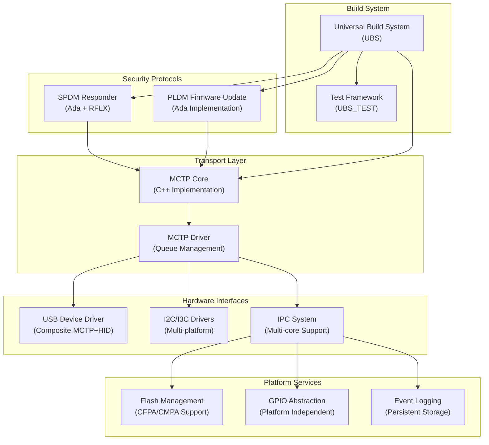
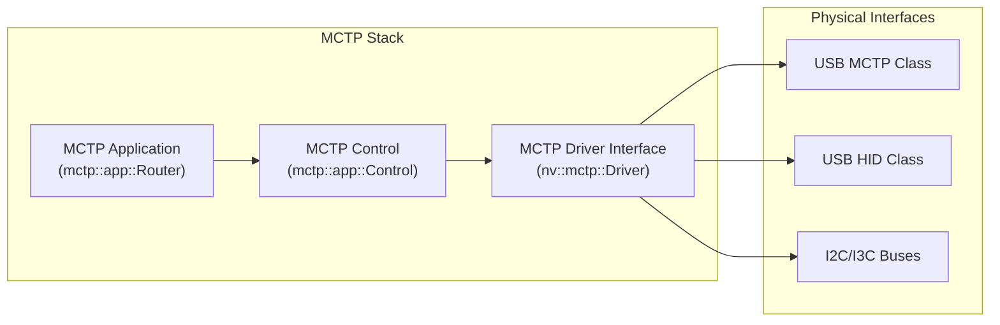

<!-- source: DeepWiki mcp.deepwiki.com · repo NVIDIA/OpenSMA · page 1 OpenSMA Overview · fetched 2026-10-26 -->

# OpenSMA Overview

Relevant source files

The following files were used as context for generating this wiki page:

- [CONTRIBUTING.md](CONTRIBUTING.md)
- [LICENSE](LICENSE)
- [NOTICE](NOTICE)
- [README.md](README.md)

OpenSMA is a secure device management system designed for embedded platforms, specifically targeting NXP MCXN-series microcontrollers. It implements DMTF standards for secure firmware updates and device communication. The system provides a multi-language architecture combining Ada for security-critical protocols, C++ for transport services, and C for hardware drivers, unified by a comprehensive build and test infrastructure.

This document provides a high-level overview of OpenSMA's architecture, key components, and design principles. For detailed information about specific subsystems, see the subsequent sections on Build Infrastructure, Security Protocols, Transport Layers, and Hardware Drivers.

## System Architecture

OpenSMA implements a layered architecture that separates security protocols, transport mechanisms, and platform-specific drivers to ensure portability and security isolation.

### High-Level Architecture

Sources: [README.md:54-61](), [CONTRIBUTING.md:55-59]()

## Core Components

### Security Protocols

OpenSMA implements two key DMTF security standards:

| Protocol | Implementation Language | Primary Function |
|----------|------------------------|------------------|
| SPDM | Ada with RFLX | Device authentication, measurement, and session establishment |
| PLDM | Ada | Secure firmware updates and device monitoring |

The SPDM implementation leverages the RFLX framework for type-safe message parsing, while PLDM handles the firmware update state machine.

### Transport Layer

The MCTP (Management Component Transport Protocol) provides the transport foundation for security protocols across various physical media including USB, I2C, and I3C.

Sources: [README.md:39-41]()

### Multi-Language Integration

OpenSMA's architecture demonstrates sophisticated multi-language integration to balance safety and performance:

- **Ada**: Used for security protocols (`SPDM`, `PLDM`) to leverage high-assurance properties.
- **C++**: Used for the transport layer (`MCTP`) and hardware abstraction layers.
- **C**: Used for low-level platform interfaces, SDK integration, and legacy drivers.

The Universal Build System (UBS) orchestrates compilation across these languages, ensuring consistent toolchain application.

## Licensing and Contributions

### Licensing

OpenSMA is primarily licensed under the **Apache License, Version 2.0**. Portions of the repository may include code under BSD-3 licenses from partners like NXP or AdaCore.

- **Main License**: Apache-2.0 [LICENSE:6-7]()
- **Copyright**: Copyright (c) 2025 NVIDIA CORPORATION & AFFILIATES [NOTICE:3-3]()

### Contribution Guidelines

OpenSMA currently maintains a restricted contribution model:
- **External Contributions**: The project is not currently accepting external code contributions or Pull Requests [CONTRIBUTING.md:3-3]().
- **Issue Reporting**: Bug reports and feature requests are welcome via GitHub Issues [CONTRIBUTING.md:8-8]().
- **DCO**: All internal commits must follow the Developer Certificate of Origin (DCO) and be signed off with `git commit -s` [CONTRIBUTING.md:21-27]().
- **Security**: Vulnerabilities should be reported via GitHub's "Report a vulnerability" feature rather than public issues [CONTRIBUTING.md:68-69]().

## Build and Environment

The system requires a Linux environment (Ubuntu 24.04 recommended) and a specific toolchain setup:

| Component | Version/Link |
|-----------|--------------|
| GCC Arm Toolchain | 14.2.rel1 [README.md:30-31]() |
| GCC Arm Toolchain (Legacy) | 10.3-2021.10 [README.md:32-33]() |
| GNAT Ada Toolchain | 14.2.1 (via Alire) [README.md:34-36]() |
| NXP SDK | MCXN556S v25.09.00 [README.md:39-41]() |

The project uses a Makefile-based build system triggered via the `mcu_build.sh` script, which supports both local builds and Docker-based containerized builds [README.md:58-71]().

Sources: [README.md:5-27](), [README.md:29-41](), [CONTRIBUTING.md:1-66]()

---

