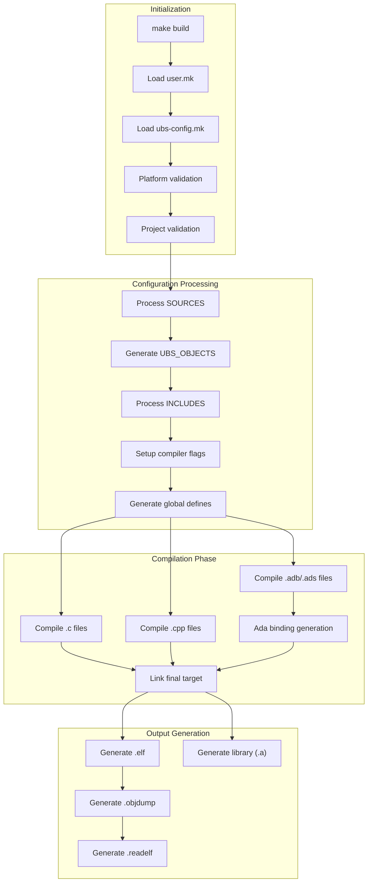
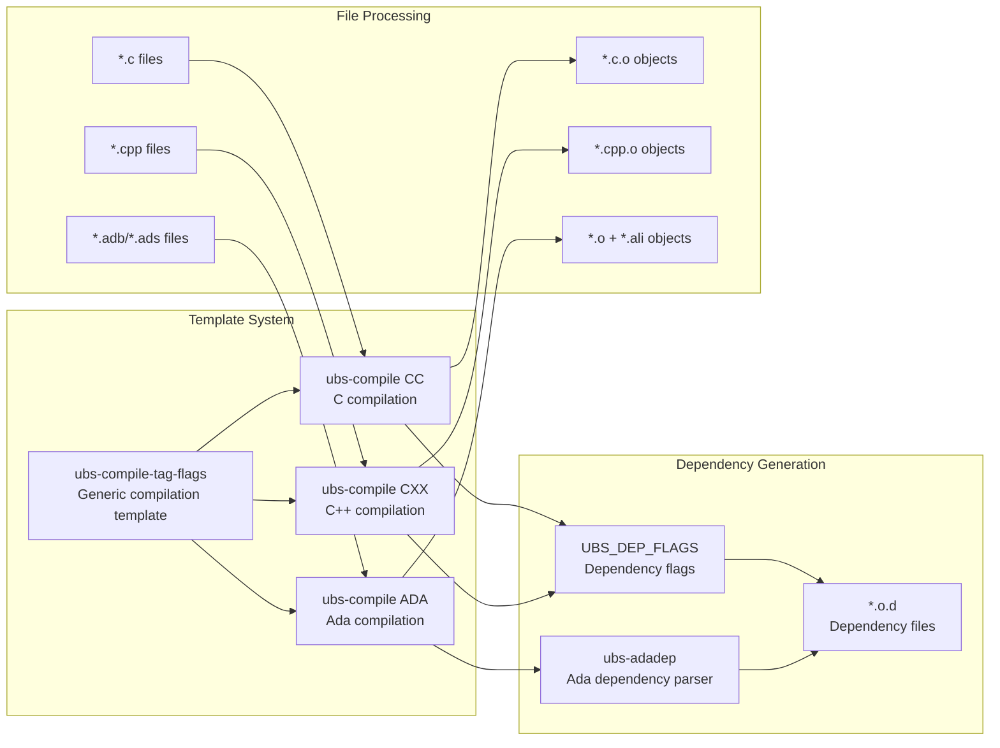
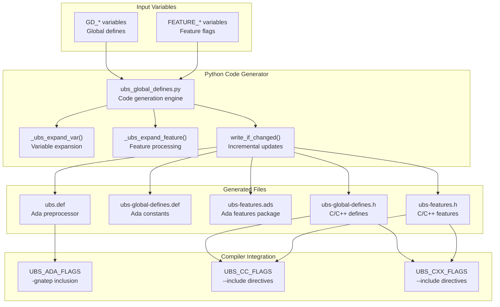
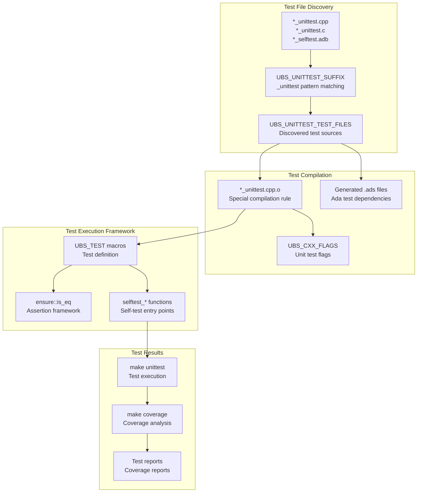
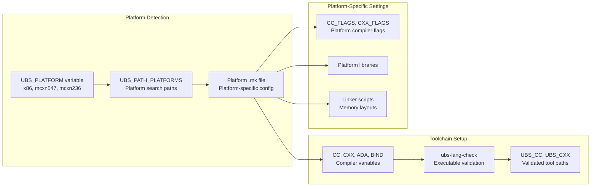
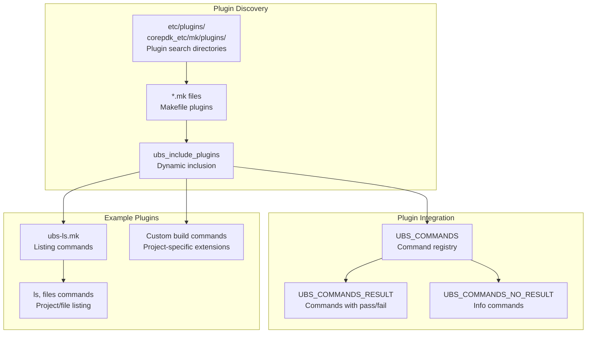
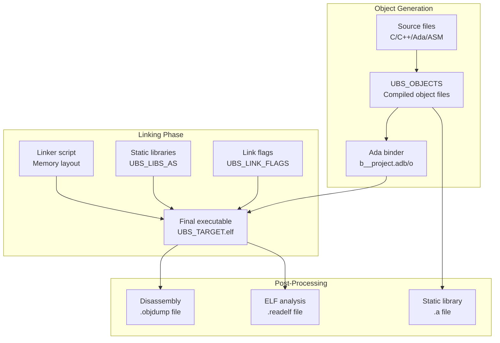

<!-- source: DeepWiki mcp.deepwiki.com · repo NVIDIA/OpenSMA · page 2 Build and Test Infrastructure · fetched 2026-10-26 -->

# Build and Test Infrastructure

<details>
<summary>Relevant source files</summary>

The following files were used as context for generating this wiki page:

- [.gitlab-ci.yml](.gitlab-ci.yml)
- [README.md](README.md)

</details>


This document covers the Universal Build System (UBS) and comprehensive testing framework that enables multi-language development across C, C++, and Ada in the OpenSMA project. UBS provides a makefile-based build orchestration system with platform abstraction, plugin architecture, and integrated testing capabilities.

For information about the specific testing implementations within individual modules, see [Self-Tests and Validation](#2.3). For details about the UBS build system mechanics, see [UBS Build System](#2.1). For the testing framework and assertion mechanisms, see [Testing Framework](#2.2).

## UBS Architecture Overview

The Universal Build System is structured as a modular makefile-based system that orchestrates compilation, linking, testing, and static analysis across multiple programming languages and target platforms.

### Core UBS Components

```mermaid
graph TB
    subgraph "UBS Entry Points"
        UBSMAIN["ubs-main.mk<br/>Main orchestration"]
        UBSMK["ubs.mk<br/>User interface"]
    end
    
    subgraph "Configuration Layer"
        UBSCONFIG["ubs-config.mk<br/>Base configuration"]
        UBSPROJECT["ubs-project.mk<br/>Project settings"] 
        UBSPLATFORM["ubs-platform.mk<br/>Platform support"]
        UBSPOSTCONFIG["ubs-post-config.mk<br/>Final processing"]
    end
    
    subgraph "Build Engine"
        UBSRULES["ubs-rules.mk<br/>Compilation rules"]
        UBSUTILS["ubs-utils.mk<br/>Helper functions"]
        UBSPRINTER["ubs-printer.mk<br/>Console output"]
    end
    
    subgraph "Extension Systems"
        UBSPLUGIN["ubs-plugin.mk<br/>Plugin loader"]
        UBSREQ["ubs-requirements.mk<br/>Tool validation"]
        UBSCLEAN["ubs-clean.mk<br/>Cleanup rules"]
    end
    
    subgraph "Testing & Analysis"
        UBSUNITTEST["ubs-unittest.mk<br/>Test execution"]
        UBSCOVERAGE["ubs-coverage.mk<br/>Coverage analysis"]
        UBSSTATICANALYSIS["ubs-static-analysis.mk<br/>Code analysis"]
    end
    
    UBSMAIN --> UBSCONFIG
    UBSMAIN --> UBSUTILS
    UBSMAIN --> UBSPRINTER
    UBSMAIN --> UBSPLUGIN
    UBSMAIN --> UBSREQ
    UBSMAIN --> UBSCLEAN
    UBSMAIN --> UBSPLATFORM
    UBSMAIN --> UBSPROJECT
    UBSMAIN --> UBSUNITTEST
    UBSMAIN --> UBSCOVERAGE
    UBSMAIN --> UBSSTATICANALYSIS
    UBSMAIN --> UBSPOSTCONFIG
    UBSMAIN --> UBSRULES
    
    UBSMK --> UBSMAIN
```



**Sources:** [corepdk/ubs/src/ubs/ubs-main.mk:18-35](), [corepdk/ubs/src/ubs/ubs.mk:19]()

### Build Process Flow



**Sources:** [corepdk/ubs/src/ubs/ubs-rules.mk:18](), [corepdk/ubs/src/ubs/ubs-post-config.mk:21-98]()

## Multi-Language Compilation Support

UBS provides unified compilation rules for C, C++, and Ada with automatic dependency management and cross-language integration.

### Language-Specific Build Rules

| Language | Source Extension | Object Pattern | Compiler Variable | Flags Variable |
|----------|------------------|----------------|-------------------|----------------|
| C | `.c` | `%.c.o` | `UBS_CC` | `UBS_CC_FLAGS` |
| C++ | `.cpp` | `%.cpp.o` | `UBS_CXX` | `UBS_CXX_FLAGS` |
| Ada Body | `.adb` | `%.o` + `%.ali` | `UBS_ADA` | `UBS_ADA_FLAGS` |
| Ada Spec | `.ads` | `%.o` + `%.ali` | `UBS_ADA` | `UBS_ADA_FLAGS` |
| Assembly | `.S` | `%.S.o` | `UBS_CC` | `UBS_CC_FLAGS` |

**Sources:** [corepdk/ubs/src/ubs/ubs-rules.mk:69-89]()

### Compilation Rule Implementation

The build system uses template-based compilation rules with automatic dependency generation:



**Sources:** [corepdk/ubs/src/ubs/ubs-rules.mk:37-57](), [corepdk/ubs/src/ubs/ubs-rules.mk:77-89]()

## Global Defines and Code Generation

UBS implements a sophisticated code generation system that creates language-specific constant definitions from makefile variables.

### Global Defines System Architecture



**Sources:** [corepdk/ubs/src/ubs/ubs_global_defines.py:79-170](), [corepdk/ubs/src/ubs/ubs-post-config.mk:94-98]()

### Feature Flag Generation Example

The system automatically generates language-appropriate feature flag definitions:

| Input Makefile Variable | Ada Output | C Output | C++ Output |
|-------------------------|------------|-----------|-------------|
| `FEATURE_USB := 1` | `Ubs.Features.USB : constant boolean := True;` | `#define UBS_FEATURES_USB 1` | `constexpr auto USB = 1;` |
| `FEATURE_LOGGING := 0` | `Ubs.Features.LOGGING : constant boolean := False;` | `#define UBS_FEATURES_LOGGING 0` | `constexpr auto LOGGING = 0;` |

**Sources:** [corepdk/ubs/src/ubs/ubs_global_defines.py:114-160]()

## Testing Framework Integration

UBS provides integrated unit testing capabilities with multi-language support and assertion frameworks.

### Test Discovery and Execution



**Sources:** [corepdk/ubs/src/ubs/ubs-rules.mk:62-67](), [corepdk/ubs/src/ubs/ubs-unittest.mk]()

## Platform Abstraction Layer

UBS supports multiple target platforms through a plugin-based platform abstraction system.

### Platform Configuration Structure



**Sources:** [corepdk/ubs/src/ubs/ubs-platform.mk:18-32](), [corepdk/ubs/src/ubs/ubs-config.mk:35-38]()

### Supported Language Toolchains

The platform layer validates and configures toolchains for all supported languages:

| Language | Variable | Validation Function | Purpose |
|----------|----------|-------------------|---------|
| C | `CC` | `ubs-lang-check` | C compiler (gcc, clang) |
| C++ | `CXX` | `ubs-lang-check` | C++ compiler (g++, clang++) |
| Ada | `ADA` | `ubs-lang-check` | Ada compiler (gnat) |
| Binding | `BIND` | `ubs-lang-check` | Ada binder (gnatbind) |
| Preprocessor | `CPP` | `ubs-lang-check` | C preprocessor |
| Linker | `LD` | `ubs-lang-check` | Linker (ld, gold) |
| Final Link | `LINK` | `ubs-lang-check` | Final linking tool |

**Sources:** [corepdk/ubs/src/ubs/ubs-platform.mk:20-31]()

## Plugin System Architecture

UBS implements an extensible plugin system that allows projects to add custom build commands and functionality.

### Plugin Loading Mechanism



**Sources:** [corepdk/ubs/src/ubs/ubs-plugin.mk:18-38](), [corepdk/ubs/src/selftests/projects/x86-ada/etc/plugins/ubs-ls.mk:18-34]()

## Build Artifacts and Output Structure

UBS organizes build outputs in a structured directory hierarchy with support for multiple configurations.

### Output Directory Structure

| Path Pattern | Purpose | Contents |
|--------------|---------|----------|
| `build/{PROJECT}-{PLATFORM}-{MODE}/` | Root build directory | All build artifacts |
| `build/{PROJECT}-{PLATFORM}-{MODE}/obj/` | Object files | `.o`, `.ali`, `.d` files |
| `build/{PROJECT}-{PLATFORM}-{MODE}/gen/` | Generated code | Auto-generated sources |
| `build/{PROJECT}-{PLATFORM}-{MODE}/reports/` | Analysis reports | Coverage, static analysis |
| `build/{PROJECT}-{PLATFORM}-{MODE}/libs/` | Library outputs | `.a` library files |

**Sources:** [corepdk/ubs/src/ubs/ubs-config.mk:44-49]()

### Target Generation Process



**Sources:** [corepdk/ubs/src/ubs/ubs-rules.mk:24-35](), [corepdk/ubs/src/ubs/ubs-rules.mk:104-111]()

## CI/CD Pipeline

The project utilizes GitLab CI for automated build and test verification. The pipeline is defined to trigger on merge requests, main branch updates, and tags.

### Pipeline Configuration

The `.gitlab-ci.yml` file defines a build matrix for key projects and platforms:

| Project | Platform | Board | Mode |
|---------|----------|-------|------|
| `mcxn547helloworld` | `mcxn556-both` | `mcxn547helloworld` | `rel` |
| `p3957_cxx` | `mcxn556-core0` | `p3957_cxx` | `rel` |

**Sources:** [.gitlab-ci.yml:18-27]()

### Environment and Tooling

The CI environment is provisioned via a Docker image `${CI_REGISTRY_IMAGE}/env:latest`. It includes:
- **Toolchains**: Arm GNU Toolchain (14.2.rel1), GNAT for ARM (14.2.1), and legacy GCC ARM (10.3).
- **SDKs**: NXP MCXN556S SDK (25.09.00), patched during the `before_script` phase.
- **Python Dependencies**: `spsdk` (3.4.0) for firmware signing and manipulation.

**Sources:** [.gitlab-ci.yml:32-51](), [README.md:30-45]()

### Build Orchestration

The `mcu_build.sh` script serves as the primary entry point for both CI and local builds, wrapping the UBS `make` calls with appropriate project and board parameters.

```bash
./mcu_build.sh PROJECT=${PROJECT} BOARD=${BOARD} PLATFORM=${PLATFORM} MODE=${MODE} RUN_LOCAL=1 BUILD_ONLY=1
```

**Sources:** [.gitlab-ci.yml:56](), [README.md:59]()

---

