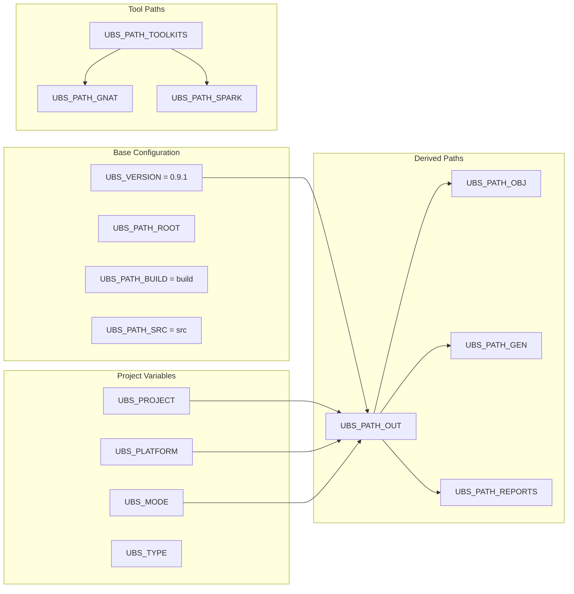
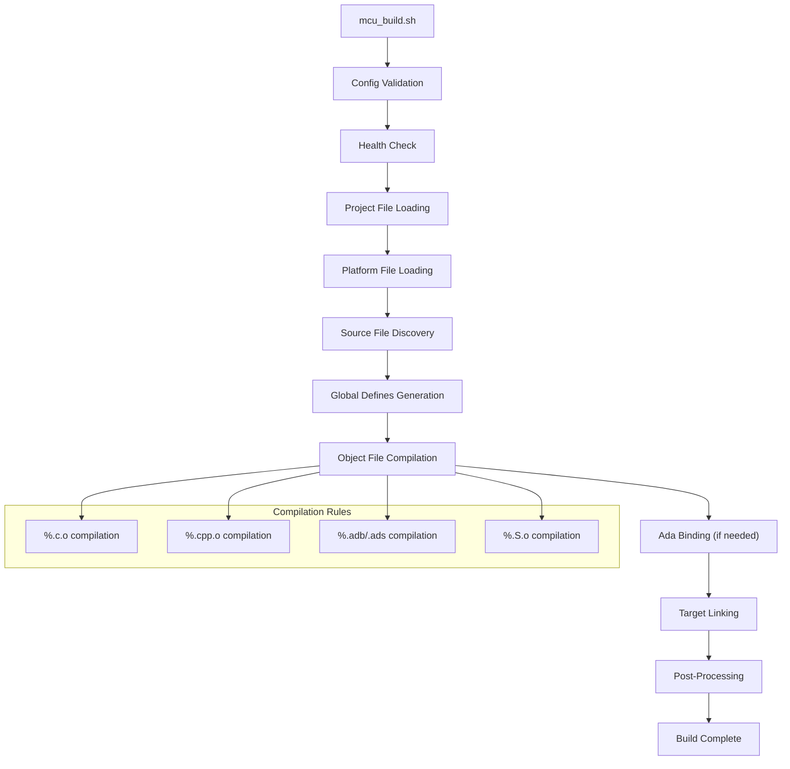
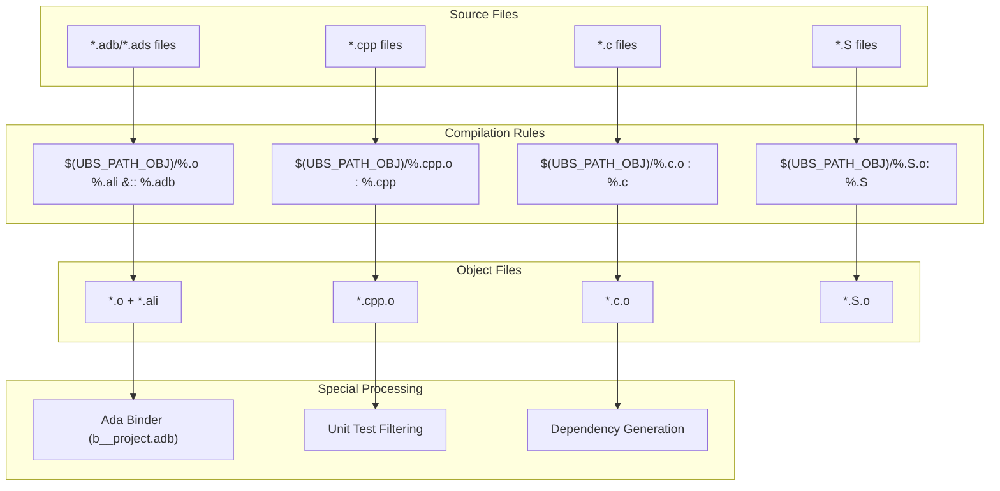
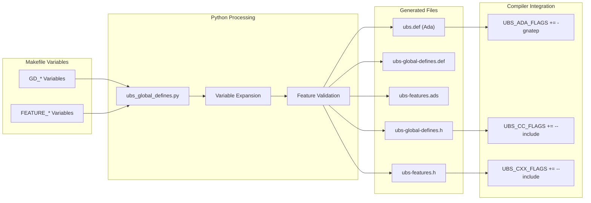
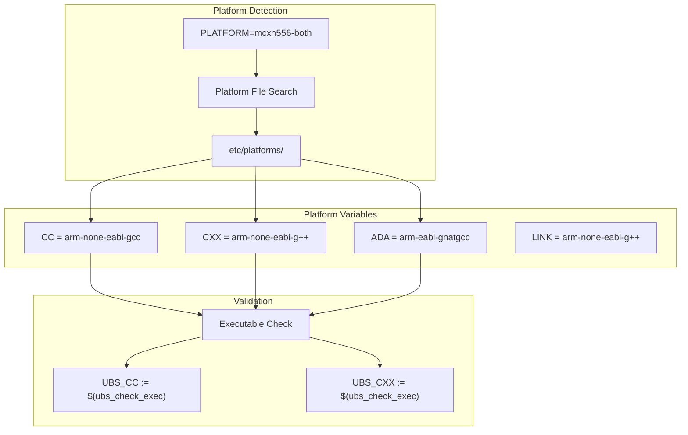
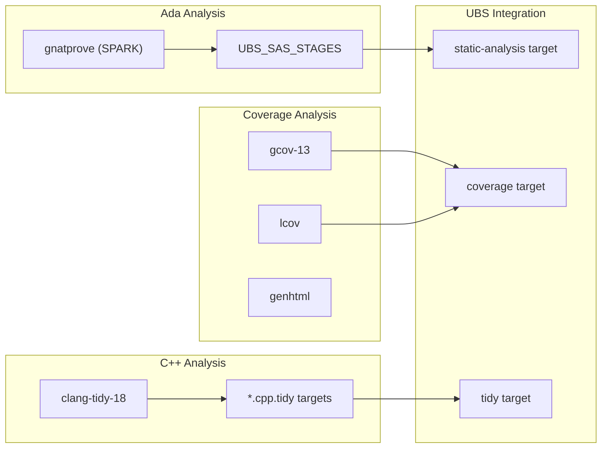

<!-- source: DeepWiki mcp.deepwiki.com · repo NVIDIA/OpenSMA · page 2.1 UBS Build System · fetched 2026-10-26 -->

# UBS Build System

Relevant source files

The following files were used as context for generating this wiki page:

- [.gitlab-ci.yml](.gitlab-ci.yml)
- [README.md](README.md)

The Universal Build System (UBS) is a comprehensive Makefile-based build infrastructure that provides multi-language compilation support, platform abstraction, and an extensible plugin architecture. UBS orchestrates the build process for C, C++, and Ada source files across multiple target platforms while providing integrated testing, static analysis, and code generation capabilities.

For information about the testing framework that integrates with UBS, see [Testing Framework](2.2). For details on self-tests and validation procedures, see [Self-Tests and Validation](2.3).

## Architecture Overview

UBS follows a modular architecture where the main orchestrator includes specialized components for different aspects of the build process.

### Core Component Structure

```mermaid
graph TB
    subgraph "Entry Points"
        UBS_MK["ubs.mk"]
        UBS_MAIN["ubs-main.mk"]
        USER_MK["user.mk"]
    end
    
    subgraph "Configuration Layer"
        UBS_CONFIG["ubs-config.mk"]
        UBS_PROJECT["ubs-project.mk"] 
        UBS_PLATFORM["ubs-platform.mk"]
        UBS_POST_CONFIG["ubs-post-config.mk"]
    end
    
    subgraph "Utility Layer"
        UBS_UTILS["ubs-utils.mk"]
        UBS_PRINTER["ubs-printer.mk"]
        UBS_PLUGIN["ubs-plugin.mk"]
        UBS_REQUIREMENTS["ubs-requirements.mk"]
    end
    
    subgraph "Build Layer"
        UBS_RULES["ubs-rules.mk"]
        UBS_CLEAN["ubs-clean.mk"]
        UBS_HELP["ubs-help.mk"]
    end
    
    subgraph "Testing Layer"
        UBS_UNITTEST["ubs-unittest.mk"]
        UBS_UNITPROVE["ubs-unitprove.mk"]
        UBS_COVERAGE["ubs-coverage.mk"]
        UBS_STATIC_ANALYSIS["ubs-static-analysis.mk"]
    end
    
    subgraph "Code Generation"
        UBS_GLOBAL_DEFINES_PY["ubs_global_defines.py"]
        UBS_GPR_PROJECT["ubs_gprproject"]
        UBS_LINKER_AUTOGEN["ubs_linker_autogen"]
    end
    
    UBS_MK --> UBS_MAIN
    UBS_MAIN --> USER_MK
    UBS_MAIN --> UBS_CONFIG
    UBS_MAIN --> UBS_UTILS
    UBS_MAIN --> UBS_PRINTER
    UBS_MAIN --> UBS_PLUGIN
    UBS_MAIN --> UBS_REQUIREMENTS
    UBS_MAIN --> UBS_CLEAN
    UBS_MAIN --> UBS_HELP
    UBS_MAIN --> UBS_PLATFORM
    UBS_MAIN --> UBS_PROJECT
    UBS_MAIN --> UBS_UNITTEST
    UBS_MAIN --> UBS_UNITPROVE
    UBS_MAIN --> UBS_COVERAGE
    UBS_MAIN --> UBS_STATIC_ANALYSIS
    UBS_MAIN --> UBS_POST_CONFIG
    UBS_MAIN --> UBS_RULES
    UBS_MAIN --> UBS_GLOBAL_DEFINES_PY
    UBS_MAIN --> UBS_GPR_PROJECT
```

Sources: [corepdk/ubs/src/ubs/ubs-main.mk:18-36](), [corepdk/ubs/src/ubs/ubs.mk:19]()

### Configuration System

UBS uses a layered configuration approach where base settings are established first, then specialized for projects and platforms.

Sources: [corepdk/ubs/src/ubs/ubs-config.mk:21-51](), [corepdk/ubs/src/ubs/ubs-config.mk:56-60]()

## Environment and Toolchain

The build system requires a specific environment (Ubuntu 24.04) and set of toolchains to function correctly. These are typically managed via `libexec/toolchain/` and `libexec/sdk/` directories.

### Toolchain Configuration
The build environment is prepared by linking toolchains and SDKs into the `libexec/` directory. Key toolchains include:
* **ARM GNU Toolchain**: `arm-gnu-toolchain-14.2.rel1-x86_64-arm-none-eabi` [.gitlab-ci.yml:38-38]()
* **GNAT for ARM**: `gnat_arm_elf_14.2.1_524d4d41` [.gitlab-ci.yml:39-39]()
* **NXP SDK**: `SDK_25_09_00_MCXN556S` [.gitlab-ci.yml:43-43]()

### CI/CD Integration
UBS is integrated into GitLab CI, using a build matrix to compile multiple project configurations in parallel.

| Project | Platform | Board | Mode |
| :--- | :--- | :--- | :--- |
| `mcxn547helloworld` | `mcxn556-both` | `mcxn547helloworld` | `rel` |
| `p3957_cxx` | `mcxn556-core0` | `p3957_cxx` | `rel` |

Sources: [.gitlab-ci.yml:18-27](), [.gitlab-ci.yml:63-64]()

## Build Process Flow

The UBS build process follows a structured sequence from configuration validation through final target generation.

### Build Orchestration

Sources: [corepdk/ubs/src/ubs/ubs-rules.mk:18](), [corepdk/ubs/src/ubs/ubs-rules.mk:24-35](), [mcu_build.sh:56-56]()

### Multi-Language Compilation Pipeline

UBS supports three primary languages with specialized handling for each:

| Language | File Extensions | Compiler Variable | Flags Variable | Special Processing |
|----------|----------------|------------------|----------------|--------------------|
| C | `.c` | `UBS_CC` | `UBS_CC_FLAGS` | Standard compilation |
| C++ | `.cpp` | `UBS_CXX` | `UBS_CXX_FLAGS` | C++23 standard, clang-tidy |
| Ada | `.adb`, `.ads` | `UBS_ADA` | `UBS_ADA_FLAGS` | Binding, ALI dependency tracking |
| Assembly | `.S` | `UBS_CC` | `UBS_CC_FLAGS` | Preprocessor support |

Sources: [corepdk/ubs/src/ubs/ubs-rules.mk:70-89](), [corepdk/ubs/src/ubs/ubs-rules.mk:91-101]()

## Global Defines and Feature System

UBS provides a sophisticated global defines system that generates code for all supported languages from makefile variables.

### Global Defines Processing

The Python-based global defines system (`ubs_global_defines.py`) processes makefile variables and generates appropriate header files and Ada packages:

Sources: [corepdk/ubs/src/ubs/ubs_global_defines.py:79-170](), [corepdk/ubs/src/ubs/ubs-post-config.mk:94-97]()

## Platform and Project System

UBS uses configuration files to define platform-specific toolchains and project-specific source lists and build settings.

### Platform Configuration

Platform files define toolchain executables and platform-specific flags. The `mcu_build.sh` script passes these parameters to the makefile.

Sources: [corepdk/ubs/src/ubs/ubs-platform.mk:18-31](), [.gitlab-ci.yml:56-56](), [README.md:59-59]()

## Static Analysis Integration

UBS integrates multiple static analysis tools with unified command interfaces, including `clang-tidy-18` for C++ code.

### Analysis Tool Chain

Sources: [corepdk/ubs/src/ubs/ubs-rules.mk:126-139](), [corepdk/ubs/src/ubs/ubs-requirements.mk:39-50](), [README.md:12-13]()

---

