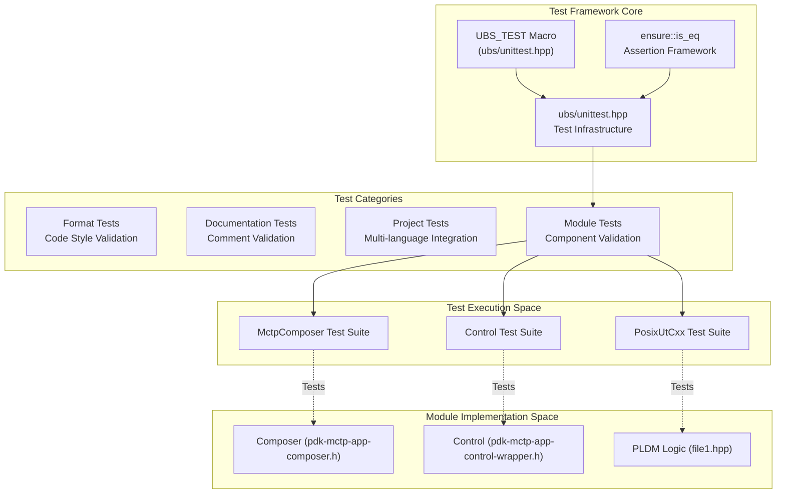
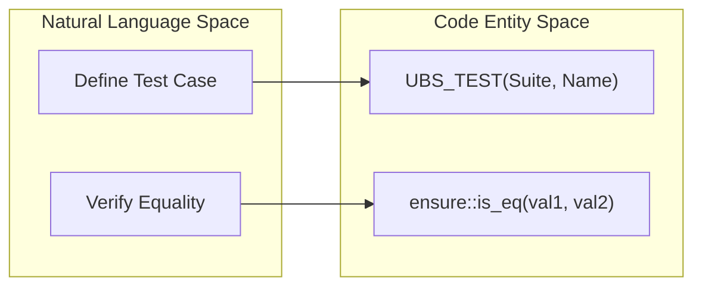
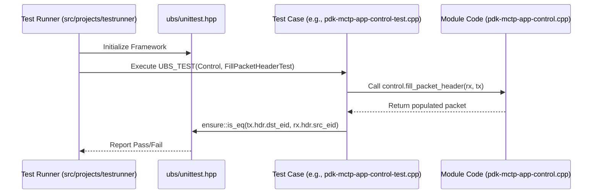

<!-- source: DeepWiki mcp.deepwiki.com · repo NVIDIA/OpenSMA · page 2.2 Testing Framework · fetched 2026-10-26 -->

# Testing Framework

Relevant source files

The following files were used as context for generating this wiki page:

- [corepdk/modules/mctp-cpp/src/app/pdk-mctp-app-composer-test.cpp](corepdk/modules/mctp-cpp/src/app/pdk-mctp-app-composer-test.cpp)
- [corepdk/modules/mctp-cpp/src/app/pdk-mctp-app-control-test.cpp](corepdk/modules/mctp-cpp/src/app/pdk-mctp-app-control-test.cpp)
- [corepdk/modules/mctp-cpp/src/file1-test.cpp](corepdk/modules/mctp-cpp/src/file1-test.cpp)
- [corepdk/modules/pldm-fd/src/file1-test.cpp](corepdk/modules/pldm-fd/src/file1-test.cpp)

## Purpose and Scope

The Testing Framework provides a comprehensive unit testing infrastructure for OpenSMA that supports multi-language development across C, C++, and Ada components. The framework is built on top of the Universal Build System (UBS) and provides standardized test macros, assertion mechanisms, and self-test validation capabilities.

This document covers the core testing infrastructure, the `UBS_TEST` macro system, the assertion framework, and the implementation of module-specific tests.

## Test Framework Architecture

The testing framework is organized around several key components that work together to provide comprehensive test coverage. Tests are typically located alongside the source code in `*-test.cpp` files.

Sources: [corepdk/modules/mctp-cpp/src/app/pdk-mctp-app-composer-test.cpp:23-26](), [corepdk/modules/mctp-cpp/src/app/pdk-mctp-app-control-test.cpp:25-27](), [corepdk/modules/pldm-fd/src/file1-test.cpp:18-21]()

## Test Macro System

### UBS_TEST Macro

The `UBS_TEST` macro is the entry point for defining a unit test. It registers the test case within a specific suite.

| Component | Description | Example |
|-----------|-------------|---------|
| **Test Suite** | Logical grouping of related tests | `MctpComposer`, `Control`, `PosixUtCxx` |
| **Test Name** | Specific identifier for the test case | `ConstructMctpHeader`, `UpdateEidTest`, `FuncTest` |

### Implementation Pattern

The standard pattern involves including `ubs/unittest.hpp` and using the `ubs::unittest` namespace.

Sources: [corepdk/modules/mctp-cpp/src/app/pdk-mctp-app-composer-test.cpp:176](), [corepdk/modules/mctp-cpp/src/app/pdk-mctp-app-control-test.cpp:29](), [corepdk/modules/mctp-cpp/src/file1-test.cpp:23]()

## Assertion Framework

### ensure::is_eq Function

The `ensure::is_eq` function is the primary assertion tool. It is used to validate that the actual output of a function matches the expected value. If the assertion fails, the test runner marks the test as failed.

### Complex Validation Example: MCTP Composer

In complex modules like MCTP, the assertion framework is used within helper functions to validate packet structures:

| Function | File | Logic |
|----------|------|-------|
| `compare_two_packet_hdr` | [corepdk/modules/mctp-cpp/src/app/pdk-mctp-app-composer-test.cpp:31-42]() | Uses `ensure::is_eq` to check `hdr_ver`, `dst_eid`, `src_eid`, and `msg_tag`. |
| `test_gen_multi_packet` | [corepdk/modules/mctp-cpp/src/app/pdk-mctp-app-composer-test.cpp:45-100]() | Validates sequence numbers (`pkt_seq`), start-of-message (`som`), and end-of-message (`eom`) flags. |

Sources: [corepdk/modules/mctp-cpp/src/app/pdk-mctp-app-composer-test.cpp:33-41](), [corepdk/modules/mctp-cpp/src/app/pdk-mctp-app-composer-test.cpp:78-82]()

## Module-Specific Testing

### MCTP Control Tests
The `Control` test suite validates the MCTP control message handling, including header filling and error packet generation.

*   **Header Filling**: `UBS_TEST(Control, FillPacketHeaderTest)` verifies that the `src_eid` and `dst_eid` are correctly swapped and assigned during response generation [corepdk/modules/mctp-cpp/src/app/pdk-mctp-app-control-test.cpp:38-84]().
*   **Error Handling**: `UBS_TEST(Control, FillErrorPacketTest)` ensures that completion codes like `Ccode::ErrorGeneral` are correctly placed in the response [corepdk/modules/mctp-cpp/src/app/pdk-mctp-app-control-test.cpp:105-123]().

### PLDM and Generic Module Tests
Modules like `pldm-fd` use the framework to validate core logic through the `PosixUtCxx` suite.

*   **Basic Validation**: Tests like `UBS_TEST(PosixUtCxx, FuncTest)` verify simple function returns using the `selftest_cxx_only` namespace [corepdk/modules/pldm-fd/src/file1-test.cpp:23-26]().

## Test Runner Project

The `testrunner` project (located in `src/projects/testrunner`) serves as the execution environment for these tests. It aggregates the various `*-test.cpp` files across the repository into a single executable that can be run on x86 or simulated environments to validate the codebase before deployment to hardware.

### Data Flow in Test Execution

Sources: [corepdk/modules/mctp-cpp/src/app/pdk-mctp-app-control-test.cpp:38-84](), [corepdk/modules/mctp-cpp/src/app/pdk-mctp-app-composer-test.cpp:23-25]()

---

