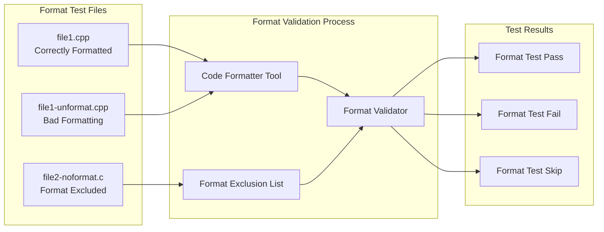
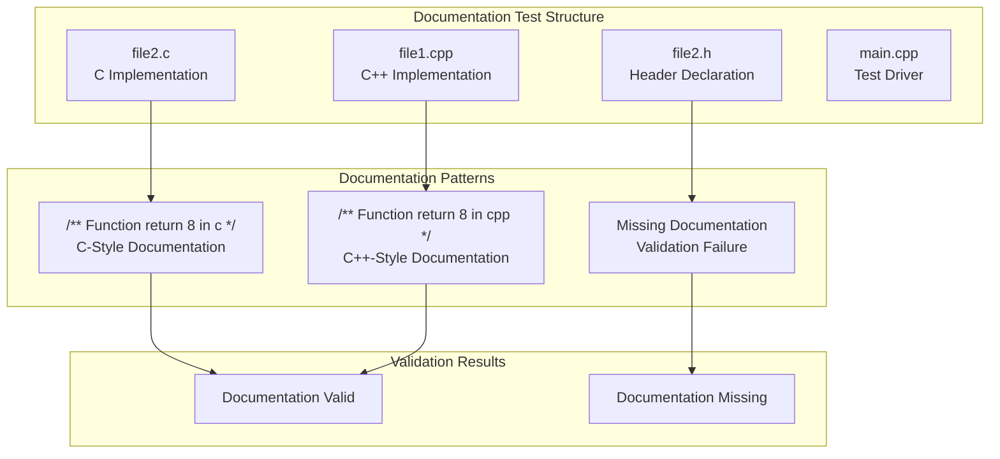
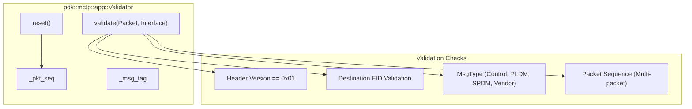
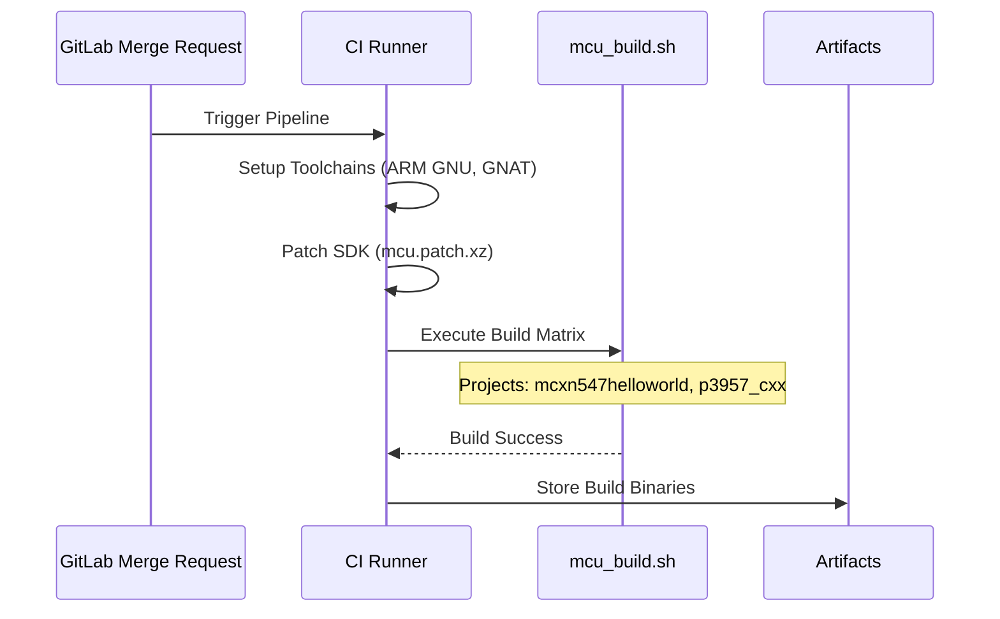

<!-- source: DeepWiki mcp.deepwiki.com · repo NVIDIA/OpenSMA · page 2.3 Self-Tests and Validation · fetched 2026-10-26 -->

# Self-Tests and Validation

<details>
<summary>Relevant source files</summary>

The following files were used as context for generating this wiki page:

- [.gitlab-ci.yml](.gitlab-ci.yml)
- [corepdk/modules/mctp-cpp/src/app/pdk-mctp-app-validator-test.cpp](corepdk/modules/mctp-cpp/src/app/pdk-mctp-app-validator-test.cpp)
- [corepdk/modules/mctp-cpp/src/app/pdk-mctp-app-validator.cpp](corepdk/modules/mctp-cpp/src/app/pdk-mctp-app-validator.cpp)
- [corepdk/modules/mctp-cpp/src/app/pdk-mctp-app-validator.h](corepdk/modules/mctp-cpp/src/app/pdk-mctp-app-validator.h)

</details>


## Purpose and Scope

The self-tests and validation system provides comprehensive testing capabilities across OpenSMA's multi-language codebase, ensuring code quality, proper formatting, documentation compliance, and cross-language integration. This system validates C, C++, and Ada components working together through the Universal Build System (UBS).

For information about the underlying UBS build infrastructure, see [UBS Build System](#2.1). For details about the testing framework macros and assertion mechanisms, see [Testing Framework](#2.2).

## Test Categories Overview

The self-test system is organized into three primary categories that validate different aspects of the codebase:

```mermaid
graph TB
    subgraph "Self-Test Categories"
        FORMAT["Format Tests<br/>Code Style Validation"]
        CDOC["Documentation Tests<br/>Comment Requirements"] 
        PROJECTS["Multi-Language Projects<br/>Integration Testing"]
        UNIT["Unit Tests<br/>Module Logic Validation"]
    end
    
    subgraph "Format Test Types"
        FORMATTED["Properly Formatted Files<br/>Reference Standard"]
        UNFORMATTED["Unformatted Files<br/>Style Violations"]
        NOFORMAT["No-Format Files<br/>Formatting Exclusions"]
    end
    
    subgraph "Documentation Validation"
        CCOMMENTS["C Documentation<br/>Function Comments"]
        CPPCOMMENTS["C++ Documentation<br/>Namespace Comments"]
        MISSING["Missing Documentation<br/>Validation Failures"]
    end
    
    subgraph "Language Integration"
        CONLY["C-Only Projects<br/>x86-ut-c"]
        CPPONLY["C++-Only Projects<br/>x86-ut-cpp"]
        MIXED["Mixed Language<br/>x86-ut-c-cpp-ada"]
    end

    subgraph "Unit Test Suites"
        MCTP_VAL["MCTP Validator Tests<br/>pdk-mctp-app-validator-test.cpp"]
    end
    
    FORMAT --> FORMATTED
    FORMAT --> UNFORMATTED
    FORMAT --> NOFORMAT
    
    CDOC --> CCOMMENTS
    CDOC --> CPPCOMMENTS
    CDOC --> MISSING
    
    PROJECTS --> CONLY
    PROJECTS --> CPPONLY
    PROJECTS --> MIXED

    UNIT --> MCTP_VAL
```



Sources: [corepdk/ubs/src/selftests/format/](), [corepdk/ubs/src/selftests/cdoc/](), [corepdk/ubs/src/selftests/projects/](), [corepdk/modules/mctp-cpp/src/app/pdk-mctp-app-validator-test.cpp:24-29]()

## Multi-Language Integration Tests

The project-based tests validate different combinations of programming languages working together through the UBS build system:

| Project Name | Languages | Purpose |
|--------------|-----------|---------|
| `x86-ut-c` | C | Pure C compilation and linking |
| `x86-ut-cpp` | C++ | Pure C++ compilation and linking |
| `x86-ut-c-cpp` | C + C++ | C/C++ interoperability |
| `x86-ut-c-ada` | C + Ada | C/Ada interoperability |
| `x86-ut-cpp-ada` | C++ + Ada | C++/Ada interoperability |
| `x86-ut-c-cpp-ada` | C + C++ + Ada | Full multi-language integration |

```mermaid
graph TD
    subgraph "Multi-Language Test Architecture"
        MAIN[main.cpp<br/>Entry Point]
        FILE1["file1.cpp<br/>selftest_cxx_only::func_that_returns_8()"]
        FILE2C["file2.c<br/>func_that_returns_8()"]
        FILE2H["file2.h<br/>C/C++ Compatible Header"]
    end
    
    subgraph "Language Interop Patterns"
        EXTERNC["extern \"C\" {}<br/>C++ to C Interface"]
        NAMESPACE["selftest_cxx_only<br/>C++ Namespace Isolation"]
        PRAGMAONCE["#pragma once<br/>Header Guard Pattern"]
    end
    
    subgraph "Test Function Patterns"
        FUNC8["func_that_returns_8()<br/>Standard Test Function"]
        FUNC7["func_that_returns_7()<br/>Variant Test Function"]
        FUNC9["func_that_returns_9()<br/>Alternative Test Function"]
    end
    
    MAIN --> FILE1
    MAIN --> FILE2C
    FILE2C --> FILE2H
    FILE1 --> NAMESPACE
    FILE2H --> EXTERNC
    FILE2H --> PRAGMAONCE
    
    FILE1 --> FUNC8
    FILE2C --> FUNC8
    FUNC8 --> FUNC7
    FUNC8 --> FUNC9
```

Sources: [corepdk/ubs/src/selftests/projects/x86-ut-c-cpp-ada/src/main.cpp:18-24](), [corepdk/ubs/src/selftests/projects/x86-ut-c-cpp/src/file1.cpp:19-26](), [corepdk/ubs/src/selftests/projects/x86-ut-c-cpp/src/file2.h:18-29]()

## Code Quality Validation Tests

### Format Validation

The format test system ensures consistent code styling across the codebase using deliberately malformed reference files:



The format tests include intentionally malformed files to validate format checking:
- [corepdk/ubs/src/selftests/format/src/file1-unformat.cpp:26]() contains a namespace comment mismatch: `}  // namespace self_test_cxx_only` instead of the correct `selftest_cxx_only`
- [corepdk/ubs/src/selftests/format/src/file2-unformat.c:24-25]() has extra trailing whitespace

Sources: [corepdk/ubs/src/selftests/format/src/file1-unformat.cpp:19-26](), [corepdk/ubs/src/selftests/format/src/file2-noformat.h:18-29](), [corepdk/ubs/src/selftests/format/src/file2-unformat.c:18-25]()

### Documentation Validation

The `cdoc` tests validate documentation comment requirements:



Key documentation patterns:
- [corepdk/ubs/src/selftests/cdoc/src/file2.c:20-23]() shows proper C function documentation: `/** Function return 8 in c */`
- [corepdk/ubs/src/selftests/cdoc/src/file1.cpp:21-23]() shows proper C++ function documentation: `/** Function return 8 in cpp */`

Sources: [corepdk/ubs/src/selftests/cdoc/src/file2.c:18-26](), [corepdk/ubs/src/selftests/cdoc/src/file1.cpp:21-27](), [corepdk/ubs/src/selftests/cdoc/src/main.cpp:18-24]()

## Module Logic Validation

The system employs logic-specific self-tests to validate protocol implementations. A primary example is the MCTP `Validator` class, which ensures that incoming packets adhere to the Management Component Transport Protocol specification.

### MCTP Validator Logic

The `pdk::mctp::app::Validator` class [corepdk/modules/mctp-cpp/src/app/pdk-mctp-app-validator.h:26-38]() maintains state for multi-packet messages and performs header validation.



| Check Type | Code Entity | Logic Description |
|------------|-------------|-------------------|
| Header Version | `ctl.hdr_ver` | Must be `0x01` [corepdk/modules/mctp-cpp/src/app/pdk-mctp-app-validator.cpp:33-36]() |
| EID Validation | `eid_ok` | Checks if `dst_eid` is NULL, Broadcast, or matches local EIDs [corepdk/modules/mctp-cpp/src/app/pdk-mctp-app-validator.cpp:42-50]() |
| Control Packets | `MsgType::Control` | Validates single-packet Request/Response types [corepdk/modules/mctp-cpp/src/app/pdk-mctp-app-validator.cpp:53-65]() |
| Multi-packet | `_pkt_seq` | Tracks and increments 2-bit sequence numbers [corepdk/modules/mctp-cpp/src/app/pdk-mctp-app-validator.cpp:156-174]() |

### Unit Test Implementation

Module unit tests use the `UBS_TEST` macro [corepdk/modules/mctp-cpp/src/app/pdk-mctp-app-validator-test.cpp:29]() to define test cases. The `Validator` tests simulate both valid and invalid scenarios:

*   **Invalid Header Version**: Tests packets where `hdr_ver != 0x01` [corepdk/modules/mctp-cpp/src/app/pdk-mctp-app-validator-test.cpp:35-48]().
*   **Invalid EID**: Tests packets with destination EIDs not present in the routing table [corepdk/modules/mctp-cpp/src/app/pdk-mctp-app-validator-test.cpp:50-63]().
*   **Protocol Start**: Validates `SOM` (Start of Message) handling for PLDM and SPDM [corepdk/modules/mctp-cpp/src/app/pdk-mctp-app-validator-test.cpp:148-174]().

Sources: [corepdk/modules/mctp-cpp/src/app/pdk-mctp-app-validator.cpp:30-186](), [corepdk/modules/mctp-cpp/src/app/pdk-mctp-app-validator-test.cpp:29-174]()

## CI Pipeline Validation

The GitLab CI pipeline automates the validation process, ensuring that every merge request or commit to `main` passes the build and test suites.



The pipeline configuration [ .gitlab-ci.yml:1-65]() defines:
1.  **Toolchain Provisioning**: Symlinks are created for ARM GNU and GNAT toolchains [ .gitlab-ci.yml:37-40]().
2.  **SDK Patching**: The NXP SDK is patched using `xz` and `patch` commands before building [ .gitlab-ci.yml:43-46]().
3.  **Build Matrix**: Parallel jobs build multiple configurations, such as `mcxn547helloworld` on the `mcxn556-both` platform [ .gitlab-ci.yml:18-27]().

Sources: [ .gitlab-ci.yml:1-65]()

## Module-Specific Self-Tests

Core modules integrate their own self-test functions following consistent patterns:

All module self-tests follow identical patterns:
- [corepdk/modules/mctp-cpp/src/file1.cpp:19-26]() defines `selftest_cxx_only::func_that_returns_8()`
- [corepdk/modules/spdm/src/file1.cpp:19-26]() uses the same function signature
- [corepdk/modules/pldm-fd/src/file1.cpp:19-26]() maintains consistency across modules

Sources: [corepdk/modules/mctp-cpp/src/file1.cpp:18-26](), [corepdk/modules/spdm/src/file1.cpp:18-26](), [corepdk/modules/pldm-fd/src/file1.cpp:18-26]()

## Test Organization and Structure

### File Naming Conventions

The self-test system uses consistent naming patterns across all test categories:

| Pattern | Purpose | Example |
|---------|---------|---------|
| `main.cpp` | Test entry points | All project directories |
| `*-test.cpp` | Logic unit tests | `pdk-mctp-app-validator-test.cpp` |
| `file1.cpp` | Primary C++ test files | C++ functionality tests |
| `file2.c` | Primary C test files | C functionality tests |
| `*-unformat.*` | Intentionally malformed code | Format validation failures |

### Test Function Standardization

The self-test system standardizes on specific function return values for validation:

- Functions returning `8`: [corepdk/modules/spdm/src/file1.cpp:21-24](), [corepdk/ubs/src/selftests/projects/x86-ut-c/src/file1.c:20-23]()
- Functions returning `7`: [corepdk/ubs/src/selftests/format/src/file2-unformat.c:20-23](), [corepdk/ubs/src/selftests/projects/x86-ut-cpp/src/file1.cpp:21-24]()
- Functions returning `9`: [corepdk/ubs/src/selftests/format/src/file2-noformat.c:20-23]()

Sources: [corepdk/ubs/src/selftests/projects/x86-ut-c/src/file1.h:18-29](), [corepdk/ubs/src/selftests/format/src/file2-unformat.h:18-29](), [corepdk/ubs/src/selftests/format/src/file2-noformat.h:18-29]()

---

