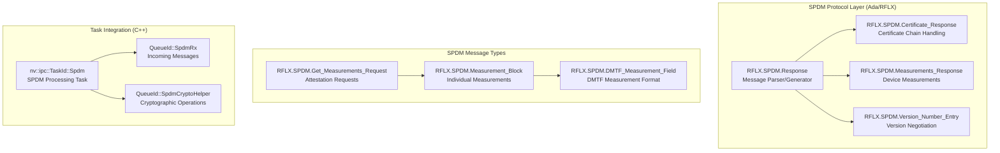
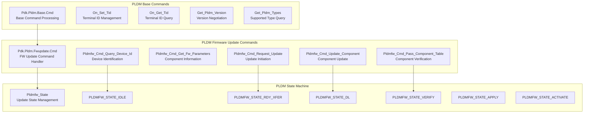
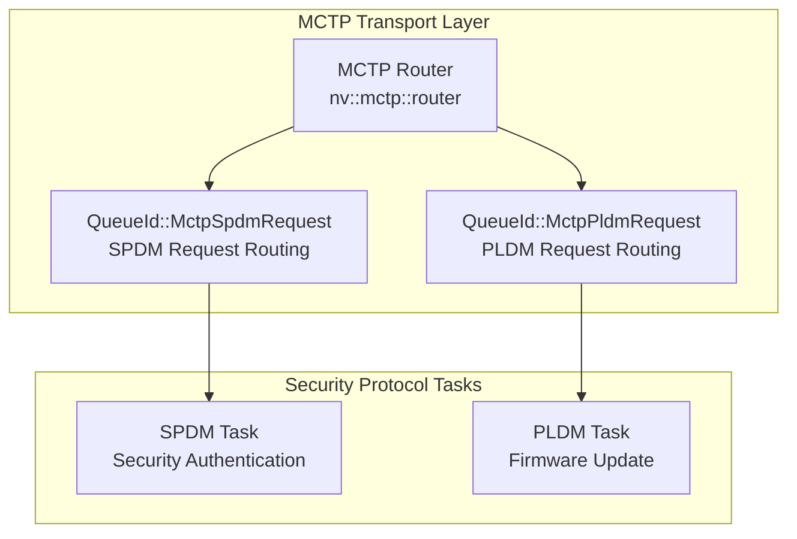

<!-- source: DeepWiki mcp.deepwiki.com · repo NVIDIA/OpenSMA · page 3 Security Protocols · fetched 2026-10-26 -->

# Security Protocols

Relevant source files

The following files were used as context for generating this wiki page:

- [corepdk/modules/pldm-fd/src/pdk-pldm.ads](corepdk/modules/pldm-fd/src/pdk-pldm.ads)
- [corepdk/modules/spdm/src/app/crypto/aead/pdk-spdm-app-res-crypto-aead.h](corepdk/modules/spdm/src/app/crypto/aead/pdk-spdm-app-res-crypto-aead.h)

## Purpose and Scope

This document covers the implementation of DMTF security protocols in OpenSMA, specifically the Security Protocol and Data Model (SPDM) and Platform Level Data Model (PLDM) firmware update protocols. These protocols provide cryptographic authentication, measurement, and secure firmware update capabilities for device management.

For information about the underlying transport layer, see [Transport Layer](#4). For details on hardware drivers and platform integration, see [Hardware Drivers](#5).

## Protocol Overview

OpenSMA implements two primary DMTF security protocols using Ada with SPARK formal verification:

| Protocol | Purpose | Key Features |
|----------|---------|--------------|
| **SPDM** | Device authentication and attestation | Certificate management, measurements, challenge-response authentication |
| **PLDM-FD** | Firmware update | Secure component updates, version management, activation control |

Both protocols operate over MCTP (Management Component Transport Protocol) and support both in-band and out-of-band communication channels.

## SPDM Protocol Implementation

The SPDM implementation provides the foundation for secure device identity and attestation. It is divided between a high-level application layer and a robust cryptographic subsystem.

### SPDM Architecture and Message Processing

The SPDM stack utilizes Record Flux (RFLX) for formal verification of message parsing and generation, ensuring memory safety during protocol exchanges.

**Sources:** `corepdk/modules/spdm/src/app/spdm_responder_ada_library/rflx-spdm-response.ads`, `src/projects/p3957/config.h:164-167`

### Cryptographic Subsystem

The SPDM implementation relies on a comprehensive crypto library supporting:
*   **AEAD**: Authenticated Encryption with Associated Data (AES-GCM and ChaCha20Poly1305) [`corepdk/modules/spdm/src/app/crypto/aead/pdk-spdm-app-res-crypto-aead.h:41-128`]().
*   **Asymmetric Cryptography**: Diffie-Hellman (DH) and Elliptic Curve (EC) for key exchange and signatures.
*   **Hashing and MAC**: Support for SHA-2 and SHA-3 hashing alongside HMAC and KMAC.

For detailed information on message structures, certificate management, and measurement signing, see **[SPDM Protocol Implementation](#3.1)**.

## PLDM Firmware Update

The Platform Level Data Model (PLDM) implementation focuses on the Firmware Device (FD) role, managing the lifecycle of secure firmware updates.

### PLDM Command and State Architecture

The PLDM implementation is structured around a central state machine that governs the update process from discovery to activation.

**Sources:** `corepdk/modules/pldm-fd/src/base/pdk-pldm-base-cmd.ads:226-266`, `corepdk/modules/pldm-fd/src/fwupdate/pdk-pldm-fwupdate-cmd.ads:77-515`, `corepdk/modules/pldm-fd/src/fwupdate/pdk-pldm-fwupdate.ads:76-84`

### Security Validation and Rate Limiting

The PLDM implementation includes security checks to prevent unauthorized updates:
*   **Rate Limiting**: Logic to prevent Denial of Service (DoS) attacks via rapid update requests [`corepdk/modules/pldm-fd/src/fwupdate/pdk-pldm-fwupdate-cmd.adb:157-222`]().
*   **Version Validation**: Checks against component stamps and classification types [`corepdk/modules/pldm-fd/src/fwupdate/pdk-pldm-fwupdate-cmd.adb:852-880`]().
*   **Interface Authorization**: Ensures updates are only accepted on authorized physical or logical interfaces [`corepdk/modules/pldm-fd/src/fwupdate/pdk-pldm-fwupdate-cmd.adb:690-701`]().

For detailed state transition diagrams and firmware package parsing details, see **[PLDM Firmware Update](#3.2)**.

## Transport Integration

### IPC Task Configuration

The security protocols integrate with the IPC system through dedicated tasks and queues, defined in the project configuration:

| Task/Queue | Purpose | Configuration |
|------------|---------|---------------|
| `TaskId::Spdm` | SPDM message processing | Task ID 76 [`src/projects/p3957/config.h:74-77`]() |
| `TaskId::Pldm` | PLDM command handling | Task ID 74 [`src/projects/p3957/config.h:74-77`]() |
| `QueueId::SpdmRx` | SPDM incoming messages | 72-byte messages [`src/projects/p3957/config.h:199-200`]() |
| `QueueId::PldmRx4k` | Large PLDM transfers | 4128-byte messages [`src/projects/p3957/config.h:215-216`]() |

### MCTP Protocol Integration

Both SPDM and PLDM operate over MCTP transport. The MCTP Router handles the delivery of messages based on the MCTP Message Type:
*   **Type 1**: PLDM Control and Discovery [`corepdk/modules/pldm-fd/src/pdk-pldm.ads:20-21`]()
*   **Type 5**: PLDM Firmware Update [`corepdk/modules/pldm-fd/src/pdk-pldm.ads:20-21`]()
*   **Type 1.2.x**: SPDM messages

**Sources:** `src/projects/p3957/config.h:102-103`, `src/projects/p3957/config.h:185-186`, `corepdk/modules/pldm-fd/src/pdk-pldm.ads:20-21`

---

