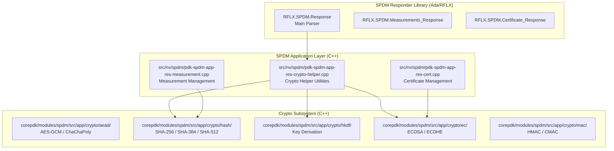
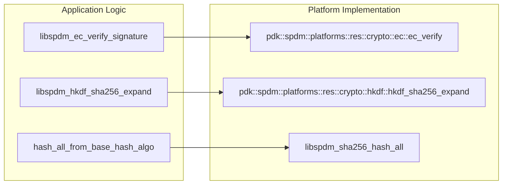

<!-- source: DeepWiki mcp.deepwiki.com · repo NVIDIA/OpenSMA · page 3.1 SPDM Protocol Implementation · fetched 2026-10-26 -->

# SPDM Protocol Implementation

<details>
<summary>Relevant source files</summary>

The following files were used as context for generating this wiki page:

- [corepdk/modules/spdm/src/app/crypto/aead/pdk-spdm-app-res-crypto-aead.cpp](corepdk/modules/spdm/src/app/crypto/aead/pdk-spdm-app-res-crypto-aead.cpp)
- [corepdk/modules/spdm/src/app/crypto/aead/pdk-spdm-app-res-crypto-aead.h](corepdk/modules/spdm/src/app/crypto/aead/pdk-spdm-app-res-crypto-aead.h)
- [corepdk/modules/spdm/src/app/crypto/cert/pdk-spdm-app-res-crypto-cert.cpp](corepdk/modules/spdm/src/app/crypto/cert/pdk-spdm-app-res-crypto-cert.cpp)
- [corepdk/modules/spdm/src/app/crypto/dh/pdk-spdm-app-res-crypto-dh.cpp](corepdk/modules/spdm/src/app/crypto/dh/pdk-spdm-app-res-crypto-dh.cpp)
- [corepdk/modules/spdm/src/app/crypto/ec/pdk-spdm-app-res-crypto-ec.cpp](corepdk/modules/spdm/src/app/crypto/ec/pdk-spdm-app-res-crypto-ec.cpp)
- [corepdk/modules/spdm/src/app/crypto/hash/pdk-spdm-app-res-crypto-hash.cpp](corepdk/modules/spdm/src/app/crypto/hash/pdk-spdm-app-res-crypto-hash.cpp)
- [corepdk/modules/spdm/src/app/crypto/hkdf/pdk-spdm-app-res-crypto-hkdf.cpp](corepdk/modules/spdm/src/app/crypto/hkdf/pdk-spdm-app-res-crypto-hkdf.cpp)
- [corepdk/modules/spdm/src/app/crypto/mac/pdk-spdm-app-res-crypto-mac.cpp](corepdk/modules/spdm/src/app/crypto/mac/pdk-spdm-app-res-crypto-mac.cpp)

</details>


## Purpose and Scope

This document covers the SPDM (Security Protocol and Data Model) implementation in OpenSMA, which provides secure device authentication, measurement, and certificate management capabilities. The implementation utilizes a hybrid approach:
1.  **Ada/SPARK Responder**: Uses the RecordFlux (RFLX) framework for formal message specification, parsing, and response generation.
2.  **C++ Cryptographic Subsystem**: Provides the underlying cryptographic primitives (AEAD, Hash, HKDF, ECDSA, etc.) required by the SPDM protocol.

The implementation handles SPDM requests and generates responses according to the DMTF SPDM specification, leveraging hardware acceleration where available on the NXP MCXN platforms.

## Architecture Overview

The SPDM implementation is split between the formal Ada responder library and the C++ cryptographic application layer.

### SPDM System Architecture



Sources: [corepdk/modules/spdm/src/app/crypto/aead/pdk-spdm-app-res-crypto-aead.cpp:3-50](), [corepdk/modules/spdm/src/app/crypto/hash/pdk-spdm-app-res-crypto-hash.cpp:52-88](), [corepdk/modules/spdm/src/app/crypto/hkdf/pdk-spdm-app-res-crypto-hkdf.cpp:26-65]()

## Cryptographic Subsystem

The cryptographic layer in `corepdk/modules/spdm/src/app/crypto/` provides a standardized interface (prefixed with `libspdm_`) that wraps platform-specific security drivers.

### Key Primitives and Implementations

| Category | File Path | Supported Algorithms |
| :--- | :--- | :--- |
| **AEAD** | [corepdk/modules/spdm/src/app/crypto/aead/pdk-spdm-app-res-crypto-aead.cpp:1-150]() | AES-GCM (128/256), ChaCha20Poly1305 |
| **Hash** | [corepdk/modules/spdm/src/app/crypto/hash/pdk-spdm-app-res-crypto-hash.cpp:1-100]() | SHA-256, SHA-384, SHA-512, SHA3-256/384/512, SM3 |
| **EC** | [corepdk/modules/spdm/src/app/crypto/ec/pdk-spdm-app-res-crypto-ec.cpp:1-200]() | ECDSA, ECDHE (P-256, P-384, P-521), SM2 |
| **HKDF** | [corepdk/modules/spdm/src/app/crypto/hkdf/pdk-spdm-app-res-crypto-hkdf.cpp:1-170]() | HMAC-based Extract/Expand for SHA-2/SHA-3 |
| **MAC** | [corepdk/modules/spdm/src/app/crypto/mac/pdk-spdm-app-res-crypto-mac.cpp:1-180]() | HMAC (SHA-2/SHA-3), AES-CMAC |

### Cryptographic Data Flow

The following diagram illustrates how the application layer utilizes the crypto primitives for SPDM operations.



Sources: [corepdk/modules/spdm/src/app/crypto/ec/pdk-spdm-app-res-crypto-ec.cpp:203-220](), [corepdk/modules/spdm/src/app/crypto/hkdf/pdk-spdm-app-res-crypto-hkdf.cpp:53-65](), [corepdk/modules/spdm/src/app/crypto/hash/pdk-spdm-app-res-crypto-hash.cpp:52-66]()

## Message Processing and Parsing

The SPDM responder processes incoming requests through a structured message parsing pipeline defined in Ada/RFLX.

### Supported SPDM Message Types

| Message Type | Purpose | RFLX Component |
| :--- | :--- | :--- |
| **Version** | Protocol version negotiation | `RFLX.SPDM.Version_Response` |
| **Capabilities** | Device capability advertisement | `RFLX.SPDM.Capabilities_Response` |
| **Algorithms** | Cryptographic algorithm negotiation | `RFLX.SPDM.Algorithms_Response` |
| **Digests** | Certificate digest exchange | `RFLX.SPDM.Digests_Response` |
| **Certificate** | Certificate chain delivery | `RFLX.SPDM.Certificate_Response` |
| **Measurements** | Device measurement reporting | `RFLX.SPDM.Measurements_Response` |

### Measurement Hash Selection
The function `find_hash_size_from_base_hash_algo` is used to determine the digest size based on the negotiated SPDM algorithm.

```cpp
size_t find_hash_size_from_base_hash_algo(const pdk::spdm::app::res::algorithms::BaseHashSel base_hash_algo)
{
    switch (base_hash_algo) {
        case BaseHashSel::TpmAlgSha256  : return HashAlgoDigestSize::TpmAlgSha256Size; // 32 bytes
        case BaseHashSel::TpmAlgSha384  : return HashAlgoDigestSize::TpmAlgSha384Size; // 48 bytes
        case BaseHashSel::TpmAlgSha512  : return HashAlgoDigestSize::TpmAlgSha512Size; // 64 bytes
        // ...
    }
}
```

Sources: [corepdk/modules/spdm/src/app/crypto/hash/pdk-spdm-app-res-crypto-hash.cpp:35-50]()

## Context and Memory Management

Each SPDM cryptographic operation involves context management to ensure state is maintained correctly during multi-step operations (e.g., Init-Update-Final for hashing).

### Hashing Context Operations
1.  **Allocation**: `libspdm_sha256_new()` initializes a platform-specific hash context. [corepdk/modules/spdm/src/app/crypto/hash/pdk-spdm-app-res-crypto-hash.cpp:100-106]()
2.  **Duplication**: `libspdm_sha256_duplicate()` allows cloning a context for branching hash calculations (common in SPDM transcript hashing). [corepdk/modules/spdm/src/app/crypto/hash/pdk-spdm-app-res-crypto-hash.cpp:153-160]()
3.  **Finalization**: `libspdm_sha256_final()` computes the final digest and invalidates the context. [corepdk/modules/spdm/src/app/crypto/hash/pdk-spdm-app-res-crypto-hash.cpp:197-205]()

### Diffie-Hellman (DH) Key Exchange
The system supports FFDHE (Finite Field Diffie-Hellman Ephemeral) via:
-   `libspdm_dh_new_by_nid`: Creates context based on Negotiated Identifier (NID). [corepdk/modules/spdm/src/app/crypto/dh/pdk-spdm-app-res-crypto-dh.cpp:23-29]()
-   `libspdm_dh_generate_key`: Generates ephemeral public/private pairs. [corepdk/modules/spdm/src/app/crypto/dh/pdk-spdm-app-res-crypto-dh.cpp:71-78]()
-   `libspdm_dh_compute_key`: Computes the shared secret from the peer's public key. [corepdk/modules/spdm/src/app/crypto/dh/pdk-spdm-app-res-crypto-dh.cpp:110-121]()

## SPARK Formal Verification

The Ada portion of the SPDM responder uses SPARK_Mode for formal verification. This ensures:
-   **Memory Safety**: Absence of buffer overflows in message parsing.
-   **Control Flow Correctness**: Guaranteed termination and valid state transitions.
-   **Data Integrity**: Verification that message fields match the DMTF specification.

Sources: [corepdk/modules/spdm/src/app/spdm_responder_ada_library/rflx-spdm-response.ads:20-24](), [corepdk/modules/spdm/src/app/spdm_responder_ada_library/rflx-spdm-response.adb:12-14]()

---

