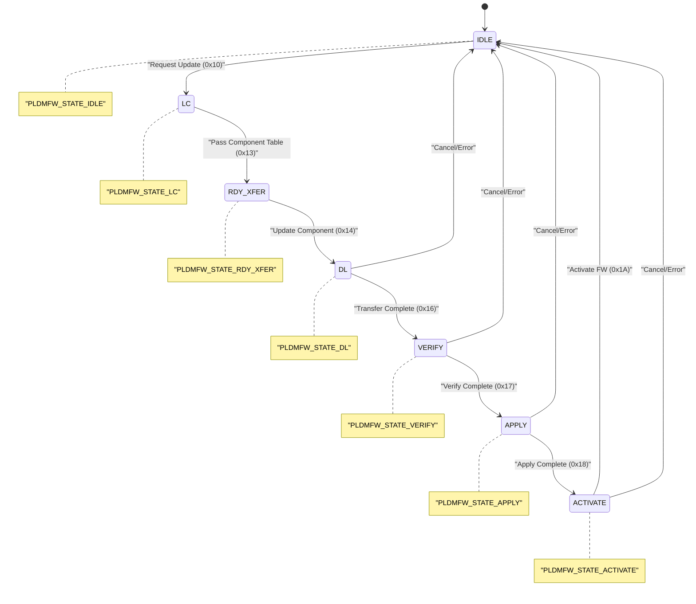
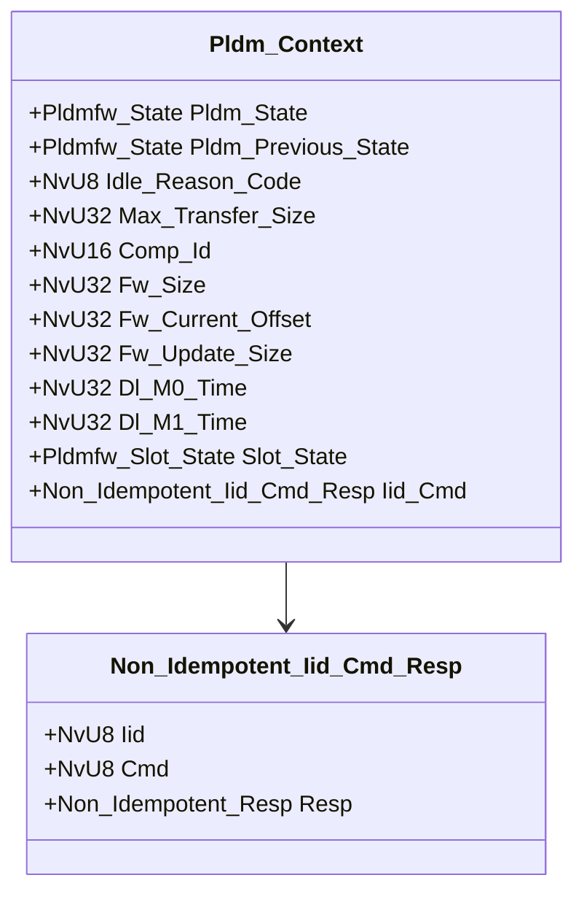
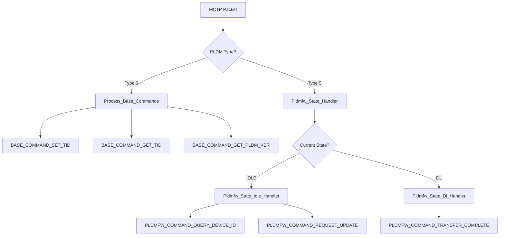

<!-- source: DeepWiki mcp.deepwiki.com · repo NVIDIA/OpenSMA · page 3.2 PLDM Firmware Update · fetched 2026-10-26 -->

# PLDM Firmware Update

<details>
<summary>Relevant source files</summary>

The following files were used as context for generating this wiki page:

- [corepdk/modules/pldm-fd/src/app/pdk-pldm-hook.ads](corepdk/modules/pldm-fd/src/app/pdk-pldm-hook.ads)
- [corepdk/modules/pldm-fd/src/app/pdk-pldm-interfaces.ads](corepdk/modules/pldm-fd/src/app/pdk-pldm-interfaces.ads)
- [corepdk/modules/pldm-fd/src/base/pdk-pldm-base-cmd.adb](corepdk/modules/pldm-fd/src/base/pdk-pldm-base-cmd.adb)
- [corepdk/modules/pldm-fd/src/base/pdk-pldm-base.ads](corepdk/modules/pldm-fd/src/base/pdk-pldm-base.ads)
- [corepdk/modules/pldm-fd/src/device/pdk-pldm-device-cmd.adb](corepdk/modules/pldm-fd/src/device/pdk-pldm-device-cmd.adb)
- [corepdk/modules/pldm-fd/src/fwupdate/pdk-pldm-fwupdate-cmd.adb](corepdk/modules/pldm-fd/src/fwupdate/pdk-pldm-fwupdate-cmd.adb)
- [corepdk/modules/pldm-fd/src/fwupdate/pdk-pldm-fwupdate-state.adb](corepdk/modules/pldm-fd/src/fwupdate/pdk-pldm-fwupdate-state.adb)
- [corepdk/modules/pldm-fd/src/pdk-pldm.ads](corepdk/modules/pldm-fd/src/pdk-pldm.ads)
- [corepdk/modules/pldm-fd/src/types/nv_types.ads](corepdk/modules/pldm-fd/src/types/nv_types.ads)

</details>


## Purpose and Scope

This document covers the PLDM (Platform Level Data Model) firmware update implementation in OpenSMA. PLDM firmware update is a DMTF standard protocol (Type 5) that provides secure, standardized firmware update capabilities for embedded devices. The implementation handles the complete firmware update lifecycle including discovery, transfer, verification, and activation phases.

The implementation consists of the `pldm-fd` module in Ada, which provides the core protocol logic, state machine management, and message parsing, and the application layer in `src/nv/pldm/` for task integration.

**Sources:** [corepdk/modules/pldm-fd/src/pdk-pldm.ads:18-32](), [corepdk/modules/pldm-fd/src/fwupdate/pdk-pldm-fwupdate.ads:19-32]()

## Architecture Overview

The PLDM firmware update system is built around a state machine that manages the firmware update process through distinct phases. The core implementation uses Ada for safety-critical operations with platform-specific integration.

### State Machine

The firmware update process is governed by the `Pldmfw_State` enumeration, which transitions through various phases from `IDLE` to `ACTIVATE`.



**Sources:** [corepdk/modules/pldm-fd/src/fwupdate/pdk-pldm-fwupdate.ads:76-83](), [corepdk/modules/pldm-fd/src/fwupdate/pdk-pldm-fwupdate-state.adb:29-60]()

### Core Context Structure

The `Pldm_Context` record maintains the complete state of a firmware update session, including transfer offsets, component IDs, and timing information for reporting.



**Sources:** [corepdk/modules/pldm-fd/src/fwupdate/pdk-pldm-fwupdate.ads:314-357]()

## Command Processing

### Command Handler Architecture

Messages are routed based on the PLDM Type and Command Code. Type 0 commands (Base) are handled in `Pdk.Pldm.Base.Cmd`, while Type 5 commands (Firmware Update) are handled in `Pdk.Pldm.Fwupdate.Cmd`.



**Sources:** [corepdk/modules/pldm-fd/src/base/pdk-pldm-base-cmd.adb:38-164](), [corepdk/modules/pldm-fd/src/fwupdate/pdk-pldm-fwupdate-state.adb:62-117](), [corepdk/modules/pldm-fd/src/fwupdate/pdk-pldm-fwupdate-state.adb:251-306]()

### Key Command Implementations

#### Request Update Command
The `Pldmfw_Cmd_Request_Update` procedure initializes the update session. It performs critical checks, including rate limiting and validation of the update agent's parameters.

- **Rate Limiting:** Checks if the update frequency exceeds allowed limits using `Pldmfw_Is_Rate_Limit_Reached`.
- **State Transition:** On success, transitions the state machine to `PLDMFW_STATE_LC` (Learn Components).

**Sources:** [corepdk/modules/pldm-fd/src/fwupdate/pdk-pldm-fwupdate-cmd.adb:654-779]()

#### Component Table Processing
`Pldmfw_Cmd_Pass_Component_Table` allows the Update Agent to communicate component information. The Firmware Device (FD) validates these against its internal component list using `Pldm_Hook_Get_Component_Info_List`.

**Sources:** [corepdk/modules/pldm-fd/src/fwupdate/pdk-pldm-fwupdate-cmd.adb:781-916]()

## Non-Idempotent Command Handling

PLDM firmware update requires specific handling for non-idempotent commands to ensure that retried requests (due to transport timeouts) receive the same response without re-triggering the operation.

The `Iid_Cmd` field in `Pldm_Context` caches the last Instance ID (IID), Command Code, and Response payload. The `Pldmfw_Response_Non_Idempotent_Cmd` procedure checks if an incoming request matches the cached IID and command; if so, it retransmits the cached response.

**Sources:** [corepdk/modules/pldm-fd/src/fwupdate/pdk-pldm-fwupdate-cmd.adb:431-483](), [corepdk/modules/pldm-fd/src/fwupdate/pdk-pldm-fwupdate.ads:345-349]()

## Rate Limiting and Flow Control

To prevent flash wear or DoS scenarios, the implementation includes a rate limiting mechanism.

```ada
procedure Pldmfw_Is_Rate_Limit_Reached
  (Context                 : in out Pldm_Context;
   Is_Limited_Rate_Reached :    out Boolean)
is
   -- Implementation logic in body
```

The algorithm tracks the number of update requests within a time window (`Info.Time`). If the `Limited_Rate` is reached, subsequent requests are rejected with `PLDMFW_CC_UNABLE_TO_INIT_UPDATE`. The limit is dynamically adjusted: if a limit was reached in the previous window, the next limit is halved to throttle the agent.

**Sources:** [corepdk/modules/pldm-fd/src/fwupdate/pdk-pldm-fwupdate-cmd.adb:157-222]()

## Platform Integration

### Platform Hooks (Ada to Platform)

The core module defines a set of hooks in `Pdk.Pldm.Hook.Plat` that must be implemented by the platform layer (e.g., MCXN556 or x86 simulation). These hooks provide access to:
- Flash storage for firmware components.
- Version information (Active/Pending).
- Timer services (`Pldm_Hook_Set_Timer`).
- Reporting and logging (`Pldm_Hook_Log_Fw_Update_Report`).

**Sources:** [corepdk/modules/pldm-fd/src/app/pdk-pldm-hook.ads:19-21](), [corepdk/modules/pldm-fd/src/fwupdate/pdk-pldm-fwupdate-cmd.adb:150-154]()

### Base Protocol Operations

While firmware update is the primary focus, the module supports mandatory PLDM Base (Type 0) commands:
- `SET_TID` / `GET_TID`: Manages the Terminal ID.
- `GET_PLDM_TYPES`: Reports supported types (0 and 5).
- `GET_PLDM_CMDS`: Reports supported commands for a given type.

**Sources:** [corepdk/modules/pldm-fd/src/base/pdk-pldm-base-cmd.adb:56-148]()

## Data Flow and Types

The system uses `Nv_Types` for fixed-width modular integers with SPARK overflow annotations to ensure mathematical correctness in buffer offset calculations.

| Type | Definition | Usage |
| :--- | :--- | :--- |
| `NvU8` | `mod 2**8` | Command codes, Completion codes |
| `NvU32` | `mod 2**32` | Flash offsets, Timestamps, Sizes |
| `Pldm_Header` | Record | Standard 3-byte PLDM header (RQ, Instance ID, Type, Cmd) |

**Sources:** [corepdk/modules/pldm-fd/src/types/nv_types.ads:58-60](), [corepdk/modules/pldm-fd/src/types/nv_types.ads:154-156](), [corepdk/modules/pldm-fd/src/fwupdate/pdk-pldm-fwupdate.ads:133-141]()

---

