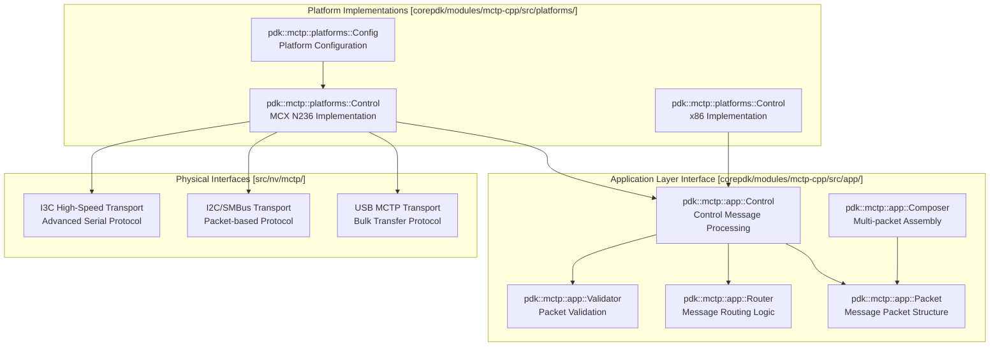
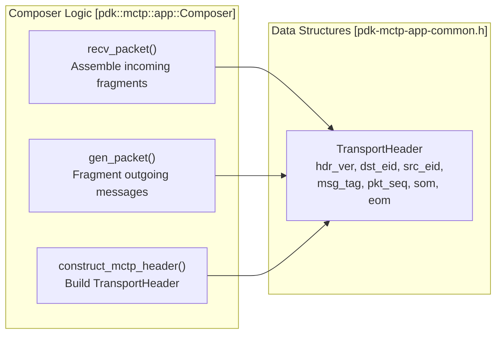

<!-- source: DeepWiki mcp.deepwiki.com · repo NVIDIA/OpenSMA · page 4 Transport Layer · fetched 2026-10-26 -->

# Transport Layer

Relevant source files

The following files were used as context for generating this wiki page:

- [corepdk/modules/mctp-cpp/src/app/pdk-mctp-app-common.h](corepdk/modules/mctp-cpp/src/app/pdk-mctp-app-common.h)
- [corepdk/modules/mctp-cpp/src/app/pdk-mctp-app-composer.h](corepdk/modules/mctp-cpp/src/app/pdk-mctp-app-composer.h)

## Purpose and Scope

The Transport Layer provides the MCTP (Management Component Transport Protocol) implementation that enables reliable message routing and transport services between security protocols and physical interfaces. This layer handles endpoint management, routing table maintenance, and platform-specific transport adaptations across I2C, USB, and I3C layers.

For security protocol implementations that use this transport layer, see [Security Protocols](#3). For hardware driver implementations that interface with this layer, see [Hardware Drivers](#5).

## MCTP Architecture Overview

The Transport Layer implements DMTF's MCTP specification (DSP0236) through a modular C++ architecture that supports multiple platforms and physical transports.

### Core Transport Components

Sources: [corepdk/modules/mctp-cpp/src/app/pdk-mctp-app-composer.h:23-62](), [corepdk/modules/mctp-cpp/src/app/pdk-mctp-app-common.h:25-36](), [corepdk/modules/mctp-cpp/src/app/pdk-mctp-app-composer.h:49-55]()

## MCTP Core Services

The core services handle the logic of the MCTP protocol independent of the physical medium. This includes packet composition, routing logic, and control message handling.

### Packet Composition and Routing
The `Composer` class manages the assembly and disassembly of MCTP packets, specifically handling multi-packet messages where a single message is split across multiple transport units. It tracks Start of Message (`som`) and End of Message (`eom`) flags to ensure complete message delivery.

- **Packet Assembly**: `recv_packet` handles multi-packet assembly and returns the full packet size when the final fragment is received [corepdk/modules/mctp-cpp/src/app/pdk-mctp-app-composer.h:37-39]().
- **Packet Generation**: `gen_packet` segments a large buffer into individual MCTP packets for transmission [corepdk/modules/mctp-cpp/src/app/pdk-mctp-app-composer.h:47-48]().
- **Header Management**: The `TransportHeader` struct defines the standard 4-byte MCTP transport header [corepdk/modules/mctp-cpp/src/app/pdk-mctp-app-common.h:25-36]().

For details, see [MCTP Core Services](#4.1).

## MCTP Platform Integration

Platform integration maps the high-level MCTP logic to specific hardware targets and operating system primitives, such as FreeRTOS queues on the MCXN series.

### Target Implementations
- **MCXN Series**: Integrates with FreeRTOS tasks and hardware drivers (I2C, USB, I3C). It uses specialized drivers in `src/nv/mctp/` to bridge the `pdk::mctp` application logic with the physical hardware.
- **x86 Simulation**: Provides a simulated environment for testing MCTP logic without physical hardware, typically used for validating routing and control message handling in CI environments.

### Transport Adaptation
The platform layer defines how packets are physically moved. For example, on MCXN556, MCTP messages are routed through FreeRTOS queues to the appropriate driver task based on the `dst_eid` (Destination Endpoint ID) and the internal routing table.

For details, see [MCTP Platform Integration](#4.2).

## Detailed Sub-Pages

- **[MCTP Core Services](#4.1)**: Detailed documentation on `Composer`, `Router`, `Control`, and `Validator` classes. Covers EID management, routing table updates, and MCTP control command implementations (e.g., `Get Endpoint ID`, `Set Endpoint ID`).
- **[MCTP Platform Integration](#4.2)**: Details on platform-specific drivers, task priorities, FreeRTOS queue integration, and target-specific configuration for x86 and MCXN microcontrollers.

Sources: [corepdk/modules/mctp-cpp/src/app/pdk-mctp-app-composer.h:1-63](), [corepdk/modules/mctp-cpp/src/app/pdk-mctp-app-common.h:1-43]()

---

