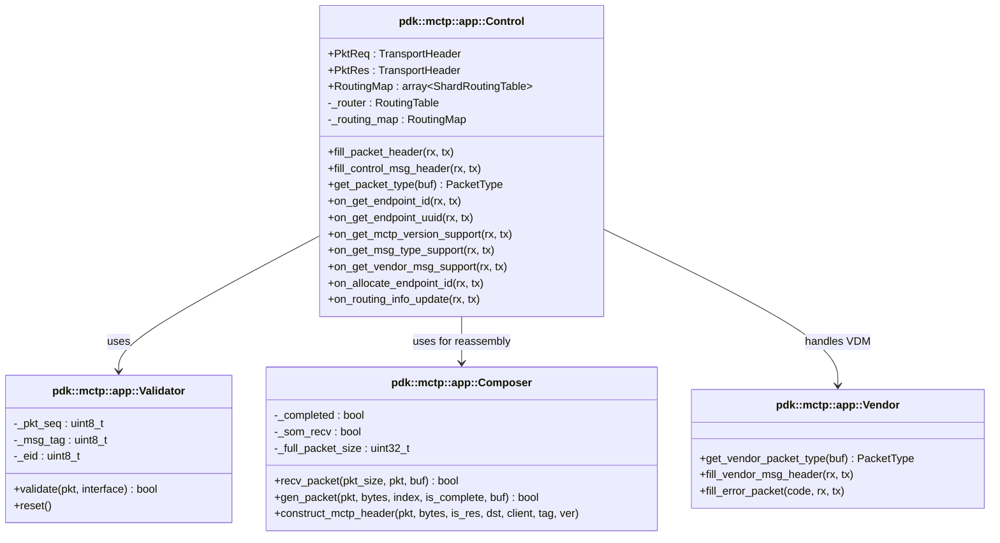
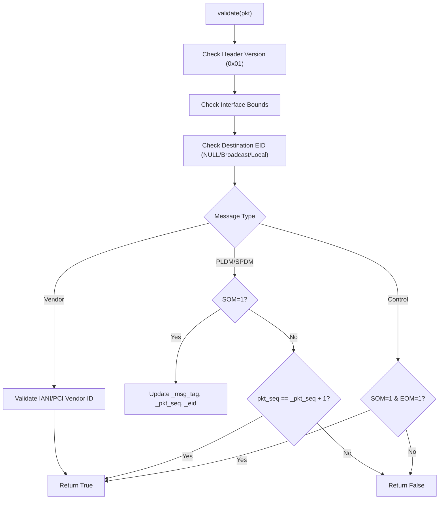

<!-- source: DeepWiki mcp.deepwiki.com · repo NVIDIA/OpenSMA · page 4.1 MCTP Core Services · fetched 2026-10-26 -->

# MCTP Core Services

Relevant source files

The following files were used as context for generating this wiki page:

- [corepdk/modules/mctp-cpp/src/app/pdk-mctp-app-common.h](corepdk/modules/mctp-cpp/src/app/pdk-mctp-app-common.h)
- [corepdk/modules/mctp-cpp/src/app/pdk-mctp-app-composer.cpp](corepdk/modules/mctp-cpp/src/app/pdk-mctp-app-composer.cpp)
- [corepdk/modules/mctp-cpp/src/app/pdk-mctp-app-composer.h](corepdk/modules/mctp-cpp/src/app/pdk-mctp-app-composer.h)
- [corepdk/modules/mctp-cpp/src/app/pdk-mctp-app-control.cpp](corepdk/modules/mctp-cpp/src/app/pdk-mctp-app-control.cpp)
- [corepdk/modules/mctp-cpp/src/app/pdk-mctp-app-control.h](corepdk/modules/mctp-cpp/src/app/pdk-mctp-app-control.h)
- [corepdk/modules/mctp-cpp/src/app/pdk-mctp-app-enums.h](corepdk/modules/mctp-cpp/src/app/pdk-mctp-app-enums.h)
- [corepdk/modules/mctp-cpp/src/app/pdk-mctp-app-packet.cpp](corepdk/modules/mctp-cpp/src/app/pdk-mctp-app-packet.cpp)
- [corepdk/modules/mctp-cpp/src/app/pdk-mctp-app-router.cpp](corepdk/modules/mctp-cpp/src/app/pdk-mctp-app-router.cpp)
- [corepdk/modules/mctp-cpp/src/app/pdk-mctp-app-router.h](corepdk/modules/mctp-cpp/src/app/pdk-mctp-app-router.h)
- [corepdk/modules/mctp-cpp/src/app/pdk-mctp-app-validator.cpp](corepdk/modules/mctp-cpp/src/app/pdk-mctp-app-validator.cpp)
- [corepdk/modules/mctp-cpp/src/app/pdk-mctp-app-vendor.cpp](corepdk/modules/mctp-cpp/src/app/pdk-mctp-app-vendor.cpp)

## Purpose and Scope

The MCTP Core Services provide control message processing, endpoint management, routing table operations, and packet composition for the Management Component Transport Protocol (MCTP) implementation. This system handles MCTP control commands as defined by the DMTF DSP0236 specification, manages endpoint identifiers (EIDs), maintains routing tables, and coordinates message reassembly (decomposition/composition) across different physical interfaces.

The core logic resides in `corepdk/modules/mctp-cpp/src/app/`, while platform-specific application logic for NVIDIA-specific message types (NSM) is found in `src/nv/mctp/`.

## Control Message Architecture

The MCTP control services are built around a layered architecture with platform-agnostic base classes and platform-specific implementations.

### Core Control Classes

Sources: [corepdk/modules/mctp-cpp/src/app/pdk-mctp-app-control.h:34-156](), [corepdk/modules/mctp-cpp/src/app/pdk-mctp-app-composer.h:23-62](), [corepdk/modules/mctp-cpp/src/app/pdk-mctp-app-validator.cpp:30-178](), [corepdk/modules/mctp-cpp/src/app/pdk-mctp-app-vendor.h:25-50]()

### Command Processing Logic

The `Control` class implements standard MCTP control commands. Key handlers include:
*   **Get Endpoint ID**: Returns the current EID and endpoint type (Simple or Bus Owner Bridge) [corepdk/modules/mctp-cpp/src/app/pdk-mctp-app-control.cpp:45-63]().
*   **Get MCTP Version Support**: Reports supported versions for Base, Control, PLDM, and Vendor types [corepdk/modules/mctp-cpp/src/app/pdk-mctp-app-control.cpp:77-99]().
*   **Allocate Endpoint ID**: Manages dynamic EID allocation and handles `ForceAllocate` requests to clear existing routing info [corepdk/modules/mctp-cpp/src/app/pdk-mctp-app-control.cpp:147-172]().
*   **Vendor Message Support**: Reports NVIDIA-specific IANI (0x1647) and PCI (0x10DE) vendor IDs [corepdk/modules/mctp-cpp/src/app/pdk-mctp-app-control.cpp:113-145]().

## Packet Composition and Reassembly

The `Composer` class manages the assembly of multi-packet MCTP messages into a contiguous buffer and the decomposition of large payloads into individual packets.

### Reassembly (recv_packet)
`recv_packet` handles four distinct cases [corepdk/modules/mctp-cpp/src/app/pdk-mctp-app-composer.cpp:40-132]():
1.  **Single Packet**: If both SOM (Start of Message) and EOM (End of Message) are set, the packet is copied directly to the buffer.
2.  **Start Packet**: If only SOM is set, it initializes a new assembly process.
3.  **Continued Packets**: Middle and End packets are appended to the buffer. It performs overflow checks against the buffer size [corepdk/modules/mctp-cpp/src/app/pdk-mctp-app-composer.cpp:102-112]().
4.  **Unknown/Out-of-Order**: Packets received without a preceding SOM are dropped.

### Decomposition (gen_packet)
`gen_packet` segments a large message buffer into individual MCTP packets for transmission [corepdk/modules/mctp-cpp/src/app/pdk-mctp-app-composer.cpp:133-177]():
*   Calculates the payload size for the current packet index.
*   Sets `som` for index 0 and `eom` for the final segment.
*   Handles packet sequence numbering (`pkt_seq`) using a 2-bit mask [corepdk/modules/mctp-cpp/src/app/pdk-mctp-app-composer.cpp:159]().

Sources: [corepdk/modules/mctp-cpp/src/app/pdk-mctp-app-composer.cpp:40-177]()

## Message Validation

The `Validator` class ensures that incoming packets adhere to the MCTP protocol state.

The validator tracks the expected `_pkt_seq` and `_msg_tag` for multi-packet sequences, rejecting out-of-order or interleaved packets from the same endpoint [corepdk/modules/mctp-cpp/src/app/pdk-mctp-app-validator.cpp:156-174]().

Sources: [corepdk/modules/mctp-cpp/src/app/pdk-mctp-app-validator.cpp:30-178]()

## Data Structures and Enums

### Transport Header
The core MCTP header structure used for all packet processing:
[corepdk/modules/mctp-cpp/src/app/pdk-mctp-app-common.h:25-36]()
*   `hdr_ver`: Header Version (4 bits)
*   `dst_eid` / `src_eid`: Endpoint IDs
*   `msg_tag`: 3-bit tag for message tracking
*   `tag_owner`: 1 bit (1 for Request, 0 for Response)
*   `pkt_seq`: 2-bit sequence number
*   `som` / `eom`: Start/End of Message flags

### Message Types and Commands
The protocol supports multiple message types via the `MsgType` enum [corepdk/modules/mctp-cpp/src/app/pdk-mctp-app-enums.h:105-115]():
*   `Control` (0x00)
*   `Pldm` (0x01)
*   `Spdm` (0x05)
*   `VendorPci` (0x7E)
*   `VendorIani` (0x7F)

Standard commands defined in `Cmd` enum include `SetEpId`, `GetEpId`, `GetEpUuid`, and `RoutingInfoUpdate` [corepdk/modules/mctp-cpp/src/app/pdk-mctp-app-enums.h:81-103]().

## Vendor Message Handling

The `Vendor` class provides specialized utilities for NVIDIA-specific messages (VDM). It handles the construction of response headers for Vendor IANI messages, ensuring the IANA ID (0x1647) and NVIDIA-specific command codes are correctly populated [corepdk/modules/mctp-cpp/src/app/pdk-mctp-app-vendor.cpp:52-65]().

It also provides `unsupported_command` logic which returns a completion code of `ErrorUnsupportedCmd` for unknown vendor requests [corepdk/modules/mctp-cpp/src/app/pdk-mctp-app-vendor.cpp:41-50]().

Sources: [corepdk/modules/mctp-cpp/src/app/pdk-mctp-app-vendor.cpp:25-98]()

---

