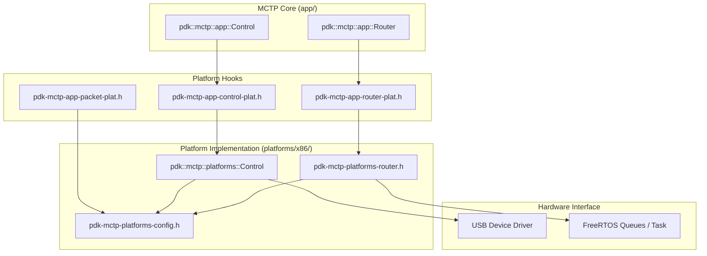
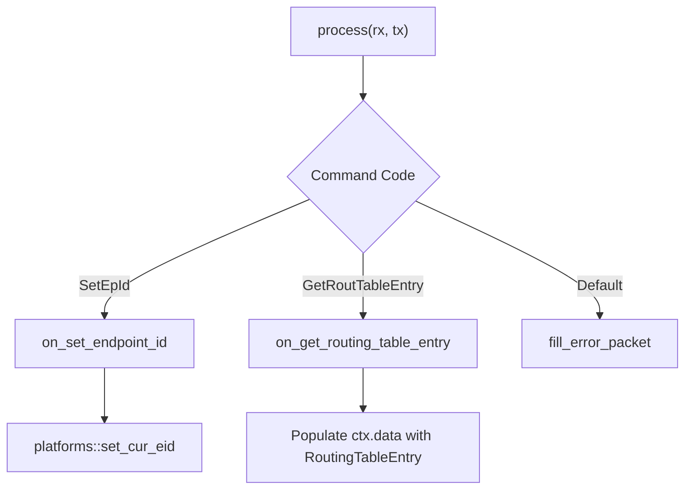

<!-- source: DeepWiki mcp.deepwiki.com · repo NVIDIA/OpenSMA · page 4.2 MCTP Platform Integration · fetched 2026-10-26 -->

# MCTP Platform Integration

Relevant source files

The following files were used as context for generating this wiki page:

- [corepdk/modules/mctp-cpp/src/app/pdk-mctp-app-control-plat.h](corepdk/modules/mctp-cpp/src/app/pdk-mctp-app-control-plat.h)
- [corepdk/modules/mctp-cpp/src/app/pdk-mctp-app-router-plat.h](corepdk/modules/mctp-cpp/src/app/pdk-mctp-app-router-plat.h)
- [corepdk/modules/mctp-cpp/src/platforms/x86/pdk-mctp-platforms-config.h](corepdk/modules/mctp-cpp/src/platforms/x86/pdk-mctp-platforms-config.h)
- [corepdk/modules/mctp-cpp/src/platforms/x86/pdk-mctp-platforms-control.cpp](corepdk/modules/mctp-cpp/src/platforms/x86/pdk-mctp-platforms-control.cpp)
- [corepdk/modules/mctp-cpp/src/platforms/x86/pdk-mctp-platforms-control.h](corepdk/modules/mctp-cpp/src/platforms/x86/pdk-mctp-platforms-control.h)
- [corepdk/modules/mctp-cpp/src/platforms/x86/pdk-mctp-platforms-nsm.h](corepdk/modules/mctp-cpp/src/platforms/x86/pdk-mctp-platforms-nsm.h)
- [corepdk/modules/mctp-cpp/src/platforms/x86/pdk-mctp-platforms-packet.h](corepdk/modules/mctp-cpp/src/platforms/x86/pdk-mctp-platforms-packet.h)
- [corepdk/modules/mctp-cpp/src/platforms/x86/pdk-mctp-platforms-router.h](corepdk/modules/mctp-cpp/src/platforms/x86/pdk-mctp-platforms-router.h)

## Purpose and Scope

This section covers the platform-specific implementations and hardware integration aspects of the MCTP (Management Component Transport Protocol) transport layer. It documents the platform abstraction mechanisms, hardware driver interfaces, and utility functions that enable MCTP to operate across different hardware platforms supported by OpenSMA, specifically focusing on the x86 simulation and MCU targets.

The platform integration layer bridges the generic `pdk::mctp::app` logic with physical transport drivers like USB, I3C, and IPC. It defines how packets are framed, how routing tables are stored, and how control commands (like EID assignment) are handled per-platform.

## Platform Abstraction Architecture

The MCTP platform integration follows a layered abstraction model. The core protocol logic in `mctp-cpp` defines platform hooks (headers ending in `-plat.h`) that must be implemented by the specific target platform.

### MCTP Platform Integration Overview

Sources: [corepdk/modules/mctp-cpp/src/app/pdk-mctp-app-control-plat.h:25-28](), [corepdk/modules/mctp-cpp/src/app/pdk-mctp-app-router-plat.h:21-25](), [corepdk/modules/mctp-cpp/src/platforms/x86/pdk-mctp-platforms-control.h:27-38](), [corepdk/modules/mctp-cpp/src/platforms/x86/pdk-mctp-platforms-config.h:25-48]()

## Platform-Specific Configurations (x86)

The x86 platform serves as the primary simulation and testing target. It defines constants for routing table sizes, supported message types, and interface behaviors.

### Configuration Constants
The `pdk::mctp::platforms` namespace in the x86 implementation defines the following parameters:

| Constant | Value | Description |
|----------|-------|-------------|
| `TransmitUnit` | 64 | Maximum payload size for MCTP packets [corepdk/modules/mctp-cpp/src/platforms/x86/pdk-mctp-platforms-packet.h:25-25]() |
| `DownStreamNum` | 0 | Number of downstream endpoints [corepdk/modules/mctp-cpp/src/platforms/x86/pdk-mctp-platforms-config.h:27-27]() |
| `UpStreamNum` | 1 | Number of upstream endpoints [corepdk/modules/mctp-cpp/src/platforms/x86/pdk-mctp-platforms-config.h:28-28]() |
| `DefaultInterface` | `Interface::UsUsb` | Default physical interface [corepdk/modules/mctp-cpp/src/platforms/x86/pdk-mctp-platforms-config.h:35-35]() |

### Supported Message Types
The platform explicitly defines which MCTP message types it supports in `SupportedType`:
- `Pldm` (Platform Level Data Model)
- `Spdm` (Security Protocol and Data Model)
- `VendorPci` (NVIDIA OEM Binding)
- `VendorIani`

Sources: [corepdk/modules/mctp-cpp/src/platforms/x86/pdk-mctp-platforms-config.h:40-46]()

## Packet Framing and Private Headers

Each platform can define a `PrivateHeader` used for internal communication between the MCTP stack and hardware drivers. This header is prepended to the MCTP `TransportHeader`.

### x86 Private Header Structure
The `PrivateHeader` includes metadata about the packet length and the physical interface it arrived on:
- `packet_length`: 16-bit length of the packet [corepdk/modules/mctp-cpp/src/platforms/x86/pdk-mctp-platforms-packet.h:36-36]()
- `packet_interface`: 8-bit identifier for the source/destination interface [corepdk/modules/mctp-cpp/src/platforms/x86/pdk-mctp-platforms-packet.h:37-37]()

Sources: [corepdk/modules/mctp-cpp/src/platforms/x86/pdk-mctp-platforms-packet.h:34-39]()

## Platform Control Logic

The `pdk::mctp::platforms::Control` class extends the base MCTP control message handler to provide platform-specific responses to discovery and EID management.

### Command Handling Flow
The `process` function dispatches MCTP Control commands to specific handlers:

### Key Implementation Details:
- **EID Assignment**: `on_set_endpoint_id` updates the routing table via `platforms::set_cur_eid` and returns the accepted EID and the size of the EID pool [corepdk/modules/mctp-cpp/src/platforms/x86/pdk-mctp-platforms-control.cpp:57-70]().
- **Routing Table Exposure**: `on_get_routing_table_entry` reports local routing information, including physical IDs (e.g., `MctpOverUsb`) and medium IDs (e.g., `Usb20`) [corepdk/modules/mctp-cpp/src/platforms/x86/pdk-mctp-platforms-control.cpp:157-161]().

Sources: [corepdk/modules/mctp-cpp/src/platforms/x86/pdk-mctp-platforms-control.cpp:28-48](), [corepdk/modules/mctp-cpp/src/platforms/x86/pdk-mctp-platforms-control.cpp:50-94]()

## NVIDIA Message Support (NSM)

OpenSMA implements NVIDIA-specific OEM bindings via the NSM (NVIDIA System Management) message type. The platform integration defines the packet structure for these messages.

### NSM Packet Format (`NsmPktReq`)
The NSM request structure overlays the standard MCTP transport header with NVIDIA-specific fields:
- `pci_vendor_id`: Set to `0xDE10` for NVIDIA [corepdk/modules/mctp-cpp/src/platforms/x86/pdk-mctp-platforms-nsm.h:84-84]().
- `nv_msg_type`: Sub-type for NSM messages [corepdk/modules/mctp-cpp/src/platforms/x86/pdk-mctp-platforms-nsm.h:41-41]().
- `cmd_code`: A union of various NSM command codes including `NsmFWCmdCode` and `NsmDevCfgCmdCode` [corepdk/modules/mctp-cpp/src/platforms/x86/pdk-mctp-platforms-nsm.h:43-50]().

Sources: [corepdk/modules/mctp-cpp/src/platforms/x86/pdk-mctp-platforms-nsm.h:25-83]()

## Routing Table and Endpoint Management

The platform maintains a `RoutingTable` structure that tracks EIDs across different "clients" (interfaces).

### Routing Table Structures
- `RoutingTableEntry`: Contains physical information like `PhyId`, `PhyMediumId`, and the `port_address` [corepdk/modules/mctp-cpp/src/platforms/x86/pdk-mctp-platforms-router.h:39-45]().
- `RoutingTable`: A packed structure containing bitfields for EID state (type, state, endpoint type) and the actual `cur_eid` map [corepdk/modules/mctp-cpp/src/platforms/x86/pdk-mctp-platforms-router.h:47-65]().

### Interface Mapping
The `PrivateEidMap` maps `Interface` enums to specific EIDs, allowing the router to determine which physical port an EID belongs to [corepdk/modules/mctp-cpp/src/platforms/x86/pdk-mctp-platforms-router.h:29-29]().

Sources: [corepdk/modules/mctp-cpp/src/platforms/x86/pdk-mctp-platforms-router.h:27-67]()

## Summary

MCTP Platform Integration provides the necessary glue between the protocol stack and hardware.
- **x86 Platform**: Provides a robust simulation environment with configurable routing and support for PLDM, SPDM, and NSM.
- **Control Handlers**: Implement the mandatory MCTP control protocol (EID assignment, discovery) using platform-specific storage.
- **OEM Support**: Extends the standard MCTP header to support NVIDIA-specific management commands (NSM).

---

