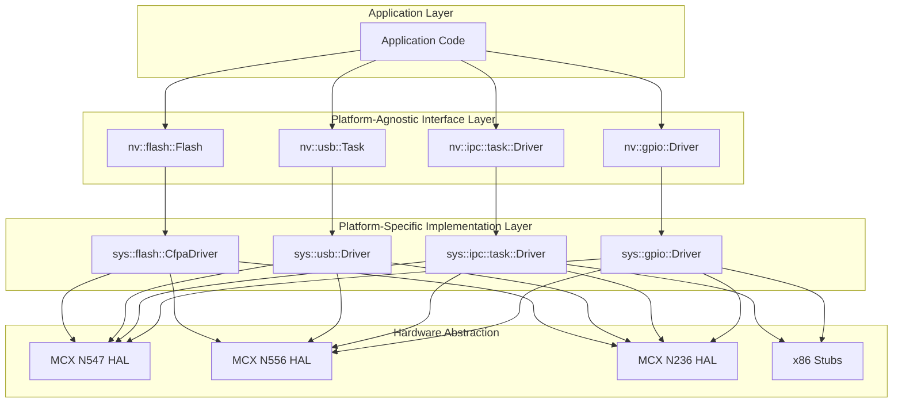
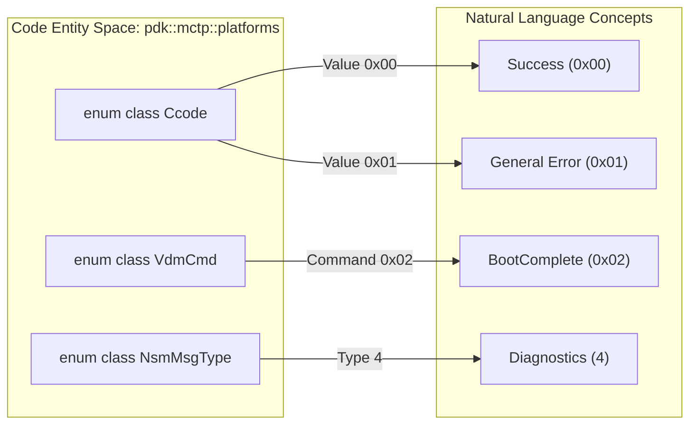

<!-- source: DeepWiki mcp.deepwiki.com · repo NVIDIA/OpenSMA · page 5 Hardware Drivers · fetched 2026-10-26 -->

# Hardware Drivers

Relevant source files

The following files were used as context for generating this wiki page:

- [corepdk/modules/mctp-cpp/src/platforms/x86/pdk-mctp-platforms-enums.h](corepdk/modules/mctp-cpp/src/platforms/x86/pdk-mctp-platforms-enums.h)

This document covers the hardware driver subsystem that provides platform abstraction layers for GPIO, USB, IPC, flash memory, and communication peripherals in the OpenSMA secure device management system. These drivers support multi-platform deployment across NXP MCXN547, MCXN556, MCXN236, and x86 architectures, enabling secure communication and hardware management capabilities.

For information about the transport protocols that use these drivers, see [Transport Layer](#4). For system services that depend on these drivers, see [System Services](#6).

## Architecture Overview

The hardware driver system follows a layered architecture pattern with platform-agnostic interfaces in the `nv::` namespace and platform-specific implementations in the `sys::` namespace. This design enables code reuse across different hardware platforms while maintaining hardware-specific optimizations.

Sources: [src/nv/gpio/driver.h:24-48](), [src/nv/ipc/driver.h:25-51](), [src/sys/mcxn547/sys/gpio/driver.cpp:45-57](), [src/sys/mcxn236/sys/ipc/driver.cpp:18-100]()

## Driver Subsystems

The hardware abstraction layer is divided into several specialized subsystems. For detailed technical specifications, implementation details, and API references, refer to the respective child pages.

### USB Device Driver
Provides a composite USB device implementation supporting MCTP (Management Component Transport Protocol) and HID (Human Interface Device) classes. It handles endpoint management, buffering, and LSTP (Low-Speed Transport Protocol) tunneling for virtual UART access.
For details, see [USB Device Driver](#5.1).

### GPIO Driver System
Manages digital I/O across multiple ports and pins with support for configurable interrupts (rising/falling edge, logic levels). It utilizes platform-specific pin masks to ensure hardware compatibility across the MCXN series.
For details, see [GPIO Driver System](#5.2).

### Inter-Process Communication (IPC)
Facilitates communication between Core0 and Core1 on dual-core MCXN platforms. It uses NXP's Multi-Core Manager (MCMGR), FreeRTOS stream buffers, and C2C (Core-to-Core) mailboxes to synchronize tasks and transfer data securely between cores.
For details, see [Inter-Process Communication](#5.3).

### Flash and Crypto Management
Handles non-volatile storage and security hardware. This includes CFPA (Customer Field Programmable Area) management for secure versioning and anti-rollback, as well as integration with NBOOT for ECDSA-based firmware authentication and hardware-accelerated cryptographic helpers.
For details, see [Flash and Crypto Management](#5.4).

### I2C, I3C, and SPI Drivers
Provides the physical transport layer for sensors, EEPROMs, and GPU communication. This subsystem includes support for SMBus/I2C, high-speed I3C communication via SMBPBI for NVIDIA GPUs, and SPI flash/SPB (Serial Peripheral Bus) drivers.
For details, see [I2C, I3C, and SPI Drivers](#5.5).

## Platform Enumerations and Codes

To ensure consistency across transport layers and drivers, the system defines standard interfaces and command codes. These are used by drivers to report status and by the MCTP router to identify physical interfaces.

| Interface Type | Enum Value | Description |
|----------------|------------|-------------|
| `UsI2c` | `27` | Upstream I2C Interface |
| `UsUsb` | `1` | Upstream USB Interface |
| `DsI3c0` | `6` | Downstream I3C Interface 0 |
| `Pldm` | `8` | PLDM Virtual Interface |
| `Spdm` | `9` | SPDM Virtual Interface |

Sources: [corepdk/modules/mctp-cpp/src/platforms/x86/pdk-mctp-platforms-enums.h:24-47]()

### Common Driver Completion Codes
Drivers return standard `Ccode` (Completion Code) and `Rcode` (Reason Code) values to indicate the result of hardware operations, particularly for NVIDIA-specific vendor messages (VDM).

Sources: [corepdk/modules/mctp-cpp/src/platforms/x86/pdk-mctp-platforms-enums.h:49-70](), [corepdk/modules/mctp-cpp/src/platforms/x86/pdk-mctp-platforms-enums.h:100-122](), [corepdk/modules/mctp-cpp/src/platforms/x86/pdk-mctp-platforms-enums.h:125-135]()

## Platform Support Matrix

| Driver Component | MCX N547 | MCX N556 | MCX N236 | x86 |
|------------------|----------|----------|----------|-----|
| GPIO Driver | Full | Full | Full | Stub |
| USB Device | Composite | Composite | Composite | N/A |
| IPC Driver | Multi-core | Multi-core | Single-core | Stub |
| Flash/CFPA | Full | Full | Full | N/A |
| I3C Driver | Support | Support | N/A | Stub |

Sources: [src/sys/mcxn547/sys/gpio/driver.cpp:45-274](), [src/sys/mcxn236/sys/gpio/driver.cpp:45-274](), [src/sys/x86/sys/gpio/driver.cpp:24-56](), [src/sys/x86/sys/ipc/driver.cpp:21-100]()

---

