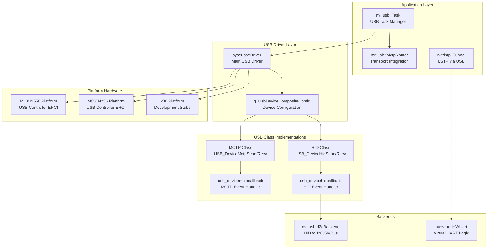
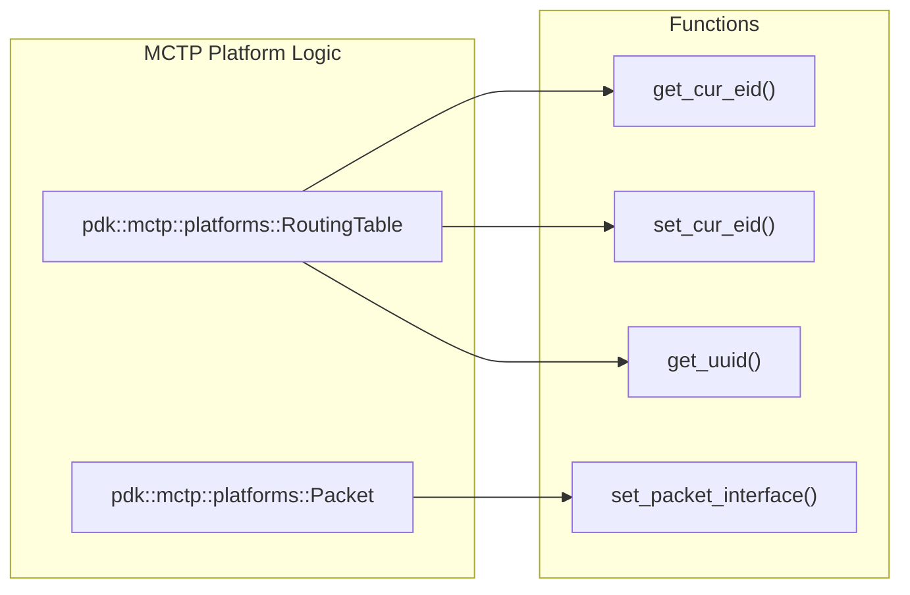
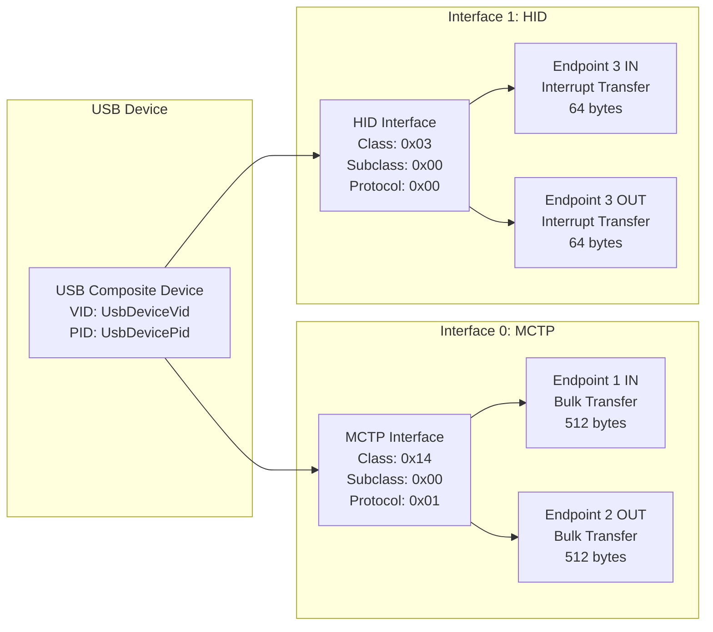
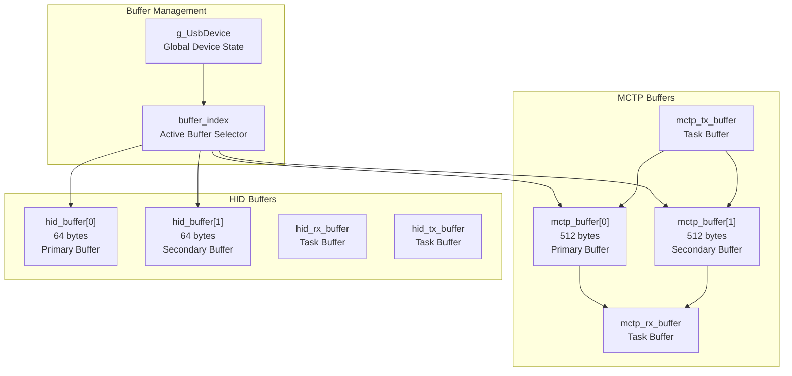

<!-- source: DeepWiki mcp.deepwiki.com · repo NVIDIA/OpenSMA · page 5.1 USB Device Driver · fetched 2026-10-26 -->

# USB Device Driver

<details>
<summary>Relevant source files</summary>

The following files were used as context for generating this wiki page:

- [corepdk/modules/mctp-cpp/src/platforms/x86/pdk-mctp-platforms-packet-plat.cpp](corepdk/modules/mctp-cpp/src/platforms/x86/pdk-mctp-platforms-packet-plat.cpp)
- [corepdk/modules/mctp-cpp/src/platforms/x86/pdk-mctp-platforms-router-plat.cpp](corepdk/modules/mctp-cpp/src/platforms/x86/pdk-mctp-platforms-router-plat.cpp)

</details>


## Purpose and Scope

The USB Device Driver provides a composite USB device implementation that supports both MCTP (Management Component Transport Protocol) and HID (Human Interface Device) classes. This driver serves as the physical transport layer for the MCTP protocol stack, enabling secure device management communications over USB. The driver is designed for embedded platforms including MCX N556 and MCX N236, and provides x86 stubs for development and testing.

In addition to standard USB classes, the driver supports **LSTP (Low-Speed Transport Protocol)** tunneling, which facilitates UART-over-USB communication via the `vruart` (Virtual Remote UART) subsystem.

For information about the MCTP protocol implementation that uses this driver, see [MCTP Core Services](#4.1). For details about the USB task that coordinates driver operations, see [Inter-Process Communication](#5.3).

Sources: [src/nv/usb/task.h:31-134](), [src/nv/lstp/lstp.h:1-50](), [src/nv/vruart/vruart.h:1-40]()

## System Architecture

The USB Device Driver implements a layered architecture with platform-specific implementations and a common interface layer.

### USB Driver Architecture



Sources: [src/sys/mcxn556/sys/usb/usb.cpp:1-541](), [src/nv/usb/task.h:31-134](), [src/nv/usb/hid_smb.h:20-50]()

## MCTP Platform Integration

The MCTP implementation over USB utilizes platform-specific packet and routing logic defined in the `pdk::mctp::platforms` namespace. This allows the USB driver to interact with the MCTP stack using standardized EIDs (Endpoint IDs) and UUIDs.

### MCTP Packet and Routing Entities



| Function | File | Description |
|----------|------|-------------|
| `get_cur_eid` | [corepdk/modules/mctp-cpp/src/platforms/x86/pdk-mctp-platforms-router-plat.cpp:24-32]() | Retrieves the current EID for a specific USB/MCTP interface. |
| `set_cur_eid` | [corepdk/modules/mctp-cpp/src/platforms/x86/pdk-mctp-platforms-router-plat.cpp:34-37]() | Updates the routing table with a new EID for the interface. |
| `get_uuid` | [corepdk/modules/mctp-cpp/src/platforms/x86/pdk-mctp-platforms-router-plat.cpp:39-42]() | Returns the device UUID associated with the MCTP stack. |
| `set_packet_interface` | [corepdk/modules/mctp-cpp/src/platforms/x86/pdk-mctp-platforms-packet-plat.cpp:41-44]() | Sets the interface type (e.g., USB) in the MCTP packet private header. |

Sources: [corepdk/modules/mctp-cpp/src/platforms/x86/pdk-mctp-platforms-router-plat.cpp:22-43](), [corepdk/modules/mctp-cpp/src/platforms/x86/pdk-mctp-platforms-packet-plat.cpp:20-59]()

## Composite Device Configuration

The USB device presents as a composite device supporting both MCTP and HID interfaces simultaneously. The composite configuration is controlled by the `USB_CONFIG_COMPOSITE` preprocessor definition.

### Device Configuration Structure



Sources: [src/sys/mcxn556/sys/usb/usb_device_descriptor.h:30-106](), [src/sys/mcxn556/sys/usb/usb_device_descriptor.cpp:402-554]()

| Configuration | Value | Description |
|---------------|--------|-------------|
| Device Class | 0xEF (Miscellaneous) | Composite device class |
| Device Subclass | 0x02 (Common Class) | Common composite subclass |
| Device Protocol | 0x01 (IAD) | Interface Association Descriptor protocol |
| Max Power | 0x32 (100mA) | Power consumption |
| Configuration Count | 1 | Single configuration |

Sources: [src/sys/mcxn556/sys/usb/usb_device_descriptor.h:69-73]()

## HID Class and I2C Backend

The HID class provides interrupt transfer endpoints primarily for SMBus/I2C operations. The `nv::usb::I2cBackend` bridges HID reports to physical I2C transactions.

### HID Event Handling

The HID class processes various events through the `Driver::usb_devicehidcallback` function:

| Event | Handler Function | Purpose |
|-------|------------------|---------|
| `kUSB_DeviceHidEventGetReport` | Report ID processing | Handle host requests for specific reports |
| `kUSB_DeviceHidEventSetReport` | `nv::usb::HidSmb` | Process SMBus configuration commands via I2C backend |
| `kUSB_DeviceHidEventSendResponse` | Send completion | Handle transmission completion |
| `kUSB_DeviceHidEventRecvResponse` | Receive processing | Process received data from host |

Sources: [src/sys/mcxn556/sys/usb/usb.cpp:76-198](), [src/nv/usb/hid_smb.h:20-40]()

## LSTP and Virtual UART (vruart)

The driver supports **LSTP (Low-Speed Transport Protocol)**, which allows for UART-like communication over the USB transport. This is implemented via the `vruart` (Virtual Remote UART) subsystem.

- **LSTP Tunnel**: Wraps data in LSTP frames for reliable delivery over USB.
- **vruart**: Provides a stream-based interface that mimics a hardware UART, allowing standard logging and console tools to operate over the USB connection.

Sources: [src/nv/lstp/lstp.h:1-50](), [src/nv/vruart/vruart.h:1-40]()

## Platform-Specific Implementations

The USB driver provides platform-specific implementations for different target platforms while maintaining a common interface.

### Hardware Controller Integration

| Platform | USB Controller | Features |
|----------|----------------|----------|
| MCX N556 | EHCI (USB 2.0) | Full-speed and high-speed support |
| MCX N236 | EHCI (USB 2.0) | Full-speed and high-speed support |
| x86 | Simulated | Development and testing only |

The driver includes interrupt handlers and VBUS detection for the EHCI controllers:

- `USB1_HS_IRQHandler()` - USB interrupt service routine
- `Driver::check_vbus()` - VBUS status detection

Sources: [src/sys/mcxn556/sys/usb/usb.cpp:317-333]()

## Task and Event Management

The USB driver integrates with the system's task-based architecture through the `nv::usb::Task` class, which coordinates USB operations with the rest of the system.

### USB Task Event Flow

```mermaid
stateDiagram-v2
    [*] --> Initialization
    
    Initialization --> WaitingForAttach : Driver::init()
    
    WaitingForAttach --> DeviceAttached : kUSB_DeviceEventSetConfiguration
    
    DeviceAttached --> ProcessingEvents : set_device_attach_event()
    
    ProcessingEvents --> MctpReceive : set_mctp_rx0_event()
    ProcessingEvents --> MctpTransmit : MctpTxBit
    ProcessingEvents --> HidReceive : set_hid_rx_event()
    ProcessingEvents --> TxComplete : set_mctp_tx_done_event()
    
    MctpReceive --> ProcessingEvents : mctp_receive()
    MctpTransmit --> ProcessingEvents : transmit()
    HidReceive --> ProcessingEvents : hid_receive()
    TxComplete --> ProcessingEvents : check_tx_done_status()
    
    ProcessingEvents --> WaitingForAttach : kUSB_DeviceEventBusReset
    
    ProcessingEvents --> [*] : System shutdown
```

Sources: [src/nv/usb/task.h:46-79](), [src/sys/mcxn556/sys/usb/usb.cpp:335-534]()

### Event Bit Definitions

The USB task uses specific event bits for coordination:

| Event Bit | Purpose | Set By |
|-----------|---------|--------|
| `MctpTxBit` | MCTP transmit request | Application layer |
| `MctpRxBit` | MCTP receive completed | USB interrupt |
| `MctpTxDoneBit` | MCTP transmit completed | USB interrupt |
| `AttachBit` | Device enumeration complete | USB interrupt |
| `ResetBit` | USB bus reset occurred | USB interrupt |
| `HidRxBit` | HID receive completed | USB interrupt |

Sources: [src/nv/usb/task.h:46-56]()

## Buffer Management

The driver implements a dual-buffer system for both MCTP and HID data transfers to enable continuous operation without blocking.

### Buffer Architecture



Sources: [src/sys/mcxn556/sys/usb/usb.cpp:223-241](), [src/nv/usb/task.h:107-117]()

### Buffer Size Configuration

| Buffer Type | Size | Purpose |
|-------------|------|---------|
| MCTP buffers | 512 bytes | `USB_MCTP_OUT_BUFFER_LENGTH` |
| HID buffers | 64 bytes | `USB_HID_GENERIC_OUT_BUFFER_LENGTH` |
| Task buffers | Variable | Application-level processing |

Sources: [src/sys/mcxn556/sys/usb/usb_device_descriptor.h:42-83]()

---

