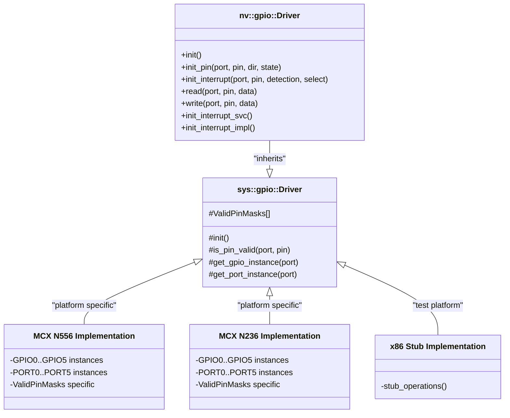
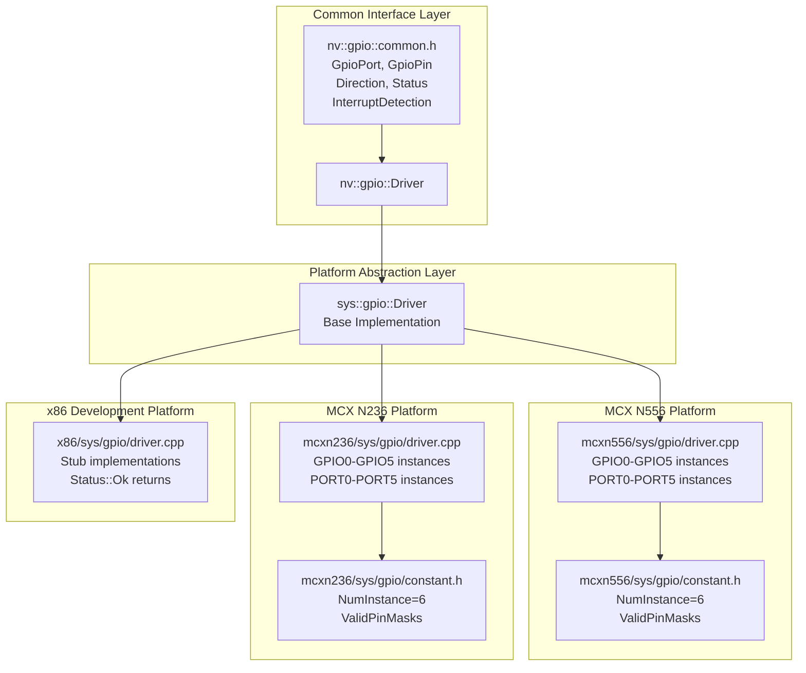
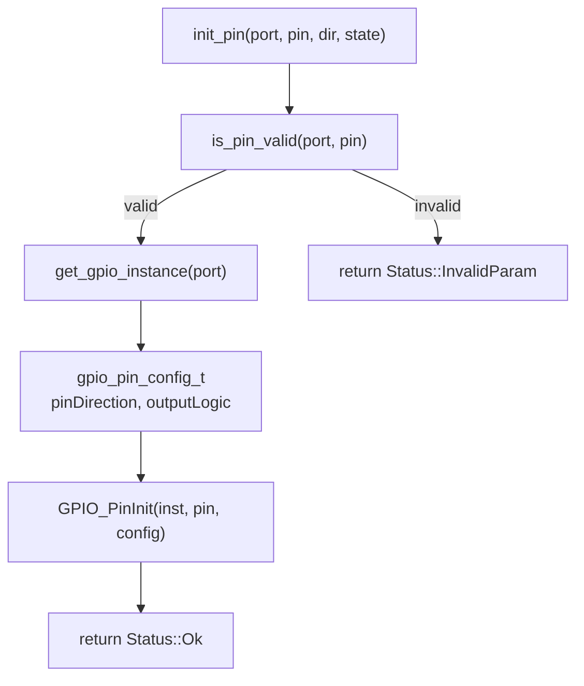
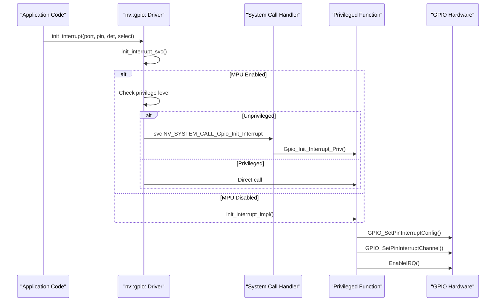
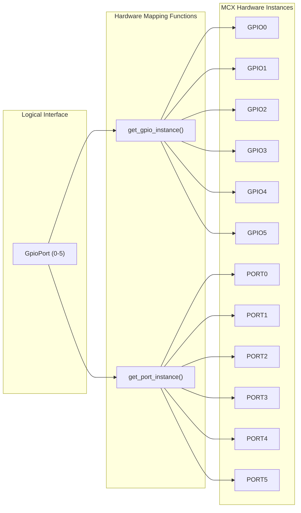
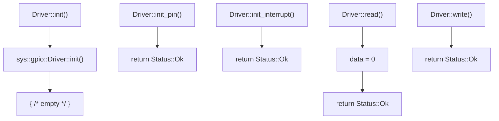

<!-- source: DeepWiki mcp.deepwiki.com · repo NVIDIA/OpenSMA · page 5.2 GPIO Driver System · fetched 2026-10-26 -->

# GPIO Driver System

Relevant source files

The following files were used as context for generating this wiki page:

- [corepdk/modules/mctp-cpp/src/platforms/x86/pdk-mctp-platforms-control-plat.cpp](corepdk/modules/mctp-cpp/src/platforms/x86/pdk-mctp-platforms-control-plat.cpp)

## Purpose and Scope

The GPIO Driver System provides a platform-agnostic interface for General Purpose Input/Output (GPIO) pin control across multiple hardware platforms. This system supports MCX N556 and MCX N236 production hardware platforms, with x86 stub implementations for development and testing purposes. The driver handles basic GPIO operations including pin initialization, interrupt configuration, and read/write operations while maintaining security through Memory Protection Unit (MPU) integration and privileged access control.

For information about other hardware drivers, see [Hardware Drivers](#5). For inter-process communication mechanisms, see [Inter-Process Communication](#5.3).

## Architecture Overview

The GPIO driver implements a two-layer architecture with platform abstraction:

**Sources:** [src/nv/gpio/driver.h:24-48](), [src/sys/mcxn556/sys/gpio/driver.h:30-48](), [src/sys/mcxn236/sys/gpio/driver.h:30-48](), [src/sys/x86/sys/gpio/driver.h:20-28]()

## Platform Implementation Structure

The system provides concrete implementations for each supported platform with hardware-specific configurations:

**Sources:** [src/nv/gpio/driver.h:19-50](), [src/nv/gpio/common.h:20-62](), [src/sys/mcxn556/sys/gpio/constant.h:22-41](), [src/sys/mcxn236/sys/gpio/constant.h:22-41]()

## Core GPIO Operations

The GPIO driver provides five primary operations accessible through the `nv::gpio::Driver` class:

| Operation | Function | Purpose | Platform Support |
|-----------|----------|---------|-------------------|
| Initialization | `init()` | Initialize GPIO subsystem and enable non-privileged access | All platforms |
| Pin Setup | `init_pin(port, pin, dir, state)` | Configure pin direction and initial state | All platforms |
| Interrupt Setup | `init_interrupt(port, pin, detection, select)` | Configure GPIO interrupts with MPU protection | MCX platforms only |
| Read Operation | `read(port, pin, data)` | Read current pin state (input/output) | All platforms |
| Write Operation | `write(port, pin, data) ` | Set output pin state | All platforms |

### GPIO Pin Initialization

The `init_pin` function configures GPIO pins with direction and initial state:

**Sources:** [src/sys/mcxn556/sys/gpio/driver.cpp:125-143](), [src/sys/mcxn236/sys/gpio/driver.cpp:125-143]()

## Security and MPU Integration

The GPIO driver implements security through Memory Protection Unit (MPU) integration, particularly for interrupt configuration:

### System Call Mechanism

The `init_interrupt` function uses a system call mechanism to ensure privileged access:

**Sources:** [src/sys/mcxn556/sys/gpio/driver.cpp:153-184](), [src/sys/mcxn556/sys/gpio/driver.cpp:34-43]()

## Platform-Specific Pin Validation

Each platform defines valid GPIO pins through bitmasks in the `ValidPinMasks` array:

### MCX N556 Pin Configuration

| GPIO Port | Valid Pin Mask | Description |
|-----------|----------------|-------------|
| GPIO0 | `0xFFFFFFF8` | Pins 3-31 available |
| GPIO1 | `0xC0FFFFFF` | Pins 0-25, 30-31 available |
| GPIO2 | `0x00000FFF` | Pins 0-11 available |
| GPIO3 | `0x00FFFFFF` | Pins 0-23 available |
| GPIO4 | `0x00FFF0FF` | Pins 0-7, 12-23 available |
| GPIO5 | `0x000003FF` | Pins 0-9 available |

### MCX N236 Pin Configuration

| GPIO Port | Valid Pin Mask | Description |
|-----------|----------------|-------------|
| GPIO0 | `0x3FFFF0FF` | Pins 0-7, 12-29 available |
| GPIO1 | `0xFF0FFFFF` | Pins 0-19, 24-31 available |
| GPIO2 | `0xFFFFFFFF` | All pins 0-31 available |
| GPIO3 | `0xFFF7FFC7` | Pins 0-2, 6-14, 16-30 available |
| GPIO4 | `0xFFFFFFFF` | All pins 0-31 available |
| GPIO5 | `0xFFFFFCFF` | Pins 0-7, 10-31 available |

**Sources:** [src/sys/mcxn556/sys/gpio/constant.h:27-32](), [src/sys/mcxn236/sys/gpio/constant.h:27-32]()

## Hardware Instance Mapping

The driver maps logical GPIO ports to hardware instances through platform-specific functions:

### GPIO and PORT Instance Resolution

**Sources:** [src/sys/mcxn556/sys/gpio/driver.cpp:69-123](), [src/sys/mcxn236/sys/gpio/driver.cpp:69-123]()

## Interrupt Configuration

The GPIO driver supports comprehensive interrupt configuration with multiple detection modes and interrupt channel selection:

### Interrupt Detection Types

The `InterruptDetection` enum supports five detection modes:

| Detection Mode | Hardware Mapping | Use Case |
|----------------|------------------|----------|
| `InterruptRising` | `kGPIO_InterruptRisingEdge` | Edge-triggered on rising signal |
| `InterruptFalling` | `kGPIO_InterruptFallingEdge` | Edge-triggered on falling signal |
| `InterruptBothEdge` | `kGPIO_InterruptEitherEdge` | Edge-triggered on both transitions |
| `InterruptHigh` | `kGPIO_InterruptLogicOne` | Level-triggered on high state |
| `InterruptLow` | `kGPIO_InterruptLogicZero` | Level-triggered on low state |

### Interrupt Channel Assignment

Each GPIO port supports two interrupt channels (`InterruptSelect0` and `InterruptSelect1`), mapped to hardware IRQ numbers using the formula:
`IRQn_Type = GPIO00_IRQn + (port * InterruptPerPort) + select`

**Sources:** [src/sys/mcxn556/sys/gpio/driver.cpp:202-231](), [src/nv/gpio/common.h:40-53](), [src/sys/mcxn556/sys/gpio/constant.h:26]()

## x86 Platform Stub Implementation

The x86 platform provides stub implementations for development and testing purposes. All GPIO operations return `Status::Ok` without performing actual hardware operations:

This allows the same GPIO driver interface to be used across development (x86) and production (MCX) environments without code changes.

**Sources:** [src/sys/x86/sys/gpio/driver.cpp:24-55]()

---

