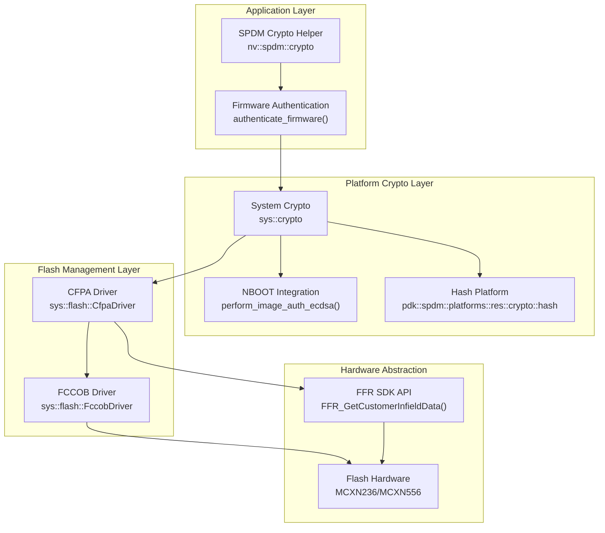
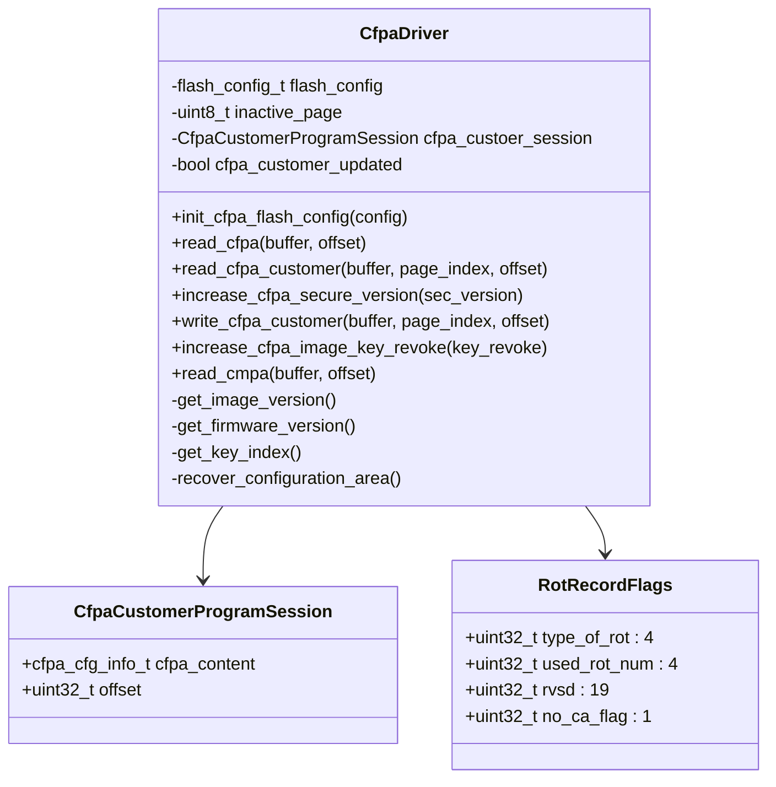
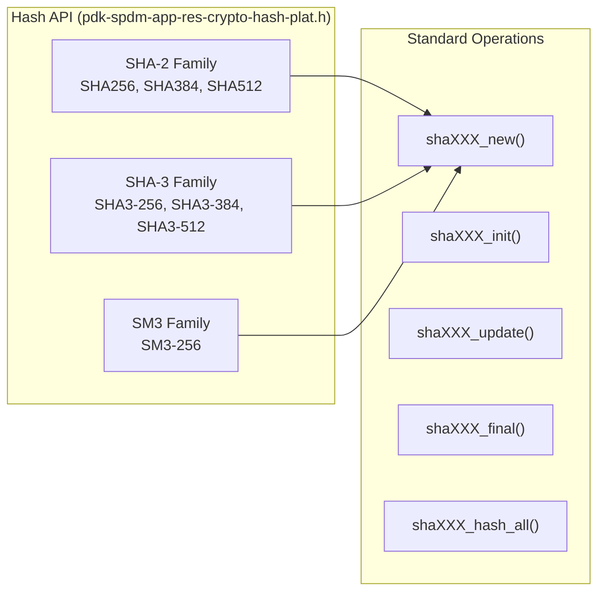
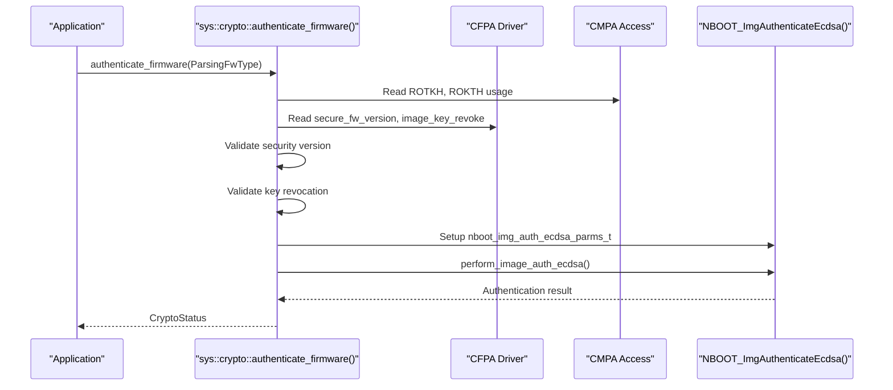
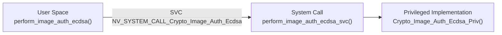
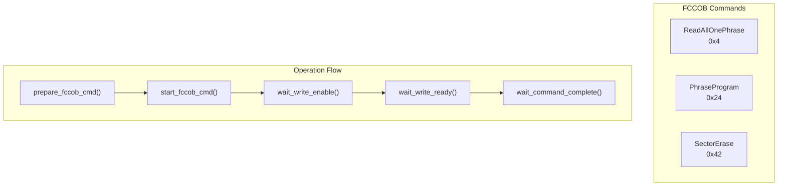
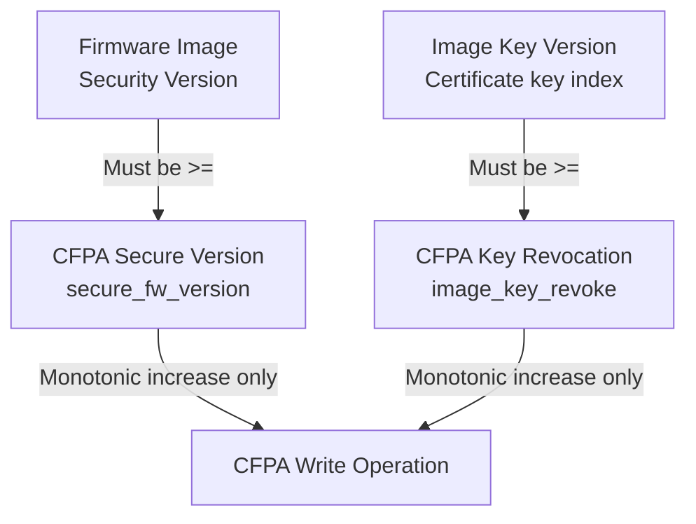

<!-- source: DeepWiki mcp.deepwiki.com · repo NVIDIA/OpenSMA · page 5.4 Flash and Crypto Management · fetched 2026-10-26 -->

# Flash and Crypto Management

Relevant source files

The following files were used as context for generating this wiki page:

- [corepdk/modules/spdm/src/app/crypto/cert/pdk-spdm-app-res-crypto-cert-plat.h](corepdk/modules/spdm/src/app/crypto/cert/pdk-spdm-app-res-crypto-cert-plat.h)
- [corepdk/modules/spdm/src/app/crypto/hash/pdk-spdm-app-res-crypto-hash-plat.h](corepdk/modules/spdm/src/app/crypto/hash/pdk-spdm-app-res-crypto-hash-plat.h)

This page covers the flash memory management and cryptographic operations that provide secure storage and authentication services in OpenSMA. The system manages Customer Field Programmable Areas (CFPA) and Customer Manufacturing Programmable Areas (CMPA) for secure configuration storage, implements cryptographic operations for the SPDM protocol, and provides firmware authentication services through NBOOT integration.

For information about the logging system that uses flash storage, see [Logging System](#6.2). For details about the bootloader that manages secure firmware updates, see [Bootloader and Watchdog](#6.1).

## System Architecture

The flash and crypto management system consists of several interconnected components that provide secure storage and authentication services:

**Sources:** [src/nv/spdm/spdm_crypto_helper.h:1-121](), [src/sys/mcxn236/sys/crypto/crypto.cpp:1-232](), [src/sys/mcxn236/sys/flash/cfpa_driver.h:1-126](), [src/sys/mcxn236/sys/flash/fccob.h:1-102](), [corepdk/modules/spdm/src/app/crypto/hash/pdk-spdm-app-res-crypto-hash-plat.h:1-64]()

## CFPA Driver System

The Customer Field Programmable Area (CFPA) driver manages secure configuration storage across dual-page flash memory areas. The system provides anti-rollback protection through version management and supports secure firmware updates.

### CFPA Driver Class Structure

### CFPA Memory Layout

| Component | Size | Offset | Description |
|-----------|------|--------|-------------|
| CFPA Configuration | 0x200 | 0x0 | Secure firmware version, key revocation |
| CFPA Customer Area | 0x1000 | 0x200 | Application-specific configuration data |
| CMPA Area | 0x200 | N/A | Root of Trust key hash, manufacturing data |

**Key Constants:**
- `CfpaStart`: 0x1000000 - Base address of CFPA area
- `CfpaPageOffset`: 0x2000 - Offset between dual pages
- `CfpaVersionAuto`: 0xFFFFFF - Automatic version increment

**Sources:** [src/sys/mcxn236/sys/flash/cfpa_driver.h:78-89](), [src/sys/mcxn547/sys/flash/cfpa_driver.h:78-89](), [src/sys/mcxn236/sys/flash/cfpa_driver.cpp:25-480]()

## Cryptographic Services

The cryptographic services provide ECDSA signing and verification, hash functions, and firmware authentication capabilities for the SPDM protocol.

### SPDM Hash Platform Interface

The system defines a platform-agnostic hash interface in the `pdk::spdm::platforms::res::crypto::hash` namespace to support various SHA algorithms required by SPDM.

### SPDM Crypto Helper Operations

| Operation | Implementation Detail |
|-----------|-----------------------|
| `spdm_hash_data()` | SHA-384 using mbedtls or platform hash |
| `spdm_ecdsa_sign()` | SECP384R1 signing |
| `spdm_ecdsa_verify()` | Signature verification |
| `spdm_random_data()` | mbedtls_ctr_drbg |

**Sources:** [corepdk/modules/spdm/src/app/crypto/hash/pdk-spdm-app-res-crypto-hash-plat.h:6-64](), [src/nv/spdm/spdm_crypto_helper.h:57-81](), [src/nv/spdm/spdm_crypto_helper.cpp:84-247]()

## System Crypto and NBOOT Integration

The system crypto layer provides platform-specific cryptographic operations with secure boot integration through NXP's NBOOT library.

### Firmware Authentication Flow

### MPU System Call Integration

The system provides privileged cryptographic operations through MPU system calls:

**Sources:** [src/sys/mcxn236/sys/crypto/crypto.cpp:48-231]()

## Flash Operations (FCCOB Driver)

The Flash Command Complete Operations Buffer (FCCOB) driver provides low-level flash memory operations including read, write, and erase functionality.

### FCCOB Command Structure

### FSTAT Register Structure

The Flash Status Register (`FstatReg`) provides status and control information:

| Field | Bits | Description |
|-------|------|-------------|
| `fail` | 0 | Command failure indicator |
| `cmdabt` | 2 | Command abort indicator |
| `pviol` | 4 | Protection violation |
| `accerr` | 5 | Access error |
| `ccif` | 7 | Command complete interrupt flag |
| `perdy` | 31 | Program/erase ready |

**Sources:** [src/sys/mcxn236/sys/flash/fccob.h:33-101]()

## Security Features

### Anti-Rollback Protection

The system implements comprehensive anti-rollback protection through multiple version checks:

### Root of Trust Configuration

The system manages Root of Trust keys through CMPA and certificate parsing:

| Component | Location | Purpose |
|-----------|----------|---------|
| Root Key Hash | CMPA offset 0x060 | SHA-384 hash of root public keys |
| Root Key Usage | CFPA offset 0x054 | Key usage flags (4 keys x 3 bits each) |
| Key Revocation | CFPA offset 0x018 | Revoked key mask |
| Certificate Block | Firmware manifest | Public key certificates and signatures |

**Sources:** [src/sys/mcxn236/sys/crypto/crypto.cpp:142-229](), [src/sys/mcxn236/sys/flash/cfpa_driver.cpp:421-463]()

## Platform Support

The flash and crypto management system supports multiple MCX platforms with identical interfaces but platform-specific implementations:

| Platform | CFPA Driver | Crypto Implementation |
|----------|-------------|----------------------|
| MCXN236 | [src/sys/mcxn236/sys/flash/cfpa_driver.h]() | [src/sys/mcxn236/sys/crypto/crypto.cpp]() |
| MCXN547 | [src/sys/mcxn547/sys/flash/cfpa_driver.h]() | Similar to MCXN236 |
| MCXN556 | [src/sys/mcxn556/sys/flash/cfpa_driver.h]() | Platform hash and cert helpers |

**Sources:** [src/sys/mcxn236/sys/flash/cfpa_driver.h:1-126](), [src/sys/mcxn547/sys/flash/cfpa_driver.h:1-126](), [corepdk/modules/spdm/src/app/crypto/hash/pdk-spdm-app-res-crypto-hash-plat.h:1-64]()

---

