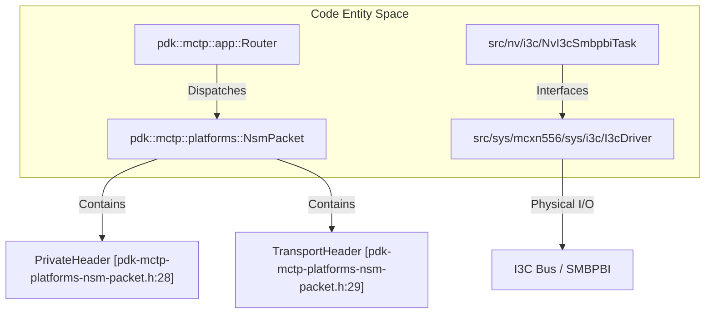
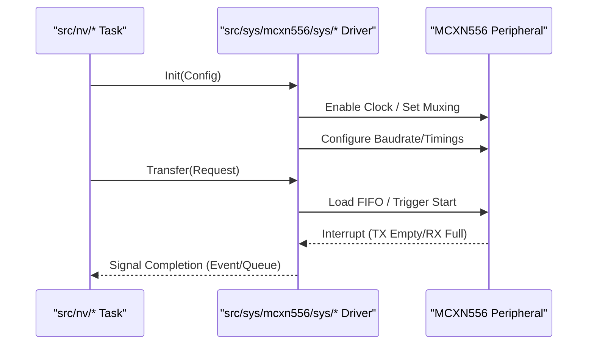

<!-- source: DeepWiki mcp.deepwiki.com · repo NVIDIA/OpenSMA · page 5.5 I2C, I3C, and SPI Drivers · fetched 2026-10-26 -->

# I2C, I3C, and SPI Drivers

Relevant source files

The following files were used as context for generating this wiki page:

- [corepdk/modules/mctp-cpp/src/platforms/x86/pdk-mctp-platforms-nsm-packet.h](corepdk/modules/mctp-cpp/src/platforms/x86/pdk-mctp-platforms-nsm-packet.h)

The I2C, I3C, and SPI driver subsystem provides the physical and data-link layer abstractions necessary for communication with sensors, EEPROMs, GPUs (via SMBPBI), and external flash memory. These drivers are partitioned into hardware-agnostic logic (residing in `src/nv/`) and platform-specific implementations for the NXP MCXN556 (residing in `src/sys/mcxn556/sys/`).

## I2C and SMBus Drivers

The I2C subsystem handles standard sensor communication and SMBus protocols. It supports both master and slave operations, primarily used for environmental monitoring and persistent storage access.

### Implementation and Data Flow

The I2C driver architecture separates the high-level request handling from the low-level peripheral register access. 

1.  **Request Layer**: High-level components (like `NvI2cSensor`) initiate transactions by providing a bus ID, slave address, and data buffer.
2.  **Hardware Abstraction Layer (HAL)**: The platform-specific code in `src/sys/mcxn556/sys/i2c/` manages the MCXN556 LPI2C (Low Power I2C) peripheral.
3.  **Interrupt Handling**: Transactions are typically non-blocking, utilizing interrupts to signal completion or error states to the calling task.

### Key Components

| Class/Entity | Location | Description |
| :--- | :--- | :--- |
| `I2cDriver` | `src/sys/mcxn556/sys/i2c/` | Manages hardware initialization, clock gating, and pin muxing for I2C instances. |
| `NvI2cEeprom` | `src/nv/i2c/` | Implements the logic for reading/writing to standard I2C EEPROMs with page-boundary handling. |
| `NvI2cSensor` | `src/nv/i2c/` | Base class for various sensors (temperature, voltage) connected via I2C. |

**Sources:** `src/nv/i2c/`, `src/sys/mcxn556/sys/i2c/`

## I3C and SMBPBI Communication

The I3C driver is specifically optimized for high-speed communication with NVIDIA GPUs using the **SMBPBI (SMBus Post-Box Interface)** protocol. This allows the MCXN556 to act as a management controller for the GPU.

### SMBPBI Protocol over I3C

The I3C implementation supports Improved Direct Data Command (IDDC) and handles the transition between I2C-compatible mode and high-speed I3C mode.

1.  **MCTP Integration**: The I3C driver serves as a transport for MCTP packets, allowing PLDM and SPDM messages to flow to the GPU.
2.  **Private Header Handling**: As seen in `NsmPacket` [corepdk/modules/mctp-cpp/src/platforms/x86/pdk-mctp-platforms-nsm-packet.h:26-33](), packets are wrapped with a `PrivateHeader` before being dispatched over the physical link.

### I3C Driver Architecture

The following diagram illustrates the relationship between the MCTP stack and the I3C physical layer:

**I3C MCTP Transport Mapping**

**Sources:** `corepdk/modules/mctp-cpp/src/platforms/x86/pdk-mctp-platforms-nsm-packet.h`, `src/nv/i3c/`, `src/sys/mcxn556/sys/i3c/`

## SPI and SPB Drivers

The SPI driver subsystem manages communication with external Flash memory and the Serial Peripheral Bus (SPB). This is critical for firmware storage, logging, and high-speed peripheral interfacing.

### SPI Flash Management

The SPI Flash driver provides an abstraction for standard NOR flash commands (Read, Page Program, Sector Erase).

*   **Concurrency**: Access to the SPI bus is protected by mutexes to prevent collisions between different tasks (e.g., the Logger task and the Firmware Update task).
*   **DMA Integration**: For large data transfers, such as firmware image writes, the SPI driver utilizes the MCXN556 DMA controller to minimize CPU overhead.

### SPB (Serial Peripheral Bus)

The SPB driver in `src/nv/spi/` provides a higher-level protocol layer over the raw SPI driver, often used for internal chip-to-chip communication or specialized sensor arrays.

| Component | File Path | Role |
| :--- | :--- | :--- |
| `SpiDriver` | `src/sys/mcxn556/sys/spi/` | Low-level LPSPI peripheral control and configuration. |
| `NvSpiFlash` | `src/nv/spi/` | Logic for JEDEC ID detection and flash-specific command sets. |
| `SpiTransaction` | `src/nv/spi/` | Encapsulates a single SPI transfer (MOSI/MISO buffers and length). |

**Sources:** `src/nv/spi/`, `src/sys/mcxn556/sys/spi/`

## Driver Hardware Abstraction Layer (HAL)

The platform-specific implementations for the MCXN556 follow a consistent pattern to ensure portability across different NXP SoC variants.

### Peripheral Initialization Sequence

The following diagram demonstrates the typical lifecycle of a peripheral driver (I2C/I3C/SPI) within the system:

**Peripheral Driver Lifecycle**

### Packet Structure for Management Protocols

When these drivers are used for management protocols (like NSM over I3C), they utilize specific packet structures defined in the MCTP platform layer. For instance, the `NsmPacket` structure defines a fixed data length of 256 bytes [corepdk/modules/mctp-cpp/src/platforms/x86/pdk-mctp-platforms-nsm-packet.h:25]().

**NsmPacket Structure [corepdk/modules/mctp-cpp/src/platforms/x86/pdk-mctp-platforms-nsm-packet.h:26-45]():**
*   `PrivateHeader priv`: Platform-specific routing/metadata.
*   `TransportHeader hdr`: Standard MCTP transport header.
*   `msg`: The actual message body (PLDM, SPDM, or Vendor-defined).
*   `to_span()`: Helper function to convert the packet to a `std::span<uint8_t>` for driver transmission [corepdk/modules/mctp-cpp/src/platforms/x86/pdk-mctp-platforms-nsm-packet.h:34-37]().

**Sources:** `corepdk/modules/mctp-cpp/src/platforms/x86/pdk-mctp-platforms-nsm-packet.h`, `src/sys/mcxn556/sys/`

---

