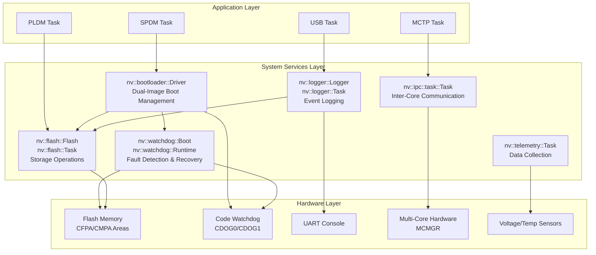
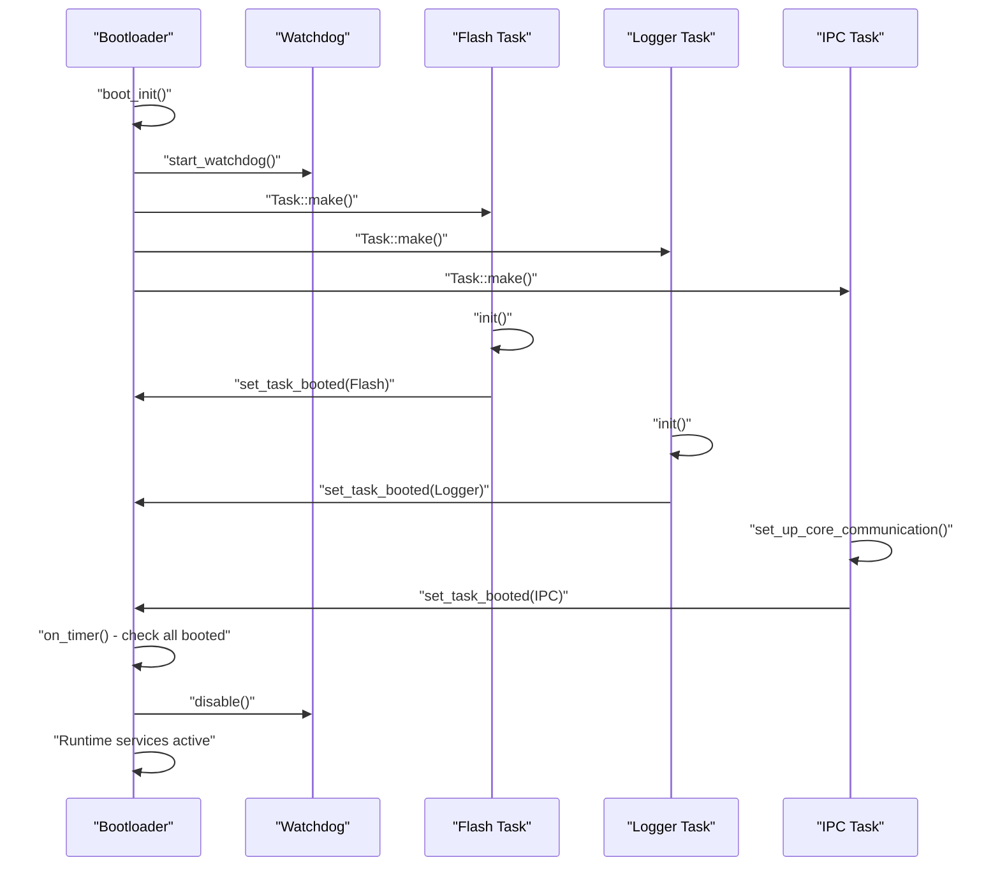
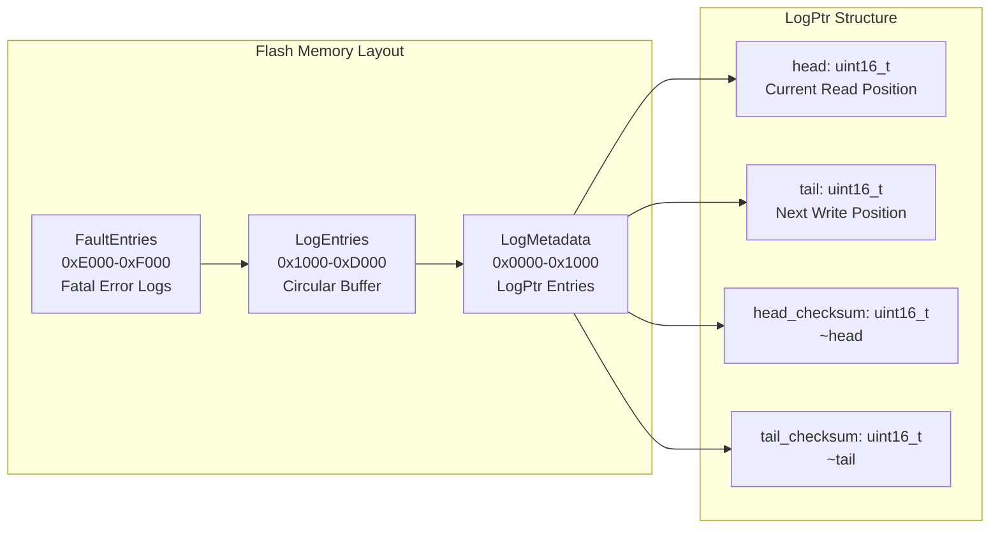
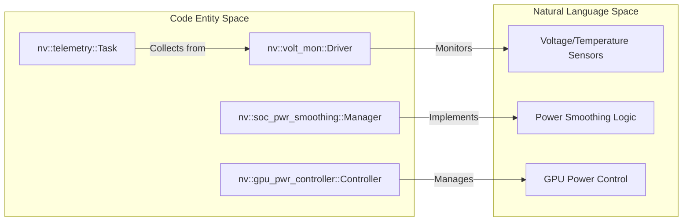
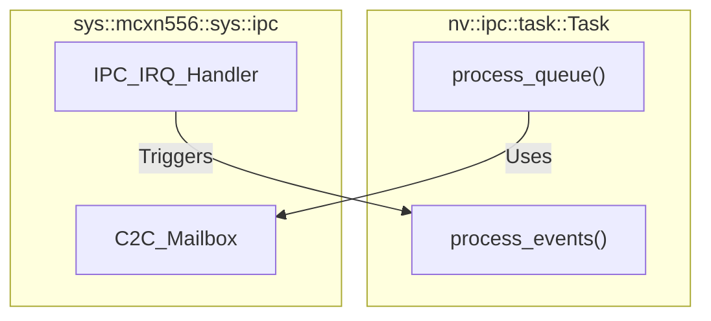

<!-- source: DeepWiki mcp.deepwiki.com · repo NVIDIA/OpenSMA · page 6 System Services · fetched 2026-10-26 -->

# System Services

Relevant source files

The following files were used as context for generating this wiki page:

- [corepdk/modules/pldm-fd/src/platforms/x86/pdk-pldm-plat.adb](corepdk/modules/pldm-fd/src/platforms/x86/pdk-pldm-plat.adb)

This document covers the core system services that provide fundamental runtime support for the OpenSMA system. These services include bootloader functionality, watchdog management, event logging, telemetry, power management, and inter-process communication.

For information about specific hardware drivers, see [Hardware Drivers](#5). For details about security protocols that run on these system services, see [Security Protocols](#3).

## System Services Architecture

System services form the foundation layer that supports all higher-level protocols and applications. They provide essential capabilities like secure boot, fault recovery, persistent storage, and inter-task communication.

### System Services Overview

**Sources:** [src/nv/bootloader.h:28-93](), [src/nv/logger/task.cpp:31-58](), [src/nv/flash/task.cpp:31-47](), [src/nv/ipc/ipc_task.cpp:28-64]()

### Service Initialization Flow

The system services follow a carefully orchestrated initialization sequence to ensure proper dependency management and fault tolerance.

**Sources:** [src/sys/mcxn556/sys/bootloader/bootloader.cpp:157-343](), [src/nv/flash/task.cpp:186-194](), [src/nv/logger/task.cpp:316-363]()

## Bootloader and Watchdog

The `nv::bootloader::Driver` class provides secure dual-image boot functionality with fault recovery capabilities. It manages image authentication via a firmware parser and handles automatic failover if a boot fails. The watchdog system provides two-tier fault detection: boot-time watchdog (`nv::watchdog::Boot`) monitors initial system startup, while runtime watchdog monitors ongoing task health.

For details, see [Bootloader and Watchdog](#6.1).

### Key Bootloader Components

| Component | Function | Implementation |
|-----------|----------|----------------|
| `current_boot_index()` | Determine active boot slot | [src/sys/mcxn556/sys/bootloader/bootloader.cpp:50-60]() |
| `boot_init()` | Initialize boot process | [src/sys/mcxn556/sys/bootloader/bootloader.cpp:157-343]() |
| `run_on_index()` | Switch to specific image | [src/sys/mcxn556/sys/bootloader/bootloader.cpp:37-48]() |
| `check_boot_reason()` | Analyze reset causes | [src/sys/mcxn556/sys/bootloader/bootloader.cpp:70-142]() |

**Sources:** [src/nv/bootloader.h:52-91](), [src/sys/mcxn556/sys/bootloader/bootloader.cpp:1-683]()

## Logging System

The logging system (`nv::logger::Logger` and `nv::logger::Task`) provides comprehensive event logging with flash persistence and UART console output capabilities. It includes specialized handling for diagnostic faults and ISR-safe logging.

For details, see [Logging System](#6.2).

### Log Storage Organization

The logging system uses a circular buffer in flash memory with metadata for tracking head/tail pointers.

**Sources:** [src/nv/logger/common.h:300-320](), [src/nv/logger/log.cpp:263-302](), [src/nv/logger/common.h:30-33]()

## Telemetry and Power Management

The telemetry and power management subsystems handle the collection of sensor data and the control of system power states. This includes voltage and temperature monitoring (`nv::volt_mon`), SoC power smoothing, and GPU power controller management. The `nv::telemetry` module provides a centralized cache for this data to be queried by management protocols like PLDM.

For details, see [Telemetry and Power Management](#6.3).

### Telemetry Entity Mapping

**Sources:** [src/nv/telemetry/task.cpp:45-80](), [src/nv/volt_mon/volt_mon.cpp:20-55](), [src/nv/soc_pwr_smoothing/soc_pwr_smoothing.cpp:15-40]()

## Inter-Process Communication (IPC)

The IPC system enables communication between multiple CPU cores (Core0 and Core1) using shared memory and stream buffers. It is managed by the `nv::ipc::task::Task` and utilizes hardware mailboxes (C2C) for signaling.

### IPC Code Mapping

**Sources:** [src/nv/ipc/ipc_task.cpp:66-110](), [src/nv/ipc/ipc_task.cpp:177-210](), [src/sys/mcxn556/sys/ipc/ipc.cpp:50-95]()

## Service Integration Summary

The system services are tightly integrated to provide comprehensive system management:

- **Bootloader-Watchdog Integration**: Boot watchdog monitors system startup and triggers image failover on boot failures.
- **Logging-Flash Integration**: Event logging uses flash services for persistent storage with circular buffer management.
- **Telemetry-Management Integration**: Telemetry data is cached and formatted for delivery via PLDM/MCTP.
- **IPC-Task Integration**: Multi-core communication enables distributed processing across CPU cores.

**Sources:** [src/sys/mcxn556/sys/bootloader/bootloader.cpp:400-535](), [src/nv/logger/task.cpp:316-504](), [src/nv/flash/task.cpp:186-293](), [src/nv/ipc/ipc_task.cpp:112-156]()

---

