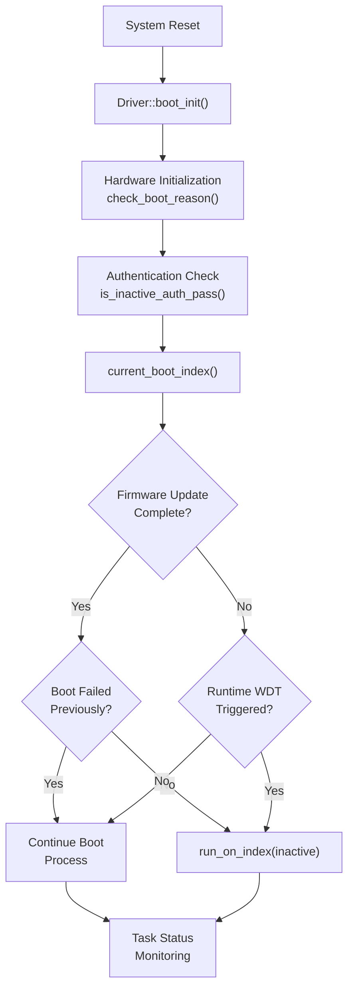
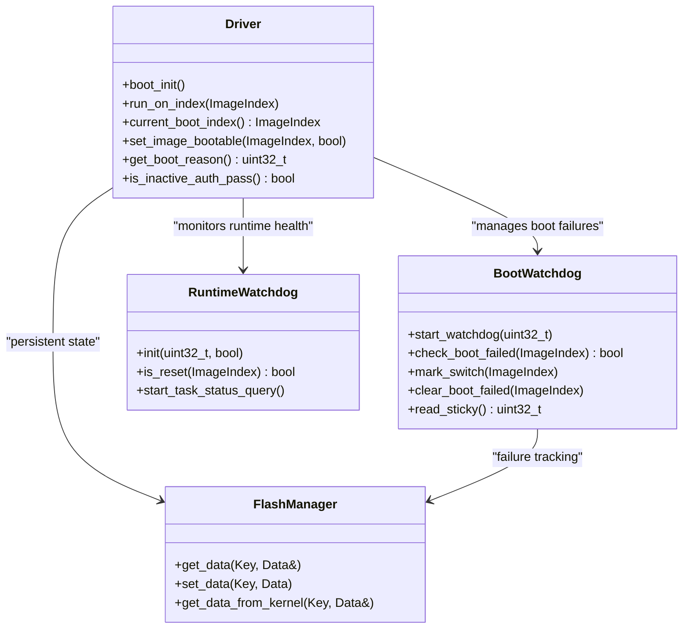
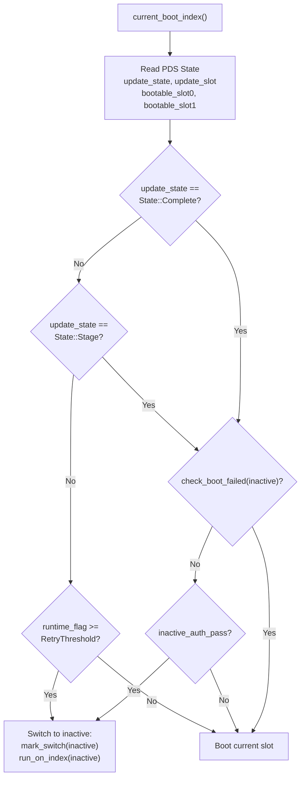
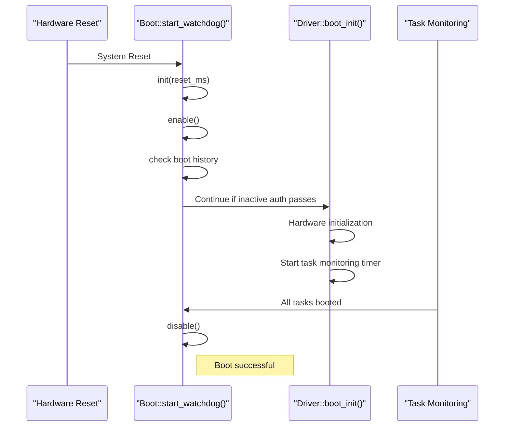
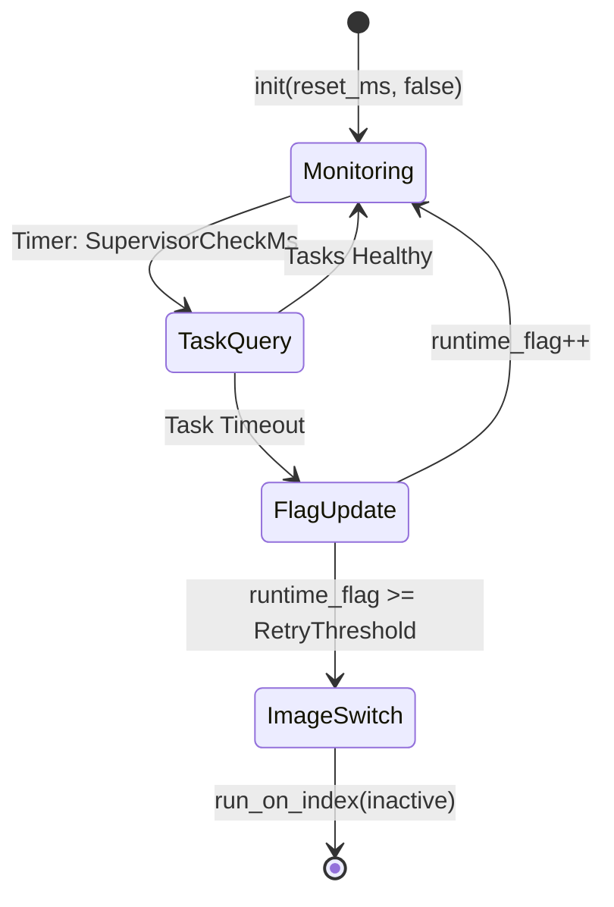
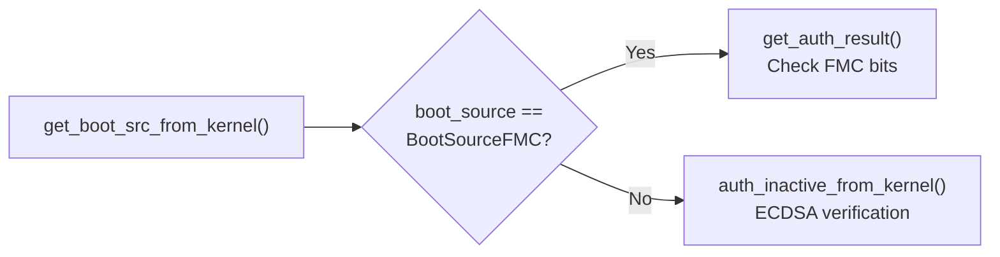
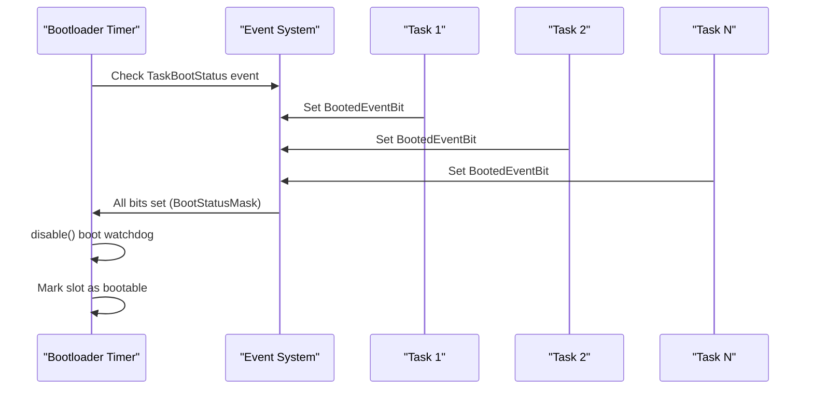

<!-- source: DeepWiki mcp.deepwiki.com · repo NVIDIA/OpenSMA · page 6.1 Bootloader and Watchdog · fetched 2026-10-26 -->

# Bootloader and Watchdog

Relevant source files

The following files were used as context for generating this wiki page:

- [corepdk/modules/pldm-fd/src/app/pdk-pldm-hook-plat.ads](corepdk/modules/pldm-fd/src/app/pdk-pldm-hook-plat.ads)
- [corepdk/modules/pldm-fd/src/platforms/x86/pdk-pldm-hook-plat.adb](corepdk/modules/pldm-fd/src/platforms/x86/pdk-pldm-hook-plat.adb)

This document covers the bootloader and watchdog systems in OpenSMA, which provide secure boot functionality with dual-image support and comprehensive fault recovery mechanisms. The bootloader manages the selection and execution of firmware images, while the watchdog systems monitor boot and runtime health to ensure system reliability.

For information about flash memory management used by the bootloader, see [Flash and Crypto Management](#5.4). For logging of boot events, see [Logging System](#6.2).

## Overview

The bootloader and watchdog system implements a robust dual-image boot architecture with automatic failover capabilities. It supports two firmware image slots (Image0 and Image1) and uses both boot-time and runtime watchdogs to detect failures and automatically switch to a working firmware image when necessary.

## Architecture

### Boot Flow Decision Making

Sources: [src/sys/mcxn556/sys/bootloader/bootloader.cpp:157-343](), [src/sys/mcxn236/sys/bootloader/bootloader.cpp:157-343]()

### Component Relationships

Sources: [src/nv/bootloader.h:28-91](), [src/nv/watchdog/boot.h:20-55](), [src/nv/watchdog/runtime.h:20-45]()

## Dual-Image Boot Management

The system maintains two firmware image slots with independent bootability tracking.

### Image Management

| Component | Description | Flash Keys |
|-----------|-------------|------------|
| **Image0** | Primary firmware slot | `PdsBootableSlot0` |
| **Image1** | Secondary firmware slot | `PdsBootableSlot1` |
| **Update State** | Firmware update progress | `PdsUpdateState`, `PdsUpdateSlot` |
| **Boot Tracking** | Historical boot information | Watchdog sticky registers |

### Boot Slot Selection Logic

Sources: [src/sys/mcxn556/sys/bootloader/bootloader.cpp:177-299](), [src/sys/mcxn236/sys/bootloader/bootloader.cpp:177-299]()

## Watchdog Systems

### Boot Watchdog (CDOG)

The boot watchdog (CDOG) monitors the initial system startup and switches to an alternate image if boot fails. It uses persistent storage to track boot failures across resets.

**BootFailedRecord Structure:**
- `slot0_failed`: Failure status and counters for Image0
- `slot1_failed`: Failure status and counters for Image1  
- `prev_try_boot_slot`: Last attempted boot slot
- `prev_booted_slot`: Last successful boot slot
- Runtime flags for each slot

Sources: [src/sys/mcxn556/sys/watchdog/boot.cpp:92-156](), [src/sys/mcxn556/sys/watchdog/boot.cpp:261-294]()

### Runtime Watchdog (WWDT)

The runtime watchdog (WWDT) monitors ongoing system health by querying the status of registered tasks via the Supervisor.

Sources: [src/sys/mcxn556/sys/bootloader/bootloader.cpp:515-526](), [src/nv/watchdog/runtime.h:20-45]()

## Boot Authentication and Security

The system verifies firmware authenticity using multiple methods to ensure only trusted code is executed.

### Authentication Flow

1. **FMC Authentication** (when available): Hardware-based verification.
2. **NBOOT Authentication** (fallback): Software-based ECDSA verification using stored keys.

**Authentication Components:**
- **CMPA Configuration**: Root key hash and usage permissions.
- **CFPA Configuration**: Firmware version and key revocation.
- **ECDSA P-384**: Signature verification algorithm.
- **Root Key Management**: Up to 4 root keys with individual revocation.

Sources: [src/sys/mcxn556/sys/watchdog/boot.cpp:381-499](), [src/sys/mcxn556/sys/bootloader/bootloader.cpp:229-240]()

## Boot Reason Detection and Fault Recovery

### Reset Cause Analysis

The bootloader identifies and logs various reset sources by reading hardware registers.

| Reset Type | CMC_SRS Bit | Description |
|------------|-------------|-------------|
| Power-on | `CMC_SRS_POR_MASK` | Initial power application |
| Watchdog | `CMC_SRS_CDOG0_MASK` | Boot watchdog timeout |
| Runtime WDT | `CMC_SRS_WWDT1_MASK` | Runtime watchdog timeout |
| Software | `CMC_SRS_SW_MASK` | Programmatic reset |
| Security | `CMC_SRS_SECVIO_MASK` | Security violation |
| Fault | `CMC_SRS_LOCKUP_MASK` | CPU lockup condition |

### Fault Record Management

The system maintains comprehensive fault records to aid in post-mortem analysis.

**Application Fault Record:**
- Magic number validation (`ApplicationFaultMagic = 0xFAFA5A5A`)
- CFSR (Configurable Fault Status Register)
- HFSR (Hard Fault Status Register)  
- Event bits indicating which tasks failed

**FMC Fault Record:**
- Fault magic (`FmcFaultMagic = 0xABABABAB`)
- Memory fault addresses (MMFAR, BFAR)
- Processor fault status

Sources: [src/sys/mcxn556/sys/bootloader/bootloader.cpp:70-142](), [src/sys/mcxn556/sys/bootloader/bootloader.cpp:325-335]()

## Autonomous Health and Status (AHS)

The AHS subsystem (Autonomous Health and Status) provides higher-level health monitoring and reporting. It integrates with the watchdog system to report health metrics and status changes.

In the context of firmware updates, the PLDM layer utilizes platform hooks to update the health and update status of components.

| Hook Function | Purpose |
|---------------|---------|
| `Pldm_Hook_Set_Update_State` | Updates the status of a firmware component (Progress, Complete, Staged) | [corepdk/modules/pldm-fd/src/app/pdk-pldm-hook-plat.ads:103-107]() |
| `Pldm_Hook_Log_Fw_Update_Report` | Logs detailed metrics of the update process including retry counts and timings | [corepdk/modules/pldm-fd/src/app/pdk-pldm-hook-plat.ads:141-146]() |
| `Pldm_Hook_Handle_Activate` | Triggers the activation of a staged firmware image | [corepdk/modules/pldm-fd/src/app/pdk-pldm-hook-plat.ads:130-133]() |

Sources: [corepdk/modules/pldm-fd/src/app/pdk-pldm-hook-plat.ads:99-155]()

## Integration Points

### Task Boot Status Monitoring

The bootloader coordinates with all system tasks through event-based boot status reporting. Each system task reports successful initialization using `nv::ipc::BootedEventBits` enumeration.

### Flash Storage Integration

The bootloader uses both persistent data storage (PDS) and non-persistent data storage (NPDS):

**PDS Keys (Persistent):**
- Boot slot states (`PdsBootableSlot0`, `PdsBootableSlot1`)
- Update tracking (`PdsUpdateState`, `PdsUpdateSlot`)

**NPDS Keys (Runtime):**
- Boot reasons and fault records
- FMC status and authentication results
- Application fault information

Sources: [src/sys/mcxn556/sys/bootloader/bootloader.cpp:400-534](), [src/sys/mcxn556/sys/bootloader/bootloader.cpp:188-209]()

---

