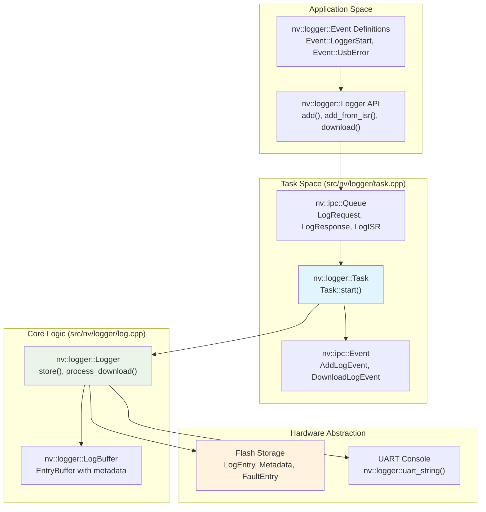
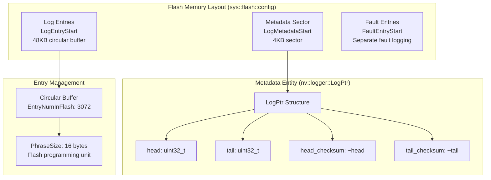
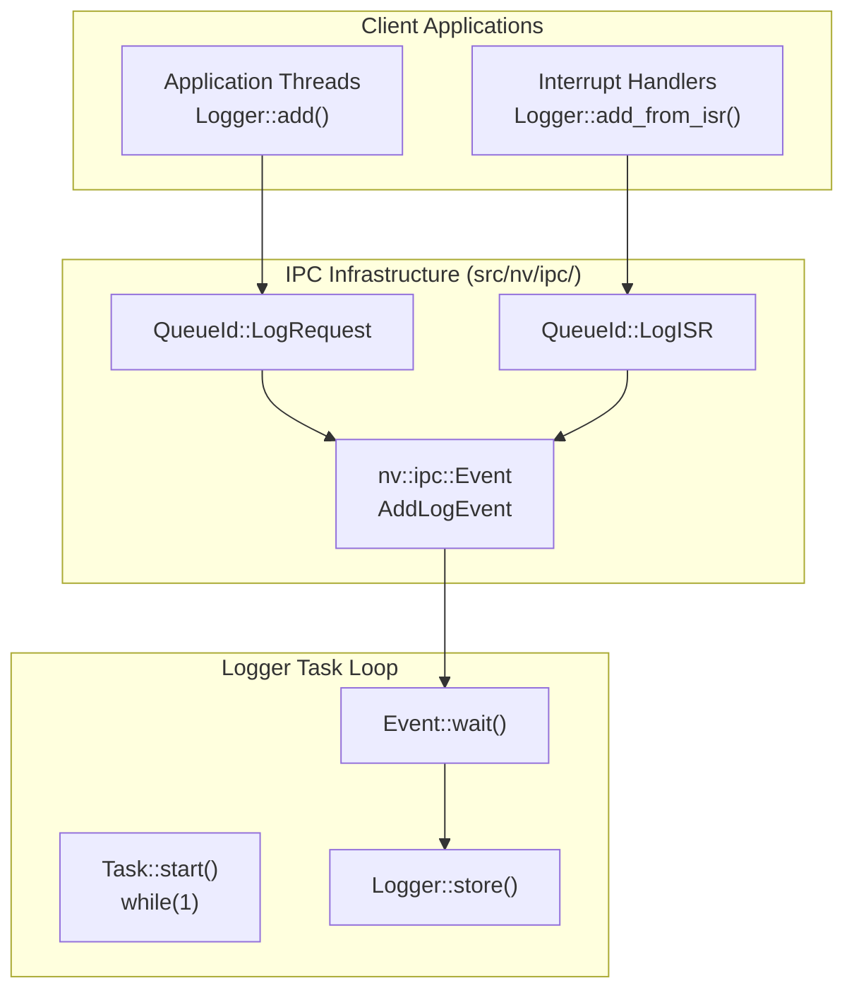

<!-- source: DeepWiki mcp.deepwiki.com · repo NVIDIA/OpenSMA · page 6.2 Logging System · fetched 2026-10-26 -->

# Logging System

<details>
<summary>Relevant source files</summary>

The following files were used as context for generating this wiki page:

- [corepdk/modules/pldm-fd/src/platforms/x86/pdk-pldm-plattypes.ads](corepdk/modules/pldm-fd/src/platforms/x86/pdk-pldm-plattypes.ads)

</details>


## Purpose and Scope

The Logging System provides comprehensive event logging capabilities with persistent flash storage, real-time console output, and remote download functionality. This system supports multi-level logging across all OpenSMA components with both synchronous and asynchronous operation modes, including interrupt-safe logging for critical system events.

For information about the Flash Management system that underlies persistent storage, see [Flash and Crypto Management](#5.4). For details about the IPC system used for task communication, see [Inter-Process Communication](#5.3).

## System Architecture

The logging system operates through a multi-component architecture centered around the `Logger` class and `Task` class, with flash-based persistence and UART console output.

### Code-to-System Mapping: Logging Architecture



Sources: [src/nv/logger/log.cpp:111-424](), [src/nv/logger/task.cpp:36-514](), [src/nv/logger/common.h:25-437]()

## Core Components

### Logger Class

The `Logger` class (defined in `src/nv/logger/log.h`) provides the core logging functionality with persistent flash storage and metadata management.

| Component | Purpose | Key Methods |
|-----------|---------|-------------|
| `Logger` | Main logging engine | `init()`, `store()`, `process_download()` |
| `LogBuffer` | In-memory buffer management | Contains `LogPtr`, `EntryBuffer`, metadata |
| `DownloadSession` | Log retrieval state machine | Manages multi-state download process |

The logger supports multiple output directions defined in the `OutputDirection` enum:
- `Console`: UART output only [src/nv/logger/common.h:253-253]()
- `Flash`: Persistent storage only [src/nv/logger/common.h:254-254]()
- `Both`: Both console and flash output [src/nv/logger/common.h:255-255]()

Sources: [src/nv/logger/log.h:34-98](), [src/nv/logger/common.h:252-258]()

### Event System

The logging system uses a comprehensive event classification system with predefined events across system components. Events are identified by a `uint16_t` `EventId` [src/nv/logger/common.h:59-59]().

| Event Structure Member | Type | Description |
|------------------------|------|-------------|
| `unique_id` | `uint16_t` | Unique identifier for the event type |
| `level` | `Level` | Severity: Debug, Info, Warning, Error, Critical |
| `data` | `EventData` | 8-byte payload array for context |

Sources: [src/nv/logger/common.h:43-51](), [src/nv/logger/common.h:59-226]()

## Flash Storage System

The logging system implements a flash-based storage system with metadata management and circular buffering to ensure persistence across reboots.

### Storage Layout and Code Entities



Sources: [src/nv/logger/common.h:283-320](), [src/nv/logger/log.cpp:263-332](), [src/nv/logger/log.h:116-121]()

### Storage Constants

| Constant | Value | Purpose |
|----------|-------|---------|
| `EntrySize` | 16 bytes | Size of single log entry [src/nv/logger/common.h:283-283]() |
| `EntryNumInFlash` | 3072 entries | Total flash capacity [src/nv/logger/common.h:285-285]() |
| `PhraseSize` | 16 bytes | Flash programming unit [src/nv/logger/common.h:298-298]() |

### Flash Operations

The logger implements flash operations through the `MemorySource` enum, supporting `LogEntry`, `Metadata`, and `FaultEntry` [src/nv/logger/common.h:260-265]().

Sources: [src/nv/logger/log.cpp:334-394]()

## Task Architecture and IPC

The logging system operates as a dedicated IPC task (`nv::logger::Task`) with event-driven processing.

### Task Communication Flow



### Event Processing

The logger task processes multiple event types through a unified event loop in `Task::start()` [src/nv/logger/task.cpp:316-514]():

| Event Bit | Purpose |
|-----------|---------|
| `AddLogEvent` | Regular logging requests via `LogRequest` queue |
| `AddLogISREvent` | Interrupt-safe logging via `LogISR` queue |
| `DownloadLogEvent` | Log download requests via `LogDownload` queue |
| `CleanLogEvent` | Clear all logs from flash |
| `DropLogEvent` | Notification that logs were dropped due to queue overflow |

Sources: [src/nv/logger/task.cpp:316-514](), [src/nv/logger/common.h:240-250]()

## Download System

The logging system provides log download capabilities through a multi-state state machine. This allows remote entities to retrieve the entire log buffer, fault data, and performance metrics.

### Download State Machine

The `DownloadSession` structure maintains state across the multi-phase download process [src/nv/logger/common.h:382-404]().

| Field | Purpose |
|-------|---------|
| `session` | Session identifier (0-254) |
| `state` | Current download state (Event, Fatal, Perf) |
| `ptr` | Current position in circular flash buffer |
| `event_tail` | End position for the current download session |

Sources: [src/nv/logger/log.cpp:401-737](), [src/nv/logger/common.h:382-404]()

## API and Usage

### Core Logging API

The logging system provides both synchronous and asynchronous logging interfaces in `src/nv/logger/log.h`:

```cpp
// Basic logging with predefined events
Status Logger::add(EventId event, Level level, EventData data, 
                   OutputDirection output, bool wait = false); [src/nv/logger/log.h:134-135]()

// ISR-safe logging
Status Logger::add_from_isr(EventId event, Level level, EventData data, 
                            OutputDirection output); [src/nv/logger/log.h:137-138]()
```

### Usage Examples

```cpp
// Log with two 32-bit values using helper
EventData data = data_from_two_u32(val1, val2); [src/nv/logger/common.h:431-437]()
Logger::add(Event::SomeEvent.unique_id, Level::Info, data, OutputDirection::Both);
```

Sources: [src/nv/logger/log.h:39-188](), [src/nv/logger/task.cpp:68-196]()

## Configuration and Constants

### Memory Configuration

| Setting | Value | Description |
|---------|-------|-------------|
| `LogMetadataStart` | `sys::flash::config::LoggerStartAddress` | Metadata sector start [src/nv/logger/common.h:288-288]() |
| `LogEntryStart` | `LogMetadataStart + 0x1000` | Log entries start (4KB offset) [src/nv/logger/common.h:289-289]() |
| `FlashSize` | 48KB | Total log flash allocation [src/nv/logger/common.h:284-284]() |

### Task Configuration

| Parameter | Value | Purpose |
|-----------|-------|---------|
| Stack Size | `configMINIMAL_STACK_SIZE + 512` | Logger task stack depth [src/nv/logger/task.cpp:52-52]() |
| Priority | `Priority::Logger` | Task scheduling priority [src/nv/logger/task.cpp:58-58]() |

Sources: [src/nv/logger/common.h:283-298](), [src/nv/logger/task.cpp:52-58]()

---

