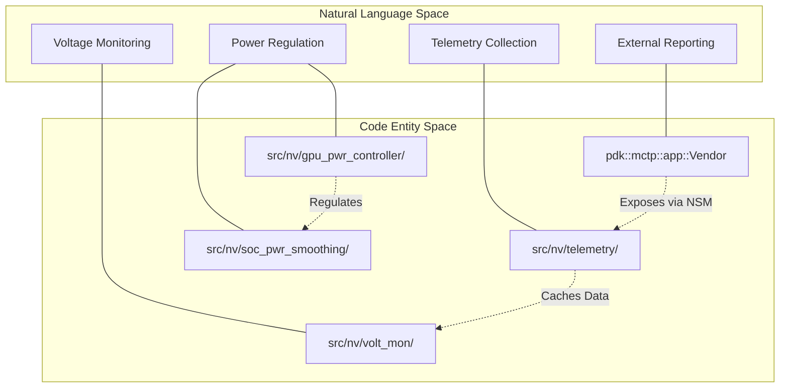
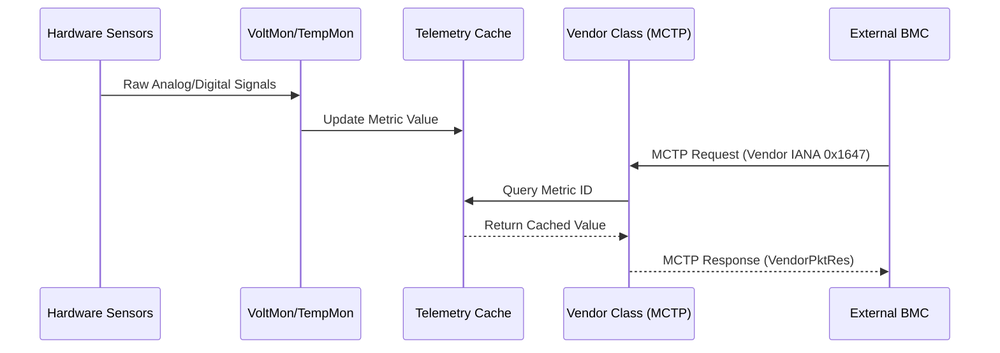

<!-- source: DeepWiki mcp.deepwiki.com · repo NVIDIA/OpenSMA · page 6.3 Telemetry and Power Management · fetched 2026-10-26 -->

# Telemetry and Power Management

<details>
<summary>Relevant source files</summary>

The following files were used as context for generating this wiki page:

- [corepdk/modules/mctp-cpp/src/app/pdk-mctp-app-vendor.cpp](corepdk/modules/mctp-cpp/src/app/pdk-mctp-app-vendor.cpp)
- [corepdk/modules/mctp-cpp/src/app/pdk-mctp-app-vendor.h](corepdk/modules/mctp-cpp/src/app/pdk-mctp-app-vendor.h)

</details>


The Telemetry and Power Management subsystems in OpenSMA provide a comprehensive framework for monitoring environmental conditions, managing power delivery to SoCs and GPUs, and exposing this data via standardized management protocols. These services ensure the operational health of the hardware by regulating voltages, smoothing power spikes, and maintaining a high-resolution telemetry cache for external monitoring tools.

## System Architecture

The telemetry and power infrastructure is organized into several specialized subsystems that interact with hardware sensors and the MCTP transport layer.

### Code Entity Space Mapping

The following diagram maps high-level system responsibilities to the specific C++ classes and files that implement them.

**Diagram: Telemetry and Power Subsystem Mapping**

Sources: [corepdk/modules/mctp-cpp/src/app/pdk-mctp-app-vendor.h:86-101](), [corepdk/modules/mctp-cpp/src/app/pdk-mctp-app-vendor.cpp:25-39]()

## Telemetry Data Collection

The telemetry subsystem (`src/nv/telemetry/`) acts as a centralized cache for all sensor data, including temperatures, voltages, and power consumption metrics. It decouples the high-frequency sampling required for power management from the asynchronous requests coming from external management controllers.

### Data Flow and Reporting

Data is exposed to external entities (such as a Baseboard Management Controller) through the NVIDIA Sensor Model (NSM) over MCTP. The `pdk::mctp::app::Vendor` class provides the foundation for handling these vendor-specific IANA messages (NVIDIA IANA `0x1647`).

**Diagram: Telemetry Data Flow**

Sources: [corepdk/modules/mctp-cpp/src/app/pdk-mctp-app-vendor.h:28-30](), [corepdk/modules/mctp-cpp/src/app/pdk-mctp-app-vendor.cpp:52-65]()

## Power Management Subsystems

OpenSMA implements sophisticated power control logic to protect hardware and optimize performance.

### GPU Power Controller
Located in `src/nv/gpu_pwr_controller/`, this subsystem manages the power sequencing and thermal throttling of the GPU. It monitors real-time power draw and interfaces with the VRMs (Voltage Regulator Modules) to adjust power limits dynamically.

### SoC Power Smoothing
The SoC Power Smoothing subsystem (`src/nv/soc_pwr_smoothing/`) is designed to mitigate transient power spikes. By monitoring high-frequency current telemetry, it can trigger rapid throttling mechanisms to ensure the SoC stays within its designated power envelope, preventing voltage droops that could lead to system instability.

### VPP and NHP
*   **VPP (Voltage Per Phase) Management**: Manages individual power phases for high-current rails, allowing for phase shedding to improve efficiency at low loads (`src/nv/vpp/`).
*   **NHP (Next-Gen High Power)**: Handles the high-power interface protocols and safety checks for high-wattage hardware components (`src/nv/nhp/`).

## Protocol Implementation (Vendor-Specific)

The `Vendor` class in `corepdk/modules/mctp-cpp/` manages the structure of telemetry requests and responses.

### Key Structures and Functions

| Entity | Description | File |
|:---|:---|:---|
| `VendorPktReq` | Structure for incoming NVIDIA-specific MCTP requests. | [corepdk/modules/mctp-cpp/src/app/pdk-mctp-app-vendor.h:31-56]() |
| `VendorPktRes` | Structure for outgoing telemetry responses including completion codes. | [corepdk/modules/mctp-cpp/src/app/pdk-mctp-app-vendor.h:58-84]() |
| `get_vendor_packet_type` | Identifies if a packet is a Request, Response, or Datagram. | [corepdk/modules/mctp-cpp/src/app/pdk-mctp-app-vendor.cpp:25-39]() |
| `fill_vendor_msg_header` | Populates the IANA and Command Code fields for responses. | [corepdk/modules/mctp-cpp/src/app/pdk-mctp-app-vendor.cpp:52-65]() |

### Response Header Construction
When responding to a telemetry query, the system must correctly map the incoming `instance_id` and `command_code` to the response packet to ensure the requester can correlate the data.

```cpp
void Vendor::fill_vendor_msg_header(const Packet& rx, Packet& tx) const
{
    auto& vrx           = VendorPktReq::from(rx);
    auto& vtx           = VendorPktRes::from(tx);
    vtx.msg_type        = MsgType::VendorIani;
    vtx.iana            = vrx.iana;  // nvidia = 0x1647
    vtx.instance_id     = vrx.instance_id;
    vtx.command_code    = vrx.command_code;
    // ...
}
```
Sources: [corepdk/modules/mctp-cpp/src/app/pdk-mctp-app-vendor.cpp:52-65]()

## Voltage Monitoring (VoltMon)

The `src/nv/volt_mon/` subsystem is responsible for:
1.  **ADC Sampling**: Periodically reading analog-to-digital converters connected to voltage rails.
2.  **Scaling**: Converting raw ADC counts into millivolts using calibration coefficients.
3.  **Threshold Checking**: Comparing current readings against Warning and Critical thresholds defined in the hardware specification.
4.  **Fault Propagation**: If a voltage exceeds a critical threshold, `VoltMon` triggers an immediate system-level fault via the `Logger` and may initiate an emergency power-down via the `GPU Power Controller`.

Sources: [corepdk/modules/mctp-cpp/src/app/pdk-mctp-app-vendor.cpp:41-50](), [corepdk/modules/mctp-cpp/src/app/pdk-mctp-app-vendor.h:86-101]()

---

