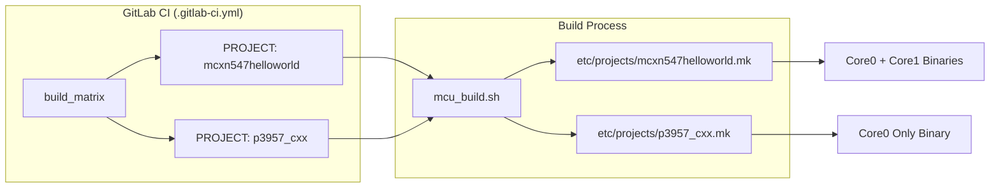

<!-- source: DeepWiki mcp.deepwiki.com · repo NVIDIA/OpenSMA · page 7 Project Configuration and Boards · fetched 2026-10-26 -->

# Project Configuration and Boards

<details>
<summary>Relevant source files</summary>

The following files were used as context for generating this wiki page:

- [.gitlab-ci.yml](.gitlab-ci.yml)
- [corepdk/modules/mctp-cpp/src/platforms/x86/pdk-mctp-platforms-enums.h](corepdk/modules/mctp-cpp/src/platforms/x86/pdk-mctp-platforms-enums.h)
- [corepdk/modules/pldm-fd/src/app/pdk-pldm-interfaces-plattypes.ads](corepdk/modules/pldm-fd/src/app/pdk-pldm-interfaces-plattypes.ads)

</details>


This section provides a high-level overview of how OpenSMA projects are structured, configured, and mapped to specific hardware boards. The project configuration system manages the complexity of a dual-core environment (NXP MCXN547/MCXN556), defining how tasks, queues, and hardware resources are distributed across Core0 and Core1.

The configuration is divided into three primary areas:
1.  **Project Definitions**: High-level task enums, buffer sizes, and protocol parameters located in `src/projects/`.
2.  **Board Support**: Low-level pin multiplexing, peripheral clocking, and hardware-specific initialization in `src/boards/`.
3.  **Build Rules**: Makefile logic in `etc/projects/` that links specific source sets and compiler flags to a target.

### Dual-Core Architecture and Task Mapping

OpenSMA utilizes a multi-core architecture where different system responsibilities are partitioned between Core0 and Core1. This partitioning is defined in the project-level `config.h` files. These files use enumerations to assign unique identifiers to tasks, FreeRTOS queues, and system events, ensuring that the Inter-Process Communication (IPC) system can route messages correctly between cores.

The following diagram illustrates how the project configuration bridges high-level application logic to the underlying hardware and multi-core IPC.

#### Project Configuration Mapping
```mermaid
graph TD
    subgraph "Project Configuration Space (src/projects/)"
        [config.h] --> ["TaskId Enum"]
        [config.h] --> ["QueueId Enum"]
        [config.h] --> ["EventId Enum"]
    end

    subgraph "Hardware Abstraction Space (src/boards/)"
        [board.h] --> ["Pin Muxing"]
        [pin_mux.c] --> ["GPIO Assignments"]
        [peripherals.c] --> ["LPI2C/LPUART Config"]
    end

    subgraph "Build System (etc/projects/)"
        [project.mk] --> ["Compiler Flags"]
        [project.mk] --> ["Source Inclusion"]
    end

    ["TaskId Enum"] -- "Routes to" --> ["IPC Task (src/nv/ipc/)"]
    ["Pin Muxing"] -- "Configures" --> ["GPIO Driver (src/nv/gpio/)"]
    ["Source Inclusion"] -- "Builds" --> ["Binary Artifact"]
```
Sources: [src/projects/mcxn547helloworld/config.h:1-100](), [src/boards/mcxn547helloworld/board.h:1-50]()

### Core Configuration Entities

The system relies on several key enums and constants to manage resource allocation. These are defined per project to allow different firmware images (e.g., a production image vs. a test runner) to utilize hardware differently.

| Entity | Purpose | Example File |
| :--- | :--- | :--- |
| `TaskId` | Identifies every active thread (MCTP, SPDM, Logger, etc.) across both cores. | `src/projects/mcxn547helloworld/config.h` |
| `QueueId` | Defines mailbox and message queue IDs for the `nv::ipc` system. | `src/projects/mcxn547helloworld/config.h` |
| `Interface` | Maps MCTP transport layers (USB, I2C, I3C) to physical hardware instances. | `corepdk/modules/mctp-cpp/src/platforms/x86/pdk-mctp-platforms-enums.h` |
| `NsmMsgType` | Defines NVIDIA-specific message types for telemetry and diagnostics. | `corepdk/modules/mctp-cpp/src/platforms/x86/pdk-mctp-platforms-enums.h` |

Sources: [corepdk/modules/mctp-cpp/src/platforms/x86/pdk-mctp-platforms-enums.h:24-47](), [corepdk/modules/mctp-cpp/src/platforms/x86/pdk-mctp-platforms-enums.h:125-135]()

### Build Matrix and CI Integration

The project configuration is tied directly to the GitLab CI pipeline via a build matrix. This matrix defines the valid combinations of `PROJECT`, `BOARD`, and `PLATFORM`. For example, the `mcxn547helloworld` project is mapped to the `mcxn556-both` platform (indicating dual-core deployment), while `p3957_cxx` is restricted to `mcxn556-core0`.

#### CI Build Matrix Flow

Sources: [.gitlab-ci.yml:18-27](), [.gitlab-ci.yml:53-57]()

---

### Sub-Pages

#### [mcxn547helloworld Project](#7.1)
The reference project for the NXP MCXN547 dual-core platform. It provides the standard configuration for LSTP (Low-Speed Transport Protocol) over USB, MCTP routing, and SPDM security parameters. This project serves as the template for dual-core task and queue mapping. For details, see [mcxn547helloworld Project](#7.1).

#### [p3957_cxx and testrunner Projects](#7.2)
Focuses on C++ and Ada integration. The `p3957_cxx` project is the primary C++ target for MCXN556 Core0, while the `testrunner` project is a specialized configuration used to execute unit tests within the target environment, including the generation of sign-parameters for secure boot validation. For details, see [p3957_cxx and testrunner Projects](#7.2).

---

