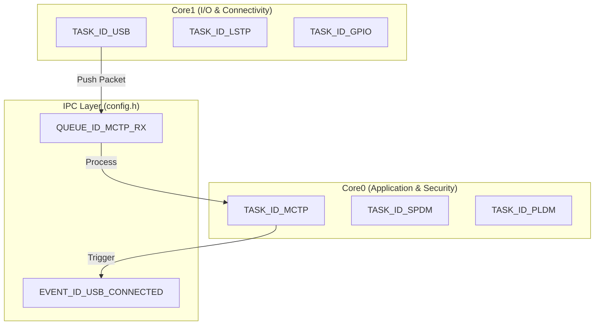
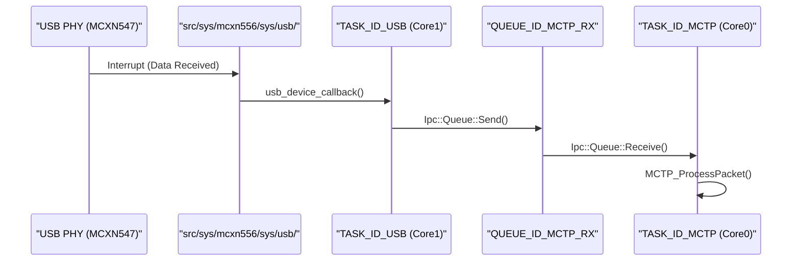

<!-- source: DeepWiki mcp.deepwiki.com · repo NVIDIA/OpenSMA · page 7.1 mcxn547helloworld Project · fetched 2026-10-26 -->

# mcxn547helloworld Project

Relevant source files

The following files were used as context for generating this wiki page:

- [.gitlab-ci.yml](.gitlab-ci.yml)
- [README.md](README.md)

The `mcxn547helloworld` project serves as the reference implementation and foundational template for the OpenSMA system on the NXP MCXN547 dual-core platform. It demonstrates the integration of the dual-core architecture (Core0 and Core1), the Management Component Transport Protocol (MCTP), Security Protocol and Data Model (SPDM), and the Low-Speed Transport Protocol (LSTP) over USB.

This project defines the system-wide configuration including task priorities, inter-process communication (IPC) identifiers, and hardware abstraction layers for the MCXN547 SoC.

## Project Configuration

The core of the project configuration is defined in `config.h`, which centralizes the orchestration of the dual-core environment. It utilizes FreeRTOS-based abstractions for task management and IPC.

### Task and Resource Identification
The project uses enumerated types to uniquely identify tasks, queues, and events across both cores. This ensures that IPC mechanisms like `Ipc::Queue` and `Ipc::Event` can route messages correctly between Core0 and Core1.

*   **Task IDs**: Defines all active tasks such as `TASK_ID_MCTP`, `TASK_ID_SPDM`, and `TASK_ID_USB` [src/projects/mcxn547helloworld/config.h:35-65]().
*   **Queue IDs**: Maps communication channels, for example, `QUEUE_ID_MCTP_RX` and `QUEUE_ID_USB_TX` [src/projects/mcxn547helloworld/config.h:73-95]().
*   **Event IDs**: Specifies synchronization primitives like `EVENT_ID_USB_CONNECTED` [src/projects/mcxn547helloworld/config.h:103-115]().

### Protocol Parameters
The project configures several high-level protocols:
1.  **MCTP**: Configures Endpoint IDs (EID) and transmission unit sizes.
2.  **SPDM**: Defines security capabilities and measurement thresholds for the MCXN547.
3.  **LSTP/USB**: Sets up the tunneling of serial data over USB HID/MCTP endpoints.

**Entity Mapping: Configuration to Execution**
The following diagram illustrates how `config.h` definitions bridge the logical "Task Space" to the physical "Dual-Core Execution Space".

**Project Task Orchestration**

Sources: [src/projects/mcxn547helloworld/config.h:35-115]()

## Build System Integration

The project is integrated into the Universal Build System (UBS) through specific Makefile rules and platform definitions. The build process targets the `mcxn556-both` platform, which triggers a synchronized compilation of both Core0 and Core1 images.

### Build Rules
Build configurations are stored in `etc/projects/`. These files define:
*   **Compiler Flags**: Optimization levels (typically `rel` for release) and architecture-specific flags for the ARM Cortex-M33.
*   **Linker Scripts**: Memory mapping for the dual-core flash layout.
*   **Artifact Generation**: The production of signed binaries using the `spsdk` tool [README.md:19-23]().

### Build Matrix
The project is a primary target in the CI/CD pipeline, ensuring that changes to the core modules do not break the reference implementation.

| Parameter | Value |
| :--- | :--- |
| **PROJECT** | `mcxn547helloworld` |
| **PLATFORM** | `mcxn556-both` |
| **BOARD** | `mcxn547helloworld` |
| **MODE** | `rel` |

Sources: [.gitlab-ci.yml:18-22](), [README.md:59-61]()

## Board Support Package (BSP)

The `src/boards/mcxn547helloworld/` directory contains the hardware-specific initialization code. This layer abstracts the NXP MCUXpresso SDK calls into the OpenSMA driver framework.

### Key Components
*   **Pin Muxing**: Configures the physical pins for USB, I2C, and UART peripherals.
*   **Clock Configuration**: Sets up the System PLL and peripheral clocks required for high-speed USB operation.
*   **Hardware Abstraction**: Implements the `board.h` interface used by `src/nv/` drivers to interact with the MCXN547 hardware.

**Data Flow: Hardware to Protocol**
The diagram below shows the flow of an MCTP message from the physical USB wire through the board-specific drivers into the project-defined tasks.

**MCTP over USB Data Flow**

Sources: [src/projects/mcxn547helloworld/config.h:40-80](), [README.md:39-41]()

## Development Environment

To build the `mcxn547helloworld` project, a specific toolchain and SDK environment are required. The project relies on the ARM GNU Toolchain and the NXP MCXN556S SDK (version 25.09.00).

### Setup Requirements
1.  **Toolchains**: ARM GNU Toolchain 14.2 and GNAT ARM ELF 14.2.1 (for Ada/SPDM components) [.gitlab-ci.yml:38-40]().
2.  **SDK**: MCXN556S SDK with mbedTLS, ELS PKC, and FreeRTOS components [README.md:39-41]().
3.  **Patching**: The SDK must be patched using `mcu.patch.xz` to ensure compatibility with the OpenSMA dual-core IPC and flash management logic [README.md:50-52]().

Sources: [README.md:5-52](), [.gitlab-ci.yml:35-51]()

---

