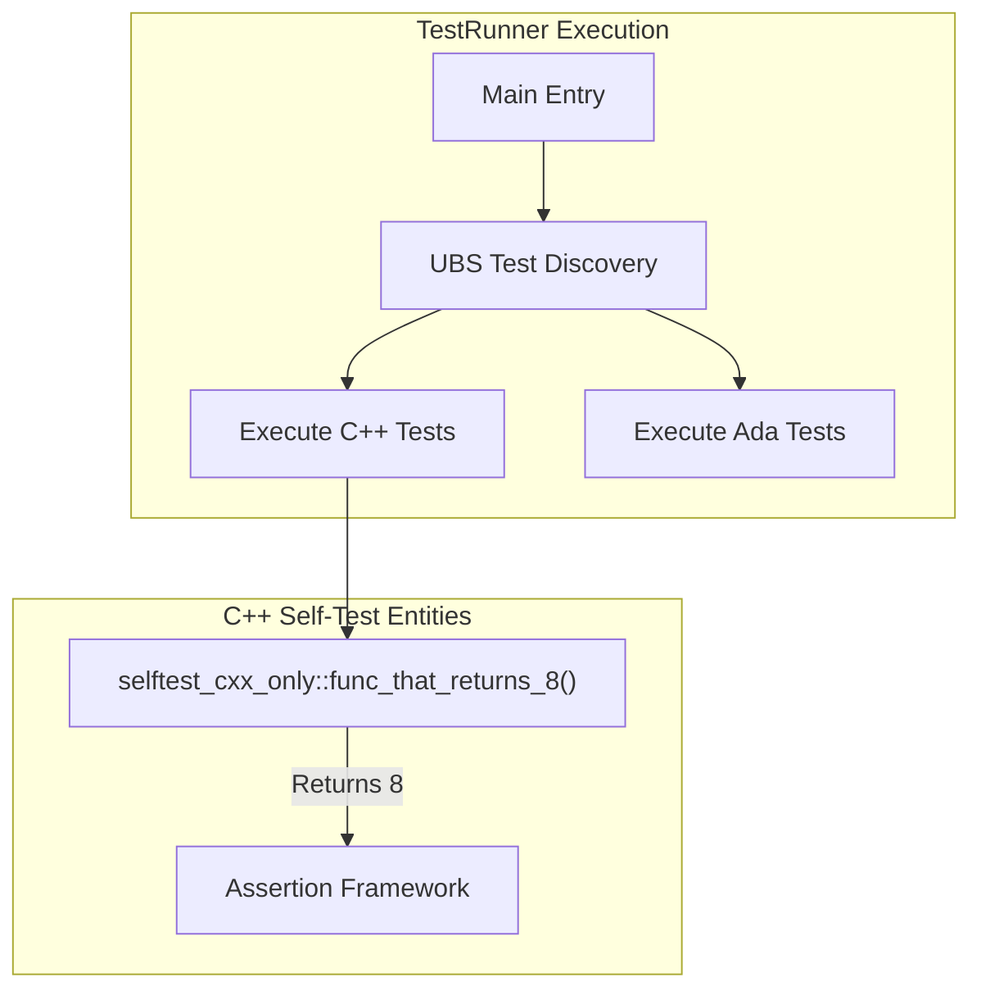
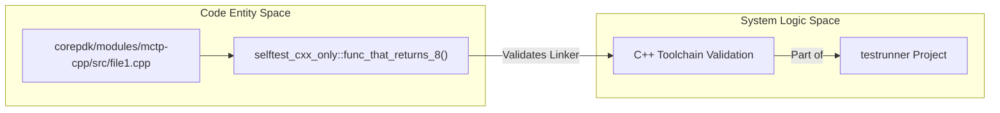

<!-- source: DeepWiki mcp.deepwiki.com · repo NVIDIA/OpenSMA · page 7.2 p3957_cxx and testrunner Projects · fetched 2026-10-26 -->

# p3957_cxx and testrunner Projects

Relevant source files

The following files were used as context for generating this wiki page:

- [corepdk/modules/mctp-cpp/src/file1.cpp](corepdk/modules/mctp-cpp/src/file1.cpp)
- [corepdk/modules/mctp-cpp/src/file1.hpp](corepdk/modules/mctp-cpp/src/file1.hpp)
- [corepdk/modules/pldm-fd/src/file1.cpp](corepdk/modules/pldm-fd/src/file1.cpp)

The `p3957_cxx` project represents the primary C++ implementation for the NVIDIA OpenSMA firmware targeted at the NXP MCXN556 microcontroller (Core0). It serves as the production-ready configuration for secure device management. Complementing this, the `testrunner` project provides a specialized environment for executing unit tests, facilitating the integration of Ada and C++ components and validating system logic through a suite of self-tests.

## p3957_cxx Project Configuration

The `p3957_cxx` project is the standard C++ reference for the MCXN556 platform. It integrates the core management protocols (SPDM, PLDM, MCTP) and hardware drivers into a cohesive firmware image.

### Project Structure and Hardware Mapping
The project is split between generic project logic and board-specific hardware definitions:
*   **Project Logic**: Located in `src/projects/p3957_cxx/`, this directory contains the `config.h` and main application entry points that define task priorities, queue sizes, and software-level feature flags.
*   **Board Support**: Located in `src/boards/p3957_cxx/`, this directory contains the pin muxing, clock configurations, and peripheral initializations specific to the p3957 hardware revision.

### Data Flow and Integration
The project orchestrates data flow between management controllers and the local SoC using MCTP as the primary transport.

| Component | Role | File Path |
| :--- | :--- | :--- |
| **MCTP Router** | Routes packets between USB, I2C, and internal tasks. | `corepdk/modules/mctp-cpp/` |
| **SPDM Responder** | Handles security authentication and measurements. | `src/nv/spdm/` |
| **PLDM FD** | Manages firmware updates via Platform Level Data Model. | `corepdk/modules/pldm-fd/` |

**Sources:**
* `src/projects/p3957_cxx/`
* `src/boards/p3957_cxx/`

---

## testrunner Project

The `testrunner` project is a dedicated build target (`src/projects/testrunner/`) designed to execute unit tests and self-tests within the firmware environment. Unlike the production `p3957_cxx` target, `testrunner` is optimized for observability and automated validation.

### Unit Test Execution Flow
The `testrunner` utilizes the UBS (Universal Build System) testing framework to discover and execute tests defined with `UBS_TEST` macros. It specifically handles the cross-language requirements of the OpenSMA codebase, ensuring that C++ modules can be tested alongside Ada components (such as the SPDM and PLDM logic).

#### C++ Self-Test Implementation
The project includes specific namespaces and functions used to verify the C++ toolchain and linker configuration within the test environment.

**Sources:**
* `corepdk/modules/mctp-cpp/src/file1.hpp:19-23`
* `corepdk/modules/mctp-cpp/src/file1.cpp:19-26`
* `corepdk/modules/pldm-fd/src/file1.cpp:19-26`

---

## Secure Boot and Sign-Parameters

Both `p3957_cxx` and `testrunner` projects must interact with the MCXN556 secure boot process. This involves the use of "sign-parameters" to generate valid firmware headers for the NXP bootloader.

### Implementation Details
1.  **Image Signing**: The build system uses configuration files in `etc/projects/` to define the signing keys and memory offsets for Core0.
2.  **Dual-Image Support**: The projects are configured to support A/B firmware slots, allowing for secure recovery if a PLDM-initiated update fails.
3.  **Secure Boot Integration**: The `testrunner` project, while used for testing, can also be signed to run on production-fused hardware to perform on-target diagnostics.

### Code-to-System Mapping

The following diagram illustrates how the `testrunner` project maps its internal validation functions to the broader testing infrastructure.

**Sources:**
* `corepdk/modules/mctp-cpp/src/file1.cpp:21-24`
* `corepdk/modules/pldm-fd/src/file1.cpp:21-24`
* `src/projects/testrunner/`

---

## Key Functions and Namespaces

### Namespace `selftest_cxx_only`
This namespace is used throughout the `corepdk` modules to house simple functions that verify the C++ environment is correctly initialized before complex management tasks begin.

*   **`func_that_returns_8()`**: A fundamental smoke-test function. If this function fails to return the expected value or fails to link, it indicates a critical failure in the project's C++ configuration or the UBS build pipeline.
    *   Defined in: `corepdk/modules/mctp-cpp/src/file1.cpp:21-24`
    *   Defined in: `corepdk/modules/pldm-fd/src/file1.cpp:21-24`
    *   Header: `corepdk/modules/mctp-cpp/src/file1.hpp:21-21`

**Sources:**
* `corepdk/modules/mctp-cpp/src/file1.hpp:19-23`
* `corepdk/modules/mctp-cpp/src/file1.cpp:19-26`
* `corepdk/modules/pldm-fd/src/file1.cpp:19-26`

---

