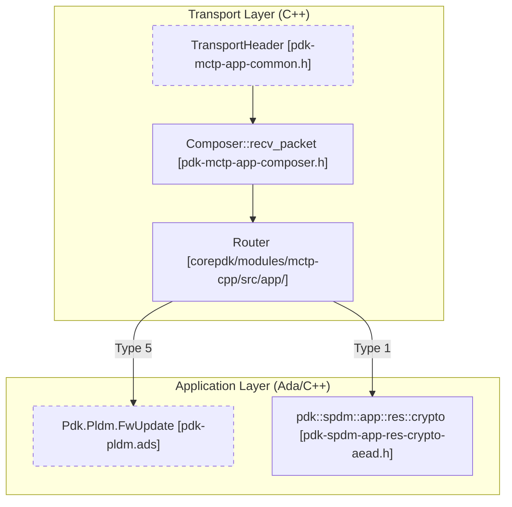
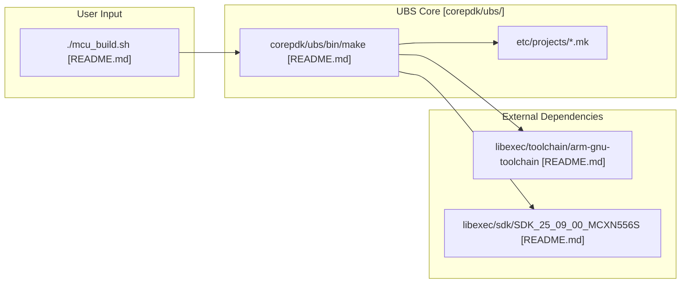

<!-- source: DeepWiki mcp.deepwiki.com · repo NVIDIA/OpenSMA · page 8 Glossary · fetched 2026-10-26 -->

# Glossary

Relevant source files

The following files were used as context for generating this wiki page:

- [CONTRIBUTING.md](CONTRIBUTING.md)
- [README.md](README.md)
- [corepdk/modules/mctp-cpp/src/app/pdk-mctp-app-common.h](corepdk/modules/mctp-cpp/src/app/pdk-mctp-app-common.h)
- [corepdk/modules/mctp-cpp/src/app/pdk-mctp-app-composer.h](corepdk/modules/mctp-cpp/src/app/pdk-mctp-app-composer.h)
- [corepdk/modules/pldm-fd/src/pdk-pldm.ads](corepdk/modules/pldm-fd/src/pdk-pldm.ads)
- [corepdk/modules/spdm/src/app/crypto/aead/pdk-spdm-app-res-crypto-aead.h](corepdk/modules/spdm/src/app/crypto/aead/pdk-spdm-app-res-crypto-aead.h)

This page provides definitions for codebase-specific terminology, domain concepts, and architectural jargon used within the OpenSMA project. It serves as a technical reference for onboarding engineers to understand the relationship between high-level specifications and their implementation in the code.

## Core System Terms

| Term | Definition | Key Code Entities |
| :--- | :--- | :--- |
| **UBS** | **Unified Build System**: A Makefile-based infrastructure that manages multi-language (C, C++, Ada) compilation and platform-specific configurations. | `corepdk/ubs/` |
| **PDK** | **Platform Development Kit**: Core modules and libraries provided as a foundational layer for specific hardware platforms. | `corepdk/modules/` |
| **DCO** | **Developer Certificate of Origin**: A requirement for commit sign-offs to certify that the contributor has the right to submit the code. | [CONTRIBUTING.md:21-29]() |
| **SPDX** | **Software Package Data Exchange**: Standard headers used at the top of files to declare licensing and copyright. | [CONTRIBUTING.md:31-53]() |

**Sources:** [CONTRIBUTING.md:21-53](), [README.md:24-27]()

## Protocol and Transport Layer

### MCTP (Management Component Transport Protocol)
A DMTF standard used for communication between management controllers and managed components. OpenSMA implements this in C++ with support for packet fragmentation and reassembly.

*   **EID (Endpoint ID)**: A unique identifier for a device in an MCTP network. Defined in `TransportHeader`. [corepdk/modules/mctp-cpp/src/app/pdk-mctp-app-common.h:29-30]()
*   **SOM/EOM**: Start of Message and End of Message bits used in multi-packet MCTP transfers. [corepdk/modules/mctp-cpp/src/app/pdk-mctp-app-common.h:34-35]()
*   **Composer**: The class responsible for assembling received packets into full messages or fragmenting outgoing messages. [corepdk/modules/mctp-cpp/src/app/pdk-mctp-app-composer.h:23-62]()

### PLDM (Platform Level Data Model)
A protocol built on top of MCTP for discovery, monitoring, and firmware updates. OpenSMA uses Ada for the PLDM Firmware Update (FD) implementation.

*   **PLDM Type**: Identifies the specific PLDM subsystem (e.g., Type 5 for Firmware Update). [corepdk/modules/pldm-fd/src/pdk-pldm.ads:20-21]()
*   **Completion Code (CC)**: Status codes returned in PLDM responses. [corepdk/modules/pldm-fd/src/pdk-pldm.ads:24-30]()

### SPDM (Security Protocol and Data Model)
Provides authentication, measurement, and key exchange capabilities over MCTP.

*   **AEAD**: Authenticated Encryption with Associated Data. Used for secure sessions. [corepdk/modules/spdm/src/app/crypto/aead/pdk-spdm-app-res-crypto-aead.h:6-16]()
*   **Slot**: A container for a certificate chain used during SPDM authentication.

### Protocol Data Flow Diagram
The following diagram bridges the natural language protocol names to the C++/Ada classes that handle them.

**MCTP to PLDM/SPDM Data Flow**

**Sources:** [corepdk/modules/mctp-cpp/src/app/pdk-mctp-app-common.h:23-36](), [corepdk/modules/mctp-cpp/src/app/pdk-mctp-app-composer.h:23-48](), [corepdk/modules/pldm-fd/src/pdk-pldm.ads:18-32](), [corepdk/modules/spdm/src/app/crypto/aead/pdk-spdm-app-res-crypto-aead.h:41-52]()

## Security and Cryptography

OpenSMA relies on a suite of cryptographic primitives, often abstracted to allow platform-specific hardware acceleration (like NXP ELS).

| Term | Definition | Implementation Pointer |
| :--- | :--- | :--- |
| **AES-GCM** | Advanced Encryption Standard in Galois/Counter Mode for AEAD. | [corepdk/modules/spdm/src/app/crypto/aead/pdk-spdm-app-res-crypto-aead.h:41-52]() |
| **ChaCha20Poly1305** | An alternative AEAD algorithm used in SPDM. | [corepdk/modules/spdm/src/app/crypto/aead/pdk-spdm-app-res-crypto-aead.h:117-128]() |
| **IV** | Initialization Vector: A non-secret starting value for cryptographic operations. | [corepdk/modules/spdm/src/app/crypto/aead/pdk-spdm-app-res-crypto-aead.h:28-28]() |
| **Tag** | Authentication Tag: Used in AEAD to ensure data integrity and authenticity. | [corepdk/modules/spdm/src/app/crypto/aead/pdk-spdm-app-res-crypto-aead.h:33-34]() |

**Sources:** [corepdk/modules/spdm/src/app/crypto/aead/pdk-spdm-app-res-crypto-aead.h:41-128]()

## Build and Environment

The OpenSMA environment requires specific toolchains and SDKs to be placed in standardized locations.

*   **libexec/toolchain/**: The directory where the ARM GNU toolchain and GNAT (Ada) toolchain must be extracted. [README.md:31-37]()
*   **libexec/sdk/**: The directory for the NXP MCUXpresso SDK. [README.md:41-45]()
*   **mcu_build.sh**: The primary entry point for building firmware projects. [README.md:59-60]()

### Build System Component Mapping
This diagram maps build concepts to the filesystem and script entities.

**UBS Build Infrastructure**

**Sources:** [README.md:24-72]()