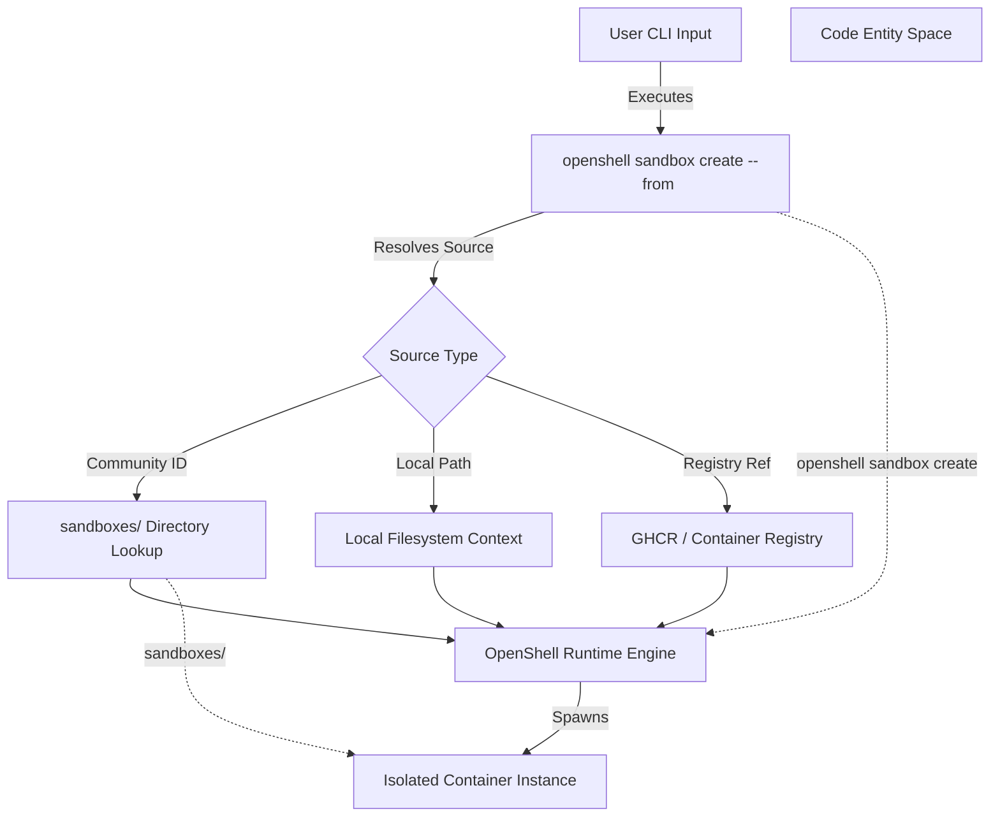
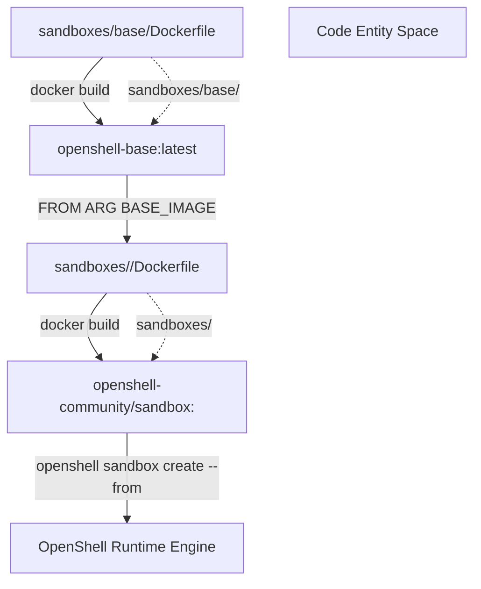

<!-- source: DeepWiki mcp.deepwiki.com · repo NVIDIA/OpenShell-Community · page 1.1 Getting Started · fetched 2026-10-26 -->

# Getting Started

<details>
<summary>Relevant source files</summary>

The following files were used as context for generating this wiki page:

- [README.md](README.md)
- [sandboxes/base/README.md](sandboxes/base/README.md)

</details>


## Purpose and Scope

This page provides technical guidance for setting up the OpenShell environment, installing the OpenShell CLI, provisioning isolated execution environments via `openshell sandbox create --from <sandbox>`, and building custom or base sandbox container images locally with Docker. 

---

## Prerequisites

Before interacting with OpenShell community sandboxes, ensure your local host environment meets the following requirements:

* **OpenShell CLI**: Installed via Python package management (`uv pip install openshell`) [README.md:36]().
* **Container Runtime**: Docker or a compatible OCI container runtime [README.md:37]().
* **Hardware Accelerators**: NVIDIA GPU with appropriate drivers installed on the host (required exclusively for hardware-accelerated images like `nvidia-gpu`) [README.md:38]().

```bash
# Install the OpenShell CLI
uv pip install openshell
```

Sources: [README.md:34-39]()

---

## Using the OpenShell CLI

The primary interface for provisioning environments is the OpenShell CLI. The `openshell sandbox create` command initializes isolated runtime instances based on target specifications [README.md:43]().

### The `--from` Flag

The `--from` flag specifies the image source. It accepts:
1. A community sandbox identifier corresponding to directories under `sandboxes/` (e.g., `ollama`, `sdg`, `droid`, `gemini`, `pi`, `nvidia-gpu`) [README.md:18-30]().
2. A direct local filesystem path to a Docker context or custom Dockerfile.
3. A remote container image reference (e.g., `ghcr.io/nvidia/openshell-community/sandboxes/base:latest`) [sandboxes/base/README.md:52]().

```bash
# Create and enter an Ollama sandbox instance
openshell sandbox create --from ollama

# Verify local LLM service availability inside the sandbox
curl http://127.0.0.1:11434/api/tags
```

### CLI Provisioning Architecture


*Figure 1: Data flow and resolution mechanism for `openshell sandbox create`.*

Sources: [README.md:18-58](), [sandboxes/base/README.md:52]()

---

## Building Images Locally with Docker

All community sandboxes inherit foundational tools, security configurations, and unprivileged user mappings from the base sandbox image located at `sandboxes/base/` [sandboxes/base/README.md:1-3]().

### Building the Base Image

To build the foundational base image locally:

```bash
cd sandboxes/base/
docker build -t openshell-base .
```

This builds an Ubuntu 24.04 environment containing pre-configured runtimes (`python3`, `node`), package managers (`npm`, `uv`, `pip`), coding agents (`claude`, `opencode`, `codex`, `copilot`), and system network diagnostic utilities [sandboxes/base/README.md:9-14]().

### Building Custom Sandboxes on Top

Child sandboxes extend the base image by defining a `Dockerfile` referencing the shared base artifact:

```dockerfile
ARG BASE_IMAGE=ghcr.io/nvidia/openshell-community/sandboxes/base:latest
FROM ${BASE_IMAGE}

# Add your sandbox-specific toolchains or configuration layers here
```

### Local Build Pipeline


*Figure 2: Hierarchical image build pipeline from base layers to instantiated runtimes.*

Sources: [sandboxes/base/README.md:41-58]()

---

