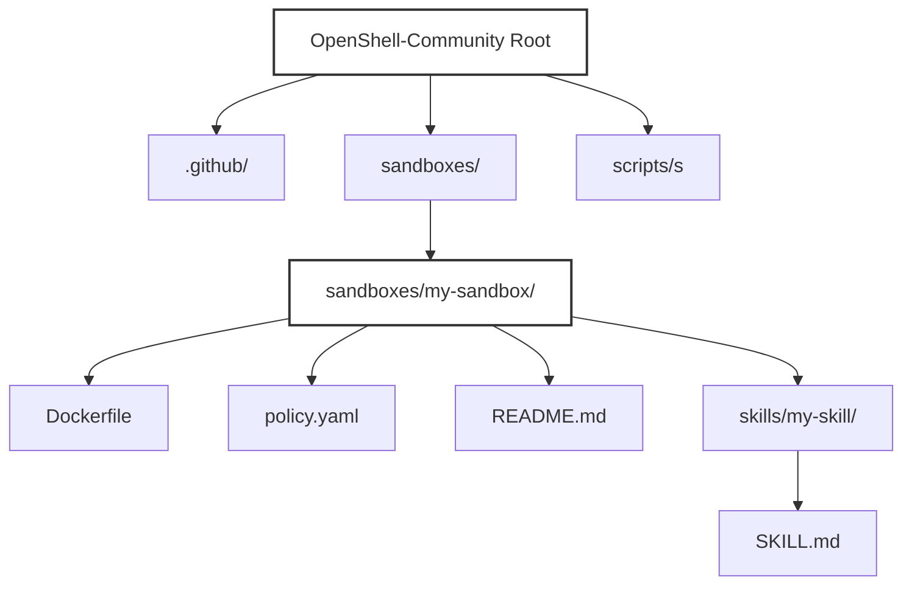

<!-- source: DeepWiki mcp.deepwiki.com · repo NVIDIA/OpenShell-Community · page 1.2 Repository Layout and Conventions · fetched 2026-10-26 -->

# Repository Layout and Conventions

<details>
<summary>Relevant source files</summary>

The following files were used as context for generating this wiki page:

- [CONTRIBUTING.md](CONTRIBUTING.md)
- [sandboxes/sdg/.gitkeep](sandboxes/sdg/.gitkeep)

</details>


## Purpose and Scope
This page details the structural organization of the `OpenShell-Community` repository and the file conventions enforced across sandbox environments, automation scripts, and workflow configurations. A standardized layout ensures consistent image builds, policy enforcement, and skill integration across all community-contributed runtimes.

Sources: [CONTRIBUTING.md:1-11](), [CONTRIBUTING.md:43-65]()

---

## Top-Level Directory Layout

The repository is organized into distinct functional directories that separate sandbox definitions, reusable agent skills, utility scripts, and GitHub Actions automation.

```
OpenShell-Community/
├── .github/          # CI/CD workflows, issue templates, and governance configs
├── sandboxes/        # Domain-specific sandbox environments and base definitions
├── scripts/          # Compliance checking, license validation, and build helpers
└── CONTRIBUTING.md   # Contribution workflow, DCO requirements, and guidelines
```

- **`sandboxes/`**: Houses all isolated execution environments. Each sandbox resides in its own isolated subdirectory [CONTRIBUTING.md:43-52]().
- **`skills/`**: Embedded within individual sandboxes (`sandboxes/<name>/skills/`), containing agent tool definitions and metadata [CONTRIBUTING.md:59-65]().
- **`scripts/`**: Contains tooling for repository compliance, such as header validation and build orchestration.
- **`.github/`**: Houses pipeline definitions, security policies, and pull request workflows.

Sources: [CONTRIBUTING.md:43-65](), [sandboxes/sdg/.gitkeep:1-3]()


*Figure 1: Top-level repository layout bridging natural language concepts to concrete filesystem paths.*

Sources: [CONTRIBUTING.md:43-65](), [sandboxes/sdg/.gitkeep:1-3]()

---

## Per-Sandbox File Conventions

Every sandbox directory under `sandboxes/` must adhere to strict file conventions to integrate properly with the OpenShell build pipeline and policy engine.

| File / Directory | Mandatory | Description |
| :--- | :--- | :--- |
| `Dockerfile` | Yes | Multi-stage or flat build instructions for the sandbox image [CONTRIBUTING.md:54-55](). |
| `policy.yaml` | Yes | Defines Landlock rules, filesystem mounts, process contexts, and network egress policies. |
| `README.md` | Yes | Documentation detailing sandbox purpose, usage, prerequisites, and operational notes [CONTRIBUTING.md:56](). |
| `skills/` | No | Containerized agent skill definitions (`SKILL.md` and auxiliary execution scripts) [CONTRIBUTING.md:59-65](). |

### 1. `Dockerfile` Requirements
Sandboxes must keep images minimal, bundling only what is strictly required for the target workload [CONTRIBUTING.md:57](). Base images should inherit from the core OpenShell runtime or established base layers.

### 2. `policy.yaml` Conventions
The policy configuration file governs sandbox isolation constraints. It defines runtime security boundaries, restricting file access, system calls, and network destinations.

### 3. `README.md` Specifications
Each sandbox must provide clear instructions covering its intended use case, configuration parameters, and local testing procedures [CONTRIBUTING.md:56]().

Sources: [CONTRIBUTING.md:43-65]()

```mermaid
graph TD
    Sub[Configuring "sandboxes/my-sandbox/"] --> D[Dockerfile]
    Sub --> P[policy.yaml]
    Sub --> R[README.md]
    Sub --> S[skills/]

    D -->|"Build Image"| Img["Docker Image Runtime"]
    P -->|"Enforce Security"| Engine["OpenShell Policy Engine"]
    R -->|"Document Usage"| User["Developer Documentation"]
    S -->|"Register Tools"| Agent["AI Agent CLI"]

    style Sub fill:none,stroke:#333,stroke-width:2px
    style Img fill:none,stroke:#333,stroke-width:2px
```
*Figure 2: Data flow mapping per-sandbox artifacts to their respective runtime and documentation subsystems.*

Sources: [CONTRIBUTING.md:43-65]()

---

