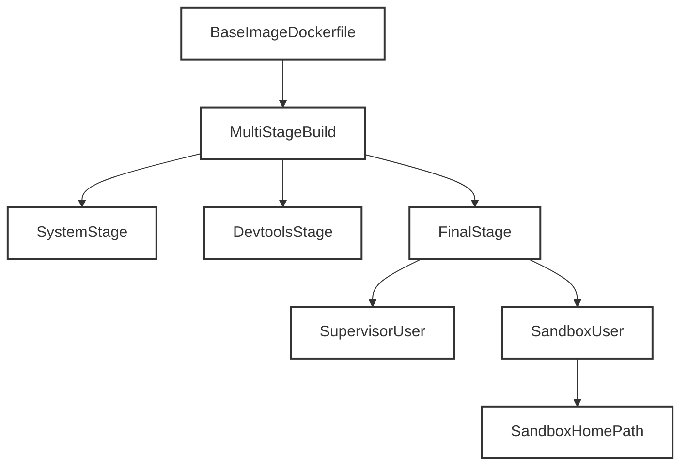
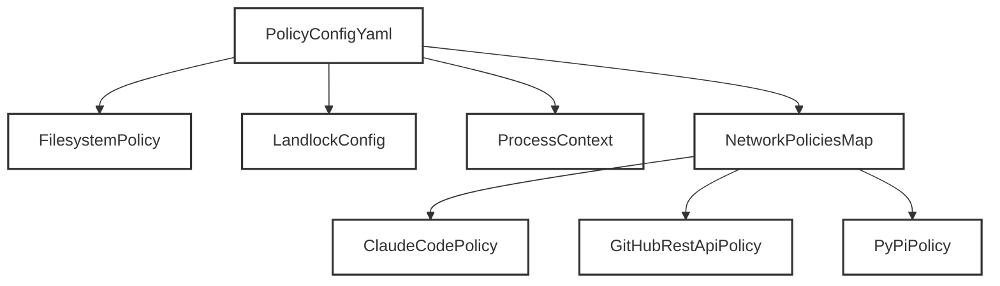
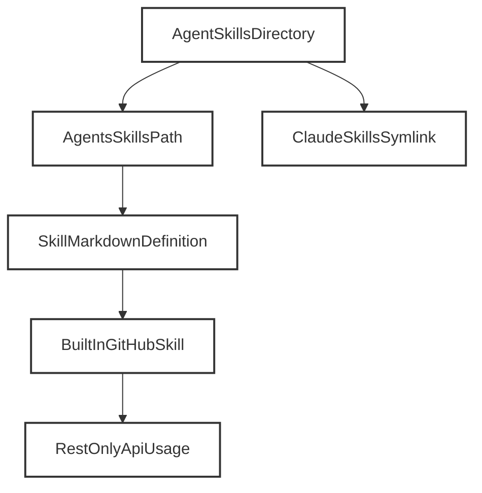

<!-- source: DeepWiki mcp.deepwiki.com · repo NVIDIA/OpenShell-Community · page 2 Sandbox Architecture · fetched 2026-10-26 -->

# Sandbox Architecture

Relevant source files

The following files were used as context for generating this wiki page:

- [sandboxes/base/README.md](sandboxes/base/README.md)
- [sandboxes/base/policy.yaml](sandboxes/base/policy.yaml)
- [sandboxes/base/skills/github/SKILL.md](sandboxes/base/skills/github/SKILL.md)

This page provides a high-level overview of how OpenShell-Community sandbox images are structured, inherited, and secured. OpenShell sandboxes combine containerized runtimes with fine-grained filesystem and network isolation to safely host autonomous coding agents. 

For complete technical deep dives, refer to the child pages:
- [Base Sandbox Image](#2.1)
- [Policy Engine and policy.yaml](#2.2)
- [Agent Skills](#2.3)

---

## 2.1 Base Sandbox Image

The foundational image (`sandboxes/base/Dockerfile`) serves as the base layer for all OpenShell Community sandboxes [sandboxes/base/README.md:3-3](). Built on Ubuntu 24.04, it bundles essential language runtimes (`python3` 3.14.3, `node` 22.22.1), package managers (`npm`, `uv`, `pip`), developer utilities (`gh`, `git`, `vim`, `nc`), and popular coding agents (`claude`, `opencode`, `codex`, `copilot`) [sandboxes/base/README.md:9-14](). 

The image establishes a dual-user model separating privileged process management from unprivileged agent execution [sandboxes/base/README.md:16-21](), alongside a structured home layout under `/sandbox` containing virtual environments and discovery paths [sandboxes/base/README.md:23-31]().

For details, see [Base Sandbox Image](#2.1).

Sources: `sandboxes/base/README.md:3-57`

---

## 2.2 Policy Engine and policy.yaml

Security isolation within OpenShell is governed by declarations in `policy.yaml` [sandboxes/base/policy.yaml:4-195](). The configuration defines static filesystem boundaries (`filesystem_policy` specifying read-only vs read-write paths), kernel-level restrictions (`landlock` compatibility), and process execution contexts (`run_as_user`) [sandboxes/base/policy.yaml:8-29]().

Dynamic network security is enforced per connection via named `network_policies` (such as `claude_code`, `github_rest_api`, `pypi`, and `copilot`) [sandboxes/base/policy.yaml:37-120](). Binary identity is resolved using process inspection (`/proc/net/tcp` inode lookups combined with `/proc/{pid}/exe`), while cryptographic integrity is managed via Rust-based Trust-On-First-Use (TOFU) [sandboxes/base/policy.yaml:33-35]().

For details, see [Policy Engine and policy.yaml](#2.2).

Sources: `sandboxes/base/policy.yaml:4-143`

---

## 2.3 Agent Skills

OpenShell sandboxes support dynamic capability discovery through structured agent skills located in `.agents/skills` and symlinked to `.claude/skills` [sandboxes/base/README.md:29-30](). Each skill defines its operational parameters and trigger keywords inside a standardized `SKILL.md` format [sandboxes/base/skills/github/SKILL.md:2-4]().

The base image includes a built-in `github` skill designed specifically for sandboxed constraints [sandboxes/base/README.md:37-40]()—instructing agents to bypass GraphQL endpoints (which are restricted by network policies) in favor of REST-only `gh api` workflows [sandboxes/base/skills/github/SKILL.md:6-11]().

For details, see [Agent Skills](#2.3).

Sources: `sandboxes/base/README.md:23-40`, `sandboxes/base/skills/github/SKILL.md:1-11`

---

